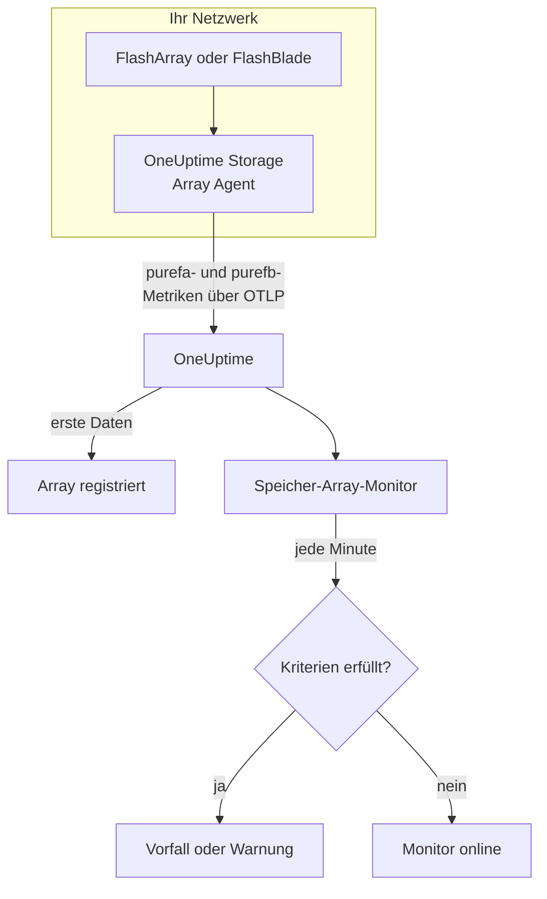

# Speicher-Array-Überwachung

Ein Speicher-Array-Monitor beobachtet ein Speicher-Array und meldet Ihnen, wenn das Array eine eigene Warnung auslöst, ihm der Platz ausgeht, es langsamer wird, Hardware oder einen Hostpfad verliert oder bei der Replikation zurückfällt. Er funktioniert mit Pure Storage FlashArray und Pure Storage FlashBlade und liest die Metriken, die das Array selbst exportiert - Pures Serien `purefa_*` und `purefb_*` -, die der OneUptime Storage Array Agent sammelt.

:::cards
- [Den Monitor erstellen](#einen-speicher-array-monitor-erstellen): Sechs Schritte im Dashboard.
- [Vorlagen](#fertige-warnungsvorlagen): Achtzehn fertige Warnungen, ein Vorfall pro Volume, Host oder Komponente.
- [Wie Pures Serien funktionieren](#wie-pures-serien-aufgebaut-sind): Ein Metrikname, viele Werte.
- [Metriken](#erfasste-metriken): Jede Serie, auf die der Monitor warnen kann.
:::

## So funktioniert es

Der OneUptime Storage Array Agent läuft auf einem Rechner, der die Verwaltungsschnittstelle des Arrays erreicht. Er liest die Metriken des Arrays mit einem nur lesenden API-Token, versieht sie mit dem Namen des Arrays, `storage.array.name`, und seiner Plattform, `storage.system`, und sendet sie über OTLP an OneUptime. Die ersten Daten registrieren das Array.

Ein Speicher-Array-Monitor ist an ein Array gebunden. Jede Minute führt er seine Abfrage über die Metriken dieses Arrays aus und vergleicht das Ergebnis mit seinen Kriterien.



## Bevor Sie beginnen

- **Installieren Sie den Storage Array Agent** dort, wo er das Array über HTTPS erreicht, mit dem API-Token eines Benutzers, der die Rolle **readonly** des Arrays hat. Die [Anleitung zum Storage Array Agent](/docs/telemetry/storage-arrays) behandelt den Benutzer, das Token und die Installation, über `ONEUPTIME_URL`, `ONEUPTIME_TELEMETRY_INGESTION_KEY`, `STORAGE_ARRAY_NAME` sowie Adresse und Token des Arrays (`PURE_FA_ENDPOINT` und `PURE_FA_API_TOKEN` oder `PURE_FB_ENDPOINT` und `PURE_FB_API_TOKEN`).
- **Prüfen Sie, ob das Array registriert ist.** Es erscheint unter **Produkte → Infrastruktur → Storage Arrays → All Storage Arrays**, benannt nach `STORAGE_ARRAY_NAME` des Agenten, etwa eine Minute nach der ersten Abfrage.

## Einen Speicher-Array-Monitor erstellen

:::steps
### Einen neuen Monitor beginnen

Gehen Sie zu **Monitore** und klicken Sie auf **Monitor erstellen**.

### Storage Array wählen

Klicken Sie unter **Monitortyp** auf **Weitere Monitortypen** und wählen Sie **Speicher-Array** unter **Infrastruktur**, oder geben Sie `storage` in das Suchfeld ein. Geben Sie einen **Name** ein - er wird in den Titeln von Vorfällen und Warnungen verwendet - und klicken Sie auf **Weiter**.

### Das Array wählen

Wählen Sie unter **Storage Array Monitor Configuration** das Array aus **Speicher-Array**. Jedes Array, das Daten gesendet hat, steht in der Liste. Seine Plattform entscheidet, welche Metriken und Vorlagen das Formular anbietet.

### Festlegen, was überwacht wird

Wählen Sie einen der drei Tabs:

- **Quick Setup** - klicken Sie auf eine [Vorlage](#fertige-warnungsvorlagen). Sie setzt die Metrik, die Label-Filter, die Aggregation, den Zeitbereich und die Schwellenwerte und ersetzt die Kriterien unten durch ihre eigenen. Den **Zeitbereich** können Sie weiterhin ändern.
- **Custom Metric** - wählen Sie eine Metrik aus **Storage Array Metric** und legen Sie dann **Aggregation** und **Zeitbereich** fest. Die [Filter](#monitor-einstellungen) schränken sie auf ein Volume, einen Host, einen Pod, eine Komponente, ein Dateisystem oder einen Bucket ein.
- **Erweitert** - bauen Sie Abfragen und Formeln selbst unter **Metriken auswählen**, zum Beispiel die belegte Kapazität als `purefa_array_space_bytes` gefiltert auf `space=capacity` minus derselben Metrik gefiltert auf `space=empty`. Verwenden Sie **Gruppieren nach** mit dem Label eines Objekts, um jedes Objekt einzeln zu beurteilen.

### Die Kriterien prüfen

Öffnen Sie jedes Kriterium unter **Monitor-Kriterien** und prüfen Sie **Metrik**, **Aggregation**, **Bedingung** und **Schwellenwert**. Eine Vorlage füllt diese aus. Mit **Custom Metric** oder **Erweitert** beginnt der Monitor mit den [Standardkriterien](#standardkriterien), die nur bemerken, dass eine Metrik auf null fällt, setzen Sie also Ihren eigenen Schwellenwert.

### Den Monitor erstellen

Klicken Sie auf **Monitor erstellen**. OneUptime öffnet die Seite des Monitors und wertet ihn jede Minute aus. Vorfälle und Warnungen, die er auslöst, stehen auch auf den Seiten **Vorfälle** und **Warnungen** des Arrays.
:::

> [!TIP]
> Um mehrere Vorlagen auf einmal einzurichten, öffnen Sie das Array über **Produkte → Infrastruktur → Storage Arrays** und gehen Sie zu **Empfehlungen**. Wählen Sie die gewünschten Vorlagen, legen Sie fest, wer benachrichtigt wird, und OneUptime erstellt einen Monitor pro Vorlage.

## Monitor-Einstellungen

| Feld | Tab | Was es tut |
| --- | --- | --- |
| **Speicher-Array** | Alle | Erforderlich. Beschränkt jede Abfrage auf `resource.storage.array.name`, sodass zwei Arrays, die beide ein Volume namens `vol-01` haben, nie vermischt werden. |
| **Volume** | Custom Metric, Erweitert | Nur FlashArray. Ein Volume, über das Label `name`, etwa `vol-db-01`. Ein Volume in einem Pod oder einer Volume-Gruppe heißt `pod::volume` oder `group/volume`. |
| **Host** | Custom Metric, Erweitert | Nur FlashArray. Ein Host, wie das Array ihn kennt, über das Label `host`, etwa `esxi-01`. |
| **Pod** | Custom Metric, Erweitert | Nur FlashArray. Ein ActiveCluster- oder ActiveDR-Pod, über das Label `name` oder `local_pod` bei Serien von Replikationsverbindungen. |
| **Hardware Component** | Custom Metric, Erweitert | Eine Hardwarekomponente, etwa `CH0.BAY1` oder `CT0`: das Label `component_name` bei einem FlashArray, `name` bei einem FlashBlade. |
| **File System** | Custom Metric, Erweitert | Nur FlashBlade. Ein Dateisystem, über das Label `name`. |
| **Bucket** | Custom Metric, Erweitert | Nur FlashBlade. Ein Objektspeicher-Bucket, über das Label `name`. |
| **Storage Array Metric** | Custom Metric | Eine Metrik aus dem [Katalog](#erfasste-metriken). Das Formular fügt den Label-Filter hinzu, der ihr ihre Bedeutung gibt, und gruppiert sie nach dem Objekt, das sie beschreibt, sodass jedes Volume, jeder Host oder jede Komponente einzeln beurteilt wird. |
| **Aggregation** | Custom Metric | Wie Stichproben zusammengefasst werden: **Durchschnitt**, **Maximum**, **Minimum**, **Summe** oder **Anzahl**. Beginnt bei der üblichen Aggregation der Metrik. |
| **Zeitbereich** | Alle | Das gleitende Zeitfenster, das die Abfrage liest, von **Past 1 Minute** bis **Past 365 Days**. Ein neuer Monitor beginnt bei **Letzte 5 Minuten**, eine eigene Metrik eines Dateisystems oder Buckets bei **Letzte 15 Minuten**; Vorlagen setzen ihr eigenes. |
| **Metriken auswählen** | Erweitert | Der Abfrage-Builder: **Metrik**, **Aggregieren nach**, **Nach Attributen filtern**, **Gruppieren nach**, dazu **Metrik hinzufügen** und **Formel hinzufügen**, um Abfragen zu kombinieren. |

Der Agent liest den Array-Endpunkt alle 60 Sekunden und Volumes, Hosts und Pods alle 2 Minuten, sodass ein Fenster von 5 Minuten immer eine Stichprobe enthält. Die Dateisysteme und Buckets eines FlashBlade liest er alle 5 Minuten, daher 15, und FlashArray-Verzeichnisse alle 30 Minuten: Geben Sie einem Verzeichnis-Monitor ein Fenster von 60 Minuten.

## Wie Pures Serien aufgebaut sind

Pure legt mehrere Werte auf **einen** Metriknamen und unterscheidet sie mit einem Label:

- **`dimension`** bei den Leistungsserien. `purefa_array_performance_latency_usec` trägt die Leselatenz (`usec_per_read_op`), die Schreiblatenz (`usec_per_write_op`), die Latenz gespiegelter Schreibvorgänge sowie SAN-, Warteschlangen-, QoS- und Servicezeit jeder davon. Filtern Sie immer auf eine `dimension`: Ein Durchschnitt über alle mischt eine Leselatenz von 200 µs mit einem Warteschlangenwert.
- **`space`** bei den Kapazitätsserien: `capacity`, `empty`, `snapshots`, `total_provisioned`, `total_physical`, `available_ratio` und weitere.

Mehrere Serien tragen ihren Zustand in einem **Label**, mit einem Wert, der immer 1 ist:

| Serie | Zustandslabel | Eine Serie pro |
| --- | --- | --- |
| `purefa_alerts_open` | `severity`, mit `summary`, `code` und `component_type` | Offene Warnung |
| `purefa_hw_component_status` | `component_status` | Hardwarekomponente |
| `purefa_host_connectivity_info` | `status`, mit `details` | Host |
| `purefa_drive_capacity_bytes` | `component_status` (der Wert ist die Kapazität des Laufwerks) | Laufwerk |

Eine auf einen schlechten Zustand gefilterte Serie existiert nur, solange sich etwas in diesem Zustand befindet, also bedeutet keine Serie gesund. Deshalb ist **Max über 0 löst aus und 0 erholt sich** die richtige Form für sie, und so sind die Vorlagen gebaut: Ihre Erholungskriterien zählen eine fehlende Serie als null.

In Monitorfiltern und Gruppierungsschlüsseln beginnen die Attribute des Agenten mit `resource.` (`resource.storage.array.name`, `resource.storage.system`), Pures eigene Labels dagegen nicht (`name`, `host`, `component_name`, `dimension`, `space`, `severity`).

## Fertige Warnungsvorlagen

OneUptime liefert 18 Vorlagen — 11 für FlashArray und 7 für FlashBlade —, und **Quick Setup** bietet die für die Plattform des Arrays an. Jede baut einen vollständigen Monitor: die Metrikabfrage, ihre Label-Filter, eine Gruppierung nach dem eigenen Label des Objekts, ein Kriterium, das auslöst, und eines, das sich erholt. Schwellenwerte sind Ausgangspunkte, die Sie bearbeiten können.

Ein Kriterium löst nur aus, wenn die Bedingung für **jeden** Wert in seinem Fenster gilt. Ein Monitor, der bei einem Schwellenwert für Kapazität, Latenz, Verzögerung oder Verhältnis ausgelöst hat, erholt sich erst 10 % jenseits davon, sodass ein Wert, der um den Schwellenwert pendelt, nicht flattert; die Vorlagen für Warnungen und Hardware erholen sich, sobald der Zustand verschwindet.

### FlashArray

| Template                       | Kategorie    | Schweregrad | Beobachtet                                                                                      | Löst aus, wenn                                                                                                                                   |
| ------------------------------ | ------------ | -------- | ----------------------------------------------------------------------------------------------- | ------------------------------------------------------------------------------------------------------------------------------------------------ |
| Critical Array Alert           | Array Health | Kritisch | `purefa_alerts_open` gefiltert auf `severity=critical`, Max pro `summary`, letzte 5 Minuten     | > 0 — das Array hat eine offene kritische Warnung (eine ausgefallene Komponente, ein Kapazitätsnotfall, ein Replikationsfehler). Ein Vorfall pro Warnung; erholt sich, wenn die Warnung geschlossen wird |
| Warning Array Alert            | Array Health | Warnung  | `purefa_alerts_open` gefiltert auf `severity=warning`, Max pro `summary`, letzte 5 Minuten      | > 0 — das Array hat eine offene Warnung der Stufe warning. Ein Vorfall pro Warnung; erholt sich, wenn die Warnung geschlossen wird               |
| Capacity Above 80%             | Kapazität    | Warnung  | `purefa_array_space_utilization`, Max, letzte 15 Minuten                                        | > 80 — Pures eigene erste Kapazitätsschwelle; erholt sich bei ≤ 72                                                                               |
| Capacity Above 90%             | Kapazität    | Kritisch | `purefa_array_space_utilization`, Max, letzte 5 Minuten                                         | > 90 — das Array steht kurz davor, Schreibvorgänge abzulehnen; erholt sich bei ≤ 81                                                              |
| High Read Latency              | Performance  | Warnung  | `purefa_array_performance_latency_usec` gefiltert auf `dimension=usec_per_read_op`, Avg, letzte 10 Minuten  | > 5000 µs (5 ms) — Lesevorgänge eines FlashArray dauern normalerweise deutlich unter 1 ms; erholt sich bei ≤ 4500                       |
| High Write Latency             | Performance  | Warnung  | `purefa_array_performance_latency_usec` gefiltert auf `dimension=usec_per_write_op`, Avg, letzte 10 Minuten | > 5000 µs (5 ms); erholt sich bei ≤ 4500                                                                                                 |
| Hardware Component Failed      | Hardware     | Kritisch | `purefa_hw_component_status` gefiltert auf `component_status=critical`, Max pro `component_name`, letzte 5 Minuten | > 0 — ein Controller, Netzteil, Lüfter, Schacht oder Port ist kritisch und die Redundanz ist weg. Ein Vorfall pro Komponente; erholt sich, wenn sie ok meldet |
| Hardware Component Degraded    | Hardware     | Warnung  | `purefa_hw_component_status` gefiltert auf `component_status=degraded`, Max pro `component_name`, letzte 5 Minuten | > 0 — eine Komponente ist beeinträchtigt. Ein Vorfall pro Komponente; erholt sich, wenn sie ok meldet                                   |
| Drive Failed                   | Hardware     | Kritisch | `purefa_drive_capacity_bytes` gefiltert auf `component_status=failed`, Max pro `component_name`, letzte 5 Minuten | > 0 — ein DirectFlash-Modul oder eine SSD ist ausgefallen, und das Array baut die Daten auf den anderen neu auf. Ein Vorfall pro Laufwerk; erholt sich, wenn es ersetzt ist |
| Host Lost Redundant Paths      | Hosts        | Warnung  | `purefa_host_connectivity_info` gefiltert auf `status=critical`, Max pro `host`, letzte 5 Minuten | > 0 — der Host erreicht das Array über einen Controller oder keinen; ein Controller-Failover würde seinen Speicher offline nehmen. Ein Vorfall pro Host; erholt sich, wenn seine Pfade zurück sind |
| Replication Lag Above 1 Minute | Replikation  | Warnung  | `purefa_pod_replica_links_lag_max_msec`, Max pro `local_pod`, letzte 10 Minuten                 | > 60000 ms (60 s) — ein Failover jetzt würde mehr jüngste Schreibvorgänge verlieren als geplant. Ein Vorfall pro Pod; erholt sich bei ≤ 54000   |

### FlashBlade

| Template                     | Kategorie    | Schweregrad | Beobachtet                                                                                                     | Löst aus, wenn                                                                                                      |
| ---------------------------- | ------------ | -------- | -------------------------------------------------------------------------------------------------------------- | ------------------------------------------------------------------------------------------------------------------- |
| Critical Array Alert         | Array Health | Kritisch | `purefb_alerts_open` gefiltert auf `severity=critical`, Max pro `summary`, letzte 5 Minuten                    | > 0 — der FlashBlade hat eine offene kritische Warnung. Ein Vorfall pro Warnung; erholt sich, wenn die Warnung geschlossen wird |
| Warning Array Alert          | Array Health | Warnung  | `purefb_alerts_open` gefiltert auf `severity=warning`, Max pro `summary`, letzte 5 Minuten                     | > 0 — der FlashBlade hat eine offene Warnung der Stufe warning. Ein Vorfall pro Warnung; erholt sich, wenn die Warnung geschlossen wird |
| Capacity Above 80%           | Kapazität    | Warnung  | `purefb_array_space_utilization` gefiltert auf `type=array`, Max, letzte 15 Minuten                            | > 80; erholt sich bei ≤ 72                                                                                          |
| Capacity Above 90%           | Kapazität    | Kritisch | `purefb_array_space_utilization` gefiltert auf `type=array`, Max, letzte 5 Minuten                             | > 90 — Schreibvorgänge schlagen für jeden Client fehl, wenn er voll ist; erholt sich bei ≤ 81                       |
| Hardware Component Unhealthy | Hardware     | Kritisch | `purefb_hardware_health`, Min pro `name`, letzte 5 Minuten                                                     | < 1 — ein Blade, Fabric-Modul, Netzteil oder Lüfter ist nicht gesund (ein unbenutzter Steckplatz meldet 2). Ein Vorfall pro Komponente; erholt sich bei ≥ 1 |
| High Read Latency            | Performance  | Warnung  | `purefb_array_performance_latency_usec` gefiltert auf `dimension=usec_per_read_op` und `protocol=all`, Avg, letzte 10 Minuten | > 10000 µs (10 ms) über alle Protokolle; erholt sich bei ≤ 9000                                        |
| File System Near Full        | File Systems | Warnung  | `purefb_file_systems_space_bytes` gefiltert auf `space=available_ratio`, Min pro `name`, letzte 15 Minuten     | < 0.1 — weniger als 10 % der bereitgestellten Größe eines Dateisystems sind übrig. Ein Vorfall pro Dateisystem; erholt sich bei ≥ 0.11 |

**Schweregrad** ist die Bezeichnung, die die Auswahl zeigt. Der Vorfall und die Warnung, die eine Vorlage erstellt, beginnen beim schwersten Vorfall- und Warnungsschweregrad Ihres Projekts; ändern Sie sie im Kriterium.

- **Offene Warnungen und Hardwarezustände verwenden Max** einer Serie, die nur existiert, solange die Warnung offen ist oder sich die Komponente in diesem Zustand befindet, sodass eine Abfrage, die sie zeigt, den Schwellenwert auslöst.
- **Jede Vorlage pro Objekt gruppiert nach dem eigenen Label des Objekts** (`summary`, `component_name`, `host`, `local_pod`, `name`), sodass pro betroffenem Objekt ein Vorfall ausgelöst wird, der das Objekt nennt.
- **Latenzvorlagen verwenden Avg** des eigenen Durchschnitts pro Operation des Arrays, und Kapazitätsvorlagen **Max** seines eigenen Auslastungsprozentsatzes. Latenzen sind in Mikrosekunden festgelegt, Kapazität in Prozent.
- **Hardware Component Unhealthy verwendet Min** pro Komponente: Ihr Zustand ist 1, wenn sie gesund ist, und fällt auf 0, wenn nicht.

Für die Latenz einzelner Volumes gibt es keine Vorlage, weil der richtige Schwellenwert von der Arbeitslast abhängt: Bauen Sie sie aus dem Katalog mit einer Gruppierung nach `name`. Eine Kapazitätsprognose braucht einen Wachstumstrend statt eines Schwellenwerts, und für den Verschleiß von Laufwerken gibt es keine Serie, auf die man warnen könnte.

## Erfasste Metriken

Der Agent sendet alles, was das Array exportiert; die Serien unten sind der Katalog, den das Monitorformular anbietet. Jeder Wert ist ein Gauge, den das Array selbst berechnet - Latenzen sind Mikrosekunden pro Operation und Durchsatz ist pro Sekunde -, sodass keine Ratenberechnung nötig ist. **Filter** ist der Label-Filter, der der Serie die Bedeutung gibt, die ihre Zeile nennt; das Formular wendet ihn für Sie an.

### Array Health

| Metrik               | Filter | Plattform  | Einheit | Beschreibung                                                                                                                                                      |
| -------------------- | ------ | ---------- | ------- | ----------------------------------------------------------------------------------------------------------------------------------------------------------------- |
| `purefa_alerts_open` | —      | FlashArray | `count` | Eine Serie pro offener Warnung des Arrays (Wert 1), mit den Labels `severity` (`critical`, `warning`, `info`, `hidden`), `category`, `code`, `component_type` und `summary` |
| `purefb_alerts_open` | —      | FlashBlade | `count` | Eine Serie pro offener Warnung des FlashBlade (Wert 1), mit den Labels `severity` (`info`, `warning`, `critical`), `code`, `component_name`, `component_type`, `summary` und `kburl` (Pures Wissensdatenbankartikel) |

### Capacity

| Metrik                                    | Filter                       | Plattform  | Einheit | Beschreibung                                                                                                                          |
| ----------------------------------------- | ---------------------------- | ---------- | ------- | ------------------------------------------------------------------------------------------------------------------------------------- |
| `purefa_array_space_utilization`          | —                            | FlashArray | `%`     | Anteil der nutzbaren Kapazität des Arrays, der belegt ist. Pure löst eigene Kapazitätswarnungen bei 80 %, 90 % und 100 % aus          |
| `purefa_array_space_bytes`                | `space=capacity`             | FlashArray | `bytes` | Nutzbare Kapazität des Arrays                                                                                                         |
| `purefa_array_space_bytes`                | `space=empty`                | FlashArray | `bytes` | Ungenutzte Kapazität — verfolgen Sie den Trend, um vorherzusagen, wann das Array voll ist                                            |
| `purefa_array_space_bytes`                | `space=snapshots`            | FlashArray | `bytes` | Physischer Platz, den nur Snapshots belegen; ein schneller Anstieg bedeutet meist, dass eine Schutzgruppe mehr Snapshots behält als geplant |
| `purefa_array_space_data_reduction_ratio` | —                            | FlashArray | `ratio` | Deduplizierung und Komprimierung über das ganze Array, z. B. 4.2 für 4.2:1. Ein anhaltender Rückgang bedeutet, dass neue Daten sich schlecht reduzieren lassen |
| `purefb_array_space_utilization`          | `type=array`                 | FlashBlade | `%`     | Anteil der nutzbaren Kapazität des FlashBlade, der belegt ist                                                                         |
| `purefb_array_space_bytes`                | `type=array`, `space=empty`  | FlashBlade | `bytes` | Ungenutzte Kapazität des FlashBlade                                                                                                   |
| `purefb_array_space_data_reduction_ratio` | `type=array`                 | FlashBlade | `ratio` | Datenreduktion über den ganzen FlashBlade                                                                                             |

### Performance

| Metrik                                     | Filter                                         | Plattform  | Einheit   | Beschreibung                                                                                                 |
| ------------------------------------------ | ---------------------------------------------- | ---------- | --------- | ------------------------------------------------------------------------------------------------------------ |
| `purefa_array_performance_latency_usec`    | `dimension=usec_per_read_op`                   | FlashArray | `µs`      | Durchschnittliche Latenz eines Lesevorgangs aus Sicht der Hosts; Lesevorgänge eines FlashArray dauern typischerweise deutlich unter 1 ms |
| `purefa_array_performance_latency_usec`    | `dimension=usec_per_write_op`                  | FlashArray | `µs`      | Durchschnittliche Latenz eines Schreibvorgangs aus Sicht der Hosts                                           |
| `purefa_array_performance_latency_usec`    | `dimension=usec_per_mirrored_write_op`         | FlashArray | `µs`      | Durchschnittliche Latenz eines Schreibvorgangs in einen gestreckten ActiveCluster-Pod, einschließlich des Umlaufs zum Partner-Array |
| `purefa_array_performance_latency_usec`    | `dimension=san_usec_per_read_op`               | FlashArray | `µs`      | Zeit, die ein Lesevorgang im SAN verbringt; hohe SAN-Latenz bei niedriger Servicelatenz weist auf das Fabric oder den Host hin |
| `purefa_array_performance_throughput_iops` | `dimension=reads_per_sec`                      | FlashArray | `ops/s`   | Leseoperationen pro Sekunde                                                                                  |
| `purefa_array_performance_throughput_iops` | `dimension=writes_per_sec`                     | FlashArray | `ops/s`   | Schreiboperationen pro Sekunde                                                                               |
| `purefa_array_performance_bandwidth_bytes` | `dimension=read_bytes_per_sec`                 | FlashArray | `bytes/s` | Gelesene Bytes pro Sekunde                                                                                   |
| `purefa_array_performance_bandwidth_bytes` | `dimension=write_bytes_per_sec`                | FlashArray | `bytes/s` | Geschriebene Bytes pro Sekunde                                                                               |
| `purefa_array_performance_queue_depth_ops` | —                                              | FlashArray | `ops`     | Auf dem Array wartende Operationen; eine wachsende Warteschlange bei steigender Latenz bedeutet, dass die Hosts mehr senden, als es bedienen kann |
| `purefa_array_performance_average_bytes`   | `dimension=bytes_per_op`                       | FlashArray | `bytes`   | Durchschnittliche Größe einer Operation — große E/A erhöht die Latenz, ohne dass etwas falsch ist           |
| `purefb_array_performance_latency_usec`    | `dimension=usec_per_read_op`, `protocol=all`   | FlashBlade | `µs`      | Durchschnittliche Leselatenz über alle Protokolle                                                            |
| `purefb_array_performance_latency_usec`    | `dimension=usec_per_write_op`, `protocol=all`  | FlashBlade | `µs`      | Durchschnittliche Schreiblatenz über alle Protokolle                                                         |
| `purefb_array_performance_throughput_iops` | `dimension=reads_per_sec`, `protocol=all`      | FlashBlade | `ops/s`   | Leseoperationen pro Sekunde über alle Protokolle                                                             |
| `purefb_array_performance_throughput_iops` | `dimension=writes_per_sec`, `protocol=all`     | FlashBlade | `ops/s`   | Schreiboperationen pro Sekunde über alle Protokolle                                                          |
| `purefb_array_performance_bandwidth_bytes` | `dimension=read_bytes_per_sec`, `protocol=all` | FlashBlade | `bytes/s` | Gelesene Bytes pro Sekunde über alle Protokolle                                                              |
| `purefb_array_performance_bandwidth_bytes` | `dimension=write_bytes_per_sec`, `protocol=all` | FlashBlade | `bytes/s` | Geschriebene Bytes pro Sekunde über alle Protokolle                                                         |

### Volumes

| Metrik                                      | Filter                           | Plattform  | Einheit   | Beschreibung                                                  |
| ------------------------------------------- | -------------------------------- | ---------- | --------- | ------------------------------------------------------------- |
| `purefa_volume_performance_latency_usec`    | `dimension=usec_per_read_op`     | FlashArray | `µs`      | Durchschnittliche Leselatenz jedes Volumes — gruppieren Sie nach `name` |
| `purefa_volume_performance_latency_usec`    | `dimension=usec_per_write_op`    | FlashArray | `µs`      | Durchschnittliche Schreiblatenz jedes Volumes                 |
| `purefa_volume_performance_throughput_iops` | `dimension=reads_per_sec`        | FlashArray | `ops/s`   | Leseoperationen pro Sekunde jedes Volumes                     |
| `purefa_volume_performance_throughput_iops` | `dimension=writes_per_sec`       | FlashArray | `ops/s`   | Schreiboperationen pro Sekunde jedes Volumes                  |
| `purefa_volume_performance_bandwidth_bytes` | `dimension=read_bytes_per_sec`   | FlashArray | `bytes/s` | Pro Sekunde aus jedem Volume gelesene Bytes                   |
| `purefa_volume_performance_bandwidth_bytes` | `dimension=write_bytes_per_sec`  | FlashArray | `bytes/s` | Pro Sekunde in jedes Volume geschriebene Bytes                |
| `purefa_volume_space_bytes`                 | `space=total_provisioned`        | FlashArray | `bytes`   | Größe jedes Volumes aus Sicht der Hosts                       |
| `purefa_volume_space_bytes`                 | `space=total_physical`           | FlashArray | `bytes`   | Physischer Platz, den jedes Volume nach der Datenreduktion belegt |
| `purefa_volume_space_data_reduction_ratio`  | —                                | FlashArray | `ratio`   | Datenreduktionsverhältnis jedes Volumes                       |

### Hosts

| Metrik                                    | Filter                        | Plattform  | Einheit | Beschreibung                                                                                                                                   |
| ----------------------------------------- | ----------------------------- | ---------- | ------- | ---------------------------------------------------------------------------------------------------------------------------------------------- |
| `purefa_host_connectivity_info`           | —                             | FlashArray | `count` | Eine Serie pro Host (Wert 1) mit dem Label seiner Konnektivität `status` (`healthy`, `critical`, `unused`) und `details` (`Redundant`, `Single Controller`, `None`, ...) |
| `purefa_host_performance_latency_usec`    | `dimension=usec_per_read_op`  | FlashArray | `µs`    | Durchschnittliche Leselatenz, die jeder Host sieht — gruppieren Sie nach `host`                                                                |
| `purefa_host_performance_latency_usec`    | `dimension=usec_per_write_op` | FlashArray | `µs`    | Durchschnittliche Schreiblatenz, die jeder Host sieht                                                                                          |
| `purefa_host_performance_throughput_iops` | `dimension=reads_per_sec`     | FlashArray | `ops/s` | Leseoperationen pro Sekunde jedes Hosts                                                                                                        |
| `purefa_host_performance_throughput_iops` | `dimension=writes_per_sec`    | FlashArray | `ops/s` | Schreiboperationen pro Sekunde jedes Hosts                                                                                                     |

### Replication

| Metrik                                               | Filter                                 | Plattform  | Einheit   | Beschreibung                                                                                                                                                 |
| ---------------------------------------------------- | -------------------------------------- | ---------- | --------- | ------------------------------------------------------------------------------------------------------------------------------------------------------------ |
| `purefa_pod_replica_links_lag_max_msec`              | —                                      | FlashArray | `ms`      | Größte Replikationsverzögerung jeder Pod-Replikationsverbindung (ActiveDR / asynchron), mit den Labels `local_pod`, `remote_pod`, `remote`, `direction` und `status` — gruppieren Sie nach `local_pod` |
| `purefa_pod_replica_links_lag_average_msec`          | —                                      | FlashArray | `ms`      | Durchschnittliche Replikationsverzögerung jeder Pod-Replikationsverbindung                                                                                   |
| `purefa_pod_performance_replication_bandwidth_bytes` | —                                      | FlashArray | `bytes/s` | Replikationsverkehr jedes Pods, mit den Labels `direction` und `dimension`                                                                                   |
| `purefa_pod_performance_latency_usec`                | `dimension=usec_per_mirrored_write_op` | FlashArray | `µs`      | Durchschnittliche Latenz gespiegelter Schreibvorgänge jedes ActiveCluster-Pods                                                                               |

### Hardware

| Metrik                                        | Filter                           | Plattform  | Einheit    | Beschreibung                                                                                                                                                                                                 |
| --------------------------------------------- | -------------------------------- | ---------- | ---------- | ------------------------------------------------------------------------------------------------------------------------------------------------------------------------------------------------------------ |
| `purefa_hw_component_status`                  | —                                | FlashArray | `count`    | Eine Serie pro Hardwarekomponente (Wert 1) — Gehäuse, Controller, Laufwerks- und NVRAM-Schächte, Netzteile, Lüfter, Temperatursensoren, Ethernet- und Fibre-Channel-Ports — mit dem Label `component_status` (`ok`, `critical`, `degraded`, `device_off`, `identifying`, `not_installed`, `unknown`) |
| `purefa_hw_component_temperature_celsius`     | —                                | FlashArray | `°C`       | Temperatur jedes Sensors — gruppieren Sie nach `component_name`                                                                                                                                              |
| `purefa_drive_capacity_bytes`                 | —                                | FlashArray | `bytes`    | Rohkapazität jedes Laufwerks, mit dem Label seines `component_status` (`healthy`, `failed`, `missing`, `recovering`, `unhealthy`, `empty`, ...) und Typs                                                      |
| `purefa_network_interface_performance_errors` | `dimension=total_errors_per_sec` | FlashArray | `errors/s` | Fehler pro Sekunde an jeder Ethernet- und Fibre-Channel-Schnittstelle — anhaltende Fehler bedeuten meist ein defektes Kabel, eine defekte Optik oder einen defekten Switch-Port                              |
| `purefb_hardware_health`                      | —                                | FlashBlade | —          | Zustand jeder Hardwarekomponente (Blades, Fabric-Module, Netzteile, Lüfter, ...): 1 = gesund, 2 = unbenutzt, 0 = nicht gesund. Nehmen Sie das Minimum pro `name`                                              |

### File Systems

| Metrik                                         | Filter                        | Plattform  | Einheit | Beschreibung                                                                                 |
| ---------------------------------------------- | ----------------------------- | ---------- | ------- | -------------------------------------------------------------------------------------------- |
| `purefb_file_systems_performance_latency_usec` | `dimension=usec_per_read_op`  | FlashBlade | `µs`    | Durchschnittliche Leselatenz jedes Dateisystems — gruppieren Sie nach `name`                 |
| `purefb_file_systems_performance_latency_usec` | `dimension=usec_per_write_op` | FlashBlade | `µs`    | Durchschnittliche Schreiblatenz jedes Dateisystems                                           |
| `purefb_file_systems_space_bytes`              | `space=total_physical`        | FlashBlade | `bytes` | Physischer Platz, den jedes Dateisystem belegt                                               |
| `purefb_file_systems_space_bytes`              | `space=available_ratio`       | FlashBlade | `ratio` | Noch verfügbarer Anteil der bereitgestellten Größe jedes Dateisystems, 0 bis 1 — nahe 0 ist sein Kontingent fast erschöpft |

### Buckets

| Metrik                                    | Filter                       | Plattform  | Einheit | Beschreibung                                          |
| ----------------------------------------- | ---------------------------- | ---------- | ------- | ----------------------------------------------------- |
| `purefb_buckets_performance_latency_usec` | `dimension=usec_per_read_op` | FlashBlade | `µs`    | Durchschnittliche Leselatenz jedes Buckets — gruppieren Sie nach `name` |
| `purefb_buckets_space_bytes`              | `space=total_physical`       | FlashBlade | `bytes` | Physischer Platz, den jeder Bucket belegt             |
| `purefb_buckets_object_count`             | —                            | FlashBlade | `count` | Anzahl der Objekte in jedem Bucket                    |

## Überwachungskriterien

Ein Kriterium vergleicht eine der Abfragen oder Formeln des Monitors mit einem Schwellenwert. Die Kriterien eines Speicher-Array-Monitors haben keinen **Filtertyp**: Jede Regel prüft den Metrikwert, mit diesen Feldern.

| Feld | Was es tut |
| --- | --- |
| **Metrik** | Die zu prüfende Abfrage oder Formel, über ihren Variablennamen. |
| **Aggregation** | Wie die Werte im Fenster zu einer Antwort werden: **Durchschnitt**, **Summe**, **Maximum Value**, **Minimum Value**, **All Values** (jeder Wert muss zutreffen) oder **Any Value** (einer genügt). |
| **Bedingung** | **Greater Than**, **Less Than**, **Greater Than Or Equal To**, **Less Than Or Equal To** oder **Equal To** — oder eine Anomaliebedingung: **Anomalously High**, **Anomalously Low** oder **Anomalous**. |
| **Schwellenwert** | Der Wert, mit dem verglichen wird. Daneben steht eine Einheitenliste, wenn die Metrik eine Einheit hat. Bei Anomaliebedingungen nicht angezeigt. |
| **Empfindlichkeit** | Nur bei Anomaliebedingungen. **Niedrig** (4σ), **Mittel** (3σ, der Standard) oder **Hoch** (2σ). |
| **Baseline-Fenster** | Nur bei Anomaliebedingungen. 14 Tage (der Standard), 28, 60 oder 90 Tage Verlauf. |
| **Bei keinen Daten** | Unter **Weitere Felder**. Was passiert, wenn das Fenster keine Stichproben hat: **Ignore** (der Standard), **Treat As Zero** oder **Auslöser**. |

Anomaliebedingungen vergleichen jeden Wert mit derselben Stunde der Woche in der Baseline. Sie bleiben im Zustand „Learning“ und lösen nichts aus, bis das Baseline-Fenster genug Verlauf enthält.

Einige Kriterien als Ausgangspunkt:

- **Ein Volume ist langsam:** `purefa_volume_performance_latency_usec` gefiltert auf `dimension=usec_per_read_op`, Durchschnitt, gruppiert nach `name`, **Greater Than** `2000`, über die letzten 10 Minuten.
- **Das Array läuft voll:** `purefa_array_space_utilization`, Maximum, **Greater Than** `85`, über die letzten 15 Minuten.
- **Ein Host läuft über einen Controller:** `purefa_host_connectivity_info` gefiltert auf `status=critical`, Maximum, gruppiert nach `host`, **Greater Than** `0`.
- **Ein FlashBlade-Dateisystem ist fast voll:** `purefb_file_systems_space_bytes` gefiltert auf `space=available_ratio`, Minimum, gruppiert nach `name`, **Less Than** `0.05`.

### Standardkriterien

Ein Monitor, den Sie nicht aus einer Vorlage bauen, beginnt mit zwei Kriterien:

| Reihenfolge | Kriterium | Trifft zu, wenn | Dann |
| --- | --- | --- | --- |
| 1 | Check if _monitor name_ is offline | Ein beliebiger Wert der ersten Abfrage `0` ist | Markiert den Monitor als **Offline** und meldet den Vorfall „_monitor name_ is offline“, der sich von selbst auflöst, wenn der Monitor sich erholt. |
| 2 | Check if _monitor name_ is online | Ein beliebiger Wert über `0` liegt | Markiert den Monitor als **Betriebsbereit**. |

> [!IMPORTANT]
> Stille trifft auf keines der Kriterien zu: Ein Array, das keine Daten mehr sendet, lässt den Monitor, wie er war. Um benachrichtigt zu werden, wenn Daten ausbleiben, setzen Sie **Bei keinen Daten** bei einem Kriterium auf **Auslöser**. Zeit, in der OneUptime selbst nichts empfangen hat, gilt nie als fehlende Daten: Eine Prüfung, deren Fenster sie enthält, wartet stattdessen, wie [Wenn OneUptime keine Daten empfängt](/docs/monitor/when-oneuptime-is-not-receiving) erklärt.

## Terraform

Der [OneUptime-Terraform-Provider](/docs/terraform/monitor-steps) trägt die Konfiguration eines Speicher-Array-Monitorschritts im Attribut `storage_array_monitor`: das rohe JSON der Konfiguration `storageArrayMonitor` (`arrayIdentifier`, `storageSystem`, `resourceFilters`, `metricViewConfig`, `rollingTime`), geschrieben mit `jsonencode()`:

```hcl title="main.tf"
monitor_steps = [{
  storage_array_monitor = jsonencode({
    arrayIdentifier = "my-storage-array"
    storageSystem   = "purestorage.flasharray"
    resourceFilters = {}
    rollingTime     = "Past 15 Minutes"
    metricViewConfig = {
      queryConfigs = [{
        metricAliasData = { metricVariable = "capacity_used_percent", title = "Capacity Used", description = "", legend = "" }
        metricQueryData = {
          filterData = {
            metricName     = "purefa_array_space_utilization"
            attributes     = {}
            aggegationType = "Max"
            aggregateBy    = {}
          }
        }
      }]
      formulaConfigs = []
    }
  })
  criteria = [ /* ... */ ]
}]
```

`arrayIdentifier` ist der `storage.array.name` des Arrays - der `STORAGE_ARRAY_NAME`, mit dem der Agent gestartet wurde -, nicht seine OneUptime-ID. `storageSystem` ist `purestorage.flasharray` oder `purestorage.flashblade`. Es entscheidet, welchen Katalog und welche Vorlagen das Formular zeigt und ob ein Hardwarefilter `component_name` oder `name` liest.

## Fehlerbehebung

:::details Das Array steht nicht in der Liste Speicher-Array
Arrays registrieren sich selbst aus den Daten des Agenten. Prüfen Sie, ob der Agent läuft und Daten sendet (siehe die [Anleitung zum Storage Array Agent](/docs/telemetry/storage-arrays)) und ob `STORAGE_ARRAY_NAME` gesetzt ist.
:::

:::details Eine Warnungs- oder Hardwarevorlage löst nie aus
Das ist der gesunde Fall. `purefa_alerts_open`, `purefa_hw_component_status`, `purefa_drive_capacity_bytes` und `purefa_host_connectivity_info` tragen ihren Zustand in einem Label, und eine auf einen schlechten Zustand gefilterte Serie (`severity=critical`, `component_status=failed`) existiert nur, solange sich etwas in diesem Zustand befindet. Um die Serie hinter einer Vorlage zu sehen, führen Sie ihre Abfrage ohne den Filter auf der Seite **Metriken** aus.
:::

:::details Ein Latenzmonitor zeigt falsche Werte
Pure legt Lese-, Schreib-, gespiegelte Schreib-, SAN-, Warteschlangen- und QoS-Werte auf einen Metriknamen, nur durch das Label `dimension` unterschieden, und eine Abfrage ohne `dimension`-Filter mittelt sie zusammen. Filtern Sie auf eine Dimension, wie es die Vorlagen und der Katalog des Formulars tun. Die Serien pro Volume und pro Host behalten nur `usec_per_read_op`, `usec_per_write_op` und `usec_per_mirrored_write_op`: Der Agent verwirft den Rest, um Serien zu sparen, und nur das arrayweite `purefa_array_performance_latency_usec` behält alle.
:::

:::details Ein Fenster von 1 Minute zeigt keine Daten
Der Agent liest Volumes, Hosts und Pods alle 2 Minuten, die Dateisysteme und Buckets eines FlashBlade alle 5 und FlashArray-Verzeichnisse alle 30, sodass ein Fenster von 1 Minute keine Stichprobe enthalten kann. Verwenden Sie 5 Minuten oder mehr: 15 für Dateisysteme und Buckets, 60 für Verzeichnisse.
:::

:::details Vorfälle lösen einmal für das ganze Array statt einmal pro Volume aus
Gruppieren Sie die Abfrage nach dem Label des Objekts: `name` für Volumes, Pods, Verzeichnisse, Dateisysteme und Buckets, `host` für Hosts und `component_name` für FlashArray-Hardware. Pures Labels haben kein Präfix, also passt `resource.name` auf nichts.
:::

## Nächste Schritte

:::cards
- [Speicher-Array-Agent](/docs/telemetry/storage-arrays): Den Agenten installieren, der die Metriken sendet.
- [Ceph-Überwachung](/docs/monitor/ceph-monitor): Dieselbe Art von Monitor für Ceph-Speichercluster.
- [Metriken-Überwachung](/docs/monitor/metrics-monitor): Auf jede Metrik aus jeder Quelle warnen.
- [Vorfälle – Übersicht](/docs/incidents/index): Was passiert, nachdem ein Kriterium einen Vorfall gemeldet hat.
:::
