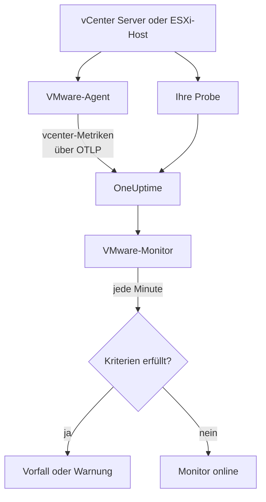

# VMware-Überwachung

Ein VMware-Monitor beobachtet ein vCenter - seine Rechenzentren, Cluster, ESXi-Hosts, virtuellen Maschinen, Datenspeicher, Ressourcenpools und vSAN - und meldet Ihnen, wenn ein Host ausgelastet ist, einer VM CPU oder Arbeitsspeicher fehlt, ein Datenspeicher vollläuft oder vSphere einen Alarm auslöst. Er liest die `vcenter.*`-Metriken, die der OneUptime VMware Agent sammelt oder eine Ihrer Probes ohne Agent sammelt.

:::cards
- [Den Monitor erstellen](#einen-vmware-monitor-erstellen): Sechs Schritte im Dashboard.
- [Vorlagen](#fertige-warnungsvorlagen): Dreiundzwanzig fertige Warnungen, ein Vorfall pro Host, VM oder Datenspeicher.
- [Identitätsattribute](#identitätsattribute): Wie Sie gezielt einen Host, eine VM oder einen Datenspeicher auswählen.
- [Metriken](#erfasste-metriken): Jede `vcenter.*`-Serie, auf die der Monitor warnen kann.
:::

## So funktioniert es

Die Metriken kommen aus der API von vCenter, gelesen mit einem Konto mit Lesezugriff, auf einem von zwei Wegen:

- **Der VMware-Agent**, ein OpenTelemetry Collector mit seinem Receiver `vcenter`, den Sie auf einem Rechner betreiben, der vCenter erreicht. Siehe [VMware-Agent](/docs/telemetry/vmware).
- **Eine Probe**, ohne etwas zu installieren: Sie verbinden das vCenter in OneUptime und wählen die Probe, die es erreicht. Siehe [VMware ohne Agent](/docs/telemetry/vmware-agentless).

Beide senden in jedem Erfassungsintervall (standardmäßig 2 Minuten) dieselben Serien, versehen mit dem Namen des vCenter, `vmware.vcenter.name`. Ein vCenter ist ein vSphere-Endpunkt: ein vCenter Server oder ein eigenständiger ESXi-Host. Ein VMware-Monitor ist an ein vCenter gebunden. Jede Minute führt er seine Abfrage über die Metriken dieses vCenter aus und vergleicht das Ergebnis mit seinen Kriterien.



## Bevor Sie beginnen

- **Sammeln Sie die Metriken des vCenter**, mit dem [VMware-Agent](/docs/telemetry/vmware) oder [ohne Agent](/docs/telemetry/vmware-agentless). Beide verwenden einen vSphere-Benutzer mit der Rolle **Read-Only** auf dem obersten vCenter-Objekt, mit aktiviertem **Propagate to children**. Der Agent liest `ONEUPTIME_URL`, `ONEUPTIME_TELEMETRY_INGESTION_KEY`, `VMWARE_VCENTER_NAME`, `VCENTER_ENDPOINT`, `VCENTER_USERNAME` und `VCENTER_PASSWORD`.
- **Prüfen Sie, ob das vCenter registriert ist.** Es erscheint unter **Produkte → Infrastruktur → VMware → Alle vCenter**: über den Agenten, benannt nach seinem `VMWARE_VCENTER_NAME`, nach seiner ersten vollständigen Erfassung; ohne Agent ab dem Moment, in dem Sie es verbinden.

## Einen VMware-Monitor erstellen

:::steps
### Einen neuen Monitor beginnen

Gehen Sie zu **Monitore** und klicken Sie auf **Monitor erstellen**.

### VMware wählen

Klicken Sie unter **Monitortyp** auf **Weitere Monitortypen** und wählen Sie **VMware** unter **Infrastruktur**, oder geben Sie `vmware` in das Suchfeld ein. Geben Sie einen **Name** ein - er wird in den Titeln von Vorfällen und Warnungen verwendet - und klicken Sie auf **Weiter**.

### Das vCenter wählen

Wählen Sie unter **Konfiguration des VMware-Monitors** das vCenter aus **vCenter**. Jedes vCenter, das Daten gesendet hat oder das Sie ohne Agent verbunden haben, steht in der Liste.

### Festlegen, was überwacht wird

Wählen Sie einen der drei Tabs:

- **Quick Setup** - klicken Sie auf eine [Vorlage](#fertige-warnungsvorlagen). Sie setzt die Metrik, die Attributfilter, die Aggregation, den Zeitbereich, die Gruppierung und die Schwellenwerte und ersetzt die Kriterien unten durch ihre eigenen. Den **Zeitbereich** können Sie weiterhin ändern.
- **Custom Metric** - wählen Sie eine Metrik aus **VMware-Metrik** und legen Sie dann **Aggregation** und **Zeitbereich** fest. Das Formular gruppiert sie nach dem Objekt, das sie beschreibt, sodass jeder Host, jede VM und jeder Datenspeicher einzeln beurteilt wird, und die [Filter](#monitor-einstellungen) schränken sie auf ein Rechenzentrum, einen Cluster, einen Host, eine VM, einen Datenspeicher oder einen Ressourcenpool ein.
- **Erweitert** - bauen Sie Abfragen und Formeln selbst unter **Metriken auswählen**, mit Filtern auf Attribute wie `disk_state`, `power_state` oder `status`. Verwenden Sie **Gruppieren nach** mit einem [Identitätsattribut](#identitätsattribute), um jedes Objekt einzeln zu beurteilen.

### Die Kriterien prüfen

Öffnen Sie jedes Kriterium unter **Monitor-Kriterien** und prüfen Sie **Metrik**, **Aggregation**, **Bedingung** und **Schwellenwert**. Eine Vorlage füllt diese aus. Mit **Custom Metric** oder **Erweitert** beginnt der Monitor mit den [Standardkriterien](#standardkriterien), die nur bemerken, dass eine Metrik auf null fällt, setzen Sie also Ihren eigenen Schwellenwert.

### Den Monitor erstellen

Klicken Sie auf **Monitor erstellen**. OneUptime öffnet die Seite des Monitors und wertet ihn jede Minute aus. Vorfälle und Warnungen, die er auslöst, stehen auch auf den Seiten **Vorfälle** und **Warnungen** des vCenter.
:::

> [!TIP]
> Um mehrere Vorlagen auf einmal einzurichten, öffnen Sie das vCenter über **Produkte → Infrastruktur → VMware** und gehen Sie zu **Empfehlungen**. Wählen Sie die gewünschten Vorlagen, legen Sie fest, wer benachrichtigt wird, und OneUptime erstellt einen Monitor pro Vorlage.

## Monitor-Einstellungen

| Feld | Tab | Was es tut |
| --- | --- | --- |
| **vCenter** | Alle | Erforderlich. Beschränkt jede Abfrage auf `resource.vmware.vcenter.name`. |
| **Rechenzentrum** | Custom Metric, Erweitert | Optional. Ein Rechenzentrum: `resource.vcenter.datacenter.name`. Jede Serie trägt es. |
| **Cluster** | Custom Metric, Erweitert | Optional. Ein Cluster: `resource.vcenter.cluster.name`. Passt auf die eigenen Serien des Clusters und die der Hosts, VMs und Ressourcenpools darin; ein eigenständiger ESXi-Host hat keinen. |
| **ESXi-Host** | Custom Metric, Erweitert | Optional. Ein ESXi-Host: `resource.vcenter.host.name`. Passt auf die eigenen Serien des Hosts **und** die jeder VM, die er ausführt, weil eine VM den Namen ihres Hosts trägt. |
| **Virtuelle Maschine** | Custom Metric, Erweitert | Optional. Eine VM: `resource.vcenter.vm.name`. VM-Namen müssen nicht eindeutig sein: Fügen Sie einen Host oder einen Cluster hinzu, wenn zwei VMs denselben Namen haben. |
| **Datenspeicher** | Custom Metric, Erweitert | Optional. Ein Datenspeicher: `resource.vcenter.datastore.name`. |
| **Pfad des Ressourcenpools** | Custom Metric, Erweitert | Optional. Ein Ressourcenpool, über seinen Inventarpfad (`/DC/host/Cluster/Resources/pool`): `resource.vcenter.resource_pool.inventory_path`. Ein Pfad, weil Poolnamen nur innerhalb ihres übergeordneten Objekts eindeutig sind. |
| **VMware-Metrik** | Custom Metric | Eine Metrik aus dem [Katalog](#erfasste-metriken). |
| **Aggregation** | Custom Metric | Wie Stichproben zusammengefasst werden: **Durchschnitt**, **Maximum**, **Minimum**, **Summe** oder **Anzahl**. Beginnt bei der üblichen Aggregation der Metrik. |
| **Zeitbereich** | Alle | Das gleitende Zeitfenster, das die Abfrage liest, von **Past 1 Minute** bis **Past 365 Days**. Ein neuer Monitor beginnt bei **Letzte 5 Minuten**; Vorlagen setzen ihr eigenes. |
| **Metriken auswählen** | Erweitert | Der Abfrage-Builder: **Metrik**, **Aggregieren nach**, **Nach Attributen filtern**, **Gruppieren nach**, dazu **Metrik hinzufügen** und **Formel hinzufügen**, um Abfragen zu kombinieren. |

vCenter wird einmal pro Erfassungsintervall gelesen, standardmäßig alle 2 Minuten, sodass ein Fenster von 1 Minute womöglich gar keine Stichprobe enthält. Halten Sie das Fenster bei 5 Minuten oder mehr, und länger, wenn Sie das Erfassungsintervall für ein großes Inventar erhöht haben.

## Identitätsattribute

Der Receiver `vcenter` sendet eine OpenTelemetry-Ressource pro vSphere-Objekt und benennt sie mit **Ressourcenattributen**. Welche davon eine Serie trägt, sagt Ihnen, welche Art von Objekt sie beschreibt:

| vSphere-Objekt      | Identitäts-Ressourcenattribute                                                                                                 |
| ------------------- | ------------------------------------------------------------------------------------------------------------------------------ |
| Rechenzentrum       | `vcenter.datacenter.name`                                                                                                      |
| Cluster             | `vcenter.datacenter.name`, `vcenter.cluster.name`                                                                              |
| ESXi-Host           | `vcenter.datacenter.name`, `vcenter.host.name` (+ `vcenter.cluster.name` in einem Cluster)                                     |
| Virtuelle Maschine  | `vcenter.datacenter.name`, `vcenter.host.name`, `vcenter.vm.name`, `vcenter.vm.id` (+ `vcenter.cluster.name`; `vcenter.resource_pool.*` oder `vcenter.virtual_app.*`) |
| VM-Vorlage          | `vcenter.datacenter.name`, `vcenter.host.name`, `vcenter.vm_template.name`, `vcenter.vm_template.id`                           |
| Datenspeicher       | `vcenter.datacenter.name`, `vcenter.datastore.name`                                                                            |
| Ressourcenpool      | `vcenter.datacenter.name`, `vcenter.resource_pool.name`, `vcenter.resource_pool.inventory_path` (+ `vcenter.cluster.name` oder `vcenter.host.name`) |

In Monitorfiltern und Gruppierungsschlüsseln beginnen Ressourcenattribute mit `resource.` (`resource.vcenter.host.name`), Datenpunktattribute dagegen nicht (`disk_state`, `power_state`, `status`, `effective`, `direction`, `object`, `type`). Das boolesche Attribut `effective` wird als Text `"true"` oder `"false"` gespeichert, filtern Sie es also mit dem Text. Filtern Sie auf ein Identitätsattribut, um gezielt ein Objekt auszuwählen, und gruppieren Sie danach, um jedes Objekt einzeln zu beurteilen.

## Fertige Warnungsvorlagen

OneUptime liefert 23 Vorlagen für häufige VMware-Probleme, und **Quick Setup** bietet alle an. Jede baut einen vollständigen Monitor: die Metrikabfrage, ihre Attributfilter, eine Gruppierung nach dem eigenen Identitätsattribut des Objekts, ein Kriterium, das auslöst, und eines, das sich erholt. Schwellenwerte sind Ausgangspunkte, die Sie bearbeiten können.

Vorlagen lesen die letzten 5 Minuten, sofern die Tabelle nichts anderes sagt. Ein Kriterium löst nur aus, wenn die Bedingung für jede Minute seines Fensters gilt, und ein Schwellenwertkriterium erholt sich erst 10 % jenseits seines Schwellenwerts, sodass ein Wert, der um die Linie pendelt, nicht flattert.

| Template | Kategorie | Schweregrad | Beobachtet | Löst aus, wenn | Erholt sich, wenn |
| --- | --- | --- | --- | --- | --- |
| Host CPU Saturation | Host | Warnung | `vcenter.host.cpu.utilization`, Avg pro `resource.vcenter.host.name` | Über 90 %: Jede VM auf dem Host konkurriert um Kerne und zeigt CPU-Ready-Zeit | Bei 81 % oder darunter |
| Host Memory Saturation | Host | Warnung | `vcenter.host.memory.utilization`, Avg pro Host | Über 90 %: Der Host beginnt, Arbeitsspeicher durch Ballooning, Komprimierung und Swapping zurückzuholen | Bei 81 % oder darunter |
| Host Disk Latency High | Host | Warnung | `vcenter.host.disk.latency.max`, Max pro Host | Über 50 ms: Jede VM, deren Datenträger auf diesem Pfad liegen, wartet auf den Speicher. Braucht Leistungszählerstufe 3 | Bei 45 ms oder darunter |
| Host Network Packet Errors | Host | Warnung | `vcenter.host.network.packet.error.rate`, Max pro Host | Über 0: fast immer ein Fehler an Kabel, SFP oder Switch-Port | Bei 0 |
| Host Network Packet Drops | Host | Warnung | `vcenter.host.network.packet.drop.rate`, Max pro Host | Über 0: ein überbuchter Uplink oder NIC-Ringpuffer, die überlaufen | Bei 0 |
| VM CPU Saturation | Virtuelle Maschine | Warnung | `vcenter.vm.cpu.utilization`, Avg pro `resource.vcenter.vm.name`, **letzte 15 Minuten** | Über 90 % der vCPUs der VM während aller 15 Minuten: Eine VM darf nutzen, was sie bekommen hat, daher benachrichtigt nur eine, die nie heruntergeht | Bei 81 % oder darunter |
| VM CPU Ready Contention | Virtuelle Maschine | Warnung | `vcenter.vm.cpu.readiness`, Avg pro VM | Über 10 %: Die VM war bereit zu laufen, aber der Host hatte keinen physischen Kern für sie. Im Gast unsichtbar | Bei 9 % oder darunter |
| VM Memory Saturation | Virtuelle Maschine | Warnung | `vcenter.vm.memory.utilization`, Avg pro VM | Über 90 % ihres Arbeitsspeichers: Der Gast beginnt gleich auszulagern | Bei 81 % oder darunter |
| VM Memory Ballooning | Virtuelle Maschine | Warnung | `vcenter.vm.memory.ballooned`, Max pro VM | Über 0: Dem Host fehlt Arbeitsspeicher, und er holt ihn von diesem Gast zurück | Bei 0 |
| VM Memory Swapping | Virtuelle Maschine | Kritisch | `vcenter.vm.memory.swapped`, Max pro VM | Über 0: Der Host lagert den Arbeitsspeicher der VM aus, das letzte Mittel nach Ballooning und Komprimierung | Bei 0 |
| VM Disk Latency High | Virtuelle Maschine | Warnung | `vcenter.vm.disk.latency.max`, Max pro VM | Über 50 ms: Anwendungen im Gast laufen bei E/A in Zeitüberschreitungen | Bei 45 ms oder darunter |
| VM Disk Usage High | Virtuelle Maschine | Warnung | `vcenter.vm.disk.utilization`, Avg pro VM | Über 90 % ihres bereitgestellten Speichers belegt: Eine Thin-Provisioned-VM steht kurz davor, ihre volle Größe zu beanspruchen | Bei 81 % oder darunter |
| Datastore Capacity Warning | Datenspeicher | Warnung | `vcenter.datastore.disk.utilization`, Avg pro `resource.vcenter.datastore.name` | Über 80 %: eine frühe Warnung, da Thin-Disks und Snapshots den Rest schnell verbrauchen | Bei 72 % oder darunter |
| Datastore Capacity Critical | Datenspeicher | Kritisch | `vcenter.datastore.disk.utilization`, Avg pro Datenspeicher | Über 90 %: Ein voller Datenspeicher pausiert jede VM, die dort einen Datenträger hat | Bei 81 % oder darunter |
| Cluster Host Not Effective | Cluster | Kritisch | `vcenter.cluster.host.count` gefiltert auf `effective = false`, Max pro `resource.vcenter.cluster.name` | Über 0: Ein Host ist im Wartungsmodus, getrennt oder reagiert nicht, sodass der Cluster mit weniger Kapazität läuft, als er ausgelegt ist | Bei 0 |
| Datacenter Hosts Unhealthy | Rechenzentrum | Kritisch | `vcenter.datacenter.host.count` gefiltert auf `status = red`, Max pro `resource.vcenter.datacenter.name` | Über 0: Ein Host hat einen kritischen Alarm, etwa einen Hardwaresensor, einen verlorenen Speicherpfad oder einen Fehler des HA-Agenten | Bei 0 |
| Datacenter Hosts Degraded | Rechenzentrum | Warnung | `vcenter.datacenter.host.count` gefiltert auf `status = yellow`, Max pro Rechenzentrum | Über 0: Ein Host hat einen Warnalarm | Bei 0 |
| Datacenter Hosts Powered Off | Rechenzentrum | Warnung | `vcenter.datacenter.host.count` gefiltert auf `power_state = off`, Max pro Rechenzentrum | Über 0: Ein Host ist ausgeschaltet - er ist abgestürzt, hat keinen Strom mehr oder wurde von DPM in den Standby versetzt | Bei 0 |
| Datacenter VMs Unhealthy | Rechenzentrum | Warnung | `vcenter.datacenter.vm.count` gefiltert auf `status = red`, Max pro Rechenzentrum | Über 0: Eine VM hat einen kritischen Alarm, etwa einen fehlgeschlagenen HA-Neustart, einen verlorenen Datenspeicher oder einen verlorenen Tools-Heartbeat | Bei 0 |
| Datacenter Clusters Unhealthy | Rechenzentrum | Kritisch | `vcenter.datacenter.cluster.count` gefiltert auf `status = red`, Max pro Rechenzentrum | Über 0: Ein Cluster hat einen kritischen Alarm, etwa zu wenige HA-Failover-Ressourcen, eine fehlgeschlagene HA-Wahl oder eine kritische vSAN-Integritätsprüfung | Bei 0 |
| vSAN Latency High | vSAN | Warnung | `vcenter.cluster.vsan.latency.avg`, Avg pro Cluster | Über 20 000 µs (20 ms): Der Speicher wird für jede VM auf dem vSAN-Datenspeicher langsamer. Auf Clustern ohne vSAN still | Bei 18 000 µs oder darunter |
| vSAN Congestion | vSAN | Warnung | `vcenter.cluster.vsan.congestions`, Max pro Cluster | Über 0: Eine Datenträgergruppe kommt nicht hinterher, und vSAN bremst die E/A ihrer Clients | Bei 0 |
| Resource Pool Memory Swapped | Cluster | Warnung | `vcenter.resource_pool.memory.swapped`, Max pro `resource.vcenter.resource_pool.inventory_path` | Über 0: Die VMs des Pools beziehen Arbeitsspeicher aus dem Host-Swap, meist weil das Speicherlimit oder die Anteile des Pools zu niedrig sind | Bei 0 |

**Schweregrad** ist die Bezeichnung, die die Auswahl zeigt. Der Vorfall und die Warnung, die eine Vorlage erstellt, beginnen beim schwersten Vorfall- und Warnungsschweregrad Ihres Projekts; ändern Sie sie im Kriterium.

- **Auslastungsvorlagen verwenden Avg:** Der Receiver meldet für jedes Objekt einen echten Prozentsatz von 0 bis 100, sodass der Durchschnitt in einer Minute die anhaltende Auslastung ist.
- **Latenzvorlagen verwenden Max:** Die Metrik ist bereits die schlechteste Latenz über die Datenträger des Objekts, sodass ihre höchste Stichprobe die ehrliche ist.
- **Zähl- und Zustandsvorlagen verwenden Max**, sodass eine einzige Erfassung, die den Zustand zeigt, sie auslöst: Paketfehler, Ballooning, Swapping, roter und gelber Status, Hosts, die nicht effektiv sind, Überlastung.
- **Jede Vorlage gruppiert nach dem eigenen Identitätsattribut des Objekts**, sodass pro betroffenem Objekt ein Vorfall ausgelöst wird, der das Objekt nennt.
- **Schwellenwerte sind an ihre Einheit gebunden** (`%`, `ms`, `us`), sodass sie ihre Bedeutung behalten, egal welche Einheit ein Diagramm zeigt.

## Erfasste Metriken

Die Metriken unten sind der Katalog, den das Monitorformular anbietet. Die Einheiten sind die des Receivers: `MHz`, `%`, `MiBy` (Mebibyte), `By` (Byte), `KiBy`, `ms`, `us` (Mikrosekunden), `{KiBy/s}`, `By/s` und Zählwerte. Eine als _standardmäßig aus_ markierte Metrik wird erst gesammelt, wenn Sie sie in der `otel-collector-config.yaml` des Agenten einschalten; die mitgelieferte Konfiguration schaltet `vcenter.host.memory.capacity` bereits ein.

### Rechenzentrum

| Metrik                               | Einheit             | Beschreibung                                                                                                                                                   |
| ------------------------------------ | ------------------- | -------------------------------------------------------------------------------------------------------------------------------------------------------------- |
| `vcenter.datacenter.cluster.count`   | `{clusters}`        | Cluster im Rechenzentrum, aufgefächert nach `status` (`red` / `yellow` / `green` / `gray`). Summe für die Gesamtzahl; filtern Sie `status = red` für Cluster mit einem kritischen Alarm |
| `vcenter.datacenter.cpu.limit`       | `MHz`               | Gesamte CPU, die dem Rechenzentrum über alle ESXi-Hosts zur Verfügung steht                                                                                    |
| `vcenter.datacenter.datastore.count` | `{datastores}`      | Datenspeicher im Rechenzentrum                                                                                                                                 |
| `vcenter.datacenter.disk.space`      | `By`                | Datenspeicherplatz im ganzen Rechenzentrum, aufgefächert nach `disk_state` (`used` / `available`). used ÷ (used + available) ist die Speicherauslastung des ganzen Rechenzentrums |
| `vcenter.datacenter.host.count`      | `{hosts}`           | ESXi-Hosts im Rechenzentrum, aufgefächert nach `status` und `power_state` (`on` / `off` / `standby` / `unknown`). Filtern Sie `status = red` oder `power_state = off` |
| `vcenter.datacenter.memory.limit`    | `By`                | Gesamter physischer Arbeitsspeicher, der dem Rechenzentrum über alle ESXi-Hosts zur Verfügung steht                                                            |
| `vcenter.datacenter.vm.count`        | `{virtual_machines}` | Virtuelle Maschinen im Rechenzentrum, aufgefächert nach `status` und `power_state` (`on` / `off` / `suspended` / `unknown`). Filtern Sie `power_state = on` für laufende VMs |

### Cluster

| Metrik                              | Einheit                       | Beschreibung                                                                                                                                                 |
| ----------------------------------- | ----------------------------- | ------------------------------------------------------------------------------------------------------------------------------------------------------------ |
| `vcenter.cluster.cpu.effective`     | `MHz`                         | CPU, die der Cluster tatsächlich einplanen kann — ohne Hosts im Wartungsmodus oder ohne Reaktion. Vergleichen Sie mit `vcenter.cluster.cpu.limit` für außer Betrieb genommene Kapazität |
| `vcenter.cluster.cpu.limit`         | `MHz`                         | Gesamte CPU aller ESXi-Hosts im Cluster, unabhängig vom Hostzustand                                                                                          |
| `vcenter.cluster.host.count`        | `{hosts}`                     | ESXi-Hosts im Cluster, aufgefächert nach `effective` (`"true"` / `"false"`). Ein Host ist nicht effektiv, solange er im Wartungsmodus, getrennt oder ohne Reaktion ist |
| `vcenter.cluster.memory.effective`  | `By`                          | Arbeitsspeicher, den der Cluster VMs tatsächlich zuweisen kann — ohne Hosts im Wartungsmodus oder ohne Reaktion und ohne den eigenen reservierten Speicher von ESXi |
| `vcenter.cluster.memory.limit`      | `By`                          | Gesamter physischer Arbeitsspeicher aller ESXi-Hosts im Cluster                                                                                              |
| `vcenter.cluster.vm.count`          | `{virtual_machines}`          | Virtuelle Maschinen im Cluster, aufgefächert nach `power_state`. Summe für die Gesamtzahl; filtern Sie `power_state = on` für laufende VMs                   |
| `vcenter.cluster.vm_template.count` | `{virtual_machine_templates}` | VM-Vorlagen im Cluster                                                                                                                                       |

### Host (ESXi)

| Metrik                                   | Einheit       | Beschreibung                                                                                                                                                      |
| ---------------------------------------- | ------------- | ----------------------------------------------------------------------------------------------------------------------------------------------------------------- |
| `vcenter.host.cpu.capacity`              | `MHz`         | Gesamte CPU-Kapazität des ESXi-Hosts (Kerne × Takt) — der Nenner für `vcenter.host.cpu.usage`                                                                     |
| `vcenter.host.cpu.reserved`              | `MHz`         | Für virtuelle Maschinen reservierte CPU, aufgefächert nach `cpu_reservation_type` (`total` / `used`). Nähert sich `used` dem Wert `total`, scheitern neue Reservierungen an der Zugangssteuerung |
| `vcenter.host.cpu.usage`                 | `MHz`         | Aktuell auf dem Host verbrauchte CPU über alle VMs und den Hypervisor selbst                                                                                      |
| `vcenter.host.cpu.utilization`           | `%`           | CPU-Auslastung des Hosts als Prozentsatz (0–100) seiner Kapazität                                                                                                 |
| `vcenter.host.disk.latency.avg`          | `ms`          | Durchschnittliche Datenträgerlatenz (Geräte- + Kernelzeit), aufgefächert nach `direction` (`read` / `write`) und `object` (Datenträgergerät). Erfordert Leistungszählerstufe 2 |
| `vcenter.host.disk.latency.max`          | `ms`          | Höchste Latenz über alle Datenträger, die der Host nutzt, pro `object`, im letzten 20-s-Intervall. Erfordert Leistungszählerstufe 3                                |
| `vcenter.host.disk.throughput`           | `{KiBy/s}`    | Kilobyte pro Sekunde, die von den Datenträgern des Hosts gelesen oder auf sie geschrieben werden, nach `direction` und `object`. Erfordert Leistungszählerstufe 4  |
| `vcenter.host.memory.active`             | `MiBy`        | Arbeitsspeicher, den die eingeschalteten VMs des Hosts aktiv nutzen. _Standardmäßig aus_ — aktivieren Sie `vcenter.host.memory.active` in der Agent-Konfiguration  |
| `vcenter.host.memory.ballooned`          | `MiBy`        | Gastspeicher, den der Balloon-Treiber von den VMs des Hosts zurückgeholt hat; über 0 bedeutet Speicherdruck auf dem Host. _Standardmäßig aus_                     |
| `vcenter.host.memory.capacity`           | `MiBy`        | Gesamter physischer Arbeitsspeicher des Hosts — der Nenner für `vcenter.host.memory.usage`. Upstream standardmäßig aus; die mitgelieferte Agent-Konfiguration aktiviert sie |
| `vcenter.host.memory.granted`            | `MiBy`        | Maschinenspeicher, der den eingeschalteten VMs auf dem Host gewährt wurde. _Standardmäßig aus_                                                                    |
| `vcenter.host.memory.usage`              | `MiBy`        | Aktuell auf dem Host verbrauchter Arbeitsspeicher, einschließlich des eigenen Overheads des Hypervisors                                                           |
| `vcenter.host.memory.utilization`        | `%`           | Speicherauslastung des Hosts als Prozentsatz (0–100) seiner physischen Kapazität                                                                                  |
| `vcenter.host.network.packet.drop.rate`  | `{packets/s}` | Pro Sekunde verworfene Pakete an jeder physischen NIC, nach `direction` (`transmitted` / `received`) und `object` (z. B. `vmnic0`) — ein überbuchter Uplink oder eine ausfallende NIC |
| `vcenter.host.network.packet.error.rate` | `{errors/s}`  | Paketfehler pro Sekunde an den physischen NICs des Hosts, nach `direction` und `object` — fast immer ein Fehler an Kabel, SFP oder Switch-Port                    |
| `vcenter.host.network.packet.rate`       | `{packets/s}` | Pro Sekunde gesendete oder empfangene Pakete an jeder physischen NIC, nach `direction` und `object`                                                              |
| `vcenter.host.network.throughput`        | `{KiBy/s}`    | Vom Host gesendete oder empfangene Kilobyte pro Sekunde, nach `direction` und `object`                                                                           |
| `vcenter.host.network.usage`             | `{KiBy/s}`    | Kombinierte Sende- und Empfangsrate über die NICs des Hosts, pro `object`                                                                                         |

### Virtuelle Maschine

| Metrik                                     | Einheit       | Beschreibung                                                                                                                                                                  |
| ------------------------------------------ | ------------- | ----------------------------------------------------------------------------------------------------------------------------------------------------------------------------- |
| `vcenter.vm.cpu.readiness`                 | `%`           | Anteil der Zeit, in der die VM laufbereit war, aber auf keiner physischen CPU eingeplant werden konnte (CPU Ready). Über 5 % wirkt der Gast träge; über 10 % ist der Host überbucht. Nur eingeschaltete VMs |
| `vcenter.vm.cpu.time`                      | `%`           | Zeit, die die vCPUs der VM in jedem Zustand verbracht haben, nach `cpu_state` (`idle` / `ready` / `wait`) und `object` (vCPU). _Standardmäßig aus_ — aktivieren Sie `vcenter.vm.cpu.time` |
| `vcenter.vm.cpu.usage`                     | `MHz`         | Von der VM verbrauchte CPU. Nur eingeschaltete VMs — an ihrem Vorhandensein erkennt OneUptime den Betriebszustand einer VM                                                    |
| `vcenter.vm.cpu.utilization`               | `%`           | CPU-Auslastung der VM als Prozentsatz (0–100) ihrer konfigurierten vCPUs. Nur eingeschaltete VMs                                                                              |
| `vcenter.vm.disk.latency.avg`              | `ms`          | Durchschnittliche Datenträgerlatenz, nach `direction` (`read` / `write`), `disk_type` (`virtual` / `physical`) und `object` (virtueller Datenträger). Erfordert Leistungszählerstufe 2 |
| `vcenter.vm.disk.latency.max`              | `ms`          | Höchste Gesamtlatenz (Geräte- + Kernelzeit), die die VM auf einem Datenträger in einem 20-s-Intervall gesehen hat, pro `object`                                               |
| `vcenter.vm.disk.throughput`               | `{KiBy/s}`    | Kilobyte pro Sekunde, die von den Datenträgern der VM gelesen oder auf sie geschrieben werden, nach `direction` und `object`. Erfordert Leistungszählerstufe 2                  |
| `vcenter.vm.disk.usage`                    | `By`          | Datenspeicherplatz, den die Dateien der VM belegen, aufgefächert nach `disk_state` (`used` / `available`). Wird auch für VM-Vorlagen gesendet. Filtern Sie `disk_state = used` für die belegte Größe |
| `vcenter.vm.disk.utilization`              | `%`           | Prozentsatz (0–100) des bereitgestellten Speichers der VM, der auf dem Datenspeicher belegt ist — eine Thin-Provisioned-VM nahe 100 % steht kurz davor, ihre volle Größe zu beanspruchen |
| `vcenter.vm.memory.ballooned`              | `MiBy`        | Gastspeicher, den der Balloon-Treiber (VMware Tools) von der VM zurückgeholt hat. Über 0 bedeutet, dass dem ESXi-Host Arbeitsspeicher fehlt                                    |
| `vcenter.vm.memory.granted`                | `MiBy`        | Maschinenspeicher, den der Host der VM gewährt hat. _Standardmäßig aus_ — aktivieren Sie `vcenter.vm.memory.granted`                                                          |
| `vcenter.vm.memory.swapped`                | `MiBy`        | Arbeitsspeicher, den die VM aus der Swap-Datei des Hosts erhält — das letzte Mittel nach Ballooning und Komprimierung; jeder Wert über 0 bedeutet, dass die VM für RAM mit Datenträgerlatenz bezahlt |
| `vcenter.vm.memory.swapped_ssd`            | `KiBy`        | Arbeitsspeicher der VM, der in den Flash-Swap-Cache des Hosts ausgelagert wurde — weniger schmerzhaft als die Swap-Datei, aber dennoch Speicherdruck                           |
| `vcenter.vm.memory.usage`                  | `MiBy`        | Arbeitsspeicher, den der Gast der VM aktiv nutzt. Wird für eingeschaltete und ausgeschaltete VMs gleichermaßen gesendet (0, wenn aus)                                           |
| `vcenter.vm.memory.utilization`            | `%`           | Speicherauslastung der VM als Prozentsatz (0–100) ihres konfigurierten Arbeitsspeichers                                                                                        |
| `vcenter.vm.network.broadcast.packet.rate` | `{packets/s}` | Broadcast-Pakete pro Sekunde pro vNIC, nach `direction` und `object`. _Standardmäßig aus_                                                                                      |
| `vcenter.vm.network.multicast.packet.rate` | `{packets/s}` | Multicast-Pakete pro Sekunde pro vNIC, nach `direction` und `object`. _Standardmäßig aus_                                                                                      |
| `vcenter.vm.network.packet.drop.rate`      | `{packets/s}` | Pro Sekunde von jeder vNIC verworfene Pakete, nach `direction` und `object`. Verwerfungen auf der Empfangsseite bedeuten meist, dass der Gast seinen Ringpuffer nicht schnell genug leert |
| `vcenter.vm.network.packet.rate`           | `{packets/s}` | Pro Sekunde von jeder vNIC gesendete oder empfangene Pakete, nach `direction` und `object`                                                                                    |
| `vcenter.vm.network.throughput`            | `By/s`        | Über das Netzwerk der VM gesendete oder empfangene Byte pro Sekunde, nach `direction` und `object`                                                                            |
| `vcenter.vm.network.usage`                 | `{KiBy/s}`    | Kombinierte Sende- und Empfangsrate der VM, pro `object`                                                                                                                       |

### Datenspeicher

| Metrik                               | Einheit | Beschreibung                                                                                                                              |
| ------------------------------------ | ------- | ----------------------------------------------------------------------------------------------------------------------------------------- |
| `vcenter.datastore.disk.usage`       | `By`    | Platz auf dem Datenspeicher, aufgefächert nach `disk_state` (`used` / `available`). used + available ist die Kapazität des Datenspeichers |
| `vcenter.datastore.disk.utilization` | `%`     | Prozentsatz (0–100) der Kapazität des Datenspeichers, der belegt ist. Ein voller Datenspeicher pausiert jede VM, die darauf schreibt, warnen Sie also lange vor 100 % |

### Ressourcenpool

| Metrik                                   | Einheit    | Beschreibung                                                                                                                                                             |
| ---------------------------------------- | ---------- | ------------------------------------------------------------------------------------------------------------------------------------------------------------------------ |
| `vcenter.resource_pool.cpu.shares`       | `{shares}` | Am Pool konfigurierte CPU-Anteile — seine relative Priorität gegenüber Geschwisterpools, wenn das übergeordnete Objekt ausgelastet ist                                   |
| `vcenter.resource_pool.cpu.usage`        | `MHz`      | Von allen VMs im Pool (und seinen untergeordneten Pools) verbrauchte CPU                                                                                                 |
| `vcenter.resource_pool.memory.ballooned` | `MiBy`     | Vom Balloon-Treiber über alle VMs im Pool zurückgeholter Arbeitsspeicher                                                                                                 |
| `vcenter.resource_pool.memory.granted`   | `MiBy`     | Den VMs des Pools gewährter Hostspeicher, aufgefächert nach `type` (`private` / `shared` — gemeinsame Seiten werden durch Transparent Page Sharing dedupliziert)          |
| `vcenter.resource_pool.memory.shares`    | `{shares}` | Am Pool konfigurierte Speicheranteile                                                                                                                                    |
| `vcenter.resource_pool.memory.swapped`   | `MiBy`     | Arbeitsspeicher, den die VMs des Pools aus dem Swap-Bereich der ESXi-Hosts erhalten — jeder Wert über 0 bedeutet, dass mindestens eine VM im Pool vom Host ausgelagert wird |
| `vcenter.resource_pool.memory.usage`     | `MiBy`     | Vom Pool genutzter Arbeitsspeicher, aufgefächert nach `type` (`guest` / `host` / `overhead`) bei neueren Collector-Builds; ältere Builds senden eine einzige Serie ohne Typ. Filtern Sie `type = guest` |

### vSAN

Wird nur für Cluster mit vSAN, die Hosts darin und die VMs auf einem vSAN-Datenspeicher gesendet. Latenzen sind in **Mikrosekunden** (`us`) angegeben, anders als die Millisekunden-Latenzen von Hosts und VMs:

| Metrik                              | Einheit           | Beschreibung                                                                                                                                    |
| ----------------------------------- | ----------------- | ----------------------------------------------------------------------------------------------------------------------------------------------- |
| `vcenter.cluster.vsan.congestions`  | `{congestions/s}` | Überlastungsereignisse pro Sekunde gegen die E/A aller vSAN-Clients im Cluster — das eigene Gegendrucksignal von vSAN                           |
| `vcenter.cluster.vsan.latency.avg`  | `us`              | Durchschnittliche Latenz, die der Cluster beim Zugriff auf vSAN-Speicher sieht, nach `type` (`read` / `write`). 20 000 µs = 20 ms               |
| `vcenter.cluster.vsan.operations`   | `{operations/s}`  | vSAN-E/A-Operationen pro Sekunde über den Cluster, nach `type` (`read` / `write` / `unmap`)                                                     |
| `vcenter.cluster.vsan.throughput`   | `By/s`            | vSAN-Durchsatz des Clusters, nach `direction` (`read` / `write`)                                                                                |
| `vcenter.host.vsan.cache.hit_rate`  | `%`               | Anteil der vSAN-Lese-E/A des Hosts, der im letzten 5-Minuten-Intervall aus seinem lokalen Client-Cache bedient wurde — eine sinkende Rate bedeutet, dass Lesevorgänge die Kapazitätsebene treffen |
| `vcenter.host.vsan.congestions`     | `{congestions/s}` | Überlastungsereignisse pro Sekunde gegen die vSAN-E/A des Hosts                                                                                 |
| `vcenter.host.vsan.latency.avg`     | `us`              | Durchschnittliche Latenz, die der Host beim Zugriff auf vSAN-Speicher sieht, nach `type`                                                        |
| `vcenter.host.vsan.operations`      | `{operations/s}`  | Vom Host ausgegebene vSAN-E/A-Operationen pro Sekunde, nach `type`                                                                              |
| `vcenter.host.vsan.throughput`      | `By/s`            | vSAN-Durchsatz des Hosts, nach `direction`                                                                                                      |
| `vcenter.vm.vsan.latency.avg`       | `us`              | Durchschnittliche Latenz, die die VM beim Zugriff auf vSAN-Speicher sieht, nach `type`                                                          |
| `vcenter.vm.vsan.operations`        | `{operations/s}`  | Von der VM ausgegebene vSAN-E/A-Operationen pro Sekunde, nach `type`                                                                            |
| `vcenter.vm.vsan.throughput`        | `By/s`            | vSAN-Durchsatz der VM, nach `direction`                                                                                                         |

> [!NOTE]
> Der Betriebszustand einer VM ist keine Metrik. Der Receiver sendet `vcenter.vm.cpu.*` nur für eingeschaltete VMs, daher unterscheidet OneUptime **Eingeschaltet** von **Ausgeschaltet** daran, ob CPU-Daten in derselben Erfassung ankamen wie die Speicher- und Datenträgerdaten der VM; die Seite **Virtuelle Maschinen** des vCenter zeigt das Ergebnis. Um auf ausgeschaltete Hosts oder auf die Zahl laufender VMs zu warnen, verwenden Sie das Attribut `power_state` von `vcenter.datacenter.host.count`, `vcenter.datacenter.vm.count` oder `vcenter.cluster.vm.count`.

## Überwachungskriterien

Ein Kriterium vergleicht eine der Abfragen oder Formeln des Monitors mit einem Schwellenwert. Die Kriterien eines VMware-Monitors haben keinen **Filtertyp**: Jede Regel prüft den Metrikwert, mit diesen Feldern.

| Feld | Was es tut |
| --- | --- |
| **Metrik** | Die zu prüfende Abfrage oder Formel, über ihren Variablennamen. |
| **Aggregation** | Wie die Werte im Fenster zu einer Antwort werden: **Durchschnitt**, **Summe**, **Maximum Value**, **Minimum Value**, **All Values** (jeder Wert muss zutreffen) oder **Any Value** (einer genügt). |
| **Bedingung** | **Greater Than**, **Less Than**, **Greater Than Or Equal To**, **Less Than Or Equal To** oder **Equal To** — oder eine Anomaliebedingung: **Anomalously High**, **Anomalously Low** oder **Anomalous**. |
| **Schwellenwert** | Der Wert, mit dem verglichen wird. Daneben steht eine Einheitenliste, wenn die Metrik eine Einheit hat. Bei Anomaliebedingungen nicht angezeigt. |
| **Empfindlichkeit** | Nur bei Anomaliebedingungen. **Niedrig** (4σ), **Mittel** (3σ, der Standard) oder **Hoch** (2σ). |
| **Baseline-Fenster** | Nur bei Anomaliebedingungen. 14 Tage (der Standard), 28, 60 oder 90 Tage Verlauf. |
| **Bei keinen Daten** | Unter **Weitere Felder**. Was passiert, wenn das Fenster keine Stichproben hat: **Ignore** (der Standard), **Treat As Zero** oder **Auslöser**. |

Anomaliebedingungen vergleichen jeden Wert mit derselben Stunde der Woche in der Baseline. Sie bleiben im Zustand „Learning“ und lösen nichts aus, bis das Baseline-Fenster genug Verlauf enthält.

Einige Kriterien als Ausgangspunkt:

- **Ein Host ist ausgelastet:** `vcenter.host.cpu.utilization`, Durchschnitt, gruppiert nach `resource.vcenter.host.name`, **Greater Than** `90`, über die letzten 5 Minuten.
- **Ein Datenspeicher läuft voll:** `vcenter.datastore.disk.utilization`, Durchschnitt, gruppiert nach `resource.vcenter.datastore.name`, **Greater Than** `80`.
- **Ein Cluster hat einen Host verloren:** `vcenter.cluster.host.count` gefiltert auf `effective = false`, Maximum, gruppiert nach `resource.vcenter.cluster.name`, **Greater Than** `0`.
- **Weniger VMs laufen als erwartet:** `vcenter.cluster.vm.count` gefiltert auf `power_state = on` und `resource.vcenter.cluster.name = Production`, Summe, **Less Than** die Anzahl, die Sie erwarten.
- **Eine VM wird vom Host ausgelagert:** `vcenter.vm.memory.swapped`, Maximum, gruppiert nach `resource.vcenter.vm.name`, **Greater Than** `0`.

### Standardkriterien

Ein Monitor, den Sie nicht aus einer Vorlage bauen, beginnt mit zwei Kriterien:

| Reihenfolge | Kriterium | Trifft zu, wenn | Dann |
| --- | --- | --- | --- |
| 1 | Check if _monitor name_ is offline | Ein beliebiger Wert der ersten Abfrage `0` ist | Markiert den Monitor als **Offline** und meldet den Vorfall „_monitor name_ is offline“, der sich von selbst auflöst, wenn der Monitor sich erholt. |
| 2 | Check if _monitor name_ is online | Ein beliebiger Wert über `0` liegt | Markiert den Monitor als **Betriebsbereit**. |

> [!IMPORTANT]
> Stille trifft auf keines der Kriterien zu: Ein vCenter, das keine Daten mehr sendet, lässt den Monitor, wie er war. Um benachrichtigt zu werden, wenn Daten ausbleiben, setzen Sie **Bei keinen Daten** bei einem Kriterium auf **Auslöser**. Zeit, in der OneUptime selbst nichts empfangen hat, gilt nie als fehlende Daten: Eine Prüfung, deren Fenster sie enthält, wartet stattdessen, wie [Wenn OneUptime keine Daten empfängt](/docs/monitor/when-oneuptime-is-not-receiving) erklärt.

## Terraform

Der [OneUptime-Terraform-Provider](/docs/terraform/monitor-steps) trägt die Konfiguration eines VMware-Monitorschritts im Attribut `vmware_monitor`: das rohe JSON der Konfiguration `vmwareMonitor` (`vcenterIdentifier`, `resourceFilters`, `metricViewConfig`, `rollingTime`), geschrieben mit `jsonencode()`:

```hcl title="main.tf"
monitor_steps = [{
  vmware_monitor = jsonencode({
    vcenterIdentifier = "prod-vcenter"
    resourceFilters   = { clusterName = "Production" }
    rollingTime       = "Past 5 Minutes"
    metricViewConfig = {
      queryConfigs = [{
        metricAliasData = { metricVariable = "host_cpu", title = "Host CPU", description = "", legend = "" }
        metricQueryData = {
          filterData = {
            metricName     = "vcenter.host.cpu.utilization"
            attributes     = {}
            aggegationType = "Avg"
            aggregateBy    = {}
          }
          groupByAttributeKeys = ["resource.vcenter.host.name"]
        }
      }]
      formulaConfigs = []
    }
  })
  criteria = [ /* ... */ ]
}]
```

`vcenterIdentifier` ist der `vmware.vcenter.name` des vCenter - der `VMWARE_VCENTER_NAME`, mit dem der Agent gestartet wurde -, nicht seine OneUptime-ID.

## Fehlerbehebung

:::details Das vCenter steht nicht in der Liste vCenter
Ein vCenter, das der Agent erfasst, registriert sich selbst aus den Daten des Agenten. Prüfen Sie, ob der Agent läuft und Daten sendet (siehe [Installation überprüfen](/docs/telemetry/vmware#die-installation-prüfen)), ob `VMWARE_VCENTER_NAME` gesetzt ist und ob ein Erfassungsintervall vergangen ist: Gesendet wird erst, wenn der erste vollständige Durchlauf durch das Inventar abgeschlossen ist.
:::

:::details Hosts haben Metriken, VMs, Datenspeicher oder Cluster aber nicht
Der vSphere-Benutzer mit Lesezugriff hat seine Rolle ohne **Propagate to children** erhalten, oder auf einem Objekt unterhalb der vCenter-Wurzel. Objekte, die der Benutzer nicht sehen kann, fehlen einfach in den Metriken. Setzen Sie die Berechtigung auf dem obersten vCenter-Objekt, mit aktivierter Weitergabe.
:::

:::details Host CPU Saturation löst nie aus
Die Vorlage mittelt `vcenter.host.cpu.utilization` pro `resource.vcenter.host.name`, sodass jeder Host einzeln geprüft wird. Wenn Sie Ihre eigene Abfrage gebaut haben, gruppieren Sie sie nach dem Identitätsattribut mit seinem Präfix `resource.`: Das bloße `vcenter.host.name` passt auf nichts, und ein Durchschnitt über alle Hosts wird von den untätigen nach unten gezogen.
:::

:::details Die vSAN-Vorlagen lösen nie aus
`vcenter.cluster.vsan.*`, `vcenter.host.vsan.*` und `vcenter.vm.vsan.*` werden nur für Cluster mit vSAN, die Hosts darin und die VMs auf einem vSAN-Datenspeicher gesendet. Ohne vSAN gibt es die Serien nicht, und die Vorlagen bleiben still.
:::

:::details Ein auf effective gefiltertes Kriterium passt auf nichts
Das boolesche Attribut `effective` des Receivers wird als Text `"true"` oder `"false"` gespeichert. Filtern Sie es mit dem Text, nicht mit einem booleschen Wert.
:::

:::details Metriken zu Datenträgerlatenz oder Durchsatz fehlen
`vcenter.host.disk.latency.avg` und `vcenter.vm.disk.*` brauchen die Statistikstufe 2 von vCenter, `vcenter.host.disk.latency.max` braucht Stufe 3 und `vcenter.host.disk.throughput` Stufe 4. Erhöhen Sie die Statistikstufe des 5-Minuten-Intervalls unter _vCenter → Configure → General → Statistics_.
:::

:::details Ein Fenster von 1 Minute zeigt keine Daten
vCenter wird einmal pro Erfassungsintervall gelesen, standardmäßig alle 2 Minuten und bei einem großen Inventar oft seltener, sodass ein Fenster von 1 Minute womöglich keine Stichprobe enthält. Verwenden Sie 5 Minuten oder mehr.
:::

## Nächste Schritte

:::cards
- [VMware-Agent](/docs/telemetry/vmware): Den Agenten installieren, der von vCenter sammelt.
- [VMware ohne Agent](/docs/telemetry/vmware-agentless): Stattdessen eine Probe sammeln lassen.
- [Proxmox-Überwachung](/docs/monitor/proxmox-monitor): Dieselbe Art von Monitor für Proxmox VE.
- [Vorfälle – Übersicht](/docs/incidents/index): Was passiert, nachdem ein Kriterium einen Vorfall gemeldet hat.
:::
