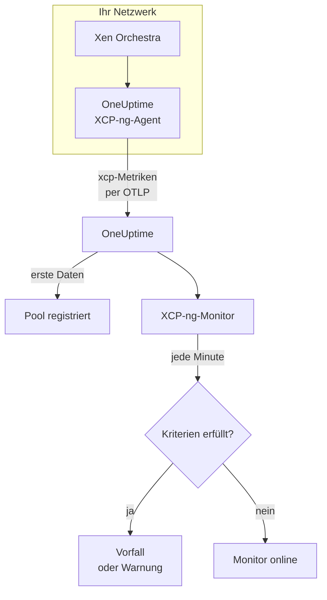

# XCP-ng-Überwachung

Ein XCP-ng-Monitor überwacht einen XCP-ng-Pool – seine Hosts, VMs, Speicher-Repositorys und virtuellen Datenträger – und meldet Ihnen, wenn Xen Orchestra den Pool verliert, ein Host offline geht oder deaktiviert bleibt, eine laufende VM stoppt oder an CPU verhungert, oder ein Speicher-Repository vollläuft oder langsam wird. Er liest die Serien `xcp_*` des OpenMetrics-Plugins von Xen Orchestra, die der OneUptime-XCP-ng-Agent erfasst, und die Zustandsserien, die OneUptime daraus ableitet; von außen wird also nichts abgefragt.

:::cards
- [Den Monitor erstellen](#einen-xcp-ng-monitor-erstellen): Sechs Schritte im Dashboard.
- [Vorlagen](#fertige-warnungsvorlagen): Zehn fertige Warnungen, ein Vorfall pro Host, VM oder Speicher-Repository.
- [Ressourcenidentität](#ressourcenidentität): Wie Sie einen Host, eine VM oder ein Speicher-Repository gezielt ansprechen.
- [Metriken](#erfasste-metriken): Jede Serie, auf die der Monitor warnen kann.
:::

## So funktioniert es

Der OneUptime-XCP-ng-Agent läuft auf einem Rechner, der Xen Orchestra erreicht. Alle 60 Sekunden liest er das OpenMetrics-Plugin von Xen Orchestra, das jeden Host jedes Pools liest, den Xen Orchestra verwaltet, und sendet die Serien per OTLP an OneUptime, eine Ressource pro Pool, versehen mit der UUID des Pools, `xcp_ng.pool.id`. Die ersten Daten registrieren jeden Pool.

Ein XCP-ng-Monitor ist an einen Pool gebunden. Jede Minute führt er seine Abfrage über die Metriken dieses Pools aus und vergleicht das Ergebnis mit seinen Kriterien.



## Bevor Sie beginnen

- **Den XCP-ng-Agent installieren**, wo er Xen Orchestra erreicht, mit dem Secret des OpenMetrics-Plugins von Xen Orchestra. Die [Anleitung zum XCP-ng-Agent](/docs/telemetry/xcp-ng) behandelt das Plugin, das Zertifikat von Xen Orchestra und die Installation.
- **Prüfen, ob der Pool registriert ist.** Er erscheint unter **Produkte → Infrastruktur → XCP-ng → Alle Pools**, so benannt, wie Xen Orchestra ihn nennt, etwa eine Minute nach dem ersten Scrape.

## Einen XCP-ng-Monitor erstellen

:::steps
### Einen neuen Monitor beginnen

Gehen Sie zu **Monitore** und klicken Sie auf **Monitor erstellen**.

### XCP-ng wählen

Klicken Sie unter **Monitortyp** auf **Weitere Monitortypen** und wählen Sie **XCP-ng** unter **Infrastruktur**, oder geben Sie `xcp` in das Suchfeld ein. Geben Sie einen **Name** ein – er wird in den Titeln von Vorfällen und Warnungen verwendet – und klicken Sie auf **Weiter**.

### Den Pool wählen

Wählen Sie unter **XCP-ng-Monitor-Konfiguration** den Pool in **XCP-ng-Pool**. Jeder Pool, der Daten gesendet hat, steht in der Liste. Sobald er gewählt ist, zeigt eine Zeile unter dem Feld, ob Daten eintreffen. **XCP-ng-Pool hinzufügen** öffnet die Einrichtungsschritte mit Ihren bereits eingetragenen Schlüsseln, die auf die ersten Daten warten.

### Festlegen, was überwacht wird

Ein neuer Monitor beginnt mit **Pool Disconnected** unter **Worüber benachrichtigt wird**. Um etwas anderes zu überwachen:

- **Ändern** – wählen Sie eine andere [Vorlage](#fertige-warnungsvorlagen). Sie legt Metriken, Filter, Aggregation, Zeitbereich und Schwellenwerte fest und ersetzt die Kriterien weiter unten durch ihre eigenen. Den **Zeitbereich** können Sie weiterhin ändern.
- **Custom Metric** (unter **Weitere Felder**) – wählen Sie eine Metrik unter **XCP-ng-Metrik** und legen Sie dann **Aggregation** und **Zeitbereich** fest. Die [Filter](#monitor-einstellungen) grenzen sie auf eine Art von Objekt oder auf ein Objekt ein.
- **Erweitert** (unter **Weitere Felder**) – erstellen Sie Abfragen und Formeln selbst unter **Metriken auswählen**, zum Beispiel den belegten Anteil eines Speicher-Repositorys aus `xcp_sr_physical_usage_bytes / xcp_sr_physical_size_bytes`. Verwenden Sie **Gruppieren nach** `xcp_ng.id`, um jedes Objekt für sich zu beurteilen.

### Die Kriterien prüfen

Öffnen Sie unter **Kriterien** jedes Kriterium und prüfen Sie seine **Metrik**, **Aggregation**, **Bedingung** und seinen **Schwellenwert**. Eine Vorlage füllt diese aus. Mit **Custom Metric** oder **Erweitert** beginnt der Monitor mit den [Standardkriterien](#standardkriterien), die nur bemerken, wenn die Metrik keine Daten sendet; legen Sie daher Ihren eigenen Schwellenwert fest.

### Den Monitor erstellen

Klicken Sie auf **Monitor erstellen**. OneUptime öffnet die Seite des Monitors und wertet ihn jede Minute aus. Vorfälle und Warnungen, die er auslöst, stehen auch auf den Seiten **Vorfälle** und **Warnungen** des Pools.
:::

> [!TIP]
> Um mehrere Vorlagen auf einmal einzurichten, öffnen Sie den Pool unter **Produkte → Infrastruktur → XCP-ng** und gehen Sie zu **Empfehlungen**. Wählen Sie die gewünschten Vorlagen, legen Sie fest, wer benachrichtigt wird, und OneUptime erstellt einen Monitor pro Vorlage.

## Monitor-Einstellungen

| Feld | Tab | Was es tut |
| --- | --- | --- |
| **XCP-ng-Pool** | Alle | Erforderlich. Grenzt jede Abfrage auf `resource.xcp_ng.pool.id` ein, die UUID des Pools, sodass sich zwei gleichnamige Pools nie vermischen. |
| **Ressourcenbereich** | Custom Metric, Erweitert | Optional. **Host**, **VM**, **Speicher-Repository**, **Virtueller Datenträger**, **XOSTOR** oder **XCP-ng-Pool** – eine exakte Übereinstimmung mit `xcp_ng.scope`. |
| **UUID** | Custom Metric, Erweitert | Optional. Exakte Übereinstimmung mit `xcp_ng.id`: die UUID eines Hosts, einer VM, eines Speicher-Repositorys oder eines virtuellen Datenträgers, wie Xen Orchestra sie anzeigt. Kombinieren Sie sie mit einem Bereich, um ein Objekt gezielt anzusprechen. |
| **Host-Name** | Custom Metric, Erweitert | Optional. Exakte Übereinstimmung mit dem Label `host_name` von Xen Orchestra: die eigenen Serien des Hosts und die der VMs, die auf ihm laufen. |
| **XCP-ng-Metrik** | Custom Metric | Eine Metrik aus dem [Katalog](#erfasste-metriken). |
| **Aggregation** | Custom Metric | Wie Messwerte zusammengefasst werden: **Durchschnitt**, **Maximum**, **Minimum**, **Summe** oder **Anzahl**. Beginnt bei der üblichen Aggregation der Metrik. |
| **Zeitbereich** | Alle | Das gleitende Zeitfenster, das die Abfrage liest, von **Past 1 Minute** bis **Past 365 Days**. Ein neuer Monitor beginnt bei **Past 1 Minute**; Vorlagen legen ihr eigenes fest. |
| **Metriken auswählen** | Erweitert | Der Abfrage-Builder: **Metrik**, **Aggregieren nach**, **Nach Attributen filtern**, **Gruppieren nach**, dazu **Metrik hinzufügen** und **Formel hinzufügen**, um Abfragen zu kombinieren. |

Der Agent liest Xen Orchestra alle 60 Sekunden, und Xen Orchestra liest seine Hosts in 60-Sekunden-Auflösung; ein Zeitfenster von 1 Minute enthält daher etwa einen Messwert, die Vorlagen lesen 5 Minuten oder mehr.

## Ressourcenidentität

Xen Orchestra benennt einen Host oder eine VM über das Label `uuid`, ein Speicher-Repository über `sr_uuid` und einen virtuellen Datenträger über `vdi_uuid`. OneUptime versieht jeden Messpunkt bei seinem Eintreffen mit zwei Attributen, sodass ein Filter jede Serie eines Objekts liest, gleich welches Label es benannt hat. Die Vorlagen stützen sich darauf:

| Attribut | Werte | Für eine VM |
| --- | --- | --- |
| `xcp_ng.scope` | `pool`, `host`, `vm`, `sr` (ein Speicher-Repository), `vdi` (ein virtueller Datenträger), `xostor` | `vm` |
| `xcp_ng.id` | Die UUID des Objekts, in Kleinbuchstaben: die `uuid` eines Hosts oder einer VM, die `sr_uuid` eines Speicher-Repositorys oder eines XOSTOR-Clusters, die `vdi_uuid` eines virtuellen Datenträgers und die eigene UUID des Pools auf den Serien des Pools | `5c6d7e8f-1a2b-4c3d-9e8f-0a1b2c3d4e5f` |

Filtern Sie nach `xcp_ng.scope` für eine Art von Objekt, nach `xcp_ng.id` für ein Objekt, und gruppieren Sie nach `xcp_ng.id`, um jedes Objekt für sich zu beurteilen. Die eigenen Labels von Xen Orchestra bleiben, wie es sie sendet: `host_name` nennt einen Host auf seinen Serien und den Host einer VM auf denen der VM, `vm_name`, `sr_name` und `vdi_name` benennen den Rest, `power_state` und `enabled` tragen den Zustand eines Hosts oder einer VM auf den Statusserien, und `is_control_domain` ist `true` auf den VM-Serien einer Steuerdomäne.

Der Pool selbst ist die Ressource, auf der die Serien eintreffen; seine Attribute tragen daher in Filtern und Gruppierungsschlüsseln das Präfix `resource.`: `resource.xcp_ng.pool.id` (seine UUID), `resource.xcp_ng.pool.name` (sein Name in Xen Orchestra) und `resource.xen_orchestra.name` (das Xen Orchestra, aus dem er gelesen wird).

## Fertige Warnungsvorlagen

Die Liste **Worüber benachrichtigt wird** bietet 10 Vorlagen an. Jede baut einen vollständigen Monitor – Abfragen, Attributfilter, eine Gruppierung, ein Kriterium, das auslöst, und eines, das wiederherstellt. Die meisten gruppieren nach `xcp_ng.id`, sodass jeder Host, jede VM und jedes Speicher-Repository einen eigenen Vorfall und eine eigene Warnung erhält. Schwellenwerte sind Ausgangspunkte, die Sie anpassen können.

Ein Kriterium löst nur aus, wenn die Bedingung in jeder Minute seines Zeitfensters gilt, und ein Schwellenwert-Kriterium erholt sich erst 10 % jenseits seines Schwellenwerts, damit ein Wert, der an der Linie schwankt, nicht flattert. Eine 0/1-Serie erholt sich beim jeweils anderen Wert.

| Template | Kategorie | Schweregrad | Beobachtet | Löst aus, wenn | Erholt sich, wenn |
| --- | --- | --- | --- | --- | --- |
| Pool Disconnected | Verfügbarkeit | Kritisch | `xcp_pool_connected`, Count über den gesamten Pool, letzte 5 Minuten | Keine Daten im gesamten Zeitfenster | Daten treffen wieder ein |
| Host Offline | Verfügbarkeit | Kritisch | `xcp_ng.host.running` für `xcp_ng.scope = host`, Min pro `xcp_ng.id`, letzte 5 Minuten | Unter 1 | Bei 1 |
| VM Stopped | VM | Warnung | `xcp_ng.vm.stopped_after_running` für `xcp_ng.scope = vm`, Min pro `xcp_ng.id`, letzte 5 Minuten | Über 0 | Bei 0 |
| Storage Repository Near Full | Speicher | Kritisch | `xcp_sr_physical_usage_bytes` ÷ `xcp_sr_physical_size_bytes` × 100 für `xcp_ng.scope = sr` (beide Summe), pro `xcp_ng.id`, letzte 5 Minuten | Über 90 % | Bei oder unter 81 % |
| Host Disabled | Host | Warnung | `xcp_ng.host.enabled` für `xcp_ng.scope = host`, Max pro `xcp_ng.id`, letzte 30 Minuten | Unter 1 | Bei 1 |
| Host Restarted | Host | Warnung | `xcp_host_uptime_seconds` und `xcp_ng.host.running` für `xcp_ng.scope = host`, Min pro `xcp_ng.id`, letzte 5 Minuten | `xcp_host_uptime_seconds` unter 900 (15 Minuten) liegt, während `xcp_ng.host.running` 1 ist | `xcp_host_uptime_seconds` bei 990 oder mehr liegt oder `xcp_ng.host.running` 0 ist |
| High Host CPU Usage | Host | Warnung | `xcp_host_cpu_average` für `xcp_ng.scope = host`, Avg pro `xcp_ng.id`, letzte 10 Minuten | Über 0,9 (90 % der CPU des Hosts) | Bei oder unter 0,81 |
| High Host Memory Usage | Host | Warnung | (`xcp_host_memory_total_bytes` − `xcp_host_memory_free_bytes`) ÷ `xcp_host_memory_total_bytes` × 100 für `xcp_ng.scope = host` (beide Summe), pro `xcp_ng.id`, letzte 10 Minuten | Über 95 % | Bei oder unter 85,5 % |
| VM Starved of CPU | VM | Warnung | `xcp_vm_runstate_full_contention` für `xcp_ng.scope = vm`, Avg pro `xcp_ng.id`, letzte 15 Minuten | Über 0,1 (10 % der Zeit) | Bei oder unter 0,09 |
| Storage Repository Slow | Speicher | Warnung | `xcp_host_disk_latency_seconds` für `xcp_ng.scope = host`, Avg pro `sr`, letzte 15 Minuten | Über 0,05 (50 ms) | Bei oder unter 0,045 |

**Schweregrad** ist die Bezeichnung, die die Auswahl anzeigt. Vorfall und Warnung, die eine Vorlage erstellt, beginnen mit dem schwersten Vorfall- und Warnungsschweregrad Ihres Projekts; ändern Sie sie in den Kriterien.

- **Pool Disconnected** löst aus, wenn `xcp_pool_connected` fünf Minuten lang ausbleibt. Xen Orchestra sendet die Serie bei jedem Scrape, solange es mit dem Pool verbunden ist, und hört auf, sie zu senden, statt 0 zu senden, wenn es den Master des Pools verliert; sie bleibt auch aus, wenn Xen Orchestra, sein Plugin oder der XCP-ng-Agent stoppt oder der Agent seine Route zu OneUptime verliert. Sie löst sich, wenn die Serie zurückkommt. Wenn keine Daten mehr kommen, haben die anderen Vorlagen nichts zu vergleichen und behalten ihren letzten Status; diese ist also die, die es Ihnen sagt.
- **Host Offline** liest `xcp_ng.host.running`, das OneUptime aus `xcp_host_status` ableitet: 0, solange Xen Orchestra den Host als Halted meldet oder seinen Zustand als Unknown, weil der Pool-Master den Kontakt zu ihm verloren hat. Die VMs, die auf dem Host liefen, sind ebenfalls ausgefallen, sofern HA sie nicht anderswo neu gestartet hat.
- **VM Stopped** liest `xcp_ng.vm.stopped_after_running`: 1, solange eine VM, die in den letzten 24 Stunden lief, Halted oder Paused ist. Eine VM, die länger als einen Tag ausgeschaltet ist, gilt als absichtlich aus und alarmiert nicht mehr, eine angehaltene VM (Suspended) alarmiert nie, und Steuerdomänen und Vorlagen bleiben außen vor.
- **Host Disabled** löst für einen Host aus, der 30 Minuten lang deaktiviert bleibt: im Wartungsmodus oder nach einer Evakuierung deaktiviert gelassen. XAPI startet keine VM auf ihm, und HA kann nicht auf ihn ausweichen. Dreißig Minuten lassen einen geplanten Neustart oder ein Update ohne Benachrichtigung vorübergehen.
- **Host Restarted** löst für einen Host aus, der läuft, aber seit weniger als 15 Minuten in Betrieb ist: Er wurde neu gestartet oder ist abgestürzt und wieder hochgekommen. Sie löst sich, sobald der Host 16,5 Minuten in Betrieb ist, 10 % jenseits des Schwellenwerts; ein ausgefallener Host löst stattdessen **Host Offline** aus.
- **Verhältnisformeln** nehmen die **Summe** beider Seiten. Beide stammen aus demselben Scrape, das Ergebnis ist also ein echter Prozentsatz. Ein Speicher-Repository, das eine Größe von 0 meldet, wie es manche ISO-Bibliotheken und Wechselmedien tun, löst nie aus.
- **VM Starved of CPU** liest die volle Konkurrenz: den Anteil der Zeit, in dem alle vCPUs einer VM laufbereit waren, aber auf eine physische CPU warteten. Ihr Host hat mehr lauffähige vCPUs als CPU-Threads, sodass die VM langsamer läuft, als ihre eigene CPU-Nutzung vermuten lässt.
- **Storage Repository Slow** gruppiert nach `sr`, der Kurzkennung eines Speicher-Repositorys bei Xen Orchestra, die jede Datenträgerserie eines Hosts trägt; jedes Speicher-Repository erhält also einen Vorfall, seine Latenz gemittelt über die Hosts, die darauf lesen und schreiben.

Das Plugin meldet keine Alarme außer denen von XOSTOR, keinen HA-Zustand, keinen Pool-Master, keine fehlenden Patches und keine Backups; keine Vorlage überwacht sie daher bisher: siehe [Was das Plugin noch nicht abdeckt](/docs/telemetry/xcp-ng#was-das-plugin-noch-nicht-abdeckt).

## Erfasste Metriken

Der Agent liest alle 60 Sekunden jede Serie des OpenMetrics-Plugins von Xen Orchestra; die Serien unten sind der Katalog, den das Monitorformular anbietet. Xen Orchestra rechnet die KiB, MiB/s und Mikrosekunden von XAPI bereits in Bytes, Bytes pro Sekunde und Sekunden um. Acht Serien, die es `_total` nennt und als Zähler typisiert, enthalten Raten pro Sekunde, und OneUptime speichert sie als die Raten, die sie sind, wie die [Anleitung zum XCP-ng-Agent](/docs/telemetry/xcp-ng#was-der-agent-erfasst) erklärt. Die vier Serien `xcp_ng.*` gehören OneUptime selbst, abgeleitet aus den Statusserien von Xen Orchestra bei deren Eintreffen.

### Verfügbarkeit

| Metrik | Einheit | Beschreibung |
| --- | --- | --- |
| `xcp_pool_connected` | — | 1, solange Xen Orchestra mit dem Pool verbunden ist. Xen Orchestra hört auf, sie zu senden, wenn es den Pool verliert, statt 0 zu senden: Achten Sie darauf, dass sie ausbleibt. |
| `xcp_ng.host.running` | — | 1, solange Xen Orchestra einen Host als Running meldet, 0, solange er Halted ist oder sein Zustand Unknown. Von OneUptime aus dem Status des Hosts abgeleitet. |
| `xcp_ng.host.enabled` | — | 1, solange ein Host aktiviert ist, 0, solange er im Wartungsmodus ist oder evakuiert wird, wenn XAPI keine VM auf ihm startet. Von OneUptime aus dem Status des Hosts abgeleitet. |
| `xcp_ng.vm.running` | — | 1, solange eine VM Running ist, 0, solange sie Halted, Paused oder Suspended ist. Steuerdomänen bleiben außen vor. Von OneUptime aus dem Status der VM abgeleitet. |
| `xcp_ng.vm.stopped_after_running` | — | 1, solange eine VM, die in den letzten 24 Stunden lief, Halted oder Paused ist, sonst 0. Eine VM, die einen Tag lang niemand laufen sah, gilt als absichtlich ausgeschaltet, und eine angehaltene VM (Suspended) zählt nie. Von OneUptime abgeleitet. |
| `xcp_host_status` | count | Immer 1 für jeden Host, ob er läuft oder nicht; der Zustand des Hosts steht in den Labels `power_state` (Running, Halted, Unknown) und `enabled`. |
| `xcp_vm_status` | count | Immer 1 für jede VM außer Steuerdomänen und Vorlagen; der Zustand der VM steht im Label `power_state` (Running, Halted, Paused, Suspended). |
| `xcp_host_uptime_seconds` | seconds | Wie lange ein Host seit seinem Start in Betrieb ist. |
| `xcp_vm_uptime_seconds` | seconds | Wie lange eine laufende VM seit ihrem Start in Betrieb ist. Nur gemeldet, solange die VM läuft. |

### Host

| Metrik | Einheit | Beschreibung |
| --- | --- | --- |
| `xcp_host_cpu_average` | ratio | Die CPU-Nutzung eines Hosts, gemittelt über seine Kerne, als Verhältnis von 0 bis 1. |
| `xcp_host_cpu_core_usage` | ratio | Die Nutzung eines CPU-Threads auf einem Host, als Verhältnis von 0 bis 1; das Label `core` sagt, welcher. |
| `xcp_host_load` | — | Die vCPUs, die auf einem Host laufen oder auf das Laufen warten, pro physischer CPU. Über 1 warten VMs auf eine CPU. |
| `xcp_host_load_average` | — | Die Load Average der Steuerdomäne (dom0) eines Hosts. |
| `xcp_host_memory_total_bytes` | bytes | Der physische Arbeitsspeicher eines Hosts. |
| `xcp_host_memory_free_bytes` | bytes | Der Arbeitsspeicher eines Hosts, der keiner VM zugeteilt ist. Vergleichen Sie ihn mit `xcp_host_memory_total_bytes`, um zu sehen, wie voll der Host ist. |
| `xcp_host_memory_reclaimed_bytes` | bytes | Arbeitsspeicher, den die dynamische Speichersteuerung von den VMs eines Hosts zurückgewonnen hat. |
| `xcp_host_memory_reclaimed_max_bytes` | bytes | Der meiste Arbeitsspeicher, den die dynamische Speichersteuerung von den VMs eines Hosts zurückgewinnen könnte. |
| `xcp_host_running_vcpus` | count | Die vCPUs der VMs, die auf einem Host laufen, zusammengezählt. |
| `xcp_host_power_consumption_watts` | W | Die Leistungsaufnahme eines Hosts, gelesen von seinem DCMI-Sensor. Wo Xen Orchestra sie stattdessen über IPMI liest, sendet es diesen Wert ohne seinen Pool, und der Agent behält ihn nicht; der geschätzte Anteil jeder VM daran wird behalten. |

### VM

| Metrik | Einheit | Beschreibung |
| --- | --- | --- |
| `xcp_vm_cpu_usage` | ratio | Die CPU-Nutzung einer VM, gemittelt über ihre vCPUs, als Verhältnis von 0 bis 1. |
| `xcp_vm_cpu_core_usage` | ratio | Die Nutzung einer vCPU, als Verhältnis von 0 bis 1; das Label `core` sagt, welche. |
| `xcp_vm_runstate_full_contention` | ratio | Der Anteil der Zeit, in dem alle vCPUs einer VM laufbereit waren, aber auf eine physische CPU warteten, von 0 bis 1. Ein hoher Wert bedeutet, dass die VM von ihren Nachbarn um CPU gebracht wird. |
| `xcp_vm_runstate_partial_contention` | ratio | Der Anteil der Zeit, in dem einige vCPUs einer VM auf eine physische CPU warteten, während die übrigen blockiert waren, von 0 bis 1. |
| `xcp_vm_runstate_concurrency_hazard` | ratio | Der Anteil der Zeit, in dem einige vCPUs einer VM liefen, während andere auf eine physische CPU warteten, von 0 bis 1. |
| `xcp_vm_runstate_fullrun` | ratio | Der Anteil der Zeit, in dem alle vCPUs einer VM liefen, von 0 bis 1. |
| `xcp_vm_runstate_partial_run` | ratio | Der Anteil der Zeit, in dem einige vCPUs einer VM liefen und die übrigen blockiert waren, von 0 bis 1. |
| `xcp_vm_runstate_blocked` | ratio | Der Anteil der Zeit, in dem alle vCPUs einer VM blockiert waren, ohne Arbeit oder wartend auf E/A, von 0 bis 1. |
| `xcp_vm_memory_bytes` | bytes | Der Arbeitsspeicher, der einer VM zugeteilt wurde. |
| `xcp_vm_memory_target_bytes` | bytes | Der Arbeitsspeicher, den die dynamische Speichersteuerung einer VM zuteilen will. |
| `xcp_vm_memory_internal_free_bytes` | bytes | Der Arbeitsspeicher, den das Gastsystem als frei meldet. Erfordert die Gastwerkzeuge in der VM. |
| `xcp_vm_power_consumption_watts` | W | Die Schätzung von Xen Orchestra für den Anteil einer VM an der Leistungsaufnahme ihres Hosts, aufgeteilt nach CPU-Last. Ihr Label `data_complete` ist `false`, wenn der CPU-Wert der VM fehlte. |

### Speicher

| Metrik | Einheit | Beschreibung |
| --- | --- | --- |
| `xcp_sr_physical_size_bytes` | bytes | Die physische Größe eines Speicher-Repositorys. Manche ISO-Bibliotheken und Wechselmedien melden 0. |
| `xcp_sr_physical_usage_bytes` | bytes | Der belegte Platz auf einem Speicher-Repository. Teilen Sie ihn durch seine Größe, um zu sehen, wie voll es ist. |
| `xcp_sr_virtual_size_bytes` | bytes | Die virtuelle Größe aller Datenträger auf einem Speicher-Repository, zusammengezählt. Liegt sie über seiner Größe, ist das Repository über das hinaus Thin-provisioniert, was es fassen kann. |
| `xcp_vdi_virtual_size_bytes` | bytes | Die Größe eines virtuellen Datenträgers, wie seine VM sie sieht. |
| `xcp_vdi_physical_usage_bytes` | bytes | Der Platz, den ein virtueller Datenträger auf seinem Speicher-Repository belegt. |
| `xcp_host_disk_iops_read` | ops/s | Leseoperationen pro Sekunde von einem Host auf ein Speicher-Repository; das Label `sr_name` sagt, welches. |
| `xcp_host_disk_iops_write` | ops/s | Schreiboperationen pro Sekunde von einem Host auf ein Speicher-Repository. |
| `xcp_host_disk_iops_total` | ops/s | Lese- und Schreiboperationen pro Sekunde von einem Host auf ein Speicher-Repository. |
| `xcp_host_disk_throughput_read_bytes` | bytes/s | Bytes pro Sekunde, die ein Host von einem Speicher-Repository liest. |
| `xcp_host_disk_throughput_write_bytes` | bytes/s | Bytes pro Sekunde, die ein Host auf ein Speicher-Repository schreibt. |
| `xcp_host_disk_throughput_total_bytes` | bytes/s | Bytes pro Sekunde, die ein Host von einem Speicher-Repository liest und darauf schreibt. |
| `xcp_host_disk_read_latency_seconds` | seconds | Wie lange die Lesezugriffe eines Hosts auf ein Speicher-Repository dauern. |
| `xcp_host_disk_write_latency_seconds` | seconds | Wie lange die Schreibzugriffe eines Hosts auf ein Speicher-Repository dauern. |
| `xcp_host_disk_latency_seconds` | seconds | Wie lange die Lese- und Schreibzugriffe eines Hosts auf ein Speicher-Repository dauern. |
| `xcp_host_disk_iowait` | ratio | Der Anteil der Zeit, in dem ein Host auf ein Speicher-Repository wartete, von 0 bis 1. |
| `xcp_vm_disk_read_bytes_total` | bytes/s | Bytes pro Sekunde, die eine VM von einem ihrer Datenträger liest; das Label `device` sagt, von welchem. Eine Rate, obwohl Xen Orchestra sie `_total` nennt und als Zähler typisiert. |
| `xcp_vm_disk_write_bytes_total` | bytes/s | Bytes pro Sekunde, die eine VM auf einen ihrer Datenträger schreibt. Eine Rate, obwohl Xen Orchestra sie `_total` nennt und als Zähler typisiert. |
| `xcp_vm_disk_iops_read` | ops/s | Leseoperationen pro Sekunde auf dem Datenträger einer VM. |
| `xcp_vm_disk_iops_write` | ops/s | Schreiboperationen pro Sekunde auf dem Datenträger einer VM. |
| `xcp_vm_disk_iops_total` | ops/s | Lese- und Schreiboperationen pro Sekunde auf dem Datenträger einer VM. |
| `xcp_vm_disk_throughput_read_bytes` | bytes/s | Bytes pro Sekunde, die vom Datenträger einer VM gelesen werden. |
| `xcp_vm_disk_throughput_write_bytes` | bytes/s | Bytes pro Sekunde, die auf den Datenträger einer VM geschrieben werden. |
| `xcp_vm_disk_throughput_total_bytes` | bytes/s | Bytes pro Sekunde, die vom Datenträger einer VM gelesen und darauf geschrieben werden. |
| `xcp_vm_disk_read_latency_seconds` | seconds | Wie lange Lesezugriffe auf den Datenträger einer VM dauern. |
| `xcp_vm_disk_write_latency_seconds` | seconds | Wie lange Schreibzugriffe auf den Datenträger einer VM dauern. |
| `xcp_vm_disk_latency_seconds` | seconds | Wie lange Lese- und Schreibzugriffe auf den Datenträger einer VM im Mittel dauern. |
| `xcp_vm_disk_iowait` | ratio | Der Anteil der Zeit, in dem eine VM auf einen ihrer Datenträger wartete, von 0 bis 1. |
| `xcp_vm_disk_inflight` | count | Die noch nicht beantworteten Anfragen auf dem Datenträger einer VM. |
| `xcp_vm_disk_queue_size` | count | Die mittlere Warteschlange der Anfragen auf dem Datenträger einer VM. |

### Netzwerk

| Metrik | Einheit | Beschreibung |
| --- | --- | --- |
| `xcp_host_network_receive_bytes_total` | bytes/s | Bytes pro Sekunde, die ein Host auf einer physischen Schnittstelle empfängt; das Label `interface` sagt, auf welcher. Eine Rate, obwohl Xen Orchestra sie `_total` nennt und als Zähler typisiert. |
| `xcp_host_network_transmit_bytes_total` | bytes/s | Bytes pro Sekunde, die ein Host auf einer physischen Schnittstelle sendet. Eine Rate, obwohl Xen Orchestra sie `_total` nennt und als Zähler typisiert. |
| `xcp_host_network_aggregated_receive_bytes` | bytes/s | Bytes pro Sekunde, die ein Host auf allen seinen physischen Schnittstellen empfängt. |
| `xcp_host_network_aggregated_transmit_bytes` | bytes/s | Bytes pro Sekunde, die ein Host auf allen seinen physischen Schnittstellen sendet. |
| `xcp_vm_network_receive_bytes_total` | bytes/s | Bytes pro Sekunde, die eine VM auf einer ihrer Netzwerkschnittstellen empfängt; das Label `vif` sagt, auf welcher. Eine Rate, obwohl Xen Orchestra sie `_total` nennt und als Zähler typisiert. |
| `xcp_vm_network_transmit_bytes_total` | bytes/s | Bytes pro Sekunde, die eine VM auf einer ihrer Netzwerkschnittstellen sendet. Eine Rate, obwohl Xen Orchestra sie `_total` nennt und als Zähler typisiert. |
| `xcp_vm_network_receive_errors_total` | errors/s | Empfangsfehler pro Sekunde auf einer der Netzwerkschnittstellen einer VM. Eine Rate, obwohl Xen Orchestra sie als Zähler typisiert. |
| `xcp_vm_network_transmit_errors_total` | errors/s | Sendefehler pro Sekunde auf einer der Netzwerkschnittstellen einer VM. Eine Rate, obwohl Xen Orchestra sie als Zähler typisiert. |

### XOSTOR

Nur für Pools gesendet, die XOSTOR betreiben, den auf LINSTOR aufgebauten replizierten Speicher von Vates.

| Metrik | Einheit | Beschreibung |
| --- | --- | --- |
| `xcp_xostor_up` | — | 1, wenn Xen Orchestra den Zustand eines XOSTOR-Clusters lesen konnte, 0, wenn nicht. |
| `xcp_xostor_node_status` | count | Immer 1 für jeden Knoten eines XOSTOR-Clusters; seine Rolle und sein Zustand stehen in den Labels `role` und `state`. |
| `xcp_xostor_resource_total` | count | Die LINSTOR-Ressourcen, die ein XOSTOR-Cluster definiert. |
| `xcp_xostor_resource_state_count` | count | Die Ressourcenreplikate eines XOSTOR-Clusters in jedem Datenträgerzustand; das Label `state` sagt, in welchem. |
| `xcp_xostor_alarms_up` | — | 1, wenn Xen Orchestra die Alarme eines XOSTOR-Clusters lesen konnte, 0, wenn nicht. |
| `xcp_xostor_alarms_count` | count | Aktive XAPI-Alarme auf einem XOSTOR-Speicher-Repository oder seinen Hosts, nach `alarm_name` und `target_type`. Fehlt, wenn keiner ausgelöst ist. |
| `xcp_xostor_smart_up` | — | 1, wenn Xen Orchestra die SMART-Daten eines Hosts für XOSTOR lesen konnte, 0, wenn nicht. |
| `xcp_xostor_disk_smart_status` | count | Immer 1 für jeden Datenträger eines XOSTOR-Hosts; sein SMART-Zustand steht im Label `status`. |
| `xcp_xostor_updates_up` | — | 1, wenn die XOSTOR-Updateprüfung eines Hosts antwortete, 0, wenn sie fehlschlug. |
| `xcp_xostor_package_update_available` | count | 1 für jedes XOSTOR-Paket mit einem wartenden Update auf einem Host; das Label `package` sagt, welches. |

## Überwachungskriterien

Ein Kriterium vergleicht eine der Abfragen oder Formeln des Monitors mit einem Schwellenwert. Die Kriterien eines XCP-ng-Monitors haben keinen **Filtertyp**: Jede Regel prüft den Metrikwert, mit diesen Feldern.

| Feld | Was es tut |
| --- | --- |
| **Metrik** | Die zu prüfende Abfrage oder Formel, anhand ihres Variablennamens. |
| **Aggregation** | Wie die Werte im Zeitfenster zu einer Antwort werden: **Durchschnitt**, **Summe**, **Maximalwert**, **Minimalwert**, **Alle Werte** (jeder Wert muss zutreffen, im ganzen Zeitfenster) oder **Beliebiger Wert** (einer genügt). |
| **Bedingung** | **Größer als**, **Kleiner als**, **Größer als oder gleich**, **Kleiner als oder gleich**, **Gleich** oder **Ungleich** – oder eine Anomaliebedingung: **Anomal hoch**, **Anomal niedrig** oder **Anomal**. **Keine Daten** trifft zu, wenn die Abfrage im Zeitfenster nichts lieferte, **Daten vorhanden**, wenn sie etwas lieferte. **Steigt voraussichtlich über** und **Fällt voraussichtlich unter** treffen zu, wenn der Trend der Metrik im Zeitfenster am Ende der unter **Prognosezeitraum** gewählten Zeit jenseits des Schwellenwerts liegt. |
| **Schwellenwert** | Der Vergleichswert. Daneben steht eine Einheitenliste, wenn die Metrik eine Einheit hat. Wird bei Anomaliebedingungen nicht angezeigt. |
| **Empfindlichkeit** | Nur bei Anomaliebedingungen. **Niedrig** (4σ), **Mittel** (3σ, der Standard) oder **Hoch** (2σ). |
| **Baseline-Fenster** | Nur bei Anomaliebedingungen. 14 Tage (der Standard), 28, 60 oder 90 Tage Verlauf. |
| **Bei keinen Daten** | Unter **Weitere Felder**. Was geschieht, wenn das Zeitfenster keine Messwerte hat: **Ignore** (der Standard), **Treat As Zero** oder **Auslöser**. |

Anomaliebedingungen vergleichen jeden Wert mit derselben Stunde der Woche in der Baseline. Sie bleiben im Zustand „Learning“ und lösen nichts aus, bis das Baseline-Fenster genug Verlauf enthält. Dieser Monitor filtert seine Abfragen nach Attributen, daher wird jede Abfrage, und jede Reihe einer gruppierten Abfrage, mit ihrem eigenen Verlauf verglichen, so weit zurück, wie Ihre Metriken aufbewahrt werden. Sind das weniger als zwei Wochen, bleibt eine Summe, eine Anzahl oder eine Abfrage auf einem Histogramm dauerhaft in diesem Zustand, und alles andere wird mit allen Reihen der Metrik verglichen. Ein Perzentil eines Histogramms bleibt immer in diesem Zustand.

Jedes Kriterium legt außerdem fest, was geschieht, wenn es zutrifft: den Monitorstatus ändern, eine Warnung erstellen oder einen Vorfall melden. Kriterien werden von oben nach unten geprüft, und das erste zutreffende entscheidet.

### Standardkriterien

Ein Monitor, den Sie nicht aus einer Vorlage erstellen, beginnt mit zwei Kriterien:

| Reihenfolge | Kriterium | Trifft zu, wenn | Dann |
| --- | --- | --- | --- |
| 1 | Prüfen, ob _Monitorname_ offline ist | Die erste Abfrage hat im ganzen Zeitfenster keine Daten | Markiert den Monitor als **Offline** und meldet den Vorfall „_Monitorname_ ist offline“, der sich von selbst auflöst, wenn der Monitor sich erholt. |
| 2 | Prüfen, ob _Monitorname_ online ist | Die erste Abfrage hat Daten | Markiert den Monitor als **Betriebsbereit**. |

> [!IMPORTANT]
> Ein Wert von `0` sind Daten; eine Metrik, die oft null ist, etwa die Netzwerkfehler einer VM, macht den Monitor also nicht offline. Um auf einen Wert zu alarmieren, beginnen Sie mit einer Vorlage oder fügen Sie ein Kriterium mit einem Schwellenwert hinzu. Wenn überhaupt keine Daten eintreffen und kein Kriterium zutrifft, behält der Monitor seinen Status, und offene Vorfälle bleiben offen: Stille ist keine Erholung. Zeit, in der OneUptime selbst nichts empfing, gilt nie als fehlende Daten: Eine Prüfung, deren Zeitfenster sie enthält, wartet stattdessen, wie [Wenn OneUptime keine Daten empfängt](/docs/monitor/when-oneuptime-is-not-receiving) erklärt.

## Terraform

Der [OneUptime-Terraform-Provider](/docs/terraform/monitor-steps) trägt die Konfiguration eines XCP-ng-Monitorschritts im Attribut `xcp_ng_monitor`: das rohe JSON der Konfiguration `xcpNgMonitor` (`poolIdentifier`, `resourceFilters`, `metricViewConfig`, `rollingTime`), geschrieben mit `jsonencode()`:

```hcl title="main.tf"
monitor_steps = [{
  xcp_ng_monitor = jsonencode({
    poolIdentifier  = "b7569d99-30f8-178a-7d94-801de3e29b5b"
    resourceFilters = { scope = "host" }
    rollingTime     = "Past 10 Minutes"
    metricViewConfig = {
      queryConfigs = [{
        metricAliasData = { metricVariable = "host_cpu", title = "Host CPU", description = "", legend = "" }
        metricQueryData = {
          filterData = {
            metricName     = "xcp_host_cpu_average"
            attributes     = {}
            aggegationType = "Avg"
            aggregateBy    = {}
          }
          groupByAttributeKeys = ["xcp_ng.id"]
        }
      }]
      formulaConfigs = []
    }
  })
  criteria = [ /* ... */ ]
}]
```

`poolIdentifier` ist die UUID des Pools, seine `xcp_ng.pool.id`, wie die **Einstellungen** des Pools sie zeigen, nicht seine OneUptime-ID. `resourceFilters` enthält die [Filter](#monitor-einstellungen), die das Formular **Ressourcenbereich**, **UUID** und **Host-Name** nennt: `scope` (`host`, `vm`, `sr`, `vdi`, `xostor` oder `pool`), `xcpNgId` und `hostName`.

## Fehlerbehebung

:::details Der Pool steht nicht in der Liste XCP-ng-Pool
Pools registrieren sich aus den Daten des Agents. Prüfen Sie, dass der Agent läuft und Daten sendet (siehe die [Anleitung zum XCP-ng-Agent](/docs/telemetry/xcp-ng)), und dass Xen Orchestra mit dem Pool verbunden ist: Ein Pool, den Xen Orchestra nicht meldet, erreicht OneUptime nie.
:::

:::details Host Offline oder VM Stopped löst nie aus
Sie lesen `xcp_ng.host.running` und `xcp_ng.vm.stopped_after_running`, die OneUptime aus `xcp_host_status` und `xcp_vm_status` ableitet. Beide Statusserien stammen vom OpenMetrics-Plugin von Xen Orchestra 6.9 oder neuer: Aktualisieren Sie ein älteres Xen Orchestra. **VM Stopped** bleibt außerdem still für eine VM, die in den letzten 24 Stunden niemand laufen sah, und für eine angehaltene (Suspended).
:::

:::details Vorfälle lösen einmal für den ganzen Pool aus statt einmal pro Host
Gruppieren Sie die Abfrage nach `xcp_ng.id`, wie es die Vorlagen tun. Ohne Gruppierung liest die Abfrage jeden Host, jede VM oder jedes Speicher-Repository des Pools als eine Serie, und ein Mittelwert über alle verdeckt dasjenige mit Problemen.
:::

:::details Ein Durchsatzdiagramm zeigt viel zu hohe Werte oder fällt unter null
Die acht Serien `_total`, die Raten enthalten, werden als Gauges in Bytes oder Fehlern pro Sekunde gespeichert, den Werten, die Xen Orchestra liefert. Lesen Sie sie so, wie sie sind, mit **Durchschnitt** oder **Maximum**: **In Rate pro Sekunde umrechnen** im Abfrage-Builder würde eine Rate einer Rate bilden. Ein Collector, den Sie selbst konfiguriert haben, muss sie ebenfalls zu Gauges machen, wie es der Prozessor `transform/xcp-ng-rates` des Agents tut; OneUptime wandelt außerdem jede um, die noch als Zähler ankommt.
:::

:::details Pool Disconnected löst für jeden Pool eines Xen Orchestra gleichzeitig aus
Der Agent, Xen Orchestra oder sein OpenMetrics-Plugin ist gestoppt, oder der Agent hat seine Route zu OneUptime verloren: Jeder Pool dieses Xen Orchestra ist gleichzeitig verstummt. Das Skript `troubleshoot.sh` des Agents nennt den Schritt, der scheitert, wie die [Anleitung zum XCP-ng-Agent](/docs/telemetry/xcp-ng#fehlerbehebung) erklärt.
:::

## Nächste Schritte

:::cards
- [XCP-ng-Agent](/docs/telemetry/xcp-ng): Den Agent installieren, der die Metriken sendet.
- [Proxmox-Überwachung](/docs/monitor/proxmox-monitor): Dieselbe Art von Monitor für Proxmox VE.
- [VMware-Überwachung](/docs/monitor/vmware-monitor): Dieselbe Art von Monitor für vSphere.
- [Vorfälle – Übersicht](/docs/incidents/index): Was passiert, nachdem ein Kriterium einen Vorfall gemeldet hat.
:::
