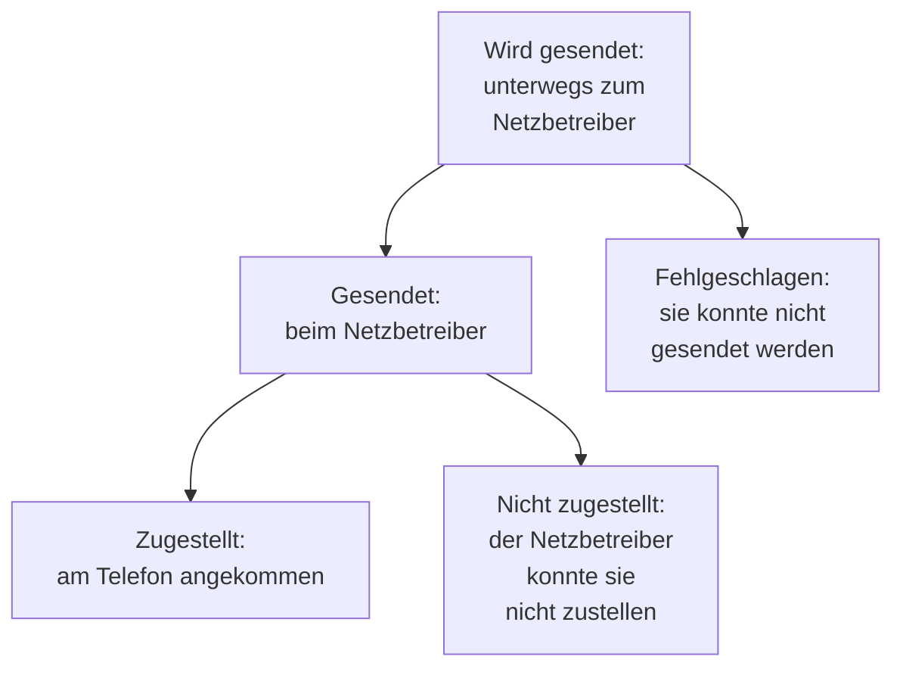

# Benachrichtigungsprotokolle

Benachrichtigungsprotokolle listen jede Nachricht auf, die OneUptime für Ihr Projekt gesendet hat, mit einem Tab pro Kanal, und zeigen, was aus jeder wurde: ob sie hinausging, ob sie ankam und, falls nicht, warum. Sie finden sie unter **Projekteinstellungen → Benachrichtigungen → Benachrichtigungsprotokolle** oder unter **Benachrichtigungsprotokolle** bei einem Vorfall, einer Warnung, einem Wartungsereignis, einer Statusseite oder einer Bereitschaftsrichtlinie, für das, was dazu gesendet wurde.

:::cards
- [Einen Status lesen](#einen-status-lesen): Seine Farbe zeigt, wo die Nachricht ist, und wenn Sie darauf zeigen, sagt er, was er bedeutet.
- [SMS](#sms): Wird gesendet, dann Gesendet, dann Zugestellt, wie der Netzbetreiber es meldet.
- [Anrufe](#anrufe): Wird angerufen, dann wie der Anruf endete.
- [WhatsApp und Telegram](#whatsapp-und-telegram): Was jede App meldet, nachdem sie eine Nachricht angenommen hat.
- [E-Mail, Push, Webhooks und Arbeitsbereiche](#e-mail-push-webhooks-und-arbeitsbereiche): Erfolg, oder Fehler und warum.
- [Wenn eine SMS auf Gesendet bleibt](#wenn-eine-sms-auf-gesendet-bleibt): Netzbetreiber, die sich nie zurückmelden, und Meldungen, die nie ankommen.
:::

## Einen Status lesen

Jeder Status ist eine Pille, deren Farbe zeigt, wo die Nachricht ist:

| Farbe | Wo die Nachricht ist |
| --- | --- |
| Grau | Übergeben, und es ist noch nichts zurückgekommen, etwa **Wird gesendet**. |
| Blau | Der Anbieter hat sie und muss noch sagen, wie sie endete, etwa **Gesendet** bei einer SMS oder **Wird angerufen** bei einem Anruf. |
| Grün | Sie hat die Person erreicht, etwa **Zugestellt**, oder dies ist der letzte Status, den sie haben wird. |
| Gelb | Sie hat das Telefon erreicht und niemand hat abgenommen, etwa **Verpasster Anruf**, oder sie ging mit einer Warnung hinaus. |
| Rot | Sie hat die Person nicht erreicht, etwa **Nicht zugestellt**, **Fehlgeschlagen**, **Fehler** oder **Guthaben zu niedrig**. |

Zeigen Sie auf einen Status, tippen Sie ihn an oder gehen Sie mit der Tabulatortaste zu ihm, und er sagt, was er bedeutet und was als Nächstes kommt. **Statusmeldung anzeigen** im Menü der Zeile zeigt, was der Anbieter gesagt hat, etwa die ID der Nachricht oder warum sie fehlschlug. Der Filter **Status** jedes Tabs listet jeden Status auf, den der Tab zeigen kann, in der Reihenfolge, in der eine Nachricht sie durchläuft.

## SMS

| Status | Was er bedeutet |
| --- | --- |
| **Wird gesendet** | OneUptime hat die SMS an Twilio übergeben, das sie an den Netzbetreiber weiterleitet. |
| **Gesendet** | Der Netzbetreiber hat die SMS angenommen. Sie wechselt zu **Zugestellt** oder **Nicht zugestellt**, sobald sich der Netzbetreiber zurückmeldet. |
| **Zugestellt** | Der Netzbetreiber hat bestätigt, dass die SMS das Telefon erreicht hat. Dies ist der letzte Status einer SMS, die angekommen ist. |
| **Nicht zugestellt** | Der Netzbetreiber konnte sie nicht zustellen. **Fehlercode** nennt den Grund: `30003` ist ein ausgeschaltetes oder unerreichbares Telefon, `30005` eine Nummer, die es nicht gibt, `30006` ein Festnetzanschluss und `30007` eine Nachricht, die der Netzbetreiber gefiltert hat. |
| **Fehlgeschlagen** | Twilio konnte sie nicht senden. **Fehlercode** nennt den Grund. |
| **Fehler** | Sie wurde nicht gesendet, zum Beispiel weil SMS für das Projekt ausgeschaltet sind oder Twilio die Nummer abgelehnt hat. **Statusmeldung anzeigen** nennt den Grund. |
| **Guthaben zu niedrig** | Sie wurde nicht gesendet: Das Guthaben des Projekts reichte dafür nicht aus. |
| **Erfolg** | Sie wurde gesendet, bevor OneUptime die Zustellung verfolgte, und Twilio hat sie angenommen. |

Eine SMS, die das eigene SMS- und Anruf-Gateway des Servers angenommen hat, bleibt **Gesendet**, in Grün: Das Gateway meldet keine Zustellung, also ist das ihr letzter Status.

Twilio meldet OneUptime jede Änderung, sobald sie geschieht, signiert mit dem Auth-Token des Kontos, über das die SMS hinausging, und OneUptime lehnt jede Meldung ab, die nicht von Twilio stammt. Dafür muss Twilio Ihren Server erreichen können: siehe [Twilio-Integration](/docs/self-hosted/twilio-integration).

## Anrufe

| Status | Was er bedeutet |
| --- | --- |
| **Wird angerufen** | Twilio hat den Anruf getätigt. Der Status ändert sich, sobald Twilio meldet, wie der Anruf endete. |
| **Erfolg** | Der Anruf wurde angenommen, und **Statusmeldung anzeigen** zeigt, wie lange er dauerte. Ein Anruf, den das eigene SMS- und Anruf-Gateway des Servers angenommen hat, ist **Erfolg**, sobald das Gateway ihn annimmt. |
| **Verpasster Anruf** | Es klingelte ohne Antwort: Niemand hat abgenommen. |
| **Besetzt** | Die Leitung war besetzt, oder der Anruf wurde abgelehnt. |
| **Mailbox** | Die Mailbox hat einen Bereitschaftsanruf angenommen. **Statusmeldung anzeigen** zeigt, ob eine Nachricht hinterlassen wurde. |
| **Fehler** | Der Anruf konnte nicht getätigt oder verbunden werden. |
| **Guthaben zu niedrig** | Er wurde nicht getätigt: Das Guthaben des Projekts reichte dafür nicht aus. |

## WhatsApp und Telegram

Eine WhatsApp-Nachricht ist **In der Warteschlange**, während OneUptime sie übergibt, **Gesendet**, sobald WhatsApp sie annimmt, **Zugestellt**, sobald sie das Telefon erreicht, und **Gelesen**, sobald sie geöffnet wird, sofern die Person Lesebestätigungen teilt. **Fehlgeschlagen** ist eine Nachricht, die WhatsApp nicht zustellen konnte, und **Warnung** eine, die es mit einer Warnung gesendet hat: **Statusmeldung anzeigen** zeigt, was WhatsApp gemeldet hat. **Fehler** und **Guthaben zu niedrig** bedeuten, dass sie nicht gesendet wurde, wie bei einer SMS.

Telegram meldet nichts mehr, nachdem es eine Nachricht angenommen hat, daher ist **Gesendet** bei einer Telegram-Nachricht grün: Telegram hat sie im Chat veröffentlicht, und das ist ihr letzter Status.

## E-Mail, Push, Webhooks und Arbeitsbereiche

Diese Tabs zeigen **Erfolg** oder **Fehler**. **Erfolg** ist der letzte Status: Der Mailserver hat die E-Mail angenommen, der Push-Dienst die Benachrichtigung, die Adresse des Webhooks hat geantwortet, dass sie die Anfrage angenommen hat, oder der Arbeitsbereich hat getan, worum er gebeten wurde. OneUptime verfolgt eine E-Mail nicht weiter, nachdem der Mailserver sie angenommen hat, und eine Push-Benachrichtigung wechselt zu **Fehler**, wenn der Push-Dienst später meldet, dass sie nicht zugestellt wurde. **Statusmeldung anzeigen** nennt den Grund, warum eine Nachricht **Fehler** ist, so wie **Grund** auf dem Tab **Arbeitsbereich**.

## Wenn eine SMS auf Gesendet bleibt

**Gesendet** bedeutet, dass der Netzbetreiber die SMS hat und sich noch nicht zurückgemeldet hat. Die meisten Netzbetreiber melden sich innerhalb von Sekunden oder Minuten, manche aber nie: Dann belässt auch Twilio die SMS auf `sent`, wie seine Nachrichtenprotokolle zeigen, und OneUptime kann nicht wissen, ob sie angekommen ist.

Eine SMS, die auf **Wird gesendet** bleibt, ist etwas anderes: Die Meldungen von Twilio erreichen OneUptime nicht. Prüfen Sie, ob Twilio Ihren Server erreichen kann, und suchen Sie im Log des Servers nach Zeilen, die mit `Twilio callback refused` beginnen: siehe [Twilio-Integration](/docs/self-hosted/twilio-integration).

## Nächste Schritte

:::cards
- [Twilio-Integration](/docs/self-hosted/twilio-integration): Twilio verbinden, damit seine Zustellmeldungen OneUptime erreichen.
- [SMS- und Anruf-Gateway](/docs/self-hosted/sms-and-call-gateway): SMS und Anrufe über ein eigenes Gateway senden.
- [Metriken zur Benachrichtigungszustellung](/docs/self-hosted/notification-delivery-metrics): Zählen, was in der ganzen Installation zugestellt wurde.
:::
