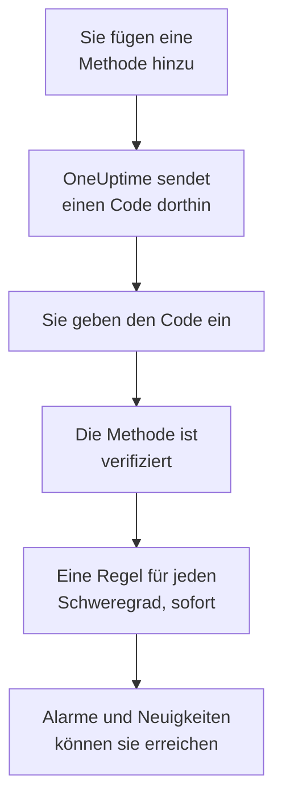

# Benachrichtigungsmethoden

Eine Benachrichtigungsmethode ist eine Adresse, unter der OneUptime Sie in einem Projekt erreichen darf: eine E-Mail-Adresse, eine Telefonnummer für SMS oder Anrufe, eine WhatsApp-Nummer, ein Telegram-Konto, Ihr Slack- oder Microsoft Teams-Konto, ein Telefon oder Browser für Push-Benachrichtigungen oder ein Webhook. Sie fügen sie unter **Benutzereinstellungen → Benachrichtigungsmethoden** hinzu, verifizieren sie, und OneUptime nutzt sie sofort für Ihre Alarme.

:::cards
- [Eine Methode wählen](#eine-methode-wählen): Was jede Methode braucht, und wie sie verifiziert wird.
- [Eine Methode hinzufügen und verifizieren](#eine-methode-hinzufügen-und-verifizieren): E-Mail, SMS, Anrufe und WhatsApp, mit einem 6-stelligen Code.
- [Webhooks](#webhooks): Senden Sie Alarme an Ihren eigenen Endpunkt, auf Wunsch signiert.
- [Einen Kanal für Ihr Projekt einschalten](#einen-kanal-für-ihr-projekt-einschalten): Warum SMS, Anrufe, WhatsApp oder Telegram fehlen können.
:::

## Wie eine Methode aktiv wird



Eine Methode, die Sie nicht verifiziert haben, wird nie genutzt. Push-Geräte, Slack, Microsoft Teams und Webhooks kommen ohne Code aus: Ein Gerät zu registrieren oder Ihr Konto zu verknüpfen beweist, dass es Ihnen gehört, und ein Webhook braucht keinen Beweis. Eine Methode zu verifizieren fügt sofort Ihre [Standardregeln](/docs/notifications/on-call-rules#die-regeln-mit-denen-sie-starten) für sie hinzu, sodass eine neue Telefonnummer Sie bei jedem Schweregrad alarmiert, bis Sie ihre Regeln ändern.

## Eine Methode wählen

Jeder Tab der **Benachrichtigungsmethoden** enthält eine oder mehrere Karten, eine pro Art von Methode:

| Karte | Tab | Was Sie hinzufügen | Wie sie verifiziert wird |
| --- | --- | --- | --- |
| **E-Mails für Benachrichtigungen** | **Direct Contact** | Eine E-Mail-Adresse | Ein Code per E-Mail |
| **Telefonnummern für SMS-Benachrichtigungen** | **Direct Contact** | Eine Telefonnummer | Ein Code per SMS |
| **Telefonnummern für Anrufbenachrichtigungen** | **Direct Contact** | Eine Telefonnummer | Ein Code, der in einem Anruf vorgelesen wird, oder keiner für eine Nummer, die für SMS verifiziert ist |
| **WhatsApp-Nummern für Benachrichtigungen** | **Direct Contact** | Eine WhatsApp-Nummer | Ein Code über WhatsApp |
| **Telegram-Konten für Benachrichtigungen** | **Direct Contact** | Ihr Telegram-Konto | Eine Nachricht an den OneUptime-Bot |
| **Slack-Konto für Benachrichtigungen** | **Workspace Apps** | Ihr Slack-Konto | Ihr Konto mit dem Arbeitsbereich des Projekts verknüpfen |
| **Microsoft Teams-Konto für Benachrichtigungen** | **Workspace Apps** | Ihr Microsoft Teams-Konto | Ihr Konto mit dem Arbeitsbereich des Projekts verknüpfen |
| **Geräte für Push-Benachrichtigungen** | **Push Notifications** | Ein Telefon mit der App OneUptime On-Call, oder ein Browser | Das Gerät registrieren |
| **Webhooks für Benachrichtigungen** | **Webhooks** | Ein eigener HTTPS-Endpunkt | Keine |

**Workspace Apps** erscheint nur, wenn das Projekt Slack oder Microsoft Teams verbunden hat, und enthält nur die verbundenen. SMS, Anrufe, WhatsApp und Telegram können für das ganze Projekt ausgeschaltet sein; siehe [Einen Kanal für Ihr Projekt einschalten](#einen-kanal-für-ihr-projekt-einschalten).

## Eine Methode hinzufügen und verifizieren

E-Mail-Adressen, SMS-Nummern, Anrufnummern und WhatsApp-Nummern werden mit einem 6-stelligen Code verifiziert.

:::steps
### Ihre Methoden öffnen

Gehen Sie zu **Benutzereinstellungen → Benachrichtigungsmethoden**. **Direct Contact** ist der erste Tab.

### Die Adresse hinzufügen

Klicken Sie in der Karte der Methode auf ihre Schaltfläche zum Hinzufügen, etwa **Telefonnummer für SMS-Benachrichtigungen hinzufügen**. Geben Sie die **E-Mail** ein, oder die **Telefonnummer** im internationalen Format, etwa `+11234567890`, und speichern Sie.

### Den Code eingeben

Der Verifizierungsdialog öffnet sich von selbst und sagt, wohin der Code ging und bis wann er gilt. Tippen Sie den Code in **Verifizierungscode** ein und klicken Sie auf **Verifizieren**.

### Die Zeile prüfen

Die Zeile ist jetzt als **Verifiziert** markiert. Den Dialog zu früh geschlossen? Klicken Sie in der Zeile auf **Verifizieren**, um ihn erneut zu öffnen.
:::

- Ein Code gilt 15 Minuten. Fünf falsche Versuche machen ihn ungültig, und Sie brauchen einen neuen.
- **Send a new code**, oder **Call me with a new code** für eine Anrufnummer, ist im Dialog. Sie können einen neuen eine Minute nach dem letzten anfordern.
- Eine Nummer, die Sie für SMS verifiziert haben, ist auch für Anrufe verifiziert. Sie unter **Telefonnummern für Anrufbenachrichtigungen** hinzuzufügen braucht keinen Code, und eine SMS-Nummer zu verifizieren verifiziert auch die Anrufnummer, die Sie dafür hinzugefügt haben.
- Ihre Anmelde-E-Mail ist bereits da, verifiziert, seit dem Tag, an dem Sie dem Projekt beigetreten sind.

## Telegram verknüpfen

:::steps
### Das Konto hinzufügen

Klicken Sie in **Telegram-Konten für Benachrichtigungen** auf **Telegram-Konto hinzufügen**. **Telegram-Handle (optional)** ist nur eine Bezeichnung für Sie und kann leer bleiben.

### Dem Bot schreiben

Klicken Sie in der neuen Zeile auf **Verifizieren**. Der Dialog **Telegram-Konto verifizieren** bietet Ihnen drei Wege zum OneUptime-Bot: Scannen Sie den QR-Code mit Ihrem Telefon, klicken Sie auf **In Telegram öffnen**, oder suchen Sie den Bot in Telegram und senden Sie ihm den Befehl `/start`, den der Dialog zeigt.

### Bestätigen

Klicken Sie zurück in OneUptime auf **Ich habe die Nachricht gesendet — prüfen**. Sobald der Bot Ihre Nachricht hat, ist das Konto verifiziert.
:::

**Code rotieren** erzeugt einen neuen Code für ein Konto, das noch nicht verifiziert ist. Der QR-Code und der Link, die Sie zuvor geöffnet haben, funktionieren dann nicht mehr. In einem selbst gehosteten OneUptime verbindet der Admin des Servers einen Telegram-Bot, bevor jemand ein Konto verknüpfen kann.

## Slack und Microsoft Teams

1. Verknüpfen Sie Ihr eigenes Konto mit dem Arbeitsbereich des Projekts: **Benutzereinstellungen → Arbeitsbereich → Slack**, oder **Microsoft Teams**. Siehe [Slack](/docs/workspace-connections/slack) und [Microsoft Teams](/docs/workspace-connections/microsoft-teams).
2. Klicken Sie auf dem Tab **Workspace Apps** auf **Slack-Konto hinzufügen** oder **Microsoft Teams-Konto hinzufügen**. Das Konto ist verifiziert, sobald es hinzugefügt ist.
3. Klicken Sie in seiner Zeile auf **Testnachricht senden**. Alarme kommen als Direktnachrichten von der OneUptime-App an.

## Push-Benachrichtigungen

Der Tab **Push Notifications** listet Ihre **Geräte für Push-Benachrichtigungen**.

- **Ein Telefon.** Installieren Sie die App OneUptime On-Call, verbinden Sie sie mit Ihrem OneUptime, melden Sie sich an und erlauben Sie Benachrichtigungen: Das Telefon trägt sich selbst in diese Liste ein. Siehe [Apps – Übersicht](/docs/mobile-desktop-apps/index).
- **Dieser Browser.** Klicken Sie auf **Gerät registrieren**, tragen Sie unter **Gerätename** einen Namen ein, und erlauben Sie Benachrichtigungen, wenn der Browser fragt.
- **Testbenachrichtigung** in der Zeile eines Geräts sendet sofort einen Push dorthin.
- **Kritische Warnungen** zeigt, ob die Alarme des Telefons den Lautlosmodus und „Nicht stören“ durchbrechen. Das wird in der App eingeschaltet, nie hier, und ein Browser kann es nicht. Siehe [Kritische Bereitschaftswarnungen](/docs/self-hosted/push-notifications#kritische-bereitschaftsalarme-stummmodus-durchbrechen).
- An ein Gerät mit der Markierung **Keine Benachrichtigungen** wird nichts gesendet. Öffnen Sie die App auf diesem Telefon, oder registrieren Sie den Browser erneut, dann ist es wieder dabei.

## Webhooks

Ein Webhook sendet jeden Alarm als JSON an einen HTTPS-Endpunkt von Ihnen, damit ein eigenes Werkzeug darauf reagieren kann.

:::steps
### Den Webhook hinzufügen

Klicken Sie auf dem Tab **Webhooks** auf **Webhook hinzufügen**. Füllen Sie **Name** mit einer Bezeichnung aus, die Sie wiedererkennen, dann **Webhook-URL** und **Signaturgeheimnis (optional)**.

### Einen Test senden

Klicken Sie in seiner Zeile auf **Test senden**. Ihr Endpunkt erhält ein Ereignis, dessen `eventType` `test` ist.

### Prüfen, was ankommt

Ein Alarm ist ein JSON-`POST` wie der unten. Antworten Sie innerhalb von 10 Sekunden mit einem beliebigen `2xx`-Status; Weiterleitungen werden nicht verfolgt.
:::

```json title="A page, as your endpoint receives it"
{
  "eventType": "on-call.incident.created",
  "timestamp": "2026-10-15T09:30:00.000Z",
  "projectId": "6a3f0d2e-1c4b-4e8a-9b7d-2f5c8e1a0b3c",
  "userId": "0c9e8d7f-6b5a-4c3d-8e2f-1a0b9c8d7e6f",
  "incident": {
    "id": "5b4a3c2d-1e0f-4a9b-8c7d-6e5f4a3b2c1d",
    "title": "Checkout API is down",
    "description": "Health check failed from 3 probes.",
    "incidentNumber": 42,
    "incidentNumberWithPrefix": "INC-42",
    "severity": "Critical Incident",
    "state": "Identified"
  },
  "onCallPolicyId": "7d6c5b4a-3e2f-4d1c-9b8a-7f6e5d4c3b2a",
  "onCallPolicyEscalationRuleId": "8e7d6c5b-4a3f-4e2d-8c1b-9a8f7e6d5c4b"
}
```

| `eventType` | Gesendet für | Der Schlüssel des Datensatzes |
| --- | --- | --- |
| `on-call.incident.created` | Einen Vorfall | `incident` |
| `on-call.alert.created` | Eine Warnung | `alert` |
| `on-call.incidentEpisode.created` | Eine Vorfallsepisode | `incidentEpisode` |
| `on-call.alertEpisode.created` | Eine Warnungsepisode | `alertEpisode` |

Die Neuigkeiten, die Sie in den **Benachrichtigungseinstellungen** für Webhook einschalten, kommen am selben Endpunkt an, mit dem Ereignis der Einstellung in `eventType` und einer kurzen Zusammenfassung in `subject` und `message`.

Jede Anfrage trägt `X-OneUptime-Event`, den Ereignistyp. Mit einem Signaturgeheimnis trägt sie außerdem `X-OneUptime-Signature`: `sha256=`, gefolgt vom HMAC-SHA256 des rohen Body, in Hex. Prüfen Sie ihn, bevor Sie der Anfrage vertrauen:

```javascript title="verify-signature.js"
const crypto = require("crypto");

// rawBody: the request body exactly as it arrived, before any JSON parsing.
function isFromOneUptime(rawBody, signatureHeader, secret) {
  const expected =
    "sha256=" + crypto.createHmac("sha256", secret).update(rawBody).digest("hex");
  const received = Buffer.from(signatureHeader || "");
  const wanted = Buffer.from(expected);
  return received.length === wanted.length && crypto.timingSafeEqual(received, wanted);
}
```

Ein Webhook braucht keine Verifizierung, daher fügt das Hinzufügen sofort seine Regeln hinzu. Private und interne Adressen werden abgelehnt, es sei denn, der Admin eines selbst gehosteten Servers erlaubt sie: siehe [Zugriff auf private Netzwerke](/docs/self-hosted/private-network-access#webhooks-und-workflows).

## Einen Kanal für Ihr Projekt einschalten

**SMS**, **Telefonanrufe**, **WhatsApp** und **Telegram** sind in jedem neuen Projekt ausgeschaltet, weil jede Nachricht Geld kostet: In OneUptime Cloud wird sie vom Guthaben des Projekts bezahlt, und SMS und Anrufe laufen stattdessen über das eigene Twilio-Konto des Projekts, wenn sein Standardkonto sie sendet. E-Mail, Push, Slack, Microsoft Teams und Webhooks sind immer eingeschaltet.

Solange ein Kanal ausgeschaltet ist, kann niemand im Projekt eine Methode darauf hinzufügen: Seine Karte hat keine Schaltfläche zum Hinzufügen und sagt, wer ihn einschalten kann. Ein Projekteigentümer, ein **Abrechnungs-Administrator** oder jemand mit **Manage Billing** schaltet ihn ein, in der Karte **Benachrichtigungskanäle** unter **Projekteinstellungen → Benachrichtigungen → Benachrichtigungseinstellungen**. Ein Projekt-Admin kann das nicht. In einem selbst gehosteten OneUptime brauchen SMS und Anrufe außerdem ein Twilio-Konto, und Telegram einen Bot, den der Admin des Servers verbindet; siehe [Twilio-Integration](/docs/self-hosted/twilio-integration).

## Eine Methode löschen

Klicken Sie in der Zeile der Methode auf **Löschen**. Eine Methode zu löschen löscht jede Bereitschaftsregel, die sie nutzt, daher zählt der Dialog diese Regeln zuerst und nennt jeden Schweregrad, den das Löschen ganz ohne Regel lassen würde.

## Fehlerbehebung

:::details Eine Karte hat keine Schaltfläche zum Hinzufügen
Dieser Kanal ist in diesem Projekt ausgeschaltet. Die Karte sagt, wer ihn einschalten kann; siehe [Einen Kanal für Ihr Projekt einschalten](#einen-kanal-für-ihr-projekt-einschalten).
:::

:::details Der Code ist nie angekommen
E-Mails können einige Minuten dauern und landen manchmal im Spam; SMS können eine Minute dauern. Warten Sie eine Minute und klicken Sie dann im Dialog auf **Send a new code**. **Projekteinstellungen → Benachrichtigungen → Benachrichtigungsprotokolle** zeigt, was mit der Nachricht passiert ist.
:::

:::details Mein Slack-Konto lässt sich nicht hinzufügen
Verknüpfen Sie zuerst Ihr Konto unter **Benutzereinstellungen → Arbeitsbereich → Slack**, und klicken Sie dann erneut auf **Slack-Konto hinzufügen**. Der Fehlerdialog hat eine Schaltfläche, die Sie dorthin bringt.
:::

:::details Mein Telefon bekommt keine Push-Benachrichtigungen
Prüfen Sie, ob das Telefon unter **Geräte für Push-Benachrichtigungen** aufgeführt ist, und senden Sie ihm eine **Testbenachrichtigung**. Siehe [FAQ & Fehlerbehebung](/docs/mobile-desktop-apps/faq-troubleshooting#benachrichtigungen).
:::

## Nächste Schritte

:::cards
- [Persönliche Bereitschaftsregeln](/docs/notifications/on-call-rules): Legen Sie fest, welche Methode jeder Alarm versucht, und wann.
- [Benachrichtigungseinstellungen](/docs/notifications/notification-settings): Wählen Sie die Neuigkeiten, von denen Sie erfahren, und über welche Kanäle.
- [Apps – Übersicht](/docs/mobile-desktop-apps/index): Erhalten Sie Alarme auf Ihrem Telefon oder Desktop.
- [Wie OneUptime Sie erreicht](/docs/notifications/index): Wie Methoden, Regeln und Einstellungen zusammenpassen.
:::
