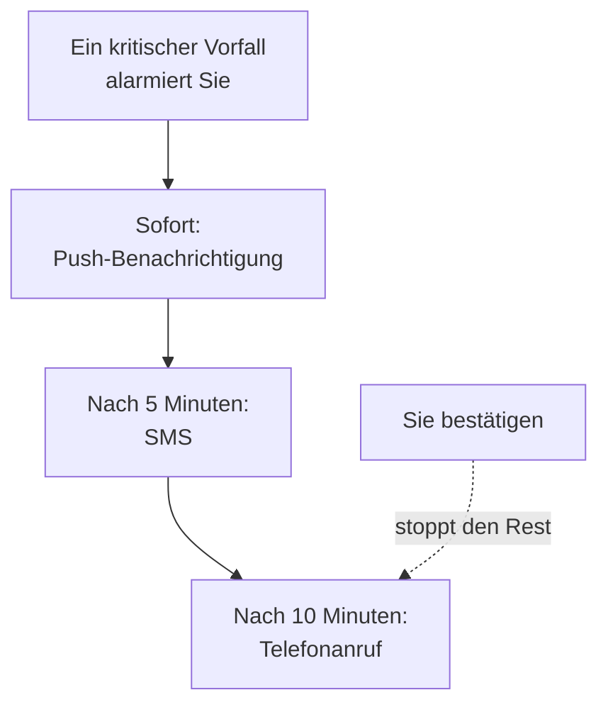

# Persönliche Bereitschaftsregeln

Ihre Bereitschaftsregeln entscheiden, wie ein Alarm Sie erreicht: welche Ihrer Benachrichtigungsmethoden OneUptime versucht, und wie lange nach dem Beginn des Alarms. Jede Art von Alarm hat eigene Regeln, ein Satz pro Schweregrad, sodass ein kritischer Vorfall Sie sofort anrufen kann, während eine Warnung mit niedrigem Schweregrad auf eine E-Mail wartet. Sie legen sie unter **Benutzereinstellungen → Bereitschaftsregeln** fest.

> [!NOTE]
> Diese Regeln gehören nur Ihnen. Die **Bereitschaftsregeln** unter **Vorfälle → Regeln** und **Warnungen → Regeln** sind etwas anderes: Sie entscheiden, welche Bereitschaftsrichtlinien ein neuer Vorfall oder eine neue Warnung ausführt.

:::cards
- [Wie ein Alarm Sie erreicht](#wie-ein-alarm-sie-erreicht): Ihre Regeln für einen Alarm, Schritt für Schritt.
- [Die Regeln, mit denen Sie starten](#die-regeln-mit-denen-sie-starten): Was jede verifizierte Methode hinzufügt, und wie Sie es kürzen.
- [Eine Regel hinzufügen](#eine-regel-hinzufügen): Eine Methode und eine Wartezeit für einen Schweregrad.
- [Push-Regeln](#push-regeln): Den Lautlosmodus durchbrechen und wiederholen, bis jemand bestätigt.
:::

## Wie ein Alarm Sie erreicht

Eine Bereitschaftsrichtlinie alarmiert Sie, wenn eine ihrer Eskalationsregeln Sie nennt, ein Team, in dem Sie sind, oder einen Plan, in dem Sie gerade Bereitschaft haben. OneUptime arbeitet dann Ihre Regeln für diese Art von Alarm und seinen Schweregrad ab: Jede Regel löst über ihre eigene Methode aus, sobald ihre Wartezeit seit dem Beginn des Alarms vergangen ist. Den Vorfall oder die Warnung zu bestätigen, aus einer beliebigen Nachricht oder in OneUptime, stoppt jede Regel, die noch nicht ausgelöst hat.

Die meisten Nachrichten können den Alarm bestätigen: E-Mails, SMS und Nachrichten über WhatsApp, Telegram, Slack und Microsoft Teams enthalten einen Bestätigungslink, und ein Anruf bittet Sie, die 1 zu drücken. Können Sie einen Alarm nicht übernehmen, können Sie ihn über dieselben Nachrichten eskalieren, und ein Anruf bittet Sie, die 2 zu drücken: Die Richtlinie alarmiert sofort ihre nächste Stufe, und Sie werden dazu nicht mehr alarmiert. Siehe [Eine Alarmierung eskalieren](/docs/on-call/escalation-rules#eine-alarmierung-eskalieren). Jeder Alarm an Sie steht unter **Benutzereinstellungen → Bereitschaftsprotokolle**, wo **Zeitachse anzeigen** jede gesendete Nachricht zeigt und ob sie zugestellt wurde.

## Die vier Tabs

**Benutzereinstellungen → Bereitschaftsregeln** hat einen Tab für jede Art von Alarm. Jeder Tab hat eine Karte pro Schweregrad, benannt und eingefärbt, wie Ihr Projekt es festgelegt hat:

| Tab | Alarme für | Karten für |
| --- | --- | --- |
| **Vorfälle** | Vorfälle | Schweregrade von Vorfällen |
| **Vorfallsepisoden** | Episoden, die Vorfälle bündeln | Schweregrade von Vorfällen |
| **Warnungen** | Warnungen | Schweregrade von Warnungen |
| **Warnungsepisoden** | Episoden, die Warnungen bündeln | Schweregrade von Warnungen |

Eine Episode alarmiert Sie über ihre eigenen Bereitschaftsrichtlinien, getrennt von den Vorfällen oder Warnungen darin, daher stehen ihre Regeln auf einem eigenen Tab. Die Adresse der Seite nennt den geöffneten Tab, etwa `/dashboard/{projectId}/user-settings/on-call-rules?type=alerts`; die anderen Werte sind `incident-episodes` und `alert-episodes`, und ohne `type` öffnet die Seite auf **Vorfälle**.

Ein Schweregrad, den Ihr Projekt archiviert hat, steht nach den anderen, markiert mit **Archiviert**, solange Sie Regeln dafür haben: Vorfälle und Warnungen, die ihn noch haben, alarmieren Sie danach. Sie können diese Regeln ändern oder entfernen, aber keine neuen hinzufügen.

## Die Regeln, mit denen Sie starten

Jede Methode, die Sie verifizieren, erhält eine Regel auf jeder Karte jedes Tabs, die gesendet wird, sobald Sie alarmiert werden. Ihre Anmelde-E-Mail hat sie seit dem Tag Ihres Beitritts, damit ein Alarm Sie immer erreicht. Verifizieren Sie eine Telefonnummer für SMS, und jeder Alarm schickt Ihnen auch eine SMS.

Das ist ein sicherer Start und meist zu viel. Kürzen Sie es auf das, was jeder Schweregrad verdient:

| Schweregrad | Eine sinnvolle Auswahl |
| --- | --- |
| Kritisch | Sofort Push, nach 5 Minuten ein Anruf |
| Hoch | Sofort Push, nach 10 Minuten eine SMS |
| Gering oder niedrig | Sofort eine E-Mail |

Ihre eigenen Regeln haben keine Ruhezeiten: Lassen Sie niedrige Schweregrade bei E-Mail, oder bei einer Push-Regel auf **Normal**, damit sie Sie nie wecken. Damit eine Alarmierung mit niedrigem Schweregrad für alle auf die Arbeitszeiten wartet, stellen Sie die Bereitschaftsregel, die sie auslöst, auf **Nur während der Arbeitszeiten**: siehe [Bereitschaftsregeln](/docs/alerts/settings#bereitschaftsregeln).

## Eine Regel hinzufügen

:::steps
### Die Karte öffnen

Gehen Sie zu **Benutzereinstellungen → Bereitschaftsregeln**, öffnen Sie den Tab für die Art von Alarm und suchen Sie die Karte des Schweregrads.

### Die Methode wählen

Klicken Sie auf **Benachrichtigungsregel hinzufügen**. Wählen Sie unter **Benachrichtigungsmethode** eine Ihrer verifizierten Methoden; eine Methode, die Sie nicht verifiziert haben, wird nicht angeboten.

### Den Klang eines Push wählen

Wählen Sie für ein Telefon unter **Push-Benachrichtigung** **Kritische Warnung** oder **Normal**. Wählen Sie für jedes Push-Gerät **Wiederholen bis zur Bestätigung**. Siehe [Push-Regeln](#push-regeln).

### Die Wartezeit festlegen

Wählen Sie **Mich benachrichtigen nach**: **Sofort**, **5 Minuten**, **10 Minuten**, **15 Minuten**, **30 Minuten** oder **1 Stunde**. Klicken Sie dann im Dialog auf **Benachrichtigungsregel hinzufügen**.
:::

Die Karte listet ihre Regeln in der Reihenfolge ihrer Wartezeit, jeweils mit **Benachrichtigungsmethode** und **Benachrichtigen nach**.

## Eine Regel ändern oder löschen

- **Bearbeiten** in der Zeile einer Regel ändert ihre Wartezeit. Um eine Regel an eine andere Methode zu senden, löschen Sie sie und fügen Sie eine neue hinzu.
- Klicken Sie bei einer Push-Regel auf die Markierung unter der Methode, um zwischen **Kritische Warnung** und **Normal** zu wechseln oder zu ändern, wie oft sie wiederholt. Das wird sofort gespeichert.
- **Löschen** fragt zuerst nach und sagt, ob der Schweregrad ohne Regel bleibt. Ein Schweregrad ohne Regel fällt auf Ihre verifizierten Methoden zurück; siehe [Wenn ein Schweregrad keine Regel hat](#wenn-ein-schweregrad-keine-regel-hat).

## Push-Regeln

Eine Regel, die ein Telefon alarmiert, legt fest, wie ihr Push klingt:

| Auswahl | Was das Telefon tut |
| --- | --- |
| **Kritische Warnung** | Klingelt auch, wenn das Telefon lautlos ist oder „Nicht stören“ an ist, sobald Critical On-Call Alerts in der App OneUptime On-Call eingeschaltet ist. Eine neue Telefonregel beginnt hier. |
| **Normal** | Folgt den Ton-, Lautlos- und „Nicht stören“-Einstellungen des Telefons. |

Eine Push-Regel, für ein Telefon oder einen Browser, kann ihren Push auch wiederholen, bis jemand bestätigt: **Nicht wiederholen**, die Voreinstellung, oder **Jede Minute**, **Alle 2 Minuten**, **Alle 3 Minuten**, **Alle 5 Minuten**, **Alle 10 Minuten**, **Alle 15 Minuten** oder **Alle 30 Minuten**. Sie wiederholt bis zu 10 weitere Male und stoppt, sobald der Vorfall, die Warnung oder die Episode bestätigt ist. Siehe [Kritische Bereitschaftswarnungen](/docs/self-hosted/push-notifications#kritische-bereitschaftsalarme-stummmodus-durchbrechen).

## Wenn ein Schweregrad keine Regel hat

Ein Schweregrad, den Ihr Projekt später hinzufügt, erhält innerhalb weniger Minuten Regeln, gebildet aus dem, was Sie auf diesem Tab bereits gewählt haben: dieselben Methoden, nach denselben Wartezeiten. Hatten Sie auf diesem Tab keine Regeln, erhält er Ihre verifizierte E-Mail, sofort.

Ein Alarm, der trotzdem keine Regel findet, geht dennoch an Ihre verifizierten Methoden, und Sie erhalten darüber eine E-Mail; siehe [Wenn keine Regel passt](/docs/notifications/index#wenn-keine-regel-passt).

:::details Einen Schweregrad bewusst ausschalten
Die API kann eine Opt-out-Regel speichern, mit gesetztem `isOptOut` und ohne Methode: Sie werden dann für diese Art von Alarm und diesen Schweregrad gar nicht alarmiert, und nichts springt ein. Die Zeile zeigt **Muted - notifications turned off for this rule**, und sie zu löschen schaltet die Alarme wieder ein. Auch ein später hinzugefügter Schweregrad bleibt stumm, wenn jede Regel, die Sie auf diesem Tab haben, eine Opt-out-Regel ist.
:::

:::details Den Rückfall für ein ganzes Projekt ausschalten
Ein Projekteigentümer oder jemand mit **Manage Billing** kann über die API `disableOnCallNotificationFallback` des Projekts setzen. Ein Alarm, der keine Regel findet, wird dann nicht zugestellt, und sein Protokoll sagt, dass der Benutzer Regeln unter **Benutzereinstellungen → Bereitschaftsregeln** hinzufügen sollte.
:::

## Regeln eines Teammitglieds

Projekteigentümer und Admins können dieselbe Seite für jeden im Projekt ansehen und ändern: Unter **Benutzer** öffnen sie die Person und dann **Bereitschaftsregeln** im Abschnitt **Bereitschaft**. **Einsatzbereitschaft** daneben zeigt, ob jeder Schweregrad die Person erreicht. Wenn jemand anderes Ihre Regeln hinzufügt, ändert oder löscht, erhalten Sie darüber eine E-Mail, und jede Änderung steht im Audit-Log des Projekts.

## Fehlerbehebung

:::details Mein Telefon blieb bei einem kritischen Alarm stumm
Prüfen Sie, ob der Push der Regel **Kritische Warnung** ist und nicht **Normal**, und ob **Kritische Warnungen** für das Telefon eingeschaltet ist, unter **Benutzereinstellungen → Benachrichtigungsmethoden** auf dem Tab **Push Notifications**.
:::

:::details Ich werde bei jedem Vorfall zweimal alarmiert
Jede verifizierte Methode hat für jeden Schweregrad eine Regel, die sofort gesendet wird. Löschen Sie die Regeln, die Sie nicht wollen, oder geben Sie ihnen eine Wartezeit. Ein Vorfall in einer Episode kann Sie einmal für den Vorfall und einmal für die Episode alarmieren, über zwei Richtlinien.
:::

:::details Ich habe eine E-Mail bekommen, obwohl meine Regel SMS sagt
Der Alarm fand keine Regel für seine Art oder seinen Schweregrad und fiel auf Ihre kostenlosen Methoden zurück: Fügen Sie die Regel auf dem richtigen Tab und der richtigen Karte hinzu. Oder die E-Mail war eine Neuigkeit zu einem Datensatz, der Ihnen gehört, und folgt den **Benachrichtigungseinstellungen**, nicht Ihren Regeln. Ihre **Bereitschaftsprotokolle** listen nur Alarme.
:::

## Nächste Schritte

:::cards
- [Benachrichtigungsmethoden](/docs/notifications/notification-methods): Fügen Sie die Methoden hinzu, auf die Ihre Regeln zeigen, und verifizieren Sie sie.
- [Eskalationsregeln](/docs/on-call/escalation-rules): Wie eine Bereitschaftsrichtlinie Personen Stufe für Stufe alarmiert.
- [Push-Benachrichtigungen](/docs/self-hosted/push-notifications): Kritische Warnungen, Alarmtöne und Wiederholungen auf Telefonen.
- [Wie OneUptime Sie erreicht](/docs/notifications/index): Wie Methoden, Regeln und Einstellungen zusammenpassen.
:::
