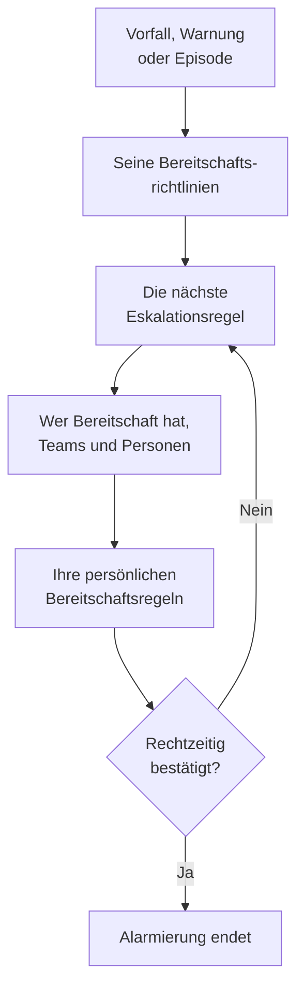

# Bereitschaft – Übersicht

Bereitschaft ist der Weg, auf dem OneUptime zu jeder Stunde eine Person an ein Problem bringt. Braucht ein Vorfall, eine Warnung oder eine Episode jemanden, alarmieren ihre Bereitschaftsrichtlinien Personen Stufe für Stufe, bis jemand bestätigt, und jede Person wird so erreicht, wie sie es gewählt hat: per Push-Benachrichtigung, SMS, Anruf, E-Mail oder Chat-Nachricht. Diese Seite zeigt, wie die Teile zusammenpassen und wo jedes zu finden ist.

:::cards
- [Wie ein Alarm jemanden erreicht](#wie-ein-alarm-jemanden-erreicht): Von einem neuen Vorfall bis zur Person, die antwortet.
- [Die Bausteine](#die-bausteine): Richtlinien, Eskalationsregeln, Pläne, Überschreibungen und persönliche Regeln.
- [Bereitschaft einrichten](#bereitschaft-einrichten): In fünf Schritten von null zu einem Team, das alarmiert wird.
- [Wo die Bereitschaft zu finden ist](#wo-die-bereitschaft-zu-finden-ist): Das Menü des Bereitschaftsdiensts, Abschnitt für Abschnitt.
:::

## Wie ein Alarm jemanden erreicht

1. Ein neuer Vorfall, eine neue Warnung oder Episode führt ihre Bereitschaftsrichtlinien sofort aus: die bei ihr gewählten und die, die ihre Bereitschaftsregeln hinzufügen. Jede Richtlinie läuft für sich. Eine Bereitschaftsregel mit **Nur während der Arbeitszeiten** lässt die Richtlinien, die sie hinzufügt, warten, bis diese Zeiten beginnen.
2. Die erste Eskalationsregel einer Richtlinie alarmiert sofort: wer in ihren Plänen gerade Bereitschaft hat, jedes Mitglied ihrer Teams und die Personen, die sie nennt.
3. Ist eine davon abwesend, schickt eine Benutzerüberschreibung ihren Alarm an die Person, die sie vertritt, oder überspringt sie.
4. Jede Person wird über ihre persönlichen Bereitschaftsregeln erreicht: welche ihrer Methoden versucht wird und nach welcher Zeit. Ein Alarm ohne passende Regel erreicht sie trotzdem über die Methoden, die sie verifiziert hat.
5. Bestätigt niemand, bevor die Wartezeit der Regel abläuft, alarmiert die nächste Regel. Nach der letzten beginnt die Richtlinie von vorn, wenn sie sich wiederholt, und hört sonst auf.

Bestätigen oder Beheben des Vorfalls, der Warnung oder der Episode stoppt jede Richtlinie, die dafür noch alarmiert. OneUptime bringt laufende Richtlinien jede Minute einen Schritt weiter und hält jeden Lauf, Regel für Regel, unter **Ausführungsprotokolle** fest.

Wenn ein Alarm zum ersten Mal jemanden erreicht, hält OneUptime das am Vorfall, an der Warnung oder an der Episode als `First Paged At` fest. Eine Messung kann ab diesem Zeitpunkt zählen: Die **Zeit bis zur Bestätigung nach der Alarmierung** misst, wie lange Personen zum Antworten brauchten, nachdem sie alarmiert wurden, nicht wie lange gewartet wurde, bevor überhaupt jemand alarmiert war. Siehe [Zeit bis zur Bestätigung nach der Alarmierung](/docs/incidents/settings#zeit-bis-zur-bestätigung-nach-der-alarmierung).

> [!NOTE]
> Ein Vorfall, eine Warnung oder Episode, die bereits bestätigt oder behoben erstellt wird, führt keine ihrer Richtlinien aus, und ihr Feed sagt das. Siehe [Bereits bestätigt oder behoben erstellt](/docs/alerts/index#bereits-bestätigt-oder-behoben-erstellt).

## Die Bausteine

| Baustein | Was er entscheidet | Mehr dazu |
| --- | --- | --- |
| Bereitschaftsrichtlinie | Wer zu einem Vorfall oder einer Warnung alarmiert wird, Stufe für Stufe | [Bereitschaftsrichtlinien](/docs/on-call/policies) |
| Eskalationsregel | Eine Stufe einer Richtlinie: wen sie alarmiert und wie lange sie auf eine Bestätigung wartet | [Eskalationsregeln](/docs/on-call/escalation-rules) |
| Bereitschaftsplan | Wer in jedem Moment Bereitschaft hat, wenn sich Personen abwechseln | [Bereitschaftspläne](/docs/on-call/schedules) |
| Benutzerüberschreibung | Wer jemanden vertritt, solange er abwesend ist | [Benutzerüberschreibungen](/docs/on-call/user-overrides) |
| Persönliche Bereitschaftsregeln | Wie eine Person erreicht wird: über welche Methode und nach welcher Zeit | [Persönliche Bereitschaftsregeln](/docs/notifications/on-call-rules) |
| Richtlinie für eingehende Anrufe | Eine Telefonnummer, unter der klingelt, wer Bereitschaft hat | [Richtlinie für eingehende Anrufe](/docs/on-call/incoming-call-policy) |

Richtlinien, Eskalationsregeln, Pläne und Überschreibungen gehören zum Projekt, unter **Bereitschaftsdienst**. Benachrichtigungsmethoden und persönliche Bereitschaftsregeln gehören jeder Person selbst, unter **Benutzereinstellungen**: Ein Admin kann sich die Einrichtung einer Person ansehen, aber nur sie selbst kann ihr Telefon oder ihre E-Mail verifizieren. Siehe [Wie OneUptime Sie erreicht](/docs/notifications/index).

## Bereitschaft einrichten

:::steps
### Einen Plan anlegen

Öffnen Sie **Bereitschaftsdienst** über das Menü **Produkte** und gehen Sie zu **Bereitschaftspläne**. Klicken Sie auf **Bereitschaftsplan erstellen**, geben Sie ihm einen Namen und wählen Sie unter **Wer wechselt sich ab?** die Personen in der Reihenfolge, in der sie sich abwechseln. Siehe [Bereitschaftspläne](/docs/on-call/schedules).

### Eine Richtlinie anlegen

Gehen Sie zu **Bereitschaftsrichtlinien** und klicken Sie auf **Bereitschaftsrichtlinie erstellen**. Wählen Sie unter **Wer wird zuerst alarmiert?** den Plan. Er wird zur ersten Eskalationsregel der Richtlinie, **Level 1**, die 30 Minuten auf eine Bestätigung wartet.

### Die nächsten Stufen hinzufügen

Klicken Sie auf der Seite **Eskalationsregeln** der Richtlinie für jede weitere Stufe auf **Eskalationsregel hinzufügen**: die nächste Person in der Rotation desselben Plans, eine Teamleitung, eine Führungskraft. Siehe [Eskalationsregeln](/docs/on-call/escalation-rules).

### Die Richtlinie automatisch ausführen

Die erste Richtlinie eines Projekts kann das schon beim Anlegen: Lassen Sie **Bei jedem neuen Vorfall und jeder neuen Warnung auslösen** eingeschaltet. Für jede andere Richtlinie gehen Sie zu **Vorfälle → Regeln → Bereitschaftsregeln** oder **Warnungen → Regeln → Bereitschaftsregeln** und fügen eine Regel hinzu, die sie für die passenden Vorfälle oder Warnungen ausführt, etwa für jede kritische. Siehe [Was eine Richtlinie ausführt](/docs/on-call/policies#was-eine-richtlinie-ausführt).

### Prüfen, ob alle erreichbar sind

Öffnen Sie **Bereitschaftsdienst → Einsatzbereitschaft**. Jede Person, die Ihre Richtlinien alarmieren können, steht dort als **Bereit**, **Einrichtung erforderlich** oder **Nicht erreichbar**, mit dem, was fehlt. Siehe [Einsatzbereitschaft & Berichte](/docs/on-call/readiness).
:::

> [!NOTE]
> In OneUptime Cloud sind Bereitschaftsrichtlinien und Eskalationsregeln in jedem Plan enthalten. Bereitschaftspläne, Benutzerüberschreibungen, Ausführungsprotokolle und der Bericht zur Bereitschaftszeit brauchen den Plan **Growth**.

## Wo die Bereitschaft zu finden ist

Öffnen Sie **Bereitschaftsdienst** über das Menü **Produkte** in der oberen Leiste. Er öffnet sich auf **Bereitschaftsrichtlinien**, unter `/dashboard/{projectId}/on-call-duty/policies`, und sein Seitenmenü enthält den Rest:

| Abschnitt | Seiten |
| --- | --- |
| **Richtlinien** | **Bereitschaftsrichtlinien** und **Einsatzbereitschaft**: wen Ihre Richtlinien wirklich erreichen |
| **Zeitpläne** | **Bereitschaftspläne**, **Zeitachse der Bereitschaftspläne** und **Kalender-Feeds** |
| **Eingehende Anrufe** | **Richtlinien für eingehende Anrufe**: eine Telefonnummer, unter der klingelt, wer Bereitschaft hat |
| **Erweitert** | **Benutzerüberschreibungen**, **Ausführungsprotokolle** und **Archivierte Richtlinien** |
| **Berichte** | **Bereitschaftszeit des Benutzers**: wie lange jede Person Bereitschaft hatte |
| **Arbeitsbereich** | **Slack** und **Microsoft Teams**: Regeln, die Bereitschaftsereignisse in einem Kanal posten |
| **Einstellungen** | **Benutzerdefinierte Felder**, **Beschriftungsregeln** und **Eigentümerregeln** |
| **Entwickler** | **Terraform**, **API** und **KI-Assistenten**: Bereitschaft als Code einrichten |

**Richtlinien**, **Zeitpläne** und **Eingehende Anrufe** sind geöffnet; die anderen Abschnitte starten eingeklappt, und ein Abschnitt öffnet sich von selbst, wenn Sie auf einer seiner Seiten sind. **Arbeitsbereich** listet die Chat-Werkzeuge, die das Projekt verbunden hat, oder **Slack oder Teams verbinden**, wenn es keines hat.

Haben Sie Bereitschaft für eine Richtlinie, zeigt die Glocke oben rechts das an. Klicken Sie darauf, um **Meine Bereitschaftsrichtlinien** zu öffnen: jede Richtlinie, für die Sie Bereitschaft haben, in all Ihren Projekten, und ob Sie direkt darin genannt sind, über ein Team oder über einen Plan.

## Fehlerbehebung

:::details Bei einem neuen Vorfall wurde niemand alarmiert
Öffnen Sie die Seite **Bereitschaftsausführungen** des Vorfalls. Ist sie leer, hatte der Vorfall keine Bereitschaftsrichtlinie: Bei ihm wurde keine gewählt, und keine Bereitschaftsregel hat gepasst. Ein Lauf mit **Execution Completed - No One Notified** ist durch jede Eskalationsregel gegangen und hat niemanden gefunden: meist ein Plan, in dem niemand Bereitschaft hat. Siehe [Ausführungsprotokolle](/docs/on-call/policies#ausführungsprotokolle). Ein Lauf mit **Wartet** wartet für eine Bereitschaftsregel mit **Nur während der Arbeitszeiten** auf die Arbeitszeiten und alarmiert niemanden, bis sie beginnen.
:::

:::details Jemand wurde auf dem falschen Kanal alarmiert, oder gar nicht
Öffnen Sie **Bereitschaftsdienst → Einsatzbereitschaft** und klicken Sie in seiner Zeile auf **Abdeckung**. Dort stehen die Methoden, die die Person verifiziert hat, und jeder Schweregrad, für den sie keine Regel hat. Beheben kann das nur sie selbst, unter **Benutzereinstellungen**: Schicken Sie ihr von derselben Seite eine Einrichtungserinnerung. Siehe [Einsatzbereitschaft & Berichte](/docs/on-call/readiness). In OneUptime Cloud kann ein Telefon, das unbekannte Anrufer blockiert, eine Alarmierung stummschalten: Nehmen Sie [die Nummern von OneUptime](/docs/on-call/phone-number-whitelist) in seine Zulassungsliste auf.
:::

:::details Eine Person im Urlaub wird weiter alarmiert
Fügen Sie eine Benutzerüberschreibung mit ihr unter **Wer ist abwesend?** hinzu. Eine unter **Bereitschaftsdienst → Erweitert → Benutzerüberschreibungen** gilt für jede Richtlinie, eine auf der Seite **Benutzerüberschreibungen** einer Richtlinie nur für diese Richtlinie. Siehe [Benutzerüberschreibungen](/docs/on-call/user-overrides).
:::

## Nächste Schritte

:::cards
- [Bereitschaftsrichtlinien](/docs/on-call/policies): Eine Richtlinie anlegen, festlegen, was sie ausführt, und nachlesen, was sie getan hat.
- [Eskalationsregeln](/docs/on-call/escalation-rules): Personen Stufe für Stufe alarmieren, bis jemand reagiert.
- [Bereitschaftspläne](/docs/on-call/schedules): Rotationen, Ebenen und Übergaben.
- [Wie OneUptime Sie erreicht](/docs/notifications/index): Die Methoden und Regeln, die entscheiden, wie jede Person erreicht wird.
:::
