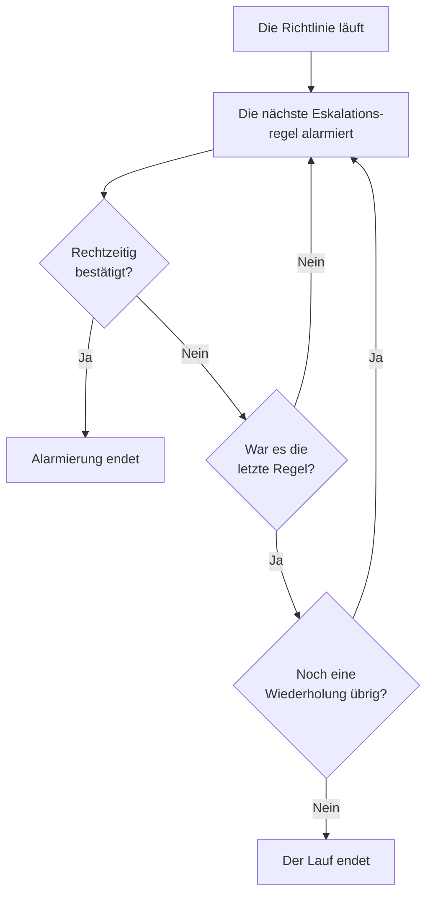

# Bereitschaftsrichtlinien

Eine Bereitschaftsrichtlinie entscheidet, wer zu einem Vorfall oder einer Warnung alarmiert wird und wer als Nächstes dran ist, wenn niemand bestätigt. Ihre Eskalationsregeln sind ihre Stufen, und die Vorfälle, Warnungen und Episoden, die sie verwenden, führen sie aus. Diese Seite behandelt das Anlegen einer Richtlinie, was sie ausführt, was ihre Seiten zeigen und wie jeder Lauf festgehalten wird.

:::cards
- [Eine Richtlinie anlegen](#eine-richtlinie-anlegen): Ein Name und wer zuerst alarmiert wird.
- [Was eine Richtlinie ausführt](#was-eine-richtlinie-ausführt): Regeln, Vorlagen, Monitore, Chat und Sie selbst.
- [Ausführungsprotokolle](#ausführungsprotokolle): Jeder Lauf, Regel für Regel, und warum er endete.
- [Eine Richtlinie archivieren oder löschen](#eine-richtlinie-archivieren-oder-löschen): Eine Richtlinie außer Dienst stellen.
:::

## Eine Richtlinie anlegen

:::steps
1. Gehen Sie zu **Bereitschaftsdienst → Bereitschaftsrichtlinien** und klicken Sie auf **Bereitschaftsrichtlinie erstellen**.
2. Geben Sie einen **Name** ein, etwa „Zahlungen primär“.
3. Klicken Sie unter **Wer wird zuerst alarmiert?** auf **Empfänger hinzufügen** und wählen Sie die Bereitschaftspläne, Teams und Personen, die zuerst alarmiert werden.
4. Klicken Sie auf **Bereitschaftsrichtlinie erstellen**. Die Richtlinie öffnet sich auf ihrer Seite **Eskalationsregeln**, mit **Level 1** an seinem Platz.
:::

**Wer wird zuerst alarmiert?** ist optional und wird nur gefragt, wer Eskalationsregeln hinzufügen darf: Bleibt die Frage leer, alarmiert die Richtlinie niemanden, bis sie eine Regel hat. **Beschreibung** und **Beschriftungen** liegen unter **Weitere Felder**. Wie Sie die nächsten Stufen hinzufügen, steht unter [Eskalationsregeln](/docs/on-call/escalation-rules).

Die Liste **Bereitschaftsrichtlinien** zeigt für jede Richtlinie **Name**, **Beschreibung**, **Beschriftungen** und **Eigentümer**. Wählen Sie Richtlinien aus, um **Beschriftungen hinzufügen**, **Beschriftungen entfernen**, **Eigentümer hinzufügen**, **Eigentümer entfernen**, **Archivieren** oder **JSON exportieren** auszuführen oder sie zu löschen. **JSON importieren** legt Richtlinien aus einem Export an: Ein Export enthält die eigenen Einstellungen einer Richtlinie, nicht ihre Eskalationsregeln oder Eigentümer.

## Was eine Richtlinie ausführt

Eine Richtlinie alarmiert niemanden, bis etwas sie ausführt. Jeder Vorfall, jede Warnung und jede Episode führt die Richtlinien, die sie hat, aus, sobald sie erstellt wird:

| Was | Wie es die Richtlinie hinzufügt | Mehr dazu |
| --- | --- | --- |
| Der Datensatz selbst | Das Feld **Bereitschaftsrichtlinie** beim Erstellen eines Vorfalls oder einer Warnung, eine Vorfallvorlage oder der eingeklappte Bereich **Bereitschaft** in den Kriterien eines Monitors | [Einen Vorfall melden](/docs/incidents/declaring-incidents) |
| Bereitschaftsregeln | **Vorfälle → Regeln → Bereitschaftsregeln** und **Warnungen → Regeln → Bereitschaftsregeln** fügen die Richtlinien jeder passenden Regel hinzu | [Bereitschaftsregeln für Vorfälle](/docs/incidents/settings#bereitschaftsregeln-für-vorfälle) |
| Gruppierungsregeln | Eine Gruppierungsregel führt ihre Richtlinien aus, wenn sie eine Episode eröffnet | [Warnungsepisoden & Gruppierungsregeln](/docs/alerts/episodes) |
| Von Hand | **Bereitschaftsdienst-Richtlinie ausführen**, im Menü **Aktionen** eines Feeds oder an einer Slack- oder Microsoft-Teams-Nachricht | [Der Vorfall-Feed](/docs/incidents/notes-owners-and-feed#der-vorfall-feed) |
| Chat und Workflows | `/oneuptime page` in Slack oder Microsoft Teams und der Schritt **Page an On-Call Policy** eines Workflows | [Paging](/docs/workflows/components#paging) |

Eine Richtlinie, die mehrere Regeln hinzufügen, läuft einmal. Ein Schweregrad führt nie selbst eine Richtlinie aus: Das tut eine Bereitschaftsregel, die zu dem Schweregrad passt. Ein Vorfall oder eine Warnung, die bereits bestätigt oder behoben erstellt wird, führt keine ihrer Richtlinien aus.

## Die Seiten einer Richtlinie

Öffnen Sie eine Richtlinie aus der Liste. Ihr Seitenmenü enthält alles zu ihr:

| Abschnitt | Seiten |
| --- | --- |
| **Grundlegend** | **Übersicht**, **Eskalationsregeln** und **Eigentümer** |
| **Protokolle** | **Ausführungsprotokolle** und **Benachrichtigungsprotokolle** |
| **Entwickler** | **Terraform**, **API** und **KI-Assistenten** |
| **Erweitert** | **Benutzerüberschreibungen**, **Benutzerdefinierte Felder**, **Einstellungen**, **Audit-Protokolle** und **Richtlinie löschen** |

**Grundlegend** ist geöffnet; die anderen Abschnitte starten eingeklappt, bis Sie sie anklicken.

- **Übersicht** zeigt die **Details der Bereitschaftsrichtlinie**, dann **Richtlinie auf einen Blick**: wie viele Stufen und Bearbeiter die Richtlinie hat, wie lange es bis zu ihrer letzten Stufe dauert und wie oft sie sich wiederholt. **Einsatzbereitschaft der Bearbeiter** sagt, ob jede Person, die sie alarmieren kann, jetzt erreichbar ist, und **Bereitschaftsrichtlinien-Feed** listet, was sich geändert hat: hinzugefügte oder entfernte Personen, Teams und Pläne, Überschreibungen und Übergaben.
- **Eigentümer** sind die Personen und Teams, die für die Richtlinie verantwortlich sind. Findet ein Alarm der Richtlinie für jemanden keine Regel oder lässt er sich nicht zustellen, bekommen sie eine E-Mail; eine Richtlinie ohne Eigentümer mailt stattdessen den Eigentümern des Projekts.
- **Benachrichtigungsprotokolle** listet jede Nachricht, die die Richtlinie gesendet hat, mit einem Tab pro Kanal.
- **Benutzerüberschreibungen** vertritt Personen nur in dieser Richtlinie. Siehe [Benutzerüberschreibungen](/docs/on-call/user-overrides).
- **Einstellungen** enthält **Bereitschaftsrichtlinie exportieren** und die Karte, die die Richtlinie archiviert.

## Eine Richtlinie wiederholen

Läuft die Wartezeit der letzten Stufe ab, ohne dass jemand bestätigt, hört eine Richtlinie auf, es sei denn, sie wiederholt sich. Öffnen Sie dafür die Seite **Eskalationsregeln** der Richtlinie, klicken Sie auf der Karte **Wiederholungsrichtlinie** unter den Regeln auf **Bearbeiten** und füllen Sie **Wiederholungsrichtlinie bearbeiten** aus:

| Feld | Was es tut | Bei einer neuen Richtlinie |
| --- | --- | --- |
| **Wiederholen, wenn niemand bestätigt** | Startet die Richtlinie nach ihrer letzten Stufe wieder bei **Level 1**. Solange es aus ist, läuft die Richtlinie einmal. | Aus |
| **Anzahl der Wiederholungen** | Wie oft die Richtlinie noch einmal von vorn beginnt. | 0 |

Mit eingeschaltetem Schalter und drei Wiederholungen geht eine Richtlinie insgesamt viermal durch ihre Stufen. **Richtlinie auf einen Blick** in der **Übersicht** sagt dasselbe in Worten.

## Ausführungsprotokolle

Jedes Mal, wenn eine Richtlinie läuft, schreibt sie ein Ausführungsprotokoll, und das Protokoll durchläuft seine Status, während der Lauf weitergeht:

| Status | Was er bedeutet |
| --- | --- |
| **Geplant**, **Begonnen** | Der Lauf wird vorbereitet. Einer, der nach 5 Minuten noch hier steht, wird mit **Fehler** beendet. |
| **Executing** | Der Lauf alarmiert. OneUptime bringt ihn jede Minute einen Schritt weiter. |
| **Execution Completed** | Jemand hat bestätigt, der Vorfall oder die Warnung wurde behoben, jede Regel und Wiederholung wurde genutzt, oder die Richtlinie wurde archiviert. |
| **Execution Completed - No One Notified** | Der Lauf ist durch jede Regel gegangen und hat niemanden alarmiert: meist ein Plan, in dem niemand Bereitschaft hat. |
| **Fehler** | Der Lauf ist fehlgeschlagen. **Statusmeldung anzeigen** sagt, warum. |

Ausführungsprotokolle finden Sie an drei Stellen:

- in den eigenen **Ausführungsprotokolle** der Richtlinie, unter **Protokolle**;
- unter **Bereitschaftsdienst → Erweitert → Ausführungsprotokolle**, für jede Richtlinie, wobei direkte Alarmierungen aus Workflows und Chat als **Direkte Alarmierung** erscheinen;
- auf der Seite **Bereitschaftsausführungen** eines Vorfalls und unter **Bereitschaftsausführungen** einer Warnung.

Jede Zeile zeigt, was den Lauf ausgelöst hat, wann, seinen **Status** und wer ihn bestätigt hat. **View Timeline** öffnet seine **Zeitachse der Ausführung**: jede Eskalationsregel, wen sie alarmiert hat, über welchen Plan und wie jeder Alarm geendet hat. Ein Plan, in dem niemand Bereitschaft hat, zeigt statt einer Person **No one was on call**. In OneUptime Cloud brauchen Ausführungsprotokolle den Plan **Growth**.

## Eine Richtlinie archivieren oder löschen

Archivieren stellt eine Richtlinie außer Dienst und behält alles: Öffnen Sie die **Einstellungen** der Richtlinie und klicken Sie auf ihrer Archivkarte auf **Archivieren**, oder wählen Sie Richtlinien in der Liste aus und wählen Sie **Archivieren**.

- Eine archivierte Richtlinie alarmiert niemanden. Vorfälle und Warnungen, die sie verwenden, überspringen sie, und ein Lauf, der noch eskaliert, endet bei seinem nächsten Schritt.
- Sie verlässt die Liste **Bereitschaftsrichtlinien** und landet unter **Bereitschaftsdienst → Erweitert → Archivierte Richtlinien**, wo **Aus Archiv entfernen** sie wieder in Dienst stellt.

**Richtlinie löschen**, unter **Erweitert**, löscht die Richtlinie mitsamt ihren Eskalationsregeln und Benutzerüberschreibungen. Das Löschen aus der Liste fragt vorher nach und schlägt vor, stattdessen zu archivieren.

## Wer eine Richtlinie ändern darf

**Project Owner**, **Project Admin**, **Project Member**, **On-Call Admin** und **On-Call Member** dürfen Richtlinien anlegen, ändern und löschen; **Viewer** und **On-Call Viewer** dürfen sie lesen. In einer eigenen Rolle heißen die Berechtigungen **Create On-Call Duty Policy**, **Edit On-Call Duty Policy**, **Delete On-Call Duty Policy** und **Read On-Call Duty Policy**, und eine Rolle, die auf einige Beschriftungen beschränkt ist, erreicht nur die Richtlinien mit diesen Beschriftungen. Eigentümer und benutzerdefinierte Felder hinzuzufügen braucht in OneUptime Cloud den Plan **Growth**.

## API und Terraform

Bereitschaftsrichtlinien sind die Ressource `/api/on-call-duty-policy` und in Terraform die Ressource `oneuptime_on_call_policy`:

| Einstellung | API-Feld |
| --- | --- |
| **Name** | `name` |
| **Beschreibung** | `description` |
| **Wiederholen, wenn niemand bestätigt** | `repeatPolicyIfNoOneAcknowledges` |
| **Anzahl der Wiederholungen** | `repeatPolicyIfNoOneAcknowledgesNoOfTimes` |
| Archiviert | `isArchived` |

Wie Sie eine Richtlinie mit ihrer ersten Stufe in einer einzigen Anfrage anlegen, steht unter [Regeln mit der API oder Terraform anlegen](/docs/on-call/escalation-rules#regeln-mit-der-api-oder-terraform-anlegen).

## Fehlerbehebung

:::details Eine Richtlinie ist gelaufen, aber niemand wurde alarmiert
Ihr Lauf zeigt **Execution Completed - No One Notified**. Öffnen Sie **View Timeline**: Eine Zeile mit **No one was on call** verweist auf einen Plan mit einer Lücke, und die Statusmeldung einer Zeile **Übersprungen** sagt, warum, etwa weil jemand abwesend war und niemand ihn vertreten hat. **Bereitschaftsdienst → Einsatzbereitschaft** zeigt, wer nicht erreichbar war.
:::

:::details Die nächste Stufe wurde eine Minute nach ihrer Wartezeit alarmiert
OneUptime bringt laufende Richtlinien einmal pro Minute einen Schritt weiter, daher wird eine Stufe bei der ersten Prüfung nach Ablauf ihrer Wartezeit alarmiert.
:::

:::details Ein Vorfall nennt eine Richtlinie, die niemanden alarmiert hat
Die Richtlinie ist archiviert: Eine archivierte Richtlinie bleibt an den Vorfällen und Warnungen, die sie verwenden, alarmiert niemanden, und ihr Ausführungsprotokoll sagt, dass sie nicht ausgeführt wurde. Holen Sie sie unter **Bereitschaftsdienst → Erweitert → Archivierte Richtlinien** aus dem Archiv.
:::

## Nächste Schritte

:::cards
- [Eskalationsregeln](/docs/on-call/escalation-rules): Die Stufen hinzufügen, die eine Richtlinie alarmiert, und wie lange jede wartet.
- [Benutzerüberschreibungen](/docs/on-call/user-overrides): Die Alarme einer Person an eine Kollegin oder einen Kollegen schicken, solange sie abwesend ist.
- [Einsatzbereitschaft & Berichte](/docs/on-call/readiness): Prüfen, ob jede Person, die eine Richtlinie alarmiert, erreichbar ist.
:::
