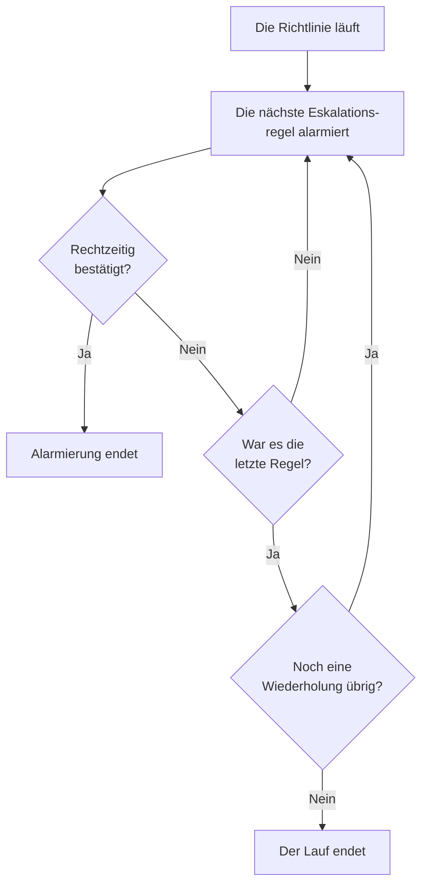

# Bereitschaftsrichtlinien

Eine Bereitschaftsrichtlinie entscheidet, wer zu einem Vorfall oder einer Warnung alarmiert wird und wer als Nächstes dran ist, wenn niemand bestätigt. Ihre Eskalationsregeln sind ihre Stufen, und die Vorfälle, Warnungen und Episoden, die sie verwenden, führen sie aus. Diese Seite behandelt das Anlegen einer Richtlinie, was sie ausführt, was ihre Seiten zeigen und wie jeder Lauf festgehalten wird.

:::cards
- [Eine Richtlinie anlegen](#eine-richtlinie-anlegen): Ein Name und wer zuerst alarmiert wird.
- [Was eine Richtlinie ausführt](#was-eine-richtlinie-ausführt): Regeln, Vorlagen, Monitore, Chat und Sie selbst.
- [Ausführungsprotokolle](#ausführungsprotokolle): Jeder Lauf, Regel für Regel, und warum er endete.
- [Eine Richtlinie archivieren oder löschen](#eine-richtlinie-archivieren-oder-löschen): Eine Richtlinie außer Dienst stellen.
:::

## Eine Richtlinie anlegen

:::steps
1. Gehen Sie zu **Bereitschaft → Bereitschaftsrichtlinien** und klicken Sie auf **Bereitschaftsrichtlinie erstellen**.
2. Geben Sie einen **Name** ein, etwa „Zahlungen primär“.
3. Klicken Sie unter **Wer wird zuerst alarmiert?** auf **Empfänger hinzufügen** und wählen Sie die Bereitschaftspläne, Teams und Personen, die zuerst alarmiert werden.
4. Klicken Sie auf **Bereitschaftsrichtlinie erstellen**. Die Richtlinie öffnet sich auf ihrer Seite **Eskalationsregeln**, mit **Level 1** an seinem Platz.
:::

**Wer wird zuerst alarmiert?** ist optional und wird nur gefragt, wer Eskalationsregeln hinzufügen darf: Bleibt die Frage leer, alarmiert die Richtlinie niemanden, bis sie eine Regel hat. **Beschreibung** und **Beschriftungen** liegen unter **Weitere Felder**. Wie Sie die nächsten Stufen hinzufügen, steht unter [Eskalationsregeln](/docs/on-call/escalation-rules).

Das Formular fragt außerdem **Bei jedem neuen Vorfall und jeder neuen Warnung auslösen**, sofern Sie Bereitschaftsregeln hinzufügen dürfen. Es legt eine Regel unter **Vorfälle → Regeln → Bereitschaftsregeln** und eine unter **Warnungen → Regeln → Bereitschaftsregeln** an, die jeweils auf alles zutreffen und diese Richtlinie ausführen. Für die erste Richtlinie eines Projekts, solange es keine Bereitschaftsrichtlinie und keine Bereitschaftsregel hat, ist es anfangs eingeschaltet, für jede weitere ausgeschaltet: Zwei Richtlinien bei jedem neuen Vorfall und jeder neuen Warnung auszulösen, ist eine bewusste Entscheidung. Bleibt es aus, alarmiert die Richtlinie niemanden, bis eine Regel, ein Monitor oder eine Person sie ausführt.

Wenn Sie sich lieber durch die Alarmierung führen lassen, von Ihrem Telefon bis zu einer Testalarmierung, klicken Sie auf **Geführte Einrichtung**: in der leeren Liste **Bereitschaftsrichtlinien** oder unter **So funktioniert es**. Siehe [Per Anruf, SMS oder Push alarmiert werden](/docs/guides/paging).

Die Liste **Bereitschaftsrichtlinien** zeigt für jede Richtlinie **Name**, **Zuerst alarmiert**, **Beschreibung**, **Beschriftungen** und **Eigentümer**. **Zuerst alarmiert** zeigt, wen die erste Eskalationsregel der Richtlinie alarmiert: ihre Bereitschaftspläne, jeweils mit der Person, die darin gerade Bereitschaft hat, ihre Teams und die Personen, die sie nennt, oder, wenn die Richtlinie niemanden alarmiert, **Keine Eskalationsregeln** oder **Keine Bearbeiter**. Wählen Sie Richtlinien aus, um **Beschriftungen hinzufügen**, **Beschriftungen entfernen**, **Eigentümer hinzufügen**, **Eigentümer entfernen**, **Archivieren** oder **JSON exportieren** auszuführen oder sie zu löschen. **JSON importieren** legt Richtlinien aus einem Export an: Ein Export enthält die eigenen Einstellungen einer Richtlinie, nicht ihre Eskalationsregeln oder Eigentümer.

## Was eine Richtlinie ausführt

Eine Richtlinie alarmiert niemanden, bis etwas sie ausführt. Jeder Vorfall, jede Warnung und jede Episode führt die Richtlinien, die sie hat, aus, sobald sie erstellt wird:

| Was | Wie es die Richtlinie hinzufügt | Mehr dazu |
| --- | --- | --- |
| Der Datensatz selbst | Das Feld **Bereitschaftsrichtlinie** beim Erstellen eines Vorfalls oder einer Warnung, eine Vorfallvorlage oder der eingeklappte Bereich **Bereitschaft** in den Kriterien eines Monitors | [Einen Vorfall melden](/docs/incidents/declaring-incidents) |
| Bereitschaftsregeln | **Vorfälle → Regeln → Bereitschaftsregeln** und **Warnungen → Regeln → Bereitschaftsregeln** fügen die Richtlinien jeder passenden Regel hinzu | [Bereitschaftsregeln für Vorfälle](/docs/incidents/settings#bereitschaftsregeln-für-vorfälle) |
| Gruppierungsregeln | Eine Gruppierungsregel führt ihre Richtlinien aus, wenn sie eine Episode eröffnet | [Warnungsepisoden & Gruppierungsregeln](/docs/alerts/episodes) |
| Von Hand | **Bereitschaftsdienst-Richtlinie ausführen**, im Menü **Aktionen** eines Feeds oder an einer Slack- oder Microsoft-Teams-Nachricht | [Der Vorfall-Feed](/docs/incidents/notes-owners-and-feed#der-vorfall-feed) |
| Chat und Workflows | `/oneuptime page` in Slack oder Microsoft Teams und der Schritt **Page an On-Call Policy** eines Workflows | [Paging](/docs/workflows/components#paging) |

Eine Richtlinie, die mehrere Regeln hinzufügen, läuft einmal. Ein Schweregrad führt nie selbst eine Richtlinie aus: Das tut eine Bereitschaftsregel, die zu dem Schweregrad passt. Ein Vorfall oder eine Warnung, die bereits bestätigt oder behoben erstellt wird, führt keine ihrer Richtlinien aus. Eine Bereitschaftsregel mit **Nur während der Arbeitszeiten** lässt die Richtlinien, die sie hinzufügt, warten, bis diese Zeiten beginnen.

## Die Seiten einer Richtlinie

Öffnen Sie eine Richtlinie aus der Liste. Ihr Seitenmenü enthält alles zu ihr:

| Abschnitt | Seiten |
| --- | --- |
| **Grundlegend** | **Übersicht**, **Eskalationsregeln** und **Eigentümer** |
| **Protokolle** | **Ausführungsprotokolle** und **Benachrichtigungsprotokolle** |
| **Entwickler** | **Terraform**, **API**, **CLI** und **KI-Assistenten** |
| **Erweitert** | **Benutzerüberschreibungen**, **Benutzerdefinierte Felder**, **Einstellungen**, **Audit-Protokolle** und **Richtlinie löschen** |

**Grundlegend** ist geöffnet; die anderen Abschnitte starten eingeklappt, bis Sie sie anklicken.

- **Übersicht** zeigt die **Details der Bereitschaftsrichtlinie**, dann **Richtlinie auf einen Blick**: wie viele Stufen und Bearbeiter die Richtlinie hat, wie lange es bis zu ihrer letzten Stufe dauert und wie oft sie sich wiederholt. **Einsatzbereitschaft der Bearbeiter** sagt, ob jede Person, die sie alarmieren kann, jetzt erreichbar ist, und **Bereitschaftsrichtlinien-Feed** listet, was sich geändert hat: hinzugefügte oder entfernte Personen, Teams und Pläne, Überschreibungen und Übergaben. Ihre Regeln für Slack, Microsoft Teams und Mattermost posten diese in Ihre Kanäle, eine Übergabe in einer Zeile: siehe [Bereitschaftsnachrichten](/docs/workspace-connections/slack#bereitschaftsnachrichten).
- **Eigentümer** sind die Personen und Teams, die für die Richtlinie verantwortlich sind. Findet ein Alarm der Richtlinie für jemanden keine Regel oder lässt er sich nicht zustellen, bekommen sie eine E-Mail; eine Richtlinie ohne Eigentümer mailt stattdessen den Projektinhabern.
- **Benachrichtigungsprotokolle** listet jede Nachricht, die die Richtlinie gesendet hat, mit einem Tab pro Kanal.
- **Benutzerüberschreibungen** vertritt Personen nur in dieser Richtlinie. Siehe [Benutzerüberschreibungen](/docs/on-call/user-overrides).
- **Einstellungen** enthält **Bereitschaftsrichtlinie exportieren** und die Karte, die die Richtlinie archiviert.

**Wodurch diese Richtlinie ausgelöst wird**, auf der **Übersicht**, listet die Bereitschaftsregeln, die Monitore, deren Kriterien die Richtlinie auslösen, die Vorlagen und anderen Regeln, die sie auslösen, und die Arbeitsabläufe, die das tun, jeweils mit einem Link. Eine ausgeschaltete Regel zeigt **Aus**. Löst nichts die Richtlinie aus, sagt die Karte es: Sie alarmiert niemanden, bis etwas sie auslöst. Wer die Richtlinie löscht oder archiviert, sieht dasselbe zuerst. Was Sie nicht öffnen dürfen, wird gezählt, aber nicht genannt.

## Eine Richtlinie wiederholen

Läuft die Wartezeit der letzten Stufe ab, ohne dass jemand bestätigt, hört eine Richtlinie auf, es sei denn, sie wiederholt sich. Um das festzulegen, öffnen Sie die Seite **Eskalationsregeln** der Richtlinie und klicken auf der Karte **Wiederholungsrichtlinie** unter den Regeln auf **Bearbeiten**. **Wiederholungsrichtlinie bearbeiten** fragt **Wenn nach der letzten Stufe niemand bestätigt**:

| Antwort | Was sie bewirkt |
| --- | --- |
| **Alarmierung beenden** | Niemand wird erneut alarmiert, die Richtlinie läuft also einmal. Eine neue Richtlinie beginnt mit dieser Antwort. |
| **Erneut bei Level 1 beginnen** | Jede Stufe wird erneut alarmiert, der Reihe nach. **Wie oft noch?** legt fest, wie oft: 1 oder mehr. |

Eine Richtlinie, die noch dreimal von vorn beginnt, geht insgesamt viermal durch ihre Stufen. Ein Durchgang, in dem keine Stufe jemanden zu alarmieren hatte, wird nicht wiederholt: Ein weiterer würde ebenfalls niemanden alarmieren, daher hört die Richtlinie auf. Die Zeile **Nach der letzten Stufe** der Karte sagt, was die Richtlinie tut, und **Richtlinie auf einen Blick** in der **Übersicht** sagt dasselbe in Worten.

## Erneut alarmieren, wenn es nicht behoben wird

Eine Bestätigung beendet die Alarmierung einer Richtlinie endgültig, auch wenn danach niemand den Vorfall oder die Warnung behebt. Eine Richtlinie kann stattdessen erneut alarmieren: Öffnen Sie ihre Seite **Eskalationsregeln**, öffnen Sie unten **Weitere Einstellungen** und klicken Sie auf der Karte **Bestätigungs-Timeout** auf **Bearbeiten**. **Bestätigungs-Timeout bearbeiten** fragt **Wenn bestätigt, aber nicht behoben**:

| Antwort | Was sie bewirkt |
| --- | --- |
| **Nicht erneut alarmieren** | Mit der Bestätigung endet die Alarmierung endgültig. Eine neue Richtlinie beginnt mit dieser Antwort. |
| **Erneut alarmieren** | Alarmiert die Person, die bestätigt hat, und wer jetzt Bereitschaft hat. **Nach wie vielen Minuten?** legt fest, wann: von 5 bis 1440, zu Beginn 30. |

Die Minuten zählen ab jeder Bestätigung, und eine Richtlinie alarmiert zu einem Vorfall, einer Warnung oder einer Episode höchstens 5-mal erneut. Eine erneute Alarmierung beginnt bei der Stufe, die bei der Bestätigung alarmierte, alarmiert, wer dort jetzt Bereitschaft hat, und geht dann wie der erste Lauf durch die Stufen. Der Vorfall oder die Warnung bleibt bestätigt: Die erneute Alarmierung ist ein eigener Lauf, im Feed und in den Ausführungsprotokollen der Richtlinie, wo sein **Status** „Erneut alarmiert (1 von 5)“ zeigt.

Wer erneut alarmiert wird, bestätigt aus der Nachricht oder mit **Erneut bestätigen** auf der Seite des Vorfalls oder der Warnung, und die Minuten beginnen von vorn; **Eskalieren** gibt die Alarmierung an die nächste Stufe weiter. Sie endet, wenn der Vorfall oder die Warnung behoben oder gelöscht, die Richtlinie archiviert oder gelöscht oder **Nicht erneut alarmieren** gewählt wird. Die Zeile **Nach einer Bestätigung** der Karte sagt, was die Richtlinie tut, und **Weitere Einstellungen** zeigt die Minuten, solange es eingeklappt ist. **Richtlinie auf einen Blick** in der **Übersicht** und die **Eskalationsübersicht** sagen dasselbe in Worten.

## Wenn mehrere Richtlinien alarmieren

Ein Vorfall, eine Warnung oder eine Episode führt jede ihrer Richtlinien für sich aus, gleichzeitig.

- Wer in zwei davon Bereitschaft hat, wird nur einmal alarmiert. Erreicht eine Stufe einer Richtlinie jemanden, den eine andere Richtlinie dazu schon alarmiert, alarmiert sie ihn nicht noch einmal: In ihrem Ausführungsprotokoll erscheint er als **Bereits alarmiert**, und der Feed des Vorfalls sowie die Slack- und Microsoft-Teams-Nachricht der Richtlinie nennen die Richtlinie, die ihn alarmiert. Die Stufe wartet trotzdem ihre Minuten bis zur nächsten Stufe ab, wie bei jedem, den sie alarmiert hat. Die Antwort auf diese eine Alarmierung gilt für beide Richtlinien. Innerhalb einer Richtlinie wird jemand, den eine Stufe zweimal nennt, persönlich und über ein Team oder einen Plan, nur einmal alarmiert.
- Eine Alarmierung, die direkt an Personen geht, zählt ebenso. Erreicht eine Stufe einer Richtlinie jemanden, den eine Alarmierung aus Slack oder Microsoft Teams oder ein Baustein zum Alarmieren eines Arbeitsablaufs dazu schon alarmiert, alarmiert sie ihn nicht noch einmal: Ihr Ausführungsprotokoll nennt, wer diese Alarmierung geschickt hat, oder den Arbeitsablauf. Ebenso alarmiert ein Baustein zum Alarmieren eines Arbeitsablaufs niemanden noch einmal, den eine Richtlinie oder eine andere Alarmierung schon alarmiert.
- Eine Bestätigung des Vorfalls oder der Warnung beendet innerhalb einer Minute jede Richtlinie, die dafür läuft, egal wo bestätigt wird: aus einer beliebigen Alarmierung dazu, auf der eigenen Seite, in der mobilen App oder in Slack oder Microsoft Teams. Keine nächste Stufe wird alarmiert, und kein Anruf und keine SMS, die noch ausstehen, werden gesendet. Bereits gesendete Benachrichtigungen bleiben gesendet.

Niemand verpasst eine Alarmierung, weil er nur einmal alarmiert wird. Seine Alarmierung kann enden, ohne dass er geantwortet hat: wenn er sie aus einer ihrer Nachrichten eskaliert, was nur diese Alarmierung eskaliert, wenn sie sich nicht senden lässt oder wenn sie endet. Dann alarmiert ihn die andere Richtlinie oder der Baustein des Arbeitsablaufs innerhalb einer Minute selbst, ohne noch einmal zu senden, was ihn schon erreicht hat. **Eskalieren** auf der Seite des Vorfalls oder in der mobilen App eskaliert beide. Eine erneute Alarmierung, eine von Hand gestartete Richtlinie und eine Alarmierung, die jemand aus Slack oder Microsoft Teams geschickt hat, alarmieren ihre Personen immer selbst, auch jemanden, den eine andere Richtlinie alarmiert. Eine Alarmierung an Beobachter und eine Alarmierung an Bearbeiter werden nie zusammengefasst.

Manche Alarmierungen gehen nach der Bestätigung weiter, bis jemand antwortet, den sie alarmiert haben, oder bis behoben ist: eine erneute Alarmierung, eine Alarmierung an Beobachter, eine Alarmierung, die jemand aus Slack oder Microsoft Teams an Personen geschickt hat, und eine von Hand gestartete Richtlinie.

Eine von Hand gestartete Richtlinie ist eine, die mit **Bereitschaftsdienst-Richtlinie ausführen** gestartet wurde oder durch eine Alarmierung aus Slack oder Microsoft Teams, die sie nennt. Sie alarmiert Stufe für Stufe wie jeder Lauf, mit Anrufen und wiederholten Push-Benachrichtigungen, und dass jemand anderes den Vorfall bestätigt, beendet sie nicht: So alarmieren Sie ein weiteres Team zu einem Vorfall, an dem schon jemand arbeitet. Wen sie alarmiert hat, antwortet aus der Nachricht seiner Alarmierung, per Anruf oder SMS oder indem er den Vorfall selbst bestätigt; sobald der Vorfall bestätigt ist, bietet die Seite des Vorfalls **Erneut bestätigen** an. **Eskalieren** gibt sie an die nächste Stufe weiter. Bei einem Vorfall, einer Warnung oder einer Episode, die behoben ist, wird nichts gestartet, und Sie erfahren, warum: Das Dashboard schaltet **Bereitschaftsdienst-Richtlinie ausführen** aus und nennt den Grund. Ihre Benachrichtigungen sagen, wer welche Richtlinie gestartet hat, und enthalten die Nachricht, die mit einer Alarmierung aus Slack oder Microsoft Teams geschickt wurde.

## Eine Richtlinie testen

**Diese Richtlinie testen**, in den Eskalationsregeln einer Richtlinie, alarmiert ihre erste Stufe als Test, ohne einen Vorfall dahinter: In jeder Nachricht steht TEST, und keine Statusseite, kein Abonnent und kein Kanal wird informiert. Schalten Sie **Jede Eskalationsstufe durchlaufen** ein, um jede Stufe nacheinander zu alarmieren, höchstens 2 Minuten auseinander, bis jemand bestätigt. Bevor etwas gesendet wird, listet der Dialog auf, wen der Test alarmiert und wie, und was er auf OneUptime Cloud kostet.

**Test-Alarmierung senden** bleibt aus, solange der Test niemanden erreichen würde: Jede Person, die er alarmiert, hat den Schweregrad abbestellt, hat keine Regel dafür und nichts, worauf zurückgegriffen werden kann, oder hat nur Methoden, die nicht verifiziert oder im Projekt ausgeschaltet sind. Eine Zeile unter der Liste nennt den Grund. Kann nur eine spätere Stufe erreicht werden, bietet die Zeile **Jede Eskalationsstufe durchlaufen** mit einem Klick an.

Wer alarmiert wird, bestätigt den Test über jede seiner Nachrichten: den Link einer E-Mail, einer SMS oder einer Chatnachricht, die 1 bei einem Anruf oder seine Push-Benachrichtigung in der OneUptime-On-Call-App, in Versionen neuer als 1.6.0. Eine Richtlinie kann alle 5 Minuten einmal getestet werden, und ein Projekt sendet höchstens 20 Tests pro Stunde.

### Eine Notfallübung für einen Monitor durchführen

**Notfallübung durchführen**, auf der Karte **Wenn das ausfällt** eines Monitors, probt einen seiner Ausfälle: einen Vorfall oder eine Warnung, die eines seiner Kriterien öffnet, oder den Vorfall, den eine Vorfallsregel für Warnungen aus einer solchen Warnung eröffnet. Sie testet jede Bereitschaftsrichtlinie, die dieser Ausfall alarmieren würde, jede so, wie **Diese Richtlinie testen** sie testet, und nichts Öffentliches geschieht: Es wird kein Vorfall und keine Warnung erstellt, und keine Statusseite, kein Abonnent und kein Kanal wird informiert. Bevor etwas gesendet wird, nennt der Dialog den Ausfall, jede Richtlinie und wen diese Richtlinie gerade alarmiert. Bei einem eröffneten Vorfall nennt er auch die Regel und wie lange die Warnung zuvor offen bleibt: Die Übung testet die Richtlinien des Vorfalls sofort, ohne diese Wartezeit.

Eine Übung alarmiert die erste Stufe jeder Richtlinie. Schalten Sie unter **Weitere Felder** die Option **Jede Eskalationsstufe durchlaufen** ein, um die Stufen jeder Richtlinie nacheinander zu alarmieren, höchstens 2 Minuten auseinander, bis jemand bestätigt: Der Dialog listet dann jede Stufe auf, die jede Richtlinie erreicht, und was das Durchlaufen höchstens kostet. Kann niemand in den ersten Stufen erreicht werden, eine spätere Stufe aber schon, bietet die Zeile unter der Liste **Jede Eskalationsstufe durchlaufen** mit einem Klick an.

**Notfallübung starten** bleibt aus, solange eine dieser Richtlinien eine ist, die Sie nicht testen können, weil Sie sie nicht bearbeiten können, oder solange niemand, den sie alarmieren, erreicht werden kann. Jede Richtlinie einer Übung zählt als eigener Test: Eine Richtlinie, die in den letzten 5 Minuten getestet wurde, hält die ganze Übung auf, und eine Übung mit drei Richtlinien belegt drei der 20 Tests pro Stunde des Projekts.

Sobald der Dialog geschlossen ist, sagt **Letzte Notfallübung** auf der Karte, welchen Ausfall die letzte Übung des Monitors geprobt hat, wann und von wem sie gestartet wurde und wie viele ihrer Tests bestätigt wurden. **Details anzeigen** listet den Test jeder Richtlinie auf: ob er bestätigt wurde, von wem, auf welchem Weg und wie schnell. Jeder Test bleibt in den Ausführungsprotokollen seiner Richtlinie, als Notfallübung des Monitors gekennzeichnet. Die Ergebnisse einer Übung sieht, wer den Monitor und jedes dieser Ausführungsprotokolle lesen kann.

## Ausführungsprotokolle

Jedes Mal, wenn eine Richtlinie läuft, schreibt sie ein Ausführungsprotokoll, und das Protokoll durchläuft seine Status, während der Lauf weitergeht:

| Status | Was er bedeutet |
| --- | --- |
| **Wartet** | Eine Bereitschaftsregel mit **Nur während der Arbeitszeiten** lässt den Lauf warten, bis diese Zeiten beginnen: Er sagt, wann die Alarmierung beginnt, und alarmiert bis dahin niemanden. Er endet ohne Alarmierung, wenn der Vorfall oder die Warnung vorher bestätigt oder behoben wird. Er beginnt umgehend zu alarmieren, wenn sich der Vorfall oder die Warnung ändert und nun zu einer Bereitschaftsregel passt, die sofort alarmiert. |
| **Geplant**, **Begonnen** | Der Lauf wird vorbereitet. Einer, der nach 5 Minuten noch hier steht, ist nicht fertig gestartet: Er geht zu **Wird ausgeführt** über und alarmiert ab der Stelle, an der sein Start stehen blieb. Eine direkte Alarmierung oder eine Testalarmierung, die noch hier steht, wird mit **Fehler** beendet. |
| **Wird ausgeführt** | Der Lauf alarmiert. OneUptime bringt ihn jede Minute einen Schritt weiter. Ein Schritt, der kurz fehlschlägt, etwa weil die Datenbank nicht erreichbar war, wird eine Minute später erneut versucht, dann nach 2 und 4 Minuten, danach alle 5 Minuten. |
| **Ausführung abgeschlossen** | Jemand hat bestätigt, der Vorfall oder die Warnung wurde behoben, jede Regel und Wiederholung wurde genutzt, oder die Richtlinie wurde archiviert. |
| **Ausführung abgeschlossen - niemand benachrichtigt** | Der Lauf ist durch jede Regel gegangen und hat niemanden alarmiert: meist ein Plan, in dem niemand Bereitschaft hat, oder eine Stufe ohne Empfänger. |
| **Fehler** | Der Lauf ist fehlgeschlagen: Ein Schritt schlug so fehl, dass ein neuer Versuch es nicht beheben kann, etwa eine gelöschte Eskalationsregel, oder schlug 10 Versuche hintereinander fehl, über etwa 37 Minuten. **Statusmeldung anzeigen** sagt, warum. |

Ausführungsprotokolle finden Sie an drei Stellen:

- in den eigenen **Ausführungsprotokolle** der Richtlinie, unter **Protokolle**;
- unter **Bereitschaft → Erweitert → Ausführungsprotokolle**, für jede Richtlinie, wobei direkte Alarmierungen aus Workflows und Chat als **Direkte Alarmierung** erscheinen;
- auf der Seite **Bereitschaftsausführungen** eines Vorfalls oder einer Warnung.

Jede Zeile zeigt, was den Lauf ausgelöst hat, wann, seinen **Status** und wer ihn bestätigt hat. **Zeitachse anzeigen** öffnet seine **Zeitachse der Ausführung**: jede Eskalationsregel, wen sie alarmiert hat, über welchen Plan und wie jeder Alarm geendet hat. **Benachrichtigt über** zeigt, wie jeder Alarm die Person erreicht hat: Telefonanruf, SMS, E-Mail, Push-Benachrichtigung und so weiter. Ein Plan, in dem niemand Bereitschaft hat, zeigt statt einer Person **Niemand hatte Bereitschaft**. Eine Stufe, die niemanden alarmiert hat, sagt, warum, mit **Ohne Wartezeit fortgesetzt** darunter: Die Richtlinie hat nicht auf sie gewartet. Wer bereits von einer anderen Richtlinie oder durch eine direkte Alarmierung alarmiert wurde, erscheint als **Bereits alarmiert**: siehe [Wenn mehrere Richtlinien alarmieren](#wenn-mehrere-richtlinien-alarmieren). In OneUptime Cloud brauchen Ausführungsprotokolle den Plan **Growth**.

## Eine Richtlinie archivieren oder löschen

Archivieren stellt eine Richtlinie außer Dienst und behält alles: Öffnen Sie die **Einstellungen** der Richtlinie und klicken Sie auf ihrer Archivkarte auf **Archivieren**, oder wählen Sie Richtlinien in der Liste aus und wählen Sie **Archivieren**.

- Eine archivierte Richtlinie alarmiert niemanden. Vorfälle und Warnungen, die sie verwenden, überspringen sie, und ein Lauf, der noch eskaliert, endet bei seinem nächsten Schritt.
- Sie verlässt die Liste **Bereitschaftsrichtlinien** und landet unter **Bereitschaft → Erweitert → Archivierte Richtlinien**, wo **Aus dem Archiv holen** sie wieder in Dienst stellt.

**Richtlinie löschen**, unter **Erweitert**, löscht die Richtlinie mitsamt ihren Eskalationsregeln und Benutzerüberschreibungen. Das Löschen aus der Liste fragt vorher nach und schlägt vor, stattdessen zu archivieren.

## Wer eine Richtlinie ändern darf

**Projektinhaber**, **Projektadministrator**, **Projektmitglied**, **Bereitschafts-Administrator** und **Bereitschafts-Mitglied** dürfen Richtlinien anlegen, ändern und löschen; **Betrachter** und **Bereitschafts-Betrachter** dürfen sie lesen. In einer eigenen Rolle heißen die Berechtigungen **Create On-Call Policy**, **Edit On-Call Policy**, **Delete On-Call Policy** und **Read On-Call Policy**, und eine Rolle, die auf einige Beschriftungen beschränkt ist, erreicht nur die Richtlinien mit diesen Beschriftungen. Eigentümer und benutzerdefinierte Felder hinzuzufügen braucht in OneUptime Cloud den Plan **Growth**.

## API und Terraform

Bereitschaftsrichtlinien sind die Ressource `/api/on-call-duty-policy` und in Terraform die Ressource `oneuptime_on_call_policy`:

| Einstellung | API-Feld |
| --- | --- |
| **Name** | `name` |
| **Beschreibung** | `description` |
| **Wenn nach der letzten Stufe niemand bestätigt** | `repeatPolicyIfNoOneAcknowledges` |
| **Wie oft noch?** | `repeatPolicyIfNoOneAcknowledgesNoOfTimes` |
| **Nach wie vielen Minuten?** | `acknowledgementTimeoutInMinutes` |
| Archiviert | `isArchived` |

`repeatPolicyIfNoOneAcknowledges` ist `false` für **Alarmierung beenden** und `true` für **Erneut bei Level 1 beginnen**. Steht es auf `true`, muss `repeatPolicyIfNoOneAcknowledgesNoOfTimes` eine ganze Zahl ab 1 sein: OneUptime lehnt `0` ab. Eine ältere, mit `0` gespeicherte Richtlinie wiederholt sich nie, und das Dashboard zeigt sie als **Alarmierung beenden**.

`acknowledgementTimeoutInMinutes` ist `null` für **Nicht erneut alarmieren** und eine ganze Zahl von Minuten zwischen 5 und 1440 für **Erneut alarmieren**. Alles andere lehnt OneUptime ab.

Wie Sie eine Richtlinie mit ihrer ersten Stufe in einer einzigen Anfrage anlegen, steht unter [Regeln mit der API oder Terraform anlegen](/docs/on-call/escalation-rules#regeln-mit-der-api-oder-terraform-anlegen).

## Fehlerbehebung

:::details Eine Richtlinie ist gelaufen, aber niemand wurde alarmiert
Ihr Lauf zeigt **Ausführung abgeschlossen - niemand benachrichtigt**. Öffnen Sie **Zeitachse anzeigen**: Eine Zeile mit **Niemand hatte Bereitschaft** verweist auf einen Plan mit einer Lücke, und die Statusmeldung einer Zeile **Übersprungen** sagt, warum, etwa weil jemand abwesend war und niemand ihn vertreten hat. **Bereitschaft → Einsatzbereitschaft** zeigt, wer nicht erreichbar war.
:::

:::details Die nächste Stufe wurde eine Minute nach ihrer Wartezeit alarmiert
OneUptime bringt laufende Richtlinien einmal pro Minute einen Schritt weiter, daher wird eine Stufe bei der ersten Prüfung nach Ablauf ihrer Wartezeit alarmiert.
:::

:::details Die nächste Stufe wurde sofort alarmiert, ohne Wartezeit
Die Stufe davor hatte niemanden zu alarmieren: keine Empfänger, niemand mit Bereitschaft in ihren Plänen oder niemand, der erreichbar war. Eine Stufe, die niemanden alarmiert, hat keine Wartezeit, daher wird die nächste Stufe alarmiert, sobald die Richtlinie sie erreicht. **Zeitachse anzeigen** zeigt, warum diese Stufe niemanden alarmiert hat.
:::

:::details Ein Vorfall nennt eine Richtlinie, die niemanden alarmiert hat
Die Richtlinie ist archiviert: Eine archivierte Richtlinie bleibt an den Vorfällen und Warnungen, die sie verwenden, alarmiert niemanden, und ihr Ausführungsprotokoll sagt, dass sie nicht ausgeführt wurde. Holen Sie sie unter **Bereitschaft → Erweitert → Archivierte Richtlinien** aus dem Archiv.
:::

:::details Jemand wurde zu einem Vorfall zweimal alarmiert
Wer in zwei der Richtlinien Bereitschaft hat, die der Vorfall ausführt, wird nur einmal alarmiert, und zwar von der Richtlinie, die ihn zuerst erreicht, ebenso wie jemand, den sowohl eine Richtlinie als auch eine Alarmierung aus Slack, Microsoft Teams oder einem Arbeitsablauf erreichen. Die zweite alarmiert ihn ebenfalls, wenn es sich um eine erneute Alarmierung, eine von Hand gestartete Richtlinie, eine aus Slack oder Microsoft Teams geschickte Alarmierung oder eine Alarmierung an Beobachter handelt, die ihre Personen alle selbst alarmieren, oder wenn seine erste Alarmierung schon vorbei war, bevor die zweite ihn erreichte: Er hatte sie eskaliert, oder sie hatte aufgehört. Unter **Zeitachse anzeigen** der zweiten Alarmierung erscheint jemand, den sie nicht noch einmal alarmiert hat, als **Bereits alarmiert**.
:::

:::details Eine Richtlinie alarmierte weiter, nachdem der Vorfall bestätigt wurde
Sie wurde von Hand gestartet, oder es ist eine erneute Alarmierung: Sie geht weiter, bis jemand antwortet, den sie alarmiert hat, oder der Vorfall behoben ist. Siehe [Wenn mehrere Richtlinien alarmieren](#wenn-mehrere-richtlinien-alarmieren).
:::

## Nächste Schritte

:::cards
- [Eskalationsregeln](/docs/on-call/escalation-rules): Die Stufen hinzufügen, die eine Richtlinie alarmiert, und wie lange jede wartet.
- [Benutzerüberschreibungen](/docs/on-call/user-overrides): Die Alarme einer Person an eine Kollegin oder einen Kollegen schicken, solange sie abwesend ist.
- [Einsatzbereitschaft & Berichte](/docs/on-call/readiness): Prüfen, ob jede Person, die eine Richtlinie alarmiert, erreichbar ist.
:::
