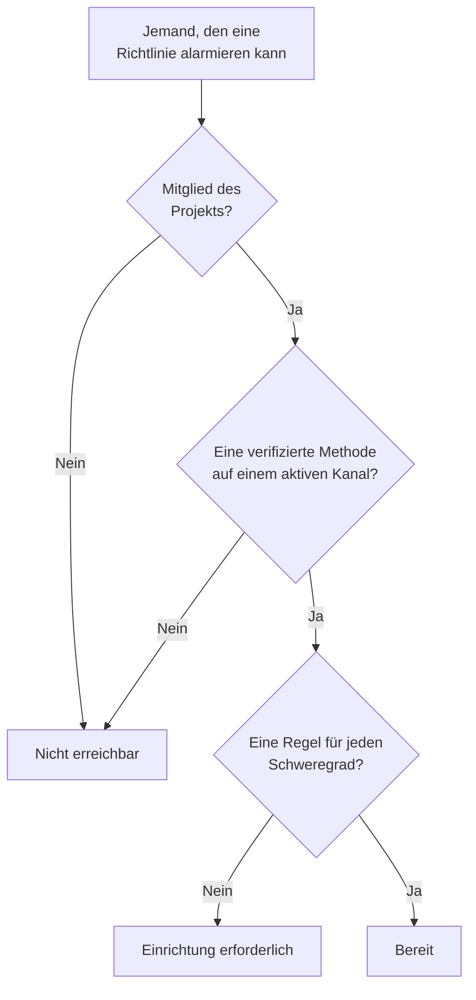

# Einsatzbereitschaft & Berichte

Die Einsatzbereitschaft beantwortet eine Frage, bevor ein Vorfall es tut: Würde jetzt etwas ausgelöst, würde dann jede Person, die Ihre Bereitschaftsrichtlinien alarmieren, wirklich erreicht? Sie listet jeden Bearbeiter im Projekt, sagt, wer bereit ist und wer nicht, und lässt Sie Personen daran erinnern, ihre Einrichtung abzuschließen. Der Bericht **Bereitschaftszeit des Benutzers** zeigt dann, wie lange jede Person Bereitschaft hatte.

:::cards
- [Wie ein Status ermittelt wird](#wie-ein-status-ermittelt-wird): Bereit, Einrichtung erforderlich oder Nicht erreichbar, und warum.
- [Die Seite Einsatzbereitschaft](#die-seite-einsatzbereitschaft): Jeder Bearbeiter im Projekt, in einer Liste.
- [Personen ans Einrichten erinnern](#personen-ans-einrichten-erinnern): Eine E-Mail, die nennt, was fehlt.
- [Bereitschaftszeit des Benutzers](#bereitschaftszeit-des-benutzers): Wie lange jede Person Bereitschaft hatte.
:::

## Wie ein Status ermittelt wird

Ein Bearbeiter ist jede Person, die eine Bereitschaftsrichtlinie alarmieren kann: eine Person, die in einer Eskalationsregel genannt ist, ein Mitglied eines Teams, das eine Regel alarmiert, jemand in einer Ebene eines Plans, den eine Regel alarmiert, und die Vertretung in einer Benutzerüberschreibung, die noch nicht geendet hat. Ein Plan, den keine Richtlinie alarmiert, fügt niemanden hinzu.

| Status | Was er bedeutet |
| --- | --- |
| **Bereit** | Die Person hat eine verifizierte Methode auf einem Kanal, den das Projekt eingeschaltet hat, und eine Regel für jeden Schweregrad, auf jedem Tab ihrer Bereitschaftsregeln. |
| **Einrichtung erforderlich** | Die Person ist erreichbar, aber für einige Schweregrade fehlt eine Regel. Die Zeile zählt diese Lücken. |
| **Nicht erreichbar** | Nichts erreicht die Person: keine verifizierte Methode, jede verifizierte Methode liegt auf einem Kanal, den das Projekt ausgeschaltet hat, oder sie ist kein Mitglied des Projekts. |

Eine Lücke ist ein Schweregrad ohne Regel, auf dem Tab für Vorfälle, Vorfallepisoden, Warnungen oder Warnungsepisoden. Eine Regel, die einen Schweregrad bewusst abschaltet, ist keine Lücke. Ein Alarm, der auf eine Lücke trifft, erreicht die Person trotzdem über ihre verifizierten Methoden, es sei denn, das Projekt hat diesen Rückfall ausgeschaltet: siehe [Wenn keine Regel passt](/docs/notifications/index#wenn-keine-regel-passt).

## Die Seite Einsatzbereitschaft

Öffnen Sie **Bereitschaftsdienst → Einsatzbereitschaft**. Die Karte **Bereitschaftsfähigkeit** listet jede Person, die eine Bereitschaftsrichtlinie im Projekt erreichen kann, die Personen mit Handlungsbedarf zuerst. Jede Person im Projekt kann sie öffnen.

Über der Liste zählen die Kacheln **Bearbeiter**, **Bereit**, **Einrichtung erforderlich** und **Nicht erreichbar**. Klicken Sie auf **Bereit**, **Einrichtung erforderlich** oder **Nicht erreichbar**, um nur diese Bearbeiter zu listen, und klicken Sie erneut darauf, um alle zu listen.

| Spalte | Was sie zeigt |
| --- | --- |
| **Bearbeiter** | Die Person, mit ihrer E-Mail-Adresse. |
| **Status** | **Bereit**, **Nicht erreichbar** oder wie viele Lücken die Person hat. |
| **Kanäle** | Ein Segment pro Kanal: gefüllt für eine verifizierte Methode, hohl für eine, die noch nicht verifiziert ist. |
| **Abdeckung** | Wie viele Schweregrade eine Regel haben, auf jedem Tab, von allen. |
| **Erreicht über** | Wie die Richtlinien die Person erreichen: jedes Team, das sie über eine Eskalationsregel alarmiert, mit seinem Namen, oder **Direkt**, **Zeitplan** oder **Vertretung**. |

**Abdeckung** in einer Zeile zeigt die Benachrichtigungsmethoden der Person, warum sie ihren Status hat, und ein Raster aller Schweregrade mit oder ohne Regel. Der Trichter filtert die Liste nach **Bearbeiter**, **Status**, **Team** oder **Erreicht über**. Die Antwort kann eine Minute alt sein: **Aktualisieren** ermittelt sie neu.

## Personen ans Einrichten erinnern

Nur die Person selbst kann ihre Benachrichtigungsmethoden und Regeln hinzufügen und verifizieren, also besteht die Lösung darin, sie zu bitten.

:::steps
1. Markieren Sie auf der Seite Einsatzbereitschaft die Bearbeiter, die Sie erinnern möchten. Bereite Bearbeiter lassen sich nicht markieren: Es gibt nichts, woran man sie erinnern müsste.
2. Klicken Sie auf **Einrichtungserinnerung senden**. Die Bestätigung nennt jede Person, der gleich eine E-Mail geschickt wird.
3. Bestätigen Sie. Jede Person bekommt eine E-Mail, die nennt, was in ihrer eigenen Einrichtung fehlt, mit einem Link zu der Seite, auf der sie es behebt.
:::

Ein Banner sagt dann, wie viele Erinnerungen gesendet, übersprungen oder fehlgeschlagen sind, und warum, für jede, die nicht gesendet wurde. Niemand wird öfter als einmal in 24 Stunden erinnert, und ein Durchgang erinnert höchstens 250 Personen. Erinnerungen senden dürfen **Projektinhaber**, **Projektadministrator** oder **Bereitschafts-Administrator**, oder wer in einer eigenen Rolle **Edit On-Call Duty Policy** hat.

## Einsatzbereitschaft auf anderen Seiten

- In der **Übersicht** einer Richtlinie listet **Einsatzbereitschaft der Bearbeiter** jede Person, die diese Richtlinie alarmieren kann und Handlungsbedarf hat, und **Erneut prüfen** liest sie neu. Ihre eigene Zeile hat eine Schaltfläche zu der Seite, die es behebt; die Zeile einer anderen Person öffnet in Ihrem eigenen Mailprogramm eine E-Mail an sie, mit der Lösung darin.
- Auf den **Eskalationsregeln** einer Richtlinie sagt eine Stufe auf ihrer Karte, wenn nicht alle ihre Bearbeiter alarmiert werden können. Siehe [Die Eskalationsübersicht](/docs/on-call/escalation-rules#die-eskalationsübersicht).
- Öffnen Sie unter **Benutzer** ein Mitglied, dann **Einsatzbereitschaft** im Abschnitt **Bereitschaft**: sein Status, seine Methoden und sein Abdeckungsraster.
- Für Ihre eigene Einrichtung führt Sie **Benutzereinstellungen → Einrichtungs-Checkliste** hindurch. Siehe [Die Einrichtungs-Checkliste](/docs/notifications/index#die-einrichtungs-checkliste).

## Die wöchentliche E-Mail zur Einsatzbereitschaft

Einmal pro Woche prüft OneUptime jedes Projekt, das eine Bereitschaftsrichtlinie hat. Ist darin jemand **Nicht erreichbar** oder **Einrichtung erforderlich**, bekommen die Eigentümer des Projekts eine E-Mail, die diese Personen in zwei Gruppen auflistet, wer gar nicht alarmiert werden kann und wer mit Lücken erreichbar ist, bis zu 20 Namen je Gruppe, mit einem Link zur Seite Einsatzbereitschaft.

Eine Woche, in der alle bereit sind, verschickt nichts, also bedeutet die E-Mail immer, dass etwas zu beheben ist. Kann jemand gar nicht alarmiert werden, beginnt ihr Betreff mit `[Action Required]`.

## Bereitschaftszeit des Benutzers

**Bereitschaftsdienst → Berichte → Bereitschaftszeit des Benutzers** zeigt, wie lange jede Person Bereitschaft hatte, über einen Zeitraum, den Sie wählen: zu Beginn **Letzter Monat**.

| Spalte | Was sie zeigt |
| --- | --- |
| **Benutzer** | Die Person. |
| **Zeit, in der der Benutzer im Bereitschaftsdienst war** | Ihre Bereitschaftszeit im Zeitraum, in Stunden und Minuten. |

Die Zeit wird erfasst, während Personen in die Bereitschaft gehen und sie verlassen: ab dem Moment, in dem ein Plan, den eine Regel alarmiert, ihnen eine Schicht übergibt oder sie direkt oder über ein Team zu einer Regel hinzugefügt werden, bis zur Übergabe oder bis sie entfernt werden. Bereitschaft über zwei Richtlinien gleichzeitig zählt einmal, und Zeit, die noch läuft, zählt bis jetzt.

Die **Zeitachse der Bereitschaftspläne** und die Kalender-Feeds zeigen vergangene Schichten so, wie die Rotation heute eingerichtet ist. Dieser Bericht wird geschrieben, während es geschieht, nutzen Sie ihn also für faire Verteilung und die Vergütung der Bereitschaft.

> [!NOTE]
> In OneUptime Cloud braucht der Bericht den Plan **Growth**, und Zeit, die vor mehr als 200 Tagen endete, wird gelöscht. Eine selbst gehostete Installation behält sie vollständig.

## Fehlerbehebung

:::details Jemand ist nicht erreichbar, hat aber eine verifizierte Telefonnummer
Die Methoden der Person liegen vielleicht alle auf Kanälen, die das Projekt ausgeschaltet hat: SMS, Anrufe, WhatsApp und Telegram sind in einem neuen Projekt aus. Siehe [Einen Kanal für Ihr Projekt einschalten](/docs/notifications/notification-methods#einen-kanal-für-ihr-projekt-einschalten).
:::

:::details Jemand fehlt in der Liste
Die Liste enthält nur Personen, die eine Bereitschaftsrichtlinie alarmieren kann. Ein Teammitglied, das seine Einladung nicht angenommen hat, jemand in einem Plan, den keine Richtlinie alarmiert, und eine Vertretung, deren Überschreibung geendet hat, fehlen darin.
:::

:::details Die Eigentümer bekommen die wöchentliche E-Mail nie
Sie wird nur in einer Woche gesendet, in der jemand **Nicht erreichbar** oder **Einrichtung erforderlich** ist, und nur an die Eigentümer des Projekts.
:::

## Nächste Schritte

:::cards
- [Wie OneUptime Sie erreicht](/docs/notifications/index): Die Methoden, Regeln und der Rückfall hinter jedem Status.
- [Benachrichtigungsmethoden](/docs/notifications/notification-methods): Die Wege hinzufügen und verifizieren, auf denen OneUptime jemanden erreicht.
- [Persönliche Bereitschaftsregeln](/docs/notifications/on-call-rules): Die Lücken schließen, Schweregrad für Schweregrad.
:::
