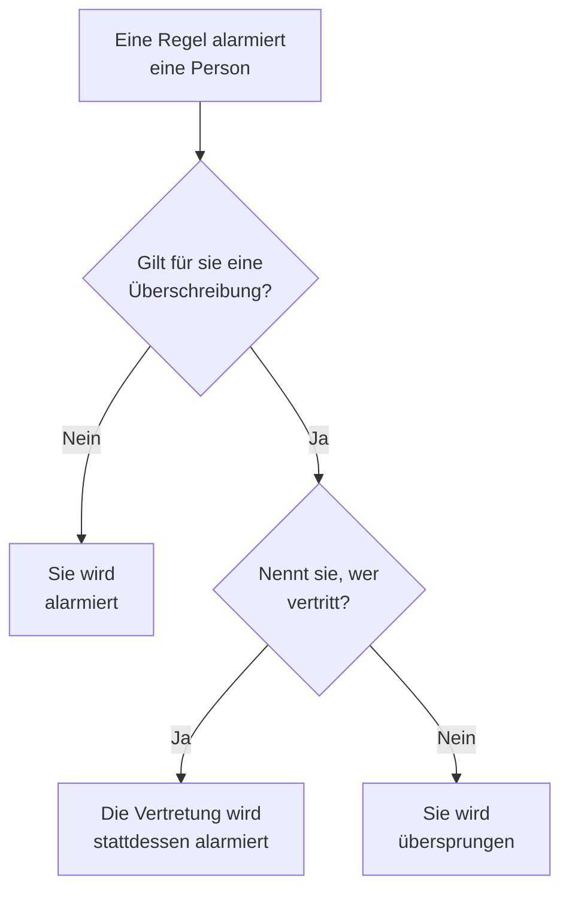

# Benutzerüberschreibungen

Solange jemand abwesend ist, schickt eine Benutzerüberschreibung die Alarme, die diese Person erreichen würden, für eine festgelegte Zeit an die Person, die sie vertritt. Ist niemand als Vertretung genannt, überspringt sie die Person stattdessen: Jede ihrer Schichten in einem Bereitschaftsplan geht an die nächste Person in der Rotation. Nutzen Sie sie für einen Urlaub, einen Krankheitstag oder eine getauschte Schicht.

:::cards
- [Wie eine Überschreibung einen Alarm ändert](#wie-eine-überschreibung-einen-alarm-ändert): Wer stattdessen alarmiert wird, und wann.
- [Eine Überschreibung hinzufügen](#eine-überschreibung-hinzufügen): Wer abwesend ist, wer vertritt, ab wann und bis wann.
- [Jede Richtlinie oder eine](#jede-richtlinie-oder-eine): Wo Sie eine Überschreibung hinzufügen und welche gewinnt.
- [Weitere Wege, eine hinzuzufügen](#weitere-wege-eine-hinzuzufügen): Aus einem Plan und aus Ihren bevorstehenden Schichten.
:::

## Wie eine Überschreibung einen Alarm ändert



Solange eine Überschreibung gilt, von ihrem Beginn bis zu ihrem Ende:

- Steht jemand unter **Wer vertritt?**, bekommt diese Person alle Alarme der abwesenden Person, aus jedem Plan, jedem Team und jeder Regel, für die die Überschreibung gilt. Der Alarm erreicht sie über ihre eigenen persönlichen Bereitschaftsregeln.
- Vertritt niemand, wird die Person übersprungen. In einem Bereitschaftsplan geht jede ihrer Schichten an die nächste Person in der Rotation, die nicht abwesend ist; sind alle in einer Ebene abwesend, übernehmen die Ebenen darunter. Eine Regel, die sie direkt oder über ein Team nennt, alarmiert sie nicht, und der Lauf der Richtlinie sagt, dass sie abwesend ist, und bis wann.
- Überschreibungen verketten sich nicht. Ist die Vertretung selbst abwesend, wird trotzdem sie für die Person alarmiert, die sie vertritt.

Endet die Überschreibung, gehören die Alarme wieder der Person. Die **Zeitachse der Bereitschaftspläne**, die Ebenen eines Plans und die Kalender-Feeds zeigen alle, wer jede vertretene Schicht hat.

## Eine Überschreibung hinzufügen

:::steps
### Die Überschreibungen öffnen

Gehen Sie zu **Bereitschaftsdienst → Erweitert → Benutzerüberschreibungen**, um jemanden in jeder Bereitschaftsrichtlinie zu vertreten, oder zur Seite **Benutzerüberschreibungen** einer Richtlinie, unter **Erweitert**, um nur in dieser Richtlinie zu vertreten. Klicken Sie auf **Benutzervertretung hinzufügen**.

### Sagen, wer abwesend ist

**Wer ist abwesend?** steht zuerst auf Ihnen, denn die eigene Abwesenheit einzutragen ist der häufigste Fall. Wählen Sie jemand anderen, um eine Vertretung für diese Person einzutragen.

### Sagen, wer vertritt

Lassen Sie **Wer vertritt?** auf **Nächste Person in der Rotation**, um die Person zu überspringen, oder wählen Sie die Kollegin oder den Kollegen, der alle ihre Alarme übernimmt. Die abwesende Person wird nicht angeboten.

### Die Zeit festlegen

**Beginnt** steht auf jetzt, wenn Sie keine andere Zeit wählen. Setzen Sie **Endet** auf den Zeitpunkt, an dem die Person zurück ist: Er muss nach dem Beginn liegen. Klicken Sie auf **Benutzervertretung hinzufügen**.
:::

Jede Überschreibung ist eine Zeile: **Abwesend**, **Vertreten durch**, **Beginnt** und **Endet**, filterbar nach Beginn und Ende. **Vertreten durch** zeigt bei einem Überspringen **Nächste Person in der Rotation**. Eine Überschreibung lässt sich nicht bearbeiten: Löschen Sie sie und fügen Sie eine neue hinzu, oder löschen Sie sie, um jemanden früher zurückzuholen.

## Jede Richtlinie oder eine

| Hinzugefügt unter | Karte | Gilt für |
| --- | --- | --- |
| **Bereitschaftsdienst → Erweitert → Benutzerüberschreibungen** | **Globale Benutzervertretungen** | Jede Bereitschaftsrichtlinie im Projekt |
| **Benutzerüberschreibungen** einer Richtlinie | **Benutzervertretungen der Bereitschaftsrichtlinie** | Nur diese Richtlinie |

Überschneiden sich zwei Überschreibungen für dieselbe Person, gewinnt die eigene der Richtlinie gegen eine globale, und eine, die eine Vertretung nennt, gewinnt gegen ein Überspringen. Ein Alarm ohne Richtlinie, aus einem Workflow oder aus dem Chat, folgt nur den globalen Überschreibungen.

## Weitere Wege, eine hinzuzufügen

- Aus einem Plan: Klappen Sie auf der Seite **Ebenen** eines Plans eine Ebene auf und klicken Sie neben einer Person auf **Überspringen bis…**. Das öffnet dasselbe Formular mit ihr als abwesend und der Rotation als Vertretung, als globale Überschreibung. Siehe [Wenn jemand abwesend ist](/docs/on-call/schedules#wenn-jemand-abwesend-ist).
- Aus Ihren bevorstehenden Schichten: **Vertretung finden** an einer Ihrer Schichten, unter **Benutzereinstellungen → Kalender → Kalender-Feed**, öffnet das Formular mit Ihnen als abwesend für die Zeiten dieser Schicht, sodass nur noch **Wer vertritt?** bleibt. Siehe [Bevorstehende Schichten und Vertretung](/docs/on-call/calendar-feeds#bevorstehende-schichten-und-vertretung).

Verlässt jemand das Projekt, wird jede Überschreibung gelöscht, die ihn nennt und noch nicht geendet hat, auf beiden Seiten.

## Wer Überschreibungen hinzufügen darf

**Projektinhaber**, **Projektadministrator**, **Projektmitglied**, **Bereitschafts-Administrator** und **Bereitschafts-Mitglied** dürfen Überschreibungen hinzufügen und löschen; **Betrachter** und **Bereitschafts-Betrachter** dürfen sie sehen. In einer eigenen Rolle heißen die Berechtigungen **Create On-Call Duty Policy User Override**, **Delete On-Call Duty Policy User Override** und **Read On-Call Duty Policy User Override**. Auf der **Zeitachse der Bereitschaftspläne** sehen nur Personen, die Überschreibungen lesen dürfen, wessen Schicht vertreten wird.

In OneUptime Cloud brauchen Benutzerüberschreibungen den Plan **Growth**.

## API

Benutzerüberschreibungen sind die Ressource `/api/on-call-duty-policy-user-override`:

| Feld | Was es enthält |
| --- | --- |
| `overrideUserId` | Die abwesende Person. Pflichtfeld. |
| `routeAlertsToUserId` | Die Person, die vertritt. Lassen Sie das Feld weg, um die Person stattdessen zu überspringen. |
| `startsAt`, `endsAt` | Wann die Überschreibung beginnt und endet. Beide sind Pflicht, und das Ende liegt nach dem Beginn. |
| `onCallDutyPolicyId` | Die Richtlinie, für die sie gilt. Lassen Sie das Feld für eine globale Überschreibung weg. |

```bash
curl -X POST https://oneuptime.com/api/on-call-duty-policy-user-override \
  -H "apikey: $ONEUPTIME_API_KEY" \
  -H "Content-Type: application/json" \
  -d '{
    "data": {
      "projectId": "<project-id>",
      "overrideUserId": "<away-user-id>",
      "routeAlertsToUserId": "<cover-user-id>",
      "startsAt": "2026-12-22T09:00:00Z",
      "endsAt": "2027-01-05T09:00:00Z"
    }
  }'
```

Eine Überschreibung, deren abwesende Person und Vertretung dieselbe ist, wird abgelehnt, ebenso eine, die vor ihrem Beginn endet.

## Fehlerbehebung

:::details Die Person im Urlaub wurde trotzdem alarmiert
Prüfen Sie, wo die Überschreibung hinzugefügt wurde. Eine auf der Seite **Benutzerüberschreibungen** einer Richtlinie gilt nur für diese Richtlinie, und andere Richtlinien alarmieren die Person weiter: Fügen Sie sie unter **Bereitschaftsdienst → Erweitert → Benutzerüberschreibungen** hinzu, um jede Richtlinie abzudecken. Prüfen Sie auch **Beginnt** und **Endet**: Zeiten werden in Ihrer Zeitzone angezeigt.
:::

:::details Die Vertretung wurde auch nicht alarmiert
Sie wird über ihre eigenen persönlichen Bereitschaftsregeln und verifizierten Methoden erreicht. Suchen Sie sie unter **Bereitschaftsdienst → Einsatzbereitschaft** und prüfen Sie den Lauf in den **Ausführungsprotokolle** der Richtlinie.
:::

:::details Ich kann keine Überschreibung hinzufügen
Dafür braucht es eine der Rollen oben, und in OneUptime Cloud den Plan **Growth**.
:::

## Nächste Schritte

:::cards
- [Bereitschaftspläne](/docs/on-call/schedules): Rotationen, Ebenen und jemanden in einer Ebene überspringen.
- [Zeitachse der Bereitschaftspläne](/docs/on-call/schedule-timeline): Jede vertretene Schicht über alle Pläne hinweg sehen.
- [Kalender-Feeds](/docs/on-call/calendar-feeds): Eine Vertretung für eine Ihrer eigenen Schichten finden.
:::
