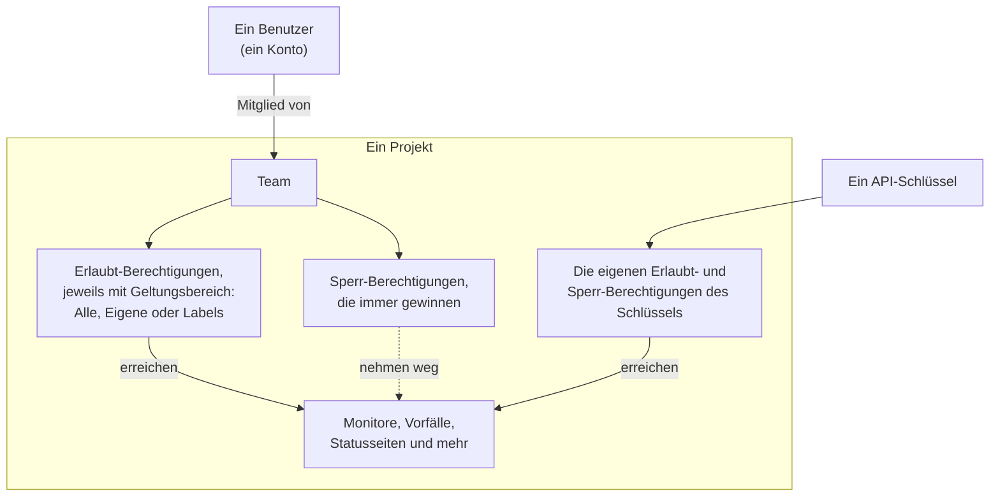
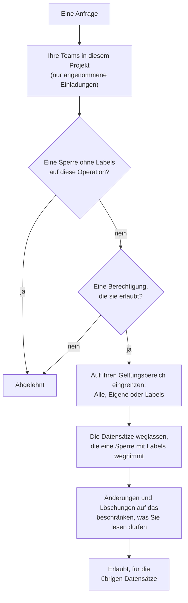

# Benutzer, Teams & Berechtigungen

Alles in OneUptime liegt innerhalb eines **Projekts**. Wer darin was tun darf, ergibt sich aus drei Dingen: den **Benutzern** im Projekt, den **Teams**, denen diese Benutzer angehören, und den **Berechtigungen**, die diesen Teams erteilt wurden.

> [!IMPORTANT]
> **Benutzer besitzen niemals direkt Berechtigungen.** Der Zugriff eines Benutzers ist die Vereinigung der Berechtigungen aller Teams, denen er in diesem Projekt angehört. Wenn Sie ändern möchten, was jemand tun darf, ändern Sie seine Teamzugehörigkeit oder die Berechtigungen dieses Teams.

**Eigentümer** sind etwas anderes. Ein Eigentümer ist derjenige, der für eine bestimmte Ressource zuständig ist — einen Monitor, einen Vorfall, ein Dashboard. Eigentümer werden über ihre Ressourcen benachrichtigt, und Berechtigungen lassen sich optional auf „nur die Dinge, die mir gehören" eingrenzen.

## So funktioniert der Zugriff

| Begriff | Bedeutung |
| --- | --- |
| Benutzer | Ein einzelnes OneUptime-Konto. Eine Anmeldung, beliebig viele Projekte. |
| Projekt | Die Mandantengrenze. Monitore, Vorfälle, Teams und Daten gehören zu genau einem Projekt. |
| Team | Eine benannte Gruppe innerhalb eines Projekts, die Berechtigungen trägt. |
| Teammitglied | Ein Benutzer, der in ein Team eingeladen wurde und angenommen hat. |
| Berechtigung | Eine einzelne Fähigkeit, z. B. `CreateProjectMonitor`, oder eine Rolle, die viele bündelt, z. B. `MonitorAdmin`. |
| Geltungsbereich | Wie weit eine Erlaubt-Berechtigung reicht: alle Ressourcen, nur eigene oder nur gelabelte. |
| Eigentümer | Ein Benutzer oder Team, der bzw. das für eine konkrete Ressource verantwortlich ist. |
| Label | Eine Markierung an Ressourcen, mit der Berechtigungen eingeschränkt und Ressourcen organisiert werden. |

## Benutzer

Ein Benutzerkonto gilt für die gesamte OneUptime-Instanz — dieselbe Anmeldung funktioniert in jedem Projekt, in das der Benutzer eingeladen wurde.

Ein Benutzer ist „in" einem Projekt, sobald er Mitglied **mindestens eines Teams** darin ist. Es gibt keinen separaten Schritt „Benutzer zum Projekt hinzufügen": Wer in ein Projekt eingeladen wird, wird in ein Team eingeladen.

:::steps
1. Öffnen Sie **Benutzer** im Menü **Produkte** unter **Einstellungen** und klicken Sie auf **Benutzer einladen**. Die Liste zeigt alle Personen im Projekt samt Einladungsstatus.
2. Geben Sie die **E-Mail** ein. Wer noch kein OneUptime-Konto hat, wird außerdem nach einem **Name** gefragt.
3. Wählen Sie das **Team**, das bestimmt, was die Person tun darf, und klicken Sie auf **Einladen**.
4. Die Person nimmt die Einladung über die Glocke oben rechts auf der Seite **Projekteinladungen** an und ist ab dann im Projekt.
:::

- Einladungen erzeugen ein ausstehendes Teammitglied. Der Benutzer zählt erst als Projektmitglied — und erhält erst dann irgendeine Berechtigung —, **nachdem er die Einladung angenommen hat.**
- **Benutzer einladen** beginnt mit dem Mitglieder-Team des Projekts: dem Team, das `ProjectMember` für das ganze Projekt hält, also **Members**, sofern Sie es nicht umbenannt haben. Wählen Sie ein anderes Team, um der Person mehr oder weniger Zugriff zu geben. Es ist nichts vorausgewählt, wenn Sie selbst nicht in dieses Team einladen dürften — wer jemanden einlädt, gibt ihm die Berechtigungen des Teams weiter, und Sie können nur Berechtigungen weitergeben, die Sie selbst haben — oder wenn das Projekt kein solches Team hat. Das Admin-Dashboard beginnt mit demselben Team, wo immer ein Instanzadministrator jemanden zu einem Projekt hinzufügt: **Benutzer einladen** bei einem Projekt, **Zu Projekt hinzufügen** bei einem Benutzer und bei mehreren Benutzern zugleich, sowie die Projekte, die einem [globalen SSO-Anbieter](/docs/identity/global-sso) zugeordnet sind.
- Wird ein Benutzer aus allen Teams eines Projekts entfernt, verliert er den Zugriff darauf, ab seiner nächsten Anfrage — auch während er angemeldet ist. Sein Konto und seine anderen Projekte sind nicht betroffen. Er wird aus den Bereitschaftsplänen, Eskalationsregeln und Vertretungen des Projekts genommen, aus den Rollen seiner offenen Vorfälle und Episoden und aus den Eigentümern seiner Ressourcen; gelöste Vorfälle behalten den Nachweis, wer sie besaß und leitete.
- Wer ein Projekt verlässt, erhält keine Benachrichtigungen mehr daraus. Seine eigenen Benachrichtigungsmethoden, -regeln und -einstellungen für das Projekt werden mit dem letzten Team entfernt — E-Mail, SMS, Anruf, WhatsApp, Telegram, Push, Webhook, Slack und Microsoft Teams, die E-Mail-Zusammenfassung samt noch nicht versendeter E-Mail, die Nummer für eingehende Anrufe und die Schicht-Erinnerungen —, sodass ein erneuter Beitritt mit den Standardwerten beginnt. Wo die Person danach noch genannt wird, etwa als Benutzer, den eine Regel für eingehende Anrufe anruft, oder als Besitzer eines gelösten Vorfalls, wird sie nicht mehr benachrichtigt: Im Namen eines Projekts wird nichts an jemanden gesendet, der kein Mitglied ist, und eine ausstehende Einladung ist noch keine Mitgliedschaft. Diese Stellen zeigen **Kein Mitglied mehr** neben dem Namen, damit Sie jemand anderen eintragen können. Wer eingeladen ist und noch nicht angenommen hat, erscheint stattdessen mit **Einladung noch nicht angenommen**. Leitet eine Vertretung die Benachrichtigungen einer Person an jemanden weiter, der das Projekt verlassen hat, wird stattdessen die vertretene Person benachrichtigt. Mit dem Verlassen werden auch die MCP-Clients getrennt, die die Person mit dem Projekt verbunden hat, und ihr persönlicher Link zum Bereitschaftskalender zeigt ab dann einen leeren Kalender. Auf OneUptime Cloud bestätigt jemand, der über das Single Sign-On des Projekts zurückkommt, es erneut aus seinem Postfach.
- Wenn Ihr Projekt SSO erzwingt und ein Benutzer sich noch nicht über den Identity Provider authentifiziert hat, gilt er als nicht autorisierter SSO-Benutzer und sieht nichts, bis er es tut. Siehe [SSO](/docs/identity/sso).
- Mit eingerichtetem SCIM kann Ihr Identity Provider Benutzer und deren Teamzugehörigkeiten automatisch anlegen, aktualisieren und entfernen. Siehe [SCIM](/docs/identity/scim).

## Teams

Über Teams gelangen Berechtigungen zu Personen. Jedes neue Projekt startet mit dreien:

| Team | Berechtigung | Bearbeitbar |
| --- | --- | --- |
| Owners | `ProjectOwner` | Nein. Hat immer mindestens ein Mitglied. |
| Admin | `ProjectAdmin` | Nein |
| Members | `ProjectMember` | Ja — dieses Team ist ein Ausgangspunkt, ändern Sie es nach Bedarf |

Die Teams **Owners** und **Admin** sind bewusst gesperrt: Ihre Berechtigungen lassen sich nicht bearbeiten, und die Teams können weder gelöscht noch umbenannt werden. Genau das verhindert, dass sich ein Projekt versehentlich selbst aussperrt. Das Owners-Team muss immer mindestens ein Mitglied behalten.

`ProjectOwner` ist die höchste Zugriffsstufe: Abrechnung, Löschen des Projekts und alles, was ein Admin kann. `ProjectAdmin` umfasst alles außer Abrechnung und Löschen des Projekts.

SMS, Telefonanrufe, WhatsApp oder Telegram für das Projekt ein- oder auszuschalten gilt als Abrechnung, weil jede Nachricht Geld kostet. Nur `ProjectOwner`, die Rolle `BillingAdmin` (**Billing Admin**) und die Berechtigung `ManageProjectBilling` (**Manage Billing**) können diese Schalter unter **Projekteinstellungen > Benachrichtigungen > Benachrichtigungseinstellungen** ändern — nicht `ProjectAdmin`.

Das Aufladen der vorausbezahlten Guthaben des Projekts gilt ebenfalls als Abrechnung. In OneUptime Cloud werden SMS, Telefonanrufe, WhatsApp und Telegram vom Guthaben unter **Projekteinstellungen > Benachrichtigungen > Benachrichtigungseinstellungen** bezahlt und KI vom KI-Guthaben unter **Projekteinstellungen > KI > KI-Guthaben**. Nur ein Projekteigentümer oder jemand mit **Manage Billing** kann sie aufladen oder ihr **Automatisches Aufladen** ändern — ein Projektadministrator kann es nicht. Eine Meldung über ein knappes Guthaben nennt, wer es aufladen kann, und nur diese Personen bekommen eine funktionierende Schaltfläche **Guthaben aufladen** oder einen Link zur Seite.

Legen Sie beliebig viele weitere Teams an — „Frontend-Bereitschaft", „Support", „Nur-Lese-Prüfer" — und geben Sie jedem genau die Berechtigungen, die es braucht. In OneUptime Cloud braucht das Anlegen eines Teams und das Ändern seiner Berechtigungen den Scale-Tarif.

**Ein Team anlegen** fragt nach einem Namen und seinem **Zugriff**, also danach, was die Mitglieder des Teams tun dürfen:

| Zugriff | Was die Mitglieder des Teams tun dürfen |
| --- | --- |
| Projektadministrator | Alles im Projekt anlegen, ändern und löschen, seine Einstellungen eingeschlossen. Nicht die Abrechnung und nicht das Löschen des Projekts. |
| Projektmitglied | Monitore, Vorfälle, Statusseiten und die anderen Ressourcen des Projekts anlegen, ändern und löschen. |
| Betrachter | Alles im Projekt lesen und nichts ändern. |
| Berechtigungen später wählen | Noch nichts. Zu Beginn ausgewählt. |

:::steps
1. Öffnen Sie **Teams** im Menü **Produkte** unter **Einstellungen** und klicken Sie auf **Team erstellen**.
2. Geben Sie den **Name** des Teams ein und wählen Sie seinen **Zugriff**. Die Beschreibung liegt unter **Weitere Felder**.
3. Legen Sie das Team an. Ein Team mit einer Rolle öffnet sich auf seiner Seite **Mitglieder**, bereit, Personen einzuladen; mit **Berechtigungen später wählen** öffnet es sich auf seiner Seite **Berechtigungen**, wo Sie eine engere Rolle wie `IncidentMember` oder einzelne Berechtigungen hinzufügen.
:::

Die gewählte Rolle wird zur ersten Berechtigung des Teams, für alle Ressourcen im Projekt, sobald das Team existiert — genau so, als hätten Sie sie mit **Rolle hinzufügen** auf der Seite Berechtigungen des Teams hinzugefügt. Angeboten werden nur die Rollen, die Sie selbst haben, weil jeder, den Sie in das Team einladen, dessen Berechtigungen erhält; wer Teams anlegen, aber nicht ändern darf, was sie tun dürfen, wird gar nicht gefragt. Lässt sich die Rolle nicht hinzufügen, wird das Team trotzdem angelegt, und ein Hinweis über der Liste verlinkt darauf.

Wo Sie es finden: Öffnen Sie ein Team unter **Teams**, um zu **Mitglieder** und **Berechtigungen** zu gelangen; **Berechtigungen blockieren** liegen unter **Weitere Einstellungen** unten auf der Seite Berechtigungen, deren eingeklappte Überschrift zeigt, wie viele das Team hat.

## Berechtigungen

Eine Berechtigung ist eine einzelne Fähigkeit. Es gibt zwei Wege, sie zu vergeben, und beide liegen auf dem Tab **Berechtigungen** des Teams.

### Rollen

Eine Rolle bündelt einen ganzen Produktbereich auf einer von drei Stufen:

- **Admin** — was der Member tut, dazu die eigene Konfiguration des Bereichs, etwa Schweregrade und Zustände von Vorfällen und Warnungen, Monitor-Status und Wartungszustände.
- **Member** — die tägliche Arbeit: die Ressourcen des Bereichs samt Notizen, Eigentümern und Vorlagen anlegen, ändern und löschen. Bei Statusseiten und Bereitschaft kann der Member alles, was der Admin kann.
- **Viewer** — nur lesend.

`MonitorAdmin`, `IncidentMember`, `StatusPageViewer` und so weiter. Rollen sind fast immer die richtige Wahl — sie bleiben korrekt, wenn OneUptime Funktionen ergänzt, weil eine neue monitorbezogene Tabelle den bestehenden Monitor-Rollen zugeordnet wird, statt eine neue Zuweisung von Ihnen zu verlangen.

Workflows und Runbooks sind die Ausnahme. Beide führen Code in Ihrem Projekt aus — ein Workflow seine Schritte, ein Runbook seine Skripte auf Ihren Runnern —, deshalb öffnet `WorkflowMember` Workflows und ihre Ausführungen und führt sie von Hand aus, und `RunbookMember` öffnet Runbooks und ihre Ausführungen und führt sie aus: Es startet eine Ausführung, schließt ihre Schritte ab oder überspringt sie und bricht sie ab. Keine der beiden Rollen erstellt, ändert oder löscht, was sie ausführt; `WorkflowAdmin` und `RunbookAdmin` bauen es. Eine Rolle führt nur die Runbooks aus, die ihr Geltungsbereich erreicht: Ein auf einige Labels beschränkter `RunbookMember` führt die Runbooks aus, die sie tragen. Siehe [Workflow-Berechtigungen](/docs/workflows/configuration#berechtigungen) und [Runbook-Berechtigungen](/docs/runbooks/configuration#berechtigungen).

Die Regeln eines Bereichs (Label-, Eigentümer-, Bereitschafts-, Gruppierungs- und Erinnerungsregeln), benutzerdefinierte Felder, SLAs und Geheimnisse sind Projektkonfiguration: Sie erfordern `ProjectAdmin`, gleich welche Bereichsrolle jemand hat. Das gilt auch für API-Schlüssel, Teams und ihre Berechtigungen, Labels, SSO und Domains — die Settings-Rollen betreuen die Dienste, Probes, Infrastruktur und Integrationen des Projekts, nicht, wer was darf.

Die Abrechnung hat drei eigene Rollen. `BillingViewer` liest die Abrechnung des Projekts — Tarif und Abonnement, Rechnungen, Nutzung, Guthaben, KI-Guthaben, Zahlungsmethoden und Rechnungskontaktdaten — und ändert nichts. `BillingMember` lädt zusätzlich Rechnungen herunter und ändert die Rechnungskontaktdaten. `BillingAdmin` kann, was `BillingMember` kann, und schaltet SMS, Telefonanrufe, WhatsApp und Telegram ein und aus. Tarif, Zahlungsmethoden oder Guthaben zu ändern und Rechnungen zu bezahlen erfordert `ProjectOwner` oder **Manage Billing**; auf den Abrechnungsseiten sind diese Schaltflächen für alle anderen gesperrt und nennen, wer sie nutzen darf.

Alle {{PERMISSION_ROLE_COUNT}} Rollen sind in der [Berechtigungsreferenz](/docs/permissions/reference) aufgeführt.

### Granulare Berechtigungen

Jede einzelne Fähigkeit ist auch für sich vergebbar — `CreateProjectMonitor`, `ReadProjectIncident`, `DeleteProjectStatusPage` und {{PERMISSION_TOTAL_COUNT}} weitere. Nutzen Sie diese, wenn eine Rolle zu breit ist und Sie genau eine Sache vergeben möchten.

Eine Berechtigung zum Ändern oder Löschen reicht nur so weit, wie Sie auch lesen dürfen; vergeben Sie deshalb die passende Leseberechtigung mit: `EditProjectIncident` ändert ohne `ReadProjectIncident` keinen Vorfall. Ein Datensatz, der über einen anderen gelesen wird, etwa eine Notiz zu einem Vorfall, braucht außerdem eine Berechtigung, diesen anderen Datensatz zu lesen: `ReadIncidentInternalNote` erreicht ohne eine Berechtigung zum Lesen von Vorfällen keine Notiz, und `CreateIncidentInternalNote` fügt eine Notiz nur einem Vorfall hinzu, den Sie lesen dürfen. Die Rollen enthalten beides bereits.

Es sind zugleich die Schlüssel, die Sie beim Anlegen von API-Schlüsseln verwenden, und die die API und der Terraform-Provider erwarten.

Die vollständige Liste steht in der [Berechtigungsreferenz](/docs/permissions/reference).

### Erlauben und sperren

Jedes Team hat zwei Listen:

- **Berechtigungen** (erlauben) — was dieses Team tun darf.
- **Berechtigungen blockieren** — was dieses Team niemals tun darf, unabhängig von jedem Erlaubt-Eintrag.

Beide liegen auf der Seite **Berechtigungen** des Teams. Nur wenige Teams brauchen eine Sperre, deshalb sind die Sperr-Berechtigungen unten auf der Seite unter **Weitere Einstellungen** eingeklappt.

> [!WARNING]
> **Sperren gewinnt immer.** Ein Sperr-Eintrag ohne Labels entzieht dem Team die Fähigkeit vollständig. Ein Sperr-Eintrag mit Labels entzieht sie nur für Ressourcen mit diesen Labels — nützlich für „dieses Team darf Monitore bearbeiten, außer den mit Production gelabelten".

Eine Berechtigung kann nicht gleichzeitig in beiden Listen Einschränkungs-Labels tragen; OneUptime lehnt den zweiten Eintrag mit einer Erklärung ab.

Die Erlaubt-Einträge eines Benutzers addieren sich über alle seine Teams, eine Sperre gilt aber für alles, was der Benutzer tut: Eine Sperre ohne Labels in einem Team entzieht die Fähigkeit auch dann, wenn ein anderes Team sie erlaubt, und ein Sperr-Eintrag gewährt nie etwas. Hat jemand weniger Zugriff als erwartet, prüfen Sie jedes seiner Teams auf eine Sperre; hat er mehr, prüfen Sie jedes Team auf eine Erlaubnis.

### Einen Status ändern

Ein Vorfall, eine Warnung, eine Warnungs- oder Vorfall-Episode und eine geplante Wartung wechseln ihren Status, und ein Monitor seinen Monitorstatus, durch eine neue Zeile in ihrer Statuszeitachse. **Bestätigen**, **Beheben**, **Status ändern**, die Seite **Zustands-Zeitachse**, die API und Workflows fügen alle eine solche Zeile hinzu. Dafür braucht es die Berechtigung, Einträge dieser Zeitachse anzulegen, zusammen mit einer Berechtigung, den Datensatz zu lesen, den sie ändert:

| Um den Status zu ändern von | Braucht es |
| --- | --- |
| Einem Vorfall | **Create Incident State Timeline** |
| Einer Warnung | **Create Alert State Timeline** |
| Einer Warnungsepisode | **Create Alert Episode State Timeline** |
| Einer Vorfall-Episode | **Create Incident Episode State Timeline** |
| Einer geplanten Wartung | **Create Scheduled Maintenance State Timeline** |
| Einem Monitor (seinem Status) | **Create Monitor Status Timeline** |

Den neuen Status - und was dazugehört, etwa wann eine Episode behoben wurde oder wann eine Wartung ihre Abonnenten das nächste Mal erinnert - schreibt OneUptime danach selbst in den Datensatz. Ein Statuswechsel braucht also nicht zusätzlich eine Berechtigung, den Datensatz zu bearbeiten: Eine eigene Rolle mit **Create Incident State Timeline**, aber ohne **Edit Incident** ändert den Status eines Vorfalls. Wollen Sie ein Team davon abhalten, Status zu ändern, sperren Sie die Berechtigung zum Anlegen in der Zeitachse; eine Sperre auf **Edit Incident** lässt Statuswechsel unberührt. Labels, Eigentümer und private Datensätze schränken die Berechtigung zum Anlegen in der Zeitachse ein wie jede andere, über den Datensatz, dessen Status sie ändert: siehe die Regeln zum Geltungsbereich weiter unten.

Nur der Status wird für Sie geschrieben. Eine Notiz, die mit einem Statuswechsel gesendet wird, wird als Sie gepostet und braucht die eigene Berechtigung der Notiz, wie unter [Statusseiten-Abonnenten über einen Statuswechsel informieren](/docs/incidents/states-and-severities#statusseiten-abonnenten-über-einen-statuswechsel-informieren) beschrieben. Die Warnungen eines Vorfalls beim Melden zu bestätigen, braucht dasselbe, wie jede von ihnen auf ihrer eigenen Seite zu bestätigen: **Create Alert State Timeline**, eingegrenzt über jede Warnung, und kein **Edit Alert**. Siehe [Die Warnungen beim Melden bestätigen](/docs/incidents/linked-alerts#die-warnungen-beim-melden-bestätigen).

## Geltungsbereich: wie weit eine Erlaubt-Berechtigung reicht

Jede Erlaubt-Berechtigung wird mit einem Geltungsbereich vergeben, den Sie beim Hinzufügen unter **Geltungsbereich** wählen:

| Geltungsbereich | Bedeutung |
| --- | --- |
| Alle Ressourcen im Projekt | Die Voreinstellung. Die Berechtigung gilt für jede passende Ressource. |
| Im Besitz dieses Teams oder seiner Mitglieder | Die Berechtigung gilt nur für Ressourcen, bei denen dieses Team oder der handelnde Benutzer als Eigentümer eingetragen ist. |
| Nach Labels einschränken (fortgeschritten) | Die Berechtigung gilt nur für Ressourcen, die mindestens eines der gewählten Labels tragen. |

**Eigene** ist der einfachste Weg zu einem Modell nach dem Motto „Ihr kümmert euch um eure eigenen Dienste": Geben Sie einem Team `MonitorAdmin` mit Geltungsbereich „Eigene" und machen Sie dieses Team zum Eigentümer der Monitore, für die es zuständig ist. Eingegrenzt werden nur Ressourcen, die überhaupt Eigentümer haben können — Monitore, Vorfälle, Dashboards, Services und Ähnliches. Projektkonfiguration (Vorfallzustände, Labels, die Teams selbst) hat keine Eigentümer, dort verhält sich eine „Eigene"-Rolle also ganz normal.

**Labels** ist die manuellere Variante derselben Idee: Ressourcen markieren und Berechtigungen auf diese Markierungen beschränken.

**Wer auf das ganze Projekt wirkt, braucht eine Berechtigung, die es erreicht.** **Jetzt ausführen** einer Regel wendet die Regel auf jede Ressource des Projekts an, und die Regeln eines Netzwerks für Standortzuordnung, Geräte-Labels und automatischen Import auf jedes Netzwerkgerät bzw. jeden Scan; das braucht deshalb Berechtigungen mit Geltungsbereich auf alle Ressourcen im Projekt: Eine auf Labels oder eigene Ressourcen beschränkte Berechtigung reicht nicht, und eine Sperre mit Labels auf die Ressourcen, die ein Lauf ändert, lehnt den Lauf ab, weil er auch die Ressourcen mit diesen Labels ändern würde.

Manche Rollen sind per Definition projektweit und bieten überhaupt keinen Geltungsbereich, weil eine Eingrenzung sinnlos wäre — „Billing Admin, aber nur für die Abrechnung, die mir gehört" beschreibt nichts:

{{PERMISSION_SCOPE_EXEMPT_ROLES}}

## Eigentümer

Ein Eigentümer ist ein Benutzer oder ein Team, das einer konkreten Ressource zugeordnet ist. Die meisten Ressourcen, die etwas Betriebliches darstellen — Monitore, Vorfälle, Warnungen, geplante Wartungen, Bereitschaftsrichtlinien, Dashboards, Services, Statusseiten, Workflows, Runbooks und SLOs — haben einen Tab **Eigentümer**.

Eigentümer erfüllen zwei Aufgaben:

1. **Benachrichtigung.** Eigentümer sind diejenigen, die OneUptime informiert, wenn mit der Ressource etwas passiert — ein Monitor fällt aus, ein Vorfall wird erstellt, ein SLO beginnt sein Fehlerbudget aufzubrauchen.
2. **Zugriff, wenn Sie es so einrichten.** Der Geltungsbereich `Owned` („Eigene") wird gegen die Eigentümerschaft aufgelöst. Ein Benutzer passt, wenn er persönlich Eigentümer ist oder wenn eines seiner Teams Eigentümer ist.

Eigentümerschaft allein gewährt nichts. Eigentümer eines Monitors zu sein erlaubt dessen Bearbeitung nur dann, wenn eines Ihrer Teams zusätzlich eine Monitor-Berechtigung hält. Eigentümerschaft grenzt Zugriff ein; sie erweitert ihn nie.

Wer eine Ressource besitzt, wird über die Ressource gelesen. Die Eigentümer eines Monitors oder einer anderen Ressource werden nur von jemandem aufgelistet, gelesen, hinzugefügt und entfernt, der diese Ressource lesen darf, und eine Berechtigung nur für Eigentümer erreicht die Eigentümer keiner Ressource, die Sie nicht lesen dürfen.

## Labels

Labels sind projektweite Markierungen, die Sie an Ressourcen anbringen. Sie dienen zwei Zwecken: Filtern und Gruppieren im Dashboard sowie dem Einschränken von Berechtigungen wie oben beschrieben.

Eine Label-Einschränkung ist erfüllt, wenn die Ressource **mindestens eines** der Labels der Berechtigung trägt. Eine Ressource ganz ohne Labels erfüllt keine label-eingeschränkte Berechtigung.

Ein Datensatz ohne eigene Labels, etwa eine Notiz zu einem Vorfall, eine Ankündigung einer Statusseite oder eine KI-Erkenntnis zu einem Service, trägt die Labels der Datensätze, zu denen er gehört oder von denen er handelt. Eine auf Labels beschränkte Berechtigung erreicht ihn, wenn einer dieser Datensätze eines ihrer Labels trägt, und eine Sperre mit Labels nimmt ihn weg, wenn einer von ihnen ein gesperrtes Label trägt – beim Lesen, Ändern und Löschen gleichermaßen. Ein Datensatz, der von keinem von ihnen handelt, etwa eine KI-Erkenntnis zu keinem Service, gehört dem Projekt: Eine Beschränkung auf Labels grenzt ihn nicht ein, und eine Sperre mit Labels nimmt ihn nicht weg.

Wo Sie es finden: **Projekteinstellungen > Grundlegend > Beschriftungen**. Die Farbe eines neuen Labels ist schon gewählt, wenn sich sein Formular öffnet – eine, die die auf der Seite aufgeführten Labels noch nicht verwenden; wählen Sie eine andere, wenn Sie möchten. In OneUptime Cloud braucht das Anlegen und Ändern von Labels den Growth-Tarif.

## Telemetrie

Logs, Traces, Metriken, Ausnahmen, Profile und Session-Wiedergaben gehören zu der Ressource, die sie gesendet hat: einem Dienst, einem Host, einem Kubernetes-Cluster, einem Monitor, einer RUM-Anwendung und Ähnlichem. Eine Telemetrie-Berechtigung liest so weit, wie ihr Geltungsbereich reicht:

- **Alle Ressourcen** liest die Telemetrie aller Ressourcen im Projekt.
- **Eigene** liest die Telemetrie der Ressourcen, die Ihnen oder einem Ihrer Teams gehören, und Telemetrie, die keine Ressource nennt.
- **Labels** liest die Telemetrie der Ressourcen, die eines der Labels der Berechtigung tragen.

Eine Sperre mit Labels auf einer Telemetrie-Berechtigung lässt die Telemetrie der Ressourcen weg, die diese Labels tragen – egal, was Sie sonst haben. Das gilt überall, wo Telemetrie gelesen wird: in den Explorern mit ihren Diagrammen, Filtern und Attributlisten, in Exporten, in Session-Wiedergaben und in dem, was der KI-Assistent für Sie liest. Die Liste der Metriknamen zeigt die Metriken, die ein Dienst meldet, den Sie lesen dürfen, und die Metriken, die kein Dienst meldet, etwa Host- und Cluster-Metriken. Dürfen Sie auch die Telemetrie anderer Arten von Ressourcen lesen, etwa von Hosts oder Clustern, zeigt sie alle Metriknamen.

Das Löschen von Telemetrie bleibt bei denselben Ressourcen: Eine Löschung erreicht die Zeilen der Ressourcen, die sowohl Ihre Berechtigung zum Lesen des Signals als auch Ihre Berechtigung zum Löschen erreichen, abzüglich derer, die eine Sperre mit Labels auf einer der beiden wegnimmt, und sie erfolgt in jeweils einem Projekt.

Monitor-Logs, SLO-Verlauf, Netzwerkflüsse und Kubernetes-Kostenzuordnungen werden ebenso über den Monitor, das SLO, das Netzwerkgerät oder den Cluster gelesen, zu dem sie gehören: „Eigene" und „Labels" erreichen die Zeilen der Datensätze, die Sie lesen dürfen, und eine Sperre mit Labels lässt die Zeilen der Datensätze weg, die diese Labels tragen. Das Audit-Log und die Threat-Intelligence-Indikatoren liest projektweit, wer sie lesen darf.

## API-Schlüssel

API-Schlüssel erhalten Berechtigungen direkt am Schlüssel — sie gehören keinem Team an und sind von Teamzugehörigkeiten unberührt.

- Weisen Sie dieselben granularen Berechtigungen und Rollen zu, die Sie einem Team geben würden.
- Schlüssel unterstützen **Sperr-Berechtigungen** und **Label-Einschränkungen** genauso wie Teams.
- Schlüssel unterstützen **keinen** Geltungsbereich „Eigene". Eigentümerschaft wird gegen einen Benutzer aufgelöst, und ein Schlüssel ist kein Benutzer — geben Sie Schlüsseln den benötigten Zugriff daher ausdrücklich.

**Einen Schlüssel anlegen** fragt nach einem Namen und seinem **Zugriff**:

| Zugriff | Was der Schlüssel tun darf |
| --- | --- |
| Projektadministrator | Alles im Projekt anlegen, ändern und löschen, seine Einstellungen eingeschlossen. Nicht die Abrechnung und nicht das Löschen des Projekts. |
| Projektmitglied | Monitore, Vorfälle, Statusseiten und die anderen Ressourcen des Projekts anlegen, ändern und löschen, wie es ein Projektmitglied kann. |
| Betrachter | Alles im Projekt lesen und nichts ändern. |
| Berechtigungen später wählen | Noch nichts. Zu Beginn ausgewählt. |

:::steps
1. Öffnen Sie **Projekteinstellungen > Erweitert > API-Schlüssel** und klicken Sie auf **API-Schlüssel erstellen**. In OneUptime Cloud brauchen API-Schlüssel den Growth-Tarif.
2. Geben Sie den **Name** des Schlüssels ein und wählen Sie seinen **Zugriff**. Die Beschreibung und das Ablaufdatum liegen unter **Weitere Felder**; ein Schlüssel läuft ein Jahr nach dem Tag seiner Erstellung ab, sofern Sie kein anderes Datum wählen, und der eingeklappte Bereich sagt das.
3. Legen Sie den Schlüssel an. Er öffnet sich auf seiner Seite, wo Sie ihn kopieren.
:::

Die gewählte Rolle wird zur ersten Berechtigung des Schlüssels, sobald der Schlüssel existiert — genau so, als hätten Sie sie auf der Seite des Schlüssels hinzugefügt. Angeboten werden nur die Rollen, die Sie selbst haben — ein Schlüssel kann nie mehr bekommen, als die Person hat, die ihn vergibt —, und wer Schlüssel anlegen, aber nicht ändern darf, was sie tun dürfen, wird gar nicht gefragt.

Auf der Seite eines Schlüssels fügt **Rolle hinzufügen** eine Rolle aus derselben Liste hinzu, die der Tab Berechtigungen eines Teams anbietet, und **Berechtigung hinzufügen** (im Menü **⋯** der Karte) fügt eine einzelne granulare Berechtigung hinzu. **Berechtigungen blockieren** liegen unter **Weitere Einstellungen** unten auf der Seite, deren eingeklappte Überschrift zeigt, wie viele der Schlüssel hat.

> [!TIP]
> Geben Sie jeder Integration einen eigenen Schlüssel mit dem engstmöglichen Berechtigungssatz, damit Sie einen widerrufen können, ohne die anderen zu stören.

## Wie OneUptime entscheidet, ob eine Anfrage erlaubt ist

Für einen angemeldeten Benutzer, der Reihe nach:

1. Die Teams ermitteln, denen der Benutzer in diesem Projekt angehört — nur angenommene Einladungen zählen. Eine Anfrage erreicht nur die Datensätze dieses Projekts: Ein Datensatz eines anderen Projekts, ob über seine ID oder in einem Filter genannt, wird behandelt, als gäbe es ihn nicht.
2. Alle Berechtigungszeilen dieser Teams sammeln — erlauben und sperren, jeweils mit Labels und Geltungsbereich.
3. Zuerst die Sperrliste prüfen. Eine Sperre ohne Labels auf irgendeiner Berechtigung, die die Zieltabelle für diese Operation akzeptiert, weist die Anfrage sofort ab – gleich, in welchem Team sie gesetzt ist.
4. Die Erlaubt-Liste prüfen. Die Anfrage braucht mindestens eine Berechtigung, die die Zieltabelle für diese Operation akzeptiert. Bei einer operativen Ressource – einem Monitor, einem Vorfall, einem Dashboard und Ähnlichem – zählt auch die passende **All Operational Resources**-Berechtigung (Create, Read, Edit oder Delete), sofern sie nicht selbst gesperrt ist.
5. Geltungsbereich anwenden. „Eigene" grenzt die Abfrage auf eigene Ressourcen ein, „Labels" auf passende Labels. Gibt es für dieselbe Operation eine breitere Zuweisung, gewinnt die breitere. Ein Datensatz ohne eigene Labels, etwa eine Notiz zu einem Vorfall, passt zu einer Zuweisung mit „Labels", wenn einer der Datensätze, zu denen er gehört, eines ihrer Labels trägt. Eine auf Labels beschränkte **All Operational Resources**-Berechtigung grenzt genauso ein: Sie erreicht die operativen Ressourcen, die eines ihrer Labels tragen, wie es die eigene Berechtigung der Ressource mit denselben Labels täte. Ein Anlegen wird genauso eingegrenzt: Eine auf Labels beschränkte Berechtigung zum Anlegen von Statusseiten legt nur Statusseiten an, die eines ihrer Labels tragen, und eine auf Labels beschränkte Berechtigung zum Anlegen von Notizen zu Vorfällen fügt Notizen nur Vorfällen hinzu, die eines davon tragen, es sei denn, eine andere Berechtigung für das Anlegen erreicht das ganze Projekt; ein Anlegen außerhalb davon wird mit einer Meldung abgelehnt, die die erlaubten Labels nennt. Eine auf „Eigene" beschränkte Berechtigung zum Anlegen legt eine Ressource mit eigenen Eigentümern, etwa einen Monitor oder eine Statusseite, nur für eine Person an, die dann ihr Eigentümer wird, und eine Notiz nur zu einem Vorfall, dessen Eigentümer Sie oder eines Ihrer Teams sind. Eine Änderung der Labels, die ein Datensatz trägt, wird genauso eingegrenzt: Mit einer auf Labels beschränkten Berechtigung zum Ändern behält der Datensatz mindestens eines davon, es sei denn, eine andere Berechtigung zum Ändern erreicht das ganze Projekt; eine Änderung, die das letzte davon entfernt, wird mit einer Meldung abgelehnt, die die erlaubten Labels nennt. Erreicht Ihre Berechtigung zum Anlegen einer Art von Datensätzen nur, was Ihnen gehört, werden Sie zum Eigentümer dessen, was Sie anlegen, bevor irgendetwas anderes damit geschieht; gelingt das nicht, wird das Anlegen abgelehnt, und nichts bleibt zurück.
6. Label-Sperren anwenden. Eine Sperre mit Labels weist die Anfrage ab, wenn die Zielressource eines davon trägt. Eine Sperre mit Labels auf einer **All Operational Resources**-Berechtigung nimmt die Ressourcen mit diesen Labels aus dem heraus, was diese Berechtigung gewährt. Hat ein Datensatz keine eigenen Labels, etwa eine Notiz zu einem Vorfall oder eine Ankündigung einer Statusseite, lässt eine Sperre mit Labels ihn beim Lesen, Ändern und Löschen weg, wenn ein Datensatz, zu dem er gehört, eines dieser Labels trägt. Eine Liste mit Datensätzen aus all Ihren Projekten zugleich, etwa die Vorfälle auf Ihrer Startseite, grenzt die Datensätze jedes Projekts mit Ihren Sperren und Zuweisungen in diesem Projekt ein. Eine Sperre mit Labels auf einer Berechtigung zum Anlegen weist einen neuen Datensatz ab, der eines ihrer Labels trägt oder, wenn er keine eigenen Labels hat, zu einem Datensatz gehört, der eines davon trägt. Eine Sperre mit Labels auf einer Berechtigung zum Ändern hindert Sie daran, einem Datensatz eines ihrer Labels zu geben oder, wenn er keine eigenen Labels hat, ihn auf einen Datensatz zu richten, der eines davon trägt.
7. Änderungen und Löschungen auf das beschränken, was Sie lesen dürfen. Eine Änderung oder Löschung wird durch Ihre Leseberechtigungen ebenso eingegrenzt wie durch die Berechtigung für die Änderung: Einen Datensatz, den Sie nicht lesen dürfen — außerhalb Ihrer Labels oder Eigentümer, oder mit einem Label, das eine Sperre auf das Lesen wegnimmt —, dürfen Sie auch nicht ändern oder löschen, und eine Sperre ohne Labels auf das Lesen einer Art von Datensätzen nimmt auch das Ändern und Löschen weg. Ein Datensatz, der über einen anderen gelesen wird, etwa eine Notiz zu einem Vorfall oder eine Ankündigung einer Statusseite, wird nur über einen Datensatz erreicht, den Sie lesen dürfen: Ohne Berechtigung zum Lesen von Vorfällen erreicht eine Berechtigung für Notizen keine Notiz, eine Sperre mit Labels auf das Lesen von Vorfällen lässt die Notizen der Vorfälle weg, die diese Labels tragen, und ist Ihre Berechtigung zum Lesen von Vorfällen auf „Eigene" beschränkt, erreicht eine Berechtigung für Notizen nur die Notizen der Vorfälle, deren Eigentümer Sie oder eines Ihrer Teams sind. Ein solcher Datensatz wird auch nur unter einem Datensatz angelegt, den Sie lesen dürfen: eine Notiz nur zu einem Vorfall, den Sie lesen dürfen, und eine Ankündigung nur auf Statusseiten, die Sie lesen dürfen, und zwar auf jeder davon; nennen Sie einen Datensatz, den Sie nicht lesen dürfen, wird das abgelehnt, als gäbe es ihn nicht. Eine Änderung folgt derselben Regel: Ein Datensatz, der unter einen anderen verschoben wird, etwa eine Ankündigung, die auf eine andere Statusseite kommt, kommt nur unter einen Datensatz, den Sie lesen dürfen, und das, worunter er schon steht, bleibt, wie es ist. Die Datensätze, die ein Anlegen oder eine Änderung auflistet, etwa die Monitore eines Vorfalls oder die Services einer Warnung, richten sich nach Ihrer Berechtigung, sie zu lesen, wenn Sie eine haben, und in jedem Fall nach einer Sperre mit Labels auf ihr Lesen: Ein Datensatz außerhalb davon wird abgelehnt, als gäbe es ihn nicht, während einer, den der Datensatz schon auflistet, bleibt. Der eine Datensatz, den ein Anlegen oder eine Änderung in einem eigenen Feld nennt, etwa der Monitor einer Warnung oder der Monitor, den eine Statusseite zeigt, folgt derselben Regel, ebenso die Datensätze, die eine Vorlage einträgt, etwa die Monitore und Statusseiten, die eine Vorfallvorlage einem daraus gemeldeten Vorfall hinzufügt; die globalen Probes und KI-Agenten von OneUptime bleiben für jedes Projekt offen. Eine Änderung oder Löschung eines einzelnen, über seine ID genannten Datensatzes, die nichts erreicht, wird beantwortet, als gäbe es den Datensatz nicht (`404`), wenn Sie ihn nicht lesen dürfen, und abgelehnt, wenn Sie ihn lesen, aber nicht ändern dürfen. Das Lesen eines einzelnen Datensatzes über seine ID wird ebenso mit `404` beantwortet, wenn der Datensatz nicht existiert oder Sie ihn nicht lesen dürfen.

Jedes Feld eines Datensatzes wird mit der eigenen Leseberechtigung des Datensatzes gelesen: Eine Berechtigung für eine andere Art von Datensatz öffnet es nie. Manche Felder sind bewusst enger. Geheimnisse lesen nur Personen, die den Datensatz bearbeiten oder verwalten dürfen, zu dem sie gehören – etwa die Schlüssel eines Monitors für eingehende Anfragen und eingehende E-Mails und sein Server-Agent-Schlüssel oder die Webhook- und E-Mail-Schlüssel eines Workflows. Die Aufzeichnung einer Session-Wiedergabe anzusehen braucht **Watch Session Replays**, nicht nur **List Session Replays**. Telemetrie wird Signal für Signal gelesen: **Read Telemetry Service Log** liest Logs, **Read Telemetry Service Traces** liest Traces und **Read Telemetry Service Metrics** liest Metriken, Metrikdiagramme eingeschlossen.

Felder folgen derselben Regel. Eine Sperre ohne Labels auf der Berechtigung eines Feldes entzieht das Feld, und bei einer operativen Ressource öffnet die passende **All Operational Resources**-Berechtigung jedes Feld, das alle öffnen dürfen, die den Datensatz lesen oder ändern dürfen – nicht aber ein bewusst engeres Feld wie einen geheimen Schlüssel.

Eine Einstellung, die Zugangsdaten enthält, nennt nur, wer sie lesen darf. Ein Anlegen oder eine Änderung nennt einen SMTP-Server, einen Anruf- und SMS-Anbieter, Runbook-Zugangsdaten, SNMP-Zugangsdaten, eine Videoanruf-Verbindung oder einen API-Schlüssel – etwa den SMTP-Server, über den eine Statusseite E-Mails sendet, oder die Zugangsdaten, mit denen ein Runbook-Schritt läuft – nur, wenn Sie diese Art von Einstellung lesen dürfen; eine, die Sie nicht lesen dürfen, wird abgelehnt, als gäbe es sie nicht, während ein Datensatz die behält, die er bereits nennt. Bei einem Anruf- und SMS-Anbieter nach Nummern zum Kauf zu suchen oder die Nummern aufzulisten, die er besitzt, braucht dieselbe Leseberechtigung. Einen KI-Befehlsplan mit einem SSH-Befehl zu genehmigen, der mit Runbook-Zugangsdaten läuft, die OneUptime AI aus denen seines Runners gewählt hat, braucht die Leseberechtigung für Runbook-Zugangsdaten (**Read Runbook Credential**; Projekteigentümer und Projektadministratoren dürfen es), und ebenso das Speichern einer Regel zur automatischen Behebung, die OneUptime AI seine Befehle ohne Rückfrage ausführen lässt, wenn das Speichern das einschaltet oder Allowlist-Muster oder Runner hinzufügt, das Einschalten von **Führt KI-Behebungsbefehle aus** für einen Runner, der SSH-Zugangsdaten hält, oder das Zuweisen von SSH-Zugangsdaten zu einem Runner, der die Befehle von OneUptime AI ausführt. Ein Workflow-Schritt handelt als Projektadministrator, bekommt aber nie die Leseberechtigung für eine Einstellung mit Zugangsdaten geliehen: Er nennt keine davon und nimmt keine dieser Änderungen vor; das muss eine Person tun, die sie lesen darf.

Dieselbe Regel entscheidet über alles andere, was fragt, ob Sie eine Berechtigung halten: Aktionen, die kein einfaches Lesen oder Schreiben sind – etwa SMS-, Anruf- oder KI-Guthaben aufladen, eine Rechnung bezahlen oder eine Benachrichtigungsregel testen – und die Schaltflächen, die OneUptime anzeigt. Eine Schaltfläche, die Sie nicht verwenden dürfen, wird gesperrt angezeigt und sagt, warum; ist eine Sperre in einem Ihrer Teams der Grund, nennt sie die gesperrte Berechtigung.

Live-Aktualisierungen folgen derselben Regel. Wird ein Datensatz angelegt, geändert oder gelöscht, benachrichtigt OneUptime die geöffneten Seiten der Personen, die diesen Datensatz lesen dürfen, und sonst niemanden. Was einschränkt, was Sie lesen dürfen, schränkt auch Ihre Live-Aktualisierungen ein: Labels, Eigentümer, eine Sperre mit Labels, ein privater Vorfall oder die KI-Unterhaltung einer anderen Person. Wenn eine Änderung Ihnen einen Datensatz entzieht, etwa weil er privat gemacht wird, werden Ihre geöffneten Seiten ebenfalls benachrichtigt, damit sie ihn nicht mehr anzeigen. Eine Änderung Ihrer Berechtigungen, eine Sperre oder der Verlust der Master-Admin-Rechte erreicht Ihre geöffneten Seiten sofort.

Live-Aktualisierungen enden auch mit der Anmeldung, die sie gestartet hat. Wenn Sie sich abmelden, Ihr Passwort ändern oder gesperrt werden, enden die Live-Aktualisierungen Ihrer geöffneten Seiten sofort. Eine geöffnete Seite erneuert ihre Anmeldung alle 15 Minuten und setzt ihre Live-Aktualisierungen danach fort; lässt sich die Anmeldung nicht erneuern, führt sie Sie zur Anmeldeseite. Ein Projekt, das SSO verlangt, schickt Live-Aktualisierungen nur an Seiten, die mit SSO angemeldet sind, wie bei allem anderen auch.

Jeder angemeldete Benutzer hält zusätzlich einen kleinen Satz automatischer Berechtigungen, die etwa das Lesen des eigenen Profils und der eigenen Benachrichtigungsregeln abdecken. Das sind keine Admin-Berechtigungen und sie geben keinen Zugriff auf fremde Daten.

Aufgelöste Berechtigungen werden pro Benutzer und Projekt zwischengespeichert und aktualisiert, wenn sich Teamzugehörigkeit oder Teamberechtigungen ändern. Sieht ein Benutzer eine Änderung nicht sofort, lassen Sie ihn neu laden.

## Rezepte

**Ein Team, das nur zuschaut.** Legen Sie das Team mit **Betrachter** unter **Zugriff** an. Nur für einige Bereiche wählen Sie **Berechtigungen später wählen** und fügen die bereichsbezogenen `*Viewer`-Rollen hinzu, die es sehen soll.

**Bereitschaftsingenieure, die ihre eigenen Dienste betreuen.** Geben Sie dem Team `MonitorAdmin`, `IncidentMember` und `OnCallMember` mit Geltungsbereich **Eigene** und tragen Sie das Team als Eigentümer der Monitore ein, die es betreibt.

**Externe von der Produktion fernhalten.** Geben Sie dem Team die nötigen Rollen im Geltungsbereich **Alle** und fügen Sie dann eine **Sperr-Berechtigung** (unter **Weitere Einstellungen** auf der Seite Berechtigungen des Teams) für die sensiblen Fähigkeiten hinzu, eingeschränkt auf das Label `Production`.

**Eine CI-Pipeline, die nur Deployments meldet.** Legen Sie einen API-Schlüssel mit **Berechtigungen später wählen** an und fügen Sie dann auf seiner Seite genau die granularen Berechtigungen hinzu, die sie braucht — keine Rollen.

**Jemand, der die Abrechnung nicht ändern und keine Rechnungen sehen soll.** Geben Sie ihm `ProjectMember`, nicht `ProjectAdmin`: Ein Projekt-Admin kann Tarif, Zahlungsmethoden und Guthaben nicht ändern, liest Rechnungen aber und lädt sie herunter. Wer die Abrechnungsseiten nur lesen soll, bekommt `BillingViewer`.

Wenn der Zugriff nicht so ist wie erwartet:

:::details Jemand kann etwas nicht sehen oder ändern, was er sollte
Prüfen Sie, ob er die Einladung angenommen hat: Ein ausstehendes Teammitglied hat keine Berechtigungen. Öffnen Sie dann jedes seiner Teams: Eine Sperre ohne Labels in irgendeinem Team entzieht die Fähigkeit, und ein Geltungsbereich „Eigene" oder mit Labels erreicht nur eigene oder gelabelte Ressourcen. Eine gesperrte Schaltfläche nennt die Berechtigung, die sie braucht, oder die Sperre, die sie verweigert.
:::

:::details Jemand darf mehr als erwartet
Sein Zugriff ist die Vereinigung aller Teams, in denen er ist; suchen Sie also in jedem Team nach einer Erlaubnis, auch in **Admin** und **Owners**. Um eine Fähigkeit wegzunehmen, egal was seine Teams erlauben, fügen Sie in einem seiner Teams eine Sperr-Berechtigung hinzu.
:::

## Nächste Schritte

:::cards
- [Berechtigungsreferenz](/docs/permissions/reference): Jede Rolle und jede granulare Berechtigung, erzeugt aus dem OneUptime-Quellcode.
- [SSO](/docs/identity/sso): Personen mit Ihrem Identity Provider anmelden lassen.
- [SCIM](/docs/identity/scim): Benutzer und Teamzugehörigkeiten von Ihrem Identity Provider anlegen lassen.
- [API-Referenz](/docs/api-reference/api-reference): Die API mit einem API-Schlüssel und seinen Berechtigungen aufrufen.
:::
