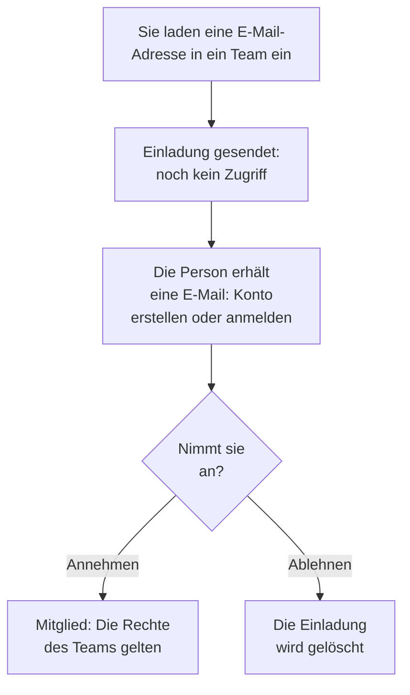

# Personen einladen

Personen kommen per Einladung in ein Projekt. Sie laden die E-Mail-Adresse einer Person in ein Team ein, die Person nimmt an, und ab dann bestimmt ihr Team, was sie tun darf. Diese Seite zeigt, wie Sie Personen einladen, was sie sehen und wie Sie ihren Zugriff später ändern oder beenden.

:::cards
- [Jemanden einladen](#jemanden-einladen): Eine E-Mail-Adresse und ein Team.
- [Eine Einladung annehmen](#eine-einladung-annehmen): Was die eingeladene Person sieht und tut.
- [Die Teams einer Person ändern](#die-teams-einer-person-ändern): Mehr Zugriff geben, oder weniger.
- [Jemanden entfernen](#jemanden-aus-dem-projekt-entfernen): Was das Verlassen des Projekts mitnimmt.
:::

## So funktioniert eine Einladung

- **Das Team bestimmt, was die Person tun darf.** Niemand hat eigene Berechtigungen: Eine Person darf, was die Teams erlauben, in denen sie ist. Siehe [Benutzer, Teams & Berechtigungen](/docs/permissions/index).
- **Bis zur Annahme wird nichts gewährt.** Eine offene Einladung erscheint als **Einladung gesendet** und gibt keinen Zugriff auf das Projekt.
- **Eine Annahme gilt für das ganze Projekt.** Wer eine Einladung annimmt, nimmt alle anderen Einladungen in dasselbe Projekt mit an. Ein Mitglied, das Sie später einem weiteren Team hinzufügen, ist sofort darin, ohne etwas anzunehmen.

## Bevor Sie beginnen

- **Eine Rolle, die Personen einladen darf.** Project Owner, Project Admin oder eine Rolle mit der Berechtigung **Invite New Members**. Sie können Personen nur in ein Team einladen, dessen Berechtigungen Sie selbst haben, denn eine Einladung gibt ihnen den Zugriff des Teams. Wer Project Admin ist und keiner Sperre unterliegt, hat dafür alles, was Project Admin ohnehin kann: Personen lassen sich zu **Members** oder in ein Team mit jeder engeren Rolle einladen, aber nicht in ein Team mit Project Owner, einer Abrechnungsberechtigung, **Delete Project**, **Edit Project**, **Edit Team** oder **Invite New Members**.
- **In OneUptime Cloud, Platz in Ihrem Tarif.** Jede Person im Projekt ist ein Platz auf seiner Rechnung, ab dem Moment der Einladung. Der Free-Tarif hat Platz für eine Person. Siehe [Abrechnung & Nutzung](/docs/configuration/billing#ihr-tarif-und-ihre-plätze).
- **Keine SCIM Push Groups.** Solange Ihr Identitätsanbieter die Teams des Projekts über SCIM Push Groups verwaltet, laden Sie Personen dort ein und entfernen sie dort, nicht in OneUptime.

## Jemanden einladen

:::steps
### Benutzer öffnen

Gehen Sie zu **Produkte → Einstellungen → Benutzer**. Die Liste **Benutzer** zeigt alle Personen im Projekt, ihre Teams und ob sie beigetreten sind.

### Auf Benutzer einladen klicken

Klicken Sie auf **Benutzer einladen**. Der Dialog **Neuen Benutzer einladen** öffnet sich.

### Die E-Mail-Adresse eingeben

Geben Sie die Adresse unter **E-Mail** ein. Verwendet noch kein OneUptime-Konto diese Adresse, fragt der Dialog zusätzlich nach einem **Name**, mit dem das neue Konto beginnt.

### Das Team wählen

**Team** beginnt mit dem Mitglieder-Team des Projekts: dem Team, das Project Member für das ganze Projekt hat, sonst dem Team namens Members. Wählen Sie ein anderes Team, um mehr oder weniger Zugriff zu geben. **Team** bleibt leer, wenn das Projekt kein solches Team hat oder wenn Sie selbst niemanden in dieses Team einladen dürften.

### Die Einladung senden

Klicken Sie auf **Einladen**. OneUptime sendet die Einladung per E-Mail und öffnet die Seite der Person. Bis zur Annahme erscheint sie als **Einladung gesendet**.
:::

> [!TIP]
> Laden Sie Personen in das kleinste Team ein, mit dem sie ihre Arbeit erledigen können. Sie können sie später weiteren Teams hinzufügen, und jedes Team erweitert, was sie tun dürfen.

## Eine Einladung annehmen

Die Einladungs-E-Mail nennt das Projekt. Ihre Schaltfläche heißt **Create Your Account** für jemanden ohne OneUptime-Konto und **Sign In to OneUptime** für jemanden mit Konto. Nach der Anmeldung nimmt die Person an einer von zwei Stellen an:

| Wo die Person ist | Was sie sieht | Was sie anklickt |
| --- | --- | --- |
| Noch in keinem Projekt | Die Einladung, auf der Seite, auf der sie nach der Anmeldung landet | **Annehmen & beitreten** oder **Ablehnen** |
| Schon in einem anderen Projekt | Die offene Einladung an der Glocke oben rechts, die **Projekteinladungen** öffnet | **Annehmen** oder **Ablehnen** |

Mit der Annahme ist die Person sofort im Projekt, mit den Berechtigungen ihres Teams und der Benachrichtigungseinrichtung, mit der jedes Mitglied beginnt: siehe [Womit Sie beginnen](/docs/notifications/index#womit-sie-starten). Eine Ablehnung löscht die Einladung, ein späterer Beitritt braucht also eine neue.

## Sehen, wer im Projekt ist

**Benutzer** hat eine Zeile pro Person:

| Spalte | Was sie zeigt |
| --- | --- |
| **Benutzer** | Name und E-Mail-Adresse. |
| **Teams** | Jedes Team des Projekts, in dem die Person ist oder zu dem sie eingeladen ist. |
| **Status** | **Mitglied**, sobald sie beigetreten ist, mit der Zahl der noch nicht angenommenen Einladungen in andere Teams. **Einladung gesendet** bis dahin. |

Filtern Sie die Liste nach **Benutzer**, **Status** oder **Team**. Klicken Sie auf eine Zeile, um die Seite der Person zu öffnen:

| Seite | Wofür sie da ist |
| --- | --- |
| **Profil** | Name, E-Mail-Adresse, Bild und Benutzer-ID. |
| **Teams** | Die Teams, in denen die Person ist. Hier fügen Sie ein Team hinzu oder entfernen es. |
| **Einsatzbereitschaft**, **Benachrichtigungsmethoden**, **Bereitschaftsregeln** | Ob die Person alarmiert werden kann, und wie. Sichtbar für Project Owners, Project Admins, die Person selbst und alle, die die Benachrichtigungsregeln anderer lesen dürfen. Siehe [Einsatzbereitschaft & Berichte](/docs/on-call/readiness). |
| **Benutzerdefinierte Felder** | Die benutzerdefinierten Felder des Projekts für Personen, wenn es welche hat. |
| **Aus Projekt entfernen** | Die Person aus dem Projekt nehmen. |

## Die Teams einer Person ändern

:::steps
### Ihre Teams-Seite öffnen

Klicken Sie unter **Benutzer** auf die Person und dann auf **Teams**.

### Sie einem Team hinzufügen

Klicken Sie auf **Einladen**, wählen Sie das **Team** und klicken Sie im Dialog auf **Einladen**. Ein Mitglied ist sofort im neuen Team. Wer noch nicht beigetreten ist, erhält eine weitere Einladung, und die Annahme einer der beiden nimmt beide an.

### Sie aus einem Team nehmen

Klicken Sie in der Zeile des Teams auf **Entfernen**. Ist es das letzte Team, dem die Person beigetreten ist, nimmt das Entfernen sie aus dem Projekt, und der Dialog sagt das, bevor sich etwas ändert.
:::

Das Owners-Team behält immer mindestens ein beigetretenes Mitglied, damit ein Projekt nie seinen letzten Owner verliert.

## Jemanden aus dem Projekt entfernen

Öffnen Sie unter **Benutzer** das Zeilenmenü der Person, **⋯**, und klicken Sie auf **Aus Projekt entfernen**. Oder öffnen Sie die Person und wählen Sie **Aus Projekt entfernen** in ihrem Seitenmenü. Um mehrere Personen auf einmal zu entfernen, wählen Sie ihre Zeilen aus und löschen Sie die Auswahl: Jede wird auf dieselbe Weise entfernt.

Das Entfernen nimmt die Person aus jedem Team des Projekts. Sie verliert sofort den Zugriff, auch wenn sie angemeldet ist, wird aus den Bereitschaftsplänen und Eskalationsregeln genommen und erhält keine Benachrichtigungen des Projekts mehr. Ihr OneUptime-Konto wird nicht gelöscht, und Sie können sie wieder einladen. [Benutzer, Teams & Berechtigungen](/docs/permissions/index#benutzer) listet alles auf, was das Verlassen eines Projekts mitnimmt.

## Andere Wege in ein Projekt

- **Single Sign-On.** Wer sich zum ersten Mal über den Identitätsanbieter des Projekts anmeldet, kommt in die Teams, die der Anbieter nennt. Siehe [Rollen und Teams für SSO-Benutzer](/docs/identity/sso#rollen-und-teams-für-sso-benutzer).
- **SCIM.** Ihr Identitätsanbieter legt Personen an und fügt sie den Standard-Teams der Verbindung hinzu. Siehe [SCIM](/docs/identity/scim#so-wird-ein-projektbenutzer-bereitgestellt).
- **Das Admin Dashboard.** Auf einer selbst gehosteten Installation kann ein Master-Admin jemanden einem Projekt hinzufügen und die Einladung für die Person annehmen. Siehe [Benutzer, Teams & Berechtigungen](/docs/permissions/index#benutzer).

## Fehlerbehebung

:::details "This user has already been invited to this team"
Die Person ist schon in diesem Team, als Mitglied oder mit einer noch nicht angenommenen Einladung. Öffnen Sie sie unter **Benutzer**, um ihre Teams zu sehen, oder laden Sie sie in ein anderes Team ein.
:::

:::details "You have reached the user limit for the free plan"
In OneUptime Cloud hat ein Projekt im Free-Tarif Platz für eine Person. Ändern Sie den Tarif und laden Sie dann erneut ein. Siehe [Den Tarif ändern](/docs/configuration/billing#den-tarif-ändern).
:::

:::details "Too many invitations were sent to this email address in the last hour"
An eine Adresse können 10 Einladungen pro Stunde gesendet werden, zu Projekten und privaten Statusseiten zusammen, egal wer sie sendet. Warten Sie eine Stunde und laden Sie die Person dann erneut ein.
:::

:::details Die Einladungs-E-Mail kam nicht an, oder ihr Link ist abgelaufen
Die Einladung hängt nicht an der E-Mail. Bitten Sie die Person, sich mit der eingeladenen Adresse zu registrieren: OneUptime sendet an diese Adresse einen neuen Link, um das Konto fertig anzulegen. Wer schon ein Konto hat, meldet sich an und findet die Einladung vor.
:::

:::details Benutzer einladen meldet, dass Benutzer über SCIM Push Groups verwaltet werden
Ihr Identitätsanbieter verwaltet die Teams des Projekts. Laden Sie Personen im Identitätsanbieter ein oder entfernen Sie sie dort, oder schalten Sie Push Groups unter **Projekteinstellungen → Sicherheit → SCIM** aus, um sie hier zu verwalten.
:::

## Nächste Schritte

:::cards
- [Benutzer, Teams & Berechtigungen](/docs/permissions/index): Festlegen, was jedes Team tun darf.
- [Projekteinstellungen](/docs/configuration/project-settings): Alles, was für das ganze Projekt gilt.
- [Ihr Konto](/docs/introduction/your-account): Anmeldung, Profil und die Projekte, zu denen Sie gehören.
- [SCIM](/docs/identity/scim): Personen und Teams von Ihrem Identitätsanbieter verwalten lassen.
:::
