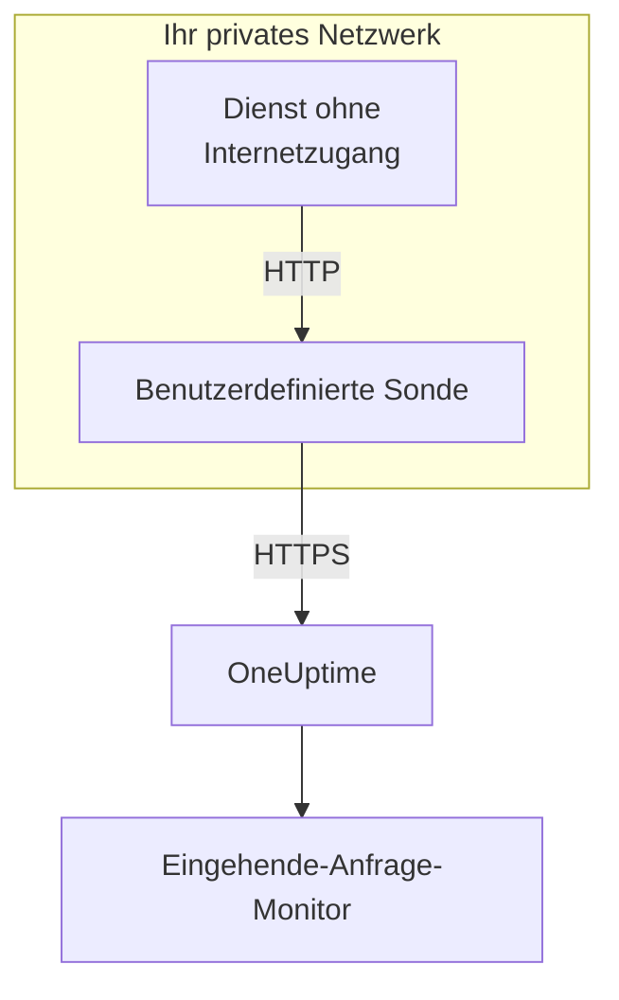

# Eingehende-Anfrage-Ingress

Ein Dienst ohne Internetzugang kann trotzdem Heartbeats an eine [Eingehende-Anfrage-Überwachung](/docs/monitor/incoming-request-monitor) senden. Er sendet sie stattdessen an eine [benutzerdefinierte Sonde](/docs/probe/custom-probe) in seinem eigenen Netzwerk, und die Sonde reicht sie an OneUptime weiter.

:::cards
- [So funktioniert es](#so-funktioniert-es): Von Ihrem Dienst über die Sonde zum Monitor.
- [Den Listener einschalten](#den-listener-einschalten): Eine Einstellung auf der Sonde, für Docker, Docker Compose oder Kubernetes.
- [Anfragen an die Sonde senden](#anfragen-an-die-sonde-senden): Die URL ändern, an die Ihr Dienst sendet, und sonst nichts.
- [Fehlerbehebung](#fehlerbehebung): Was die Sonde protokolliert, wenn eine Anfrage nicht durchkommt.
:::

## So funktioniert es



1. **Ihr Dienst sendet die Anfrage an die Sonde.** Dasselbe `GET` oder `POST` mit demselben geheimen Schlüssel, das er an OneUptime senden würde, an einen Port, auf dem die Sonde lauscht.
2. **Die Sonde antwortet sofort.** Sie antwortet mit `200`, bevor sie die Anfrage weiterreicht, sodass Ihr Dienst nie auf OneUptime wartet.
3. **Die Sonde leitet sie weiter.** Sie sendet die Anfrage mit Methode, Headern und Body an OneUptime weiter und fügt einen Header `OneUptime-Probe-Id` hinzu, der die Sonde nennt.
4. **OneUptime liest sie wie gewohnt.** Die Kriterien des Monitors sehen die Anfrage, als hätte der Dienst sie direkt gesendet.

Der Listener läuft auf einem eigenen Port, getrennt von den Health-Checks der Sonde, sodass Sie ihn für Ihr privates Netzwerk öffnen können, ohne sonst etwas zu öffnen.

## Wann Sie ihn verwenden

Verwenden Sie den Listener, wenn:

- Ihre Dienste in einem isolierten Netzwerksegment ohne ausgehenden HTTPS-Zugang laufen
- Sie den gesamten Überwachungsverkehr in Ihrer VPC bzw. Ihrem lokalen Netzwerk halten müssen
- Sie einen einzigen Ausgangspunkt wollen – die Sonde –, der OneUptime erreichen darf
- Sie bereits eine [benutzerdefinierte Sonde](/docs/probe/custom-probe) betreiben und sie für eingehende Heartbeats wiederverwenden möchten

Wenn Ihre Dienste `https://oneuptime.com` (oder Ihre selbst gehostete URL) bereits direkt erreichen, brauchen Sie diese Funktion **nicht** – rufen Sie die Heartbeat-URL direkt vom Dienst aus auf.

## Bevor Sie beginnen

- **Eine laufende benutzerdefinierte Sonde.** Ihr **Status** zeigt **Verbunden**. Wie Sie eine installieren, steht unter [Benutzerdefinierte Probes](/docs/probe/custom-probe).
- **Ein Monitor für eingehende Anfragen.** Seine Heartbeat-URL enthält den geheimen Schlüssel, den Ihr Dienst sendet: siehe [Eingehende-Anfrage-Überwachung](/docs/monitor/incoming-request-monitor).
- **Ein Port auf dem Host der Sonde, den Ihre Dienste erreichen.** Die Beispiele verwenden `3875`.

## Den Listener einschalten

Setzen Sie `PROBE_INGRESS_PORT` auf den Port, den der Listener verwenden soll. Jeder Wert größer als `0` schaltet ihn ein; ungesetzt oder `0` bleibt er aus.

:::tabs
@tab Docker
```bash
docker run --name oneuptime-probe --network host \
  -e PROBE_KEY=<probe-key> \
  -e PROBE_ID=<probe-id> \
  -e ONEUPTIME_URL=https://oneuptime.com \
  -e PROBE_INGRESS_PORT=3875 \
  -d oneuptime/probe:release
```

Ohne `--network host` veröffentlichen Sie den Port mit `-p 3875:3875`.
@tab Docker Compose
```yaml title="docker-compose.yml"
services:
  oneuptime-probe:
    image: oneuptime/probe:release
    container_name: oneuptime-probe
    environment:
      - PROBE_KEY=<probe-key>
      - PROBE_ID=<probe-id>
      - ONEUPTIME_URL=https://oneuptime.com
      - PROBE_INGRESS_PORT=3875
    network_mode: host
    restart: always
```

Ohne `network_mode: host` veröffentlichen Sie den Port unter `ports:` als `"3875:3875"`.
@tab Kubernetes
```yaml title="oneuptime-probe.yaml"
apiVersion: apps/v1
kind: Deployment
metadata:
  name: oneuptime-probe
spec:
  selector:
    matchLabels:
      app: oneuptime-probe
  template:
    metadata:
      labels:
        app: oneuptime-probe
    spec:
      containers:
        - name: oneuptime-probe
          image: oneuptime/probe:release
          env:
            - name: PROBE_KEY
              value: "<probe-key>"
            - name: PROBE_ID
              value: "<probe-id>"
            - name: ONEUPTIME_URL
              value: "https://oneuptime.com"
            - name: PROBE_INGRESS_PORT
              value: "3875"
          ports:
            - name: ingress
              containerPort: 3875
---
apiVersion: v1
kind: Service
metadata:
  name: oneuptime-probe-ingress
spec:
  selector:
    app: oneuptime-probe
  ports:
    - name: ingress
      port: 3875
      targetPort: 3875
  type: ClusterIP
```

Dienste im Cluster senden dann an `http://oneuptime-probe-ingress.<namespace>.svc.cluster.local:3875/heartbeat/<secret-key>`.
:::

Läuft der Listener, steht im Log der Sonde `Probe ingress listener started on port 3875 (heartbeat / incoming-request endpoints)`.

## Anfragen an die Sonde senden

Ihr Dienst sendet an die Sonde statt an OneUptime. Ersetzen Sie die öffentliche Heartbeat-URL:

```text
https://oneuptime.com/heartbeat/<secret-key>
```

durch die Ingress-URL der Sonde:

```text
http://<probe-host>:<PROBE_INGRESS_PORT>/heartbeat/<secret-key>
```

Pfad, Methode, Body und Header bleiben sonst gleich, sodass vorhandener Client-Code nur die Basis-URL ändern muss. Die Sonde nimmt auch `/incoming-request/<secret-key>` an, was genauso funktioniert.

```bash
# GET heartbeat
curl http://probe.internal:3875/heartbeat/YOUR_SECRET_KEY

# POST heartbeat with JSON body
curl -X POST http://probe.internal:3875/heartbeat/YOUR_SECRET_KEY \
  -H "Content-Type: application/json" \
  -d '{"status": "healthy", "version": "1.2.3"}'

# Cron job
*/5 * * * * curl -s http://probe.internal:3875/heartbeat/YOUR_SECRET_KEY > /dev/null
```

## Wie Anfragen weitergeleitet werden

| Was | Wie die Sonde damit umgeht |
| --- | --- |
| Die Antwort | `200` mit einem leeren JSON-Objekt (`{}`), gesendet, bevor die Anfrage weitergeleitet wird. Wie bei OneUptime wird sie gesendet, egal was danach geschieht: Auch ein falscher geheimer Schlüssel bekommt sie. |
| Methoden | `POST` wird als `POST` weitergeleitet. `GET` und `HEAD` werden als `GET` weitergeleitet. Andere Methoden bekommen von der Sonde ein `404`. |
| Header | Alle außer den Hop-by-Hop-Headern (`Host`, `Connection`, `Content-Length`, `Transfer-Encoding`, `Keep-Alive`, `Proxy-Authenticate`, `Proxy-Authorization`, `TE`, `Trailer`, `Upgrade`) und `Content-Encoding`, da die Sonde den Body unkomprimiert weiterleitet. Die Sonde fügt `OneUptime-Probe-Id` hinzu. |
| Der Body | JSON- und Formular-Bodies bis 50 MB, wie wenn Sie direkt an OneUptime senden. Wie dort kommt jeder andere Body leer beim Monitor an. |
| Wiederholungen | Schlägt eine Weiterleitung fehl, versucht es die Sonde bis zu `PROBE_INGRESS_FORWARD_RETRY_LIMIT`-mal erneut und wartet dabei 2 s, dann 4 s, dann 8 s, nie mehr als 15 s. Danach protokolliert sie den Fehler und verwirft die Anfrage. |
| Proxys | Die Weiterleitung läuft über den Proxy der Sonde, wenn `HTTP_PROXY_URL` oder `HTTPS_PROXY_URL` gesetzt ist. |
| Wohin sie geht | `ONEUPTIME_URL`, gefolgt von `/incoming-request-ingest/incoming-request/<secret-key>`. |

## Umgebungsvariablen

| Variable | Standard | Was sie bewirkt |
| --- | --- | --- |
| `PROBE_INGRESS_PORT` | ungesetzt (aus) | Der Port, den der Listener verwendet. Jeder Wert größer als `0` schaltet ihn ein. |
| `PROBE_INGRESS_FORWARD_TIMEOUT_MS` | `10000` | Wie lange jede Weiterleitung an OneUptime dauern darf, in Millisekunden. Ein Wert unter `1000` fällt auf den Standard zurück. |
| `PROBE_INGRESS_FORWARD_RETRY_LIMIT` | `3` | Wie oft eine fehlgeschlagene Weiterleitung erneut versucht wird. `0` schaltet Wiederholungen aus. |

Die üblichen Variablen der Sonde (`PROBE_KEY`, `PROBE_ID`, `ONEUPTIME_URL` und die Proxy-Variablen) gelten alle: die vollständige Liste steht unter [Benutzerdefinierte Probes](/docs/probe/custom-probe).

## Sicherheitshinweise

- **Der Endpunkt ist absichtlich nicht authentifiziert** – der geheime Schlüssel im URL-Pfad *ist* die Authentifizierung, genau wie beim öffentlichen Endpunkt `oneuptime.com`. Behandeln Sie den geheimen Schlüssel wie ein Zugangsdatum.
- **Halten Sie den Listener in Ihrem privaten Netzwerk.** Er sollte aus dem Internet nicht erreichbar sein. Begrenzen Sie mit einer Network Policy, einer Firewall-Regel oder einem Service vom Typ `ClusterIP`, wer ihn erreichen kann.
- **Setzen Sie TLS davor, wenn Sie Verschlüsselung in Ihrem Netzwerk brauchen.** Der Listener spricht reines HTTP. Stellen Sie ihn hinter einen internen Load Balancer oder Ingress-Controller, um TLS auf dieser Strecke zu haben. Die Weiterleitung von der Sonde an OneUptime nutzt HTTPS, wenn `ONEUPTIME_URL` mit `https://` beginnt.
- **Begrenzen Sie die Body-Größe selbst, wenn 50 MB zu viel sind.** Stellen Sie einen Reverse Proxy mit einer niedrigeren Grenze vor den Listener.

## Fehlerbehebung

:::details Das Log der Sonde meldet nie, dass der Listener gestartet ist
`PROBE_INGRESS_PORT` ist ungesetzt, `0` oder keine Zahl. Setzen Sie eine Portnummer und starten Sie die Sonde neu. Die Logzeile lautet `Probe ingress listener started on port <port> (heartbeat / incoming-request endpoints)`.
:::

:::details Die Sonde protokolliert `Probe ingress: failed to forward to <url> after N attempts`
Die Sonde konnte OneUptime auch nach ihren Wiederholungen nicht erreichen. Prüfen Sie die ausgehende Konnektivität der Sonde, ihre Proxy-Einstellungen und den Wert von `ONEUPTIME_URL`. Zeigt die Sonde außerdem **Getrennt**, finden Sie unter [Benutzerdefinierte Probes](/docs/probe/custom-probe) heraus, wo ihre Anfragen hängen bleiben.
:::

:::details Die Sonde protokolliert `Probe ingress: probe ID not available, forwarding without it`
Die Sonde hat ihre Verbindung zu OneUptime noch nicht fertig aufgebaut und leitet die Anfrage daher ohne den Header `OneUptime-Probe-Id` weiter. Die Anfrage erreicht den Monitor trotzdem.
:::

:::details Der Monitor bekommt die Anfragen, aber nicht über die Sonde
Ihr Dienst sendet noch an die öffentliche URL. Prüfen Sie, dass er an `http://<probe-host>:<port>/...` sendet: Ein DNS-Name oder ein Eintrag in `/etc/hosts`, der woandershin zeigt, ist die übliche Ursache.
:::

:::details Der Monitor bekommt nichts, und die Sonde protokolliert nichts
Die Anfrage hat die Sonde nie erreicht. Prüfen Sie, ob der Dienst den Host der Sonde auf dem Port erreicht: eine Firewall-Regel, ein nicht veröffentlichter Port oder ein Kubernetes-Service, der den Pod der Sonde nicht auswählt.
:::

## Nächste Schritte

:::cards
- [Eingehende-Anfrage-Überwachung](/docs/monitor/incoming-request-monitor): Festlegen, was als gesunder Heartbeat zählt.
- [Benutzerdefinierte Probes](/docs/probe/custom-probe): Die Sonde installieren, und jede Einstellung, die sie liest.
:::
