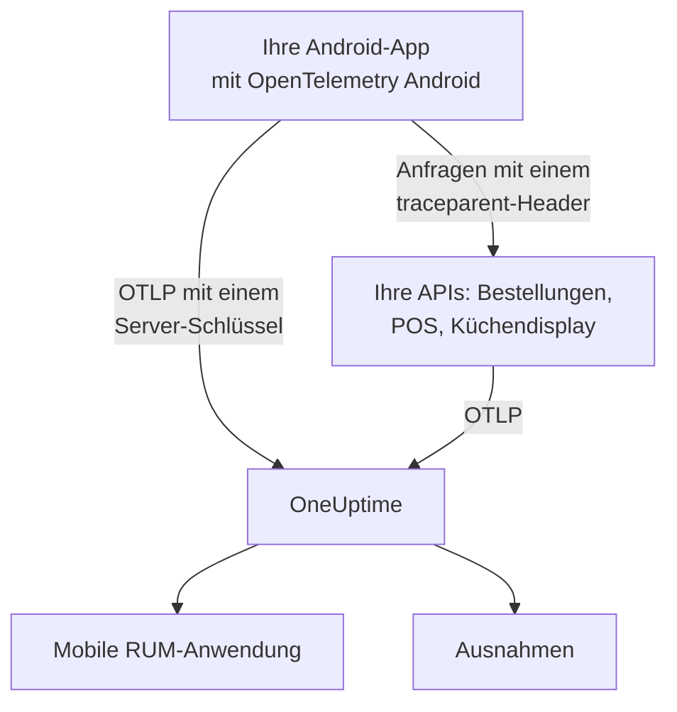

# Einrichtung für Android

Instrumentieren Sie eine native Android-App mit OpenTelemetry Android, damit sie als mobile RUM-Anwendung an OneUptime meldet: ihre Abstürze und ANRs, langsame und eingefrorene Frames, App-Starts, Bildschirme, Sitzungen und Netzwerkanfragen, bis in Ihr Backend verfolgt.

:::cards
- [OpenTelemetry Android hinzufügen](#opentelemetry-android-hinzufügen): Eine Gradle-Abhängigkeit und ein paar Zeilen beim Start der App.
- [Was der Agent meldet](#was-der-agent-meldet): Abstürze, ANRs, eingefrorene Frames, Starts und Sitzungen, und wo jedes davon landet.
- [Anfragen bis in Ihr Backend tracen](#anfragen-bis-in-ihr-backend-tracen): Ein Span für jeden OkHttp-Aufruf, und daran ein `traceparent`.
- [Eigene Abläufe tracen](#eigene-abläufe-tracen): Eine Bestellung von der Speisekarte bis in die Küche, ein Zahlungsterminal, ein Drucker.
- [Kioske und andere eigene Geräte](#kioske-und-andere-eigene-geräte): Jedes Gerät benennen, es über Ihr MDM konfigurieren, Daten offline behalten.
:::

## So funktioniert es

OpenTelemetry Android läuft in Ihrer App. Es sendet Traces, Logs und Metriken über OTLP mit einem **Server**-Ingestion-Schlüssel an OneUptime und fügt den Anfragen Ihrer App einen W3C-Header `traceparent` hinzu, sodass sich die Spans Ihres Backends den Traces der App anschließen.



## Bevor Sie beginnen

- Eine Android-App, deren `minSdk` 23 oder höher ist, gebaut mit `compileSdk` 34 oder höher. Bei einem `minSdk` unter 26 schalten Sie [Core Library Desugaring](https://developer.android.com/studio/write/java8-support#library-desugaring) ein, mit Android Gradle Plugin 8.3.0 oder neuer und `android.useFullClasspathForDexingTransform=true` in `gradle.properties`.
- Ein **Server**-Ingestion-Schlüssel, erstellt unter **Projekteinstellungen → Telemetrie & APM → Ingestion-Schlüssel** mit **Ingestion-Schlüssel erstellen**. Ein **Browser**-Schlüssel wird aus einer App abgelehnt: Er wird gegen den Header `Origin` geprüft, den eine App nicht sendet.
- Diese OTLP-Einstellungen. Wenn Sie OneUptime selbst hosten, ersetzen Sie `https://oneuptime.com` durch Ihren eigenen Host.

| Einstellung | Wert |
| --- | --- |
| OTLP-Endpunkt | `https://oneuptime.com/otlp` |
| Header | `x-oneuptime-token: YOUR_TELEMETRY_INGESTION_TOKEN` |

> [!WARNING]
> Der Schlüssel wird mit Ihrer App ausgeliefert, und eine App lässt sich entpacken. Gehen Sie also davon aus, dass jemand ihn kopiert. Legen Sie auf der Seite des Schlüssels unter **Festgelegter Dienstname** einen Dienstnamen fest, tragen Sie ein **Limit für Anfragen pro Minute** und ein Datum unter **Läuft ab am** ein, und tauschen Sie den Schlüssel mit Ihren Releases aus.

## OpenTelemetry Android hinzufügen

:::steps
### Die Abhängigkeit hinzufügen

```kotlin title="app/build.gradle.kts"
dependencies {
    implementation("io.opentelemetry.android:android-agent:1.8.1")
}
```

Der Agent bringt die Instrumentierung für Abstürze, ANRs, langsames Rendering, Activities, Fragments, Netzwerk und Sitzungen mit. Prüfen Sie [seine Releases](https://github.com/open-telemetry/opentelemetry-android/releases) auf eine neuere Version.

### Den Agenten mit der App starten

```kotlin title="KioskApplication.kt"
import android.app.Application
import io.opentelemetry.android.OpenTelemetryRum
import io.opentelemetry.android.agent.OpenTelemetryRumInitializer

class KioskApplication : Application() {
    lateinit var otelRum: OpenTelemetryRum

    override fun onCreate() {
        super.onCreate()

        otelRum = OpenTelemetryRumInitializer.initialize(this) {
            httpExport {
                baseUrl = "https://oneuptime.com/otlp"
                baseHeaders = mapOf("x-oneuptime-token" to BuildConfig.ONEUPTIME_TOKEN)
            }
            resource {
                put("service.name", "kiosk-ordering")
                put("deployment.environment.name", "production")
            }
        }
    }
}
```

`baseUrl` ist der Endpunkt ohne Signal: Der Agent hängt `/v1/traces`, `/v1/logs` und `/v1/metrics` daran an. Setzen Sie `service.name`, sonst wird die App nach ihrem Launcher-Label benannt. Dieser Name ist die Identität der Anwendung in OneUptime, halten Sie ihn also von Release zu Release gleich.

Tragen Sie die Klasse im `android:name` des Elements `<application>` Ihres Manifests ein. `BuildConfig.ONEUPTIME_TOKEN` steht für den Ort, an dem Ihr Build den Schlüssel aufbewahrt; eine Geräteflotte kann ihn stattdessen von ihrem MDM erhalten, wie [Kioske und andere eigene Geräte](#kioske-und-andere-eigene-geräte) zeigt.

### Die App starten und prüfen, ob sie ankommt

```bash
curl -i https://oneuptime.com/otlp/v1/validate \
  -H "x-oneuptime-token: YOUR_TELEMETRY_INGESTION_TOKEN"
```

`200` mit `"valid": true` bedeutet, dass der Schlüssel angenommen wird. Starten Sie dann die App und nutzen Sie sie einen Moment: Sie erscheint unter **Produkte → Ressourcen → Real User Monitoring**, benannt nach ihrem `service.name`. Der Agent schreibt Telemetrie auf den Datenträger, bevor er sie sendet, daher kann es eine Minute dauern, bis der erste Batch ankommt.
:::

## Was der Agent meldet

OpenTelemetry Android zeichnet all das von sich aus auf. Die Geräteattribute, die es setzt, `device.model.identifier`, `device.model.name` und `device.manufacturer`, ordnen die App als mobile RUM-Anwendung ein und füllen ihre Seite **Clients**. Außerdem setzt es `os.name`, `os.version` und eine `app.installation.id` pro Installation, und keine `device.id`.

| Was | Wie der Agent es sendet | Wo es in OneUptime erscheint |
| --- | --- | --- |
| Abstürze | Ein Ereignis `app.crash` mit Typ, Nachricht und Stacktrace der Ausnahme | **Ausnahmen**, als nicht behandelt |
| ANRs | Ein Ereignis `device.anr` mit dem Stack des Hauptthreads, sobald die App etwa 5 Sekunden lang nicht reagiert | **Ausnahmen**, als nicht behandelt, unter dem Typ `ANR` |
| Langsame und eingefrorene Frames | Ein Ereignis `app.jank` mit `app.jank.frame_count`, den Frames, die langsamer als 16 ms (`app.jank.threshold` ist `0.016`) oder 700 ms (`0.7`) sind | **Protokolle**, mit `@event.name:app.jank` |
| App-Starts | Ein Span `AppStart`, mit `start.type` auf `cold`, `warm` oder `hot` gesetzt | **Traces** |
| Bildschirme | Ein Span für jeden Schritt im Lebenszyklus einer Activity oder eines Fragments, und `app.screen.name` auf jedem Span und Log | **Traces** |
| Sitzungen | `session.id` auf jedem Span und Log, und die Ereignisse `session.start` und `session.end` | **Traces** und **Protokolle**, durchsucht mit `@session.id:` |
| Netzwerkwechsel | Ein Ereignis `network.change`, und `network.connection.type` auf jedem Span und Log | **Protokolle** |

Abstürze und ANRs erreichen **Ausnahmen** als nicht behandelt, gruppiert nach ihren Stacktraces, mit der Sitzung, in der sie passiert sind. Der Agent speichert einen Absturz auf dem Datenträger, noch während die App abstürzt, und sendet ihn von dort aus, sodass ein Absturz, der offline passiert, trotzdem ankommt, sobald die App wieder mit Netzwerk läuft.

Die **Übersicht** der Anwendung wertet das für Sie aus: **Sitzungen**, **Absturzfreie Sitzungen**, **Abstürze**, **ANRs**, **App-Starts**, **Kaltstart (p95)** und **Eingefrorene Frames**, und jede dieser Kacheln öffnet die Ausnahmen, Spans oder Ereignisse, die sie zählt. Solange die App keine App-Starts oder Frames sendet, sagen die zugehörigen Diagramme, wie Sie sie einschalten. Die **Empfehlungen** der Anwendung bieten Monitore für Abstürze, ANRs, langsame Kaltstarts, eingefrorene Frames und eine App, die nicht mehr meldet.

Eine Sitzung endet nach 15 Minuten im Hintergrund oder nach 4 Stunden. Eine App, die nie in den Hintergrund geht, etwa ein Kiosk, behält 4 Stunden lang eine einzige Sitzung. Tracen Sie daher den Besuch jedes Kunden als eigenen Span, wie [Eigene Abläufe tracen](#eigene-abläufe-tracen) zeigt.

Auch die eigenen `android.util.Log`-Aufrufe Ihrer App werden zu Logs, wenn Sie `android-log-library` und `android-log-agent` neben den OkHttp-Modulen unten hinzufügen: Das Tag jedes Aufrufs landet in `android.log.tag`, und ein Aufruf mit einem Throwable ist eine Ausnahme unter **Ausnahmen**. OpenTelemetry Android liest Logcat nicht.

## Anfragen bis in Ihr Backend tracen

Fügen Sie die OkHttp-Instrumentierung und das ByteBuddy-Plugin hinzu, mit dem sie gebaut wird:

```kotlin title="app/build.gradle.kts"
plugins {
    // ...the plugins your app already applies, then:
    id("net.bytebuddy.byte-buddy-gradle-plugin") version "1.18.15"
}

dependencies {
    implementation("io.opentelemetry.android:android-agent:1.8.1")
    implementation("io.opentelemetry.android.instrumentation:okhttp3-library:1.8.1-alpha")
    byteBuddy("io.opentelemetry.android.instrumentation:okhttp3-agent:1.8.1-alpha")
}
```

Das Plugin instrumentiert die Klasse `OkHttpClient` selbst, daher wird jeder Client in der App getraced, auch die, die Bibliotheken erstellen. Jede Anfrage wird zu einem Client-Span, der nach ihrer Methode benannt ist, mit ihrer URL, ihrem Statuscode und ihrer Dauer, und trägt einen W3C-Header `traceparent`. Ein mit [OpenTelemetry](/docs/telemetry/open-telemetry) instrumentiertes Backend setzt den Trace ab diesem Header fort, sodass die Bestell-API, die POS-Bridge und der Küchendisplay-Dienst ihre Spans demselben Trace hinzufügen wie das Tippen auf dem Kiosk.

- Für `HttpURLConnection` gibt es dasselbe Modulpaar: `httpurlconnection-library` und `httpurlconnection-agent`.
- Ohne das Plugin umhüllen Sie einen Client selbst: `OkHttpTelemetry.builder(otelRum.openTelemetry).build().createCallFactory(client)`, aus `io.opentelemetry.instrumentation:opentelemetry-okhttp-3.0`.
- Ein Span, den Sie in Ihrem Code öffnen, wie im nächsten Abschnitt, ist der Eltern-Span der Anfragen, die darin gestellt werden.

## Eigene Abläufe tracen

Holen Sie sich einen Tracer vom Agenten und erzeugen Sie einen Span für die Bestellung eines Kunden, mit einem Kind-Span für jeden ihrer Schritte. Jeder Schritt hat dann seine eigene Dauer und seine eigenen Fehler, und die Bestellung sagt, wie sie ausgegangen ist:

```kotlin title="OrderTrace.kt"
import io.opentelemetry.api.trace.Span
import io.opentelemetry.api.trace.StatusCode
import io.opentelemetry.api.trace.Tracer
import io.opentelemetry.context.Context

class OrderTrace(private val tracer: Tracer) {
    // order.session: from the first tap to the order reaching the kitchen.
    private val order: Span = tracer.spanBuilder("order.session").startSpan()
    private val parent: Context = Context.current().with(order)

    // One step: menu.browse, cart.customize, payment.process, pos.inject.
    fun <T> step(name: String, block: (Span) -> T): T {
        val span = tracer.spanBuilder(name).setParent(parent).startSpan()
        return try {
            span.makeCurrent().use { block(span) }
        } catch (error: Throwable) {
            span.recordException(error)
            span.setStatus(StatusCode.ERROR)
            throw error
        } finally {
            span.end()
        }
    }

    fun complete() = finish("completed")

    fun abandon(reason: String) {
        order.setAttribute("order.abandon_reason", reason)
        finish("abandoned")
    }

    private fun finish(outcome: String) {
        order.setAttribute("order.outcome", outcome)
        order.end()
    }
}
```

```kotlin title="CheckoutFlow.kt"
val order = OrderTrace(otelRum.openTelemetry.getTracer("kiosk.ordering"))

order.step("cart.customize") { span ->
    span.setAttribute("cart.items", cart.size.toLong())
}
order.step("payment.process") { terminal.charge(cart.total) }
order.step("pos.inject") { posApi.submit(cart) } // its OkHttp span is a child
order.complete()
```

Umhüllen Sie auf dieselbe Weise jeden Aufruf an das SDK eines Zahlungsterminals, eines Druckers, eines Scanners oder eines NFC-Lesers, und geben Sie an, welches Gerät es war, sodass ein langsames oder ausfallendes Gerät ein langsamer oder fehlschlagender Span ist:

```kotlin title="ReceiptPrinter.kt"
order.step("printer.print") { span ->
    span.setAttribute("peripheral.type", "printer")
    span.setAttribute("peripheral.model", printer.model)
    span.setAttribute("peripheral.connection", "usb")
    printer.print(receipt, timeoutMillis = 10_000)
}
```

Die Attributnamen wählen Sie selbst: Halten Sie sie in jeder App gleich, damit ein einziger Filter jeden Drucker findet. Geben Sie jedem Aufruf ein Timeout, denn ein Span endet erst, wenn sein Aufruf zurückkehrt. Ein Schritt, der sich über mehrere Bildschirme erstreckt, etwa das Durchblättern der Speisekarte, ist ein Span, den Sie starten, wenn sich der Bildschirm öffnet, und beenden, wenn er sich schließt, mit demselben Eltern-Span. Für eine Tatsache ohne Dauer, etwa einen Drucker, dem das Papier ausgeht, senden Sie ein Ereignis: `otelRum.emitEvent("printer.paper_low")`.

Filtern Sie in **Traces** nach dem Namen eines Schritts, um zu sehen, wie lange er dauert und wie oft er fehlschlägt, und nach `@order.outcome:abandoned`, um die Bestellungen zu finden, die nie abgeschlossen wurden.

## Kioske und andere eigene Geräte

### Jedes Gerät benennen

OneUptime ordnet eine mobile App nach Anwendung ein, nie nach Gerät, sodass eine App auf Tausenden von Telefonen nie die Telefone ihrer Benutzer auflistet. Benennen Sie bei Geräten, die Ihnen gehören, jedes einzelne in `host.name`. Jedes Gerät erscheint dann im **Inventar** als Host neben Ihren anderen Maschinen, mit Hersteller, Modell und Betriebssystemversion, die der Agent meldet, mit dem, was Sie unten hinzufügen, und mit dem Zeitpunkt, zu dem es zuletzt gesehen wurde:

```kotlin title="KioskApplication.kt"
resource {
    put("service.name", "kiosk-ordering")
    put("host.name", deviceName)
    put("host.serial_number", serialNumber)
    put("device.type", "kiosk")
    put("device.location", "Store 0412")
}
```

Die Telemetrie der App bleibt bei ihrer RUM-Anwendung, und das Gerät wird kein Host unter **Hosts**: Eine App meldet keine Host-Metriken, also gäbe es dort nichts zu zeigen. Die Seite des Geräts im **Inventar** zeigt seine eigenen Logs, Traces und Ausnahmen, und `@resource.host.name:` findet sie unter **Traces** und **Protokolle**. Ein Gerät, das 30 Tage lang nichts sendet, verschwindet aus dem **Inventar**.

### Die Flotte über Ihr MDM konfigurieren

Eine App kann die verwalteten Konfigurationen von Android lesen, die jeder Geräteverwaltungsdienst an seine Geräte verteilt. Lesen Sie den Schlüssel und den Namen des Geräts daraus, statt sie in die App einzubauen:

```kotlin title="KioskApplication.kt"
import android.content.RestrictionsManager

val restrictions = (getSystemService(RESTRICTIONS_SERVICE) as RestrictionsManager)
    .applicationRestrictions
val token = restrictions.getString("oneuptime_token").orEmpty()
val deviceName = restrictions.getString("device_name") ?: android.os.Build.MODEL
val serialNumber = restrictions.getString("device_serial").orEmpty()
```

Übergeben Sie dann `token` an `baseHeaders` anstelle von `BuildConfig.ONEUPTIME_TOKEN`, und `deviceName` und `serialNumber` an die Ressource oben. Fügen Sie in Esper die Konfiguration unten in einem Blueprint unter **Managed Configuration** der App ein. Esper füllt die Platzhalter auf jedem Gerät aus, mit Esper Agent 8.00.0764 oder neuer:

```json title="Managed configuration"
{
  "oneuptime_token": "YOUR_TELEMETRY_INGESTION_TOKEN",
  "device_name": "${esper.deviceName}",
  "device_serial": "${esper.serialNumber}"
}
```

Führen Sie nach einer Änderung ein Converge der Geräte aus, damit sie die neuen Werte lesen. Deklarieren Sie dieselben Schlüssel in einer `app_restrictions.xml`, wenn Ihr MDM ein Schema verlangt. Esper lehnt ein APK ohne v1-Signatur ab, signieren Sie das Release also mit dem v1-Schema sowie mit v2 oder v3.

### Die Flotte aus Esper importieren

Verbinden Sie Ihren Esper-Tenant mit dem Inventar, und jedes Gerät, das Esper registriert, wird aufgeführt, auch die Geräte, deren App nie gestartet wurde, mit dem, was nur Esper weiß: Gruppe, Android-Version, Sicherheitspatch-Ebene, Seriennummer, Akku, Speicher, installierte Apps und letzter Kontakt. Ein Gerät, das sich nicht mehr meldet, wird als offline angezeigt, mit der Zeit seit seinem letzten Kontakt. Siehe [Geräte aus Esper importieren](/docs/inventory/overview#geräte-aus-esper-importieren).

Ein Gerät, dessen App es wie oben benennt, ist ein einziges Element mit dem, was die App sendet: `host.name` ist sein Name in Esper. OneUptime findet das Element eines Geräts über `host.name`, dann über `host.serial_number`, also geben Sie jedem Gerät denselben Namen und dieselbe Seriennummer in jeder App, die von ihm aus meldet, und in den Einstellungen `device_name` und `device_serial` des Android-Agents.

### Behalten, was offline aufgezeichnet wird

Der Agent schreibt jeden Span, jedes Log und jede Metrik auf den Datenträger, bevor er sie sendet. Solange das Netzwerk ausgefallen ist, behält er sie dort und sendet sie, sobald es wieder da ist, bis zu 18 Stunden später. Er behält 10 MB; erhöhen Sie den Wert für ein Gerät, das oft offline ist:

```kotlin title="KioskApplication.kt"
diskBuffering {
    maxCacheSize = 50 * 1024 * 1024
}
```

## Fehlerbehebung

:::details Die App erscheint unter Dienste statt unter Real User Monitoring
OpenTelemetry Android setzt `device.model.identifier` selbst, also wurde die App mit einem anderen SDK eingerichtet, oder ihre Ressource wurde mit `resource(Resource)` ersetzt, was die eigenen Attribute des Agenten verwirft. Verwenden Sie den Block `resource { }`, der sie ergänzt. Der bereits angelegte Dienst wird nicht zu einer RUM-Anwendung. Löschen Sie ihn daher unter **Produkte → Dienste**, sobald RUM-Telemetrie eintrifft.
:::

:::details Nichts kommt an, oder der Schlüssel wird abgelehnt
Führen Sie die Schlüsselprüfung unter [OpenTelemetry Android hinzufügen](#opentelemetry-android-hinzufügen) durch. Ein `401` bedeutet, dass der Schlüssel unbekannt, widerrufen, ausgeschaltet oder abgelaufen ist. Ein **Browser**-Schlüssel wird aus einer App abgelehnt: Verwenden Sie einen **Server**-Schlüssel. Prüfen Sie, dass `baseUrl` auf `/otlp` endet, ohne `/v1/traces`: Der Agent hängt den Pfad selbst an.
:::

:::details Ein Absturz oder ein ANR fehlt unter Ausnahmen
Ein Absturz wird gespeichert, während die App abstürzt, und ein ANR, sobald der Hauptthread etwa 5 Sekunden lang blockiert war. Beide warten auf dem Datenträger, bis das Gerät sie senden kann. Sehen Sie also erneut nach, wenn die App eine Minute lang mit Netzwerk gelaufen ist. Starten Sie den Agenten ganz am Anfang von `onCreate` Ihrer `Application`, bevor irgendetwas läuft, das abstürzen kann, damit sein Absturz-Handler zuerst bereitsteht.
:::

:::details Ein Gerät fehlt im Inventar
Nur ein Gerät, dessen App `host.name` setzt, wird aufgeführt. Prüfen Sie den Wert in den Ressourcenattributen eines Spans: Ein leerer Wert benennt kein Gerät, und zwei Geräte mit demselben Namen sind eine Zeile.
:::

## Nächste Schritte

:::cards
- [Einrichtung für Mobilgeräte](/docs/rum/mobile-setup): iOS, React Native und die anderen Plattformen.
- [Ausnahmen](/docs/telemetry/exceptions): Die Abstürze und ANRs sichten, die Ihre App meldet.
- [Trace-Explorer](/docs/telemetry/traces-explorer): Einer Bestellung vom Kiosk bis in die Küche folgen.
- [Anwendungen verwalten](/docs/rum/applications): Namen, Labels, Eigentümer und Aufbewahrung.
:::
