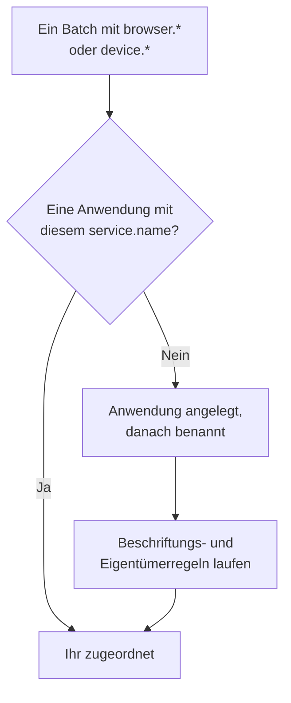

# Anwendungen verwalten

OneUptime legt eine RUM-Anwendung an, sobald die Telemetrie Ihrer App zum ersten Mal eintrifft. Diese Seite behandelt, was Sie danach verwalten: den Namen der Anwendung, ihre Beschriftungen und Eigentümer, wie lange ihre Daten aufbewahrt werden, das Archivieren, wer sie sehen darf und Alarme.

:::cards
- [Wie eine Anwendung entsteht](#wie-eine-anwendung-entsteht): Über `service.name` zugeordnet, beim ersten Batch angelegt.
- [Beschriftungen](#beschriftungen): Anwendungen gruppieren und festlegen, wer sie erreicht.
- [Aufbewahrung](#aufbewahrung): Wie lange Telemetrie und Aufzeichnungen bleiben.
- [Berechtigungen](#berechtigungen): Wer Anwendungen sieht und wer Aufzeichnungen ansehen darf.
:::

## Wie eine Anwendung entsteht

Sie müssen keine RUM-Anwendung anlegen. Trifft ein Telemetrie-Batch mit Browser- oder Geräteattributen und einem `service.name` ein, ordnet OneUptime ihn der Anwendung mit diesem `service.name` zu und legt die Anwendung an, wenn das Projekt noch keine hat.



- Der `service.name` ist die Identität der Anwendung und wird ohne Rücksicht auf Groß- und Kleinschreibung verglichen: `Storefront-Web` und `storefront-web` sind eine Anwendung.
- Ein neuer `service.name` beginnt eine neue Anwendung. Die alte behält ihren Verlauf und wird **Getrennt**, die neue beginnt leer, und beide werden nie zusammengeführt.
- Verwenden Sie einen `service.name` pro App, nicht einen pro Umgebung. Unterscheiden Sie Umgebungen mit einer Beschriftung wie `oneuptime.label.env=production`, damit sie sich eine Anwendung und einen Verlauf teilen.

### Eine Anwendung umbenennen

Der **Anzeigename** entspricht anfangs dem `service.name`. Um ihn zu ändern, öffnen Sie die Seite **Einstellungen** der Anwendung und klicken auf der Karte **Anwendungsdetails** auf **Details bearbeiten**; dort bearbeiten Sie auch Beschreibung und Beschriftungen. Telemetrie wird über den **App-Name (service.name)** zugeordnet, den die Karte zeigt und der sich nie ändert, daher ist Umbenennen gefahrlos.

### Eine Anwendung selbst hinzufügen

Legen Sie eine Anwendung selbst an, wenn ihre Beschriftungen, Eigentümer oder ihre Wiedergaberichtlinie schon stehen sollen, bevor der erste Besucher kommt.

:::steps
#### Die Anwendungsliste öffnen

Gehen Sie zu **Produkte → Ressourcen → Real User Monitoring** und klicken Sie auf **RUM-Anwendung erstellen**.

#### Den App-Namen eingeben

Tragen Sie unter **App-Name (service.name)** den `service.name` ein, den Ihre App melden wird, genau so, wie die App ihn meldet.

#### Benennen und speichern

Die Anwendung wird nach ihrem App-Namen benannt, wie eine entdeckte Anwendung. Um einen anderen Namen anzuzeigen, öffnen Sie **Weitere Felder** und geben einen **Anzeigename** ein; Beschreibung und Beschriftungen finden Sie dort ebenfalls. Speichern Sie dann das Formular.
:::

Danach öffnet sich die Einrichtungsanleitung der Anwendung von selbst, mit dem App-Namen als `service.name` des Snippets. Der letzte Schritt, **Auf die Verbindung warten**, meldet, wann die ersten Daten eintreffen.

Hat das Projekt bereits eine Anwendung mit diesem `service.name`, ob entdeckt, früher hinzugefügt oder archiviert, sagt das Formular das, statt eine zweite anzulegen.

## Verbindungsstatus

Eine Anwendung zeigt **Verbunden**, solange Telemetrie eintrifft, und **Getrennt** nach 15 Minuten ohne Telemetrie. OpenTelemetry-Telemetrie und Datenverkehr der Sitzungswiedergabe zählen beide.

**Zuletzt gesehen** wird alle paar Minuten aktualisiert statt bei jedem Batch, kann dem Live-Verkehr also um bis zu etwa fünf Minuten hinterherhinken; die 15 Minuten lassen dafür Raum. Zeit, in der OneUptime selbst ausgefallen war oder seine Ingest-Warteschlange aufholte, zählt nicht dazu.

**Getrennt** ist für sich allein kein Fehler: Ein internes Werkzeug ohne Besucher über Nacht ist tatsächlich getrennt. Wenn Menschen die App benutzen, lesen Sie [RUM-Fehlerbehebung](/docs/rum/troubleshooting).

## Beschriftungen

Beschriftungen gruppieren Anwendungen in Listen und Filtern. Sie entscheiden auch, was ein auf bestimmte Beschriftungen beschränktes Mitglied erreicht: Ein solches Mitglied sieht nur die Anwendungen, die eine dieser Beschriftungen tragen. Eine Anwendung erhält ihre Beschriftungen auf drei Wegen:

| Wie | Wo |
| --- | --- |
| Von Hand | Im Erstellformular unter **Weitere Felder**, oder später mit **Details bearbeiten** auf der Karte **Anwendungsdetails** der Seite **Einstellungen** der Anwendung. Für mehrere auf einmal wählen Sie sie in der Liste aus und wählen **Beschriftungen hinzufügen** unter **Massenaktionen**. |
| Aus der Telemetrie | Ein Ressourcenattribut namens `oneuptime.label.<name>` fügt die Beschriftung `<name>:<value>` hinzu, wie unten gezeigt. |
| Über eine Beschriftungsregel | Eine Regel versieht jede neue Anwendung, auf die sie passt, mit Beschriftungen. Siehe [Beschriftungs- und Eigentümerregeln](#beschriftungs-und-eigentümerregeln). |

Setzen Sie die Attribute auf derselben Ressource wie `service.name`, zum Beispiel in der Datei `src/telemetry.ts` aus der [Einrichtung für Browser](/docs/rum/browser-setup):

```ts
const resource = defaultResource().merge(
  resourceFromAttributes({
    [ATTR_SERVICE_NAME]: "storefront-web",
    "oneuptime.label.team": "payments",
    "oneuptime.label.env": "production",
  }),
);
```

Das fügt die Beschriftungen `team:payments` und `env:production` hinzu und legt sie im Projekt an, wenn es sie noch nicht gibt. Weil der Name des Attributs in die Beschriftung eingeht, bleiben `oneuptime.label.team=prod` und `oneuptime.label.env=prod` getrennt. Eine Beschriftung mit mehr als 100 Zeichen wird auf 100 gekürzt, und ein leerer oder nicht textueller Wert fügt nichts hinzu.

## Beschriftungs- und Eigentümerregeln

Eine Regel versieht jede neue Anwendung, auf die sie passt, mit Beschriftungen oder Eigentümern. Öffnen Sie **Real User Monitoring → Einstellungen → Beschriftungsregeln** oder **Eigentümerregeln** und legen Sie die Regel in zwei Schritten an:

1. Unter **Übereinstimmung** passt **Alle RUM-Anwendungen**, womit eine neue Regel beginnt, auf jede Anwendung. Um sie einzugrenzen, wählen Sie **Nur RUM-Anwendungen, die den Bedingungen entsprechen** und fügen Bedingungen zu **Anwendungsbeschriftungen** (hat eine, alle oder keine der gewählten Beschriftungen), **Anwendungsname** oder **Anwendungsbeschreibung** hinzu (gleich, enthält, beginnt mit, endet mit oder passt auf ein Muster).
2. Wählen Sie unter **Beschriftungen**, bei einer Eigentümerregel unter **Eigentümer**, was die Regel hinzufügt. Eine neue Regel muss mindestens eine Beschriftung oder einen Eigentümer hinzufügen. Der **Name** wird aus Ihrer Auswahl gebildet, etwa _team:payments hinzufügen_ oder _Payments als Eigentümer hinzufügen_, bis Sie einen eigenen Namen eingeben. **Beschreibung** und, bei einer Eigentümerregel, **Eigentümer benachrichtigen** warten unter **Weitere Felder**.

Regeln laufen, wenn eine Anwendung angelegt wird, auch wenn sie entdeckt wurde. Um eine Regel auf Ihre vorhandenen Anwendungen anzuwenden, öffnen Sie das Menü **⋯** in ihrer Zeile und wählen **Jetzt ausführen**: siehe [Regeln auf vorhandene Ressourcen anwenden](/docs/configuration/run-rules-now). Eine Regel, der eine Bearbeitung nichts zum Hinzufügen gelassen hat, ist in der Liste mit **Fügt nichts hinzu** markiert. [Beschriftungs- und Eigentümerregeln](/docs/configuration/label-and-owner-rules) beschreibt die Formulare vollständig.

### Eigentümer

Eigentümer sind die Personen und Teams, die für eine Anwendung verantwortlich sind. Eigentümerregeln fügen sie neuen Anwendungen hinzu. Um sie von Hand hinzuzufügen oder zu entfernen, wählen Sie Anwendungen in der Liste aus und wählen **Eigentümer hinzufügen** oder **Eigentümer entfernen** unter **Massenaktionen**; die API fügt sie über `/rum-application-owner-user` und `/rum-application-owner-team` hinzu. Ist **Eigentümer benachrichtigen** eingeschaltet, was die Voreinstellung ist, erfährt jeder Eigentümer, den eine Regel hinzufügt, davon. Schalten Sie es aus, bevor Sie eine Regel über viele Anwendungen laufen lassen, wenn niemand benachrichtigt werden soll.

## Aufbewahrung

Die Telemetrie einer Anwendung und ihre Aufzeichnungen werden unterschiedlich lange aufbewahrt:

| Daten | Aufbewahrt für | Festgelegt unter |
| --- | --- | --- |
| Logs, Metriken, Traces und Profile | Die Aufbewahrung des Projekts, sofern die Anwendung sie nicht überschreibt | Die Seite **Einstellungen** der Anwendung |
| Aufzeichnungen der Sitzungswiedergabe | Standardmäßig 7 Tage, oder 1, 14, 30 oder 90 Tage | **Wiedergaberichtlinie**, mit **Richtlinie bearbeiten → Limits** |

### Aufbewahrung der Telemetrie

Standardmäßig wird die Telemetrie einer Anwendung so lange aufbewahrt wie im Projekt festgelegt, unter **Projekteinstellungen → Telemetrie & APM → Datenaufbewahrung**. Zwei Karten auf der Seite **Einstellungen** der Anwendung überschreiben das:

- **Aufbewahrung von Telemetriedaten** enthält **Telemetriedaten aufbewahren für (Tage)**, einen Wert für die gesamte Telemetrie der Anwendung. Lassen Sie das Feld leer, um die Aufbewahrung des Projekts zu verwenden.
- **Aufbewahrung nach Telemetrietyp** enthält je einen Standard für Logs, Traces, Metriken und Profile sowie für Logs nach Schweregrad und Traces nach Status. Ein leer gelassener Wert fällt auf den Wert der Anwendung zurück, dann auf den des Projekts.

Überschreibungen der Aufbewahrung gehören zur [Enterprise Edition](/docs/self-hosted/enterprise) und auf OneUptime Cloud zum Scale-Tarif und darüber. Ohne sie zeigen die Karten, was der Tarif hinzufügt, und die Anwendung behält die Aufbewahrung des Projekts.

In einem kleineren Cloud-Tarif gilt eine Überschreibung, die eine Testphase hinterlassen hat, weiter für neue Telemetrie. Die Seite **Einstellungen** zeigt sie auf einer Karte **Aufbewahrungsüberschreibung** mit der Schaltfläche **Überschreibung entfernen**, die in jedem Tarif funktioniert: Ab dann behält die Anwendung die Aufbewahrung des Projekts, und was bereits gespeichert ist, behält die Aufbewahrung, mit der es gespeichert wurde. Eine neue Überschreibung braucht wieder den Scale-Tarif.

### Aufbewahrung der Sitzungswiedergabe

Aufzeichnungen haben eine eigene Aufbewahrung, festgelegt auf der Seite **Wiedergaberichtlinie** der Anwendung mit **Richtlinie bearbeiten → Limits**: standardmäßig 7 Tage, oder 1, 14, 30 oder 90 Tage. Sie ist absichtlich kurz, denn eine Aufzeichnung ist weit sensibler und weit größer als ein Span. Die Karte **Aufbewahrung der Sitzungswiedergabe** auf der Seite **Einstellungen** zeigt sie an (_Sitzungswiedergaben werden 7 Tage aufbewahrt._), und ihre Schaltfläche **In der Wiedergaberichtlinie bearbeiten** öffnet die Richtlinie.

Eine längere Telemetrie-Aufbewahrung hält Aufzeichnungen nicht länger. Zähler, Signale und Gerät einer Sitzung verfallen mit ihrem Material; nur die Logs, Spans und Ausnahmen der Sitzung folgen der Telemetrie-Aufbewahrung. Siehe [Aufbewahrung und Löschung](/docs/telemetry/session-replay#aufbewahrung-und-löschung).

> [!TIP]
> RUM ist oft die umfangreichste Telemetrie eines Projekts, weil sie mit Ihren Benutzern wächst statt mit Ihren Servern. Eine kürzere Aufbewahrung hier und eine längere für Ihre Backend-Dienste ist eine verbreitete Einrichtung.

## Archivieren und löschen

**Archivieren** blendet eine Anwendung aus **Alle Anwendungen** aus, während sie weiter Telemetrie sammelt. Archivieren Sie eine App, die Sie nicht mehr beobachten, deren Verlauf Sie aber behalten wollen.

- Klicken Sie auf der Seite **Einstellungen** der Anwendung auf **Archivieren**, oder wählen Sie in der Liste mehrere Anwendungen aus und archivieren Sie sie gemeinsam.
- Archivierte Anwendungen liegen unter **Real User Monitoring → Erweitert → Archiviert**. **Erweitert** ist im Seitenmenü anfangs eingeklappt: Klicken Sie darauf, um **Archiviert** anzuzeigen. Dort holen Sie eine Anwendung mit **Aus Archiv entfernen** zurück, oder mehrere auf einmal.

**Anwendung löschen** im Abschnitt **Erweitert** des Seitenmenüs der Anwendung entfernt die Anwendung endgültig. Sendet die App noch Telemetrie, legt ihr nächster Batch die Anwendung neu an, ohne ihre Einstellungen; beenden Sie also zuerst die Instrumentierung.

Um die Daten einer einzelnen Person statt einer ganzen Anwendung zu löschen, stellen Sie eine Löschanfrage: siehe [Sitzungen löschen](/docs/telemetry/session-replay#sitzungen-löschen).

## Berechtigungen

Jeder mit der Viewer-Rolle des Projekts sieht RUM-Anwendungen und ihre Telemetrie. Die Sitzungswiedergabe gehört absichtlich nicht zu dieser Rolle: Aufzeichnungen auflisten, eine ansehen und lesen, wer zugesehen hat, sind getrennte Berechtigungen. Projekteigentümer und -administratoren haben sie alle. Die Berechtigungsauswahl führt jede Berechtigung unter ihrem Titel, hier kursiv angegeben.

| Berechtigung | Erlaubt einem Mitglied |
| --- | --- |
| `ReadRumApplication` (_Read RUM Application_) | Anwendungen und ihre Telemetrieseiten sehen. |
| `CreateRumApplication`, `EditRumApplication`, `DeleteRumApplication` | Anwendungen hinzufügen, bearbeiten und löschen. |
| `ReadRumSessionReplay` (_List Session Replays_) | Aufgezeichnete Sitzungen und ihre Details auflisten, ohne sie abzuspielen oder zu erfahren, wer der Benutzer war. |
| `ReadRumSessionReplayPayload` (_Watch Session Replays_) | Aufzeichnungen abspielen und die Referenz und Merkmale des identifizierten Benutzers lesen. |
| `ReadRumSessionReplayAudit` (_Read Session Replay Audit_) | Das **Zugriffsprotokoll der Wiedergaben** lesen: wer welche Aufzeichnung angesehen hat. |
| `DeleteRumSessionReplay` (_Delete Session Replays_) | Aufzeichnungen löschen. |
| `CreateRumSessionErasureRequest`, `ReadRumSessionErasureRequest` | Löschanfragen stellen und verfolgen. |
| `ReadRumApplicationLabelRule`, `ReadRumApplicationOwnerRule` (und ihre Create-, Edit- und Delete-Varianten) | Beschriftungs- und Eigentümerregeln verwalten. |
| `ReadRumApplicationOwnerUser`, `ReadRumApplicationOwnerTeam` (und ihre Create-, Edit- und Delete-Varianten) | Eigentümer über die API hinzufügen und entfernen. |

Eine sinnvolle Aufteilung: Geben Sie einem Support-Mitarbeiter `ReadRumApplication` und `ReadRumSessionReplay`. Er sieht, welche Sitzungen auf Fehler gestoßen sind, ohne den Bildschirm von jemandem anzusehen oder zu erfahren, wer der Benutzer war. Geben Sie `ReadRumSessionReplayPayload` nur denen, die es brauchen; Mitglieder mit `ReadRumSessionReplayAudit` sehen dann jede Wiedergabe auf der Seite **Zugriffsprotokoll der Wiedergaben** der Anwendung. [Wer eine Aufzeichnung ansehen darf](/docs/telemetry/session-replay#wer-eine-aufzeichnung-ansehen-kann) zeigt, was jede Berechtigung in der Sitzungsliste und im Player freischaltet.

## Alarme für RUM-Daten

RUM-Telemetrie besteht aus gewöhnlichen Logs, Metriken und Traces, daher gibt es keinen eigenen RUM-Monitor: Die üblichen Monitore funktionieren damit. Am schnellsten beginnen Sie auf der Seite **Empfehlungen** der Anwendung, die Monitore anbietet, die bereits auf die Anwendung beschränkt sind:

| Gruppe | Empfehlungen |
| --- | --- |
| Core Web Vitals | Poor Largest Contentful Paint, Poor Interaction to Next Paint, Poor Cumulative Layout Shift, Slow First Contentful Paint und Slow Time to First Byte. Siehe [Core Web Vitals](/docs/rum/web-vitals). |
| Fehler | Failed User Operations und Unhandled Browser Exceptions. |
| Sitzungswiedergabe | Die vier [Alarme zum Speicherbudget](/docs/telemetry/session-replay#alarme-zum-speicherbudget), die warnen, bevor das Tageslimit des Projekts oder das Monatsbudget der Anwendung aufgebraucht ist. Sie werden angeboten, sobald die Anwendung eine Wiedergabe aufgezeichnet hat, das Monatspaar erst, wenn sie auch ein Monatsbudget hat. |

Um einen eigenen Monitor zu bauen, wählen Sie den, der das Signal liest:

- [Metriken-Monitor](/docs/monitor/metrics-monitor): eine Core Web Vital oder jede Metrik, die Ihre App sendet.
- [Traces-Monitor](/docs/monitor/traces-monitor): die clientseitige Fehlerrate oder Latenz.
- [Logs-Monitor](/docs/monitor/logs-monitor): ein Muster in Browser-Logs.
- [Ausnahmen-Monitor](/docs/monitor/exceptions-monitor): neue oder sprunghaft steigende clientseitige Ausnahmen.

Beschränken Sie einen selbst gebauten Monitor auf die Anwendung, damit ein Backend-Dienst mit ähnlicher Signatur ihn nicht auslöst.

## Nächste Schritte

:::cards
- [Sitzungswiedergabe](/docs/telemetry/session-replay): Aufzeichnen, was Benutzer sahen, mit eigener Richtlinie und Aufbewahrung.
- [Beschriftungs- und Eigentümerregeln](/docs/configuration/label-and-owner-rules): Beide Regelformulare, Schritt für Schritt.
- [Regeln auf vorhandene Ressourcen anwenden](/docs/configuration/run-rules-now): Eine neue Regel auf Ihre vorhandenen Anwendungen anwenden.
- [RUM-Fehlerbehebung](/docs/rum/troubleshooting): Wenn eine Anwendung fehlt, leer ist oder getrennt ist.
:::
