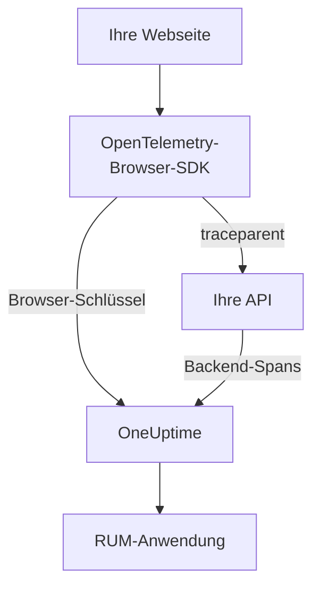

# Einrichtung für Browser

Instrumentieren Sie eine Web-App mit dem OpenTelemetry-Browser-SDK, damit sie OneUptime als RUM-Anwendung meldet. Seitenaufrufe und Anfragen kommen als Traces an, und dieselbe Einrichtung überträgt auch Ihre Fehler, Logs, Metriken und Core Web Vitals.

:::cards
- [Einrichten](#einrichten): Sechs Schritte vom Browser-Schlüssel bis zum ersten Seitenaufruf.
- [Mit Ihrem Backend verknüpfen](#mit-ihren-backend-traces-verknüpfen): Browser-Spans mit den Backend-Traces verbinden, die sie auslösen.
- [Fehler melden](#unbehandelte-fehler-melden): Unbehandelte Fehler in die Ausnahmen-Ansicht senden.
- [Fehlerbehebung](#fehlerbehebung): Was Sie prüfen, wenn nichts ankommt.
:::

## So funktioniert es

Das SDK läuft in den Browsern Ihrer Besucher. Es zeichnet für jeden Seitenaufruf und jede Anfrage einen Span auf und exportiert sie mit einem **Browser**-Ingestion-Schlüssel direkt an OneUptime, ohne eigenen Collector oder Proxy dazwischen.



## Bevor Sie beginnen

- Eine Web-App, deren Code Sie ändern und neu ausliefern können und deren Abhängigkeiten über npm installiert werden.
- Die Ursprünge, von denen Ihre Seiten ausgeliefert werden, etwa `https://app.example.com`. Ein Browser-Schlüssel nimmt Anfragen nur von den Ursprüngen an, die Sie bei ihm eintragen.
- Eine Rolle, die Ingestion-Schlüssel erstellen darf: Projektbesitzer und -administratoren dürfen das, ebenso alle mit der Berechtigung **Create Telemetry Ingestion Key**.

## Einrichten

:::steps
### Einen Browser-Ingestion-Schlüssel erstellen

1. Gehen Sie zu **Produkte → Projekteinstellungen**.
2. Klappen Sie im Seitenmenü **Telemetrie & APM** auf und wählen Sie **Ingestion-Schlüssel**.
3. Klicken Sie auf **Aufnahmeschlüssel erstellen** und wählen Sie **Browser** als **Schlüsseltyp**.
4. Tragen Sie im Schritt **Browser-Einstellungen** Ihre Ursprünge unter **Zulässige Ursprünge** als JSON-Array ein, etwa `["https://app.example.com"]`, und erstellen Sie dann den Schlüssel. Im Free-Tarif von OneUptime Cloud zeigt ein letzter Schritt **Abrechnung** vorher den Preis für Telemetrie.


Der neue Schlüssel öffnet sich auf einer eigenen Seite. Kopieren Sie den Wert unter **Geheimer Schlüssel**: Das ist das Token, das das SDK als `x-oneuptime-token` sendet.


### Die Pakete installieren

```bash
npm install @opentelemetry/api \
  @opentelemetry/sdk-trace-web \
  @opentelemetry/resources \
  @opentelemetry/semantic-conventions \
  @opentelemetry/opentelemetry-browser-detector \
  @opentelemetry/exporter-trace-otlp-http \
  @opentelemetry/context-zone \
  @opentelemetry/instrumentation \
  @opentelemetry/instrumentation-document-load \
  @opentelemetry/instrumentation-fetch \
  @opentelemetry/instrumentation-xml-http-request
```

### Die Telemetrie-Datei anlegen

Legen Sie `src/telemetry.ts` an. `browserDetector` fügt die `browser.*`-Attribute hinzu, durch die die Telemetrie als RUM eingeordnet wird, und `service.name` benennt die Anwendung.

```ts title="src/telemetry.ts"
import {
  WebTracerProvider,
  BatchSpanProcessor,
} from "@opentelemetry/sdk-trace-web";
import { OTLPTraceExporter } from "@opentelemetry/exporter-trace-otlp-http";
import { ZoneContextManager } from "@opentelemetry/context-zone";
import { registerInstrumentations } from "@opentelemetry/instrumentation";
import { DocumentLoadInstrumentation } from "@opentelemetry/instrumentation-document-load";
import { FetchInstrumentation } from "@opentelemetry/instrumentation-fetch";
import { XMLHttpRequestInstrumentation } from "@opentelemetry/instrumentation-xml-http-request";
import {
  defaultResource,
  detectResources,
  resourceFromAttributes,
} from "@opentelemetry/resources";
import { browserDetector } from "@opentelemetry/opentelemetry-browser-detector";
import { ATTR_SERVICE_NAME } from "@opentelemetry/semantic-conventions";

const ONEUPTIME_URL = "https://oneuptime.com";
// Public: it ships in your page. It must be a Browser ingestion key.
const ONEUPTIME_TOKEN = "YOUR_TELEMETRY_INGESTION_TOKEN";

/*
 * browserDetector supplies the browser.* attributes. Without them this
 * telemetry is classified as a backend Service, not a RUM application.
 * The attributes set last win, so service.name here overrides the
 * "unknown_service" that defaultResource() provides.
 */
const resource = defaultResource()
  .merge(detectResources({ detectors: [browserDetector] }))
  .merge(
    resourceFromAttributes({
      [ATTR_SERVICE_NAME]: "storefront-web",
    }),
  );

const provider = new WebTracerProvider({
  resource: resource,
  spanProcessors: [
    new BatchSpanProcessor(
      new OTLPTraceExporter({
        url: `${ONEUPTIME_URL}/otlp/v1/traces`,
        headers: { "x-oneuptime-token": ONEUPTIME_TOKEN },
      }),
    ),
  ],
});

provider.register({
  contextManager: new ZoneContextManager(),
});

registerInstrumentations({
  instrumentations: [
    new DocumentLoadInstrumentation(),
    new FetchInstrumentation({
      // See "Linking to your backend traces" before widening this.
      propagateTraceHeaderCorsUrls: [/^https:\/\/api\.example\.com/],
    }),
    new XMLHttpRequestInstrumentation({
      propagateTraceHeaderCorsUrls: [/^https:\/\/api\.example\.com/],
    }),
  ],
});
```

### Sie zuerst importieren

Machen Sie sie zum ersten Import Ihrer App. Die Instrumentierungen patchen `fetch` und `XMLHttpRequest`, und eine Anfrage vor dem Patch wird nicht getraced.

```ts
// src/index.tsx (React), src/main.ts (Vue / Angular), etc.
import "./telemetry";
import React from "react";
// ... the rest of your app
```

### Den Schlüssel prüfen

Fragen Sie OneUptime, ob es den Schlüssel annimmt, bevor Sie anderswo suchen:

```bash
curl -i https://oneuptime.com/otlp/v1/validate \
  -H "x-oneuptime-token: YOUR_TELEMETRY_INGESTION_TOKEN"
```

`200` mit `"valid": true` bedeutet, dass der Schlüssel angenommen wird; bei einem Browser-Schlüssel fügt die Meldung hinzu, dass er nur aus einem Browser und von einem seiner zulässigen Ursprünge aus funktioniert. `401` bedeutet, dass der Schlüssel unbekannt, widerrufen, ausgeschaltet oder abgelaufen ist.

### Eine Seite laden

Öffnen Sie Ihre Website. Innerhalb einer Minute erscheint die Anwendung unter **Produkte → Ressourcen → Real User Monitoring**, benannt nach ihrem `service.name`.
:::

## Was ein Browser-Schlüssel erlaubt

Alles im Snippet wird an Ihre Besucher ausgeliefert, daher kann jeder das Token aus Ihrer Seite kopieren. Ein Browser-Schlüssel begrenzt, was eine Kopie anrichten kann:

| Einstellung | Was sie bewirkt |
| --- | --- |
| **Zulässige Ursprünge** | Anfragen werden nur von diesen Ursprüngen angenommen, jeweils mit Schema und gegebenenfalls Port. Ein Host darf mit einem einzelnen Platzhalter `*.` beginnen: `https://*.example.com` deckt jede Subdomain von `example.com` ab, aber nicht `example.com` selbst. |
| **Limit für Anfragen pro Minute** | Eine Obergrenze für alle Besucher, die den Schlüssel verwenden: 6000 Anfragen pro Minute, sofern Sie keine eigene festlegen. |
| **Festgelegter Dienstname** | Erzwingt `service.name` auf allem, was der Schlüssel schreibt, sodass eine Kopie ihre Telemetrie nicht als einen Ihrer Backend-Dienste ausgeben kann. |
| **Läuft ab am** | Nach diesem Datum wird der Schlüssel nicht mehr angenommen. |
| **Aktiviert** | Schalten Sie es aus, um einen durchgesickerten Schlüssel sofort zu stoppen. |

Ein Browser-Schlüssel schreibt OTLP-Traces, -Logs und -Metriken sowie Sitzungswiedergaben; jeder andere Ingest-Weg lehnt ihn ab. Diese Einstellungen ändern Sie auf der eigenen Seite des Schlüssels. Der Schlüsseltyp lässt sich nach dem Erstellen des Schlüssels nicht mehr ändern.

> [!WARNING]
> Legen Sie nie einen **Server**-Schlüssel in eine Seite. Ein Server-Schlüssel schreibt jede Art von Telemetrie von überall aus, ohne Ursprungsprüfung, sodass jeder, der Ihre Seite liest, in Ihr Projekt schreiben könnte.

## `browser.*` ohne den Detektor setzen

`browserDetector` liest die [UA Client Hints API](https://wicg.github.io/ua-client-hints/), die nur Chromium-Browser haben. In Safari und Firefox setzt er `browser.language` und `user_agent.original`, aber nicht `browser.platform`, `browser.brands` oder `browser.mobile`.

Das reicht trotzdem, um die Telemetrie als RUM einzuordnen, weil `browser.language` allein einen Batch als Browser-RUM kennzeichnet. Die Seite **Clients** listet Plattformen jedoch aus `browser.platform` auf, daher fügen Besuche mit Safari und Firefox dort keine Zeile hinzu.

Um den Detektor wegzulassen oder jedem Browser eine Plattform zu geben, setzen Sie die Attribute selbst:

```ts
const resource = defaultResource().merge(
  resourceFromAttributes({
    [ATTR_SERVICE_NAME]: "storefront-web",
    // browser.language or browser.platform marks the telemetry as browser RUM.
    "browser.language": navigator.language,
    "browser.platform":
      (navigator as any).userAgentData?.platform ?? "unknown",
    "browser.mobile": (navigator as any).userAgentData?.mobile ?? false,
    "user_agent.original": navigator.userAgent,
  }),
);
```

Halten Sie `browser.platform` grob. Jeder eigene Wert wird zu einer Zeile auf der Seite **Clients**, daher ergibt ein vollständiger User-Agent-String oder ein Wert pro Benutzer dort eine endlose Liste und ist außerdem ein Datenschutzproblem.

## Routenwechsel tracen

`DocumentLoadInstrumentation` traced nur das erste Laden. In einer Single-Page-App bleiben Routenwechsel unsichtbar, bis Sie sie aufzeichnen, was in Ihrem Router ein paar Zeilen erfordert:

```ts
import { trace } from "@opentelemetry/api";

const tracer = trace.getTracer("app-router");

function onRouteChange(to: string): void {
  const span = tracer.startSpan("route-change", {
    attributes: { "app.route": to },
  });
  // End it when the route's data has loaded and the view has painted.
  requestAnimationFrame(() => {
    return span.end();
  });
}
```

Fügen Sie `@opentelemetry/instrumentation-user-interaction` hinzu, um auch Klicks und andere DOM-Ereignisse zu tracen. Für INP pro Route siehe [Single-Page-Apps](/docs/rum/web-vitals#single-page-apps).

## Mit Ihren Backend-Traces verknüpfen

`propagateTraceHeaderCorsUrls` legt fest, welche ursprungsübergreifenden Anfragen einen W3C-Header `traceparent` tragen, der den Browser-Span mit dem Backend-Trace verbindet, den er ausgelöst hat. Anfragen an den eigenen Ursprung Ihrer Seite tragen ihn ohne jede Konfiguration.

> [!WARNING]
> Setzen Sie ihn nicht auf `/.*/`. Der Header macht aus einer einfachen ursprungsübergreifenden Anfrage eine mit Preflight, daher schlägt jede Drittanbieter-API fehl, die `traceparent` nicht in ihrem `Access-Control-Allow-Headers` aufführt.

Führen Sie nur Ursprünge auf, die Sie kontrollieren und konfiguriert haben:

```ts
new FetchInstrumentation({
  propagateTraceHeaderCorsUrls: [
    /^https:\/\/api\.example\.com/,
    /^https:\/\/auth\.example\.com/,
  ],
});
```

Mit installierter [Sitzungswiedergabe](/docs/telemetry/session-replay) tragen Anfragen an Ihren eigenen Ursprung zusätzlich die Sitzungs-ID der Wiedergabe, die Ihre Backend-Telemetrie der Aufzeichnung zuordnet: siehe [Traces mit der Sitzungswiedergabe verbinden](#traces-mit-der-sitzungswiedergabe-verbinden).

## Traces mit der Sitzungswiedergabe verbinden

Wenn Sie auch die [Sitzungswiedergabe](/docs/telemetry/session-replay) nutzen, schließt sich Ihre **Backend**-Telemetrie der Aufzeichnung ohne Code an dieser Stelle an. Während eine Sitzung hochlädt, fügt der Recorder den Anfragen, die Ihre Seite an ihren eigenen Ursprung stellt, ein `tracestate`-Mitglied mit der Sitzungs-ID hinzu und überlässt den `traceparent` Ihrer `FetchInstrumentation` / `XMLHttpRequestInstrumentation`. Die Spans Ihres Backends werden beim Ingest mit der Sitzungs-ID versehen, in jedem Dienst, der den W3C-Trace-Kontext fortführt, und seine Logs und Ausnahmen schließen sich der Aufzeichnung über die Trace-ID an. Siehe [Mit Ihrer übrigen Telemetrie verknüpfen](/docs/telemetry/session-replay#correlating-with-your-other-telemetry), wie das funktioniert, was es nicht abdeckt und welcher Schalter es abschaltet.

Der Recorder liest außerdem den `traceparent` zurück, den Ihre Instrumentierungen setzen, ob der Aufruf eine URL (mit oder ohne Init-Objekt) oder ein `Request`-Objekt übergibt, sodass jede Anfragezeile in der Wiedergabe auf ihren Backend-Trace verweist. Eine API auf einem anderen Ursprung führen Sie oben in `propagateTraceHeaderCorsUrls` auf; ihre Anfragen tragen keine Sitzungs-ID und schließen sich der Aufzeichnung über die Trace-ID an. **Ursprünge für die Trace-Weitergabe** in der Wiedergaberichtlinie der Anwendung leistet dasselbe für Seiten *ohne* dieses SDK.

Was die Header nicht erreichen, sind die eigenen Browser-Spans dieses SDKs: Dokument-Ladevorgänge, Routenwechsel und die Fehler, die Sie melden. Um auch diese der Aufzeichnung zuzuordnen, versehen Sie jeden Span beim Start mit `session.id`. Der Recorder teilt Ihnen die ID über `onSessionChange` mit, das sofort auslöst, wenn bereits eine Sitzung besteht, und erneut, wann immer sich die ID ändert: wenn der Besucher nach 30 Minuten Inaktivität zurückkommt, bei der Obergrenze von 4 Stunden, wenn `identify()` einen anderen Benutzer nennt oder wenn ein anderer Tab desselben Besuchers sie zuerst geändert hat.

```ts title="src/replaySession.ts"
import type { Context } from "@opentelemetry/api";
import type {
  ReadableSpan,
  Span,
  SpanProcessor,
} from "@opentelemetry/sdk-trace-web";

declare global {
  interface Window {
    OneUptimeReplayQueue?: Array<Array<unknown>>;
  }
}

let replaySessionId: string | null = null;

// The recorder script loads asynchronously. The queue is applied the
// moment it starts and stays live afterwards, so this works either way.
(window.OneUptimeReplayQueue = window.OneUptimeReplayQueue || []).push([
  "onSessionChange",
  (sessionId: string): void => {
    replaySessionId = sessionId;
  },
]);

export class ReplaySessionSpanProcessor implements SpanProcessor {
  public onStart(span: Span, _parentContext: Context): void {
    if (replaySessionId) {
      span.setAttribute("session.id", replaySessionId);
    }
  }

  public onEnd(_span: ReadableSpan): void {}

  public forceFlush(): Promise<void> {
    return Promise.resolve();
  }

  public shutdown(): Promise<void> {
    return Promise.resolve();
  }
}
```

Setzen Sie ihn dann als ersten Span-Prozessor des Providers in `src/telemetry.ts` ein:

```ts
import { ReplaySessionSpanProcessor } from "./replaySession";

const provider = new WebTracerProvider({
  resource: resource,
  spanProcessors: [
    new ReplaySessionSpanProcessor(),
    new BatchSpanProcessor(
      new OTLPTraceExporter({
        url: `${ONEUPTIME_URL}/otlp/v1/traces`,
        headers: { "x-oneuptime-token": ONEUPTIME_TOKEN },
      }),
    ),
  ],
});
```

Danach gestartete Spans tragen die ID, der Tab **Traces** des Wiedergabe-Players listet sie auf der Uhr der Aufzeichnung, und jeder von ihnen verweist im Dashboard zurück auf den Moment in der Wiedergabe. Ein Span-Prozessor versieht jeden Span mit der ID, die bei seinem Start galt; die ID stattdessen in `resource.attributes` zu schreiben, würde Spans umbenennen, die beim Wechsel der Sitzung noch im Export-Batch warteten. Der Listener erfährt die ID, sobald der Recorder startet, noch vor einer Einwilligung oder einem Aufzeichnungsauslöser. Wenn das für Sie wichtig ist, versehen Sie Spans erst, sobald Ihre Seite die Einwilligung hat.

## Content Security Policy

Wenn Ihre Website eine Content Security Policy sendet, blockiert der Browser die Anfragen des Exporters, bis Sie OneUptime in `connect-src` erlauben. Nichts schlägt sichtbar fehl: Die Seite meldet einfach nichts.

```text
connect-src 'self' https://oneuptime.com;
```

Führen Sie es mit Ihrer bestehenden Direktive `connect-src` zusammen. Wenn Sie OneUptime selbst hosten, verwenden Sie Ihren eigenen Host.

## Unbehandelte Fehler melden

Das OpenTelemetry-Browser-SDK erfasst unbehandelte Fehler nicht. Melden Sie sie selbst, dann erscheinen sie unter **Ausnahmen** neben Ihren Backend-Fehlern:

```ts
import { trace, SpanStatusCode } from "@opentelemetry/api";

const tracer = trace.getTracer("app-errors");

window.addEventListener("error", (event: ErrorEvent) => {
  const span = tracer.startSpan("window.onerror");
  span.recordException(event.error ?? new Error(event.message));
  span.setStatus({ code: SpanStatusCode.ERROR });
  span.end();
});

window.addEventListener("unhandledrejection", (event: PromiseRejectionEvent) => {
  const span = tracer.startSpan("unhandledrejection");
  span.recordException(
    event.reason instanceof Error ? event.reason : new Error(String(event.reason)),
  );
  span.setStatus({ code: SpanStatusCode.ERROR });
  span.end();
});
```

Mit der [Sitzungswiedergabe](/docs/telemetry/session-replay) erfasst auch der Recorder unbehandelte Fehler und markiert sie auf der Zeitleiste der Wiedergabe. Die Seite der Ausnahme zeigt dann eine Karte **Ansehen, was der Benutzer gesehen hat**, die die Wiedergabe zehn Sekunden vor dem Fehler öffnet. Mit der Standardrichtlinie wird jede Sitzung aufgezeichnet, ob etwas fehlschlägt oder nicht; der Fehler entscheidet nur, wo die Karte öffnet.

## Logs und Metriken hinzufügen

Traces reichen, um die Übersicht zu füllen. Fügen Sie die Log- und Metrik-Pipelines hinzu, wenn Sie Browser-Logs in OneUptime haben oder [Core Web Vitals](/docs/rum/web-vitals) senden möchten:

```bash
npm install @opentelemetry/api-logs @opentelemetry/sdk-logs \
  @opentelemetry/exporter-logs-otlp-http \
  @opentelemetry/sdk-metrics @opentelemetry/exporter-metrics-otlp-http
```

```ts
import { LoggerProvider, BatchLogRecordProcessor } from "@opentelemetry/sdk-logs";
import { OTLPLogExporter } from "@opentelemetry/exporter-logs-otlp-http";
import { MeterProvider, PeriodicExportingMetricReader } from "@opentelemetry/sdk-metrics";
import { OTLPMetricExporter } from "@opentelemetry/exporter-metrics-otlp-http";
import { logs } from "@opentelemetry/api-logs";
import { metrics } from "@opentelemetry/api";

const headers = { "x-oneuptime-token": ONEUPTIME_TOKEN };

logs.setGlobalLoggerProvider(
  new LoggerProvider({
    resource: resource,
    processors: [
      new BatchLogRecordProcessor({
        exporter: new OTLPLogExporter({
          url: `${ONEUPTIME_URL}/otlp/v1/logs`,
          headers,
        }),
      }),
    ],
  }),
);

metrics.setGlobalMeterProvider(
  new MeterProvider({
    resource: resource,
    readers: [
      new PeriodicExportingMetricReader({
        exporter: new OTLPMetricExporter({
          url: `${ONEUPTIME_URL}/otlp/v1/metrics`,
          headers,
        }),
        exportIntervalMillis: 30000,
      }),
    ],
  }),
);
```

Bauen Sie sie mit demselben `resource`-Objekt. Eine Log- oder Metrik-Pipeline, deren Ressource kein `browser.*` hat, wird als eigener Backend-Dienst eingeordnet.

## Endpunkt-Referenz

| Signal | Endpunkt | Header |
| --- | --- | --- |
| Traces | `POST {host}/otlp/v1/traces` | `x-oneuptime-token: <token>` |
| Metriken | `POST {host}/otlp/v1/metrics` | `x-oneuptime-token: <token>` |
| Logs | `POST {host}/otlp/v1/logs` | `x-oneuptime-token: <token>` |

`{host}` ist `https://oneuptime.com` oder Ihr eigener Host, wenn Sie OneUptime selbst betreiben; ändern Sie ihn in den OTLP-URLs und im Eintrag der Content Security Policy. OneUptime nimmt OTLP/JSON und OTLP/protobuf an. Die Endpunkte beantworten ursprungsübergreifende Anfragen von jedem Ursprung und erlauben den Header `x-oneuptime-token`, sodass ein Browser direkt an sie exportiert.

## Fehlerbehebung

:::details Keine Anfrage an OneUptime im Tab Netzwerk
Öffnen Sie die Entwicklertools Ihres Browsers, gehen Sie zum Tab Netzwerk und filtern Sie nach `otlp`: Sie suchen `POST /otlp/v1/traces`. Gar keine Anfrage bedeutet, dass das SDK nie gestartet ist:

- `telemetry.ts` ist nicht der erste Import, oder Ihr Bundler hat ihn verworfen.
- Der Batch-Prozessor hat noch nicht exportiert. Er wartet einige Sekunden, um einen Batch zu füllen. Warten Sie also oder wechseln Sie zu einer anderen Seite, bevor Sie entscheiden, dass nichts gesendet wird.
- Eine Umgebungsvariable zur Build-Zeit wurde zu `undefined`, sodass die URL des Exporters kaputt ist. Protokollieren Sie die URL einmal beim Start.
:::

:::details Der Browser blockiert die Anfrage
- Ein Fehler der Content Security Policy in der Konsole bedeutet, dass `connect-src` OneUptime noch nicht erlaubt: siehe [Content Security Policy](#content-security-policy).
- Ein CORS-Fehler bedeutet fast immer, dass die Anfrage OneUptime nie erreicht hat, dessen Endpunkte jeden Ursprung erlauben: Suchen Sie nach einem Unternehmens-Proxy, einem Werbeblocker oder einem Tippfehler im Host.
:::

:::details OneUptime lehnt die Anfrage ab
- `422` mit `Origin https://app.example.com is not allowed for this browser ingestion key.` bedeutet, dass der genaue Ursprung der Seite (Schema, Host und Port) unter **Zulässige Ursprünge** des Schlüssels fehlt.
- `422` mit `This telemetry ingestion key has been disabled.` bedeutet, dass jemand den Schlüssel ausgeschaltet hat. Schalten Sie ihn wieder ein oder verwenden Sie einen anderen Schlüssel.
- `401` bedeutet, dass der Schlüssel unbekannt, widerrufen oder abgelaufen ist. Führen Sie die Schlüsselprüfung aus [Einrichten](#einrichten) aus und erstellen Sie dann einen gültigen Browser-Schlüssel.
- `404` bedeutet, dass die URL falsch ist. Der Trace-Exporter braucht den vollständigen Pfad `/otlp/v1/traces`.
:::

:::details Die App erscheint unter Dienste statt unter Real User Monitoring
Die Ressource hat kein `browser.*`-Attribut, daher wurde die Telemetrie als Backend-Dienst eingeordnet. Fügen Sie `browserDetector` hinzu oder setzen Sie die Attribute wie in [`browser.*` ohne den Detektor setzen](#browser-ohne-den-detektor-setzen).

Prüfen Sie im Tab Netzwerk in der Nutzlast der Anfrage, was Sie senden: `resourceSpans[0].resource.attributes` ist die Liste, die darüber entscheidet. Der bereits angelegte Dienst wird nicht zu einer RUM-Anwendung. Löschen Sie ihn daher unter **Produkte → Dienste**, sobald RUM-Telemetrie eintrifft.
:::

:::details Die Seite Clients ist in Safari oder Firefox leer
Client-Zeilen stammen aus `browser.platform`, das `browserDetector` nur in Chromium-Browsern setzt. Setzen Sie es selbst, um Besuche mit Safari und Firefox aufzulisten: siehe [`browser.*` ohne den Detektor setzen](#browser-ohne-den-detektor-setzen).
:::

## Nächste Schritte

:::cards
- [Core Web Vitals](/docs/rum/web-vitals): LCP, INP, CLS, FCP und TTFB von derselben Seite senden.
- [Sitzungswiedergabe](/docs/telemetry/session-replay): Aufzeichnen, was der Benutzer gesehen hat, neben diesen Traces.
- [Anwendungen verwalten](/docs/rum/applications): Namen, Labels, Eigentümer und Aufbewahrung.
- [RUM-Fehlerbehebung](/docs/rum/troubleshooting): Jede Prüfung in der Reihenfolge, in der Probleme meist auftreten.
:::
