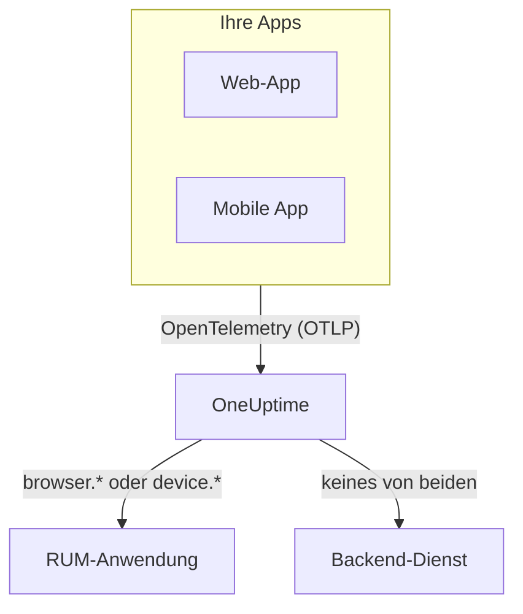

# RUM – Übersicht

Real User Monitoring (RUM) zeigt, was echte Benutzer in Ihren Web- und Mobil-Apps erleben: Seitenaufrufe, Anfragen, Fehler und Core Web Vitals, gemeldet von der App selbst statt von einer Probe. OneUptime ordnet diese Telemetrie einer RUM-Anwendung zu, die Sie in Diagrammen darstellen, durchsuchen und mit Alarmen überwachen können.

:::cards
- [So funktioniert es](#so-funktioniert-es): Eine OpenTelemetry-Pipeline, beim Eintreffen als RUM eingeordnet.
- [Wie OneUptime RUM erkennt](#wie-oneuptime-rum-erkennt): Die Ressourcenattribute, die darüber entscheiden.
- [Was Sie bekommen](#was-sie-bekommen): Die Übersicht, die Vitals, die Explorer und die Wiedergaben.
- [Erste Schritte](#erste-schritte): Vom Ingestion-Schlüssel bis zum ersten Seitenaufruf.
:::

## So funktioniert es

RUM nutzt dieselbe OpenTelemetry-Pipeline wie der Rest von OneUptime. Es gibt keinen RUM-Agenten und kein eigenes Übertragungsformat: Sie richten ein OpenTelemetry-SDK für Browser oder Mobilgeräte auf OneUptime aus, und die Telemetrie wird beim Eintreffen als RUM eingeordnet.

- **Eine Anwendung pro App.** Ihre Identität ist der `service.name`, den Ihr SDK meldet, und OneUptime legt die Anwendung beim ersten Telemetrie-Batch an.
- **Nie doppelt gezählt.** Client-Telemetrie gehört nur zu ihrer RUM-Anwendung; sie erscheint nicht zusätzlich als Backend-Dienst.
- **Die Sitzungswiedergabe ist eine eigene, optionale Ebene.** Sie hat ein eigenes Snippet und eigene Datenschutzeinstellungen: siehe [Sitzungswiedergabe](/docs/telemetry/session-replay).

## Wo Sie es finden

Öffnen Sie **Produkte → Ressourcen → Real User Monitoring**. **Alle Anwendungen** listet Ihre Anwendungen mit **Client-Typ**, **Status** und **Zuletzt gesehen** auf. Zwei weitere Abschnitte des Seitenmenüs sind anfangs eingeklappt:

- **Einstellungen**: **Eigentümerregeln**, **Beschriftungsregeln** und der projektweite Schalter **Sitzungswiedergabe**.
- **Erweitert**: **Archiviert**, die Anwendungen, die Sie archiviert haben.

Das Seitenmenü einer Anwendung gliedert ihre Seiten so; **Einstellungen**, **Entwickler** und **Erweitert** sind anfangs eingeklappt:

| Abschnitt | Seiten |
| --- | --- |
| **Grundlegend** | **Übersicht**, **Empfehlungen**, **Dokumentation** |
| **Observability** | **Metriken**, **Protokolle**, **Traces**, **Clients** |
| **Sitzungswiedergabe** | **Sitzungswiedergabe**, **Benutzerflüsse**, **Benutzer der Wiedergabe**, **Integrität**, **Wiedergaberichtlinie**, **Zugriffsprotokoll der Wiedergaben**, **Dokumentation** |
| **Einstellungen** | **Einstellungen** |
| **Entwickler** | **Terraform**, **API**, **KI-Assistenten** |
| **Erweitert** | **Anwendung löschen** |

## Wie OneUptime RUM erkennt

Die meisten Fragen der Art „meine App taucht nicht auf“ enden hier. OneUptime entscheidet für jeden Telemetrie-Batch beim Eintreffen anhand seiner **Ressourcenattribute**:

1. Ein Batch, dessen Ressource `browser.platform`, `browser.language` oder ein nicht leeres `browser.brands` hat, ist **Browser**-RUM.
2. Andernfalls ist ein Batch mit `device.id` oder `device.model.identifier` **mobiles** RUM.
3. Andernfalls ist auch ein Batch mit `device.manufacturer` und ohne Host-Identität (`host.name`, `host.id` oder `k8s.node.name`) **mobiles** RUM.
4. Alles andere ist ein Backend-Dienst.

Backend-SDKs setzen nie `browser.*`, `device.id` oder `device.model.identifier`, daher sind das eindeutige Signale. `device.manufacturer` ist die Ausnahme: Das Inventar eines Hosts meldet damit auch den Hersteller einer Maschine, daher zählt es nur auf einer Ressource ohne Host-Identität. Siehe [Inventarattribute](/docs/telemetry/host-otel-collector#inventarattribute-ip-mac-seriennummer-hersteller-modell-firmware).

| Attribut | Erforderlich | Was es bewirkt |
| --- | --- | --- |
| `service.name` | **Ja** | Die Identität der Anwendung, etwa `storefront-web`. Ohne dieses Attribut wird keine RUM-Anwendung angelegt. |
| `browser.platform`, `browser.language`, `browser.brands` | Eines davon, im Web | Kennzeichnet den Batch als Browser-RUM. `browser.platform` füllt außerdem die Seite **Clients**. |
| `device.id`, `device.model.identifier` | Eines davon, auf Mobilgeräten | Kennzeichnet den Batch als mobiles RUM. `device.model.identifier` füllt außerdem die Seite **Clients**. |
| `device.manufacturer` | Nein | Kennzeichnet den Batch nur dann als mobiles RUM, wenn die Ressource keine Host-Identität trägt. |
| `telemetry.sdk.language` | Nein | Wird in der Übersicht angezeigt, etwa `webjs` oder `swift`. |
| `telemetry.sdk.version` | Nein | Wird als SDK-Version angezeigt; fehlt es, wird `oneuptime.agent.version` gelesen. |
| `oneuptime.label.<name>` | Nein | Fügt der Anwendung das Projekt-Label `<name>:<value>` hinzu. |

OneUptime findet die Anwendung über `service.name`, ohne Rücksicht auf Groß- und Kleinschreibung, und legt sie an, wenn das Projekt noch keine hat. Ein neuer `service.name` startet eine neue Anwendung. Halten Sie ihn also stabil und unterscheiden Sie Umgebungen mit einem Label statt mit einem neuen Namen. [Anwendungen verwalten](/docs/rum/applications) behandelt Namen, Labels, Eigentümer und Aufbewahrung.

> [!IMPORTANT]
> Das OpenTelemetry-Browser-SDK fügt keine `browser.*`-Attribute hinzu, solange Sie nicht den Browser-Ressourcendetektor einbinden oder die Attribute selbst setzen. Mit nur `service.name` wird die Telemetrie ein Backend-Dienst, keine RUM-Anwendung. [Einrichtung für Browser](/docs/rum/browser-setup) zeigt beide Wege.

## Was Sie bekommen

| Wo | Was es zeigt |
| --- | --- |
| **Übersicht** | Kacheln für **Seitenaufrufe**, **Seitenladezeit (p95)**, **Ereignisse**, **Fehlerrate**, **Ereignisdauer (p95)**, **Ausnahmen**, **Clients** und **Aufgezeichnete Sitzungen** sowie Verlaufsdiagramme für den gewählten Zeitraum. |
| **Core Web Vitals** | Eine Karte in der Übersicht mit LCP, INP, CLS, FCP und TTFB, jeweils an Googles Grenzwerten gemessen, und INP für jede Route einer Single-Page-App. Siehe [Core Web Vitals](/docs/rum/web-vitals) und [Single-Page-Apps](/docs/rum/web-vitals#single-page-apps). |
| **Metriken**, **Protokolle**, **Traces** | Die Telemetrie-Explorer, auf diese Anwendung beschränkt. |
| **Clients** | Die Browser-Plattformen und Gerätemodelle, auf denen die Anwendung genutzt wurde: eine kurze Liste nach Plattform, nie eine Zeile pro Benutzer. |
| **Sitzungswiedergabe** | Aufzeichnungen echter Sitzungen neben ihren Fehlern, Traces und Logs: siehe [Sitzungswiedergabe](/docs/telemetry/session-replay). |
| **Empfehlungen** | Fertige Monitore für die Anwendung: schlechte Core Web Vitals, fehlgeschlagene Anfragen, Browser-Ausnahmen und, sobald sie aufzeichnet, Budgets der Sitzungswiedergabe. |

Die Zahlen stammen aus den Spans, die Ihre Instrumentierung sendet. **Seitenaufrufe** zählt den Span `documentLoad`, den die Seitenlade-Instrumentierung bei jedem vollständigen Laden aufzeichnet; ein Routenwechsel innerhalb einer Single-Page-App ist also kein Seitenaufruf.

Eine Anwendung zeigt **Verbunden**, solange Telemetrie eintrifft, und **Getrennt** nach 15 Minuten ohne Telemetrie. Zeit, in der OneUptime selbst ausgefallen war oder seine Eingangswarteschlange abarbeitete, zählt nicht zu diesen 15 Minuten.

## Erste Schritte

:::steps
### Ingestion-Schlüssel erstellen

Öffnen Sie **Projekteinstellungen → Telemetrie & APM → Ingestion-Schlüssel** und klicken Sie auf **Aufnahmeschlüssel erstellen**. Eine Web-App braucht einen **Browser**-Schlüssel, der nur von den Ursprüngen aus funktioniert, die Sie angeben. Eine Mobil-App braucht einen **Server**-Schlüssel, weil ein mobiles SDK keinen `Origin`-Header sendet.

### App instrumentieren

Folgen Sie [Einrichtung für Browser](/docs/rum/browser-setup) für eine Web-App oder [Einrichtung für Mobilgeräte](/docs/rum/mobile-setup) für Android, iOS, React Native und andere Plattformen.

### Eine Seite öffnen

Laden Sie eine Seite Ihrer Website oder starten Sie Ihre App. Die Anwendung erscheint mit ihrem ersten Telemetrie-Batch unter **Produkte → Ressourcen → Real User Monitoring**, benannt nach ihrem `service.name`. Sie müssen sie nicht vorher anlegen.

### Vitals und Wiedergaben hinzufügen

Wenn die Grundlagen ankommen, senden Sie [Core Web Vitals](/docs/rum/web-vitals) und fügen Sie die [Sitzungswiedergabe](/docs/telemetry/session-replay) hinzu. Beides ist optional.
:::

Wenn nichts erscheint, geht [RUM-Fehlerbehebung](/docs/rum/troubleshooting) die Ursachen in der Reihenfolge durch, in der sie meist auftreten.

## Nächste Schritte

:::cards
- [Einrichtung für Browser](/docs/rum/browser-setup): Eine Web-App mit dem OpenTelemetry-Browser-SDK instrumentieren.
- [Einrichtung für Mobilgeräte](/docs/rum/mobile-setup): Android, iOS, React Native und jedes andere OpenTelemetry-SDK.
- [Core Web Vitals](/docs/rum/web-vitals): LCP, INP, CLS, FCP und TTFB senden und INP Route für Route lesen.
- [Sitzungswiedergabe](/docs/telemetry/session-replay): Sehen, was der Benutzer gesehen hat, neben seinen Fehlern und Traces.
:::
