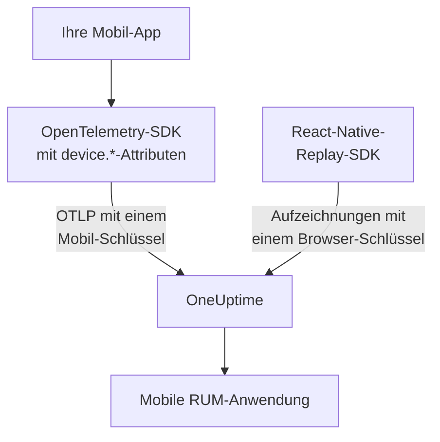

# Einrichtung für Mobilgeräte

Instrumentieren Sie eine Android-, iOS- oder React-Native-App mit OpenTelemetry, damit sie OneUptime als mobile RUM-Anwendung meldet. Jede andere Plattform mit einem OpenTelemetry-SDK funktioniert genauso.

:::cards
- [Was OneUptime braucht](#was-oneuptime-braucht): Zwei Ressourcenattribute, gesendet mit einem Mobil-Schlüssel.
- [Ihre Plattform einrichten](#ihre-plattform-einrichten): Android, iOS, React Native und alle anderen.
- [iOS-Abstürze und -Hänger](#ios-abstürze-und-hänger): Die Berichte von MetricKit und KSCrash unter Ausnahmen, benannt durch Ihre dSYMs.
- [Prüfen, ob es ankommt](#prüfen-ob-es-ankommt): Den Schlüssel testen, dann die App finden.
- [Sitzungswiedergabe auf Mobilgeräten](#sitzungswiedergabe-auf-mobilgeräten): Aufzeichnungen für React-Native-Apps.
:::

## So funktioniert es

Ihre App exportiert OTLP mit einem **Mobil**-Ingestion-Schlüssel direkt an OneUptime, der auf die App festgelegt ist, sodass alles, was sie sendet, als diese mobile RUM-Anwendung eingeordnet wird. Mit jedem anderen Schlüssel ordnen die `device.*`-Attribute auf ihrer Ressource sie als mobiles RUM statt als Backend-Dienst ein.



## Was OneUptime braucht

Zwei Ressourcenattribute, auf jedem Batch, den Ihre App exportiert:

| Attribut | Was es ist |
| --- | --- |
| `service.name` | Die Identität der Anwendung, etwa `storefront-android`. |
| `device.id` oder `device.model.identifier` | Kennzeichnet die Telemetrie als mobiles RUM. `device.model.identifier` füllt außerdem die Seite **Clients**. |

Mit einem anderen Schlüssel gesendet, kommt Telemetrie ohne Geräteattribut trotzdem an und Sie können sie abfragen, aber sie wird als Backend-Dienst statt als RUM-Anwendung eingeordnet.

`device.manufacturer` kennzeichnet einen Batch ebenfalls als mobil, aber nur auf einer Ressource ohne Host-Identität, weil das Inventar eines Hosts damit den Hersteller einer Maschine meldet. Setzen Sie zusätzlich `device.id` oder `device.model.identifier`, wie es jedes Rezept unten tut, dann spielt das nie eine Rolle.

Machen Sie `device.id` zu einer Kennung pro Installation, nie zu einer Werbe-ID oder etwas anderem, das eine Person identifiziert. OneUptime liest sie nur, um mobile Telemetrie zu erkennen.

## Bevor Sie beginnen

- Eine App mit einem OpenTelemetry-SDK: dem OpenTelemetry Java SDK oder OpenTelemetry Android, opentelemetry-swift oder dem OpenTelemetry JavaScript SDK für React Native.
- Ein **Mobil**-Ingestion-Schlüssel, erstellt unter **Projekteinstellungen → Telemetrie & APM → Ingestion-Schlüssel** mit **Ingestion-Schlüssel erstellen**, mit dem `service.name` Ihrer App unter **Festgelegter Dienstname**. Ein **Browser**-Schlüssel wird aus einer Mobil-App abgelehnt: Er wird gegen den Header `Origin` geprüft, den mobile SDKs nicht senden. Liefern Sie nie einen **Server**-Schlüssel in einer App aus.
- Diese OTLP-Einstellungen. Wenn Sie OneUptime selbst hosten, ersetzen Sie `https://oneuptime.com` durch Ihren eigenen Host.

| Einstellung | Wert |
| --- | --- |
| OTLP-Endpunkt | `https://oneuptime.com/otlp` |
| Header | `x-oneuptime-token: YOUR_TELEMETRY_INGESTION_TOKEN` |
| Traces | `POST https://oneuptime.com/otlp/v1/traces` |
| Metriken | `POST https://oneuptime.com/otlp/v1/metrics` |
| Logs | `POST https://oneuptime.com/otlp/v1/logs` |

> [!WARNING]
> Der Schlüssel wird mit Ihrer App ausgeliefert, und eine App lässt sich entpacken. Gehen Sie also davon aus, dass jemand ihn kopiert. Eine Kopie eines Mobil-Schlüssels kann nur die Traces, Logs und Metriken dieser App senden, eingeordnet unter dem Namen aus **Festgelegter Dienstname**, und nie von einer Webseite aus. Sie kann trotzdem erfundene Daten für diese App senden, bis zu seinem **Limit für Anfragen pro Minute**. Tragen Sie also ein Datum unter **Läuft ab am** ein und tauschen Sie den Schlüssel mit Ihren Releases aus.

## Ihre Plattform einrichten

Die Snippets zeigen die Form der Einrichtung. Die mobilen OpenTelemetry-SDKs ändern ihre APIs zwischen Releases, prüfen Sie die Methodennamen also an der Version, die Sie festlegen. Was OneUptime braucht, ändert sich nie: den Endpunkt, den Header, `service.name` und ein `device.*`-Attribut.

:::tabs
@tab Android
Verwenden Sie das OpenTelemetry Java SDK und seinen OTLP-Exporter, die auf Android laufen:

```kotlin title="app/build.gradle.kts"
dependencies {
    implementation(platform("io.opentelemetry:opentelemetry-bom:<latest>"))
    implementation("io.opentelemetry:opentelemetry-sdk")
    implementation("io.opentelemetry:opentelemetry-exporter-otlp")
}
```

```kotlin title="StorefrontApplication.kt"
import android.app.Application
import android.os.Build
import io.opentelemetry.exporter.otlp.http.trace.OtlpHttpSpanExporter
import io.opentelemetry.sdk.OpenTelemetrySdk
import io.opentelemetry.sdk.resources.Resource
import io.opentelemetry.sdk.trace.SdkTracerProvider
import io.opentelemetry.sdk.trace.export.BatchSpanProcessor

class StorefrontApplication : Application() {
    override fun onCreate() {
        super.onCreate()

        val resource = Resource.getDefault().toBuilder()
            .put("service.name", "storefront-android")
            .put("device.manufacturer", Build.MANUFACTURER)
            .put("device.model.identifier", Build.MODEL)
            .build()

        val exporter = OtlpHttpSpanExporter.builder()
            .setEndpoint("https://oneuptime.com/otlp/v1/traces")
            .addHeader("x-oneuptime-token", BuildConfig.ONEUPTIME_TOKEN)
            .build()

        OpenTelemetrySdk.builder()
            .setTracerProvider(
                SdkTracerProvider.builder()
                    .setResource(resource)
                    .addSpanProcessor(BatchSpanProcessor.builder(exporter).build())
                    .build()
            )
            .buildAndRegisterGlobal()
    }
}
```

Der Agent [OpenTelemetry Android](https://github.com/open-telemetry/opentelemetry-android) fügt darüber Abstürze, ANRs, langsame und eingefrorene Frames sowie App-Starts hinzu und setzt `device.model.identifier` und `device.manufacturer` auf seiner eigenen Ressource. [Einrichtung für Android](/docs/rum/android-setup) richtet ihn anstelle des Codes oben ein.
@tab iOS
Verwenden Sie [opentelemetry-swift](https://github.com/open-telemetry/opentelemetry-swift) und setzen Sie die Geräteattribute selbst: Die Ressource, die jede Version von sich aus hinzufügt, hat sich zwischen Releases geändert.

```swift
let resource = Resource(attributes: [
    "service.name": .string("storefront-ios"),
    "device.model.identifier": .string(UIDevice.current.model),
    "device.manufacturer": .string("Apple"),
    "device.id": .string(UIDevice.current.identifierForVendor?.uuidString ?? ""),
    "telemetry.sdk.language": .string("swift"),
])

let exporter = OtlpHttpTraceExporter(
    endpoint: URL(string: "https://oneuptime.com/otlp/v1/traces")!,
    config: OtlpConfiguration(
        headers: [("x-oneuptime-token", oneUptimeToken)]
    )
)

OpenTelemetry.registerTracerProvider(
    tracerProvider: TracerProviderBuilder()
        .with(resource: resource)
        .add(spanProcessor: BatchSpanProcessor(spanExporter: exporter))
        .build()
)
```

`UIDevice.current.model` liefert einen kurzen Namen wie `iPhone`, wodurch die Seite **Clients** eine Zeile pro Geräteart behält. `identifierForVendor` ist die Installation, nach der OneUptime die absturzfreien Installationen zählt, wie [Sitzungen aufzeichnen](#sitzungen-aufzeichnen) beschreibt.
@tab React Native
React Native führt das OpenTelemetry JavaScript SDK aus. Bauen Sie den Provider, den OTLP-Exporter und den Batch-Prozessor also wie in [Einrichtung für Browser](/docs/rum/browser-setup), mit drei Änderungen: Senden Sie mit einem **Mobil**-Schlüssel, lassen Sie `browserDetector` und `DocumentLoadInstrumentation` weg, und setzen Sie die Geräteattribute selbst.

```ts
import { Platform } from "react-native";
import * as Device from "expo-device"; // or react-native-device-info
import {
  defaultResource,
  resourceFromAttributes,
} from "@opentelemetry/resources";

const resource = defaultResource().merge(
  resourceFromAttributes({
    "service.name": "storefront-mobile",
    "device.manufacturer": Device.manufacturer ?? Platform.OS,
    "device.model.identifier":
      Device.modelId ?? Device.modelName ?? "unknown",
    "telemetry.sdk.language": "webjs",
  }),
);
```

`Device.modelId` ist nur unter iOS gesetzt, daher greift Android auf `Device.modelName` zurück.
@tab Andere Plattformen
Flutter, Unity, .NET MAUI, ein eingebetteter Client oder ein eigener OTLP-Writer funktionieren alle, solange die Ressource `service.name` und ein `device.*`-Attribut trägt. Ein SDK, das die Standard-Umgebungsvariablen von OpenTelemetry liest, übernimmt diese unverändert:

```bash
OTEL_EXPORTER_OTLP_ENDPOINT="https://oneuptime.com/otlp"
OTEL_EXPORTER_OTLP_HEADERS="x-oneuptime-token=YOUR_TELEMETRY_INGESTION_TOKEN"
OTEL_RESOURCE_ATTRIBUTES="service.name=storefront-mobile,device.manufacturer=Acme,device.model.identifier=AC-100"
```

Das SDK hängt `/v1/traces`, `/v1/metrics` und `/v1/logs` selbst an den Endpunkt an.
:::

## iOS-Abstürze und -Hänger

opentelemetry-swift ab Version 2.3 meldet die Abstürze und Hänger einer iOS-App über seine MetricKit-Instrumentierung, die jede Diagnose von Apple als Protokolleintrag an OpenTelemetry übergibt. OneUptime ordnet sie so ein wie die Abstürze und ANRs von OpenTelemetry Android, sodass sie unter **Ausnahmen** und auf der **Übersicht** der Anwendung erscheinen:

| Diagnose von Apple | Ereignisname | Unter Ausnahmen |
| --- | --- | --- |
| Ein Absturz | `metrickit.diagnostic.crash` | Eine nicht behandelte Ausnahme, deren Typ angibt, was die App beendet hat: die Objective-C-Ausnahme ab iOS 17, sonst die Mach-Ausnahme (`EXC_BAD_ACCESS`), sonst das Signal (`SIGSEGV`) |
| Ein Hänger | `metrickit.diagnostic.hang` | Eine nicht behandelte Ausnahme vom Typ **Hang**, das iOS-Gegenstück zu einem ANR, die festhält, wie lange der Hänger gedauert hat |

Die Kachel **Abstürze** der Übersicht zählt die Abstürze, und ihre Kachel **ANRs** zählt die Hänger zusammen mit den ANRs von Android. Jeder Stacktrace wird wie die Threads eines Absturzberichts dargestellt, mit dem Thread, der abgestürzt ist oder hing, an erster Stelle. Ein Frame aus dem Code Ihrer App wird nach seiner Funktion benannt, etwa `CartViewController.checkout()`, sobald das dSYM seines Builds hochgeladen ist, wie unter [Ihre dSYMs hochladen](#ihre-dsyms-hochladen). Jeder andere Frame nennt seine Binärdatei und wie weit darin der Code lag, und **Binary Images** listet die UUID jeder Binärdatei auf, an der Sie erkennen, zu welchem Build das dSYM gehört, das sie benennt.

Abstürze und Hänger werden nach den Frames Ihrer App auf dem Thread gruppiert, der abgestürzt ist oder hing: nach ihren Funktionen, wo ein dSYM sie benannt hat, sodass ein Absturz von einem Release zum nächsten eine einzige Ausnahme bleibt, und nach ihren Offsets in der Binärdatei, wo keines das getan hat, die sich mit jedem Build ändern. Ein Bericht wird benannt, sobald er ankommt, laden Sie die dSYMs eines Builds also hoch, bevor Sie ihn ausliefern: Ein Absturz, der vor seinem dSYM ankam, behält seine Offsets.

:::steps
### Logs zusätzlich zu Spans exportieren

MetricKit meldet Diagnosen als Protokolleinträge, registrieren Sie daher neben dem Tracer-Provider einen Logger-Provider, mit derselben Ressource, demselben Endpunkt und demselben Header:

```swift
let logExporter = OtlpHttpLogExporter(
    endpoint: URL(string: "https://oneuptime.com/otlp/v1/logs")!,
    config: OtlpConfiguration(
        headers: [("x-oneuptime-token", oneUptimeToken)]
    )
)

OpenTelemetry.registerLoggerProvider(
    loggerProvider: LoggerProviderBuilder()
        .with(resource: resource)
        .with(processors: [
            BatchLogRecordProcessor(logRecordExporter: logExporter),
        ])
        .build()
)
```

### Die MetricKit-Instrumentierung registrieren

Fügen Sie das Produkt `MetricKitInstrumentation` von opentelemetry-swift hinzu und registrieren Sie es bei MetricKit, sobald der Logger-Provider registriert ist:

```swift
import MetricKit
import MetricKitInstrumentation

// MXMetricManager keeps only a weak reference: hold this for the app's lifetime.
let metricKitInstrumentation = MetricKitInstrumentation()
MXMetricManager.shared.add(metricKitInstrumentation)
```

### Sitzungen aufzeichnen

Die Kacheln **Sitzungen** und **Absturzfreie Sitzungen** zählen die `session.id` auf Ihren Spans. Das Produkt `Sessions` von opentelemetry-swift setzt sie: Fügen Sie dem Tracer-Provider `SessionSpanProcessor` hinzu und umhüllen Sie den Log-Prozessor mit `SessionLogRecordProcessor`, damit auch Diagnosen eine Sitzung tragen.

Die Zeile unter **Absturzfreie Sitzungen** zeigt den Anteil der Installationen, die nicht abgestürzt sind, und **Daily Crash Rate** und **Daily ANR Rate** alarmieren anhand des Anteils, der abgestürzt ist. Eine Installation ist die `device.id` der Ressource oben, die Anbieterkennung der App: eine pro Gerät für alle Ihre Apps, die erhalten bleibt, solange eine von ihnen installiert ist, sodass eine Neuinstallation Ihrer einzigen App eine neue Installation ergibt, die Neuinstallation einer von zweien aber nicht. Ein Release von opentelemetry-swift, das `app.installation.id` setzt, wird stattdessen danach gezählt.

### Ihre dSYMs hochladen

Xcode schreibt beim Archivieren der App ein dSYM für jede Binärdatei Ihrer App, und App Store Connect gibt sie unter **Download dSYMs** wieder heraus. Laden Sie sie nach jedem Archivieren hoch, aus der CI oder einer Xcode-Build-Phase, mit der [OneUptime-CLI](/docs/cli/index) und einem Server-Schlüssel Ihres Builds: Ein Schlüssel, für den unter **Festgelegter Dienstname** ein Dienstname festgelegt ist, etwa der, mit dem Ihre App ausgeliefert wird, wird abgelehnt, weil ein dSYM die Frames jeder App im Projekt benennt, die seine Binärdatei ausliefert.

```bash
oneuptime dsym upload "$ARCHIVE_PATH/dSYMs" --app storefront-ios --url https://oneuptime.com --ingestion-key YOUR_TELEMETRY_INGESTION_TOKEN
```

Die CLI liest `.dSYM`-Bundles, Ordner und ZIP-Archive davon sowie DWARF-Dateien dort, wo sie liegen, und sendet nur die UUID, die Architektur und die Funktionsnamen jeder Binärdatei: Die dSYMs einer großen App sind Hunderte Megabyte groß, ihre Namen nur wenige. Ohne die CLI senden Sie die DWARF-Datei eines dSYM oder ein ZIP-Archiv von `.dSYM`-Bundles so, wie sie sind, bis zu 50 MB pro Datei:

```bash
curl --fail -X POST "https://oneuptime.com/dsyms/v1/upload" \
  -H "x-oneuptime-token: YOUR_TELEMETRY_INGESTION_TOKEN" \
  -F "appName=storefront-ios" \
  -F "dsym=@MyApp.app.dSYM/Contents/Resources/DWARF/MyApp"
```

Jede Binärdatei wird anhand ihrer UUID 400 Tage lang aufbewahrt, sodass ein Release, das Monate später noch auf den Telefonen der Leute läuft, weiterhin benannt wird, und ein erneutes Hochladen eines Builds ersetzt, was für ihn aufbewahrt wurde. Ein dSYM gehört zum Projekt, nicht zu einer einzelnen App: Ein Framework, das zwei Ihrer Apps einbetten, wird in beiden benannt.
:::

> [!NOTE]
> Apple übergibt die Diagnosen von MetricKit erst bei einem späteren Start an die App, ab iOS 15 sofort und davor einmal am Tag, sodass ein Absturz oder ein Hänger Minuten oder einen Tag nach seinem Auftreten ankommen kann und gezählt wird, wenn er ankommt. „0 Abstürze in der letzten Stunde“ auf der Übersicht einer iOS-App ist also noch keine gute Nachricht. Eine Diagnose trägt die Sitzung, die sie gemeldet hat, nicht die, die sie beendet hat.

opentelemetry-swift zeichnet keinen Span auf, wenn die App startet, daher bleiben die Kacheln **App-Starts** und **Kaltstart (p95)** leer, bis Ihre App einen aufzeichnet: einen Span namens `AppStart`, bei dem `start.type` auf `cold`, `warm` oder `hot` gesetzt ist, vom Start des Prozesses, bis der erste Bildschirm bereit ist.

### Wenn auch KSCrash einen Absturz meldet

opentelemetry-swift kann Abstürze auch über KSCrash melden, das seinen Bericht als Protokolleintrag `device.crash` sendet, wenn die App das nächste Mal geöffnet wird, mit dem Zeitpunkt, zu dem die App abgestürzt ist. Eine App, die beide registriert, meldet jeden Absturz zweimal: KSCrash beim nächsten Start, MetricKit beim nächsten Start oder bis zu einen Tag später. OneUptime zählt einen solchen Absturz einmal: Der zuerst ankommende Bericht ist das Vorkommen, und der zweite wird daneben aufbewahrt, in derselben Ausnahme, als Beleg für denselben Absturz, und in keiner Kachel, keinem Diagramm und keinem Monitor gezählt. Unter **Vorkommen** der Ausnahme steht bei diesem Vorkommen **Zweimal gemeldet**.

Zwei Berichte gelten nur dann als ein einziger Absturz, wenn all dies zutrifft:

- Sie stammen von den beiden Meldern, KSCrash und MetricKit. Keiner von beiden meldet einen Absturz zweimal, daher sind zwei Berichte von demselben Melder zwei Abstürze.
- Sie stammen von derselben Installation: derselben `app.installation.id` oder `device.id`.
- Sie liegen höchstens 26 Stunden auseinander: MetricKit versieht einen Absturz mit dem Ende des Tages, über den es berichtet, KSCrash mit dem Moment des Absturzes.
- Sie stimmen beim Signal, bei der Mach-Ausnahme und bei der Objective-C-Ausnahme überein, wo immer beide eines davon nennen.
- Die abgestürzten Threads stimmen Frame für Frame überein, von dort, wo der Thread begann, nach innen, nach Binärdatei und Offset, über jeden Frame aus dem Code Ihrer App, den einer der beiden nennt. Ein Absturz, der ganz im Code von Apple liegt, muss in mindestens drei Frames übereinstimmen, und zwar in allen.

Jeder Bericht wird einmal gepaart, mit dem zeitlich nächsten, sodass zwei Abstürze durch denselben Fehler auf einer Installation, Minuten auseinander, zwei Vorkommen sind, jedes mit seinem zweiten Bericht. Wenn OneUptime einen Bericht nicht mit den anderen seiner Installation vergleichen kann, zählt es ihn, sodass ein Absturz schlimmstenfalls doppelt gezählt wird, aber nie verloren geht.

## Prüfen, ob es ankommt

:::steps
### Den Schlüssel testen

Bevor Sie die Einstellungen des SDKs durchsuchen, fragen Sie OneUptime, ob es den Schlüssel annimmt:

```bash
curl -i https://oneuptime.com/otlp/v1/validate \
  -H "x-oneuptime-token: YOUR_TELEMETRY_INGESTION_TOKEN"
```

`200` mit `"valid": true` bedeutet, dass der Schlüssel angenommen wird. Ein Browser-Schlüssel antwortet ebenfalls mit `200`, aber seine Meldung sagt, dass er nur aus einem Browser funktioniert: Eine Mobil-App braucht einen Mobil-Schlüssel. `401` bedeutet, dass der Schlüssel unbekannt, widerrufen, ausgeschaltet oder abgelaufen ist, und keine SDK-Einstellung behebt das.

### Die App starten

Starten Sie die App und nutzen Sie sie einen Moment. Sie erscheint mit ihrem ersten Telemetrie-Batch unter **Produkte → Ressourcen → Real User Monitoring**, benannt nach ihrem `service.name`.

### Die Seite Clients öffnen

Öffnen Sie die Seite **Clients** der Anwendung: Jedes Gerätemodell aus `device.model.identifier` hat eine Zeile. Bleibt die Seite leer, während sich **Traces** füllt, erreichen die Geräteattribute die Ressource nicht.
:::

## Sitzungswiedergabe auf Mobilgeräten

React-Native-Apps können Sitzungen mit `@oneuptime/react-native-replay` aufzeichnen. Es zeichnet den nativen View-Baum als Drahtgitter auf, nie Bildschirmfotos oder den Text auf dem Bildschirm, und seine Aufzeichnungen öffnen sich im selben Player wie die aus dem Web. Es sendet mit einem **Browser**-Schlüssel, dessen **Zulässige Ursprünge** Ihre App als `app://` gefolgt von ihrer Android-Application-ID oder iOS-Bundle-ID aufführen: ein anderer Schlüssel als der Mobil-Schlüssel, den Ihr OpenTelemetry-SDK verwendet. [In React Native installieren](/docs/telemetry/session-replay#in-react-native-installieren) führt Sie durch die Einrichtung.

Native Android- und iOS-Apps und die anderen Plattformen haben keinen Sitzungsrecorder: Ihre Seite **Sitzungswiedergabe** bleibt leer, während Traces, Logs, Metriken, Ausnahmen und die Seite **Clients** wie gewohnt funktionieren.

## Fehlerbehebung

:::details Die Schlüsselprüfung liefert 401, oder der Schlüssel wird abgelehnt
Ein `401` bedeutet, dass der Schlüssel unbekannt, widerrufen, ausgeschaltet oder abgelaufen ist: Erstellen Sie einen Mobil-Schlüssel und bauen Sie die App damit neu.

Ein Browser-Schlüssel besteht die Prüfung, aber jeder Export aus einer Mobil-App wird mit einem `422` abgelehnt, das lautet: `This request did not send an Origin header, so it cannot be checked against the allowed origins of this browser ingestion key. Use a mobile ingestion key in a mobile app, and a server ingestion key on a server.` Verwenden Sie einen **Mobil**-Schlüssel. Auch ein Mobil-Schlüssel wird über gRPC und von einer Webseite aus mit einem `422` abgelehnt: Exportieren Sie über OTLP/HTTP.
:::

:::details Die App erscheint unter Dienste statt unter Real User Monitoring
Die Telemetrie wurde nicht mit einem Mobil-Schlüssel gesendet, und ihre Ressource hat weder `device.id` noch `device.model.identifier`, daher wurde sie als Backend-Dienst eingeordnet. Senden Sie mit einem Mobil-Schlüssel, oder setzen Sie sie wie unter [Ihre Plattform einrichten](#ihre-plattform-einrichten).

Der bereits angelegte Dienst wird nicht zu einer RUM-Anwendung. Löschen Sie ihn daher unter **Produkte → Dienste**, sobald RUM-Telemetrie eintrifft.
:::

:::details Die Seite Clients ist leer
Client-Zeilen stammen nur aus `device.model.identifier`. Ein SDK, das nur `device.id` oder `device.manufacturer` setzt, ordnet die App als mobiles RUM ein, listet aber keine Clients: Setzen Sie zusätzlich `device.model.identifier`.
:::

:::details Der Status zeigt „Kein aktueller Datenverkehr“, obwohl die App genutzt wird
Der Status wechselt nach 15 Minuten ohne Telemetrie zu **Kein aktueller Datenverkehr**. Wenn die App genutzt wird:

- Ein Sampler verwirft möglicherweise alles: Suchen Sie nach einem Always-off-Sampler oder einer sehr niedrigen Rate.
- Die App sendet Telemetrie vielleicht nur für Aktionen, die in dieser Zeit niemand ausgeführt hat.
- Der Schlüssel wurde seit dem Release vielleicht widerrufen oder ist abgelaufen: Testen Sie ihn wie unter [Prüfen, ob es ankommt](#prüfen-ob-es-ankommt).
:::

## Nächste Schritte

:::cards
- [Sitzungswiedergabe](/docs/telemetry/session-replay): React-Native-Sitzungen neben ihren Traces aufzeichnen.
- [Anwendungen verwalten](/docs/rum/applications): Namen, Labels, Eigentümer und Aufbewahrung.
- [OpenTelemetry](/docs/telemetry/open-telemetry): Die OTLP-Endpunkte, Grenzen und Fehler im Detail.
- [RUM-Fehlerbehebung](/docs/rum/troubleshooting): Jede Prüfung in der Reihenfolge, in der Probleme meist auftreten.
:::
