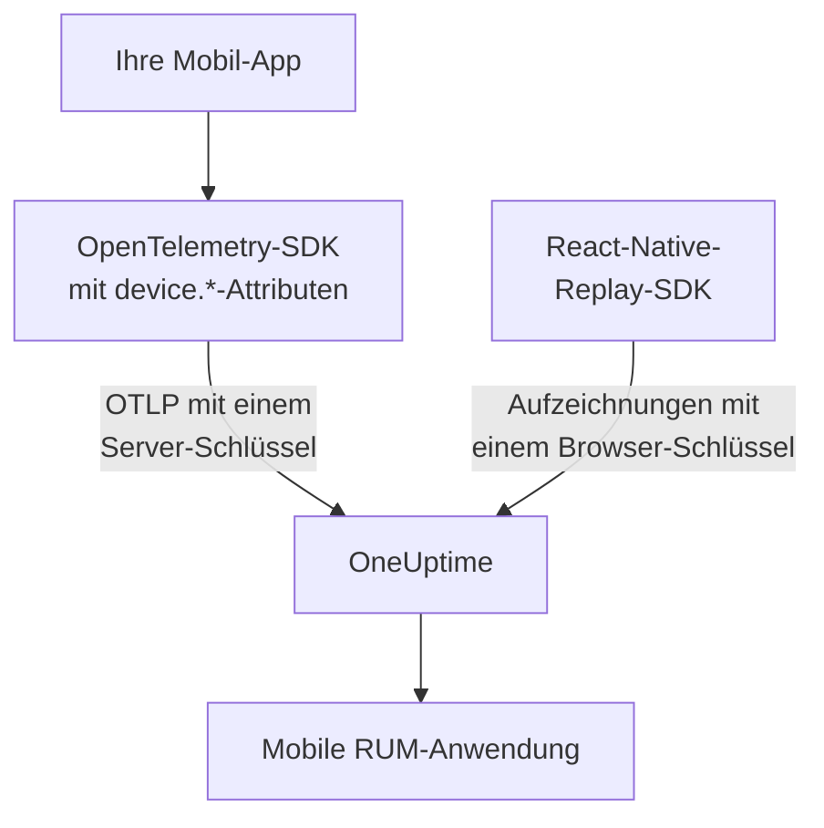

# Einrichtung für Mobilgeräte

Instrumentieren Sie eine Android-, iOS- oder React-Native-App mit OpenTelemetry, damit sie OneUptime als mobile RUM-Anwendung meldet. Jede andere Plattform mit einem OpenTelemetry-SDK funktioniert genauso.

:::cards
- [Was OneUptime braucht](#was-oneuptime-braucht): Zwei Ressourcenattribute, gesendet mit einem Server-Schlüssel.
- [Ihre Plattform einrichten](#ihre-plattform-einrichten): Android, iOS, React Native und alle anderen.
- [Prüfen, ob es ankommt](#prüfen-ob-es-ankommt): Den Schlüssel testen, dann die App finden.
- [Sitzungswiedergabe auf Mobilgeräten](#sitzungswiedergabe-auf-mobilgeräten): Aufzeichnungen für React-Native-Apps.
:::

## So funktioniert es

Ihre App exportiert OTLP mit einem **Server**-Ingestion-Schlüssel direkt an OneUptime. Die `device.*`-Attribute auf ihrer Ressource ordnen sie als mobiles RUM statt als Backend-Dienst ein.



## Was OneUptime braucht

Zwei Ressourcenattribute, auf jedem Batch, den Ihre App exportiert:

| Attribut | Was es ist |
| --- | --- |
| `service.name` | Die Identität der Anwendung, etwa `storefront-android`. |
| `device.id` oder `device.model.identifier` | Kennzeichnet die Telemetrie als mobiles RUM. `device.model.identifier` füllt außerdem die Seite **Clients**. |

Ohne Geräteattribut kommt die Telemetrie trotzdem an und Sie können sie abfragen, aber sie wird als Backend-Dienst statt als RUM-Anwendung eingeordnet.

`device.manufacturer` kennzeichnet einen Batch ebenfalls als mobil, aber nur auf einer Ressource ohne Host-Identität, weil das Inventar eines Hosts damit den Hersteller einer Maschine meldet. Setzen Sie zusätzlich `device.id` oder `device.model.identifier`, wie es jedes Rezept unten tut, dann spielt das nie eine Rolle.

Machen Sie `device.id` zu einer Kennung pro Installation, nie zu einer Werbe-ID oder etwas anderem, das eine Person identifiziert. OneUptime liest sie nur, um mobile Telemetrie zu erkennen.

## Bevor Sie beginnen

- Eine App mit einem OpenTelemetry-SDK: dem OpenTelemetry Java SDK oder OpenTelemetry Android, opentelemetry-swift oder dem OpenTelemetry JavaScript SDK für React Native.
- Ein **Server**-Ingestion-Schlüssel, erstellt unter **Projekteinstellungen → Telemetrie & APM → Ingestion-Schlüssel** mit **Aufnahmeschlüssel erstellen**. Ein **Browser**-Schlüssel wird aus einer Mobil-App abgelehnt: Er wird gegen den Header `Origin` geprüft, den mobile SDKs nicht senden.
- Diese OTLP-Einstellungen. Wenn Sie OneUptime selbst hosten, ersetzen Sie `https://oneuptime.com` durch Ihren eigenen Host.

| Einstellung | Wert |
| --- | --- |
| OTLP-Endpunkt | `https://oneuptime.com/otlp` |
| Header | `x-oneuptime-token: YOUR_TELEMETRY_INGESTION_TOKEN` |
| Traces | `POST https://oneuptime.com/otlp/v1/traces` |
| Metriken | `POST https://oneuptime.com/otlp/v1/metrics` |
| Logs | `POST https://oneuptime.com/otlp/v1/logs` |

> [!WARNING]
> Der Schlüssel wird mit Ihrer App ausgeliefert, und eine App lässt sich entpacken. Gehen Sie also davon aus, dass jemand ihn kopiert. Legen Sie auf der Seite des Schlüssels unter **Festgelegter Dienstname** einen Dienstnamen fest, damit eine Kopie nicht unter den Namen Ihrer Backend-Dienste schreiben kann, tragen Sie ein **Limit für Anfragen pro Minute** und ein Datum unter **Läuft ab am** ein, und tauschen Sie den Schlüssel mit Ihren Releases aus.

## Ihre Plattform einrichten

Die Snippets zeigen die Form der Einrichtung. Die mobilen OpenTelemetry-SDKs ändern ihre APIs zwischen Releases, prüfen Sie die Methodennamen also an der Version, die Sie festlegen. Was OneUptime braucht, ändert sich nie: den Endpunkt, den Header, `service.name` und ein `device.*`-Attribut.

:::tabs
@tab Android
Verwenden Sie das OpenTelemetry Java SDK und seinen OTLP-Exporter, die auf Android laufen:

```kotlin title="app/build.gradle.kts"
dependencies {
    implementation(platform("io.opentelemetry:opentelemetry-bom:<latest>"))
    implementation("io.opentelemetry:opentelemetry-sdk")
    implementation("io.opentelemetry:opentelemetry-exporter-otlp")
}
```

```kotlin title="StorefrontApplication.kt"
import android.app.Application
import android.os.Build
import io.opentelemetry.exporter.otlp.http.trace.OtlpHttpSpanExporter
import io.opentelemetry.sdk.OpenTelemetrySdk
import io.opentelemetry.sdk.resources.Resource
import io.opentelemetry.sdk.trace.SdkTracerProvider
import io.opentelemetry.sdk.trace.export.BatchSpanProcessor

class StorefrontApplication : Application() {
    override fun onCreate() {
        super.onCreate()

        val resource = Resource.getDefault().toBuilder()
            .put("service.name", "storefront-android")
            .put("device.manufacturer", Build.MANUFACTURER)
            .put("device.model.identifier", Build.MODEL)
            .build()

        val exporter = OtlpHttpSpanExporter.builder()
            .setEndpoint("https://oneuptime.com/otlp/v1/traces")
            .addHeader("x-oneuptime-token", BuildConfig.ONEUPTIME_TOKEN)
            .build()

        OpenTelemetrySdk.builder()
            .setTracerProvider(
                SdkTracerProvider.builder()
                    .setResource(resource)
                    .addSpanProcessor(BatchSpanProcessor.builder(exporter).build())
                    .build()
            )
            .buildAndRegisterGlobal()
    }
}
```

Der Agent [OpenTelemetry Android](https://github.com/open-telemetry/opentelemetry-android) fügt darüber automatische Instrumentierung hinzu und setzt Geräteattribute auf seiner eigenen Ressource. Wenn Sie ihn verwenden, richten Sie seinen Exporter auf denselben Endpunkt und Header aus und prüfen Sie, ob `device.model.identifier` in Ihrer Version auf der Ressource ankommt.
@tab iOS
Verwenden Sie [opentelemetry-swift](https://github.com/open-telemetry/opentelemetry-swift) und setzen Sie die Geräteattribute selbst: Die Ressource, die jede Version von sich aus hinzufügt, hat sich zwischen Releases geändert.

```swift
let resource = Resource(attributes: [
    "service.name": .string("storefront-ios"),
    "device.model.identifier": .string(UIDevice.current.model),
    "device.manufacturer": .string("Apple"),
    "telemetry.sdk.language": .string("swift"),
])

let exporter = OtlpHttpTraceExporter(
    endpoint: URL(string: "https://oneuptime.com/otlp/v1/traces")!,
    config: OtlpConfiguration(
        headers: [("x-oneuptime-token", oneUptimeToken)]
    )
)

OpenTelemetry.registerTracerProvider(
    tracerProvider: TracerProviderBuilder()
        .with(resource: resource)
        .add(spanProcessor: BatchSpanProcessor(spanExporter: exporter))
        .build()
)
```

`UIDevice.current.model` liefert einen kurzen Namen wie `iPhone`, wodurch die Seite **Clients** eine Zeile pro Geräteart behält.
@tab React Native
React Native führt das OpenTelemetry JavaScript SDK aus. Bauen Sie den Provider, den OTLP-Exporter und den Batch-Prozessor also wie in [Einrichtung für Browser](/docs/rum/browser-setup), mit drei Änderungen: Senden Sie mit einem **Server**-Schlüssel, lassen Sie `browserDetector` und `DocumentLoadInstrumentation` weg, und setzen Sie die Geräteattribute selbst.

```ts
import { Platform } from "react-native";
import * as Device from "expo-device"; // or react-native-device-info
import {
  defaultResource,
  resourceFromAttributes,
} from "@opentelemetry/resources";

const resource = defaultResource().merge(
  resourceFromAttributes({
    "service.name": "storefront-mobile",
    "device.manufacturer": Device.manufacturer ?? Platform.OS,
    "device.model.identifier":
      Device.modelId ?? Device.modelName ?? "unknown",
    "telemetry.sdk.language": "webjs",
  }),
);
```

`Device.modelId` ist nur unter iOS gesetzt, daher greift Android auf `Device.modelName` zurück.
@tab Andere Plattformen
Flutter, Unity, .NET MAUI, ein eingebetteter Client oder ein eigener OTLP-Writer funktionieren alle, solange die Ressource `service.name` und ein `device.*`-Attribut trägt. Ein SDK, das die Standard-Umgebungsvariablen von OpenTelemetry liest, übernimmt diese unverändert:

```bash
OTEL_EXPORTER_OTLP_ENDPOINT="https://oneuptime.com/otlp"
OTEL_EXPORTER_OTLP_HEADERS="x-oneuptime-token=YOUR_TELEMETRY_INGESTION_TOKEN"
OTEL_RESOURCE_ATTRIBUTES="service.name=storefront-mobile,device.manufacturer=Acme,device.model.identifier=AC-100"
```

Das SDK hängt `/v1/traces`, `/v1/metrics` und `/v1/logs` selbst an den Endpunkt an.
:::

## Prüfen, ob es ankommt

:::steps
### Den Schlüssel testen

Bevor Sie die Einstellungen des SDKs durchsuchen, fragen Sie OneUptime, ob es den Schlüssel annimmt:

```bash
curl -i https://oneuptime.com/otlp/v1/validate \
  -H "x-oneuptime-token: YOUR_TELEMETRY_INGESTION_TOKEN"
```

`200` mit `"valid": true` bedeutet, dass der Schlüssel angenommen wird. Ein Browser-Schlüssel antwortet ebenfalls mit `200`, aber seine Meldung sagt, dass er nur aus einem Browser funktioniert: Eine Mobil-App braucht einen Server-Schlüssel. `401` bedeutet, dass der Schlüssel unbekannt, widerrufen, ausgeschaltet oder abgelaufen ist, und keine SDK-Einstellung behebt das.

### Die App starten

Starten Sie die App und nutzen Sie sie einen Moment. Sie erscheint mit ihrem ersten Telemetrie-Batch unter **Produkte → Ressourcen → Real User Monitoring**, benannt nach ihrem `service.name`.

### Die Seite Clients öffnen

Öffnen Sie die Seite **Clients** der Anwendung: Jedes Gerätemodell aus `device.model.identifier` hat eine Zeile. Bleibt die Seite leer, während sich **Traces** füllt, erreichen die Geräteattribute die Ressource nicht.
:::

## Sitzungswiedergabe auf Mobilgeräten

React-Native-Apps können Sitzungen mit `@oneuptime/react-native-replay` aufzeichnen. Es zeichnet den nativen View-Baum als Drahtgitter auf, nie Bildschirmfotos oder den Text auf dem Bildschirm, und seine Aufzeichnungen öffnen sich im selben Player wie die aus dem Web. Es sendet mit einem **Browser**-Schlüssel, dessen **Zulässige Ursprünge** Ihre App als `app://` gefolgt von ihrer Android-Application-ID oder iOS-Bundle-ID aufführen: ein anderer Schlüssel als der Server-Schlüssel, den Ihr OpenTelemetry-SDK verwendet. [In React Native installieren](/docs/telemetry/session-replay#install-in-react-native) führt Sie durch die Einrichtung.

Native Android- und iOS-Apps und die anderen Plattformen haben keinen Sitzungsrecorder: Ihre Seite **Sitzungswiedergabe** bleibt leer, während Traces, Logs, Metriken, Ausnahmen und die Seite **Clients** wie gewohnt funktionieren.

## Fehlerbehebung

:::details Die Schlüsselprüfung liefert 401, oder der Schlüssel wird abgelehnt
Ein `401` bedeutet, dass der Schlüssel unbekannt, widerrufen, ausgeschaltet oder abgelaufen ist: Erstellen Sie einen Server-Schlüssel und bauen Sie die App damit neu.

Ein Browser-Schlüssel besteht die Prüfung, aber jeder Export aus einer Mobil-App wird mit einem `422` abgelehnt, das lautet: `This request did not send an Origin header, so it cannot be checked against the allowed origins of this browser ingestion key. Use a server ingestion key for requests that are not sent by a browser.` Verwenden Sie einen **Server**-Schlüssel.
:::

:::details Die App erscheint unter Dienste statt unter Real User Monitoring
Die Ressource hat weder `device.id` noch `device.model.identifier`, daher wurde die Telemetrie als Backend-Dienst eingeordnet. Setzen Sie sie wie unter [Ihre Plattform einrichten](#ihre-plattform-einrichten).

Der bereits angelegte Dienst wird nicht zu einer RUM-Anwendung. Löschen Sie ihn daher unter **Produkte → Dienste**, sobald RUM-Telemetrie eintrifft.
:::

:::details Die Seite Clients ist leer
Client-Zeilen stammen nur aus `device.model.identifier`. Ein SDK, das nur `device.id` oder `device.manufacturer` setzt, ordnet die App als mobiles RUM ein, listet aber keine Clients: Setzen Sie zusätzlich `device.model.identifier`.
:::

:::details Der Status zeigt Getrennt, obwohl die App genutzt wird
Der Status wechselt nach 15 Minuten ohne Telemetrie zu **Getrennt**. Wenn die App genutzt wird:

- Ein Sampler verwirft möglicherweise alles: Suchen Sie nach einem Always-off-Sampler oder einer sehr niedrigen Rate.
- Die App sendet Telemetrie vielleicht nur für Aktionen, die in dieser Zeit niemand ausgeführt hat.
- Der Schlüssel wurde seit dem Release vielleicht widerrufen oder ist abgelaufen: Testen Sie ihn wie unter [Prüfen, ob es ankommt](#prüfen-ob-es-ankommt).
:::

## Nächste Schritte

:::cards
- [Sitzungswiedergabe](/docs/telemetry/session-replay): React-Native-Sitzungen neben ihren Traces aufzeichnen.
- [Anwendungen verwalten](/docs/rum/applications): Namen, Labels, Eigentümer und Aufbewahrung.
- [OpenTelemetry](/docs/telemetry/open-telemetry): Die OTLP-Endpunkte, Grenzen und Fehler im Detail.
- [RUM-Fehlerbehebung](/docs/rum/troubleshooting): Jede Prüfung in der Reihenfolge, in der Probleme meist auftreten.
:::
