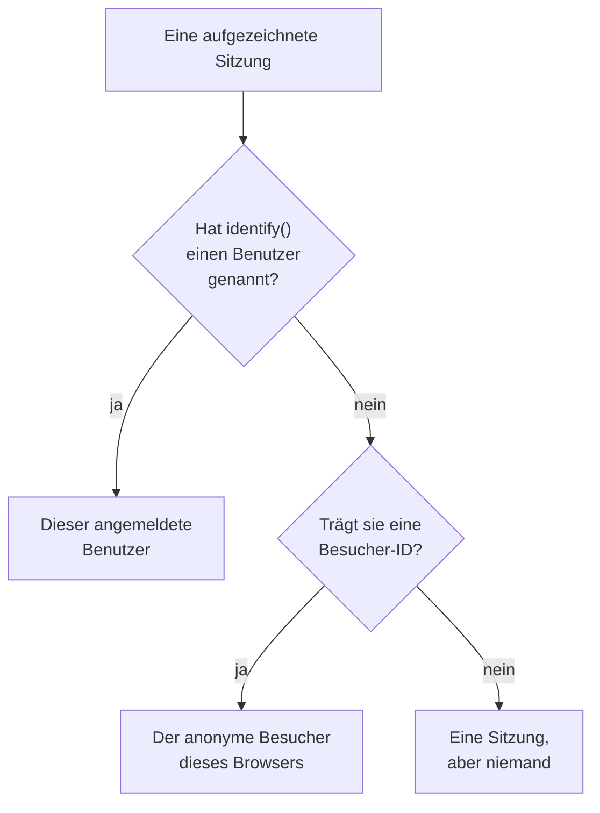

# Produktanalyse

Die Produktanalyse zählt die Menschen, die eine RUM-Anwendung nutzen, wie ihre Sitzungen verlaufen und was sie tun: aktive, neue, wiederkehrende, angemeldete und inaktive Benutzer, Sitzungen nach Gerät, Browser, Land und Seite sowie die Ereignisse, die Ihre App sendet, als Verläufe, Trichter und Bindung. Sie zählt die Sitzungen, die die [Sitzungswiedergabe](/docs/telemetry/session-replay) aufzeichnet, und die Ereignisse, die deren Recorder sendet, braucht also kein eigenes Snippet und bewahrt ihre Zahlen 13 Monate lang auf, lange nachdem die Aufzeichnungen abgelaufen sind.

:::cards
- [Benutzer](#benutzer): Aktive, neue, wiederkehrende, angemeldete, alle und inaktive Benutzer.
- [Sitzungen](#sitzungen): Wie viele, wie lange, und nach Gerät, Browser, Land und Seite.
- [Ereignisse und Metriken senden](#ereignisse-und-metriken-senden): Was Menschen tun, und die Zahlen, die Ihre Seite misst.
- [Ereignisse](#ereignisse): Wie oft etwas geschah, wer es tat und wo.
- [Trichter](#trichter): Wer Schritt für Schritt weitermachte und wie lange es dauerte.
- [Benutzerbindung](#benutzerbindung): Wer zurückkam, Kohorte für Kohorte.
:::

## Wie Personen gezählt werden

Das Seitenmenü einer Anwendung hat einen Abschnitt **Produktanalyse**: **Benutzer**, **Sitzungen**, **Ereignisse**, **Trichter**, **Benutzerbindung**, **Benutzerflüsse** und **Analyseeinstellungen**. **Benutzer** und **Sitzungen** zählen die Sitzungen, die die Sitzungswiedergabe aufzeichnet: Sie beginnen also, wenn der Recorder der Anwendung beginnt, und eine Sitzung, die die Wiedergaberichtlinie nicht aufzeichnet, wird nicht gezählt. Jede Sitzung zählt für eine Person oder für niemanden:



- **Ein angemeldeter Benutzer zählt einmal**, auf jedem Browser und Gerät, das er nutzt: Er wird am Einweg-Hash der Referenz erkannt, die Ihre Seite `identify()` übergeben hat (siehe [Ihre Benutzer identifizieren](/docs/telemetry/session-replay#ihre-benutzer-identifizieren)).
- **Ein anonymer Browser zählt einmal**, über seine [anonyme Besucher-ID](/docs/telemetry/session-replay#anonyme-besucher). Zwei Browser sind zwei Besucher, und die Sitzungen, die ein Browser hatte, bevor sich jemand darauf angemeldet hat, bleiben die seines Besuchers.
- **Eine Sitzung von einem älteren Recorder**, der keine Besucher-ID gesendet hat, zählt als Sitzung, aber nicht als Person.

**Ereignisse**, **Trichter** und **Benutzerbindung** zählen Personen genauso, aus den Ereignissen, die der Recorder aus jeder Sitzung sendet, ob aufgezeichnet oder nicht (siehe [Ereignisse und Metriken senden](#ereignisse-und-metriken-senden)).

Tage werden in Ihrer eigenen Zeitzone gezählt.

## Benutzer

**Benutzer** zählt die Personen des Zeitraums, den Sie wählen:

| Kachel | Was sie zählt |
| --- | --- |
| **Aktive Benutzer** | Alle, die im Zeitraum gekommen sind: jeder angemeldete Benutzer einmal und jeder anonyme Browser einmal. |
| **Neue Benutzer** | Aktive Benutzer, deren erster Besuch im Zeitraum lag. |
| **Wiederkehrende Benutzer** | Aktive Benutzer, die schon vor Beginn des Zeitraums gekommen waren. |
| **Angemeldete Benutzer** | Aktive Benutzer, die Ihre App mit `identify()` angemeldet hat, und ihr Anteil an allen aktiven Benutzern. |
| **Benutzer insgesamt** | Alle, die die Anwendung in den letzten 13 Monaten gesehen hat. |
| **Inaktive Benutzer** | Personen, die früher gekommen sind, aber nicht in den letzten 30 Tagen, oder in den 7, 14, 60 oder 90 Tagen, die Sie wählen. |

Die ersten drei zeigen auch, wie sie sich gegenüber dem Zeitraum davor verändert haben. Unter den Kacheln zeichnet **Aktive Benutzer** für jeden Tag die Personen, die an diesem Tag gekommen sind, die in den 7 Tagen bis dahin und die in den 30 Tagen bis dahin, und **Neue und wiederkehrende Benutzer** teilt die Personen jedes Tages in zwei.

**Personen** listet alle, die die Kacheln zählen, eine Zeile pro Person, zuletzt gesehene zuerst, und sein Filter zeigt die Personen einer Kachel, die anonymen Besucher oder alle. Öffnen Sie eine Person, um ihren ersten und letzten Besuch und jede ihrer Sitzungen aus den letzten 13 Monaten zu sehen, mit **Ansehen** bei jeder, deren Aufzeichnung noch aufbewahrt wird.

## Sitzungen

**Sitzungen** zählt die Sitzungen, die im Zeitraum begonnen haben: **Sitzungen**, **Angemeldete Sitzungen**, **Median der Sitzungsdauer**, **Seiten pro Sitzung**, **Sitzungen mit Fehlern** und **Frustrierte Sitzungen**. Unter den Kacheln:

- **Sitzungen nach Gerät** zeichnet die Sitzungen jedes Tages von Desktops, Telefonen und Tablets. Die Sitzung einer mobilen App auf einem Bildschirm, dessen kürzere Seite 600 Punkte oder mehr misst, zählt als die eines Tablets.
- **Sitzungsdauer** ordnet die beendeten Sitzungen danach, wie lange sie gedauert haben, von unter 10 Sekunden bis über 30 Minuten. Eine Sitzung, die noch aufgezeichnet wird, hat noch keine Dauer.
- **Aufschlüsselung** reiht Benutzer und Sitzungen nach Gerätetyp, Browser, Betriebssystem, Land, App-Version, Einstiegsseite oder Seite, die meisten Benutzer zuerst.

## Ereignisse und Metriken senden

Ereignisse werden gesendet, solange **Produktanalyse-Ereignisse senden** auf der Seite **Analyseeinstellungen** der Anwendung eingeschaltet ist. Bei einer neuen Anwendung ist es von Anfang an eingeschaltet, bei einer Anwendung, die angelegt wurde, bevor es diesen Schalter gab, ausgeschaltet, also schalten Sie es dort ein. Auch die Sitzungswiedergabe muss für die Anwendung eingeschaltet sein, denn ihr Recorder sendet die Ereignisse; der React-Native-Recorder sendet noch keine.

Jede Sitzung, in der der Browser-Recorder läuft, sendet ihren Start und jede Seite, die sie aufruft, von selbst, die Routenwechsel einer Single-Page-App eingeschlossen, ob die Stichprobe und die Richtlinie der Wiedergabe diese Sitzung aufzeichnen oder nicht. Ihre eigenen Ereignisse und Zahlen kommen aus dem Code Ihrer Seite:

```js
OneUptimeReplay.track("Signed up", { plan: "pro" });
OneUptimeReplay.metric("cart.value", 42.5, { currency: "EUR" });
```

| Aufruf | Was er sendet |
| --- | --- |
| `track(name, properties?)` | Ein Ereignis, das **Ereignisse**, **Trichter** und **Benutzerbindung** zählen, und eine Markierung auf der Zeitleiste der Wiedergabe, wenn die Sitzung aufgezeichnet wird. `name` ≤ 64 Zeichen; ≤ 20 Eigenschaften mit Zeichenketten-, Zahlen- oder booleschen Werten, Schlüssel ≤ 40 Zeichen, Wert ≤ 200 Zeichen. |
| `metric(name, value, attributes?)` | Eine Zahl, die Ihre Seite gemessen hat, als Punkt einer Metrik der Anwendung (siehe [Dashboards und Alarme](#dashboards-und-alarme)). `name` ≤ 100 Zeichen aus Buchstaben, Ziffern, `_`, `.`, `-` und `/`, beginnt mit einem Buchstaben und nicht mit `oneuptime.`; `value` eine endliche Zahl; `attributes` wie die Eigenschaften von `track()`. |

Bevor der Recorder geladen ist, legen Sie dieselben Aufrufe als `["track", name, properties]` und `["metric", name, value, attributes]` in `window.OneUptimeReplayQueue` ab (siehe [JavaScript-API](/docs/telemetry/session-replay#javascript-api)).

- **Jede Sitzung, aufgezeichnet oder nicht.** Die Stichprobe und die Upload-Richtlinie der Wiedergabe entscheiden, welche Sitzungen aufgezeichnet werden, nicht, welche gezählt werden. Unter Do Not Track oder Global Privacy Control wird nichts gesendet, und von einem Ursprung, den die Anwendung nicht zulässt, wird nichts aufbewahrt. Verlangt die Richtlinie eine Einwilligung, warten die Ereignisse auf `grantConsent()`, höchstens 500, und `revokeConsent()` verwirft sie.
- **Maskiert wie die Aufzeichnung.** Unter _Mask all text_ werden die Werte von Eigenschaften und Attributen maskiert, bevor sie die Seite verlassen. Eine Seite wird als ihr Pfad gesendet, ohne Query und Fragment.
- **In kleinen Stapeln**, alle 5 Sekunden und wenn der Tab ausgeblendet wird. Ein Ereignis, das OneUptime mehr als 3 Tage nach seinem Geschehen erreicht, wird verworfen, und ein Projekt darf 60.000 Ereignisse und Metrikpunkte pro Minute senden, alle seine Anwendungen zusammen; darüber wartet der Recorder und sendet sie erneut.

`metric()` sendet nichts, solange die Ereignisse ausgeschaltet sind, und `getDiagnostics().productAnalytics` sagt, ob sie eingeschaltet sind (siehe [`getDiagnostics()`](/docs/telemetry/session-replay#getdiagnostics)).

### Benutzereigenschaften

Um Ereignisse danach aufzuschlüsseln und zu segmentieren, wer sie ausgelöst hat, listen Sie Merkmalsschlüssel von `identify()` unter **Benutzereigenschaften für die Analyse** auf **Analyseeinstellungen** auf, etwa `["plan", "role"]`, höchstens 20, genau so abgeglichen, wie sie geschrieben sind. Jedes Ereignis trägt dann diese Merkmale des angemeldeten Benutzers, so wie Ihre Seite sie `identify()` übergeben hat. Die anderen Merkmale verlassen die Seite nie, und keines tut es, solange **Endbenutzeridentität erfassen** ausgeschaltet ist. Listen Sie keine Merkmale auf, die personenbezogene Daten enthalten, etwa eine E-Mail-Adresse.

## Ereignisse

**Ereignisse** zeigt jeweils ein Ereignis: das häufigste Ereignis Ihrer App, bis Sie ein anderes wählen, oder die meistaufgerufene Seite, solange sie keines sendet. Die Auswahl listet auch **Sitzung gestartet** und jede aufgerufene Seite, und **Alle Ereignisse** darunter listet jedes Ereignis des Zeitraums mit der Anzahl, wie oft es geschah und wie viele Personen es auslösten; wählen Sie eines, um es oben zu sehen.

- Die Kacheln zählen die **Ereignisse** des Ereignisses, mit der durchschnittlichen Anzahl pro Person, seine **Benutzer** und seine **Sitzungen**.
- **Ereignisse und Benutzer** zeigt für jeden Tag die Anzahl des Ereignisses und die der Personen, die es an diesem Tag auslösten.
- **Aufschlüsselung** ordnet das Ereignis nach Gerätetyp, Browser, Betriebssystem, Land, App-Version, Seite, Ereigniseigenschaft oder Benutzereigenschaft, mit den Ereignissen, Benutzern und dem Anteil jedes Werts. Wählen Sie einen Wert, um nur ihn zu zeigen.

**Segment** grenzt die Seite auf die Ereignisse ein, deren Felder die gewählten Werte haben: **Filter hinzufügen**, dann ein Feld und ein Wert, exakt abgeglichen. Ein Segment enthält höchstens 5 Filter, und ein Ereignis muss allen entsprechen. Die Adresse der Seite behält das Ereignis, den Zeitraum, das Segment und die Aufschlüsselung, sodass ein Link dieselbe Ansicht öffnet.

## Trichter

**Trichter** folgt Personen durch 2 bis 6 Schritte in ihrer Reihenfolge, jeder ein Ereignis, wie **Ereignisse** sie listet. Von den Personen, die den ersten Schritt im Zeitraum ausführten, zählt es, wie viele danach den zweiten ausführten, dann den dritten, alle innerhalb der Zeit, die Sie ab ihrem ersten Schritt wählen: **Innerhalb von 1 Stunde**, **Innerhalb von 1 Tag**, **Innerhalb von 7 Tagen**, **Innerhalb von 14 Tagen** oder **Innerhalb von 30 Tagen**. **Schritt hinzufügen** fügt einen hinzu.

Unter **Konversion** stehen der Anteil der Personen, die jeden Schritt ausführten, und für jeden Schritt, wie viele Personen ihn erreichten, welcher Anteil der Personen des ersten Schritts das ist, wie viele seit dem vorigen Schritt abgesprungen sind und die mittlere Zeit, die sie von dort brauchten. Wer es mehrmals versuchte, zählt einmal, mit dem Versuch, der am weitesten kam.

Das Segment eines Trichters und das einer Bindungstabelle nehmen die Felder, die jedes Ereignis trägt, und Benutzereigenschaften, nicht die eigenen Eigenschaften eines Ereignisses, da ihre Schritte verschiedene Ereignisse sind.

## Benutzerbindung

**Benutzerbindung** gruppiert Personen nach dem Tag, der Woche oder dem Monat des Zeitraums, in dem sie ein Ereignis zum ersten Mal ausführten, dem **Startereignis**, und zeigt, welcher Anteil jeder Gruppe ein anderes ausführte, das **Rückkehrereignis**, in dieser Periode und in jeder danach. Beide sind **Sitzung gestartet**, bis Sie andere wählen.

**Kohorten** legt die Periode fest: **Nach Tag**, **Nach Woche** oder **Nach Monat**. Hält der Zeitraum mehr Perioden, als eine Tabelle zeigt, 32 Tage, 26 Wochen oder 13 Monate, macht die Seite die Kohorten länger und sagt es.

Jede Zeile ist eine Kohorte mit der Anzahl ihrer Personen, und jede Zelle der Anteil von ihnen, der in dieser Periode zurückkam, dunkler, je mehr es waren. Eine Periode, die noch nicht begonnen hat, bleibt leer.

**Alle Kohorten**, darüber, zählt die Kohorten als eine: in jeder Periode die Personen, die zurückkamen, von den Personen der Kohorten, die sie erreicht haben, sodass eine Kohorte von 200 Personen viermal so viel wiegt wie eine von 50. Die Zeile erscheint, sobald zwei Kohorten jemanden enthalten.

## Gespeicherte Trichter und Bindungstabellen

**Gespeicherte Trichter** auf der Seite **Trichter** und **Gespeicherte Bindungstabellen** auf **Benutzerbindung** listen, was Ihr Team für die Anwendung gespeichert hat, um es wieder zu öffnen oder auf einem Dashboard zu zeigen. Ein gespeicherter Trichter behält seine Schritte, seine Zeit zum Abschließen und sein Segment, eine gespeicherte Bindungstabelle ihre beiden Ereignisse, ihre Periode und ihr Segment. Keiner von beiden behält den Zeitraum: Die Seite behält ihren eigenen, und ein Dashboard liest seinen eigenen.

- **+ Trichter speichern** oder **+ Bindungstabelle speichern** speichert, was die Seite zeigt, unter einem Namen. Eine Anwendung behält höchstens 100 von jeder Art.
- Wählen Sie einen Eintrag, um ihn zu öffnen. Die Adresse der Seite nennt ihn, sodass ein Link ihn für alle öffnet, die ihn sehen dürfen. Sobald Sie ändern, was er zeigt, sagt es sein Name, und **Aktualisieren** speichert die Änderung.
- **Bearbeiten** benennt einen um, und **Löschen** löscht ihn für alle. **Ansicht zurücksetzen** schließt den geöffneten und behält, was die Seite zeigt.
- Ein Link zu einem, der gelöscht wurde oder den Sie nicht sehen dürfen, sagt es, und die Seite öffnet sich ohne ihn.

## Dashboards und Alarme

Jedes Ereignis wird außerdem Minute für Minute als Metrik der Anwendung gezählt, und jeder Aufruf von `metric()` ist ein Punkt einer eigenen Metrik unter dem Namen, den er angibt. Stellen Sie sie auf der Seite **Metriken** der Anwendung dar, fügen Sie sie einem Dashboard hinzu oder lassen Sie einen Metriken-Monitor darauf alarmieren; **Metriken öffnen** unter **Alle Ereignisse** öffnet die Seite.

| Metrik | Was sie zählt | Nach |
| --- | --- | --- |
| `oneuptime.rum.product.events` | Ihre `track()`-Ereignisse, pro Minute | `event.name` |
| `oneuptime.rum.product.sessions` | Gestartete Sitzungen, pro Minute | `device.type` |
| `oneuptime.rum.product.page.views` | Aufgerufene Seiten, pro Minute | `device.type` |

Diese drei werden nicht abgerechnet, und `metric()` lehnt einen Namen ab, der mit `oneuptime.` beginnt, sodass nichts, was Ihre Seite sendet, als eine von ihnen durchgeht. Ihre `metric()`-Punkte werden aufbewahrt und abgerechnet wie die anderen Metriken der Anwendung.

Ein gespeicherter Trichter oder eine gespeicherte Bindungstabelle kommt auch auf ein Dashboard: Die Widgets **Trichter** und **Benutzerbindung** in der Gruppe **Produktanalyse** des Widget-Katalogs zeigen sie im Zeitbereich des Dashboards, und **In „Trichter“ öffnen** oder **In „Benutzerbindung“ öffnen** öffnet sie auf ihrer Seite (siehe [Dashboard-Widgets](/docs/dashboards/widgets#produktanalyse)).

## Datenschutz und Aufbewahrung

- **13 Monate.** Die Zahlen eines Monats werden am ersten Tag des 13. Monats danach entfernt, sodass die letzten 12 vollen Monate immer da sind, unabhängig von der eigenen Aufbewahrung der Aufzeichnungen (standardmäßig 7 Tage). Ereignisse werden ebenso aufbewahrt.
- **Keine gespeicherten Namen.** Die Zahlen bewahren den Einweg-Schlüssel eines angemeldeten Benutzers und die Besucher-ID eines Browsers auf, nie die Referenz oder eine IP-Adresse, und von den Merkmalen nur die Benutzereigenschaften, die Sie auflisten. Eine Zeile nennt einen angemeldeten Benutzer nur, solange eine seiner Aufzeichnungen noch aufbewahrt wird, und nur einer Rolle, die die Identität lesen darf; sonst steht dort **Angemeldeter Benutzer** oder **Anonymer Besucher** und der Anfang der ID.
- **Auf Anfrage gelöscht.** Eine Löschanfrage entfernt auch hier die passenden Zahlen und Ereignisse (siehe [Sitzungen löschen](/docs/telemetry/session-replay#sitzungen-löschen)).

## Wer sie sehen kann

Diese Seiten zu lesen erfordert dasselbe wie das Lesen der Sitzungsliste: `ReadRumSessionReplay` (_List Session Replays_) oder `ReadRumSessionReplayPayload` (_Watch Session Replays_), die Projektinhaber und Administratoren haben. Zu sehen, wer ein angemeldeter Benutzer ist, und Personen nach Namen zu suchen, erfordert die Identitätsberechtigung, die [Wer eine Aufzeichnung ansehen kann](/docs/telemetry/session-replay#wer-eine-aufzeichnung-ansehen-kann) beschreibt.

Gespeicherte Trichter und Bindungstabellen zu speichern, umzubenennen und zu löschen erfordert dieselben Berechtigungen wie das Lesen dieser Seiten, und ein Dashboard-Widget zeigt sie nur einem Leser, der sie hat.

Die Ereignisse ein- oder auszuschalten erfordert `EditRumApplication` (_Edit RUM Application_) oder die Rolle eines Projektinhabers, Administrators oder Mitglieds. Benutzereigenschaften aufzulisten erfordert `EditRumApplication` oder die Rolle eines Inhabers oder Administrators, da es festlegt, was über angemeldete Personen aufbewahrt wird.

## Nächste Schritte

:::cards
- [Sitzungswiedergabe](/docs/telemetry/session-replay): Zeichnen Sie die Sitzungen auf, die diese Seiten zählen, und sehen Sie sie an.
- [Anwendungen verwalten](/docs/rum/applications): Namen, Labels, Inhaber und Aufbewahrung.
- [RUM – Übersicht](/docs/rum/index): Was eine RUM-Anwendung sonst noch zeigt.
:::
