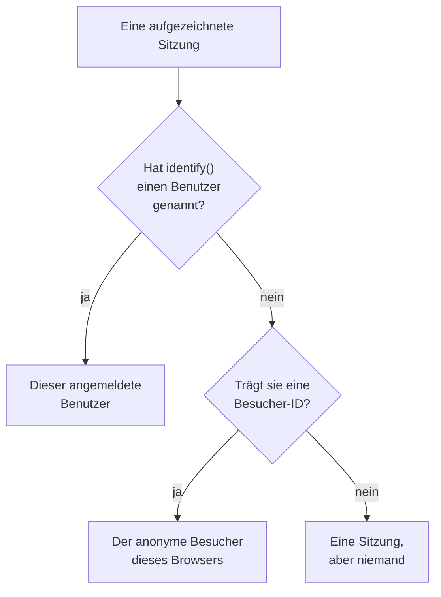

# Produktanalyse

Die Produktanalyse zählt die Menschen, die eine RUM-Anwendung nutzen, und wie ihre Sitzungen verlaufen: aktive, neue, wiederkehrende, angemeldete und inaktive Benutzer sowie Sitzungen nach Gerät, Browser, Land und Seite. Sie zählt die Sitzungen, die die [Sitzungswiedergabe](/docs/telemetry/session-replay) aufzeichnet, braucht also kein eigenes Snippet und bewahrt ihre Zahlen 13 Monate lang auf, lange nachdem die Aufzeichnungen abgelaufen sind.

:::cards
- [Wie Personen gezählt werden](#wie-personen-gezählt-werden): Ein angemeldeter Benutzer einmal, ein anonymer Browser einmal.
- [Benutzer](#benutzer): Aktive, neue, wiederkehrende, angemeldete, alle und inaktive Benutzer.
- [Sitzungen](#sitzungen): Wie viele, wie lange, und nach Gerät, Browser, Land und Seite.
- [Datenschutz und Aufbewahrung](#datenschutz-und-aufbewahrung): 13 Monate, keine gespeicherten Namen, auf Anfrage gelöscht.
:::

## Wie Personen gezählt werden

Das Seitenmenü einer Anwendung hat einen Abschnitt **Produktanalyse** mit zwei Seiten, **Benutzer** und **Sitzungen**. Beide zählen die Sitzungen, die die Sitzungswiedergabe aufzeichnet: Sie beginnen also, wenn der Recorder der Anwendung beginnt, und eine Sitzung, die die Wiedergaberichtlinie nicht aufzeichnet, wird nicht gezählt. Jede Sitzung zählt für eine Person oder für niemanden:

- **Ein angemeldeter Benutzer zählt einmal**, auf jedem Browser und Gerät, das er nutzt: Er wird am Einweg-Hash der Referenz erkannt, die Ihre Seite `identify()` übergeben hat (siehe [Ihre Benutzer identifizieren](/docs/telemetry/session-replay#ihre-benutzer-identifizieren)).
- **Ein anonymer Browser zählt einmal**, über seine [anonyme Besucher-ID](/docs/telemetry/session-replay#anonyme-besucher). Zwei Browser sind zwei Besucher, und die Sitzungen, die ein Browser hatte, bevor sich jemand darauf angemeldet hat, bleiben die seines Besuchers.
- **Eine Sitzung von einem älteren Recorder**, der keine Besucher-ID gesendet hat, zählt als Sitzung, aber nicht als Person.

Tage werden in Ihrer eigenen Zeitzone gezählt.

## Benutzer

**Benutzer** zählt die Personen des Zeitraums, den Sie wählen:

| Kachel | Was sie zählt |
| --- | --- |
| **Aktive Benutzer** | Alle, die im Zeitraum gekommen sind: jeder angemeldete Benutzer einmal und jeder anonyme Browser einmal. |
| **Neue Benutzer** | Aktive Benutzer, deren erster Besuch im Zeitraum lag. |
| **Wiederkehrende Benutzer** | Aktive Benutzer, die schon vor Beginn des Zeitraums gekommen waren. |
| **Angemeldete Benutzer** | Aktive Benutzer, die Ihre App mit `identify()` angemeldet hat, und ihr Anteil an allen aktiven Benutzern. |
| **Benutzer insgesamt** | Alle, die die Anwendung in den letzten 13 Monaten gesehen hat. |
| **Inaktive Benutzer** | Personen, die früher gekommen sind, aber nicht in den letzten 30 Tagen, oder in den 7, 14, 60 oder 90 Tagen, die Sie wählen. |

Die ersten drei zeigen auch, wie sie sich gegenüber dem Zeitraum davor verändert haben. Unter den Kacheln zeichnet **Aktive Benutzer** für jeden Tag die Personen, die an diesem Tag gekommen sind, die in den 7 Tagen bis dahin und die in den 30 Tagen bis dahin, und **Neue und wiederkehrende Benutzer** teilt die Personen jedes Tages in zwei.

**Personen** listet alle, die die Kacheln zählen, eine Zeile pro Person, zuletzt gesehene zuerst, und sein Filter zeigt die Personen einer Kachel, die anonymen Besucher oder alle. Öffnen Sie eine Person, um ihren ersten und letzten Besuch und jede ihrer Sitzungen aus den letzten 13 Monaten zu sehen, mit **Ansehen** bei jeder, deren Aufzeichnung noch aufbewahrt wird.

## Sitzungen

**Sitzungen** zählt die Sitzungen, die im Zeitraum begonnen haben: **Sitzungen**, **Angemeldete Sitzungen**, **Median der Sitzungsdauer**, **Seiten pro Sitzung**, **Sitzungen mit Fehlern** und **Frustrierte Sitzungen**. Unter den Kacheln:

- **Sitzungen nach Gerät** zeichnet die Sitzungen jedes Tages von Desktops, Telefonen und Tablets. Die Sitzung einer mobilen App auf einem Bildschirm, dessen kürzere Seite 600 Punkte oder mehr misst, zählt als die eines Tablets.
- **Sitzungsdauer** ordnet die beendeten Sitzungen danach, wie lange sie gedauert haben, von unter 10 Sekunden bis über 30 Minuten. Eine Sitzung, die noch aufgezeichnet wird, hat noch keine Dauer.
- **Aufschlüsselung** reiht Benutzer und Sitzungen nach Gerätetyp, Browser, Betriebssystem, Land, App-Version, Einstiegsseite oder Seite, die meisten Benutzer zuerst.

## Datenschutz und Aufbewahrung

- **13 Monate.** Die Zahlen eines Monats werden am ersten Tag des 13. Monats danach entfernt, sodass die letzten 12 vollen Monate immer da sind, unabhängig von der eigenen Aufbewahrung der Aufzeichnungen (standardmäßig 7 Tage).
- **Keine gespeicherten Namen.** Die Zahlen bewahren den Einweg-Schlüssel eines angemeldeten Benutzers und die Besucher-ID eines Browsers auf, nie die Referenz, die Merkmale oder eine IP-Adresse. Eine Zeile nennt einen angemeldeten Benutzer nur, solange eine seiner Aufzeichnungen noch aufbewahrt wird, und nur einer Rolle, die die Identität lesen darf; sonst steht dort **Angemeldeter Benutzer** oder **Anonymer Besucher** und der Anfang der ID.
- **Auf Anfrage gelöscht.** Eine Löschanfrage entfernt auch hier die passenden Zahlen (siehe [Sitzungen löschen](/docs/telemetry/session-replay#sitzungen-löschen)).

## Wer sie sehen kann

Die beiden Seiten zu lesen erfordert dasselbe wie das Lesen der Sitzungsliste: `ReadRumSessionReplay` (_List Session Replays_) oder `ReadRumSessionReplayPayload` (_Watch Session Replays_), die Projektinhaber und Administratoren haben. Zu sehen, wer ein angemeldeter Benutzer ist, und Personen nach Namen zu suchen, erfordert die Identitätsberechtigung, die [Wer eine Aufzeichnung ansehen kann](/docs/telemetry/session-replay#wer-eine-aufzeichnung-ansehen-kann) beschreibt.

## Nächste Schritte

:::cards
- [Sitzungswiedergabe](/docs/telemetry/session-replay): Zeichnen Sie die Sitzungen auf, die diese Seiten zählen, und sehen Sie sie an.
- [Anwendungen verwalten](/docs/rum/applications): Namen, Labels, Inhaber und Aufbewahrung.
- [RUM – Übersicht](/docs/rum/index): Was eine RUM-Anwendung sonst noch zeigt.
:::
