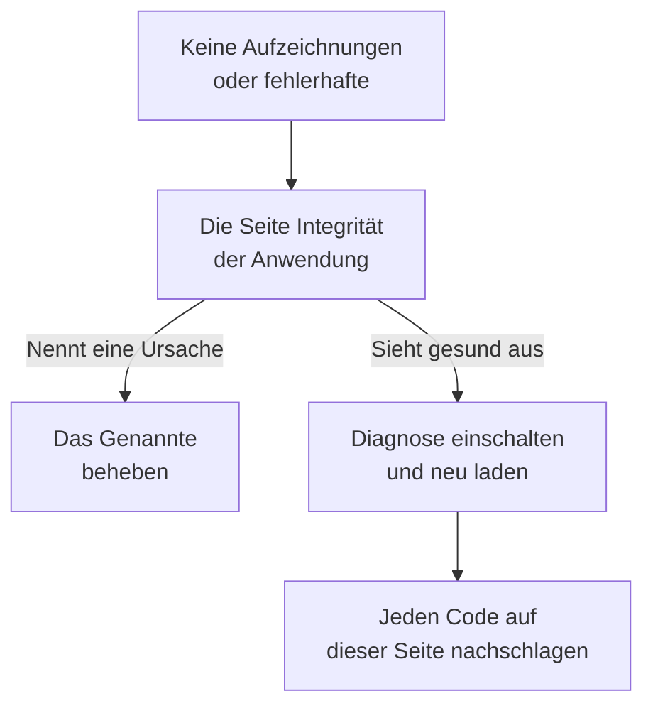

# Fehlerbehebung bei der Sitzungswiedergabe

Wenn keine Aufzeichnungen ankommen oder sie fehlerhaft ankommen, findet diese Seite den Grund. Die Sitzungswiedergabe zeichnet standardmäßig jede Sitzung auf und lädt sie laufend hoch, daher sendet eine gesunde Seite etwa alle 15 Sekunden ein Chunk, solange der Benutzer etwas tut. Ein inaktiver Tab erzeugt keine Ereignisse und sendet nichts, und nach fünf Minuten ohne Eingabe pausiert der Recorder ganz (`recording-paused-idle`); bewegen Sie also die Maus oder klicken Sie, bevor Sie eine Installation anhand des Tabs „Netzwerk“ beurteilen. Sehen Sie auch dann gar keine Anfragen an OneUptime, liegt der Grund weiter unten.

:::cards
- [Diagnose einschalten](#diagnose-einschalten): Den Recorder jede Entscheidung in der Konsole erklären lassen.
- [Codes](#codes): Jede Zeile, die der Recorder ausgibt, und was zu tun ist.
- [Eine Firewall vor OneUptime lehnt die Chunks ab](#eine-firewall-vor-oneuptime-lehnt-die-chunks-ab): Zu prüfende Regeln und hinzuzufügende Ausnahmen.
- [Bilder, Symbole oder Stile fehlen in der Wiedergabe](#bilder-symbole-oder-stile-fehlen-in-der-wiedergabe): Aufzeichnungen, die laufen, aber nicht so aussehen, wie Ihr Benutzer sie sah.
:::



Die einzige Einstellung, bei der Stille normal ist, ist das Hochladen nur _On error or frustration_ (`OnErrorOrFrustration`): Der Recorder hält dann einen rollierenden Puffer im Speicher und lädt nur hoch, wenn etwas schiefgeht, was bis zum ersten Auslöser genau wie eine kaputte Installation aussieht. Prüfen Sie, welche Einstellung Sie haben, bevor Sie nach anderem suchen: Die Zeile `config-accepted` weiter unten gibt sie aus.

Beginnen Sie, wenn möglich, auf der Serverseite. Die Seite **Integrität** der Anwendung im Abschnitt **Sitzungswiedergabe** ihres Seitenmenüs nennt die Ursache, wenn nichts ankommt: Der Recorder wurde nie geladen, er wurde geladen, aber nichts wurde hochgeladen und warum, Uploads werden abgelehnt und aus welchem Grund, oder das Budget ist aufgebraucht. Siehe [Aufzeichnungszustand](/docs/telemetry/session-replay#aufzeichnungszustand). Was folgt, ist die Browserseite: Diagnose einschalten, einmal neu laden und die Konsole lesen.

Aufzeichnungen kommen an, werden aber mit kaputten Bildern, fehlenden Symbolen oder unformatierten Bereichen abgespielt? Das ist eine Frage der Wiedergabe, beantwortet unter [Bilder, Symbole oder Stile fehlen in der Wiedergabe](#bilder-symbole-oder-stile-fehlen-in-der-wiedergabe).

## Diagnose einschalten

Wählen Sie den Schalter, den Sie erreichen können. Alle bewirken dasselbe.

:::tabs
@tab Im Browser
Im Browser, in dem der Fehler auftritt. Das braucht kein erneutes Deployment, funktioniert in Produktion und übersteht Neuladen:

```js
localStorage.setItem("oneuptime.sessionReplay.debug", "true");
// then reload the page
```

Ausschalten mit:

```js
localStorage.removeItem("oneuptime.sessionReplay.debug");
```
@tab Per Link
Für jemanden ohne technische Kenntnisse oder eine Seite, auf der Sie keine Konsole öffnen können, hängen Sie `oneuptime_debug=1` an die URL an. Es funktioniert auch im Fragment, das einen Server übersteht, der ihm unbekannte Query-Parameter entfernt:

```text
https://your-app.example.com/checkout?oneuptime_debug=1
https://your-app.example.com/checkout#oneuptime_debug=1
```
@tab Im Script-Tag
Für eine Staging-Umgebung, in der die Diagnose für alle eingeschaltet sein soll:

```html
<script
  src="https://oneuptime.com/telemetry/session-replay/v1/recorder.js"
  data-oneuptime-token="YOUR_TELEMETRY_INGESTION_KEY"
  data-oneuptime-app-identifier="YOUR_RUM_APP_IDENTIFIER"
  data-oneuptime-debug="true"
  crossorigin="anonymous"
  async
></script>
```
@tab Im Init-Global
Wenn Sie den Recorder über das Init-Global konfigurieren:

```js
window.__ONEUPTIME_SESSION_REPLAY__ = {
  host: "https://oneuptime.com",
  token: "YOUR_TELEMETRY_INGESTION_KEY",
  appIdentifier: "YOUR_RUM_APP_IDENTIFIER",
  debug: true,
};
```
@tab Im Deployment
Im OneUptime-Deployment, der einzige Schalter, der niemanden am fehlerhaften Browser braucht. Setzen Sie `SESSION_REPLAY_DEBUG=true` und starten Sie neu. Jeder Recorder, den diese Instanz ausliefert, protokolliert dann auf jeder Seite, auf der er läuft; schalten Sie es also ein, sammeln Sie ein Neuladen und schalten Sie es wieder aus. Es ändert keine Richtlinie: weder Sampling noch Maskierung noch Einwilligung. Siehe [Hinweise zum Selbsthosting](/docs/telemetry/session-replay#hinweise-zum-selbsthosting) für die übrigen Deployment-Einstellungen.
@tab Zur Laufzeit
Sobald der Recorder geladen ist:

```js
OneUptimeReplay.setDebug(true);
```
:::

Die Ausgabe sieht so aus:

```text
[OneUptime Session Replay] loader-start: Loader running.
[OneUptime Session Replay] init-options-read: Init options read. {host: "https://oneuptime.com", appIdentifier: "checkout-web", …}
[OneUptime Session Replay] config-fetch-start: Requesting the policy. {url: "https://oneuptime.com/telemetry/session-replay/v1/config", …}
[OneUptime Session Replay] config-accepted: Policy accepted. {captureTrigger: "Always", samplePercentage: 100, …}
[OneUptime Session Replay] recording: Recording and uploading …
```

## Die Zeitleiste abrufen, ohne vorher etwas einzuschalten

Der Recorder behält seine letzten 250 Entscheidungen, ob die Diagnose eingeschaltet ist oder nicht. Ist das Problem schon aufgetreten, müssen Sie es nicht mit eingeschaltetem Logging nachstellen — fragen Sie stattdessen danach:

```js
copy(JSON.stringify(OneUptimeReplay.getDiagnostics(), null, 2));
```

Das liefert die Recorder-Version, die Sitzungs-ID, ihren `state` (`recording`, `uploading`, `not-sampled`, `stopped`…), warum sie gestoppt hat, falls ja, die `bootstrapDecision`, die Antwort jeder Schranke unter `decisions` (gesampelt oder nicht, Einwilligungsstatus, ob Uploads erlaubt sind und was sie blockiert, die letzte Serveranweisung), die `capabilities` des Recorders und die vollständige Liste der Einträge — einschließlich der Einträge des Loader-Stubs, der läuft, bevor das Recorder-Artefakt existiert, und in dem die meisten Rückzüge entschieden werden. Sie enthält konstruktionsbedingt keinen Seiteninhalt; siehe [Was die Diagnose nie enthält](#was-die-diagnose-nie-enthält). Die Felder sind unter [`getDiagnostics()`](/docs/telemetry/session-replay#getdiagnostics) beschrieben.

**Wenn `OneUptimeReplay is not defined` erscheint**, wurde das Recorder-Artefakt nie geladen — was selbst schon die Antwort auf gut die Hälfte der Codes unten ist, und genau dann, wenn Sie die Zeitleiste am dringendsten brauchen. Die Einträge sind trotzdem da, in einem Global, in das der Loader-Stub schreibt, bevor das Artefakt existiert:

```js
copy(JSON.stringify(window.__ONEUPTIME_SESSION_REPLAY_DEBUG__.records, null, 2));
```

Fügen Sie eines von beiden in Ihr Support-Ticket ein — oder unter **Den Browser fragen** auf der Seite **Integrität** der Anwendung, die jeden Code darin erklärt. Meist reicht das allein.

## Wenn Stille normal ist: die fehlergesteuerte Richtlinie

Dieser Abschnitt gilt nur, wenn `config-accepted` den Wert `captureTrigger: "OnErrorOrFrustration"` ausgegeben hat. Mit der Standardrichtlinie `Always` sendet der Recorder während der Aufzeichnung, und Stille auf einer Seite, mit der der Benutzer interagiert, bedeutet, dass wirklich etwas nicht stimmt — lesen Sie dann über diesen Abschnitt hinaus weiter.

Wenn die Konsole Folgendes sagt:

```text
[OneUptime Session Replay] recording: Recording into memory. Nothing uploads until a trigger fires - call OneUptimeReplay.captureSession() to force one.
```

…dann funktioniert der Recorder. Mit einer fehlergesteuerten Richtlinie stellt eine gesunde Seite genau eine Anfrage an OneUptime pro Seitenaufruf (den Abruf der Konfiguration) und sendet sonst nichts, bis ein Fehler, ein 5xx, ein Frustrationssignal oder eine Überschreitung eines Leistungsbudgets eintritt.

Um den ganzen Weg von Anfang bis Ende zu prüfen, erzwingen Sie einen Upload:

```js
OneUptimeReplay.captureSession("installation test");
```

Sie sollten sofort ein `POST /telemetry/session-replay/v1/chunk` im Tab „Netzwerk“ und eine Zeile `chunk-accepted` in der Konsole sehen. Wenn ja, ist die Installation korrekt, und die Wiedergabe erscheint innerhalb etwa einer Minute im Dashboard, mit Ihrem Grund auf ihrer Zeitleiste markiert.

Ein `202` mit `chunk-accepted` ist das, wonach Sie suchen. Ein `204` protokolliert stattdessen `chunk-not-recorded`: Die Anfrage war in Ordnung, und der Server hat entschieden, sie nicht zu speichern — Budget überschritten, nicht gesampelt oder die Anwendung ist ausgeschaltet. Das ist eine Antwort der Richtlinie, kein Installationsfehler, und die Zeile `server-directive` daneben sagt, welche.

Um wieder jede Sitzung aufzuzeichnen, setzen Sie auf der Seite **Wiedergaberichtlinie** der Anwendung **Wann eine Aufzeichnung hochgeladen wird** auf _Always_ und **Stichprobenanteil** über 0. Das ist die ausgelieferte Voreinstellung.

## Codes

Jede Zeile trägt einen stabilen `code`. Schlagen Sie Ihren hier nach.

### Start

| Code | Was er bedeutet |
| --- | --- |
| `loader-start` | Das Recorder-Skript lief. Sehen Sie dies bei eingeschalteter Diagnose nicht, wurde das Skript selbst nie ausgeführt — prüfen Sie die `<script>`-Anfrage im Tab „Netzwerk“ und Ihre CSP-`script-src`. |
| `init-options-read` | Optionen wurden gefunden. Prüfen Sie `host` und `appIdentifier` im Detail: `appIdentifier` muss genau zur RUM-Anwendung passen, und `host` muss Ihr OneUptime-Ursprung sein, nicht der Ihrer eigenen App. |
| `init-options-incomplete` | Eine erforderliche Option fehlt. Das Detail sagt, welches von `hasHost` / `hasToken` / `hasAppIdentifier` falsch ist. Ist `hasHost` falsch, hat das Script-Tag keine `src`, aus der sich der Host ableiten ließe — fügen Sie `data-oneuptime-host` hinzu. |
| `privacy-signal` | Der Browser sendet Do Not Track oder Global Privacy Control, und das wird beachtet — von der Seite (nichts im Script-Tag sagt etwas anderes) oder von der Serverrichtlinie. Nichts wird aufgezeichnet; mit `stage: "before-config-fetch"` wird auch keine Konfigurationsanfrage gestellt. Das ist kein Fehler. Setzen Sie `data-oneuptime-respect-do-not-track="false"` nur, wenn Ihre Rechtsgrundlage wirklich nicht von dem Signal abhängt. |
| `init-options-missing` | Auf der Seite gibt es nichts zu lesen: kein Tag `script[data-oneuptime-token]` und kein `window.__ONEUPTIME_SESSION_REPLAY__`. Das Markierungsattribut ist falsch geschrieben, das Snippet landete in einem anderen Dokument, oder ein Tag-Manager hat es verworfen. |
| `loader-threw` | Ein Fehler im Recorder selbst, nicht in Ihrer Konfiguration. Bitte melden Sie ihn mit der Diagnoseausgabe. |

### Richtlinie

| Code | Was er bedeutet |
| --- | --- |
| `config-fetch-start` | Die Richtlinie wird gleich angefragt. Die `url` im Detail ist die genaue URL — prüfen Sie, dass sie sich aus einem Browser auflösen lässt. |
| `config-fetch-rejected` | Der Endpunkt antwortete mit einem Nicht-2xx-Status. Siehe [Status beim Abruf der Konfiguration](#status-beim-abruf-der-konfiguration) weiter unten. |
| `config-fetch-failed` | Die Anfrage wurde gar nicht abgeschlossen: CSP-`connect-src`, ein Werbeblocker, DNS, TLS, offline oder ein Timeout nach 5 Sekunden. Der Browser protokolliert meist eine eigene Zeile daneben. |
| `config-body-unparseable` | Der Endpunkt antwortete mit 2xx und einem Body, der gar kein JSON ist. Unterschied zu `config-fetch-failed`: Die Anfrage *wurde* abgeschlossen, also hat etwas auf dem Weg — ein Proxy, ein Captive Portal, eine SSO-Zwischenseite — statt OneUptime geantwortet. |
| `config-unparseable` | Der Body *war* gültiges JSON, aber kein Objekt — `null`, ein String, ein Array. Ein umschreibender Proxy oder ein Server, der eine andere Route beantwortet. |
| `config-disabled` | Der Server sagt, dass die Wiedergabe hier ausgeschaltet ist. Die `disabledReason` im Detail ist die Antwort: siehe [disabledReason](#disabledreason) weiter unten. |
| `config-recorder-version-invalid` | Die Richtlinie nannte nicht genau das kleingeschriebene `latest`, daher ließ sich keine Artefakt-URL bilden. Ein umschreibender Proxy oder eine manipulierte Antwort — ein Deployment ohne Build meldet stattdessen `config-disabled` mit `recorder-not-built`. |
| `config-accepted` | Die Richtlinie wurde akzeptiert. Das Detail ist die ganze Richtlinie — `captureTrigger`, `samplePercentage`, `consentMode`, `maskingMode`. |
| `config-field-defaulted` | Der Server schickte für ein Richtlinienfeld (im Detail genannt) keinen Wert, daher nutzte dieser Recorder den Produktstandard dafür. Nur zur Information: meist ein Server, der älter ist als der Recorder. Zeigt das Dashboard für dieses Feld einen anderen Wert, aktualisieren Sie OneUptime. |
| `config-value-unrecognised` | Der Server schickte einen Wert, den dieser Recorder-Build nicht kennt, daher fiel er auf den sichersten zurück — der nicht der sein muss, den Ihr Dashboard zeigt. Meist läuft auf einer Seite noch ein Recorder aus einem älteren Deployment. |
| `directive-stop` | Der Server hat diesen Recorder angewiesen, sich zurückzuziehen. Prüfen Sie den Aufzeichnungszustand der Anwendung auf ein Budget, ein Ratenlimit oder einen Notschalter. |

#### Status beim Abruf der Konfiguration

| Status | Lösung |
| --- | --- |
| `401` | Das Ingestion-Token ist falsch, widerrufen, abgelaufen oder stammt aus einem anderen Projekt. Legen Sie eines unter **Projekteinstellungen → Telemetrie & APM → Ingestion-Schlüssel** an und bestätigen Sie es mit `GET /session-replay/v1/validate` — senden Sie den Schlüssel so, wie der Recorder es tut, und fügen Sie den Header `x-oneuptime-app-identifier` hinzu; dann enthält die Antwort auch `isSessionReplayEnabled` für diese Anwendung, `sessionReplayDisabledDetail` mit dem ausgeschalteten Schalter, falls sie es nicht ist, `isIngestEnabledOnThisInstance` und den `keyType`. |
| `400` | `data-oneuptime-app-identifier` fehlt. |
| `403` | Der Ursprung der Seite steht nicht in den **Zulässige Ursprünge** des Ingestion-Schlüssels. Fügen Sie ihn hinzu, oder verwenden Sie einen Schlüssel, dessen Positivliste diese Seite abdeckt. |
| `404` | Der Pfad ließ sich am OneUptime-Ursprung nicht auflösen. Fast immer ist das ein falscher `data-oneuptime-host` — oder ein Reverse-Proxy vor OneUptime, der `/telemetry/*` nicht weiterleitet. |
| `5xx` | Ein serverseitiger Fehler; prüfen Sie die Logs der OneUptime-App. |

#### disabledReason

| Wert | Was zu tun ist |
| --- | --- |
| `not-enabled-for-application` | Die Sitzungswiedergabe ist für diese RUM-Anwendung ausgeschaltet, die Kennung passt zu keiner, oder das Projekt darf keine Wiedergabe nutzen. `disabledDetail` sagt, was davon: `application-not-enabled` (der Schalter dieser Anwendung), `project-not-allowed` (der projektweite Schalter unter **Real User Monitoring → Einstellungen → Sitzungswiedergabe**), `application-unknown` (keine Anwendung hat diesen `appIdentifier` — prüfen Sie die Schreibweise auf der Seite **Wiedergaberichtlinie** der Anwendung) oder `project-killed` (ein Notschalter des Betreibers in diesem Deployment). |
| `budget-exhausted` | Das tägliche Byte-Budget des Projekts oder das Monatsbudget der Anwendung ist bereits aufgebraucht, daher werden Recorder angewiesen, nicht aufzuzeichnen, statt Chunks hochzuladen, die abgelehnt würden. `disabledDetail` ist `project-daily-budget-exhausted` oder `app-monthly-budget-exhausted`, und `budgetResetsAt` sagt, wann es sich zurücksetzt. Erhöhen Sie das Budget auf der Seite **Wiedergaberichtlinie**, oder warten Sie auf das Zurücksetzen. |
| `recorder-not-built` | **Dem Deployment fehlt das Recorder-Artefakt.** Nichts auf der Seite des Kunden kann das beheben. Der Build, der `packages/App/FeatureSet/BrowserRecorder/public/dist/manifest.json` erzeugt, lief nicht, oder seine Ausgabe erreichte das laufende Image nicht. Bauen Sie die OneUptime-App neu und deployen Sie sie erneut. Das ist die übliche Antwort bei einer selbst gehosteten Installation, in der die Wiedergabe nie funktioniert hat. |
| `disabled-by-default` | `SESSION_REPLAY_ENABLED_BY_DEFAULT=false` in diesem Deployment. Setzen Sie es auf `true` — und setzen Sie zuerst `SESSION_REPLAY_MAX_BYTES_PER_PROJECT_PER_DAY`, wenn Sie selbst hosten, denn die Wiedergabe ist Ihre größte Tabelle. |
| `ingest-disabled` | `SESSION_REPLAY_INGEST_ENABLED=false` in diesem Deployment. |
| `policy-unavailable` | Der Server konnte die Richtlinie nicht auflösen — meist Redis oder Postgres. Er schließt absichtlich ab. Prüfen Sie die Logs der OneUptime-App. |
| `not-reported` | Der Server ist älter als dieses Feld. Verwenden Sie stattdessen das Panel **Ihre Installation testen** des Dashboards auf der Seite **Wiedergaberichtlinie**. |

### Das Artefakt

| Code | Was er bedeutet |
| --- | --- |
| `artifact-requested` | Das neueste Recorder-Bundle wird eingebunden. Die `url` ist die genaue. |
| `artifact-load-failed` | Es wurde nicht geladen. Nach Wahrscheinlichkeit: eine CSP-`script-src`, die Ihren OneUptime-Ursprung nicht erlaubt, eine SRI-Abweichung (ein Proxy schreibt das Bundle um) oder ein 404, weil dieses Deployment den Recorder nicht gebaut hat. |
| `artifact-url-invalid` | Die Richtlinie nannte nicht genau das kleingeschriebene `latest`, daher wurde keine URL gebildet. Eine manipulierte oder über einen Proxy veränderte Konfigurationsantwort. |
| `artifact-api-missing` | Das Bundle wurde geladen, hat aber `window.OneUptimeReplay` nicht veröffentlicht — ein anderes Skript auf der Seite hat es überschrieben. |
| `bootstrap` | Das Recorder-Artefakt startet. |
| `bootstrap-already-started` | Zwei Kopien des Snippets auf einer Seite. Entfernen Sie eine. |
| `bootstrap-already-running` | `bootstrap()` wurde erneut aufgerufen, während schon ein Recorder lief. Harmlos; meist eine doppelte Einbindung. |
| `bootstrap-cancelled` | Ein `revokeConsent()` oder `stop()` in `window.OneUptimeReplayQueue` lief, bevor der Recorder startete, daher wird diese Sitzung nicht aufgezeichnet. Richtig, wenn Ihr Banner bereits abgelehnt worden war. |
| `prerender-wait` | Der Browser hat diese Seite vorab gerendert — wie Chrome es mit einer Seite tut, die voraussichtlich als Nächstes geöffnet wird —, und noch niemand hat sie geöffnet. Der Recorder startet, wenn der Besucher die Seite öffnet, daher zeichnet eine Seite, die nie geöffnet wird, nichts auf; Aufrufe, die Ihre Seite in der Zwischenzeit macht, werden dann angewendet. |
| `start-stopped` | `start()` erhielt auf dem Weg des selbst gehosteten Bundles keine nutzbare Richtlinie. Der genaue Grund steht in der `config-*`-Zeile direkt darüber. |
| `rrweb-did-not-start` | Der DOM-Recorder hat den Start verweigert. Bitte melden Sie das. |
| `rrweb-error` | Der DOM-Recorder stieß auf dieser Seite auf einen internen Fehler (der Name des Fehlers steht im Detail; er wird einmal protokolliert). Die Aufzeichnung kann an dieser Stelle springen oder einfrieren, und nach drei solchen Fehlern trägt die Sitzung einen Hinweis zur Wiedergabetreue, der das sagt. Bitte melden Sie es mit dem Framework der Seite und dem Namen des Fehlers. |

### Aufzeichnung und Upload

| Code | Was er bedeutet |
| --- | --- |
| `not-sampled` | Diese Sitzung hat die Stichprobe verloren, daher wird gar nichts aufgezeichnet. Das Sampling ist durch die Sitzungs-ID festgelegt, Neuladen hilft dieser Sitzung also nicht. Erhöhen Sie den Stichprobenanteil. |
| `recording` | Es wird aufgezeichnet. Lesen Sie das Detail: `uploading: true` ist der normale Zustand mit dem Standardauslöser `Always`. `uploading: false` mit `captureTrigger: "OnErrorOrFrustration"` ist der andere gesunde Zustand ohne Anfragen. |
| `same-origin-propagation` | Wird einmal beim Start des Recorders protokolliert: ob er Trace-Kontext (`traceparent` und einen `tracestate` mit der Sitzungs-ID) zu Anfragen an den eigenen Ursprung der Seite hinzufügt. `enabled: true` mit `reason: "on"` ist der Standard. `reason: "policy-off"` bedeutet, dass **Same-Origin-Trace-Weitergabe** auf der Seite **Wiedergaberichtlinie** der Anwendung ausgeschaltet ist; `reason: "opaque-origin"` bedeutet, dass die Seite keinen eigenen Ursprung hat (ein sandboxed iframe, `about:blank`, `srcdoc` oder `file:`), sodass nichts als gleicher Ursprung gilt. Auch eingeschaltet kommen die Header nur an Anfragen, die gestellt werden, während die Sitzung hochlädt, und nie an ein `POST` an einen Pfad, der auf `/v1/traces`, `/v1/logs` oder `/v1/metrics` endet (die eigenen OpenTelemetry-Exporte der Seite). Ein weiteres Mal protokolliert, mit `reason: "agent-stand-down"` und einem Feld `agent` (`DD_RUM`, `NREUM` oder `elasticApm`), wenn der Recorder in einem Seitenaufruf zum ersten Mal den `traceparent` einer Anfrage an den gleichen Ursprung diesem Agenten überlässt, weil er so konfiguriert ist, dass er die Anfrage tracet (Datadog RUM nur in einer Sitzung, die es verfolgt); die Anfrage erhält trotzdem das `tracestate`-Mitglied und wird nur verknüpft, wenn der Agent wirklich einen `traceparent` sendet, was Datadog nur in einer verfolgten, für Traces gesampelten Datadog-Sitzung tut. New Relic (`NREUM`) sendet seinen eigenen `tracestate` anstelle des Mitglieds, daher werden seine Anfragen nur über die Trace-ID verknüpft (siehe [die Tabs Logs und Traces sind leer](#die-tabs-logs-und-traces-des-players-sind-leer)). Siehe [Mit Ihrer übrigen Telemetrie verknüpfen](/docs/telemetry/session-replay#mit-ihrer-übrigen-telemetrie-verknüpfen). |
| `same-origin-propagation-tripped` | Eine Anfrage, der der Recorder Trace-Kontext hinzugefügt hatte, scheiterte auf Netzwerkebene, meist eine Anfrage an den gleichen Ursprung, die zu einem anderen Ursprung umgeleitet wurde, der `traceparent` und `tracestate` nicht erlaubt. Der Recorder fügt sie für den Rest dieses Seitenaufrufs nicht mehr hinzu. `retried: true` bedeutet, dass es ein `GET`- oder `HEAD`-`fetch` ohne Body war und noch einmal genau so gesendet wurde, wie Ihre Seite es gestellt hatte; `false` bedeutet, dass es nicht wiederholt werden konnte und fehlschlug: alles außer einem `GET`- oder `HEAD`-`fetch` ohne Body (jedes XHR, jede andere Methode, jede Anfrage mit Body) wird nicht wiederholt. Eigene Abbrüche und Timeouts Ihrer Seite lösen es nicht aus, ebenso wenig ein Fehler, während der Browser sich als offline meldet; der nächste Seitenaufruf beginnt neu. Siehe [Downloads oder Weiterleitungen scheitern nach dem Einschalten der Sitzungswiedergabe](#downloads-oder-weiterleitungen-scheitern-nach-dem-einschalten-der-sitzungswiedergabe). |
| `trigger` | Etwas Behaltenswertes ist passiert. Der `reason` ist einer von `error`, `frustration`, `performance`, `sampled` oder `manual`. |
| `upload-started` | Der gepufferte Vorlauf wird geleert. Hier beginnen die Chunk-POSTs. |
| `upload-blocked-consent` | Ein Auslöser hat gefeuert, und nichts wurde hochgeladen, weil die Einwilligung nie erteilt wurde. Im Einwilligungsmodus `RequireExplicit` muss Ihre Seite `OneUptimeReplay.grantConsent()` aufrufen, sobald Ihr Banner akzeptiert ist. |
| `chunk-discarded-consent` | Dieselbe Ursache, eine Ebene tiefer: Ein vollständiges Chunk wurde verworfen. |
| `chunk-accepted` | Ein Chunk ist angekommen und wurde gespeichert. Die Installation funktioniert. |
| `chunk-not-recorded` | Der Server hat die Anfrage angenommen und absichtlich nicht aufgezeichnet — Budget überschritten, nicht gesampelt, Anwendung ausgeschaltet oder die Chunk-Obergrenze pro Sitzung erreicht. Die Zeile `server-directive` daneben enthält den Grund. Die Installation ist korrekt; die Richtlinie oder das Budget ist nicht, was Sie erwarten. |
| `chunk-post-failed` | Das POST hat den Server nie erreicht, bevor diese Seite je erfolgreich hochgeladen hatte. CSP-`connect-src`, ein Werbeblocker oder CORS am Ingest-Ursprung — oder eine Seite, die vor ihrem ersten Upload die Verbindung verlor. Zählt für den Schutzschalter. |
| `chunk-held-offline` | Offlinemodus: Das Gerät hat keine Verbindung (der Browser meldet sich als offline, oder eine Anfrage hat einen Server, der zuvor geantwortet hat, nie erreicht). Die Aufzeichnung läuft weiter, und das Chunk wartet; `queueDepth` sagt, wie viele warten, und `retryInMs`, wann der nächste Versuch kommt. Kostet keinen Fehlversuch, und nichts geht verloren. |
| `back-online` | Die erste Anfrage nach einem Ausfall hat den Server erreicht. Die wartenden Chunks werden hochgeladen, die ältesten zuerst. |
| `browser-offline` | Der Browser hat sein Ereignis `offline` ausgelöst. Die Aufzeichnung läuft weiter; der Recorder öffnet seinen Offline-Speicher, damit die Chunks eines jetzt geschlossenen Tabs erhalten bleiben. |
| `browser-online` | Der Browser hat sein Ereignis `online` ausgelöst, und `queuedChunks` werden jetzt hochgeladen statt nach dem Wiederholungs-Timer. |
| `offline-queue-full` | Der Ausfall hat die Upload-Warteschlange (240 Chunks oder 4 MB) überdauert: Die `dropped` ältesten Chunks wurden verworfen, um die neuesten zu behalten. Die Sitzung zeigt dort eine Lücke. |
| `offline-flush-stored` | Die Seite wurde offline ausgeblendet oder geschlossen, daher wurden ihre letzten Chunks in die IndexedDB des Browsers geschrieben statt gesendet. `storeOpen: false` bedeutet, dass der Speicher noch nicht fertig geöffnet war und ein sich schließender Tab sie trotzdem verlieren kann. Die nächste Seite der Anwendung lädt sie hoch. |
| `final-flush-deferred` | Die abschließende Anfrage konnte nicht jedes Chunk mitnehmen, und der Rest (`kept`) wurde für die nächste Seite in die IndexedDB geschrieben, statt verworfen zu werden. |
| `offline-chunks-restored` | Diese Seite fand `chunks`, die eine frühere Seite offline aufgezeichnet hatte und nicht senden konnte, und lädt sie vor ihren eigenen hoch. |
| `offline-chunk-claimed-elsewhere` | Ein anderer Tab derselben Anwendung hat ein Chunk, das dieser Tab gespeichert hatte, bereits hochgeladen, daher hat dieser Tab es übersprungen. Nichts fehlt. |
| `chunk-post-server-error` | Der Server antwortete mit 5xx. Der Recorder wiederholt; `consecutiveFailures` gegenüber `maxFlushFailures` im Detail sagt, wie nah er am Aufgeben ist. |
| `chunk-retry-scheduled` | Ein wiederholbarer Fehler (Netzwerk, 5xx oder eine Drosselung durch den Server) hat das Chunk in die Wiederholungswarteschlange gestellt; `inMs` im Detail ist die Pause bis zum nächsten Versuch und `queueDepth`, wie viele Chunks warten. Noch ist nichts verloren. |
| `chunk-retry` | Die Pause ist vorbei, und die wartenden Chunks werden erneut gesendet. |
| `chunk-abandoned` | Ein Chunk scheiterte zu oft und wurde verworfen; das Hochladen geht mit dem nächsten weiter. Die Sitzung zeigt dort eine Lücke. Die `chunk-post-*`-Zeile davor nennt die Ursache. |
| `final-chunk-carried-queue` | Die Seite wurde ausgeblendet oder geschlossen, während noch Chunks auf eine Wiederholung warteten, und sie fuhren als zusätzliche Frames der einen Anfrage beim Ausblenden mit: `frames` sagt, wie viele die Anfrage trug, `bytes` ihre Gesamtgröße. Nichts ging verloren — was nicht passte, meldet stattdessen `final-flush-partial`. |
| `final-flush-truncated` | Beim Verlassen der Seite war mehr gepuffert, als eine keepalive-Anfrage tragen darf, daher wurden die ältesten Ereignisse des abschließenden Chunks verworfen, damit es passt; `droppedEvents` sagt, wie viele. Das Ende der Sitzung — der Teil, den Sie meist suchen — bleibt erhalten. |
| `final-flush-partial` | Die abschließende Anfrage konnte nicht jedes ihr übergebene Chunk tragen: `sent` Frames gingen raus, `dropped` nicht. Das abschließende Chunk wird zuerst gewählt, verloren gehen also ältere wartende Chunks, und die Sitzung zeigt dort eine Lücke. |
| `chunk-too-large` | Ein Chunk war nach der Komprimierung immer noch über der Obergrenze pro Anfrage — ein unteilbarer vollständiger Snapshot eines sehr großen DOM. Nur seine angegebene Größe wird gesendet, der Server antwortet mit 422, und die Sitzung trägt anstelle dieses Snapshots einen Hinweis zur Wiedergabetreue, statt zu scheitern. |
| `envelope-trimmed` | Das Header-JSON des Chunks war über der Umschlag-Grenze des Servers von 8 KB, daher wurden optionale Felder in dieser Reihenfolge entfernt, bis es passte: Trace-IDs, Routen, Merkmale, Tags, Hinweise zur Wiedergabetreue (`shed` listet, was entfernt wurde). Das Material ist nicht betroffen; der Sitzung können einige Korrelations- oder Tag-Daten fehlen. Meist sind es 20 Tags und 20 Merkmale in maximaler Länge an einer Sitzung. |
| `final-chunk-too-large` | Ein beim Verlassen der Seite gesendetes Chunk war über den 56 KB, die sich der Recorder für das Leeren beim Ausblenden erlaubt — absichtlich unter dem gemeinsamen keepalive-Kontingent des Browsers von 64 KB. Mit `sealed: true` war es das letzte Chunk: Seine Ereignisse wurden verworfen, die Aufzeichnung endet also ein paar Sekunden früher, und an seiner Stelle geht ein leeres letztes Chunk hinaus, sodass die Sitzung trotzdem mit dem Tab endet und die Chunk-Folge kein Loch hat. Mit `sealed: false` war es kein letztes Chunk: Es wurde ganz verworfen, nichts wurde abgeschlossen, und die Sitzung bleibt offen, mit einer Lücke, wo dieses Chunk war. In beiden Fällen gehen die Ereignisse dieses Chunks verloren; ein wartendes Chunk, das nicht in derselben Anfrage mitfahren konnte, meldet getrennt `final-flush-partial`. |
| `upload-blocked-transport` | Ein Auslöser feuerte, nachdem das Hochladen für diese Seite bereits abgeschaltet war. Die Zeile `transport-disabled` darüber sagt warum. |
| `chunk-rejected-terminal` | Das Hochladen ist endgültig gestoppt. `status: 401` ist ein ungültiges Token; `status: 403` ist ein Ursprung, der nicht auf der Positivliste der Anwendung oder des Schlüssels steht; `status: 404` ist ein falscher Host. Beheben und neu laden — der Recorder versucht es nicht von selbst erneut. Lesen Sie zuerst `answeredBy`: `"not-oneuptime"` bedeutet, dass die Ablehnung gar nicht von OneUptime kam — eine Web Application Firewall, ein CDN oder ein Proxy davor hat geantwortet, oder der Host ist nicht OneUptime. Siehe [Eine Firewall vor OneUptime lehnt die Chunks ab](#eine-firewall-vor-oneuptime-lehnt-die-chunks-ab). |
| `chunk-refused` | Ein Chunk wurde abgelehnt (zu groß oder nicht lesbar), und die Aufzeichnung ging ohne es weiter. |
| `chunk-refused-terminal` | Das Hochladen ist gestoppt, weil der Server jedes Chunk dieses Recorders ablehnen wird: Entweder ist der `error` im Detail einer, den der Server jedes Mal gleich beantwortet (`unsupported-wire-version` — ein Recorder, den der Server nicht mehr annimmt; `app-identifier-mismatch` oder `missing-app-identifier` — das Chunk nennt eine andere Anwendung als die, für die die Richtlinie abgerufen wurde; `malformed-body` / `malformed-envelope` / `missing-envelope` — ein Proxy schreibt die Anfrage um), oder jedes jüngste Chunk wurde als fehlerhaft abgelehnt. Aktualisieren Sie OneUptime, damit der veröffentlichte Recorder zum Server passt, und melden Sie es mit der Diagnose, wenn es bestehen bleibt. |
| `chunk-throttled` | Ratenlimit erreicht. Uploads pausieren und laufen von selbst weiter. |
| `transport-disabled` | Der Schutzschalter hat nach wiederholten Fehlern ausgelöst. Der `reason` sagt, welche. |
| `server-directive` | Der Server hat mitten in der Sitzung geändert, was der Recorder tun soll. Der `reason` stammt aus einem festen Vokabular — siehe [Status beim Chunk-POST](#status-beim-chunk-post) weiter unten. |
| `recorder-stopped-by-server` | Der Server hat den Recorder angewiesen aufzuhören. Meist das tägliche Byte-Budget. |
| `recorder-throttled-by-server` | Der Server hat den Recorder gebeten, langsamer zu werden. Uploads laufen von selbst weiter; nichts zu tun. |
| `recorder-stopped-transport` | Das Hochladen ist dauerhaft gescheitert, daher wurde die Aufzeichnung gestoppt und der Puffer freigegeben. Der `reason` ist derselbe, den `transport-disabled` gemeldet hat. |
| `recorder-stopped` | Die Aufzeichnung endete, mit den Summen der Sitzung: `droppedEvents`, `droppedChunks`, `flushFailures`. Alle drei sollten bei einer gesunden Sitzung 0 sein. |
| `session-ended-idle` | 30 Minuten lang passierte auf der Seite nichts, daher endete die Sitzung — datiert auf die letzte Aktivität, nicht auf den Moment, in dem der Recorder es bemerkte (`idleForMs` sagt, wie lange das her war). Bis der Benutzer zurückkommt, wird nichts mehr hochgeladen, und Anfragen an Ihren eigenen Ursprung tragen keine Sitzungs-ID; ein offen gelassener Tab, an dem niemand sitzt, beginnt nicht jede halbe Stunde eine neue Sitzung. |
| `recording-paused-idle` | 5 Minuten lang hat niemand eine Taste gedrückt, geklickt, die Maus bewegt, mit dem Mausrad gescrollt oder die Seite berührt, daher wurde die Aufzeichnung pausiert (`idleForMs` sagt, wie lange es her war). Bis die nächste Eingabe dieselbe Sitzung fortsetzt, wird nichts erfasst oder hochgeladen, und Anfragen an Ihren eigenen Ursprung tragen keine Sitzungs-ID — siehe [Leerlaufzeit](/docs/telemetry/session-replay#leerlaufzeit). Normal bei jedem unbeachteten Tab. |
| `recording-resumed` | Der Benutzer kam zurück, während die Aufzeichnung pausiert war, daher wurde sie in derselben Sitzung auf einem frischen Snapshot fortgesetzt (`pausedForMs` sagt, wie lange sie pausiert war). Der Player überspringt den Abschnitt dazwischen. |
| `session-rotated` | Eine neue Sitzung begann (der Benutzer kam nach 30 Minuten Inaktivität zurück, die Sitzung erreichte 4 Stunden, `identify()` nannte einen anderen Benutzer als den, dem die Sitzung gehörte — `rotationReason: "identity-change"` — oder ein anderer Tab desselben Besuchers hat zuerst eine begonnen — `rotationReason: "adopted"`). Die Aufzeichnung geht unter einer neuen ID weiter, `onSessionChange`-Listener werden informiert, und Anfragen an Ihren eigenen Ursprung tragen ab dann die neue ID. |
| `command-queue-not-an-array` | `window.OneUptimeReplayQueue` ist kein Array, daher wurde jeder darin eingereihte Befehl ignoriert. Es muss ein Array aus Einträgen `[command, ...arguments]` sein. |
| `command-queue-unknown-command` | Ein eingereihter Befehlsname wurde nicht erkannt — prüfen Sie die Schreibweise anhand der [JavaScript-API](/docs/telemetry/session-replay#javascript-api). |
| `command-queue-command-failed` | Ein eingereihter Befehl warf beim Anwenden einen Fehler — der `command` und der `name` des Fehlers stehen im Detail. Der Rest der Warteschlange lief trotzdem. Meist ein Argument in falscher Form (ein String, wo ein Merkmalsobjekt erwartet wird). |

#### Status beim Chunk-POST

Was der Ingest-Endpunkt auf ein Chunk-`POST` antwortet, so wie Sie es im Tab „Netzwerk“ sehen. Nur 4xx außer 429 bedeuten, dass die Installation falsch ist.

| Status | Was er bedeutet |
| --- | --- |
| `202` | Angenommen und zur Speicherung eingereiht. Trägt die Antwort auch `directive: "stop"` mit dem Grund `session-chunk-cap`, sind die Chunks dieser Anfrage, die unter der Obergrenze pro Sitzung lagen, angekommen, und danach wird keines mehr ankommen — ein langlebiger Tab, der das Ende dessen erreicht, was eine Sitzung fassen darf, kein Fehler. |
| `204` | Angenommen und absichtlich nicht gespeichert. 204 hat keinen Body, daher reist die Anweisung in Headern: `x-oneuptime-replay-directive` ist `stop`, wenn sich der Recorder zurückziehen soll (Wiedergabe ausgeschaltet, nicht gesampelt, Budget überschritten, an der Obergrenze), oder `continue`, wenn nur diese Anfrage abgelehnt wurde, und `x-oneuptime-replay-reason` trägt den Grund. `consent-required` ist der, der mit `continue` zurückkommt: Der Einwilligungsmodus ist _Require explicit_, und die Seite hat `grantConsent()` noch nicht aufgerufen, daher zeichnet der Recorder weiter auf und versucht es erneut. Das Vokabular der Gründe ist `ingest-disabled`, `instance-not-offering-replay`, `policy-unavailable`, `not-enabled`, `origin-not-allowed`, `session-chunk-cap`, `not-sampled`, `rate-limited`, `rate-counter-unavailable`, `budget-exhausted`, `budget-counter-unavailable`, `app-monthly-budget-exhausted` und `consent-required`, und die Seite **Integrität** zählt sie nach Namen. |
| `400` | Der Frame ließ sich nicht verarbeiten, und der nächste aus demselben Build ebenso wenig, daher trägt der Body `directive: "stop"` und einen stabilen `error`-Code: `empty-body`, `missing-envelope`, `envelope-too-large`, `malformed-envelope`, `malformed-body`, `unsupported-wire-version`, `truncated-payload`, `too-many-frames`, `app-identifier-mismatch`, `missing-app-identifier` oder `chunk-index-malformed` (ein `chunkIndex`, der fehlt, negativ, gebrochen oder absurd ist). Sechs davon — `unsupported-wire-version`, `app-identifier-mismatch`, `missing-app-identifier`, `malformed-body`, `malformed-envelope`, `missing-envelope` — stoppen das Hochladen sofort (`chunk-refused-terminal`); jedes andere 400 wird einmal verziehen und stoppt das Hochladen nach drei in Folge. Fast immer ein Proxy, der die Anfrage umschreibt, oder ein Recorder und ein Server aus verschiedenen Versionen. |
| `401` | Der Ingestion-Schlüssel ist falsch, widerrufen, abgelaufen oder aus einem anderen Projekt. |
| `403` | Der Ursprung der Seite steht nicht auf der Positivliste des Ingestion-Schlüssels oder der Anwendung. Endgültig — der Recorder versucht es nicht erneut. Ein 403, dessen Body eine HTML-Seite oder leer ist, kam nicht von OneUptime: Eine Web Application Firewall hat die Anfrage abgelehnt — siehe [Eine Firewall vor OneUptime lehnt die Chunks ab](#eine-firewall-vor-oneuptime-lehnt-die-chunks-ab). |
| `413` | Der Body war über der Obergrenze pro Anfrage. Der Recorder teilt Chunks deutlich darunter, das ist also ein Proxy, der einen komprimierten Body wieder aufgebläht hat. Dieses eine Chunk wird verworfen; die Sitzung geht weiter. |
| `422` | `snapshot-too-large`: Ein Frame meldete eine Nutzlast über der Obergrenze — ein unteilbarer vollständiger Snapshot, der nicht passt. Pro Chunk, nicht endgültig: Die Sitzung übersteht es mit einem Hinweis zur Wiedergabetreue, dass dieser Snapshot fehlt, und die Wiedergabe setzt beim nächsten fort. Verkleinern Sie das DOM, oder rechnen Sie bei diesem Seitenaufruf mit einer Lücke. |
| `429` | Ratenlimit erreicht. `Retry-After` sagt, wie lange; Uploads pausieren und laufen von selbst weiter. |
| `503` | Der Chunk-Speicher war nicht erreichbar. Der Recorder versucht es erneut. |

### Aufrufe Ihrer Seite

Diese halten fest, was Ihr eigener Code vom Recorder verlangt hat. Sie sind nützlich, um zu bestätigen, dass ein Einwilligungsbanner oder eine manuelle Aufnahme tatsächlich beim Recorder angekommen ist, und wann.

| Code | Was er bedeutet |
| --- | --- |
| `api-capture-session` | `captureSession()` wurde aufgerufen. `hasReason` sagt, ob ein Grund für die Zeitleiste mitkam. |
| `api-grant-consent` | `grantConsent()` wurde aufgerufen. |
| `api-revoke-consent` | `revokeConsent()` wurde aufgerufen. Alles Gepufferte wurde verworfen und das Hochladen gestoppt; der Recorder läuft nur noch in den Speicher weiter, daher setzt ein späteres `grantConsent()` mit einer neuen Sitzung fort. |
| `api-stop` | `stop()` wurde aufgerufen. Das letzte Chunk wurde hochgeladen und die Sitzung abgeschlossen; für den Rest des Lebens der Seite wird nichts aufgezeichnet. |
| `api-no-recorder` | Einer der obigen Aufrufe lief, während kein Recorder aktiv war — meist weil er lief, bevor das Recorder-Artefakt geladen war. Legen Sie stattdessen Einträge `[command, ...arguments]` in `window.OneUptimeReplayQueue` ab; sie werden angewendet, sobald es da ist. |

## Gar keine Anfrage im Tab „Netzwerk“

Arbeiten Sie diese Liste ab; sie ist danach sortiert, wie oft der jeweilige Punkt die Antwort ist.

1. **Filtern Sie nach `session-replay`, nicht nach der App-Kennung.** Die Konfigurationsanfrage ist ein `GET`, und sie ist die einzige Anfrage, die eine gesunde, nicht ausgelöste Sitzung stellt.
2. **Gibt es ein `GET .../session-replay/v1/config`?**
   - **Nein, und kein `loader-start` in der Konsole** → Das Skript wurde nie ausgeführt. Prüfen Sie, dass das `<script>`-Element im DOM ist, dass seine Anfrage gelang, und Ihre CSP-`script-src`.
   - **Nein, aber `privacy-signal` steht in der Konsole** → Do Not Track oder GPC. Funktioniert wie vorgesehen.
   - **Ja, mit Nicht-2xx** → siehe [Status beim Abruf der Konfiguration](#status-beim-abruf-der-konfiguration).
3. **Gibt es kein Chunk-`POST`?** Interagieren Sie zuerst mit der Seite — ein inaktiver Tab hat nichts zu senden. Lesen Sie dann die Zeile `recording`. Mit dem Standardauslöser `Always` sollte `uploading` `true` sein, und Chunks sollten etwa alle 15 Sekunden Aktivität gesendet werden; `uploading: false` mit `OnErrorOrFrustration` ist normal — rufen Sie `OneUptimeReplay.captureSession()` auf, um einen Upload zu erzwingen und zu bestätigen, dass der Weg funktioniert.
4. **Immer noch nichts nach `captureSession()`?** Suchen Sie nach `upload-blocked-consent` (rufen Sie `grantConsent()` auf), `not-sampled` oder `transport-disabled`.

## Eine Firewall vor OneUptime lehnt die Chunks ab

Erreicht der Recorder OneUptime über Ihre eigene Edge — eine Web Application Firewall wie Azure Front Door oder Application Gateway, Cloudflare oder einen ModSecurity- oder Coraza-Proxy —, prüft diese Firewall jedes Chunk, bevor OneUptime es sieht. Lehnt sie eines ab, sehen Sie:

- Chunk-`POST`s, die mit `403` (manchmal `400` oder `406`) und einer HTML-Seite oder einem leeren Body antworten statt mit dem JSON von OneUptime;
- `chunk-rejected-terminal` in der Konsole mit `answeredBy: "not-oneuptime"`, und das Hochladen ist für den Rest der Seite gestoppt;
- im Log der Firewall eine Regel-ID wie `920420` (_Request content type is not allowed by policy_), `921110` (_HTTP Request Smuggling Attack_) und dann `949110` (_Inbound Anomaly Score Exceeded_).

Am schnellsten prüfen Sie, wohin die Anfragen gehen. Ist der Host des Recorders Ihre eigene Domain (zum Beispiel `https://app.example.com/telemetry/...`, weitergeleitet an OneUptime), liegt Ihre Firewall im Weg. Den Recorder direkt von Ihrem OneUptime-Host zu laden nimmt Ihre Firewall ganz heraus.

### Was der Recorder sendet

Schreiben Sie jede Ausnahme genau hierfür und für nichts Breiteres:

| Was | Wie es aussieht |
| --- | --- |
| Anfragen | `GET /telemetry/session-replay/v1/config`, `POST /telemetry/session-replay/v1/chunk` und der CORS-Preflight `OPTIONS` des Browsers für jede. Dieselben Pfade ohne das Präfix `/telemetry` sind ebenfalls aktiv. |
| `Content-Type` | `application/octet-stream`. Recorder, die vor dieser Änderung gebaut wurden, sendeten `application/vnd.oneuptime.session-replay.v1`, das Regel 920420 ablehnt. |
| Header | `x-oneuptime-token` und `x-oneuptime-app-identifier` an beiden Anfragen; `x-oneuptime-user-ref` an der Konfigurationsanfrage, wenn Ihre Seite einen Benutzer identifiziert hat. Kein `Content-Encoding`. |
| Body | Kein JSON, kein Formular und kein XML: ein oder mehrere Frames aus `<envelope JSON>`, gefolgt von der Aufzeichnung, meist gzip-komprimiert. Eine Firewall liest ihn als undurchsichtige Bytes. |

Unabhängig davon fügt der Recorder den Anfragen Ihrer Seite an ihren eigenen Ursprung die Header `traceparent` und `tracestate` hinzu (siehe [Mit Ihrer übrigen Telemetrie verknüpfen](/docs/telemetry/session-replay#mit-ihrer-übrigen-telemetrie-verknüpfen)). Diese gehen an Ihr Backend, nicht an OneUptime, und spielen hier nur eine Rolle, wenn die Firewall vor Ihrer eigenen Site unbekannte Header ablehnt oder entfernt.

### OWASP Core Rule Set 3.3 und Azures DRS 2.x

Nichts zu konfigurieren. `application/octet-stream` steht auf der Standard-Positivliste der Inhaltstypen des Regelwerks, daher lässt 920420 es durch, und ein Body dieses Typs wird nie in Argumente zerlegt, sodass die Injection-Regeln die Seiten-URLs und Merkmalswerte darin nie sehen. Die eine Regel, die einen solchen Body roh liest, 921110, sucht nach Text in Form einer HTTP-Anfragezeile: ein Methodenname wie `get`, Leerraum und dann ein Zeilenumbruch oder `HTTP/1.1`. Der Recorder schreibt jedes Chunk so, dass dieses Muster nicht vorkommen kann — `%`, `&` und `http/` gehen als JSON-Escapes hinaus, was der URL- und Entity-Dekodierung der Firewall nichts lässt, das sie in einen Zeilenumbruch verwandeln könnte, und vor dem eigenen Zeilenumbruch jedes Frames steht ein Leerzeichen. OneUptime liest das Chunk genau wie zuvor.

Azure Front Doors DRS 2.1 und 2.2 basieren auf CRS 3.3.2 und 3.3.4, daher gilt das auch für sie.

Läuft auf einer Seite noch ein Recorder von vor dieser Änderung — ein langlebiger Tab oder ein Build einer Mobile-App, der nicht aktualisiert wurde —, tragen seine Chunks den alten Inhaltstyp und werden abgelehnt, bis er neu lädt oder aktualisiert wird. Um dieses Zeitfenster bei Azure Front Door zu überbrücken, fügen Sie eine benutzerdefinierte Regel hinzu, die auf `RequestUri` mit `/session-replay/v1/chunk` und auf den Anfrage-Header `Content-Type` gleich `application/vnd.oneuptime.session-replay.v1` passt, mit der Aktion _Allow_. Entfernen Sie sie, sobald diese Clients verschwunden sind.

### OWASP Core Rule Set 4

CRS 4 hat `application/octet-stream` aus seiner Standard-Positivliste entfernt, daher lehnt 920420 die Chunks ab, bis Sie diesen Typ erlauben — nur für die Chunk-Route, nicht für die ganze Site:

```apache
# REQUEST-900-EXCLUSION-RULES-BEFORE-CRS.conf
SecRule REQUEST_FILENAME "@endsWith /session-replay/v1/chunk" \
    "id:1000100,phase:1,pass,nolog,ctl:ruleRemoveById=920420"
```

Der Chunk-Body braucht nichts weiter: Dieselbe Kodierung hält 921110 auch unter CRS 4 ruhig.

### Auch Ihre OpenTelemetry-Anfragen werden blockiert

Der OTLP/HTTP-Exporter des OpenTelemetry-Browser-SDK sendet `application/json`, das eine Firewall sehr wohl parst — und dann ist jedes Span-Attribut ein Argument für die Injection-Regeln. Schon das `http.url` eines Spans mit einem Query-String reicht, um eine auszulösen; eine Log-Zeile der Firewall, die `JsonValue:resourceSpans.scopeSpans.spans.attributes.value.stringValue` nennt, ist genau das. OneUptime kann nicht ändern, was dieses SDK sendet, daher liegt die Lösung bei der Firewall: Nehmen Sie die Werte der OTLP-Nutzlast nur auf den OTLP-Pfaden (`/otlp/v1/traces`, `/otlp/v1/logs`, `/otlp/v1/metrics`) von der Prüfung aus. Hängen Sie bei Azure Front Door eine eigene WAF-Richtlinie an die Route, die diese Pfade bedient, und fügen Sie darin Ausnahmen für verwaltete Regeln mit der Match-Variablen _Request body JSON arg names_, dem Operator _Starts with_ und den Selektoren `resourceSpans`, `resourceLogs` und `resourceMetrics` hinzu, beschränkt auf die Regeln oder Regelgruppen, die laut Ihrem Log auslösen.

## Die Sitzungsliste meldet „N chunks missing“, oder der Player zeichnet Lücken

Eine Aufzeichnung wird pro Tab als nummerierte Folge von Chunks hochgeladen. Der Finalisierer meldet jeden Index, der nie ankam, als fehlendes Chunk, die Liste zeigt die Sitzung als **Teilweise** mit den fehlenden Sekunden, und der Player zeichnet eine beschriftete Lücke, wo immer die Folge springt, und springt darüber — absichtlich, denn die Alternative wäre, Mutationen über ein Loch hinweg abzuspielen und ein DOM darzustellen, das der Benutzer nie gesehen hat.

Die Zahl sagt also immer die Wahrheit. Was sie bedeutet, hängt davon ab, wo das Loch liegt:

- **Ein Loch ganz am Ende** ist das übliche, harmlose: Der Browser wurde mitten im Leeren geschlossen oder verlassen. Suchen Sie nach `final-flush-partial` oder `final-chunk-carried-queue` in der Konsole. Ein `final-chunk-too-large` mit `sealed: true` verliert die letzten Sekunden, ohne eine Lücke in der Chunk-Folge zu hinterlassen.
- **Ein Loch in der Mitte** ist ein Chunk, das der Server abgelehnt oder nie erhalten hat. `chunk-refused`, `chunk-abandoned`, `chunk-post-failed`, `chunk-not-recorded` und `final-chunk-too-large` mit `sealed: false` in der Konsole nennen jeweils eine andere Ursache, und die Zeile `server-directive` daneben enthält den Grund des Servers.
- **Dieselbe Lücke an derselben Stelle in jeder Sitzung, auf einer Seite mit großem DOM**, war ein Fehler älterer Recorder, behoben in dem Recorder, den diese OneUptime-Version veröffentlicht. Diese Builds zerlegten einen vollständigen rrweb-Snapshot über der Leer-Schwelle von 256 KB in mit `snapshotPart` markierte Fragmente, die auf der Empfängerseite nie wieder zusammengesetzt wurden, daher wurde der Snapshot — und jeder Chunk-Index, den er belegte — bei jedem Seitenaufruf verworfen, und nichts auf der Seite des Kunden konnte das umgehen. Der aktuelle Recorder teilt nie einen Snapshot. Der Server zählt, was er ablehnt, daher erscheint ein alter Recorder auf der Seite **Integrität** als verworfene Chunks mit dem Grund `snapshot-fragment-unsupported`. Laden Sie die betroffene Seite neu, um `latest` ohne Browser-Cache abzurufen; bereits erstellte Aufzeichnungen bleiben, wie sie sind.

Lücken sind nicht dasselbe wie Leerlaufabschnitte: Ein Leerlaufabschnitt ist Material, in dem nichts passierte, grau auf der Zeitleiste gezeichnet und überspringbar; eine Lücke ist Material, das nie ankam, bernsteinfarben gezeichnet.

## Der Player meldet Buffering, oder ein Chunk ließ sich nicht laden

Der Player ruft das Material in 15-Sekunden-Chunks ab, während sich der Abspielkopf ihnen nähert. _Buffering_ bedeutet, dass das nächste Chunk noch nicht angekommen ist; nach acht Sekunden bietet er **Wiederholen** an. Ein Chunk, das endgültig scheitert, zeigt einen Fehler mit **Wiederholen** und **Diagnose kopieren** — Letzteres enthält Sitzungs-ID, Tab, Chunk und Generation, also das, was der Support braucht. Eine Sitzung, deren Material abgelaufen ist, zeigt anstelle der Bühne eine Erklärung, während die Tabs Logs, Traces und Errors weiter aus Ihrer Telemetrie funktionieren.

## Bilder, Symbole oder Stile fehlen in der Wiedergabe

Eine Aufzeichnung behält die Adresse jedes Bildes und jedes Stylesheets, das der Recorder nicht lesen konnte, statt der Datei, und der Player lädt sie beim Ansehen von diesen Adressen in Ihrem Browser; siehe [Bilder, Stile und Schriften bei der Wiedergabe](/docs/telemetry/session-replay#bilder-stile-und-schriften-bei-der-wiedergabe). Lädt eine davon nicht, sieht die Wiedergabe anders aus als das, was Ihr Benutzer sah:

- Symbole für kaputte Bilder, manchmal mit dem Alt-Text des Bildes daneben, etwa „web“ oder „close“;
- ein fehlendes Logo oder Produktfoto;
- Bereiche, die ihre Stile verloren haben: reiner Text, gestapelte Layouts, Bedienelemente im Standardaussehen des Browsers;
- ein Banner oder Dialog, den Ihre Site normalerweise ausblendet, wird angezeigt, weil die Regel, die ihn ausblendet, in einem nicht geladenen Stylesheet steht. Die Leiste _You're offline. This is a read only version of the page._ eines Power-Pages-Portals ist so ein Fall: Sie steht auf jeder Portalseite und wird von einem Stylesheet von `content.powerapps.com` ausgeblendet. Sie ist ein eigenes Element des Portals, nicht der [Offlinemodus](/docs/telemetry/session-replay#offline-modus) von OneUptime, und sie sagt nichts über die Verbindung Ihres Benutzers;
- Text in einer anderen Schrift, wodurch sich Zeilenumbrüche verschieben können;
- Symbolschriften als leere Quadrate oder als die Wörter, für die sie stehen.

### Prüfen Sie zuerst das

1. **Lesen Sie die Aufnahmehinweise unter dem Player.** Konnten Bilder oder Stylesheets in Ihrem Browser nicht geladen werden, sagt das der erste Hinweis — zum Beispiel _2 images didn't load in this replay_ — und nennt die Sites, von denen sie kamen. Er umfasst jeden Tab, den der Player abgespielt hat, seit Sie die Sitzung geöffnet haben. **Sitzungsdetails** (`I`) → **Wiedergabetreue** → **Fehlende Assets** listet jede Adresse auf, bis zu den ersten 200. Web-Schriften, CSS-Hintergrundbilder und Bilder, die Ihre Seite im Browser erzeugt hat (`blob:`-Adressen), stehen nicht in dieser Liste; suchen Sie sie in den DevTools (unten).
2. **Prüfen Sie den Maskierungsmodus.** Eine unter _Mask all text_ aufgezeichnete Sitzung lädt weder ihre Bilder noch ihre Web-Schriften, so ist es vorgesehen (ein Bild, das die Seite als `data:` URL hielt, ist Teil der Aufzeichnung und wird trotzdem angezeigt), und ihre Aufnahmehinweise sagen _Images and web fonts are not loaded_. Ebenso eine Sitzung, deren Maskierungsmodus nicht gemeldet wurde oder keiner ist, den das Dashboard erkennt. Stylesheets werden in beiden Fällen geladen. **Sitzungsdetails** → **Datenschutz** zeigt den Modus, den die Sitzung meldet, also den Modus ihres letzten Seitenaufrufs.
3. **Prüfen Sie, ob es auch bei Ihrem Benutzer fehlschlug.** Öffnen Sie in der Leiste den Tab **Fehler** an dieser Stelle: Eine Zeile _Resource failed to load_ für dieselbe Datei bedeutet, dass sie auch auf dem Bildschirm Ihres Benutzers kaputt war und die Wiedergabe das getreu zeigt.

### Die Ursache in den DevTools finden

Öffnen Sie die Entwicklertools Ihres Browsers auf dem Dashboard-Tab (F12 oder Cmd+Option+I auf einem Mac), wählen Sie **Network**, laden Sie die Seite neu und spielen Sie bis zu der Stelle ab, an der etwas fehlt. Filtern Sie nach dem Host, den der Aufnahmehinweis nennt, oder nach Typ (**Img**, **CSS**, **Font**), und lesen Sie den Status der Datei, die scheiterte; die **Console** sagt in Worten, warum der Browser sie abgelehnt hat. Die Texte unten sind die, die Chrome und Edge zeigen; Firefox und Safari formulieren sie anders.

| Was Sie sehen | Warum die Datei nicht geladen wurde | Was zu ändern ist |
| --- | --- | --- |
| `401` oder `403` | Die Datei braucht die Anmeldung Ihres Benutzers, oder ihr Server lehnt sie ab: eine IP-Positivliste, eine Firewall-Regel oder ein Hotlink-Schutz, der auf einem `Referer` Ihrer eigenen Site besteht. Ein abgelaufener signierter Link antwortet meist ebenfalls mit `403`. | Liefern Sie statische Dateien wie Logos, Symbole und Stylesheets ohne Anmeldung aus, und lassen Sie den Hotlink-Schutz Anfragen ohne `Referer` und Anfragen mit Ihrem OneUptime-Ursprung als `Referer` zu: Von CSS gestellte Anfragen, etwa für Hintergrundbilder und Schriften, senden ihn in Chrome und Edge. Eine Datei, die nur ein angemeldeter Benutzer abrufen kann, lässt sich in einer Wiedergabe nicht zeigen. |
| `404` oder `410` | Die Datei ist weg: Ein Deployment hat ihren Hash-Namen geändert, oder sie wurde gelöscht. Die Wiedergabe fragt die Datei so an, wie sie jetzt ist, nicht wie sie war, als Ihr Benutzer sie sah. | Halten Sie die Dateien früherer Deployments so lange online, wie Sie Aufzeichnungen behalten. Eine bereits verschwundene Datei lässt sich nicht zurückholen. |
| _CORS error_, und in der Konsole _No 'Access-Control-Allow-Origin' header is present on the requested resource_ | Eine Web-Schrift oder ein Bild, das Ihre Seite mit `crossorigin` lädt. Der Browser verwendet diese auf einer anderen Site nur mit Erlaubnis des Servers, und die Wiedergabe läuft auf dem OneUptime-Ursprung. | Senden Sie mit diesen Dateien `Access-Control-Allow-Origin: *` oder Ihren OneUptime-Ursprung. |
| `ERR_BLOCKED_BY_RESPONSE.NotSameOrigin` oder `ERR_BLOCKED_BY_RESPONSE.NotSameSite` in der Konsole, und `(blocked:CORP not "same-origin")` oder `(blocked:CORP not "same-site")` im Network-Panel | Der Server sendet `Cross-Origin-Resource-Policy: same-origin` oder `same-site`, was die Datei jeder anderen Site verweigert. | Senden Sie bei statischen Dateien `Cross-Origin-Resource-Policy: cross-origin`, oder lassen Sie den Header weg. |
| `(blocked:mixed-content)`, und ein Konsolenfehler, der mit _This request has been blocked; the content must be served over HTTPS_ endet | Ein `http://`-Stylesheet, eine Schrift, ein `srcset`-Kandidat oder ein Bild in `<picture>` auf einem `https`-Dashboard. Andere `http://`-Bilder (ein einfaches ``, ein Video-Poster, ein CSS-Hintergrund) werden stattdessen auf `https://` hochgestuft, mit einer Warnung _Mixed Content_, und scheitern, wo der Host kein `https` hat. | Liefern Sie die Dateien über `https` aus. |
| `(blocked:csp)`, und eine Konsolenzeile, die besagt, dass die Datei _violates the following Content Security Policy directive_ | Die Zeile nennt die Direktive, die sie abgelehnt hat. `img-src data: blob:` oder `font-src data:` ist die eigene Richtlinie der Wiedergabe für eine Sitzung, die ohne ihre Bilder und Web-Schriften abgespielt wird (_Mask all text_ oder ein Maskierungsmodus, der nicht gemeldet wurde oder nicht erkannt wird), und `object-src 'none'` oder `media-src 'none'` ist ihre Richtlinie für Einbettungen, Video und Audio in jeder Aufzeichnung: Beides ist Absicht. Jede andere Direktive stammt aus einer `Content-Security-Policy` des OneUptime-Dashboards selbst, die auch in der Wiedergabe gilt; bei einer selbst gehosteten Installation fügt sie meist ein Reverse-Proxy hinzu. | Nichts, bei der eigenen Richtlinie der Wiedergabe. Bei der des Dashboards erlauben Sie `https:` oder die Hosts, die Ihre Seiten verwenden, in dessen `img-src`, `style-src` und `font-src`. |
| Ein Netzwerkfehler wie `ERR_NAME_NOT_RESOLVED` oder `ERR_CONNECTION_TIMED_OUT` | Ihr Browser erreicht den Host nicht: ein Intranet-Name, ein Host nur per VPN, eine IP-Positivliste, die Sie nicht einschließt. | Sehen Sie die Wiedergabe aus einem Netzwerk an, das ihn erreicht. |
| `ERR_BLOCKED_BY_CLIENT` in der Konsole, und `(blocked:other)` im Network-Panel | Eine Erweiterung in Ihrem Browser, etwa ein Werbe- oder Tracker-Blocker, hat die Datei abgelehnt. Ihr Benutzer hat sie womöglich gesehen; der Aufnahmehinweis nennt auch diese Ursache. | Erlauben Sie die Site in dieser Erweiterung, oder sehen Sie die Wiedergabe in einem Browserprofil ohne sie an. An Ihrer Site muss sich nichts ändern. |
| `(blocked:origin)` an der Sprite-Datei, die vom Typ **Other** ist, sodass der Filter **Img** sie ausblendet, und in der Konsole _Unsafe attempt to load URL … Domains, protocols and ports must match._ | Das Symbol wird aus einer SVG-Sprite-Datei gezeichnet (`<use href="/icons.svg#close">`). Browser lassen `<use>` nur auf eine Datei am eigenen Ursprung der Seite zeigen, und die Wiedergabe läuft auf dem von OneUptime, daher werden diese nie dargestellt, auch nicht von Ihrer eigenen Domain. | Binden Sie den Sprite in die Seite ein (`<use href="#close">`), oder zeichnen Sie das Symbol mit `` oder einem eingebetteten `<svg>`. |
| `(blocked:other)` an einer `blob:`-Adresse, und in der Konsole _Not allowed to load local resource: blob:…_ | Ein Bild, das Ihre Seite im Browser mit `URL.createObjectURL` erzeugt hat: eine Upload-Vorschau oder ein mit einem Token abgerufenes Bild. Eine `blob:`-Adresse bedeutet nur in dem Tab etwas, der sie erzeugt hat, daher laden diese nie in einer Wiedergabe, und die Aufnahmehinweise listen sie nicht. | Nichts: Eine Wiedergabe kann sie nicht zeigen. |

### Power-Pages-Portale

- Das Stylesheet der Offline-Leiste und ihre Symbole `web.png` und `close.png` kommen von `content.powerapps.com`, das sie jeder Site ausliefert, daher lädt der Player sie, und die Leiste bleibt ausgeblendet, wie bei Ihrem Benutzer. Erscheint sie trotzdem, nennen die Aufnahmehinweise das Stylesheet von `content.powerapps.com`, das in Ihrem Browser nicht geladen wurde. Prüfen Sie, dass Ihr Netzwerk oder eine Richtlinie an einem selbst gehosteten Dashboard Sie diesen Host erreichen lässt; ein `404` bedeutet, dass diese Version der Datei nicht mehr ausgeliefert wird.
- Symbolschriften, die das Portal von seiner eigenen Domain ausliefert, etwa Glyphicons (`/fonts/glyphicons-halflings-regular.woff2`), laden nur, wenn das Portal Ihren OneUptime-Ursprung per CORS zulässt. Fügen Sie ihn (zum Beispiel `https://oneuptime.com`) der Site-Einstellung `HTTP/Access-Control-Allow-Origin` in der App Portal Management hinzu, oder unter **Security** → **Advanced settings** → **CORS** im Designstudio von Power Pages.
- Seiten, Webdateien und Bilder, die eine Anmeldung am Portal brauchen — hinter Seiten- oder Tabellenberechtigungen oder auf einer privaten Site —, bleiben in der Wiedergabe kaputt, weil Ihr Browser nicht die Portalsitzung Ihres Benutzers hat.

Aufzeichnungen eines Portals, die entstanden, bevor OneUptime diese Dateien bei der Wiedergabe lud — die, die die Offline-Leiste in jeder Wiedergabe zeigten —, werden jetzt ebenfalls mit ausgeblendeter Leiste abgespielt, solange das Stylesheet, das sie nennen, noch ausgeliefert wird: An einer Aufzeichnung muss sich nichts ändern.

## Die RUM-Anwendung zeigt „Getrennt“

Die Status-Pille und **Zuletzt gesehen** auf der Seite der Anwendung zeigen, wann zuletzt Telemetrie für diese Anwendung ankam. Die Sitzungswiedergabe zählt mit: Sowohl ein Recorder, der seine Richtlinie abruft, als auch ein angenommenes Chunk aktualisieren sie, daher bleibt eine nur mit dem Wiedergabe-Snippet instrumentierte Anwendung verbunden. In älteren Versionen zählte nur OpenTelemetry-RUM-Telemetrie, daher zeigte eine reine Wiedergabe-Anwendung „Getrennt“ mit einem Tage alten Zuletzt-gesehen-Wert, während ihre Recorder einwandfrei arbeiteten.

„Verbunden“ bedeutet also, dass *etwas* meldet — nicht, dass alles meldet. Seitenaufrufe, Fehlerrate, p95-Dauer und Clients stammen vom OpenTelemetry-Browser-SDK, einer separaten Installation; stehen diese auf null, während Aufzeichnungen ankommen, sagt die Übersichtsseite der Anwendung das direkt.

## RUM-Telemetrie ist getrennt

Sitzungswiedergabe und RUM-Traces sind zwei unabhängige Pipelines mit zwei unabhängigen Fehlerarten. Ein funktionierender Recorder heißt nicht, dass RUM-Telemetrie ankommt, und eine funktionierende RUM-Anwendung ist keine Voraussetzung dafür, dass der Recorder lädt.

Fehlen Ihre OTLP-Anfragen im Tab „Netzwerk“, liegt das am OpenTelemetry-Browser-SDK auf Ihrer Seite, nicht an diesem Recorder — siehe [RUM-Fehlerbehebung](/docs/rum/troubleshooting), die die Ursachen auf SDK-Seite der Reihe nach behandelt.

## Die Tabs Logs und Traces des Players sind leer

Diese Tabs zeigen die mit der Aufzeichnung verknüpfte Telemetrie Ihres Backends, ohne Code Ihrerseits: Spans, die beim Ingest mit der Sitzungs-ID versehen werden, aus dem `tracestate`, den der Recorder an Anfragen Ihrer Seite an ihren eigenen Ursprung anhängt, sowie die Logs und Ausnahmen auf denselben Traces, über die Trace-ID verknüpft. Siehe [Mit Ihrer übrigen Telemetrie verknüpfen](/docs/telemetry/session-replay#mit-ihrer-übrigen-telemetrie-verknüpfen). Bleiben sie leer, arbeiten Sie diese Liste ab:

1. **Hat der Recorder die Header hinzugefügt?** Bei eingeschalteter Diagnose sollte `same-origin-propagation` `enabled: true` sagen. `reason: "policy-off"` bedeutet, dass **Same-Origin-Trace-Weitergabe** für die Anwendung ausgeschaltet ist; `"opaque-origin"` bedeutet, dass die Seite keinen eigenen Ursprung hat. Eine Zeile `same-origin-propagation-tripped` bedeutet, dass eine Anfrage scheiterte und der Recorder die Header für den Rest des Seitenaufrufs nicht mehr hinzufügt (siehe [unten](#downloads-oder-weiterleitungen-scheitern-nach-dem-einschalten-der-sitzungswiedergabe)). In den DevTools trägt ein `fetch` an den gleichen Ursprung, das gestellt wird, während die Sitzung hochlädt, `tracestate: oneuptime=sid:…`. Vor der Einwilligung unter _Require explicit_ oder vor einem Auslöser unter _On error or frustration_ wird nichts hinzugefügt.
2. **`tracestate`, aber kein `traceparent`?** Eine Anfrage an den gleichen Ursprung, die in den DevTools `tracestate: oneuptime=…`, aber keinen `traceparent` zeigt, bedeutet, dass ein anderer Tracing-Agent auf der Seite den Recorder zum Rückzug gebracht und dann selbst keinen `traceparent` hinzugefügt hat. Ihr Backend verwirft einen `tracestate`, der ohne einen ankommt, daher wird nichts verknüpft. Suchen Sie bei eingeschalteter Diagnose nach `same-origin-propagation` mit `reason: "agent-stand-down"`: Sein `agent` nennt Datadog RUM (`DD_RUM`) oder Elastic APM (`elasticApm`). Bei Datadog ist das meist eine Sitzung, die Datadog nicht für Traces sampelt: Mit einer `traceSampleRate` unter 100 und dem Standard `traceContextInjection: "sampled"` sendet es in seinen übrigen Sitzungen keinen `traceparent`. Setzen Sie `traceSampleRate: 100`, um jede Sitzung zu verknüpfen, die es verfolgt; `traceContextInjection: "all"` sendet auch in diesen Sitzungen einen `traceparent`, aber als nicht gesampelt markiert, sodass der Standard-Sampler `ParentBased` Ihres Backends ihre Traces trotzdem verwirft. Prüfen Sie bei Elastic APM, dass seine `disableInstrumentations` weder `fetch` noch `xmlhttprequest` aufführen. Andernfalls konfigurieren Sie diesen Agenten so, dass er einen W3C-`traceparent` an Ihren eigenen Ursprung weitergibt. Prüfen Sie beim OpenTelemetry-Browser-SDK, dass die URL nicht in den `ignoreUrls` seiner Instrumentierung steht. New Relic (`NREUM`) zeigt ein anderes Symptom, das Schritt 5 behandelt.
3. **Liegt Ihre API auf einem anderen Ursprung?** Ihre Anfragen erhalten nichts, solange der Ursprung nicht in **Ursprünge für die Trace-Weitergabe** steht, und dann nur einen `traceparent`, verknüpft über die Trace-ID. Hat auch die Zeile der Anfrage im Tab Netzwerk keinen Trace-Link, ist der Ursprung nicht eingetragen, und Ihre Seite setzt `traceparent` nicht selbst.
4. **Führt Ihr Backend den W3C-Trace-Kontext fort?** Seine OpenTelemetry-Propagatoren müssen `tracecontext` enthalten (das SDK für Go gibt nichts weiter, bis `otel.SetTextMapPropagator(propagation.TraceContext{})`), und kein Proxy oder CDN davor darf `traceparent` und `tracestate` entfernen. Ein Backend-Trace, dessen ID zur Trace-ID der Netzwerkzeile passt, dessen Spans aber im Tab fehlen, deutet hierauf.
5. **Trug die Anfrage bereits einen `tracestate`?** Datadog RUM, Elastic RUM und manche OpenTelemetry-Setups senden ihren eigenen. Der Recorder schreibt nicht in den Header eines anderen Anbieters, daher werden diese Spans nicht gestempelt und nur über die Trace-ID verknüpft. New Relic mit eingeschaltetem verteiltem Tracing (`agent-stand-down` nennt `NREUM`) sendet mit jedem `traceparent`, den es hinzufügt, seinen eigenen `tracestate` anstelle des Mitglieds: Die DevTools zeigen einen `traceparent` und einen `tracestate` ohne Eintrag `oneuptime=`. Seine `XMLHttpRequest`-Aufrufe und seine mit einem `Request`-Objekt gestellten `fetch`-Aufrufe werden über die Trace-ID verknüpft; ein mit einer URL aufgerufenes `fetch` wird gar nicht verknüpft, wenn New Relic zuerst lädt, weil New Relic eine Kopie der Optionen der Anfrage sendet, die der Recorder nie sieht. Keine Einstellung von New Relic bringt das Mitglied zurück; nur das Ausschalten seines verteilten Tracings tut das, und dann erzeugt der Recorder den `traceparent` selbst.
6. **Traces da, Logs leer?** Logs werden über die Trace-ID verknüpft, daher muss Ihr Backend sie innerhalb des Spans der Anfrage schreiben, mit OpenTelemetry-Logging, das die aktive Trace-ID festhält.
7. **Weggesampelt?** Ein Trace, den Ihr Backend verwirft, erreicht OneUptime nie; siehe [Sampling von im Browser gestarteten Traces](/docs/telemetry/session-replay#sampling-von-im-browser-gestarteten-traces).

Ein gesperrter Tab, der eine Berechtigung nennt, bedeutet, dass Ihre Rolle Logs oder Traces nicht lesen darf. React-Native-Aufzeichnungen verknüpfen von sich aus nichts: Das SDK instrumentiert kein Netzwerk, setzen Sie `session.id` also selbst aus `onSessionChange()`.

## Downloads oder Weiterleitungen scheitern nach dem Einschalten der Sitzungswiedergabe

Eine Anfrage an Ihren eigenen Ursprung, die der Server zu einem anderen Ursprung umleitet (ein Download, der an eine vorsignierte URL von S3, GCS oder Azure Blob weitergereicht wird, ein Avatar aus einem CDN), nimmt die Header `traceparent` und `tracestate`, die der Recorder hinzugefügt hat, mit. Der Browser muss dann mit einem CORS-Preflight beim anderen Ursprung um Erlaubnis fragen, und erlaubt dieser Ursprung diese Header nicht, scheitert die Anfrage mit einem CORS-Fehler in der Konsole.

Der Recorder löst beim ersten solchen Fehler einen Schutzschalter aus. Er protokolliert `same-origin-propagation-tripped`, fügt für den Rest des Seitenaufrufs keine Header mehr hinzu und wiederholt ein `GET`- oder `HEAD`-`fetch` ohne Body einmal, genau so, wie Ihre Seite es gestellt hat (`retried: true` im Detail), sodass Ihre Seite das Ergebnis der Wiederholung erhält. Alles außer einem `GET`- oder `HEAD`-`fetch` ohne Body (jedes `XMLHttpRequest`, jede andere Methode, jede Anfrage mit Body) wird nicht wiederholt, diese eine Anfrage scheitert also weiterhin, und der nächste Seitenaufruf fügt die Header wieder hinzu. Um es dauerhaft zu beheben, entweder:

- erlauben Sie `traceparent` und `tracestate` in der CORS-Konfiguration des anderen Ursprungs (bei S3 die CORS-`AllowedHeaders` des Buckets), oder
- schalten Sie **Same-Origin-Trace-Weitergabe** auf der Seite **Wiedergaberichtlinie** der Anwendung aus und entfernen Sie Ihren eigenen Ursprung aus **Ursprünge für die Trace-Weitergabe**, falls Sie ihn dort eingetragen haben, sonst erhalten seine Anfragen weiter einen `traceparent`. Backend-Telemetrie wird dann nur noch für Ursprünge in **Ursprünge für die Trace-Weitergabe** und für Anfragen verknüpft, die Ihre Seite selbst tracet.

Siehe [Weiterleitungen zu einem anderen Ursprung](/docs/telemetry/session-replay#weiterleitungen-zu-einem-anderen-ursprung).

## Jede Sitzung in der Liste zeigt Anonymous oder Visitor

Der Recorder weiß nicht, wer Ihr Benutzer ist, solange Ihre Seite es ihm nicht sagt. Rufen Sie `OneUptimeReplay.identify(userRef, traits)` auf, sobald Sie es wissen, oder reihen Sie es in `window.OneUptimeReplayQueue` ein, bevor das Skript lädt — siehe [Ihre Benutzer identifizieren](/docs/telemetry/session-replay#ihre-benutzer-identifizieren). Bis dahin gruppiert die Liste die Sitzungen eines Browsers unter _Visitor a1b2c3_, der zufälligen [Besucher-ID](/docs/telemetry/session-replay#anonyme-besucher) des Recorders pro Browser, die einem Browser folgt und nie einer Person über Geräte hinweg; die Seite **Benutzer der Wiedergabe** und das Menü der anderen Sitzungen im Player arbeiten damit, die Suche mit `user:` nicht.

Fünf Dinge, die Ihnen die Zeilen sagen:

- **_Visitor_ in jeder Zeile** — der Recorder ist aktuell, und Ihre Seite ruft `identify()` nicht auf, oder ruft es erst nach dem Ende der Sitzung auf. `hasTraits` in `getDiagnostics()` ist `true`, sobald ein `identify()` mit Merkmalen den Recorder erreicht hat.
- **_Anonymous_ statt _Visitor_** — diese Sitzungen stammen von einem Recorder, der gebaut wurde, bevor es Besucher-IDs gab. Prüfen Sie, ob `visitor-id` in `getDiagnostics().capabilities` erscheint; laden Sie die Seite neu, um den aktuellen `latest`-Recorder abzurufen, wenn nicht.
- **Eine andere _Visitor_-ID bei jedem Seitenaufruf aus einem Browser** — der Recorder konnte nicht in `localStorage` schreiben (privates Surfen, blockierte Websitedaten), daher erzeugte er bei jedem Aufruf eine neue ID. Die Aufzeichnung funktioniert trotzdem; nur die Gruppierung über Besuche hinweg geht verloren.
- **_Visitor_, obwohl Ihre Seite `identify()` aufruft** — prüfen Sie, dass **Endbenutzeridentität erfassen** für die Anwendung eingeschaltet ist. Ist es aus, verlässt die Referenz den Browser absichtlich nie, und die Sitzung bleibt ein Besucher. Eine Zeile mit _Hidden_ ist wieder etwas anderes: Die Seite hat jemanden identifiziert, und Ihre Rolle darf nicht lesen, wen.
- **Manche Sitzungen eines angemeldeten Benutzers zeigen _Visitor_, andere seinen Namen** — eine Sitzung wird nach dem Benutzer benannt, sobald irgendeine ihrer Seiten `identify()` aufruft, und ab dann trägt jede Seite und jeder Tab dieser Sitzung den Benutzer, auch Seiten, die es selbst nie aufrufen (siehe [Ihre Benutzer identifizieren](/docs/telemetry/session-replay#ihre-benutzer-identifizieren)). Eine _Visitor_-Zeile ist eine Sitzung, in der keine Seite jemanden identifiziert hat: typischerweise eine offen gelassene Anmeldeseite, ein Besuch, der endete, bevor sich der Benutzer anmeldete, oder eine neue Sitzung — nach 30 Minuten Inaktivität oder der 4-Stunden-Grenze — auf einer Seite, die `identify()` nicht selbst aufgerufen hatte. Ruft Ihre App `identify()` bei jedem Seitenaufruf auf, bei dem sie den Benutzer kennt, nicht nur direkt nach der Anmeldung, ist der letzte Fall abgedeckt. Ein Benutzer, der sich abmeldet, und ein anderer, der sich im selben Browser anmeldet, erhalten je eine Sitzung: `identify()` mit einer anderen Referenz beendet die laufende Sitzung und beginnt eine neue.

## Was die Diagnose nie enthält

Die Diagnose enthält keinen Seiteninhalt, und das wird erzwungen, nicht nur versprochen:

- Das Detail jedes Eintrags ist auf Typebene auf Strings, Zahlen, Booleans und null beschränkt. Ein DOM-Knoten, eine Response oder ein anderes Objekt, das aus untypisiertem JavaScript übergeben wird, wird durch `<object omitted>` ersetzt, bevor der Eintrag entsteht, nicht erst bevor er ausgegeben wird.
- Stringwerte werden gekürzt.
- URLs in Einträgen sind entweder die eigenen Endpunkte von OneUptime oder bereits vom selben Bereiniger, den auch die Aufzeichnung verwendet, um Query-Strings und Fragmente bereinigt.

Die Ausgabe von `getDiagnostics()` kann also gefahrlos in ein Support-Ticket eingefügt werden. Die Diagnose für jeden Besucher einer Produktionssite eingeschaltet zu lassen ist dagegen nicht ratsam — nicht aus Datenschutzgründen, sondern weil es Lärm in den Konsolen Ihrer Endbenutzer ist.

## Immer noch nicht gelöst

Sammeln Sie Folgendes, bevor Sie um Hilfe bitten:

- Die Ausgabe von `OneUptimeReplay.getDiagnostics()`.
- Den Status der Anfrage `session-replay/v1/config`.
- Was die Seite **Integrität** der Anwendung und das Panel **Ihre Installation testen** auf der **Wiedergaberichtlinie** sagen. Sie antworten von der Serverseite, also der Hälfte, die ein Browser nicht sehen kann.
- Bei fehlenden Bildern, Symbolen oder Stilen: die Adresse einer Datei, die nicht geladen wurde (**Fehlende Assets** listet sie), und die Zeile, die die Browserkonsole dafür ausgegeben hat.

Wenden Sie sich dann an support@oneuptime.com oder eröffnen Sie ein Issue auf [GitHub](https://github.com/OneUptime/oneuptime).

## Nächste Schritte

:::cards
- [Sitzungswiedergabe](/docs/telemetry/session-replay): Die Installation, die Richtlinie und jede Einstellung, die diese Seite nennt.
- [RUM-Fehlerbehebung](/docs/rum/troubleshooting): Wenn OpenTelemetry-Telemetrie fehlt statt Aufzeichnungen.
- [Einrichtung für Browser](/docs/rum/browser-setup): Ingestion-Schlüssel, zulässige Ursprünge und die Content Security Policy.
:::
