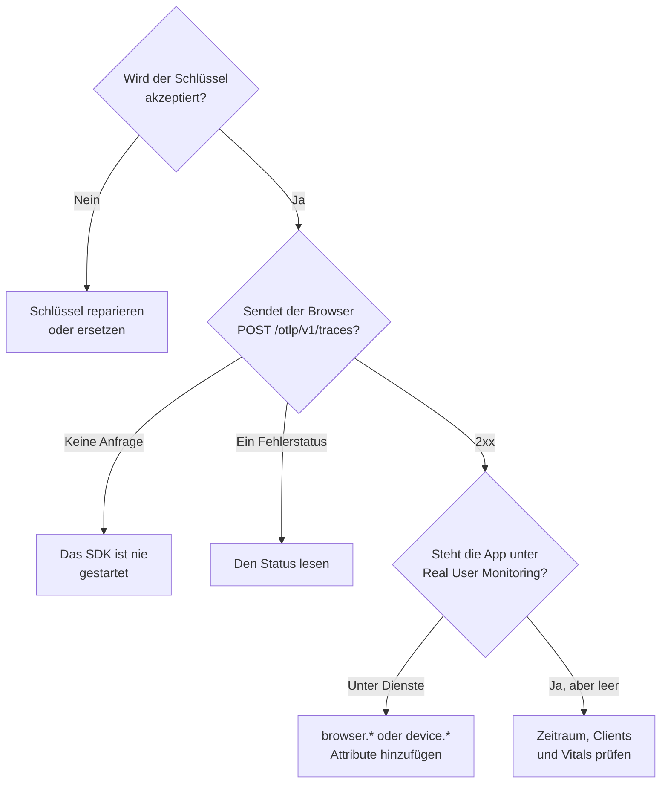

# RUM-Fehlerbehebung

Wenn eine RUM-Anwendung fehlt, leer ist oder **Getrennt** anzeigt, arbeiten Sie diese Seite der Reihe nach ab. Jede Prüfung schließt einen Teil des Wegs von Ihrer App zu OneUptime aus, in der Reihenfolge, in der diese Probleme meist auftreten.

:::cards
- [Den Schlüssel prüfen](#den-schlüssel-prüfen): Die schnellste Prüfung, und alles Weitere hängt von ihr ab.
- [Prüfen, was den Browser verlässt](#prüfen-was-den-browser-verlässt): Die Exportanfrage in den Entwicklertools Ihres Browsers.
- [Prüfen, wo die Telemetrie landet](#prüfen-wo-die-telemetrie-landet): Eine RUM-Anwendung oder ein Backend-Dienst.
- [Probleme mit der Sitzungswiedergabe](#probleme-mit-der-sitzungswiedergabe): Eine eigene Pipeline mit einer eigenen Seite.
:::

## Wo RUM-Telemetrie hängen bleibt

Telemetrie durchläuft auf dem Weg zu einer RUM-Anwendung drei Prüfungen. Suchen Sie die erste, die fehlschlägt:



## Den Schlüssel prüfen

Prüfen Sie zuerst den Schlüssel. Das ist die schnellste Prüfung, und nichts danach funktioniert ohne einen Schlüssel, den OneUptime akzeptiert:

```bash
curl -i https://oneuptime.com/otlp/v1/validate \
  -H "x-oneuptime-token: YOUR_TELEMETRY_INGESTION_TOKEN"
```

| Antwort | Was sie bedeutet |
| --- | --- |
| `200` mit `"valid": true` | OneUptime akzeptiert den Schlüssel. Die Antwort nennt außerdem seinen `keyType` und seine `projectId`. Gehen Sie zur nächsten Prüfung über. |
| `401` mit `"valid": false` | Der Schlüssel fehlt, ist unbekannt, widerrufen, ausgeschaltet oder abgelaufen, und die `message` sagt, was davon. Legen Sie unter **Projekteinstellungen → Telemetrie & APM → Ingestion-Schlüssel** einen gültigen Schlüssel an. |

Eine Web-App braucht einen **Browser**-Schlüssel, eine Mobile-App einen **Server**-Schlüssel: siehe [Browser-Einrichtung](/docs/rum/browser-setup) und [Mobile-Einrichtung](/docs/rum/mobile-setup). Auch die Export-Endpunkte lehnen einen ungültigen Schlüssel mit `401` ab, wie es die OTLP-Spezifikation verlangt, daher protokolliert ein ordentliches SDK die Ablehnung, statt es erneut zu versuchen. Diese Zeile übersieht man in der Browser-Konsole leicht, und diese Prüfung antwortet direkt.

## Prüfen, was den Browser verlässt

Öffnen Sie auf der Seite der App die Entwicklertools Ihres Browsers, wählen Sie den Tab „Netzwerk“ und filtern Sie nach `otlp`. Sie suchen `POST /otlp/v1/traces` mit einem `2xx`-Status als Antwort.

### Gar keine Anfrage

Das SDK ist nie gestartet. Fast immer liegt es an einem dieser Punkte:

- `telemetry.ts` ist nicht der erste Import Ihrer App, oder Ihr Bundler hat die Datei entfernt. Die Instrumentierungen patchen `fetch` und `XMLHttpRequest`, daher wird eine Anfrage vor dem Patch nicht erfasst, und eine vom Bundler entfernte Datei führt gar nichts aus.
- Der Batch-Prozessor hat noch nicht exportiert. `BatchSpanProcessor` wartet einige Sekunden, um einen Batch zu füllen; warten Sie also oder wechseln Sie auf eine andere Seite, bevor Sie schließen, dass nichts gesendet wird.
- Eine Umgebungsvariable zur Build-Zeit wurde zu `undefined`, sodass die URL des Exporters kaputt ist. Protokollieren Sie die URL einmal beim Start.

### Der Browser blockiert die Anfrage

- **Ein Content-Security-Policy-Fehler in der Konsole.** Die Richtlinie Ihrer Seite erlaubt OneUptime noch nicht. Ergänzen Sie Ihre vorhandene `connect-src`-Direktive, oder verwenden Sie Ihren eigenen Host, wenn Sie OneUptime selbst betreiben:

  ```text
  connect-src 'self' https://oneuptime.com;
  ```

- **Ein CORS-Fehler.** Die OTLP-Endpunkte nehmen Anfragen von jedem Ursprung an und erlauben den Header `x-oneuptime-token`, daher bedeutet ein echter CORS-Fehler fast immer, dass die Anfrage OneUptime nie erreicht hat: Suchen Sie nach einem Firmen-Proxy, einem Werbeblocker oder einem Tippfehler im Host. Prüfen Sie die URL der Anfrage im Tab „Netzwerk“.

### Die Anfrage erhält einen Fehlerstatus

**`401`.** Der Schlüssel ist unbekannt, widerrufen oder abgelaufen. Führen Sie die [Schlüsselprüfung](#den-schlüssel-prüfen) aus und verwenden Sie dann einen gültigen Schlüssel.

**`404`.** Die URL ist falsch. Der Trace-Exporter braucht den vollständigen Pfad, `/otlp/v1/traces`. Ein häufiger Fehler ist, die Basisadresse (`https://oneuptime.com/otlp`) einem Exporter zu geben, der die vollständige URL erwartet, oder die vollständige URL einem, der den Pfad selbst anhängt und bei `/otlp/v1/traces/v1/traces` landet.

**`413`.** Der Batch war größer, als ein Proxy erlaubt. Der eigene Ingress von OneUptime nimmt auf `/otlp` bis zu 4 MB an, aber ein Proxy, den Sie vor OneUptime betreiben, kann strenger sein — ingress-nginx setzt `proxy-body-size` zum Beispiel standardmäßig auf 1 MB — erhöhen Sie also, falls Sie einen haben, auch dessen Limit für `/otlp`. In jedem Fall macht eine kleinere `maxExportBatchSize` am `BatchSpanProcessor` jeden Export kleiner:

```ts
new BatchSpanProcessor(exporter, { maxExportBatchSize: 100 });
```

Ein Browser sendet selten so große Batches, es sei denn, Spans tragen große Attribute, etwa einen ganzen Stacktrace oder einen Antworttext. Diese zu kürzen ist die bessere Lösung.

**`422`.** OneUptime hat den Schlüssel hier abgelehnt, und die Meldung sagt warum. `Origin https://app.example.com is not allowed for this browser ingestion key.` bedeutet, dass der genaue Ursprung der Seite, mit Schema und gegebenenfalls Port, in den **Zulässige Ursprünge** des Schlüssels fehlt. `This telemetry ingestion key has been disabled.` bedeutet, dass jemand den Schlüssel ausgeschaltet hat.

**`429`.** Das **Limit für Anfragen pro Minute** des Schlüssels ist erschöpft: `Too many telemetry requests for this ingestion key. Please retry later.` Ein Browser-Schlüssel erlaubt 6000 Anfragen pro Minute für alle Ihre Besucher zusammen, sofern Sie am Schlüssel kein eigenes Limit festlegen.

**`403` mit einer HTML-Seite oder einem leeren Body.** OneUptime beantwortet jede Ablehnung in JSON, diese kam also von etwas davor, meist einer Web Application Firewall auf Ihrer eigenen Domain, falls Sie OneUptime darüber leiten. Die Firewall parst OTLP/JSON und prüft jedes Span-Attribut gegen ihre Injection-Regeln, sodass schon eine URL mit Query-String an einem Span zur Blockierung reicht, und das Log der Firewall nennt die Regel. Nehmen Sie die OTLP-Nutzlast nur auf den OTLP-Pfaden von der Prüfung aus: [Auch Ihre OpenTelemetry-Anfragen werden blockiert](/docs/rum/session-replay-troubleshooting#auch-ihre-opentelemetry-anfragen-werden-blockiert) zeigt wie, und behandelt auch den Wiedergabe-Recorder hinter derselben Firewall.

## Prüfen, wo die Telemetrie landet

Die Anfrage gelingt, aber die App erscheint unter **Produkte → Dienste** statt unter **Produkte → Ressourcen → Real User Monitoring**. Das ist die häufigste Meldung, und die Ursache ist fast immer eine Ressource ohne Client-Attribute. OneUptime ordnet einen Batch nur dann als RUM ein, wenn seine Ressource eines dieser Attribute trägt:

| Art | Attribute |
| --- | --- |
| Browser | `browser.platform`, `browser.language` oder ein nicht leeres `browser.brands` |
| Mobil | `device.id` oder `device.model.identifier`, oder `device.manufacturer` auf einer Ressource ohne Host-Identität (`host.name`, `host.id` oder `k8s.node.name`) |

Ein `service.name` allein ergibt einen Backend-Dienst. Das OpenTelemetry-Browser-SDK fügt keine `browser.*`-Attribute hinzu, solange Sie nicht den Browser-Ressourcendetektor einbinden oder sie selbst setzen: siehe [Browser-Einrichtung](/docs/rum/browser-setup).

Um zu sehen, was Sie tatsächlich senden, öffnen Sie die OTLP-Anfrage im Tab „Netzwerk“ und sehen sich ihre Nutzlast an: `resourceSpans[0].resource.attributes` ist die Liste, die darüber entscheidet. Steht dort kein `browser.*`-Attribut, fügt das SDK es nicht hinzu, was auch immer seine Dokumentation sagt.

Fügen Sie die Attribute hinzu, und der nächste Batch legt die RUM-Anwendung an. Der zuerst angelegte Dienst wird nicht zur RUM-Anwendung, weil beides getrennte Datensätze sind; löschen Sie ihn also unter **Produkte → Dienste**, sobald RUM-Telemetrie eintrifft.

> [!NOTE]
> Eine Ressource, deren einziges Client-Attribut `device.manufacturer` ist und die außerdem eine Host-Identität hat, gilt als Maschine statt als Telefon, weil das Inventar eines Hosts dessen Hersteller mit demselben Attribut meldet. Fügen Sie `device.id` oder `device.model.identifier` hinzu, und der Batch wird als mobiles RUM eingeordnet, was er sonst auch trägt.

## Die Anwendung ist leer

Die Anwendung existiert, aber ihre Seiten zeigen nichts.

- **Prüfen Sie den Zeitraum.** Die Übersicht zeigt standardmäßig die letzte Stunde, ein Test-Batch von heute Morgen liegt also außerhalb.
- **Warten Sie ein paar Minuten.** Ingest läuft über eine Warteschlange, und **Zuletzt gesehen** wird alle paar Minuten aktualisiert statt bei jedem Batch.
- **Prüfen Sie das Projekt.** Ein Schlüssel schreibt in sein eigenes Projekt, mit dem Schlüssel eines anderen Projekts gesendete Telemetrie liegt also dort, nicht hier.

## Die Seite Clients ist leer

Die Seite **Clients** listet `browser.platform` im Web und `device.model.identifier` auf Mobilgeräten. Zwei Gründe, warum sie leer bleibt, während alles andere funktioniert:

- **Safari und Firefox.** `browserDetector` liest die UA Client Hints API, die nur Chromium-Browser haben. Anderswo setzt er `browser.language`, was reicht, um die Telemetrie als RUM einzuordnen, aber nicht `browser.platform`. Setzen Sie `browser.platform` selbst, um diese Clients aufzulisten.
- **Ein mobiles SDK, das nur `device.manufacturer` setzt.** Das ordnet die Telemetrie als mobiles RUM ein, aber die Seite **Clients** braucht `device.model.identifier`.

## Core Web Vitals zeigen „Noch keine Web Vitals gemeldet“

Die Karte füllt sich nur aus Metriken, die Ihre App sendet, Traces allein füllen sie also nie. Prüfen Sie, dass Sie überhaupt Metriken exportieren, dass die Metriknamen solche sind, die OneUptime liest, und dass sie auf der Seite **Metriken** der Anwendung erscheinen. [Die Karte zeigt „Noch keine Web Vitals gemeldet“](/docs/rum/web-vitals#fehlerbehebung) geht jede Prüfung durch, auch Werte, die verloren gehen, wenn ein Besucher den Tab vor dem nächsten Export schließt.

## Der Status zeigt Getrennt, während Menschen die App benutzen

Eine Anwendung wird nach 15 Minuten ohne Telemetrie **Getrennt**. Wenn Menschen die App benutzen:

- **Ein Sampler verwirft womöglich alles.** Prüfen Sie, dass Sie keinen Always-off-Sampler und keine sehr niedrige Rate eingestellt haben.
- **Die App sendet Telemetrie womöglich nur bei bestimmten Interaktionen**, und niemand hat sie in dieser Zeit ausgeführt.
- **Der Schlüssel wurde womöglich widerrufen oder ausgeschaltet**, nachdem Sie ausgeliefert haben: Führen Sie die [Schlüsselprüfung](#den-schlüssel-prüfen) erneut aus.

Eine interne App oder eine mit wenig Verkehr ohne Besucher über Nacht ist tatsächlich getrennt. Das ist kein Fehler.

## Probleme mit der Sitzungswiedergabe

Die Sitzungswiedergabe ist eine eigene Pipeline mit eigenen Problemen: das Recorder-Skript, die Ursprungs-Positivlisten, die Einwilligung, die Content Security Policy und die Maskierung. [Fehlerbehebung bei der Sitzungswiedergabe](/docs/rum/session-replay-troubleshooting) behandelt sie. Beginnen Sie dort, und zwar damit, die Diagnose des Recorders einzuschalten, denn die meisten seiner Fehler sind absichtlich still:

```js
localStorage.setItem("oneuptime.sessionReplay.debug", "true");
// then reload the page
```

Die Seite **Integrität** der Anwendung im Abschnitt **Sitzungswiedergabe** und das Panel **Ihre Installation testen** auf der **Wiedergaberichtlinie** prüfen den Schlüssel, die Positivlisten und die Richtlinie von der Serverseite aus und sagen, warum nichts ankommt. Die Konsole des Browsers zeigt Ihnen die Hälfte, die der Server nicht sehen kann.

Mit der Standardrichtlinie sendet ein Recorder etwa alle 15 Sekunden ein Chunk, solange der Benutzer mit der Seite interagiert. Ein inaktiver Tab hat nichts zu senden, klicken Sie also zuerst oder bewegen Sie die Maus; bleiben danach Chunk-Anfragen ganz aus, stimmt etwas nicht. Lädt die Anwendung nur _On error or frustration_ hoch, ist Stille zu erwarten, bis etwas schiefgeht. Rufen Sie `OneUptimeReplay.captureSession()` auf, um einen Upload zu erzwingen und den Weg in jedem Fall zu prüfen.

Die beiden Pipelines sind voneinander unabhängig. Eine funktionierende RUM-Anwendung ist keine Voraussetzung dafür, dass der Recorder lädt, und ein funktionierender Recorder heißt nicht, dass RUM-Telemetrie ankommt: Jede kann allein ausfallen.

## Immer noch nicht gelöst

Sammeln Sie Folgendes, bevor Sie um Hilfe bitten. Das spart eine Runde Rückfragen:

- Die Liste `resource.attributes` aus der Nutzlast einer echten OTLP-Anfrage.
- Den HTTP-Status dieser Anfrage.
- Den genauen `service.name`, den Sie senden, und ob das Projekt eine Anwendung oder einen Dienst mit diesem Namen hat.
- Ob `/otlp/v1/validate` für den Schlüssel im ausgelieferten Build mit `200` antwortet.

Wenden Sie sich dann an support@oneuptime.com oder eröffnen Sie ein Issue auf [GitHub](https://github.com/OneUptime/oneuptime).

## Nächste Schritte

:::cards
- [Browser-Einrichtung](/docs/rum/browser-setup): Die Einrichtung, von der diese Prüfungen ausgehen, Schritt für Schritt.
- [Mobile-Einrichtung](/docs/rum/mobile-setup): Der Schlüssel und die Attribute, die eine Mobile-App braucht.
- [Anwendungen verwalten](/docs/rum/applications): Namen, Beschriftungen, Aufbewahrung und Status.
- [Fehlerbehebung bei der Sitzungswiedergabe](/docs/rum/session-replay-troubleshooting): Jeder Recorder-Code, und was zu tun ist.
:::
