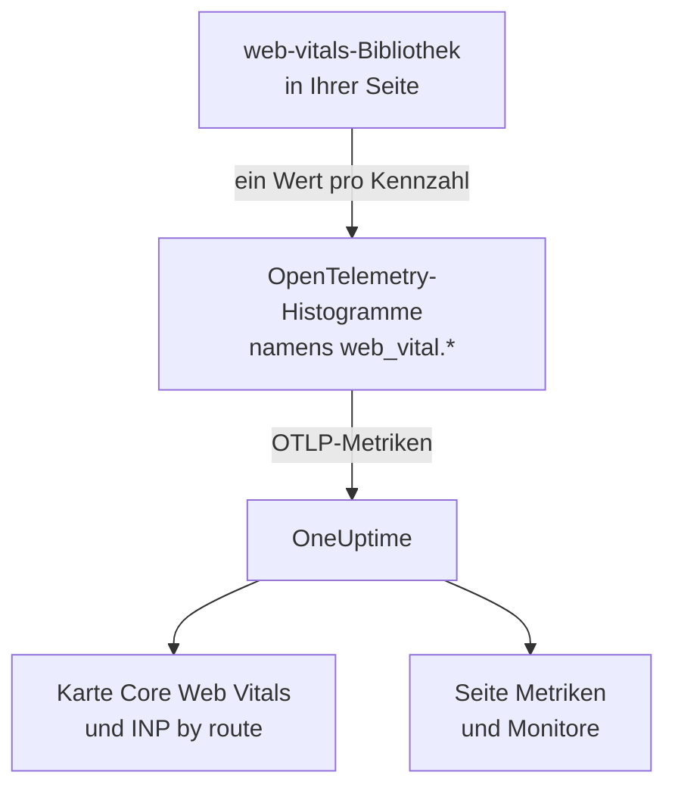
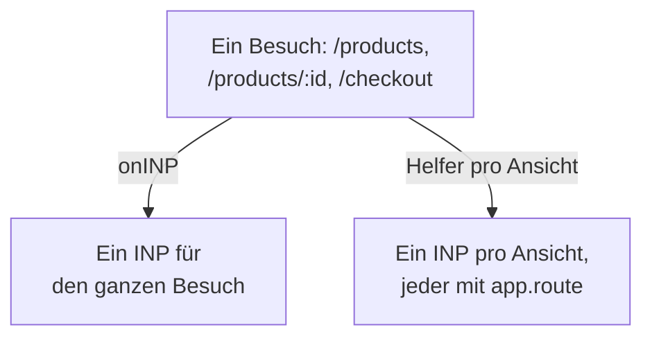

# Core Web Vitals

Die Karte **Core Web Vitals** in der Übersicht einer RUM-Anwendung zeigt LCP, INP, CLS, FCP und TTFB, jeweils an Googles Grenzwerten gemessen. OneUptime misst keinen dieser Werte selbst: Die Karte füllt sich nur aus Metriken, die Ihre Browser-Instrumentierung meldet, und diese Seite zeigt, wie Sie sie senden.

:::cards
- [Senden](#aus-ihrer-app-senden): Die Werte der web-vitals-Bibliothek als OpenTelemetry-Metriken weitergeben.
- [Namen, die OneUptime liest](#metriknamen-die-oneuptime-erkennt): Die Metriknamen, unter denen jede Kennzahl ankommen kann.
- [Single-Page-Apps](#single-page-apps): INP für jede Ansicht statt eines Werts pro Seitenaufruf.
- [Alarm für eine Kennzahl](#alarm-für-eine-kennzahl): Fertige Monitore für schlechte Werte.
:::

## So funktioniert es

Die Bibliothek [`web-vitals`](https://github.com/GoogleChrome/web-vitals) misst jede Kennzahl in der Seite; es ist dieselbe Bibliothek, die Chromes eigene Werkzeuge verwenden. Ihr Code zeichnet jeden Wert in einem OpenTelemetry-Histogramm auf, und die Metrik-Pipeline des Browsers exportiert ihn an OneUptime.



OpenTelemetry hat noch keine endgültige Namenskonvention für Web Vitals, daher sucht OneUptime jede Kennzahl unter mehreren Namen und verwendet den ersten mit Daten. Verwenden Sie für neue Instrumentierung die Namen `web_vital.*`.

## Bevor Sie beginnen

- Eine Web-App, eingerichtet wie in [Einrichtung für Browser](/docs/rum/browser-setup), mit ihrer Metrik-Pipeline: Der `MeterProvider` aus [Logs und Metriken hinzufügen](/docs/rum/browser-setup#logs-und-metriken-hinzufügen) exportiert diese Werte.

## Aus Ihrer App senden

:::steps
### Die Bibliothek installieren

```bash
npm install web-vitals
```

### Jede Kennzahl in einem Histogramm aufzeichnen

Legen Sie `src/web-vitals.ts` an. Jede Kennzahl ist ein Histogramm, damit die Seite **Metriken** später Perzentile berechnen kann, mit Bucket-Grenzen auf Googles Grenzwerten für gut und schlecht.

```ts title="src/web-vitals.ts"
// Import after ./telemetry
import { metrics } from "@opentelemetry/api";
import { onCLS, onFCP, onINP, onLCP, onTTFB, type Metric } from "web-vitals";

const meter = metrics.getMeter("web-vitals");

// Histograms, so the Metrics tab can compute percentiles later. The bucket
// edges sit on each vital's good / poor limits: a percentile is read from
// the buckets, and the defaults are far too coarse for these ranges.
const buckets = (...edges: number[]) => ({ advice: { explicitBucketBoundaries: edges } });

const lcp = meter.createHistogram("web_vital.lcp", { unit: "ms", ...buckets(0, 1000, 1500, 2000, 2500, 3000, 3500, 4000, 5000, 7500, 10000) });
const inp = meter.createHistogram("web_vital.inp", { unit: "ms", ...buckets(0, 50, 100, 150, 200, 250, 300, 400, 500, 750, 1000, 2000) });
const fcp = meter.createHistogram("web_vital.fcp", { unit: "ms", ...buckets(0, 600, 1200, 1800, 2400, 3000, 4000, 6000, 10000) });
const ttfb = meter.createHistogram("web_vital.ttfb", { unit: "ms", ...buckets(0, 200, 400, 600, 800, 1200, 1800, 2500, 4000) });
const cls = meter.createHistogram("web_vital.cls", { unit: "1", ...buckets(0, 0.025, 0.05, 0.1, 0.15, 0.2, 0.25, 0.4, 0.6, 1) });

function record(
  histogram: { record: (v: number, a?: Record<string, string>) => void },
) {
  return (metric: Metric): void => {
    histogram.record(metric.value, {
      // Keep attributes low-cardinality. Never put a full URL or a user id here.
      "web_vital.rating": metric.rating,
    });
  };
}

onLCP(record(lcp));
onINP(record(inp));
onCLS(record(cls));
onFCP(record(fcp));
onTTFB(record(ttfb));
```

### Sie nach Ihrer Telemetrie-Einrichtung importieren

```ts
import "./telemetry";
import "./web-vitals";
```

### Die Seite Metriken prüfen

Laden Sie ein paar Seiten und suchen Sie dann auf der Seite **Metriken** der Anwendung nach `web_vital.lcp`. Sobald die Metriken dort sind, füllt sich die Karte **Core Web Vitals** für den gewählten Zeitraum.
:::

## Die letzten Werte senden, bevor die Seite schließt

`onINP` und `onCLS` melden, wenn die Seite ausgeblendet wird, nicht während des Besuchs. Mit dem Exportintervall von 30 Sekunden aus [Einrichtung für Browser](/docs/rum/browser-setup) kann ein Besucher, der den Tab direkt nach dem letzten Wert schließt, gehen, bevor dieser exportiert ist. Wenn Vollständigkeit wichtig ist, verkürzen Sie `exportIntervalMillis` oder behalten Sie den `MeterProvider`, den Sie in `telemetry.ts` gebaut haben, und leeren Sie ihn, wenn die Seite ausgeblendet wird:

```ts
// In telemetry.ts, export the provider you created:
export const meterProvider = new MeterProvider({ /* ... */ });

// Anywhere after setup:
import { meterProvider } from "./telemetry";

document.addEventListener("visibilitychange", () => {
  if (document.visibilityState === "hidden") {
    void meterProvider.forceFlush();
  }
});
```

## Metriknamen, die OneUptime erkennt

OneUptime probiert die Namen in dieser Reihenfolge, und der erste mit Daten im gewählten Zeitraum gewinnt.

| Kennzahl | Metriknamen, einer davon | Einheit |
| --- | --- | --- |
| LCP: Largest Contentful Paint | `web_vital.lcp`, `browser.largest_contentful_paint`, `largest_contentful_paint`, `web.vitals.lcp` | ms |
| INP: Interaction to Next Paint | `web_vital.inp`, `browser.interaction_to_next_paint`, `interaction_to_next_paint`, `web.vitals.inp` | ms |
| CLS: Cumulative Layout Shift | `web_vital.cls`, `browser.cumulative_layout_shift`, `cumulative_layout_shift`, `web.vitals.cls` | Wert |
| FCP: First Contentful Paint | `web_vital.fcp`, `browser.first_contentful_paint`, `first_contentful_paint`, `web.vitals.fcp` | ms |
| TTFB: Time to First Byte | `web_vital.ttfb`, `browser.time_to_first_byte`, `time_to_first_byte`, `web.vitals.ttfb` | ms |

Die anderen Namen gibt es, damit eine App, die bereits nach einer Community-Konvention sendet, ohne Änderungen erscheint.

## Bewertungsgrenzen

Die Karte bewertet jeden Wert mit den veröffentlichten Core-Web-Vitals-Grenzwerten von Google:

| Kennzahl | **Good** | **Needs work** | **Poor** |
| --- | --- | --- | --- |
| LCP | unter 2500 ms | 2500 bis 4000 ms | 4000 ms oder mehr |
| INP | unter 200 ms | 200 bis 500 ms | 500 ms oder mehr |
| CLS | unter 0,1 | 0,1 bis 0,25 | 0,25 oder mehr |
| FCP | unter 1800 ms | 1800 bis 3000 ms | 3000 ms oder mehr |
| TTFB | unter 800 ms | 800 bis 1800 ms | 1800 ms oder mehr |

Die Karte zeigt den **Mittelwert** über den gewählten Zeitraum, nicht das 75. Perzentil, das Googles Feldwerkzeuge melden. Das ist Absicht: OneUptime liest die Perzentile eines Histogramms aus seinen Buckets, ein Perzentil ist also nur so genau wie die Buckets, während der Mittelwert aus der exakten Summe und Anzahl des Histogramms stammt. Mit den Standard-Buckets von OpenTelemetry (`0, 5, 10, 25, 50, …`) landet jeder CLS-Wert im ersten Bucket, und ein 75. Perzentil würde für eine Seite, die sich kaum bewegt, 2,5 anzeigen.

> [!TIP]
> Lesen Sie die Karte als Trend. Für das 75. Perzentil zeichnen Sie mit den obigen Bucket-Grenzen auf und stellen die Metrik dann auf der Seite **Metriken** mit der Aggregation **P75** dar. Ein Metrik-Monitor bietet dieselbe Wahl.

## Single-Page-Apps

`onINP` misst INP so, wie der Browser es definiert: **ein Wert pro Seitenaufruf**. Eine Single-Page-App lädt einmal und wechselt dann die Route mit `history.pushState`, daher ergibt ein Besuch von `/products`, `/products/42` und `/checkout` einen einzigen INP für den ganzen Besuch. Die Interaktionen aller Ansichten konkurrieren um diese eine Zahl, und ein Routenattribut daran nennt die Seite, die beim Melden angezeigt wurde, nicht die Seite, die langsam war.



Um INP pro Ansicht zu sehen, messen Sie ihn pro Ansicht: Jeder Routenwechsel beendet die aktuelle Ansicht und beginnt eine neue, und jede Ansicht meldet ihren eigenen INP. Der Helfer unten erledigt das mit der Event Timing API des Browsers, denselben Daten, die `onINP` nutzt, und kümmert sich um den Teil, der leicht schiefgeht: Der Klick, der eine Navigation **ausgelöst** hat, wird erst nach dem Routenwechsel zugestellt, gehört aber zu der Seite, auf der er geklickt wurde.

```ts title="src/inp-per-route.ts"
// INP for each view of a single-page app.
type Report = (inpMs: number, route: string) => void;

interface View {
  route: string;
  path: string; // the URL path it was opened for
  start: number; // performance.now() when the view began
  latencies: Map<number, number>; // interactionId -> its slowest entry
}

// Long enough for the click that navigated to be delivered: its entry
// arrives after the next paint, i.e. after the route has changed.
const SETTLE_MS = 1000;

let views: Array<View> = [];
let report: Report = () => {};

// The path, plus the hash when a hash router keeps the route there.
const currentPath = (): string =>
  location.pathname + (location.hash.startsWith("#/") ? location.hash : "");

function close(view: View): void {
  if (!views.includes(view)) return; // already reported
  views = views.filter((v) => v !== view);

  const sorted = [...view.latencies.values()].sort((a, b) => b - a);
  if (sorted.length === 0) return; // nobody interacted: no INP, not 0

  // web-vitals' p98: skip one outlier for every 50 interactions.
  report(sorted[Math.min(sorted.length - 1, Math.floor(sorted.length / 50))]!, view.route);
}

function record(entries: PerformanceEntryList): void {
  for (const entry of entries as Array<PerformanceEventTiming & { interactionId?: number }>) {
    if (!entry.interactionId) continue; // hovers, scrolls: not interactions

    // The view the interaction STARTED in, so the click that navigated
    // counts towards the page it was clicked on.
    const view = [...views].reverse().find((v) => entry.startTime >= v.start);
    if (!view) continue;

    const slowest = view.latencies.get(entry.interactionId) ?? 0;
    view.latencies.set(entry.interactionId, Math.max(slowest, entry.duration));
  }
}

export function observeInpPerRoute(route: string, onReport: Report): void {
  if (typeof PerformanceObserver === "undefined" || !PerformanceObserver.supportedEntryTypes?.includes("event")) return;

  report = onReport;
  views = [{ route, path: currentPath(), start: 0, latencies: new Map() }];

  const observer = new PerformanceObserver((list) => record(list.getEntries()));
  observer.observe({ type: "event", durationThreshold: 40, buffered: true } as PerformanceObserverInit);

  // The tab may never come back: report every view now, then keep
  // measuring the current route as a fresh view.
  document.addEventListener("visibilitychange", () => {
    if (document.visibilityState !== "hidden") return;
    record(observer.takeRecords());
    const current = views[views.length - 1]?.route ?? route;
    [...views].forEach(close);
    views = [{ route: current, path: currentPath(), start: performance.now(), latencies: new Map() }];
  });
}

// Call after every navigation, with the route PATTERN ("/products/:id").
// Safe to call when nothing changed (a router's initial navigation, a
// query-string update): the view only ends when the path does.
export function startView(route: string): void {
  const closing = views[views.length - 1];
  if (!closing || closing.path === currentPath()) return;

  views.push({ route, path: currentPath(), start: performance.now(), latencies: new Map() });
  setTimeout(() => close(closing), SETTLE_MS);
}
```

Beide Funktionen nehmen das **Muster** der Route, nie die URL: `/products/42` und `/products/7` müssen eine Route sein, sonst wird jedes Produkt zu einer eigenen Serie. Verwenden Sie das Muster Ihres Routers, wo er eines hat; andernfalls fassen Sie die IDs selbst zusammen:

```ts
// "/products/42" -> "/products/:id", also for UUIDs.
export const toRoutePattern = (path: string): string =>
  path.replace(/\/(\d+|[0-9a-f]{8}-[0-9a-f-]{27})(?=\/|$)/gi, "/:id");
```

Zeichnen Sie auf, was der Helfer meldet, im selben Histogramm `web_vital.inp`, mit der Route als `app.route`, und **entfernen Sie `onINP`** aus dem Snippet oben: Mit beiden würde jede Interaktion doppelt gezählt.

```ts
// src/web-vitals.ts, in place of onINP(record(inp))
import { observeInpPerRoute } from "./inp-per-route";

observeInpPerRoute(toRoutePattern(location.pathname), (inpMs, route) => {
  inp.record(inpMs, {
    "app.route": route,
    "web_vital.rating": inpMs <= 200 ? "good" : inpMs <= 500 ? "needs-improvement" : "poor",
  });
});
```

Rufen Sie dann `startView` überall dort auf, wo Ihr Router eine abgeschlossene Navigation meldet. Ein Aufruf wird ignoriert, wenn sich der URL-Pfad nicht geändert hat, daher teilt ein Router, der auch das erste Laden oder eine Änderung des Query-Strings meldet, die Ansicht nicht:

:::tabs
@tab Vue Router
```ts
router.afterEach((to) => startView(to.matched[to.matched.length - 1]?.path ?? toRoutePattern(to.path)));
```
@tab React Router
```tsx
// In a component that stays mounted inside the router
const { pathname } = useLocation();
useEffect(() => startView(toRoutePattern(pathname)), [pathname]);
```
:::

Was Sie bekommen:

- **INP by route** in der Übersicht, langsamste zuerst, aus `app.route`; OneUptime liest außerdem das OpenTelemetry-Attribut `url.template`.
- Einen Routenfilter für Alarme: Filtern Sie einen Metrik-Monitor auf `web_vital.inp` nach `app.route`, um einen Ablauf wie `/checkout` für sich allein zu beobachten.
- Der app-weite INP auf der Karte **Core Web Vitals** funktioniert weiter: Es ist dieselbe Metrik, jetzt mit einem Wert pro Ansicht statt einem pro Seitenaufruf.

Chromium-Browser melden die Interaktions-IDs, die dafür nötig sind. Safari meldet keine, weshalb `onINP` dort auch nichts meldet. Chromes experimentelle Soft Navigations API soll das künftig selbst leisten, ist aber nicht allgemein verfügbar; dieser Helfer funktioniert heute.

> [!NOTE]
> Der Recorder der [Sitzungswiedergabe](/docs/telemetry/session-replay) misst INP bereits pro Ansicht, ganz ohne Code: Jede Aufzeichnung zeigt eine INP-Zeile für jede Route, auf der der Benutzer interagiert hat, mit dem langsamen Element und der Aufteilung seiner Zeit in Eingabeverzögerung, Verarbeitung und Darstellung.

## Die Kardinalität im Griff behalten

Metrikattribute vervielfachen sich. `web_vital.rating` hat drei mögliche Werte, das ist in Ordnung, und ein Routen- oder Seitentyp-Attribut lohnt sich meist:

```ts
histogram.record(metric.value, {
  "web_vital.rating": metric.rating,
  "app.route": routePattern, // "/product/:id" — the PATTERN, not "/product/8842"
});
```

Die konkrete URL statt des Routenmusters aufzuzeichnen erzeugt eine Zeitreihe pro Produktseite, was die Seite **Metriken** langsam und die Speicherrechnung hoch macht. Dasselbe gilt für Benutzer-IDs, Sitzungs-IDs und Bildschirmgrößen.

## Alarm für eine Kennzahl

Die Seite **Empfehlungen** der Anwendung bietet für jede Kennzahl einen fertigen Monitor. Jeder liest den Fünf-Minuten-Mittelwert seiner Metrik und löst aus, wenn er Googles Grenzwert für schlecht erreicht:

| Empfehlung | Metrik | Löst aus bei | Schweregrad |
| --- | --- | --- | --- |
| **Poor Largest Contentful Paint** | `web_vital.lcp` | 4000 ms | **Kritisch** |
| **Poor Interaction to Next Paint** | `web_vital.inp` | 500 ms | **Kritisch** |
| **Poor Cumulative Layout Shift** | `web_vital.cls` | 0,25 | **Kritisch** |
| **Slow First Contentful Paint** | `web_vital.fcp` | 3000 ms | **Warnung** |
| **Slow Time to First Byte** | `web_vital.ttfb` | 1800 ms | **Warnung** |

Diese Monitore lesen nur die Namen `web_vital.*`. Wenn Ihre App eine Kennzahl unter einem anderen Namen sendet, ändern Sie die Metrik des erstellten Monitors. Um für eine einzelne Route zu alarmieren, fügen Sie dem Monitor einen Filter `app.route` hinzu. Sie können auch einen eigenen Monitor auf jeder dieser Metriken bauen: siehe [Metriken-Überwachung](/docs/monitor/metrics-monitor).

## Fehlerbehebung

:::details Die Karte zeigt „Noch keine Web Vitals gemeldet“
Die Karte füllt sich nur aus Metriken, die Ihre App sendet. Prüfen Sie der Reihe nach:

1. Sie haben überhaupt eine Metrik-Pipeline: Traces allein füllen diese Karte nie.
2. Die Metriknamen gehören zu denen, die OneUptime liest: siehe [Metriknamen, die OneUptime erkennt](#metriknamen-die-oneuptime-erkennt).
3. Die Metriken sind auf der Seite **Metriken** der Anwendung. Wenn ja, funktioniert der Export, und das Problem ist der Name oder der Zeitraum.
4. INP und CLS werden gemeldet, wenn die Seite ausgeblendet wird, daher kann ein kurzer Besuch vor dem nächsten Export enden: siehe [Die letzten Werte senden, bevor die Seite schließt](#die-letzten-werte-senden-bevor-die-seite-schließt).

Wenn nichts davon hilft, prüft [RUM-Fehlerbehebung](/docs/rum/troubleshooting) die gesamte Pipeline.
:::

:::details INP wird gemeldet, aber nicht pro Route
Die Karte **INP by route** braucht das Attribut `app.route` oder `url.template` auf `web_vital.inp`. Zeichnen Sie das Routenmuster mit jedem Wert auf, wie unter [Single-Page-Apps](#single-page-apps).
:::

:::details Die Werte weichen von Googles Bericht ab
Die Karte zeigt den Mittelwert über den gewählten Zeitraum, und Google meldet das 75. Perzentil seiner eigenen Besucher. Stellen Sie **P75** auf der Seite **Metriken** dar, um Gleiches mit Gleichem zu vergleichen.
:::

## Nächste Schritte

:::cards
- [Einrichtung für Browser](/docs/rum/browser-setup): Die Pipeline für Traces, Logs und Metriken, auf der diese Kennzahlen laufen.
- [Metriken-Überwachung](/docs/monitor/metrics-monitor): Für jede Kennzahl alarmieren, für die ganze App oder eine Route.
- [Sitzungswiedergabe](/docs/telemetry/session-replay): INP pro Ansicht in Aufzeichnungen sehen, ohne Code.
- [RUM-Fehlerbehebung](/docs/rum/troubleshooting): Jede Prüfung in der Reihenfolge, in der Probleme meist auftreten.
:::
