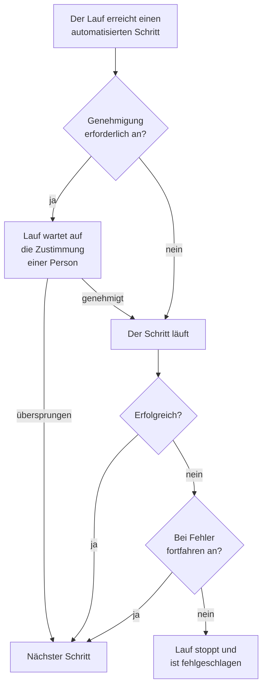

# Ein Runbook verfassen

Sie schreiben ein Runbook als geordnete Liste von Schritten auf seiner Seite **Schritte**. Diese Seite zeigt, wie Sie ein Runbook erstellen, wie Sie jeden der sieben Schritttypen einrichten und wie Fehler und Freigaben den Verlauf eines Laufs ändern.

:::cards
- [Ein Runbook erstellen](#ein-runbook-erstellen): Vom leeren Runbook zu gespeicherten Schritten.
- [Schritttypen](#schritttypen): Manual, JavaScript, HTTP request, Bash, SSH, kubectl und AI.
- [Fehlerbehandlung und Freigaben](#fehlerbehandlung-und-freigaben): Was passiert, wenn ein Schritt fehlschlägt oder auf eine Freigabe wartet.
- [Ein durchgespieltes Beispiel](#ein-durchgespieltes-beispiel): Ein Datenbank-Failover in fünf Schritten.
:::

## Bevor Sie beginnen

- **Eine Rolle, die Runbooks schreibt.** Project Owner, Project Admin und Runbook Admin erstellen Runbooks und speichern ihre Schritte. Mit granularen Berechtigungen brauchen Sie **Create Runbook** und **Edit Runbook**. Siehe [Berechtigungen](/docs/runbooks/configuration#berechtigungen).
- **Ein Runner, für Bash-, SSH- und kubectl-Schritte.** Diese Schritte laufen auf einem [Runner](/docs/runbooks/agents) in Ihrer eigenen Infrastruktur, nie auf dem OneUptime Worker. Installieren Sie zuerst einen. Ein Schritt, der keinen Runner wählt, läuft auf dem [Standard-Runner des Projekts](/docs/runbooks/agents#der-standard-runner-des-projekts), wenn Sie einen festgelegt haben; ein JavaScript-Schritt läuft sonst auf einem [globalen Runner](/docs/runbooks/agents#globale-runner).
- **Eine geheime Variable, für SSH- und kubectl-Schritte.** Der Schlüssel, das Passwort oder die kubeconfig, mit denen sich ein Schritt anmeldet, ist eine geheime [Runbook-Variable](/docs/runbooks/variables). Project Owner und Project Admin erstellen Variablen, und Runbook Admin wählt sie in den Schritten aus, die er schreibt. Ein kubectl-Schritt kann stattdessen den eigenen Zugriff des Runners verwenden.
- **Ein LLM-Anbieter, für KI-Schritte.** Siehe [LLM-Anbieter](/docs/ai/llm-provider).

## Ein Runbook erstellen

:::steps
### Runbooks öffnen

Öffnen Sie **Produkte → Runbooks**. Runbooks liegt in der Gruppe **Dashboards & Automatisierung**.

### Das Runbook erstellen

Klicken Sie auf **Runbook erstellen**, geben Sie einen **Name** und optional eine **Beschreibung** dessen ein, wofür das Runbook gedacht ist. Unter **Weitere Felder** liegen der Schalter **Aktiviert**, standardmäßig an, und **Beschriftungen**. Das neue Runbook öffnet sich auf seiner Seite **Schritte**.

### Schritte hinzufügen

Unter **Ihr Runbook beginnen** wählen Sie den Typ des ersten Schritts; unter dem letzten Schritt bietet **Weiteren Schritt hinzufügen** dieselben sieben Typen an. Jeder Schritt öffnet sich mit seinem **Titel** und dem, was sein Typ braucht; der Rest, etwa seine **Beschreibung** und die Timeouts, ist unter **Weitere Felder** eingeklappt. Sobald das Runbook einen Schritt hat, fügt **Schritt hinzufügen** oben auf der Karte einen Manual-Schritt hinzu.

### Die Schritte ordnen

Schritte laufen **der Reihe nach**. Um die Reihenfolge zu ändern, ziehen Sie einen Schritt am Griff links in seiner Kopfzeile; mit der Tastatur fokussieren Sie den Griff, drücken die Leertaste, verschieben den Schritt mit den Pfeiltasten und drücken die Leertaste erneut.

### Die Schritte speichern

Klicken Sie auf **Schritte speichern**. Bis dahin zeigt der Editor **Nicht gespeicherte Änderungen**. Nach dem Speichern sehen Sie **Gespeichert**, und das Runbook ist bereit zum [Ausführen](/docs/runbooks/running).
:::

## Aufbau eines Schritts

Jeder Schritt hat diese Felder. Ein automatisierter Schritt zeigt seinen **Titel** und die Einstellungen seines Typs und klappt den Rest unter **Weitere Felder** ein, das sagt, was davon gesetzt ist:

| Feld | Zweck |
| --- | --- |
| **Titel** | Eine kurze Bezeichnung, in der Schrittliste und in jedem Lauf angezeigt. |
| **Beschreibung** | Optionaler Kontext für die reagierende Person, in Markdown, unter **Weitere Felder**. Bei einem Manual-Schritt sind es die **Anweisungen**, die die Person liest und befolgt, und sie stehen unter dem Titel. |
| **Bei Fehler fortfahren** | Nur automatisierte Schritte. Ist es an, stoppt ein fehlschlagender Schritt den Lauf nicht: Der nächste Schritt läuft trotzdem. |
| **Genehmigung erforderlich** | Nur automatisierte Schritte. Ist es an, hält der Lauf vor diesem Schritt an, bis jemand ihn genehmigt, und führt ihn erst dann aus. Der Schalter heißt **Genehmigung erforderlich, bevor dieser Schritt ausgeführt wird**, und der Kopf des Schritts zeigt **Genehmigung nötig**. |
| Typspezifische Einstellungen | Das Skript, die URL, der Runner, eine geheime Variable oder der Prompt. Siehe [Schritttypen](#schritttypen). |

## Schritttypen

| Typ | Läuft auf | Braucht |
| --- | --- | --- |
| [Manual](#manual) | Einer Person | Nichts |
| [JavaScript](#javascript) | Einem Runner | Einen Runner |
| [HTTP request](#http-request) | Dem OneUptime Worker | Nichts |
| [Bash](#bash) | Einem Runner | Einen Runner |
| [SSH](#ssh) | Einem Runner | Einen Runner und eine geheime Variable zum Anmelden |
| [kubectl](#kubectl) | Einem Runner | Einen Runner und eine kubeconfig-Variable oder den eigenen Zugriff des Runners |
| [AI](#ai) | Dem OneUptime Worker | Einen LLM-Anbieter |

In jedem der folgenden automatisierten Schritte stehen unter **Weitere Felder** des Schritts zuerst sein **Runner**, bei einem Schritt, der auf einem läuft, dann **Genehmigung erforderlich** und **Bei Fehler fortfahren**, dann die eigenen zusätzlichen Einstellungen des Schritts - die Header eines HTTP-Aufrufs, Port und Passphrase des Schlüssels eines SSH-Schritts, Anbieter und Kontextschalter eines KI-Schritts - und zuletzt die **Beschreibung** und die Timeouts. Eingeklappt nennt es den Runner des Schritts, sodass Sie sehen, wo ein Schritt läuft, ohne ihn zu öffnen.

### Manual

Ein Checklistenpunkt für eine Person: Seine **Anweisungen** sagen, was zu tun oder zu prüfen ist. Der Lauf pausiert, wenn er einen Manual-Schritt erreicht, und bleibt in `WaitingForManualStep` (**Wartet auf Sie**), bis jemand auf **Als abgeschlossen markieren** oder **Überspringen** klickt. Ein Lauf, der auf eine Person wartet, läuft nie in ein Timeout. Ein Manual-Schritt hat keinen Genehmigungsschalter: Er hält den Lauf ohnehin für eine Person an.

Nutzen Sie ihn für das, was nur ein Mensch prüfen oder tun kann: „Bestätigen, dass der Verkehr im Dashboard des Load Balancers in die sekundäre Region verlagert wurde.“

### JavaScript

Ein JavaScript-Snippet, das in einer `isolated-vm`-Sandbox auf einem [Runbook-Agent](/docs/runbooks/agents) läuft, nicht auf dem OneUptime Worker: auf einem Ihrer eigenen, oder auf einem [globalen Runner](/docs/runbooks/agents#globale-runner), wenn der Schritt keinen wählt.

| Feld | Was es tut | Standard |
| --- | --- | --- |
| **Runner** | Unter **Weitere Felder**. Der Runner, der den Schritt ausführt: **Globaler Runner** oder einer Ihrer eigenen. Nur der Runner, den Sie wählen, darf den Job übernehmen; einen Schritt auf **Globaler Runner** darf jeder globale Runner übernehmen. | Der [Standard-Runner des Projekts](/docs/runbooks/agents#der-standard-runner-des-projekts), wenn Sie einen festgelegt haben; sonst **Globaler Runner**, wenn es einen gibt |
| **Skript** | Das auszuführende JavaScript. Geben Sie mit `return` einen Wert zurück, um ihn zu erfassen; jede Zeile aus `console.log` wird ebenfalls erfasst. Ein geworfener Fehler lässt den Schritt fehlschlagen. | — |
| **Ausführungs-Timeout** | Wie lange der Runner das Snippet laufen lässt, bevor er die Sandbox abbaut. Ein globaler Runner lässt es höchstens 5 Minuten laufen. | 30 Sekunden |
| **Übernahme-Timeout** | Wie lange der Worker darauf wartet, dass der Runner den Job übernimmt. | 2 Minuten |

```javascript
const start = Date.now();
// ... your logic ...
console.log("replica lag checked");
return { durationMs: Date.now() - start };
```

Die Sandbox hat 128 MB Arbeitsspeicher und keinen Zugriff auf Dateisystem oder Prozesse. Sie kann mit `axios` HTTP-Anfragen stellen, aber nur an öffentliche Adressen: Eine Anfrage an ein privates Netz, an den eigenen Host des Runners oder an einen Cloud-Metadaten-Endpunkt wird abgelehnt. Um einen Dienst in Ihrem Netz zu erreichen, nutzen Sie einen [Bash](#bash)-Schritt mit `curl`.

### HTTP request

Ein ausgehender HTTP-Aufruf, ausgeführt vom OneUptime Worker. Es wird kein Runner gebraucht.

| Feld | Was es tut | Standard |
| --- | --- | --- |
| **Methode** | `GET`, `POST`, `PUT`, `PATCH`, `DELETE` oder `HEAD`. | `GET` |
| **URL** | Der aufzurufende Endpunkt. | Leer |
| **Header (JSON)** | Unter **Weitere Felder**. Ein JSON-Objekt, etwa `{ "Authorization": "Bearer ..." }`. Header, die kein gültiges JSON sind, lassen den Schritt fehlschlagen. | Keine |
| **Body** | Wird bei `POST`, `PUT`, `PATCH` und `DELETE` angezeigt. Wird als JSON gesendet, wenn er sich als JSON parsen lässt, sonst als Text. | Keiner |
| **Anfrage-Timeout** | Wie lange auf die Antwort des Endpunkts gewartet wird, bevor der Schritt fehlschlägt. | 30 Sekunden |

Der Schritt gelingt bei einer `2xx`- oder `3xx`-Antwort und schlägt bei allem anderen fehl, mit `HTTP <status>` als Fehler. Weiterleitungen werden nicht verfolgt. Status, Header und Body der Antwort werden erfasst, bis zu 50 KB.

> [!NOTE]
> Der Worker ruft nie Loopback- oder Link-Local-Adressen auf, etwa einen Cloud-Metadaten-Endpunkt. In OneUptime Cloud ruft er nur öffentliche Adressen auf. Ein selbst gehostetes OneUptime erreicht auch private Netze, außer `DATA_SOURCE_BLOCK_PRIVATE_ADDRESSES` ist `true`. Um aus OneUptime Cloud einen Dienst in Ihrem Netz aufzurufen, nutzen Sie einen [Bash](#bash)-Schritt mit `curl`.

Nützlich für: einen PagerDuty-Vorfall öffnen, an einen Slack-Webhook posten, die öffentliche API Ihres Cloud-Anbieters oder Ihre eigene aufrufen.

### Bash

Ein Bash-Skript, ausgeführt mit `bash -c <script>` auf einem [Runbook-Agent](/docs/runbooks/agents) in Ihrer eigenen Infrastruktur. Bash läuft nie auf dem OneUptime Worker.

| Feld | Was es tut | Standard |
| --- | --- | --- |
| **Runner** | Unter **Weitere Felder**. Der Runner, der den Schritt ausführt. Nur dieser Runner darf den Job übernehmen. Globale Runner führen nur JavaScript-Schritte aus. | Der Standard-Runner des Projekts, wenn Sie einen festgelegt haben |
| **Bash-Skript** | Das Skript. Die Ausgabe (stdout und stderr) wird bis zu 50 KB erfasst, und ein Exit-Code ungleich null lässt den Schritt fehlschlagen. | — |
| **Ausführungs-Timeout** | Wie lange der Runner das Skript laufen lässt, bevor er es mit `SIGKILL` beendet. Erhöhen Sie ihn für Schritte, die zu Recht Minuten dauern. | 30 Sekunden |
| **Übernahme-Timeout** | Wie lange der Worker darauf wartet, dass der Runner den Job übernimmt. | 2 Minuten |

Das Skript läuft im Container des Runners, mit den Werkzeugen, die sein Image mitbringt, etwa `curl`, `wget` und dem `ssh`-Client, und mit dem Netzzugang des Hosts, auf dem es läuft. Zum Beispiel, um einen Dienst zu prüfen, den nur Ihr Netz erreicht:

```bash
set -euo pipefail
HTTP_CODE=$(curl -s -o /tmp/resp.txt -w "%{http_code}" "http://payments.internal:8080/health")
echo "HTTP $HTTP_CODE"
cat /tmp/resp.txt
if [[ "$HTTP_CODE" != "200" ]]; then
  echo "Health check failed"
  exit 1
fi
```

Ist der gewählte Runner offline, wenn der Lauf diesen Schritt erreicht, wartet der Schritt bis zum **Übernahme-Timeout** (standardmäßig 2 Minuten) und schlägt dann wegen Zeitüberschreitung fehl. Fügen Sie unter **Runbooks → Runbook-Agents** einen Agenten hinzu, bevor Sie sich auf einen Bash-Schritt verlassen.

> [!TIP]
> Halten Sie Passwörter und Tokens aus dem Skript heraus. Speichern Sie sie als geheime [Runbook-Variablen](/docs/runbooks/variables) und schreiben Sie `{{global.variables.NAME}}` dorthin, wo der Wert hingehört: Der Runner erhält das Skript mit eingesetztem Wert, und die Ausgabe des Schritts zeigt an seiner Stelle `[REDACTED]`.

### SSH

Sich per SSH an einem Rechner anmelden und dort ein Bash-Skript ausführen. Der Runner öffnet die Verbindung, daher muss der Rechner nur vom Runner aus erreichbar sein, und der Schlüssel oder das Passwort, mit dem sich der Schritt anmeldet, ist eine geheime [Runbook-Variable](/docs/runbooks/variables), die nie im Schritt steht.

| Feld | Was es tut |
| --- | --- |
| **Runner** | Unter **Weitere Felder**. Der Runner, der die Verbindung öffnet. Er muss den Rechner über das Netz erreichen können. Ein Schritt, der keinen wählt, läuft auf dem Standard-Runner des Projekts. |
| **SSH zu** | Der Benutzer und der Rechner, so wie Sie sie nach `ssh` schreiben würden: `deploy@10.0.4.21`. |
| **Anmelden mit** | Die geheime Variable, die den privaten Schlüssel oder das Passwort enthält; der Wert sagt, was es ist. Es werden nur geheime Variablen angeboten, und der Schritt sagt, wenn sein Runner die gewählte nicht nutzen darf. |
| **Bash-Skript** | Läuft mit `bash` auf dem Rechner, als der Benutzer, mit dem sich der Schritt anmeldet. Die Ausgabe wird bis zu 50 KB erfasst, und ein Exit-Code ungleich null lässt den Schritt fehlschlagen. |
| **Port** | Unter **Weitere Felder**. 22, wenn leer gelassen. |
| **Passphrase des Schlüssels** | Unter **Weitere Felder**. Die geheime Variable, die die Passphrase eines Schlüssels enthält, der eine hat. |
| **Ausführungs-Timeout** | Umfasst Verbinden, Anmelden und Ausführen des Skripts zusammen, sodass ein hängendes Skript den Schritt nicht offen halten kann. Standard 30 Sekunden. |
| **Übernahme-Timeout** | Wie lange der Worker darauf wartet, dass der Runner den Job übernimmt. Standard 2 Minuten. |

Zum Beispiel, um einen Dienst neu zu starten und zu zeigen, dass er wieder läuft:

```bash
sudo systemctl restart nginx
systemctl status nginx --no-pager
```

### kubectl

kubectl-Befehle gegen einen Cluster ausführen. Das Skript läuft mit bash auf dem Runner, der `kubectl` mitbringt, wobei `KUBECONFIG` auf den Cluster zeigt: Jeder kubectl-Befehl funktioniert, und ebenso jedes Bash drumherum.

| Feld | Was es tut |
| --- | --- |
| **Runner** | Unter **Weitere Felder**. Der Runner, der kubectl ausführt. Er muss den API-Server des Clusters erreichen können. Ein Schritt, der keinen wählt, läuft auf dem Standard-Runner des Projekts. |
| **Kubeconfig** | Die geheime Variable, die die kubeconfig des Clusters enthält, oder **Der eigene Zugriff des Runners**: die eigene kubeconfig des Runners oder sein Dienstkonto, wenn er im Cluster läuft. Der Runner schreibt eine kubeconfig in eine Datei, die nur er lesen kann, und entfernt sie, wenn das Skript endet. |
| **Skript** | Die kubectl-Befehle. Die Ausgabe wird bis zu 50 KB erfasst, und ein Exit-Code ungleich null lässt den Schritt fehlschlagen. |
| **Ausführungs-Timeout** | Wie lange der Runner das Skript laufen lässt, bevor er es mit `SIGKILL` stoppt. Standard 30 Sekunden. |
| **Übernahme-Timeout** | Wie lange der Worker darauf wartet, dass der Runner den Job übernimmt. Standard 2 Minuten. |

Zum Beispiel, um ein Deployment neu zu starten und zu warten, bis seine neuen Pods bereit sind:

```bash
kubectl rollout restart deployment/checkout-api --namespace checkout
kubectl rollout status deployment/checkout-api --namespace checkout --timeout=120s
```

**Beispiele – zum Einfügen klicken**, unter jedem Skript, setzt übliche Skripte wie diese ein. Geben Sie dem Benutzer der kubeconfig nur, was Ihre Skripte tun: eine Role in den Namespaces, in denen sie wirken, mit den Verben, die sie verwenden. Lehnt der API-Server einen Befehl ab, steht die eigene Meldung von kubectl in der Ausgabe des Schritts, sodass ein Berechtigungsfehler Ihnen sagt, welche Rollenbindung Sie erweitern müssen.

### AI

Lassen Sie die KI mitten im Lauf etwas analysieren, zusammenfassen oder entscheiden. Die Antwort wird zur Ausgabe des Schritts auf der Ausführung. KI-Schritte laufen auf dem OneUptime Worker; es wird kein Runner gebraucht.

| Feld | Was es tut |
| --- | --- |
| **Prompt** | Was die KI tun soll. Zum Beispiel: „Prüfe die Ausgabe der vorherigen Schritte und sag, ob die Behebung sicher fortgesetzt werden kann.“ |
| **LLM-Anbieter** | Optional. **Projektstandard** nutzt den Standardanbieter des Projekts. Legen Sie einen Anbieter fest, wenn der Schritt ein bestimmtes Modell braucht, etwa ein selbst gehostetes für Daten, die Ihr Netz nicht verlassen dürfen. Siehe [LLM-Anbieter](/docs/ai/llm-provider). |
| **Kontext vorheriger Schritte einbeziehen** | Ist es an, sieht die KI alles über die Schritte, die vor diesem liefen: Titel, Typ, Status, Ausgabe und Fehlermeldungen. Sie erhält bis zu 4.000 Zeichen der Ausgabe jedes Schritts. |
| **Auslöserkontext einbeziehen** | Ist es an, sieht die KI, was den Lauf gestartet hat: den verknüpften Vorfall, die Warnung oder das geplante Wartungsereignis (Beschreibung, Schweregrad, aktueller Zustand, betroffene Monitore, Grundursache, Zustandsverlauf und öffentliche Notizen) oder wer das Runbook von Hand gestartet hat. |

Damit ein Mensch eingebunden bleibt, schalten Sie **Genehmigung erforderlich** an dem Schritt nach einem KI-Schritt ein: Die KI analysiert, eine reagierende Person liest ihre Antwort, und der behebende Schritt läuft erst, wenn sie ihn genehmigt.

**Was die KI nie sieht.** Die Antwort eines KI-Schritts wird als Schrittausgabe auf der Ausführung gespeichert, und Ausführungen kann jeder mit Leseberechtigung für Runbooks lesen, ein größerer Kreis als beim Vorfall. Deshalb lässt der Auslöserkontext **private interne Notizen** und **Kanalnachrichten aus Slack und Microsoft Teams** weg. Die Ausgabe früherer Schritte wird nach Geheimnissen (Tokens, Schlüssel, Anmeldedaten) durchsucht, die geschwärzt werden, bevor sie an das Modell geht. Eingebettete Bilder und lange kodierte Daten, etwa ein Screenshot in der Beschreibung eines Vorfalls, werden ebenfalls weggelassen, mit einem kurzen Hinweis an ihrer Stelle.

KI-Schritte werden wie jede andere KI-Funktion gemessen und abgerechnet. Der Schritt schlägt mit einer Meldung, die den Grund nennt, fehl, wenn er keinen Prompt hat, wenn KI-Funktionen für das Projekt ausgeschaltet sind, wenn kein LLM-Anbieter verfügbar ist oder wenn der festgelegte Anbieter für das Projekt nicht mehr verfügbar ist. Schalten Sie **Bei Fehler fortfahren** ein, wenn der Rest des Runbooks trotzdem laufen soll.

## Fehlerbehandlung und Freigaben



Standardmäßig hält ein fehlschlagender Schritt den Lauf an und markiert die Ausführung als `Failed`, mit dem Fehler des Schritts als Grund. Mit **Bei Fehler fortfahren** wird der Fehler aufgezeichnet und der nächste Schritt läuft, was zu Runbooks nach dem Muster „diese drei Dinge versuchen, dann benachrichtigen“ passt.

**Genehmigung erforderlich** greift, bevor ein Schritt läuft, egal was davor geschah: Der Lauf wartet, bis jemand auf **Genehmigen und ausführen** klickt, und der Schritt läuft, oder auf **Überspringen**, und er läuft nie. Schalten Sie es für den Schritt ein, der etwas verändert - den Neustart, das Failover, das Herunterskalieren -, damit eine Person sich zuerst ansieht, was die Schritte davor gefunden haben. Die Genehmigung gehört zum Schritt: Wird der Schritt verschoben, wandert sie mit.

:::note
Über die API und Terraform ist der Schalter das Feld `requireApprovalBeforeRunning` eines Schritts. Das Feld `requireApproval` eines Schritts, das Runbooks schrieben, bevor Genehmigungen an den Schritt wanderten, den sie schützen, funktioniert weiter und bedeutet, was es bedeutete: eine Genehmigung nach diesem Schritt. OneUptime liest es als Genehmigung vor dem nächsten Schritt oder, nach dem letzten Schritt, als Manual-Schritt am Ende mit dem Titel **Approve the result**.
:::

## Speichern und bearbeiten

Änderungen an den Schritten wirken, wenn Sie auf **Schritte speichern** klicken. Jeder Lauf arbeitet mit der Momentaufnahme, die beim Start entstand, sodass laufende Ausführungen die Schritte behalten, mit denen sie begonnen haben, und Bearbeiten nie die Geschichte früherer Läufe umschreibt.

## Ein durchgespieltes Beispiel

Ein Runbook für „DB primary unreachable“:

| # | Typ | Was er tut |
| --- | --- | --- |
| 1 | JavaScript | Den aktuellen Primary-Host aus Ihrem Konfigurationsdienst holen und protokollieren. |
| 2 | Manual | „Bestätigen, dass die Replikationsverzögerung auf dem Secondary unter 5 Sekunden liegt.“ |
| 3 | HTTP request | `POST` an die API Ihres Failover-Orchestrators. |
| 4 | Manual | „Prüfen, dass Schreibzugriffe jetzt zum neuen Primary gehen.“ |
| 5 | HTTP request | `POST` einer Entwarnung an einen Slack-Webhook. |

Die reagierende Person sieht Schritt 1 laufen, hakt Schritt 2 ab, sieht Schritt 3 laufen, hakt Schritt 4 ab, und der Lauf endet mit Schritt 5. Die Ausgabe jedes Schritts wird für das Postmortem erfasst.

## Nächste Schritte

:::cards
- [Ein Runbook ausführen](/docs/runbooks/running): Einen Lauf starten und seine Schritte abschließen, genehmigen oder überspringen.
- [Runbook-Regeln](/docs/runbooks/rules): Dieses Runbook automatisch bei passenden Vorfällen starten.
- [Runbook-Agents](/docs/runbooks/agents): Den Runner installieren, den Ihre Skriptschritte brauchen.
- [Runbook-Variablen](/docs/runbooks/variables): Hosts, Schlüssel, Passwörter und kubeconfigs aus Ihren Schritten heraushalten.
:::
