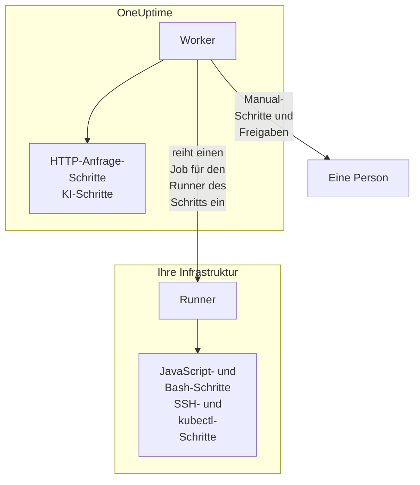

# Runbook-Konfiguration & Sicherheit

Dies ist die Referenz für Betreiber und Sicherheitsprüfer: wo jede Art von Schritt läuft, welche Limits und Timeouts für einen Schritt gelten, wer was darf und wie Runbooks gehärtet sind.

:::cards
- [Wo jeder Schritttyp läuft](#wo-jeder-schritttyp-läuft): Der Worker, ein Runner oder eine Person.
- [Ausgabegrenzen und Timeouts](#ausgabegrenzen-und-timeouts): Jedes Limit, das für einen Schritt gilt.
- [Berechtigungen](#berechtigungen): Granulare Berechtigungen, die drei Runbook-Rollen und welche Runbooks eine Rolle erreicht.
- [Härtungshinweise](#härtungshinweise): Sandboxing, Netzzugang und Authentifizierung von Runnern.
:::

## Wo jeder Schritttyp läuft

| Schritttyp | Läuft auf | Wie |
| --- | --- | --- |
| Manual | Einer Person | Der Lauf wartet, bis jemand den Schritt abschließt oder überspringt. |
| JavaScript | Einem Runner | In einer `isolated-vm`-Sandbox. |
| HTTP request | Dem OneUptime Worker | Ein ausgehender HTTP-Aufruf. |
| Bash | Einem Runner | `bash -c <script>`. |
| SSH | Einem Runner | Eine SSH-Verbindung, die das Skript mit bash auf dem Rechner ausführt, angemeldet mit einer geheimen [Variable](/docs/runbooks/variables). |
| kubectl | Einem Runner | `bash -c <script>`, wobei `KUBECONFIG` auf den Cluster zeigt. |
| AI | Dem OneUptime Worker | Ein Aufruf des LLM-Anbieters des Projekts. |

## Wie Runner-Schritte verteilt werden

JavaScript-, Bash-, SSH- und kubectl-Schritte **laufen nie auf dem OneUptime Worker**. Sie werden als Jobs an einen bestimmten [Runbook-Agent](/docs/runbooks/agents) verteilt: einen kleinen Prozess, den Sie auf einem Host in Ihrer eigenen Infrastruktur installieren. Ein Schritt, der keinen wählt, geht an den [Standard-Runner des Projekts](/docs/runbooks/agents#der-standard-runner-des-projekts), wenn es einen hat; ein JavaScript-Schritt geht sonst an die [globalen Runner](/docs/runbooks/agents#globale-runner), die OneUptime für jedes Projekt betreibt.

Das Verteilungsmodell:

1. Wer den Runbook-Schritt schreibt, wählt beim Schreiben einen Runner aus der Dropdown-Liste.
2. Wenn der Schritt läuft, fügt der Worker eine Zeile in `RunnerJob` ein, deren `targetAgentId` die ID dieses Runners ist, bei einem Schritt, der keinen gewählt hat, die des Standard-Runners des Projekts, und deren Status `Pending` lautet. Ein JavaScript-Schritt, der keinen gewählt hat, erhält in einem Projekt ohne Standard-Runner, das globale Runner nutzt, stattdessen `runsOnGlobalRunner`.
3. Genau dieser Runner (und nur er) übernimmt den Job atomar, führt ihn lokal aus — Bash und kubectl über `bash -c <script>`, JavaScript in einer `isolated-vm`-Sandbox, SSH über eine Verbindung zum Rechner, jeweils mit den Variablen eingesetzt, die er nennt — und meldet das Ergebnis zurück. Einen Job mit `runsOnGlobalRunner` darf jeder globale Runner übernehmen.
4. Der Worker setzt das Runbook mit dem Ergebnis fort.

Es gibt kein Umgebungs-Flag `RUNBOOK_BASH_ENABLED` mehr. Ob diese Schritte in einer Installation funktionieren, hängt allein davon ab, ob das Projekt einen verbundenen Runner mit eingeschaltetem **Führt Runbooks aus** hat. Ein JavaScript-Schritt funktioniert auch auf einem globalen Runner.

## Ausgabegrenzen und Timeouts

| Limit | Wert | Gilt für |
| --- | --- | --- |
| Ausgabe pro Schritt | **50 KB**. Längere Ausgabe wird mit einer Markierung abgeschnitten. | Jeden automatisierten Schritt |
| Ausführungs-Timeout | Standardmäßig **30 Sekunden** | JavaScript-, Bash-, SSH- und kubectl-Schritte |
| Anfrage-Timeout | Standardmäßig **30 Sekunden** | HTTP-Anfrage-Schritte |
| Übernahme-Timeout | Standardmäßig **2 Minuten**: wie lange der Worker darauf wartet, dass der gewählte Runner den Job übernimmt, bevor er ihn fehlschlagen lässt | JavaScript-, Bash-, SSH- und kubectl-Schritte |
| Timeout-Bereich | **1 Sekunde bis 1 Stunde** | Jedes Timeout |
| Warten auf eine Person | Kein Limit | Manual-Schritte und Freigaben |

Setzen Sie die Timeouts pro Schritt unter **Weitere Felder** des Schritts auf der Seite **Schritte** des Runbooks; lassen Sie ein Feld leer, um den Standard zu behalten. Ein Wert außerhalb des Bereichs wird beim Ausführen des Schritts begrenzt, sodass eine vertippte Konfiguration das Timeout weder abschalten noch einen Worker-Platz unbegrenzt belegen kann.

## Berechtigungen

Runbook-Berechtigungen liegen in der Berechtigungsgruppe `Runbook`:

- `CreateRunbook`, `EditRunbook`, `DeleteRunbook`, `ReadRunbook` — Runbook-Vorlagen verwalten.
- `CreateRunbookExecution`, `EditRunbookExecution`, `DeleteRunbookExecution`, `ReadRunbookExecution` — Ausführungen starten, abhaken, löschen und lesen.
- `CreateRunbookRule`, `EditRunbookRule`, `DeleteRunbookRule`, `ReadRunbookRule` — Regeln für automatische Auslösung verwalten.
- `CreateRunner`, `EditRunner`, `DeleteRunner`, `ReadRunner` — Runner verwalten, die Schritte in Ihrer eigenen Infrastruktur ausführen. (Vor der Umbenennung in Runner hießen sie `*RunbookAgent`; bestehende Zuweisungen wurden migriert, es muss also nichts neu zugewiesen werden.)
- `RunbookAdmin`, `RunbookMember`, `RunbookViewer` (Rollen) — `RunbookAdmin` baut Runbooks, ihre Regeln und die Runner, auf denen sie laufen, und führt sie aus. `RunbookMember` öffnet Runbooks und ihre Läufe und führt sie aus — es startet einen Lauf, schließt seine Schritte ab oder überspringt sie und bricht ihn ab —, erstellt, ändert und löscht aber kein Runbook und keinen Runner. `RunbookViewer` liest Runbooks und ihre Läufe und führt nichts aus. `RunbookAdmin` bündelt alle granularen Berechtigungen oben.

Eine Rolle führt die Runbooks aus, die ihr Geltungsbereich erreicht. Eine Zuweisung von `RunbookMember`, `RunbookAdmin` oder `ProjectMember`, die auf bestimmte Beschriftungen begrenzt ist, startet und bewegt Läufe der Runbooks mit diesen Beschriftungen, eine auf **Owned** begrenzte die der Runbooks, die ihrem Team gehören, und die Sperre eines Teams auf eine Beschriftung nimmt ihm diese Runbooks weg. `CreateRunbookExecution` und `EditRunbookExecution` betreffen Läufe, die keine Beschriftungen tragen, und erreichen daher jedes Runbook im Projekt. Das Genehmigen eines Behebungsvorschlags, der ein Runbook startet, wird genauso geprüft.

Zeitplan und Webhook eines Runbooks starten Läufe, ohne dass jemand dabei ist; deshalb braucht das Einrichten beider die Berechtigung, das Runbook zu bearbeiten und auszuführen, und ebenso das Ansehen seiner Webhook-URL. Das Ausschalten braucht nur die Berechtigung, es zu bearbeiten. Siehe [Runbook-Auslöser](/docs/runbooks/triggers#wer-auslöser-einrichten-darf).

Runbook-Variablen liegen außerhalb von `RunbookAdmin`, das sie nur liest, um sie in den Schritten auszuwählen, die es schreibt. Variablen zu verwalten erfordert `ProjectOwner` oder `ProjectAdmin` oder die Berechtigungen `CreateRunbookSecret`, `EditRunbookSecret`, `DeleteRunbookSecret` und `ReadRunbookSecret`: die Berechtigungen der Runbook-Geheimnisse, die ihre Namen behielten, als aus Geheimnissen Variablen wurden. Siehe [Runbook-Variablen](/docs/runbooks/variables).

Auch die Eigentümer- und Beschriftungsregeln unter **Runbooks → Einstellungen** liegen außerhalb von `RunbookAdmin`. Sie zu verwalten, erfordert `ProjectOwner` oder `ProjectAdmin` oder die Berechtigungen `CreateRunbookOwnerRule` und `CreateRunbookLabelRule` samt ihren Gegenstücken zum Bearbeiten, Löschen und Lesen.

Wie Rollen und granulare Berechtigungen zusammenwirken, lesen Sie unter [Benutzer, Teams & Berechtigungen](/docs/permissions/index).

## Warteschlange & Worker

Runbook-Ausführungen laufen in der BullMQ-Warteschlange `Runbook`. Jeder Worker-Prozess führt bis zu 25 Ausführungen gleichzeitig aus; die Zahl ist im Code festgelegt, nicht über eine Umgebungsvariable.

Wenn ein manueller Schritt über die API abgehakt wird, wird die Ausführung erneut eingereiht, um mit dem nächsten Schritt fortzufahren. Sie wartet als `Scheduled`, bis ein Worker sie wieder übernimmt, und eine eingereihte Ausführung schlägt nie wegen Wartens fehl.

## Härtungshinweise

- **JavaScript, Bash, SSH und kubectl** laufen auf einem Runner-Host, den Sie kontrollieren, nicht auf dem OneUptime Worker. JavaScript läuft in einem eigenen `isolated-vm`-Isolat mit 128 MB Arbeitsspeicher und ohne Zugriff auf Dateisystem oder Prozesse des Runners; es kann mit `axios` HTTP-Anfragen stellen, aber Anfragen an private Netze, Loopback- und Link-Local-Adressen werden abgelehnt. Bash läuft über `bash -c`, mit einem Timeout, das auf dem Runner durchgesetzt wird. Ein JavaScript-Schritt, der keinen wählt, läuft auf dem Standard-Runner des Projekts oder, wenn keiner festgelegt ist, auf einem globalen Runner.
- **SSH-Schritte** melden sich nur an, wenn der Rechner einen der Host-Schlüssel vorlegt, die der Schritt nennt. Ein Schritt, der keinen nennt, akzeptiert jeden Schlüssel, und seine Ausgabe nennt den, den der Rechner vorgelegt hat, damit Sie ihn im Schritt eintragen können.
- **HTTP-Schritte** nutzen eine nachsichtige Statusprüfung, sodass eine 4xx- oder 5xx-Antwort als fehlgeschlagener Schritt aufgezeichnet statt als Ausnahme geworfen wird, und die erfasste Ausgabe zeigt, was die Gegenseite tatsächlich zurückgegeben hat. Weiterleitungen werden nicht verfolgt. Der Worker ruft nie Loopback- oder Link-Local-Adressen auf, etwa einen Cloud-Metadaten-Endpunkt; in OneUptime Cloud lehnt er auch private Netzadressen ab, und ein selbst gehostetes OneUptime lehnt sie mit `DATA_SOURCE_BLOCK_PRIVATE_ADDRESSES=true` ab.
- **KI-Schritte** sehen nie private Vorfallnotizen oder Nachrichten aus Slack und Microsoft Teams, und die Ausgabe früherer Schritte wird nach Geheimnissen durchsucht, die geschwärzt werden, bevor sie das Modell erreicht. Eingebettete Bilder und lange kodierte Daten werden aus dem Prompt weggelassen. Siehe [AI](/docs/runbooks/authoring#ai).
- **Globale Runner** führen nur JavaScript-Schritte aus, jeden in einer Sandbox, die für diesen Schritt erstellt und danach verworfen wird, die nur öffentliche Internetadressen erreicht, höchstens 5 Minuten lang und mit höchstens drei Schritten eines Projekts gleichzeitig. Sie erhalten nur die geheimen Variablen des eigenen Projekts des Schritts, die für globale Runner eingeschaltet sind; der mitgelieferte besitzt seinen eigenen Schlüssel und sonst nichts vom Server. Siehe [Globale Runner](/docs/runbooks/agents#globale-runner).
- **Runner-Authentifizierung** erfolgt über ID und geheimen Schlüssel, die am Runner-Container als Umgebungsvariablen gesetzt sind. Auf dem Server stammt die maßgebliche Runner-Identität aus der Datenbankzeile zu der vorgelegten ID und dem Schlüssel: Ein Client kann sich selbst mit einem kompromittierten Schlüssel nicht als ein anderer Runner ausgeben.
- **Geheime Variablen** sind im Ruhezustand verschlüsselt, werden von der API nie zurückgegeben und nur an die Runner übergeben, die sie aufführen, wenn diese einen Schritt übernehmen, der sie nennt. Eine geheime Variable wird außerdem einem globalen Runner übergeben, der einen Schritt aus dem eigenen Projekt der Variable übernimmt, wenn die Variable globale Runner sie nutzen lässt. Der Runner ersetzt jedes Geheimnis, das ein Schritt erhalten hat, in der Ausgabe des Schritts durch `[REDACTED]`, und OneUptime tut es noch einmal, bevor es die Ausgabe speichert. Ein HTTP-Anfrage-Schritt, den OneUptime selbst sendet, erhält jedes Geheimnis seines eigenen Projekts, das er nennt, und verbirgt es in der Antwort, die er erfasst.

## Datenbanktabellen

| Tabelle | Was sie enthält |
| --- | --- |
| `Runbook` | Die Vorlage: Name, Slug, Beschreibung, `isEnabled`, Beschriftungen und die Schritte als JSON. |
| `RunbookExecution` | Eine Zeile pro Lauf, mit den optionalen Fremdschlüsseln `incidentId`, `alertId` und `scheduledMaintenanceId` und einem JSON-Array `stepExecutions`, das die Schritte und den Zustand jedes Schritts festhält. |
| `RunbookRule` | Regeln für automatische Auslösung, mit einem Unterscheidungsfeld `triggerEntityType` (Incident, Alert, ScheduledMaintenance), einer Viele-zu-viele-Beziehung zu den zu startenden Runbooks und dem, worauf sie abgleichen: einer JSON-Spalte `criteria` (die Bedingungen) sowie Viele-zu-viele-Verknüpfungen zu Monitoren, Vorfallsschweregraden, Warnungsschweregraden, Beschriftungen und Monitor-Beschriftungen und Muster für Titel, Beschreibung, Monitorname und Monitorbeschreibung. |
| `Runner` | Eine Zeile pro installiertem Runner: Name, geheimer Schlüssel, `lastAlive`, `connectionStatus`, Host-Informationen und Fähigkeiten. Bei einem globalen Runner ist `isGlobalRunner` gesetzt, und er hat kein Projekt; beim Standard-Runner des Projekts ist `isProjectDefault` gesetzt. |
| `RunnerJob` | Eine Zeile pro an einen Runner verteiltem Schritt: `targetAgentId` (der Runner, den die Autorin oder der Autor des Schritts gewählt hat), Schritttyp, Skript oder Nutzdaten, Status (`Pending` → `Claimed` → `Running` → `Succeeded`, `Failed`, `TimedOut` oder `Cancelled`), Übernahmefrist, Lease, Ausgabe und Exit-Code. `runsOnGlobalRunner` markiert einen Schritt, den jeder globale Runner übernehmen darf. |
| `RunbookVariable` | Runbook-Variablen: die globalen des Projekts und die eigenen eines Runbooks, die es in `runbookId` nennen; der Wert eines Geheimnisses verschlüsselt, und die Runner, die ein Geheimnis erhalten dürfen. |

## Betriebstipps

- **Stellen Sie sicher, dass der Runner, den Sie an einem Schritt wählen, gesund ist.** Wenn Sie Redundanz brauchen, betreiben Sie einen zweiten Runner und teilen Ihre Schritte zwischen beiden auf, oder halten Sie ein Ersatz-Runbook bereit, das auf den anderen Runner zielt.
- **URLs erfassen, keine Blobs.** Erzeugt ein Schritt mehr als ein paar KB Ausgabe, schreiben Sie sie in einen Objektspeicher oder Ihren Logging-Stack und geben Sie die URL zurück.
- **Idempotenz ist wichtig.** Ein HTTP-Anfrage- oder KI-Schritt läuft erneut, wenn der Worker mitten im Schritt neu startet und der Lauf fortgesetzt wird. Ein Schritt auf einem Runner wird pro Ausführung höchstens einmal verteilt, aber ein Skript kann vor einem Fehler teilweise gelaufen sein, und Sie führen das Runbook vielleicht erneut aus. Gestalten Sie Schritte so, dass sie sicher wiederholt werden können.

## Nächste Schritte

:::cards
- [Runbook-Agents](/docs/runbooks/agents): Runner installieren, betreiben und Fehler beheben.
- [Runbook-Variablen](/docs/runbooks/variables): Die Werte und Geheimnisse, die Schritte verwenden, und die Runner, die sie erhalten.
- [Benutzer, Teams & Berechtigungen](/docs/permissions/index): Wie Rollen, Beschriftungen und Teams entscheiden, wer was ausführt.
:::
