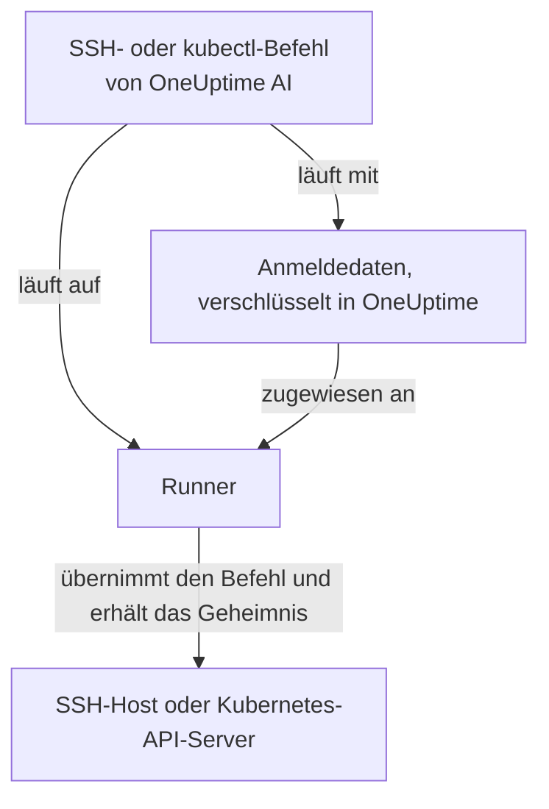

# KI-Zugriff

Der KI-Zugriff ist der Weg, auf dem die eigenen Befehle von OneUptime AI etwas erreichen, das **nicht** der eigene Host eines Runners ist — einen Server per SSH oder den API-Server eines Kubernetes-Clusters, der das Kubernetes-Agent-Chart nicht ausführt. Jeder Zugriff sind Anmeldedaten: dieser Zugang als verwaltetes Objekt, im Ruhezustand verschlüsselt, bestimmten Runnern zugewiesen und von OneUptime AI ausgewählt, statt in einen Befehl geschrieben. Runbook-Schritte verwenden sie nicht: Ein SSH- oder kubectl-Schritt meldet sich mit einer geheimen [Runbook-Variable](/docs/runbooks/variables) an. Ein Runner, der älter als dieses Release ist, ist die Ausnahme: Er führt einen aus einer Aktion überführten Kubernetes-Schritt mit den Anmeldedaten aus, die der Schritt nannte, bis das Skript oder die kubeconfig des Schritts geändert wird.

Sie verwalten sie unter **Runbooks → Runbook-Agents → KI-Zugriff**.

:::cards
- [Anmeldedaten erstellen](#anmeldedaten-erstellen): Ihr Zugang und die Runner, die sie nutzen dürfen.
- [Minimale Rechte auf der Gegenseite](#minimale-rechte-auf-der-gegenseite): Begrenzen, was der Schlüssel oder das Token tun kann.
- [Runner, die die Befehle von OneUptime AI ausführen](#runner-die-die-befehle-von-oneuptime-ai-ausführen): Wer einem solchen Runner SSH-Anmeldedaten geben darf.
:::

## Wie Anmeldedaten genutzt werden

OneUptime AI führt einen SSH-Befehl mit einem der SSH-Anmeldedaten aus, die dem Runner zugewiesen sind, auf dem er läuft, und einen kubectl-Befehl für einen Cluster, der das Kubernetes-Agent-Chart nicht ausführt, mit den Kubernetes-Anmeldedaten, die an diesen Cluster gebunden sind, wie [KI-SRE](/docs/ai/ai-sre) zeigt. Wenn der Runner den Befehl übernimmt, prüft OneUptime, dass die Anmeldedaten ihm zugewiesen sind, entschlüsselt das Geheimnis und übergibt es nur in der Antwort auf diese Übernahme. Das Geheimnis wird nie im Job gespeichert und ist über die API nie lesbar.

## Bevor Sie beginnen

- **Eine Rolle, die Anmeldedaten verwaltet.** Project Owner und Project Admin oder jeder mit der Berechtigung **Create Runbook Credential**. Die Rolle Runbook Admin enthält sie nicht. SSH-Anmeldedaten einem Runner zuzuweisen, der die Befehle von OneUptime AI ausführt, erfordert zusätzlich **Read Runbook Credential**; siehe [Runner, die die Befehle von OneUptime AI ausführen](#runner-die-die-befehle-von-oneuptime-ai-ausführen).
- **Ein Tarif, der sie enthält.** In OneUptime Cloud brauchen Runbook-Anmeldedaten den Tarif **Growth** oder höher.
- **Ein [Runner](/docs/runbooks/agents)**, der den Host oder den API-Server des Clusters über das Netz erreicht.

## Anmeldedaten erstellen

:::steps
### KI-Zugriff öffnen

Öffnen Sie **Runbooks → Runbook-Agents → KI-Zugriff** und klicken Sie auf **Anmeldedaten erstellen**.

### Benennen und den Typ wählen

Geben Sie im Schritt **Anmeldedaten** einen **Name** ein, etwa `prod-cluster`, eine optionale **Beschreibung** und den **Typ**: **SSH** oder **Kubernetes**. Der Typ lässt sich später nicht ändern; erstellen Sie stattdessen neue Anmeldedaten.

### Den Zugang eingeben

:::tabs
@tab SSH
Geben Sie unter **SSH-Host** den **Hostname**, den **Port** (22, wenn leer) und den **Benutzername** ein. Wählen Sie unter **SSH-Authentifizierung** bei **Anmelden mit**: einen **Privater Schlüssel**, die bessere Wahl, wo Sie sie haben, und fügen Sie dann den **Privater Schlüssel (PEM)** ein, mit seiner **Passphrase des privaten Schlüssels**, falls er eine hat; oder ein **Passwort** für einen Host ohne Schlüsselzugang, und geben Sie dann das **Passwort** ein.
@tab Kubernetes
Geben Sie unter **Kubernetes** die **API-Server-URL** ein, etwa `https://10.0.0.1:6443`, das **Dienstkonto-Token** und das **CA-Zertifikat (PEM)**, damit der Runner den API-Server prüfen kann. Lassen Sie die CA nur leer, wenn der API-Server ein Zertifikat vorlegt, dem der Runner bereits vertraut.
:::

### Runnern zuweisen

Wählen Sie im Schritt **Runbook-Agents** die Runner, die die Anmeldedaten nutzen dürfen, und klicken Sie dann auf **Anmeldedaten erstellen**. Anmeldedaten, die keinem Runner zugewiesen sind, kann kein Befehl nutzen.

### OneUptime AI sie nutzen lassen

OneUptime AI führt seine SSH-Befehle auf einem Runner aus, bei dem **Führt KI-Behebungsbefehle aus** eingeschaltet ist, mit einem der SSH-Anmeldedaten, die ihm zugewiesen sind. Kubernetes-Anmeldedaten werden verwendet, sobald sie mit einem ihrer Runner an einen Cluster gebunden sind: siehe [KI-SRE](/docs/ai/ai-sre).
:::

## Was gespeichert wird

| Typ | Felder |
| --- | --- |
| SSH | Hostname, Port (standardmäßig 22), Benutzername und entweder ein privater PEM-Schlüssel (mit optionaler Passphrase) oder ein Passwort. |
| Kubernetes | URL des API-Servers, ein Dienstkonto-Token und das CA-Zertifikat des Clusters. |

## Geheime Werte sind nur schreibbar

Private Schlüssel, Passphrasen, Passwörter und Dienstkonto-Tokens sind im Ruhezustand verschlüsselt, und die API **gibt sie nie zurück** — nicht an das Dashboard, nicht an einen Workflow, nicht an einen Export. Die Tabelle kann Ihnen zeigen, was Anmeldedaten *sind*, ohne je zu zeigen, was sie enthalten.

Es gibt deshalb kein „Anzeigen“ für einen geheimen Wert, nur „Ersetzen“: Einen Wert erneut einzugeben, ist die Art, ihn zu rotieren. Haben Sie das Original verloren, stellen Sie auf dem Zielsystem einen neuen Schlüssel aus und aktualisieren Sie die Anmeldedaten.

## Anmeldedaten Runnern zuweisen

Anmeldedaten sind nur für die Runner nutzbar, denen Sie sie zuweisen. Ein Befehl, der Anmeldedaten nennt, die seinem Runner nicht zugewiesen sind, **schlägt fehl, statt zu laufen** — ein Runner, der stillschweigend nichts tut, sieht genauso aus wie einer, der funktioniert hat.

Die Zuweisung ist die Zugriffsgrenze, also halten Sie sie eng: Ein Runner, der immer nur einen Cluster neu startet, braucht nicht den SSH-Schlüssel Ihrer Datenbank-Hosts.

### Runner, die die Befehle von OneUptime AI ausführen

Auf einem Runner mit eingeschaltetem **Führt KI-Behebungsbefehle aus** wählt OneUptime AI für die Befehle, die es dort ausführt, aus den SSH-Anmeldedaten, die dem Runner zugewiesen sind. Daher erreichen SSH-Anmeldedaten einen solchen Runner nur über jemanden, der Runbook-Anmeldedaten lesen darf (**Read Runbook Credential** oder ein Project Owner oder Project Admin), je nachdem, was zuerst gespeichert wird:

- **Die Anmeldedaten zuweisen.** SSH-Anmeldedaten mit einem solchen Runner zu erstellen oder einen solchen Runner zu ihnen hinzuzufügen, erfordert diese Berechtigung. Ohne sie wird das Speichern abgelehnt und nennt den Runner: Weisen Sie die Anmeldedaten Runnern zu, die keine KI-Behebungsbefehle ausführen, oder bitten Sie jemanden mit der Berechtigung, sie zuzuweisen.
- **Den Schalter einschalten.** **Führt KI-Behebungsbefehle aus** für einen Runner einzuschalten, der SSH-Anmeldedaten hält, erfordert dieselbe Berechtigung.

Runner von Anmeldedaten zu entfernen, Anmeldedaten mit den Runnern zu speichern, die sie schon haben, und Kubernetes-Anmeldedaten verlangen nichts weiter: Die kubectl-Befehle von OneUptime AI laufen mit den Anmeldedaten, die an ihren Cluster gebunden sind. Zuweisungen von Anmeldedaten und das Einschalten des Schalters durch jemanden ohne diese Berechtigung werden in einem Projekt nacheinander gespeichert, sodass beide ihre Prüfungen nicht gemeinsam bestehen können; ein Speichern, das kommt, während ein anderes läuft, wartet darauf, und dauert das zu lange, wird es mit *Try again in a moment* abgelehnt. Speichern Sie erneut.

Die Schritte eines Workflows handeln als Project Admin, bekommen aber nicht das Lesen von Runbook-Anmeldedaten eines Project Admins geliehen: Ein Schritt hat es nur, wenn die Person, die die Schritte des Workflows zuletzt gespeichert hat, es hat. Siehe [Was Workflow-Schritte tun können](/docs/workflows/configuration#was-workflow-schritte-dürfen).

## Minimale Rechte auf der Gegenseite

OneUptime kann nicht einschränken, was Ihre Anmeldedaten auf dem Zielsystem tun dürfen — das ist Aufgabe des Zielsystems, und es lohnt sich:

- **SSH** — ziehen Sie einen Schlüssel einem Passwort vor, geben Sie dem Benutzer nur die Befehle, die er braucht (ein erzwungener Befehl oder eine eingeschränkte Shell, wo praktikabel), und verwenden Sie nicht den persönlichen Schlüssel einer Administratorin oder eines Administrators wieder.
- **Kubernetes** — binden Sie das Dienstkonto an eine Role, die nur erlaubt, was Sie OneUptime AI tun lassen, in den Namespaces, in denen es handeln darf. Ein Dienstkonto, das nur lesen darf, lässt OneUptime AI untersuchen und verweigert jede Korrektur.

## Wer sie sehen kann

Anmeldedaten zu erstellen, zu bearbeiten und zu löschen, erfordert die Berechtigungen für Runbook-Anmeldedaten (oder Project Owner/Admin). Anmeldedaten zu lesen, zeigt nur ihre nicht geheimen Felder.

Beachten Sie, dass der **Agenten-Schlüssel** eines Runners den ihm zugewiesenen Anmeldedaten gleichkommt: Alles, was den Schlüssel hat, kann als dieser Runner Arbeit übernehmen und Anmeldedaten erhalten. Agenten-Schlüssel können deshalb nur Project Owner, Project Admins und Runbook Admins lesen — behandeln Sie sie so, wie Sie die Anmeldedaten selbst behandeln würden.

## Nächste Schritte

:::cards
- [Runbook-Variablen](/docs/runbooks/variables): Die Geheimnisse, mit denen sich SSH- und kubectl-Schritte anmelden.
- [Runbook-Agents](/docs/runbooks/agents): Den Runner installieren, dem Anmeldedaten zugewiesen werden.
- [Runbook-Konfiguration & Sicherheit](/docs/runbooks/configuration): Berechtigungen und Härtung für den gesamten Runbook-Stack.
:::
