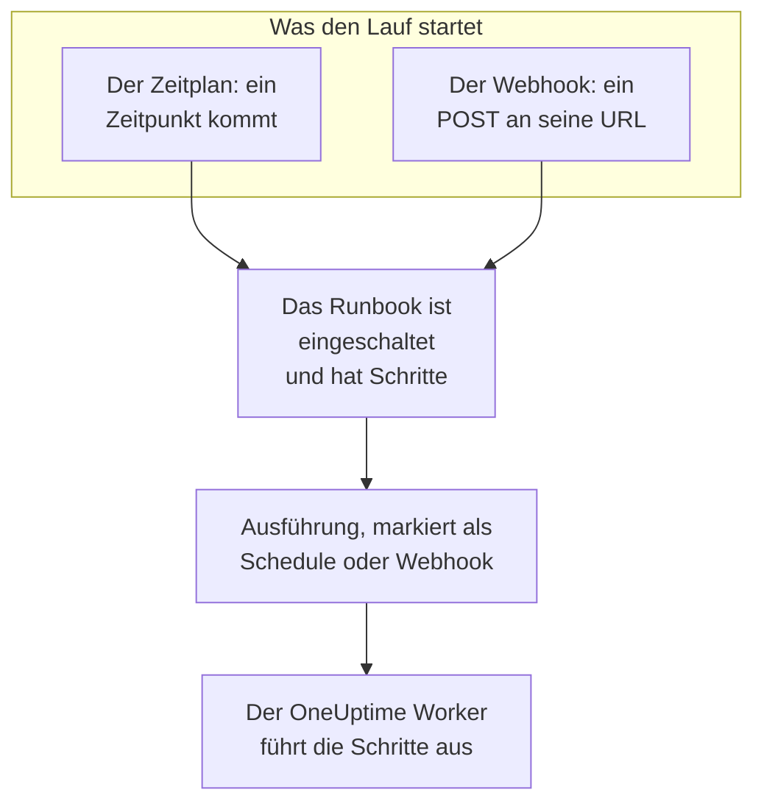

# Runbook-Auslöser

Ein Runbook kann von selbst starten: nach einem Zeitplan oder wenn ein anderes Tool seine Webhook-URL aufruft. Nutzen Sie einen Zeitplan für Routinearbeit, etwa eine nächtliche Bereinigung oder eine wöchentliche Zertifikatsprüfung, und den Webhook, um ein Runbook aus einem Alarmsystem, einer CI-Pipeline oder einem Skript zu starten. Beides richten Sie auf der Seite **Auslöser** des Runbooks ein.

:::cards
- [Nach Zeitplan ausführen](#nach-zeitplan-ausführen): Alle paar Minuten, jeden Tag, an bestimmten Wochentagen oder per Cron-Ausdruck.
- [Den Webhook aufrufen](#den-webhook-aufrufen): Einen Lauf mit einer POST-Anfrage an die URL des Runbooks starten.
- [Werte, die ein Webhook-Aufruf sendet](#werte-die-ein-webhook-aufruf-sendet): Wie die Schritte das JSON lesen, das ein Aufrufer sendet.
- [Fehlerbehebung](#fehlerbehebung): Ein Zeitplan, der nicht läuft, ein Aufruf, der abgelehnt wird.
:::

## Wie ein Auslöser einen Lauf startet



Ein Auslöser startet einen Lauf so, wie **Jetzt ausführen** es tut: Der Lauf ist eine Ausführung der aktuellen Schritte des Runbooks und hängt an keinem Vorfall, keiner Warnung und keinem geplanten Wartungsereignis. Jeder Lauf hält fest, was ihn gestartet hat. Die **Ausführungen** des Runbooks und **Runbooks → Ausführungen** zeigen es unter **Ausgelöst von**, mit dem Zeitpunkt, zu dem ein geplanter Lauf fällig war, oder der Adresse, die den Webhook aufgerufen hat, und beide Listen lassen sich danach filtern.

## Bevor Sie beginnen

- Ein Runbook mit mindestens einem Schritt, dessen Schalter **Dieses Runbook ausführen** auf seiner Seite **Einstellungen** eingeschaltet ist.
- Die Berechtigung, das Runbook zu bearbeiten und auszuführen. Siehe [Wer Auslöser einrichten darf](#wer-auslöser-einrichten-darf).

## Nach Zeitplan ausführen

:::steps
### Die Seite Auslöser des Runbooks öffnen
Öffnen Sie das Runbook unter **Runbooks** und klicken Sie in seinem Menü auf **Auslöser**.

### Den Zeitplan einrichten
Klicken Sie auf **Zeitplan einrichten**. Wählen Sie unter **Wann es läuft** eine Option bei **Wiederholen** und was sie braucht. Der Dialog nennt den Zeitplan in einem Satz, etwa „Läuft an jedem Wochentag um 09:00“, und listet seine nächsten Ausführungen auf, während Sie ihn ändern.

### Die Zeitzone prüfen
**Zeitzone** beginnt mit Ihrer eigenen. Die Zeiten des Zeitplans gelten nach der Uhr dieser Zone.

### Speichern
Klicken Sie auf **Zeitplan speichern**. Der Zeitplan wird eingeschaltet, und die Karte zeigt ihn in einem Satz mit seinen **Nächste Ausführungen**.
:::

| **Wiederholen** | Was Sie wählen | Beispiel |
| --- | --- | --- |
| **Alle paar Minuten** | **Alle**: 1, 2, 3, 4, 5, 6, 10, 12, 15, 20 oder 30 Minuten | Alle 15 Minuten |
| **Alle paar Stunden** | **Alle**: 1, 2, 3, 4, 6, 8 oder 12 Stunden, und **Minuten nach der vollen Stunde** | Alle 2 Stunden um :30 |
| **Jeden Tag** | **Uhrzeit** | Jeden Tag um 09:00 |
| **An bestimmten Tagen** | **An diesen Tagen**, mit **Wochentage** und **Jeden Tag** als Abkürzungen, und **Uhrzeit** | An jedem Wochentag um 09:00 |
| **Benutzerdefiniert (Cron-Ausdruck)** | **Cron-Ausdruck** | `0 2 1 * *`: 02:00 am 1. jedes Monats |

Ein Cron-Ausdruck hat fünf Felder: Minute, Stunde, Tag des Monats, Monat und Wochentag. Runbooks laufen höchstens einmal pro Minute, daher gibt es kein Sekundenfeld. Der Dialog erklärt einen Ausdruck, den er nicht lesen kann, oder einen, der nie läuft, etwa `0 0 31 2 *`, und speichert nichts, bis er laufen kann.

Die Karte zeigt dann den Zeitplan, seine nächsten drei Ausführungen nach der Uhr der Zone, was er tut, wenn noch ein Lauf läuft oder ein Zeitpunkt verpasst wurde, und die **Letzte geplante Ausführung** mit **Ausführung anzeigen**. **Zeitplan bearbeiten** öffnet denselben Dialog, und der Schalter **Nach diesem Zeitplan ausführen** pausiert den Zeitplan, ohne ihn zu verlieren.

### Wenn noch ein Lauf läuft

Ein Lauf läuft noch, solange er in der Warteschlange steht, ausgeführt wird oder darauf wartet, dass jemand einen Schritt abschließt oder genehmigt, egal wie er gestartet wurde. Die Einstellung **Wenn noch eine Ausführung läuft** des Zeitplans, im Dialog unter **Weitere Felder** eingeklappt, entscheidet, was ein Zeitpunkt tut, der dann kommt:

| Einstellung | Was passiert |
| --- | --- |
| **Diesen Zeitpunkt überspringen** (Standard) | Nichts startet. Der Zeitplan wartet auf seinen nächsten Zeitpunkt. |
| **Ausführen, sobald sie endet** | Ein Lauf wartet und startet, wenn der laufende endet. Weitere Zeitpunkte, die inzwischen kommen, starten nichts. |

### Wenn OneUptime einen Zeitpunkt verpasst hat

War OneUptime zu einem geplanten Zeitpunkt ausgefallen oder wurde es gerade aktualisiert, gilt der Zeitpunkt als verpasst, sobald er mehr als 5 Minuten zurückliegt. **Wenn OneUptime einen Zeitpunkt verpasst hat** entscheidet, was passiert, wenn OneUptime wieder läuft:

| Einstellung | Was passiert |
| --- | --- |
| **Einmal ausführen, sobald OneUptime wieder läuft** (Standard) | Ein Lauf startet, egal wie viele Zeitpunkte verpasst wurden, markiert mit „Einmal ausgeführt, um verpasste Zeitpunkte nachzuholen“. |
| **Verpasste Zeitpunkte überspringen** | Nichts startet bis zum nächsten Zeitpunkt. |

Zeitpunkte, die vergehen, während der Zeitplan oder das Runbook ausgeschaltet ist, gelten nicht als verpasst: Wird eines davon wieder eingeschaltet, geht es ab dem nächsten Zeitpunkt weiter.

### Zeitzonen und Sommerzeit

Die Zeiten gelten das ganze Jahr nach der Uhr der Zone. Ein Zeitplan für 09:00 in Europe/London läuft im Winter wie im Sommer um 09:00 Londoner Zeit. In der Nacht, in der die Uhren vorgestellt werden, läuft ein Zeitpunkt, den es in dieser Nacht nicht gibt, eine Stunde später nach der Uhr. Werden die Uhren zurückgestellt und kommt eine Stunde zweimal, läuft ein Zeitplan, der jede Stunde läuft, in beiden, und jeder andere Zeitplan einmal, in der ersten.

## Den Webhook aufrufen

:::steps
### Den Webhook einschalten
Schalten Sie auf der Seite **Auslöser** des Runbooks **Ausführen, wenn diese URL aufgerufen wird** ein. Das Runbook erhält seine eigene URL.

### Die URL kopieren
Die **Webhook-URL** ist maskiert: Klicken Sie auf **Anzeigen**, um sie zu sehen, oder auf **URL kopieren**, um sie ganz zu kopieren. **Ausprobieren** enthält einen `curl`-Befehl als Ausgangspunkt.

### Sie aus Ihrem Tool aufrufen
Senden Sie eine `POST`-Anfrage an die URL, mit einem JSON-Objekt als Text oder ohne Text:

```bash
curl -X POST "https://oneuptime.com/runbook/webhook/RUNBOOK_ID/SECRET_KEY" \
  -H "Content-Type: application/json" \
  -d '{"host": "web-1", "reason": "Disk almost full"}'
```

### Den Lauf prüfen
Die Antwort nennt den gestarteten Lauf: `{"runbookExecutionId": "...", "status": "Scheduled"}`. Der Lauf steht in den **Ausführungen** des Runbooks, wo **Ausgelöst von** **Webhook** zeigt, und seine Seite zeigt unter **Eingaben**, was der Aufruf gesendet hat.
:::

**Testanfrage senden** sendet einen `POST` mit einem Text, den Sie schreiben, an die URL, wie es ein anderes Tool tun würde, und verlinkt den gestarteten Lauf. Es ist ein echter Lauf des Runbooks.

### Womit ein Aufruf beantwortet wird

| Antwort | Wann |
| --- | --- |
| `200` | Der Lauf wurde gestartet. Der Text nennt ihn. |
| `400` | Der Text ist kein JSON-Objekt, ist mehr als 32 Ebenen tief verschachtelt oder enthält ein NUL-Zeichen, oder das Runbook hat keine Schritte. |
| `403` | Der Webhook oder das Runbook ist ausgeschaltet. |
| `404` | Unter dieser URL antwortet kein Runbook-Webhook: Die Runbook-ID oder der Schlüssel ist falsch, oder die URL wurde zurückgesetzt. |
| `405` | Die Anfrage ist ein `GET`. Ein `GET` startet nie einen Lauf, sodass eine Linkvorschau in einer Chat-App ihn nicht versehentlich ausführen kann. |
| `413` | Der Text ist größer als 64 KB. |
| `429` | Der Webhook hat in der letzten Minute 30 Läufe gestartet, 10 seiner Läufe laufen noch, oder eine Adresse hat in einer Minute mehr als 120 Aufrufe an Runbook-Webhooks gesendet. Der Header `Retry-After` sagt, wann Sie es erneut versuchen können, wo das möglich ist. |
| `503` | OneUptime kann Aufrufe gerade nicht zählen. Versuchen Sie es in einer Minute erneut. |

Ein abgelehnter Aufruf startet nichts, und sein Text sagt in einem Satz, warum, etwa "This runbook is turned off, so it was not started. Turn it on with Run this runbook, under the runbook's Settings."

### Die URL geheim halten

Die URL enthält den geheimen Schlüssel des Runbooks: Wer sie hat, kann das Runbook starten. Der Schlüssel besteht aus 43 zufälligen Zeichen, wird in konstanter Zeit verglichen, und ein falscher Schlüssel wird so beantwortet, als gäbe es kein solches Runbook.

Wird die URL bekannt, klicken Sie auf **URL zurücksetzen**. Das Runbook erhält eine neue URL, und die alte funktioniert sofort nicht mehr; geben Sie die neue also jedem Tool, das sie aufruft. Wird der Webhook aus- und wieder eingeschaltet, bleibt die URL dieselbe.

## Werte, die ein Webhook-Aufruf sendet

Die Werte der obersten Ebene des Texts werden zu den Eingaben des Laufs. Sie erreichen die Schritte als Daten, nie als Text, der in ein Skript oder einen Befehl eingefügt wird:

| Schritttyp | Wie er die Eingaben liest |
| --- | --- |
| Bash | Umgebungsvariablen: eine `ONEUPTIME_INPUT_<NAME>` für jeden Wert der obersten Ebene, `ONEUPTIME_INPUTS` mit dem ganzen Objekt als JSON und `ONEUPTIME_TRIGGER` mit dem, was den Lauf gestartet hat, etwa `Webhook` oder `Schedule`. |
| JavaScript | `args.inputs`, das Objekt wie gesendet, und `args.trigger`. |
| AI | In seinem Prompt, als Daten von außerhalb von OneUptime markiert, wenn **Auslöserkontext einbeziehen** eingeschaltet ist. |
| HTTP request, SSH und Kubernetes | Gar nicht. Ihre URL, ihr Befehl und ihr Ziel sind das, was im Runbook steht, und nichts, was ein Aufrufer sendet, ändert sie. |

Der Name einer Variable ist der Name des Werts in Großbuchstaben, wobei jedes Zeichen außer einem Buchstaben oder einer Ziffer als `_` geschrieben wird: Aus `host-name` wird `ONEUPTIME_INPUT_HOST_NAME`. Text wird unverändert übergeben, Zahlen und `true` oder `false` wie geschrieben und Objekte und Listen als JSON. Ein Schritt erhält höchstens 100 dieser Variablen, und aus einem Namen mit mehr als 100 Zeichen wird keine; jeder Wert steht trotzdem in `ONEUPTIME_INPUTS`. Jeder Name beginnt mit `ONEUPTIME_`, sodass ein Aufrufer weder `PATH` noch eine andere Variable setzen kann, die der Runner liest.

Diese Werte bestimmt ein Aufrufer, prüfen Sie sie also, bevor Sie danach handeln:

```bash
set -euo pipefail
case "$ONEUPTIME_INPUT_HOST" in
  web-1|web-2|web-3) ;;
  *) echo "Unknown host: $ONEUPTIME_INPUT_HOST"; exit 1 ;;
esac
curl -fsS -X POST "http://$ONEUPTIME_INPUT_HOST.internal:8080/restart"
```

```javascript
const host = args.inputs.host;
if (!["web-1", "web-2", "web-3"].includes(host)) {
  throw new Error(`Unknown host: ${host}`);
}
console.log(`Started by ${args.trigger} for ${host}`);
return { host };
```

## Wer Auslöser einrichten darf

Ein Zeitplan oder ein Webhook startet Läufe, ohne dass jemand dabei ist; deshalb braucht das Einrichten die Berechtigung, das Runbook zu bearbeiten und auszuführen: Project Owner, Project Admin oder Runbook Admin, oder **Edit Runbook** zusammen mit Project Member, Runbook Member oder **Create Runbook Execution**. Die Beschriftungen, auf die eine Rolle beschränkt ist, zählen, wie bei **Jetzt ausführen**. Die Webhook-URL zu sehen oder zurückzusetzen braucht dasselbe.

Einen Zeitplan oder einen Webhook auszuschalten startet nichts und braucht daher nur die Berechtigung, das Runbook zu bearbeiten. Wer das Runbook bearbeiten, aber nicht ausführen darf, sieht die Seite **Auslöser** mit gesperrtem **Zeitplan einrichten** und erfährt, wer die Webhook-URL sehen kann.

## Fehlerbehebung

:::details Nach dem Zeitplan läuft nichts
Das Runbook ist ausgeschaltet oder hat keine Schritte: Die Karte sagt, was davon. Schalten Sie **Dieses Runbook ausführen** auf der Seite **Einstellungen** des Runbooks ein, oder fügen Sie auf seiner Seite **Schritte** Schritte hinzu. Sagt die Karte, dass der Zeitplan pausiert ist, schalten Sie **Nach diesem Zeitplan ausführen** ein.
:::

:::details Ein geplanter Zeitpunkt hat nichts gestartet
Ein Lauf lief noch, und der Zeitplan überspringt solche Zeitpunkte, oder OneUptime hat den Zeitpunkt verpasst, und der Zeitplan überspringt verpasste Zeitpunkte. Siehe [Wenn noch ein Lauf läuft](#wenn-noch-ein-lauf-läuft) und [Wenn OneUptime einen Zeitpunkt verpasst hat](#wenn-oneuptime-einen-zeitpunkt-verpasst-hat).
:::

:::details Das Speichern eines Zeitplans schlägt fehl mit "You do not have permission to set up this runbook's schedule or webhook."
Das Einrichten eines Auslösers braucht die Berechtigung, das Runbook auszuführen und es zu bearbeiten. Bitten Sie um Runbook Admin, oder um Runbook Member oder **Create Runbook Execution** zusätzlich zu **Edit Runbook**.
:::

:::details Ein Aufruf wird mit "No runbook webhook answers at this URL." beantwortet
Die URL wurde zurückgesetzt oder falsch kopiert. Kopieren Sie sie erneut von der Seite **Auslöser** des Runbooks.
:::

:::details Ein Aufruf wird mit "This runbook's webhook is turned off, so the runbook was not started." beantwortet
Schalten Sie **Ausführen, wenn diese URL aufgerufen wird** auf der Seite **Auslöser** des Runbooks ein. Die URL ist dieselbe wie zuvor.
:::

## Nächste Schritte

:::cards
- [Ein Runbook ausführen](/docs/runbooks/running): Was ein Lauf zeigt und wie Sie ihn voranbringen.
- [Ein Runbook verfassen](/docs/runbooks/authoring): Die Schritte schreiben, die ein Auslöser ausführt.
- [Runbook-Konfiguration & Sicherheit](/docs/runbooks/configuration): Grenzen, Berechtigungen und Härtung.
:::
