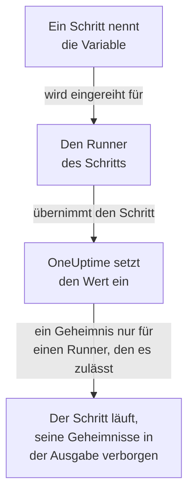

# Runbook-Variablen

Eine Runbook-Variable ist ein Wert, den Ihre Schritte über seinen Namen verwenden, statt ihn selbst zu enthalten: ein Host, ein Namespace oder eine URL, oder ein Geheimnis wie ein SSH-Schlüssel, ein Passwort, eine kubeconfig oder ein API-Token. Ändern Sie den Wert einmal, und jeder Schritt, der ihn nennt, verwendet beim nächsten Lauf den neuen. Ein Geheimnis ist verschlüsselt, wird nie wieder angezeigt und in dem verborgen, was Schritte ausgeben.

:::cards
- [Eine Variable erstellen](#eine-variable-erstellen): Ein einfacher Wert, oder ein Geheimnis und die Runner, die es nutzen dürfen.
- [Eine Variable in einem Schritt verwenden](#eine-variable-in-einem-schritt-verwenden): In einem Skript oder einer HTTP-Anfrage, oder als Anmeldung eines SSH-Schritts und kubeconfig eines kubectl-Schritts.
- [Wer ein Geheimnis erhält](#wer-ein-geheimnis-erhält): Ihre Runner, globale Runner, wenn Sie es ihnen erlauben, und OneUptime für einen HTTP-Anfrage-Schritt.
:::

## Wie eine Variable einen Schritt erreicht



Ein Schritt enthält den Namen der Variable, nie ihren Wert. Wenn der Runner des Schritts ihn übernimmt, setzt OneUptime den Wert ein - im Skript, in Rechner und Anmeldung eines SSH-Schritts oder in der kubeconfig eines kubectl-Schritts - und übergibt ihn nur diesem Runner. Ein Schritt, der eine Variable nennt, die er nicht haben darf, schlägt mit dem Grund fehl, statt mit dem Namen an der Stelle des Werts zu laufen.

Bash-, JavaScript-, SSH-, kubectl- und HTTP-Anfrage-Schritte verwenden Variablen. KI-Schritte setzen sie nicht ein. Einen HTTP-Anfrage-Schritt sendet OneUptime selbst, ohne Runner, daher erhält der Schritt jede Variable, die er nennt, auch Geheimnisse, und verbirgt sie in der Antwort, die er erfasst.

## Globale und Runbook-Variablen

| | Globale Variablen | Die eigenen Variablen eines Runbooks |
| --- | --- | --- |
| Verwaltet unter | **Runbooks → Einstellungen → Globale Variablen** | **Einstellungen → Variablen** des Runbooks |
| Verwendet von | Jedem Runbook im Projekt | Nur den Schritten dieses Runbooks |
| In einem Schritt geschrieben als | `{{global.variables.NAME}}` | `{{local.variables.NAME}}` |

Ein Name kommt unter den globalen Variablen des Projekts nur einmal vor, unabhängig von der Groß- und Kleinschreibung, und unter den eigenen Variablen eines Runbooks ebenfalls nur einmal. Eine Variable eines Runbooks darf einen Namen mit einer globalen teilen: Jede wird auf ihre eigene Weise geschrieben.

## Bevor Sie beginnen

- **Eine Rolle, die Variablen verwaltet.** Project Owner und Project Admin oder die Berechtigung **Create Runbook Variable**. Runbook Admin liest Variablen, um sie in den Schritten auszuwählen, die er schreibt, ändert sie aber nicht.
- **Ein Tarif, der sie enthält.** In OneUptime Cloud brauchen Runbook-Variablen den Tarif **Growth** oder höher.

## Eine Variable erstellen

:::steps
### Die Variablen öffnen

Öffnen Sie **Runbooks → Einstellungen → Globale Variablen** oder **Einstellungen → Variablen** eines Runbooks, und klicken Sie auf **Variable erstellen**.

### Sie benennen und ihren Wert eingeben

Geben Sie im Schritt **Variable** einen **Name** ein: Buchstaben, Ziffern, Bindestriche und Unterstriche, bis zu 100 Zeichen, etwa `PROD_DB_SSH_KEY`. **Geheimnis** ist zu Beginn eingeschaltet: Fügen Sie den Schlüssel, das Passwort, das Token oder die kubeconfig in **Geheimniswert** ein und klicken Sie auf **Weiter**. Für einen Wert, den jeder lesen darf, etwa einen Host, schalten Sie **Geheimnis** aus, geben ihn in **Wert** ein und klicken auf **Variable erstellen**. Eine optionale **Beschreibung** wartet unter **Weitere Felder**.

### Wählen, wer ein Geheimnis nutzen darf

Wählen Sie im Schritt **Wer es nutzen darf** Ihre Runner unter **Ihre Runner, die es nutzen dürfen**. Auf einem Server mit [globalen Runnern](/docs/runbooks/agents#globale-runner) erlaubt **Globale Runner dürfen es nutzen** außerdem den Schritten dieses Projekts, die auf einem globalen Runner laufen, das Geheimnis zu nutzen: Der Schalter ist zu Beginn eingeschaltet, solange das Projekt globale Runner verwendet. Ein Geheimnis braucht das eine oder das andere. Klicken Sie auf **Variable erstellen**.
:::

Ob eine Variable ein Geheimnis ist, lässt sich später nicht ändern. Löschen Sie sie stattdessen und erstellen Sie sie mit demselben Namen neu: Schritte nennen Variablen beim Namen, daher funktionieren sie weiter. Der In-Cluster-Runner eines Clusters, den das Kubernetes-Agent-Chart installiert, erhält nie ein Geheimnis.

## Geheime Werte sind nur schreibbar

Der Wert eines Geheimnisses ist im Ruhezustand verschlüsselt, und die API **gibt ihn nie zurück**: weder an das Dashboard noch an einen Workflow oder einen Export. Die Liste zeigt **Geheimnis**, wo eine einfache Variable ihren Wert zeigt, und ihre Spalte **Runbook-Agents** sagt, welche Runner jedes Geheimnis erhalten. Um ihn zu ändern, klicken Sie in seiner Zeile auf **Wert ersetzen**: Der neue Wert wird verschlüsselt, der alte ist endgültig weg, und Schritte erhalten beim nächsten Lauf den neuen.

Wenn ein Schritt ein Geheimnis ausgibt, das er erhalten hat, ersetzt der Runner es durch `[REDACTED]`, bevor die Ausgabe seinen Host verlässt, und OneUptime tut es noch einmal, bevor es die Ausgabe speichert. Eine Zeile eines privaten Schlüssels oder das Token in einer kubeconfig wird ebenfalls verborgen. Nach einem Geheimnis, das kürzer als 4 Zeichen ist, wird nicht gesucht.

## Eine Variable in einem Schritt verwenden

:::tabs
@tab In einem Skript
Schreiben Sie den Verweis dorthin, wo der Wert hingehört, in einem Bash-, JavaScript-, SSH- oder kubectl-Skript:

```bash
curl -s -X POST \
  -H "Authorization: Bearer {{global.variables.CDN_API_TOKEN}}" \
  "https://api.cdn.example.com/v1/purge"
```
@tab In einer HTTP-Anfrage
Schreiben Sie den Verweis in die URL, die Header oder den Body eines [HTTP-Anfrage-Schritts](/docs/runbooks/authoring#http-request):

```json
{ "Authorization": "Bearer {{global.variables.API_TOKEN}}" }
```
@tab SSH-Anmeldung
Ein [SSH-Schritt](/docs/runbooks/authoring#ssh) wählt unter **Anmelden mit** die geheime Variable, die seinen privaten Schlüssel oder sein Passwort enthält, und unter **Weitere Felder → Passphrase des Schlüssels** die Passphrase seines Schlüssels. Der Wert sagt, ob es ein Schlüssel oder ein Passwort ist.
@tab Kubeconfig
Ein [kubectl-Schritt](/docs/runbooks/authoring#kubectl) wählt unter **Kubeconfig** die geheime Variable, die die kubeconfig des Clusters enthält, oder **Der eigene Zugriff des Runners**, um den des Runners zu verwenden.
:::

Auf der Seite **Schritte** eines Runbooks listen jedes Skript und jede HTTP-Anfrage unter **Variablen – zum Kopieren klicken** die Variablen auf, die ihr Schritt verwenden kann, und der Editor sagt, wenn ein Schritt eine Variable nennt, die es nicht gibt, oder ein Geheimnis, das sein Runner nicht nutzen darf.

## Wer ein Geheimnis erhält

| Wer den Schritt ausführt | Eine einfache Variable | Ein Geheimnis |
| --- | --- | --- |
| Einer Ihrer Runner | Immer | Wenn das Geheimnis ihn unter **Ihre Runner, die es nutzen dürfen** aufführt |
| Ein globaler Runner | Immer | Wenn **Globale Runner dürfen es nutzen** eingeschaltet ist, für einen Schritt aus dem eigenen Projekt des Geheimnisses |
| OneUptime selbst, für einen HTTP-Anfrage-Schritt | Immer | Immer |

Ein Schritt, der ein Geheimnis nennt, das sein Runner nicht nutzen darf, schlägt fehl, nennt das Geheimnis und was zu ändern ist, und nichts wird übergeben.

## Aus Runbook-Geheimnissen und Anmeldedaten wurden Variablen

Runbook-Variablen haben den Platz der Runbook-Geheimnisse eingenommen, und den der Anmeldedaten, die SSH- und Kubernetes-Schritte nannten. Als OneUptime aktualisiert wurde, wurde das, was jedes Projekt hatte, einmal verschoben, sodass jedes Runbook so läuft wie zuvor:

- Jedes Runbook-Geheimnis wurde zu einer geheimen globalen Variable mit demselben Namen, demselben Wert, denselben Runnern und demselben Schalter für globale Runner;
- `{{runbookSecrets.NAME}}` in einem Skript wurde zu `{{global.variables.NAME}}` umgeschrieben, und die alte Schreibweise liest weiterhin die globale Variable `NAME`;
- alle Anmeldedaten, die ein Schritt nannte, wurden zu geheimen globalen Variablen mit denselben Runnern, nach ihnen benannt: `<name>-ssh-key` (und `<name>-ssh-key-passphrase`, für einen Schlüssel, der eine hatte), `<name>-ssh-password` oder `<name>-kubeconfig`;
- jeder SSH-Schritt, der Anmeldedaten nannte, meldet sich mit ihnen an seinem Rechner an und führt seinen Befehl als sein Skript aus, und jeder Kubernetes-Schritt wurde zu einem kubectl-Schritt, der das `kubectl patch` ausführt, das seine Aktion vornahm, und dafür keinen weitergehenden Zugriff braucht als der Schritt hatte.

Ein Runner, der älter als dieses Release (14.0.79) ist, kann kein kubectl-Skript ausführen: Er lässt einen kubectl-Schritt fehlschlagen und sagt, dass der Runner aktualisiert werden muss. Jeder so überführte Kubernetes-Schritt hat zunächst seine Anmeldedaten und seine Aktion neben seinem Skript behalten, für einen solchen Runner; sie sind mit den Runbook-Anmeldedaten entfallen, sodass jeder kubectl-Schritt einen Runner ab 14.0.79 braucht.

Runbook-Anmeldedaten wurden inzwischen entfernt, und ein Schritt, der noch welche nannte, wurde zuvor auf dieselbe Weise überführt. Ein Schritt, der Anmeldedaten nennt, läuft nicht mehr, und seine Seite der Schritte bietet **In einen Skriptschritt umwandeln** an; ein Speichern über die API oder Terraform, das einem Schritt welche gibt, wird abgelehnt. Siehe [Runbook-Anmeldedaten sind entfernt](/docs/installation/upgrading#runbook-anmeldedaten-sind-entfernt).

## Nächste Schritte

:::cards
- [Ein Runbook erstellen](/docs/runbooks/authoring): Die SSH- und kubectl-Schritte schreiben, die eine Variable verwenden.
- [Runbook-Agents](/docs/runbooks/agents): Den Runner installieren, dem ein Geheimnis übergeben wird.
- [Runbook-Konfiguration und Sicherheit](/docs/runbooks/configuration): Berechtigungen und Härtung für den gesamten Runbook-Stack.
:::
