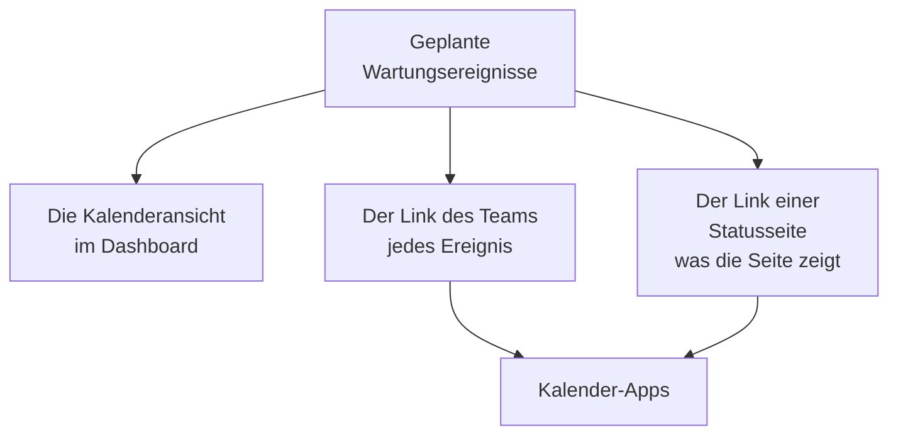

# Wartungskalender

Der Wartungskalender zeigt Ihre geplante Wartung nach Datum: als Kalender im Dashboard, über einen geheimen Link in den Kalender-Apps Ihres Teams und in den Kalendern der Menschen, die Ihren Statusseiten folgen. Diese Seite erklärt die Kalenderansicht, den Kalenderlink des Teams, den Kalender einer Statusseite und was jeder Kalendertermin enthält.

:::cards
- [Die Kalenderansicht](#die-kalenderansicht): Jedes Ereignis in einem Monat, einer Woche oder einem Tag, in der Farbe seines Zustands.
- [Der Kalenderlink des Teams](#der-kalenderlink-des-teams): Jedes Ereignis des Projekts in Google Kalender, Outlook oder Apple Kalender.
- [Der Kalender einer Statusseite](#der-kalender-einer-statusseite): Was eine Statusseite zeigt, in den Kalendern ihrer Besucher.
- [Was ein Kalendertermin enthält](#was-ein-kalendertermin-enthält): Der Titel, das Zeitfenster, der Zustand und ein Link zurück.
:::



## Die Kalenderansicht

Öffnen Sie **Geplante Wartung → Alle Ereignisse**. Am rechten Ende der Filterleiste wechseln **Liste** und **Kalender** zwischen der Tabelle der Ereignisse und einem Kalender davon. Ihr Browser merkt sich die Wahl, sodass die Seite beim nächsten Mal mit dem Kalender öffnet.

- Der Kalender öffnet mit diesem Monat, der heutige Tag ist markiert. **Monat**, **Woche** und **Tag** ändern, wie viel er zeigt, und **Zurück**, **Weiter** und **Heute** bewegen ihn. Die Zeiten stehen in Ihrer eigenen Zeitzone.
- Jedes Ereignis ist ein Block in der Farbe seines Zustands, und die Farben der Zustände sind unter dem Kalender benannt. Klicken Sie auf ein Ereignis, um es zu öffnen.
- Die Filter über dem Kalender wirken wie in der Liste: Wählen Sie einen Zustand, ein Label oder einen Eigentümer, um nur diese Ereignisse zu sehen.
- Ein Tag, der noch bevorsteht, zeigt ein **+**, wenn Sie auf seine Woche zeigen. Es öffnet **Geplantes Wartungsereignis erstellen** mit **Beginnt am** an diesem Tag, zu der Stunde, die das Formular heute wählen würde. Sie sehen es nur, wenn Sie Ereignisse erstellen dürfen.
- Eine Ansicht zeigt bis zu 500 Ereignisse. Ein vollerer Monat sagt es: Grenzen Sie ihn mit den Filtern ein oder sehen Sie sich eine Woche an.

## Der Kalenderlink des Teams

**Kalender abonnieren**, unter dem Kalender oder im **⋯**-Menü der Liste, öffnet den Kalenderlink des Projekts: einen geheimen iCalendar-Link (`.ics`), der jedes geplante Wartungsereignis des Projekts in Google Kalender, Outlook, Apple Kalender oder jede App bringt, die einen Kalender per URL abonniert.

:::steps
### Den Link veröffentlichen

Klicken Sie auf **Link veröffentlichen**. Ein Projekt hat einen Link für das ganze Team, daher ist das nur einmal nötig.

### Ihn zu Ihrer Kalender-App hinzufügen

**Google Kalender** öffnet Google Kalender, das fragt, ob der Kalender hinzugefügt werden soll. **Apple Kalender / Outlook** öffnet den Link in der Kalender-App Ihres Computers oder Telefons. **Link kopieren** kopiert ihn für jede andere App.

### Prüfen, ob es funktioniert

Das Feld **Status** sagt, wann eine Kalender-App den Link zuletzt gelesen hat und welche. Ein neuer Link zeigt **Wartet auf die erste Synchronisierung**, bis eine App ihn liest.
:::

Der Link sieht so aus:

```text
https://<your host>/api/scheduled-maintenance-calendar/project/<token>/maintenance.ics
```

> [!WARNING]
> Wer den Link hat, sieht jedes geplante Wartungsereignis des Projekts, ohne sich anzumelden. Behandeln Sie ihn wie ein Passwort und erzeugen Sie ihn neu, wenn er versehentlich weitergegeben wurde.

### Wer den Link sehen kann

Der Link zeigt jedes Ereignis des Projekts, daher zeigt der Dialog ihn nur Personen, die jedes Ereignis lesen dürfen. Wem die Rolle nur einige Ereignisse erlaubt, nach Label oder nur die eigenen, erfährt stattdessen den Grund.

| Aktion | Wer sie ausführen kann |
| --- | --- |
| Den Link kopieren | Jeder, der jedes geplante Wartungsereignis des Projekts lesen darf |
| **Link veröffentlichen** | Jeder, der außerdem geplante Wartungsereignisse erstellen darf |
| **Link neu erzeugen**, **Link ausschalten** | Jeder, der außerdem geplante Wartungsereignisse bearbeiten darf |

### Den Link verwalten

**Link neu erzeugen** und **Link ausschalten** stehen im Menü **⋯** oben im Dialog.

| Aktion | Was passiert |
| --- | --- |
| **Link neu erzeugen** | Erzeugt einen neuen Link. 30 Tage lang liefert der alte einen leeren Kalender, damit die Apps, die ihn halten, ihre Kopie leeren; danach wird er nicht mehr gefunden. Abonnieren Sie erneut mit dem neuen Link. |
| **Link ausschalten** | Behält den Link, aber er liefert einen leeren Kalender bis **Link einschalten**. |

Der Kalender enthält jedes Ereignis von 90 Tagen zurück bis ein Jahr voraus, bis zu 1.000 Ereignisse.

## Der Kalender einer Statusseite

Die Menschen, die einer Statusseite folgen, können ihre geplante Wartung in ihren eigenen Kalender holen. Auf der Seite der geplanten Ereignisse der Statusseite bietet **Kalender abonnieren** Google Kalender, die Kalender-App ihres Geräts oder den Link zum Kopieren an. Der Link ist die Adresse der Seite, gefolgt von `/maintenance.ics`, etwa `https://status.example.com/maintenance.ics`.

- **Was er enthält.** Genau das, was die Seite zeigt: die Ereignisse im Verlaufszeitraum der Seite, jedes bevorstehende und jedes laufende Ereignis, solange **Auf Statusseite sichtbar** eingeschaltet ist. Was ein Ereignis betrifft, wird so benannt, wie die Seite ihre Ressourcen nennt, nie mit den eigenen Namen Ihrer Monitore.
- **Eine private Seite.** Eine Kalender-App kann sich nicht anmelden, daher bietet eine private Seite kein **Kalender abonnieren** an, und ihr Link liefert einen leeren Kalender, der sagt, dass die Seite privat ist.
- **Ein Ereignis.** **Zum Kalender hinzufügen** auf der Seite eines Ereignisses fügt nur dieses Ereignis hinzu: Google Kalender öffnet sich mit ausgefülltem Termin, oder es wird als Datei heruntergeladen, die die Kalender-App des Geräts öffnet. Es funktioniert auch auf einer privaten Seite für einen angemeldeten Besucher und wird nicht mehr angeboten, wenn das Ereignis vorbei ist.

## Was ein Kalendertermin enthält

Jeder Kalender, der des Teams und der einer Statusseite, schreibt einen Termin auf dieselbe Weise.

| Teil | Was er enthält |
| --- | --- |
| Titel | Der Titel des Ereignisses |
| Beginn und Ende | Sein geplantes Zeitfenster in UTC; die Kalender-App zeigt es in Ihrer eigenen Zeitzone |
| Beschreibung | Seine Beschreibung als reiner Text, sein Zustand, was es betrifft, und ein Link zum Ereignis; der Link des Teams nennt auch seine Statusseiten |
| Status | Abgesagt, wenn das Ereignis abgesagt wurde: abgeschlossen, ohne je in Arbeit gewesen zu sein |
| Frei oder beschäftigt | Frei, damit ein Wartungsfenster nie Ihre Verfügbarkeit blockiert |
| Kategorien | Seine Labels; der Kalender einer Statusseite zeigt sie nur, wenn die Seite Labels zeigt |

Ein in OneUptime bearbeitetes Ereignis wird in jedem Kalender, der es hält, an Ort und Stelle aktualisiert, und eines, das gelöscht oder von einer Statusseite genommen wird, verlässt den Kalender bei der nächsten Aktualisierung.

## Wie oft Kalender aktualisieren

Kalender-Apps lesen einen abonnierten Link nach ihrem eigenen Zeitplan. Google Kalender tut es alle paar Stunden, manchmal nur einmal am Tag; Apple Kalender und Outlook meist stündlich. OneUptime hält einen Kalender höchstens fünf Minuten vor, die Wartezeit, die Sie sehen, ist also die der Kalender-App. Die Schritte für jede App stehen unter [Kalender-Feeds](/docs/on-call/calendar-feeds#in-ihrer-kalender-app-abonnieren), die für Bereitschaftsschichten genauso funktionieren.

## Fehlerbehebung

:::details Die Kalender-App zeigt keine neuen Ereignisse mehr
Der Link wurde neu erzeugt oder ausgeschaltet: Öffnen Sie **Kalender abonnieren**, um seinen Status zu sehen. Ein neu erzeugter Link muss mit dem neuen Link erneut abonniert werden; ein ausgeschalteter Link kommt mit **Link einschalten** zurück.
:::

:::details Google Kalender kann den Link nicht hinzufügen
Google Kalender liest den Link von Googles Servern, daher muss der OneUptime-Server aus dem Internet erreichbar sein. Für einen selbst gehosteten Server siehe [Kalender-Feeds](/docs/on-call/calendar-feeds#fehlerbehebung).
:::

:::details Ein Ereignis fehlt im Kalender einer Statusseite
Der Kalender der Seite enthält, was die Seite zeigt. Prüfen Sie, dass das Ereignis die Seite nennt, dass **Auf Statusseite sichtbar** in seinen **Einstellungen** eingeschaltet ist und dass es im Verlaufszeitraum der Seite begonnen hat.
:::

## Nächste Schritte

:::cards
- [Wartungsereignisse erstellen](/docs/scheduled-maintenance/creating-events): Das Formular, Feld für Feld, und was danach passiert.
- [Abonnenten & Ankündigungen](/docs/status-pages/subscribers#geplante-wartungsereignisse): Was die Abonnenten einer Statusseite über Wartung erfahren.
- [Kalender-Feeds](/docs/on-call/calendar-feeds): Dieselbe Art von Link für Bereitschaftsschichten.
:::
