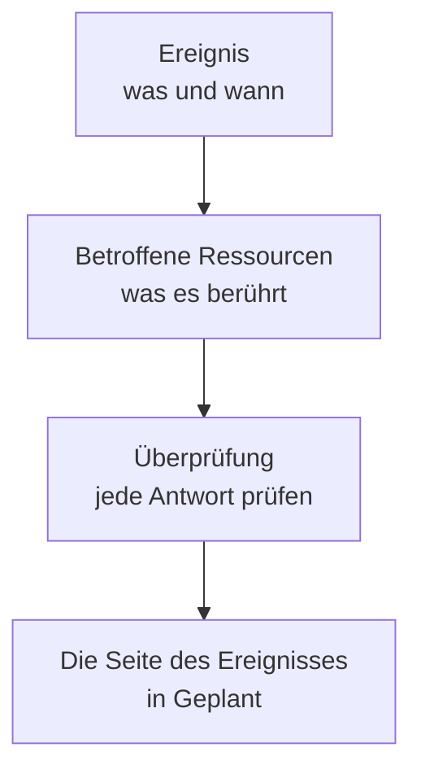

# Wartungsereignisse erstellen

Planen Sie eine Wartung in zwei kurzen Schritten: Sagen Sie, was passiert und wann, dann, was es betrifft und wer davon erfahren soll. Nur der Titel muss eingegeben werden; alles andere beginnt mit einem sinnvollen Standardwert. Diese Seite führt durch das Formular, zeigt, was im Moment des Erstellens passiert, wie Sie ein Ereignis später ändern und wie Sie Ereignisse per Code erstellen.

:::cards
- [Ein Ereignis erstellen](#ein-ereignis-erstellen): Zwei Schritte und eine Überprüfung.
- [Was beim Erstellen passiert](#was-beim-erstellen-passiert): Seine Nummer, Regeln, Eigentümer und die ersten Nachrichten.
- [Später veröffentlichen](#später-veröffentlichen): Halten Sie es bis zu einem Zeitpunkt Ihrer Wahl von Ihren Statusseiten fern.
- [Ein Ereignis später ändern](#ein-ereignis-später-ändern): Sein Zeitfenster, seine Ressourcen, Statusseiten und Notizen.
- [Ereignisse per Code erstellen](#ereignisse-per-code-erstellen): Die API, Terraform, Workflows und Chat.
:::

## So funktioniert es

Das Formular stellt zwei Fragen, eine pro Schritt, und zeigt dann alles in einer Überprüfung, bevor es das Ereignis erstellt. Das Ereignis beginnt in Ihrem geplanten Status, und seine Seite öffnet sich.



## Bevor Sie beginnen

- **Ihre Rolle.** Um ein Ereignis zu erstellen, brauchen Sie **Projektinhaber**, **Projektadministrator**, **Projektmitglied**, **Wartungs-Administrator** oder **Wartungs-Mitglied** oder eine benutzerdefinierte Rolle mit **Create Scheduled Maintenance**.
- **Ihre Statusseiten.** Um Kunden zu informieren, brauchen Sie eine Statusseite, die geplante Wartungsereignisse anzeigt. Siehe [Statusseiten – Übersicht](/docs/status-pages/index).

## Ein Ereignis erstellen

:::steps
### Das Formular öffnen

Gehen Sie zu **Geplante Wartung → Alle Ereignisse** und klicken Sie auf **Geplantes Wartungsereignis erstellen**. Das Formular öffnet sich mit seinem ersten Schritt, **Ereignis**.

### Sagen, was passiert und wann

Geben Sie einen **Titel** ein und fügen Sie bei Bedarf eine **Beschreibung** hinzu: Sie ist Markdown und wird auf Ihren Statusseiten angezeigt. **Beginnt am** steht bereits auf der nächsten vollen Stunde Ihrer Uhr und **Endet am** eine Stunde später; ändern Sie beides nur, wenn es nicht stimmt. Wenn Sie **Beginnt am** verschieben, wandert **Endet am** mit, sodass das Zeitfenster seine Länge behält. **Eigentümer** und **Beschriftungen** liegen eingeklappt unter **Weitere Felder**.

### Auswählen, was es betrifft

Klicken Sie auf **Weiter**, um zu **Betroffene Ressourcen** zu gelangen. Wählen Sie die **Monitore**, die die Arbeit berührt. Sobald Sie einen wählen, erscheint darunter **Monitor-Status ändern in**: der Status, in den die Monitore wechseln, wenn das Ereignis beginnt. Wählen Sie dann **Andere betroffene Ressourcen**, etwa Hosts, Cluster, Datenbanken, Netzwerkstandorte oder Dienste.

### Festlegen, wer davon erfährt

Wählen Sie die Statusseiten unter **Ereignis auf diesen Status-Seiten anzeigen**. **Abonnentenbenachrichtigungen**, eingeklappt, sagt in einer Zeile, wann das Ereignis dort erscheint und wer wann informiert wird; öffnen Sie es, um unter **Auf Statusseiten veröffentlichen** die Option **Zu einem bestimmten Zeitpunkt** zu wählen oder um **Wenn das Ereignis geplant wird**, **Wenn das Ereignis beginnt**, **Wenn das Ereignis endet** oder **Erinnerungen vor dem Ereignis** zu ändern.

### Es erstellen

Klicken Sie auf **Weiter**, um die Überprüfung zu sehen, prüfen Sie sie und klicken Sie dann auf **Geplantes Wartungsereignis erstellen**. Die Seite des Ereignisses öffnet sich.
:::

Nichts wird gesendet, bis Sie eine Statusseite wählen: Ein Ereignis, das auf keiner Statusseite erscheint, informiert keinen Abonnenten.

## Die Felder des Formulars

| Feld                                 | Schritt            | Beginnt als                     | Was es tut                                                                       |
| ------------------------------------ | ------------------ | ------------------------------- | -------------------------------------------------------------------------------- |
| **Titel**                            | **Ereignis**       | Leer und erforderlich           | Benennt das Ereignis überall, auch auf Ihren Statusseiten.                       |
| **Beschreibung**                     | **Ereignis**       | Leer                            | Erklärt Ihren Kunden die Arbeit, in Markdown.                                    |
| **Beginnt am**                       | **Ereignis**       | Die nächste volle Stunde        | Wann das Ereignis von selbst beginnt.                                            |
| **Endet am**                         | **Ereignis**       | Eine Stunde nach **Beginnt am** | Wann das Ereignis von selbst endet. Es muss nach **Beginnt am** liegen.          |
| **Eigentümer**                       | **Ereignis**       | Niemand                         | Personen und Teams, denen das Ereignis gehört und die darüber informiert werden. |
| **Beschriftungen**                   | **Ereignis**       | Keine                           | Beschriftungen, nach denen Regeln und Filter suchen können.                      |
| **Monitore**                         | **Betroffene Ressourcen** | Keine                    | Die Monitore, die nicht geprüft werden, solange das Ereignis läuft.              |
| **Monitor-Status ändern in**         | **Betroffene Ressourcen** | Keine Änderung           | Der Status, den diese Monitore während des Ereignisses zeigen. Wird abgefragt, sobald ein Monitor gewählt ist. |
| **Andere betroffene Ressourcen**     | **Betroffene Ressourcen** | Keine                    | Hosts, Cluster, Datenbanken, Netzwerkstandorte, Dienste und mehr.                |
| **Ereignis auf diesen Status-Seiten anzeigen** | **Betroffene Ressourcen** | Keine          | Die Statusseiten, die das Ereignis zeigen und ihre Abonnenten informieren.       |
| **Abonnentenbenachrichtigungen**     | **Betroffene Ressourcen** | Sofort veröffentlicht, alle drei Momente an, keine Erinnerungen | Wann das Ereignis auf diesen Seiten erscheint und wann ihre Abonnenten informiert werden. |

Zwei Dinge füllen das Formular unterwegs für Sie aus:

- **Verknüpfte Ressourcen.** Wenn Sie einen Monitor wählen, werden die Hosts, Cluster, Dienste und anderen Ressourcen, mit denen er verknüpft ist, unter **Andere betroffene Ressourcen** hinzugefügt, und eine Zeile unter dem Feld nennt sie. Entfernen Sie alle, die Sie nicht möchten. Cloud-Ressourcen werden nicht hinzugefügt: Ein Wartungsereignis enthält keine.
- **Vorgeschlagene Statusseiten.** Unter **Ereignis auf diesen Status-Seiten anzeigen** werden die Seiten vorgeschlagen, die Ihre Monitore zeigen: Klicken Sie auf den Namen einer Seite, um sie hinzuzufügen, oder auf **Alle hinzufügen**. Nichts wird für Sie ausgewählt. Siehe [Geplante Wartungsereignisse](/docs/status-pages/subscribers#geplante-wartungsereignisse).

## Von einer Ressource oder einer Vorlage aus beginnen

Auf dem Tab **Geplante Wartung** eines Hosts, eines Kubernetes-, Proxmox-, Ceph- oder Docker-Swarm-Clusters, eines Docker- oder Podman-Hosts, eines vCenters, eines Speicherarrays, einer IoT-Flotte, einer Datenbank, eines Dienstes oder eines Netzwerkstandorts öffnet **Geplantes Wartungsereignis erstellen** dasselbe Formular, mit dieser Ressource bereits unter **Andere betroffene Ressourcen** ausgewählt, und der Tab listet die Ereignisse auf, die sie betreffen. Der Tab eines Inventarelements wählt den Host, den Dienst oder den Kubernetes-Cluster, auf den das Element verweist.

**Aus Vorlage erstellen**, neben der Schaltfläche zum Erstellen, fragt nach **Vorlage für geplante Wartung auswählen** und öffnet dann das Formular, aus der Vorlage ausgefüllt. Siehe [Vorlagen & wiederkehrende Ereignisse](/docs/scheduled-maintenance/templates).

## Was beim Erstellen passiert

In dem Moment, in dem Sie auf **Geplantes Wartungsereignis erstellen** klicken, arbeitet OneUptime diese Schritte in dieser Reihenfolge ab:

1. **Es erhält eine Nummer und einen Status.** Die Nummer stammt aus einem Zähler pro Projekt und wird mit Ihrem Präfix angezeigt (`SM-42`). Das Ereignis beginnt in Ihrem geplanten Status, egal welchen Status eine Anfrage nennt.
2. **Ihre Chat-Tools erfahren davon.** Die Slack- und Microsoft-Teams-Regeln unter **Arbeitsbereich** posten es in ihre Kanäle, und eine Regel kann einen Kanal für das Ereignis erstellen. Sein Feed hält fest, dass es erstellt wurde.
3. **Seine Zustands-Zeitachse beginnt.** Die erste Zeile seiner **Zustands-Zeitachse** ist Ihr geplanter Status.
4. **Eigentümer und Beschriftungen werden hinzugefügt**: die, die Sie gewählt haben, dann die der passenden Eigentümer- und Beschriftungsregeln.
5. **Runbook-Regeln starten** die Runbooks, die zum Ereignis passen.
6. **Erinnerungen werden geplant**, wenn eine Erinnerungsregel passt, für seine Eigentümer.

Innerhalb einer Minute nach seiner Veröffentlichung – sofort, wenn Sie kein **Veröffentlichen am** gewählt haben – erfahren die Abonnenten seiner Statusseiten, dass es geplant ist, außer Sie haben **Wenn das Ereignis geplant wird** ausgeschaltet. Der Workflow-Trigger **On Create Scheduled Maintenance Event** startet jeden darauf aufgebauten Workflow, und seine Eigentümer erfahren davon, wenn sie diese Benachrichtigung eingeschaltet haben: siehe [Benachrichtigungseinstellungen](/docs/notifications/notification-settings).

## Später veröffentlichen

Planen Sie die Arbeit so früh, wie Sie möchten, und behalten Sie sie in Ihrem Team, bis Ihre Kunden davon erfahren sollen. Wählen Sie unter **Auf Statusseiten veröffentlichen** die Option **Zu einem bestimmten Zeitpunkt**, im Formular oder im Schritt **Statusseiten** von **Bearbeiten** des Ereignisses, und ein **Veröffentlichen am** vor **Beginnt am**. Bis dahin steht das Ereignis auf keiner seiner Statusseiten: nicht in ihren Listen, ihrem Verfügbarkeitsverlauf, ihren RSS- und Atom-Feeds, ihrem Wartungskalender oder ihrer API und nicht unter seinem eigenen Link. Zu diesem Zeitpunkt erscheint es als bevorstehend, und seine Abonnenten erfahren einmal, dass es geplant ist.

| Wann                       | Was passiert                                                         | Auf Ihren Statusseiten |
| -------------------------- | -------------------------------------------------------------------- | ---------------------- |
| Beim Erstellen             | Sie wählen ein **Veröffentlichen am** vor seinem **Beginnt am**      | Nicht angezeigt        |
| Sein **Veröffentlichen am** | Es wird veröffentlicht, und seine Abonnenten erfahren, dass es geplant ist | Bevorstehend     |
| Sein **Beginnt am**        | Es beginnt, wie jedes Ereignis                                       | Laufend                |
| Sein **Endet am**          | Es endet                                                             | Vorbei                 |

- **Bis dahin erfahren Abonnenten nichts.** Erinnerungen vor dem Ereignis, Statusänderungen und öffentliche Notizen werden ihnen nicht gesendet, solange das Ereignis wartet.
- **Seine Seite sagt es.** Sein Kopfbereich zeigt **Noch nicht auf Statusseiten** mit dem Zeitpunkt, ab dem es erscheint, und **Jetzt veröffentlichen** veröffentlicht es sofort, nach einer Rückfrage. Seine **Einstellungen** sagen dasselbe, und die Liste der Ereignisse zeigt den Zeitpunkt unter seinen Statusseiten.
- **Ändern oder sofort veröffentlichen.** Verschieben Sie **Veröffentlichen am** im Schritt **Statusseiten** von **Bearbeiten**, oder wählen Sie **Sofort**. Schalten Sie **Auf Statusseite sichtbar** in seinen **Einstellungen** aus, um es unabhängig vom Zeitpunkt von seinen Statusseiten fernzuhalten.

## Ein Ereignis später ändern

Alles aus dem Formular lässt sich auf den Seiten des Ereignisses ändern, außer den drei Abonnenten-Momenten, die einmal, beim Erstellen des Ereignisses, festgelegt werden.

| Zu ändern                                   | Wohin                                                                          |
| ------------------------------------------- | ------------------------------------------------------------------------------ |
| Titel, Zeitfenster oder Beschriftungen      | **Bearbeiten** auf der Karte **Wartungsdetails** seiner **Übersicht**, Schritt **Ereignis** |
| Die Statusseiten, wann es veröffentlicht wird, oder die Erinnerungen | Dasselbe **Bearbeiten**, Schritt **Statusseiten**              |
| Die Monitore, ihr Status oder andere Ressourcen | **Bearbeiten** auf der Karte **Betroffene Ressourcen**                      |
| Die Beschreibung                            | **Beschreibung** in seinem Seitenmenü                                          |
| Die Eigentümer                              | **Eigentümer** in seinem Seitenmenü                                            |

**Monitor-Status ändern in** lässt sich ändern, bis das Ereignis beginnt. Danach zeigt die Karte den Wert schreibgeschützt, weil die Monitore bereits in diesem Status sind. Eine Bearbeitung fügt dem **Feed der geplanten Wartung** einen Eintrag hinzu, der nennt, was sie geändert hat; Speichern ohne Änderung fügt keinen hinzu.

## Notizen posten, während die Arbeit läuft

- **Öffentliche Notizen** sind Updates für Ihre Kunden: Sie erscheinen auf den Statusseiten des Ereignisses, und jede kann deren Abonnenten mit **Statusseiten-Abonnenten benachrichtigen** informieren.
- **Private Notizen** sind nur für Ihr Team.

Schreiben Sie eine auf der Seite **Öffentliche Notizen** oder **Private Notizen** des Ereignisses oder über das Menü **Aktionen** des **Feed der geplanten Wartung** mit **Öffentliche Notiz hinzufügen** oder **Private Notiz hinzufügen**. Dasselbe Menü startet ein Runbook mit **Runbook ausführen**. Eine Notizvorlage füllt Text aus, den Ihr Team oft schreibt: siehe [Wartungsregeln & Einstellungen](/docs/scheduled-maintenance/settings#notizvorlagen).

## Ereignisse per Code erstellen

Das Ereignismodell hat eine Standard-API, also erstellt `POST /api/scheduled-maintenance` ein Ereignis. Authentifizieren Sie sich mit einem API-Schlüssel aus **Projekteinstellungen → Erweitert → API-Schlüssel**, gesendet im Header `apikey`; der Schlüssel benennt das Projekt.

```bash
curl -X POST https://oneuptime.com/api/scheduled-maintenance \
  -H "apikey: $ONEUPTIME_API_KEY" \
  -H "Content-Type: application/json" \
  -d '{
    "data": {
      "title": "Database upgrade",
      "description": "Writes pause for a few minutes while the primary restarts.",
      "startsAt": "2030-06-01T02:00:00Z",
      "endsAt": "2030-06-01T04:00:00Z"
    }
  }'
```

| Feld                                                  | Hinweise                                                                                  |
| ----------------------------------------------------- | ----------------------------------------------------------------------------------------- |
| `title`, `startsAt`, `endsAt`                          | Erforderlich, wie im Formular.                                                            |
| `monitors`, `statusPages`, `labels`                   | Die Monitore, Statusseiten und Beschriftungen des Ereignisses, alle aus dem Projekt des API-Schlüssels. |
| `changeMonitorStatusToId`                             | Der Monitorstatus, in den seine Monitore wechseln, wenn es beginnt.                       |
| `currentScheduledMaintenanceStateId`                  | Wird ignoriert: Jedes Ereignis beginnt in Ihrem geplanten Status.                        |
| `shouldStatusPageSubscribersBeNotifiedOnEventCreated` | Der Schalter **Wenn das Ereignis geplant wird**. Die anderen beiden Momente haben eigene Felder. |
| `publishOnStatusPageAt`                               | Wann das Ereignis auf seinen Statusseiten veröffentlicht wird und seine Abonnenten erfahren, dass es geplant ist. Weggelassen: sofort. |

Dasselbe Ereignis als Code ist die Terraform-Ressource `oneuptime_scheduled_maintenance_event`: siehe [Beispiele](/docs/terraform/examples#geplante-wartung). Ein Workflow erstellt eines mit seinem Schritt **Create One Scheduled Maintenance Event**, und `/oneuptime maintenance` öffnet das Formular in Slack: siehe [Slack](/docs/workspace-connections/slack#vorfälle-und-wartungen-aus-slack-erstellen).

## Fehlerbehebung

:::details Endet am muss nach Beginnt am liegen
Das Zeitfenster muss stimmen: Das Ereignis endet, nachdem es begonnen hat. Verschieben Sie zuerst **Beginnt am**, denn **Endet am** folgt ihm, und setzen Sie dann **Endet am**.
:::

:::details Monitor-Status ändern in fehlt im Formular
Das Feld wird erst abgefragt, wenn das Ereignis einen Monitor hat. Wählen Sie einen unter **Monitore**, und es erscheint direkt darunter.
:::

:::details Monitor-Status ändern in lässt sich nicht mehr ändern
Das Ereignis hat begonnen, und seine Monitore sind bereits in diesem Status. Der Status gilt vom Beginn des Ereignisses bis zu seinem Ende.
:::

:::details Veröffentlichen am muss vor Beginnt am liegen
Ein Ereignis wird veröffentlicht, damit Ihre Kunden von der Arbeit erfahren, bevor sie beginnt. Wählen Sie ein **Veröffentlichen am** vor **Beginnt am**, oder **Sofort**.
:::

## Nächste Schritte

:::cards
- [Wartungsstatus](/docs/scheduled-maintenance/states): Was ein Ereignis startet und beendet, und wie Sie es von Hand weiterschieben.
- [Vorlagen & wiederkehrende Ereignisse](/docs/scheduled-maintenance/templates): Die Antworten des Formulars für das nächste Mal speichern.
- [Abonnenten & Ankündigungen](/docs/status-pages/subscribers#geplante-wartungsereignisse): Genau, wer wann informiert wird.
- [Wartungsregeln & Einstellungen](/docs/scheduled-maintenance/settings): Eigentümer, Beschriftungen und Erinnerungen automatisch hinzufügen.
:::
