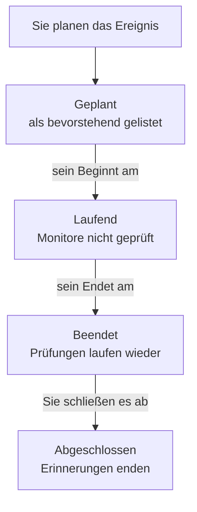

# Geplante Wartung – Übersicht

Ein geplantes Wartungsereignis kündigt geplante Arbeiten an, bevor sie beginnen: ein Datenbank-Upgrade, eine Netzwerkänderung, ein Umzug auf neue Server. OneUptime startet und beendet das Ereignis pünktlich, prüft die betroffenen Monitore nicht, solange die Arbeit läuft, und zeigt es auf Ihren Statusseiten, damit geplante Ausfallzeiten nie wie ein Ausfall aussehen. Diese Seite erklärt, wie ein Ereignis abläuft, wo im Dashboard Sie alles finden und was ein Ereignis im übrigen OneUptime verändert.

:::cards
- [Wie ein Ereignis abläuft](#wie-ein-ereignis-abläuft): Von geplant bis abgeschlossen, größtenteils von selbst.
- [Woher Ereignisse kommen](#woher-ereignisse-kommen): Das Formular, Vorlagen, ein Zeitplan, Formulare, Chat und Code.
- [Was ein Ereignis beeinflusst](#was-ein-ereignis-beeinflusst): Monitore, Statusseiten, Abonnenten und Warnungen.
- [Die Seiten eines Ereignisses](#die-seiten-eines-ereignisses): Seine Übersicht, Zeitachse, Notizen und Einstellungen.
:::

## Wie ein Ereignis abläuft

Jedes Ereignis hat ein geplantes Zeitfenster, sein **Beginnt am** und **Endet am**, und durchläuft Ihre Liste der Wartungsstatus von oben nach unten. Ein Job, der jede Minute läuft, schiebt es an beiden Enden des Fensters weiter, sodass Sie die Arbeit einmal planen und OneUptime den Rest erledigt.

Ein neues Ereignis beginnt in **Geplant**. Zu seinem **Beginnt am** wechselt es zu **Laufend**: OneUptime prüft seine Monitore nicht mehr und zeigt sie, falls Sie einen Status für sie gewählt haben, in diesem Status. Zu seinem **Endet am** wechselt es zu **Beendet**: Die Prüfungen laufen wieder, und jeder Monitor kehrt zu „betriebsbereit“ zurück. **Abgeschlossen** ist der letzte Schritt, und nichts setzt ihn von selbst: Eine Person, eine Chat-Schaltfläche oder die API markiert die Arbeit als abgenommen, was auch die Erinnerungen an die Eigentümer beendet.

Sie können ein Ereignis früher starten oder beenden oder eigene Status zwischen diesen vier hinzufügen. Siehe [Wartungsstatus](/docs/scheduled-maintenance/states).

## Wartung und Ankündigungen

Beide informieren die Besucher Ihrer Statusseiten über etwas. Nutzen Sie ein Wartungsereignis für Arbeiten mit Beginn und Ende und eine Ankündigung für alles andere, was sie lesen sollen.

|                              | Geplante Wartung                                                        | Ankündigung                                    |
| ---------------------------- | ----------------------------------------------------------------------- | ---------------------------------------------- |
| **Was es ist**               | Geplante Arbeit mit einem Zeitfenster                                   | Eine Nachricht für die Besucher Ihrer Statusseiten |
| **Seine Monitore**           | Werden nicht geprüft, solange es läuft, und zeigen den gewählten Status | Unverändert                                    |
| **Wie es weitergeht**        | Pünktlich durch Ihre Wartungsstatus                                     | Es wird ab seiner Startzeit bis zu seiner Endzeit gezeigt, falls es eine hat |
| **Wann Abonnenten informiert werden** | Wenn es geplant wird, beginnt und endet, und vor dem Beginn, wenn Sie es wünschen | Einmal, wenn es angezeigt wird        |
| **Nummern in einem neuen Projekt** | `SM-42`                                                           | Keine                                          |

Ankündigungen werden unter [Abonnenten & Ankündigungen](/docs/status-pages/subscribers#ankündigungen) behandelt.

## Woher Ereignisse kommen

- **Das Formular.** Klicken Sie in der Liste der Ereignisse auf **Geplantes Wartungsereignis erstellen** oder auf dem Tab **Geplante Wartung** eines Hosts, eines Clusters, eines Dienstes, eines Netzwerkstandorts oder einer anderen Ressource, der diese Ressource für Sie auswählt. Siehe [Wartungsereignisse erstellen](/docs/scheduled-maintenance/creating-events).
- **Eine Vorlage.** **Aus Vorlage erstellen** füllt das Formular aus einer Vorlage aus, die Sie für wiederkehrende Arbeiten gespeichert haben. Siehe [Vorlagen & wiederkehrende Ereignisse](/docs/scheduled-maintenance/templates).
- **Ein Zeitplan.** Eine wiederkehrende Vorlage erstellt nach einem Zeitplan, etwa jede Woche oder jeden Monat, ein neues Ereignis, ohne dass jemand das Formular öffnet.
- **Ein Formular.** Ein Formular, dessen Einreichungen Wartungsereignisse erstellen, macht aus einer Änderungsanfrage ein Ereignis. Siehe [Was eine Einreichung erstellt](/docs/forms/on-submit#wie-aus-einer-einreichung-ein-geplantes-wartungsereignis-wird).
- **Chat.** `/oneuptime maintenance` in Slack oder `maintenance`, an den OneUptime-Bot in Microsoft Teams geschrieben, öffnet das Formular in Ihrem Chat-Tool. Siehe [Slack](/docs/workspace-connections/slack#vorfälle-und-wartungen-aus-slack-erstellen).
- **Code.** Die API unter `/api/scheduled-maintenance`, die Terraform-Ressource `oneuptime_scheduled_maintenance_event` und der Schritt **Create One Scheduled Maintenance Event** eines Workflows.

## Wo die Wartung im Dashboard liegt

Öffnen Sie **Geplante Wartung** über das Menü **Produkte** in der oberen Leiste. Die Liste der Ereignisse liegt unter `/dashboard/{projectId}/scheduled-maintenance-events`, und ihr Seitenmenü enthält alles rund um die Wartung:

| Abschnitt     | Was Sie dort tun                                                                                                           |
| ------------- | -------------------------------------------------------------------------------------------------------------------------- |
| **Übersicht** | **Alle Ereignisse** und **Laufende Ereignisse**, dessen Abzeichen die gerade laufenden Ereignisse zählt.                     |
| **Kalender** | **Wartungskalender**: jedes Ereignis in einem Monat, einer Woche oder einem Tag, neben den Kalendern von außerhalb des Projekts, die Sie hinzufügen. |
| **Arbeitsbereich** | **Slack** und **Microsoft Teams**, je nachdem, was das Projekt verbunden hat, oder **Slack oder Teams verbinden**, wenn es keines hat. |
| **Regeln**    | **Eigentümerregeln**, **Runbook-Regeln**, **Beschriftungsregeln**, **Erinnerungsregeln**.                                   |
| **Einstellungen** | **Ereignisstatus**, **Ereignis-Vorlagen**, **Notiz-Vorlagen**, **Benutzerdefinierte Felder**, **Messungen**, **Kalendereinstellungen**, **Nummerierung**. |

**Übersicht** und **Kalender** sind geöffnet; **Arbeitsbereich**, **Regeln**, **Einstellungen** und **Entwickler** sind zunächst eingeklappt, und ein Abschnitt öffnet sich von selbst, wenn Sie auf einer seiner Seiten sind. **Entwickler** enthält **Terraform**, **API** und **KI-Assistenten**, um die Wartung per Code zu verwalten. Alles zur Wartung liegt hier, nicht in den **Projekteinstellungen**.

Die Liste zeigt **Nummer der geplanten Wartung**, **Titel**, **Aktueller Status**, **Betroffene Ressourcen**, **Auf Statusseite angezeigt**, **Beginnt am**, **Dauer**, **Endet am**, **Beschriftungen** und **Eigentümer**. Wählen Sie Ereignisse aus, um mehrere auf einmal zu bearbeiten: **Status ändern**, **Beschriftungen hinzufügen**, **Beschriftungen entfernen**, **Eigentümer hinzufügen**, **Eigentümer entfernen** oder **Löschen**.

**Wartungskalender** im Abschnitt **Kalender** zeigt dieselben Ereignisse auf einem Monat, einer Woche oder einem Tag und kann daneben Kalender von außerhalb des Projekts zeigen. Siehe [Wartungskalender](/docs/scheduled-maintenance/calendar).

## Was ein Ereignis beeinflusst

Solange ein Ereignis läuft, behandelt OneUptime den geplanten Ausfall als erwartet:

- **Seine Monitore werden nicht geprüft.** Jeder Monitor unter **Monitore** wird nicht mehr geprüft, und seine Seiten zeigen **Diese Überwachung ist deaktiviert**. Wenn Sie ein **Monitor-Status ändern in** gewählt haben, zeigen die Monitore diesen Status, auch auf Ihren Statusseiten. Wenn das Ereignis endet oder gelöscht wird, laufen die Prüfungen wieder, und jeder Monitor kehrt zu „betriebsbereit“ zurück, es sei denn, ein anderes laufendes Ereignis hält ihn noch.
- **Seine anderen Ressourcen bleiben still.** Ein Telemetrie-Monitor, der viele Hosts, Cluster, Datenbanken oder Dienste mit je einer Serie überwacht, erstellt keinen Vorfall und keine Warnung für eine Serie, deren Ressource das Ereignis abdeckt, während die anderen Serien weiter warnen.
- **Netzwerkstandorte und SLOs halten sich zurück.** Ein Netzwerkstandort, den das Ereignis abdeckt, rechnet seinen geplanten Ausfall den Standorten darüber nicht mehr an, und die Burn-Rate-Regeln eines SLO lösen nichts aus, solange einer seiner Monitore in Wartung ist. Siehe [Netzwerkstandorte](/docs/monitor/network-sites#geplante-wartung-für-netzwerkstandorte) und [Burn-Rate-Warnungen und -Vorfälle](/docs/slo/burn-rate-alerts#geplante-wartung).
- **Ihre Statusseiten zeigen es.** Das Ereignis erscheint auf den gewählten Statusseiten, zuerst als bevorstehend, dann als laufend, dann als vorbei, solange **Auf Statusseite sichtbar** in seinen **Einstellungen** eingeschaltet ist.
- **Abonnenten erfahren davon.** Standardmäßig werden die Abonnenten dieser Seiten informiert, wenn es geplant wird, wenn es beginnt und wenn es endet, und vor dem Beginn erinnert, wenn Sie Erinnerungen festlegen. Siehe [Geplante Wartungsereignisse](/docs/status-pages/subscribers#geplante-wartungsereignisse).
- **Ihr Team erfährt davon.** Seine Eigentümer werden so informiert, wie es ihre [Benachrichtigungseinstellungen](/docs/notifications/notification-settings) vorsehen, und die Slack- und Microsoft-Teams-Regeln unter **Arbeitsbereich** posten es in Ihre Kanäle.

## Die Seiten eines Ereignisses

Öffnen Sie ein Ereignis aus der Liste, um seine Seiten zu sehen. Sein Seitenmenü enthält:

| Abschnitt im Seitenmenü | Seiten                                                                                     |
| ----------------- | --------------------------------------------------------------------------------------------- |
| **Übersicht** | **Übersicht**, **Zustands-Zeitachse**, **Beschreibung**, **Runbooks** |
| **Team** | **Eigentümer** |
| **Benachrichtigungen**    | **Benachrichtigungsprotokolle** und **KI-Protokolle**: jede Nachricht über das Ereignis und alles, was die KI dafür getan hat |
| **Notizen**       | **Private Notizen** und **Öffentliche Notizen**                                                |
| **Entwickler**    | **Terraform**, **API** und **KI-Assistenten**: das Ereignis per Code verwaltet                  |
| **Erweitert**     | **Benutzerdefinierte Felder**, **Einstellungen**, **Audit-Protokolle**, **Ereignis löschen**    |

**Übersicht**, **Team** und **Notizen** sind geöffnet; die anderen Abschnitte bleiben eingeklappt, bis Sie sie anklicken.

- **Übersicht** — die Kopfzeile zeigt Nummer, Titel und Status des Ereignisses, wie lange es bis zum Beginn dauert oder wie lange es schon läuft, wem es gehört, auf welchen Statusseiten es erscheint und wer es erstellt hat, und die Schaltflächen, die es weiterschieben. Darunter zeigen **Beginnt**, **Endet** und **Dauer** das geplante Zeitfenster in Ihrer Zeitzone. Der **Feed der geplanten Wartung** zeichnet alles auf, was dem Ereignis passiert ist, neben den Karten **Wartungsdetails** und **Betroffene Ressourcen** sowie den Karten **Messungen** und **Benutzerdefinierte Felder**, wenn Ihr Projekt welche hat.
- **Zustands-Zeitachse** — jeder Status, in dem das Ereignis war, wann und wie lange. Siehe [Wartungsstatus](/docs/scheduled-maintenance/states#die-zustands-zeitachse).
- **Öffentliche Notizen** — Updates für Ihre Statusseiten und deren Abonnenten. **Private Notizen** sind nur für Ihr Team.
- **Einstellungen** — **Auf Statusseite sichtbar**, das das Ereignis auf seinen Statusseiten zeigt oder verbirgt, und **Erinnerungen senden**, das seine Eigentümer erinnert, bis es abgeschlossen ist. Jeder Schalter speichert, sobald Sie ihn umlegen.

## Fehlerbehebung

:::details Ein Ereignis hat zu seinem Beginnt am nicht begonnen
Der Job, der Ereignisse startet, läuft jede Minute, warten Sie also eine Minute. Zeigt die Kopfzeile **Start überfällig**, hat das Ereignis seinen Beginn um mehr als zwei Minuten verpasst: Starten Sie es mit der Schaltfläche in der Kopfzeile, die alles tut, was der Job tut, und öffnen Sie seine **Zustands-Zeitachse**, um zu sehen, wo es stand.
:::

:::details Ein Monitor wurde während der Wartung weiter geprüft
Nur die Monitore, die das Ereignis unter **Monitore** nennt, werden nicht mehr geprüft, und nur solange das Ereignis läuft. Ein Monitor eines Hosts oder Dienstes, den das Ereignis unter **Andere betroffene Ressourcen** nennt, wird weiter geprüft. Bearbeiten Sie die Karte **Betroffene Ressourcen** des Ereignisses, um den Monitor hinzuzufügen.
:::

:::details Das Ereignis erscheint nicht auf meiner Statusseite
Prüfen Sie, ob das Ereignis die Seite unter **Ereignis auf diesen Status-Seiten anzeigen** nennt und ob **Auf Statusseite sichtbar** in den **Einstellungen** des Ereignisses eingeschaltet ist. Prüfen Sie dann die Statusseite selbst: Sie muss geplante Wartungsereignisse anzeigen, und ein Ereignis, das vor längerer Zeit begonnen hat als das Verlaufsfenster der Seite, standardmäßig 14 Tage, wird nicht mehr aufgeführt.
:::

## Nächste Schritte

:::cards
- [Wartungsereignisse erstellen](/docs/scheduled-maintenance/creating-events): Das Formular, Feld für Feld, und was danach passiert.
- [Wartungsstatus](/docs/scheduled-maintenance/states): Was ein Ereignis startet und beendet, und eigene Status.
- [Vorlagen & wiederkehrende Ereignisse](/docs/scheduled-maintenance/templates): Ein Ereignis wiederverwenden oder es jede Woche planen.
- [Wartungsregeln & Einstellungen](/docs/scheduled-maintenance/settings): Eigentümer, Beschriftungen, Runbooks und Erinnerungen, automatisch.
:::
