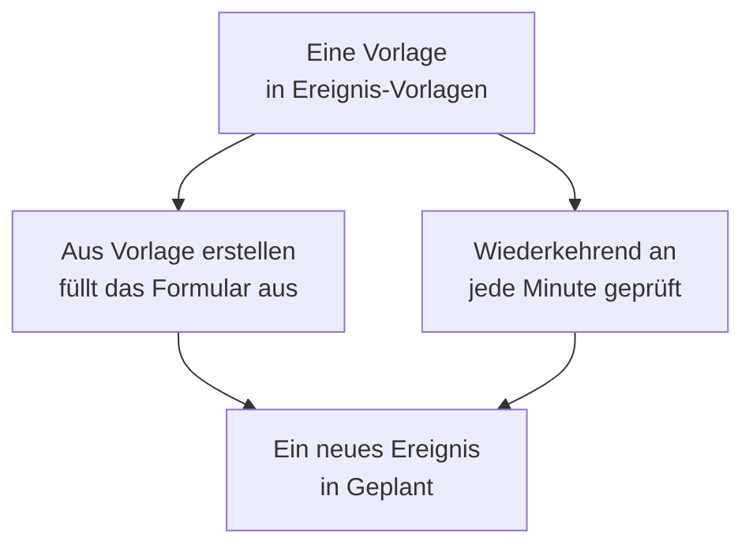

# Vorlagen & wiederkehrende Ereignisse

Eine Vorlage für geplante Wartung speichert ein Ereignis, das Sie oft planen: seinen Titel und seine Beschreibung, die Monitore, die es pausiert, die Statusseiten, auf denen es erscheint, und wer informiert wird. Nutzen Sie eine, um das Formular mit einem Klick auszufüllen, oder machen Sie sie wiederkehrend, damit OneUptime das Ereignis für Sie plant, jede Woche, jeden Monat oder in einem beliebigen Abstand.

:::cards
- [Eine Vorlage erstellen](#eine-vorlage-erstellen): Die Schritte des Formulars, mit einem Namen vorne und einem Zeitplan am Ende.
- [Eine Vorlage verwenden](#eine-vorlage-verwenden): Ein neues Ereignis daraus ausfüllen.
- [Wiederkehrende Ereignisse](#wiederkehrende-ereignisse): OneUptime das Ereignis selbst planen lassen.
- [Eine Vorlage ändern oder stoppen](#eine-vorlage-ändern-oder-stoppen): Sie bearbeiten, ihren Zeitplan anhalten oder sie löschen.
:::

## So funktioniert es

Eine Vorlage ist ein Ausgangspunkt. Ein daraus erstelltes Ereignis ist eine Kopie mit eigenen Werten: Wenn Sie die Vorlage später ändern, ändern sich nur die danach erstellten Ereignisse.

## Bevor Sie beginnen

- **Ihr Plan.** In OneUptime Cloud erfordern Vorlagen den Plan **Growth** oder höher.
- **Ihre Rolle.** Um eine Vorlage zu erstellen, brauchen Sie **Projektinhaber**, **Projektadministrator**, **Projektmitglied**, **Wartungs-Administrator** oder **Wartungs-Mitglied** oder eine benutzerdefinierte Rolle, die Vorlagen für geplante Wartung erstellen darf.

## Eine Vorlage erstellen

:::steps
### Die Vorlagen öffnen

Gehen Sie zu **Geplante Wartung → Einstellungen → Ereignis-Vorlagen**. **Einstellungen** ist im Seitenmenü zunächst eingeklappt: Klappen Sie es zuerst auf. Klicken Sie auf **Vorlage für geplante Wartung erstellen**.

### Die Vorlage benennen

Geben Sie ihr unter **Vorlageninformationen** einen **Vorlagenname** und eine **Vorlagenbeschreibung**, damit Ihr Team weiß, wann es sie nutzen soll. Beides ist erforderlich.

### Das Ereignis beschreiben

Füllen Sie unter **Ereignis** den **Titel** und die **Beschreibung** aus, mit denen jedes Ereignis daraus beginnt. **Eigentümer** und **Beschriftungen** liegen unter **Weitere Felder**.

### Auswählen, was sie betrifft

Wählen Sie unter **Betroffene Ressourcen** die **Monitore**, das **Monitor-Status ändern in** für sie, beliebige **Andere betroffene Ressourcen**, die Statusseiten unter **Ereignis auf diesen Status-Seiten anzeigen** und die **Abonnentenbenachrichtigungen**.

### Entscheiden, ob sie wiederkehrt

Lassen Sie unter **Wiederkehrend** den Schalter **Wiederkehrendes Ereignis** für eine Vorlage aus, die Sie von Hand nutzen, oder schalten Sie ihn ein und füllen Sie den Zeitplan aus. Klicken Sie auf **Weiter**, um die Überprüfung zu prüfen, und erstellen Sie dann die Vorlage.
:::

Eine Vorlage fragt nach **Monitor-Status ändern in**, auch wenn sie keine Monitore nennt: Der Status gilt auch für die Monitore, die Sie hinzufügen, wenn Sie ein Ereignis daraus planen. Unter **Andere betroffene Ressourcen** nimmt eine Vorlage Hosts, Kubernetes-Cluster, Docker-Hosts, Podman-Hosts und Dienste an.

## Was eine Vorlage ausfüllt

| Teil des Ereignisses                              | Aus Vorlage erstellen                | Ein wiederkehrendes Ereignis    |
| ------------------------------------------------- | ------------------------------------ | ------------------------------- |
| **Titel** und **Beschreibung**                    | Ausgefüllt, und Sie können sie ändern | Kopiert                        |
| **Monitore** und **Monitor-Status ändern in**     | Ausgefüllt                           | Kopiert                         |
| **Andere betroffene Ressourcen**                  | Ausgefüllt                           | Kopiert                         |
| Die Statusseiten und **Abonnentenbenachrichtigungen** | Ausgefüllt                       | Kopiert                         |
| **Eigentümer** und **Beschriftungen**             | Ausgefüllt                           | Kopiert                         |
| **Beginnt am** und **Endet am**                   | Die nächste volle Stunde, für eine Stunde | Aus dem Zeitplan berechnet |

## Eine Vorlage verwenden

:::steps
### Die Vorlage wählen

Klicken Sie unter **Geplante Wartung → Alle Ereignisse** auf **Aus Vorlage erstellen** und wählen Sie eine Vorlage unter **Vorlage für geplante Wartung auswählen**.

### Das Formular prüfen

Klicken Sie auf **Aus Vorlage erstellen**. Das Formular öffnet sich mit den Antworten der Vorlage. Legen Sie das Zeitfenster fest und ändern Sie, was dieses Ereignis braucht.

### Das Ereignis erstellen

Gehen Sie die Schritte mit **Weiter** durch und klicken Sie dann in der Überprüfung auf **Geplantes Wartungsereignis erstellen**.
:::

Hat das Projekt noch keine Vorlage, sagt **Aus Vorlage erstellen** das und verlinkt auf **Ereignis-Vorlagen**.

## Wiederkehrende Ereignisse

Eine wiederkehrende Vorlage erstellt das Ereignis nach einem Zeitplan. Sie legen fest, wann das erste Ereignis erstellt wird, wann es beginnt und wann es endet; jedes spätere Ereignis behält dieselben Abstände, ein Intervall später.

| Feld                                     | Was es bedeutet                                                                                     |
| ---------------------------------------- | --------------------------------------------------------------------------------------------------- |
| **Wiederkehrendes Ereignis**             | Schaltet den Zeitplan ein.                                                                          |
| **Erstes Ereignis geplant für**          | Wann OneUptime das erste Ereignis erstellt, also wann seine Abonnenten erfahren, dass es geplant ist. |
| **Erstes Ereignis beginnt am**           | Wann das erste Ereignis beginnt.                                                                    |
| **Erstes Ereignis endet am**             | Wann das erste Ereignis endet.                                                                      |
| **Wie oft soll dieses Ereignis wiederkehren?** | Eine Zahl und eine Einheit: Stunden, Tage, Wochen, Monate oder Jahre.                         |

Zum Beispiel ein wöchentliches Zeitfenster, dessen erstes Ereignis an einem Montag für den Samstag danach erstellt wird:

| Ereignis     | Erstellt           | Beginnt            | Endet              |
| ------------ | ------------------ | ------------------ | ------------------ |
| Das erste    | `2030-06-03 09:00` | `2030-06-08 02:00` | `2030-06-08 04:00` |
| Das zweite   | `2030-06-10 09:00` | `2030-06-15 02:00` | `2030-06-15 04:00` |

Setzen Sie **Erstes Ereignis geplant für** so weit vor den Beginn, wie Ihre Kunden im Voraus von der Arbeit erfahren sollen. Alle drei Zeiten müssen beim Erstellen der Vorlage in der Zukunft liegen, das Ereignis muss vor seinem Beginn und Ende erstellt werden, und es muss beginnen, bevor es endet; das Formular sagt, gegen welche Regel eine Zeit verstößt.

Ein Job prüft die wiederkehrenden Vorlagen jede Minute. Wenn die nächste Zeit einer Vorlage kommt, schiebt er diese Zeit um ein Intervall weiter und erstellt das Ereignis. Die Vorlagenliste zeigt diese Zeit in ihrer Spalte **Wiederkehrendes Ereignis**, und **Nein** bei einer Vorlage, die nicht wiederkehrt. Ein nach Zeitplan erstelltes Ereignis ist wie jedes andere: Seine Regeln laufen, seine Eigentümer werden hinzugefügt, und seine Abonnenten erfahren, dass es geplant ist.

## Eine Vorlage ändern oder stoppen

Öffnen Sie eine Vorlage aus der Liste, um ihre Seite zu sehen:

- **Vorlagendetails der geplanten Wartung** zeigt, womit neue Ereignisse beginnen. Ihr **Bearbeiten** führt durch **Vorlageninformationen**, **Ereignis**, **Statusseiten** und **Wiederkehrend**.
- **Betroffene Ressourcen** enthält ihre **Monitore**, deren **Monitor-Status ändern in** und ihre **Andere betroffene Ressourcen**, mit einem eigenen **Bearbeiten**.
- **Eigentümer** listet die Personen und Teams auf, denen jedes aus ihr geplante Ereignis gehört.

Änderungen gelten für die Ereignisse, die nach dem Speichern erstellt werden; bereits erstellte Ereignisse behalten ihre eigenen Werte. Um einen Zeitplan zu stoppen, schalten Sie **Wiederkehrendes Ereignis** in **Bearbeiten** aus oder löschen Sie die Vorlage. Eine ausgeschaltete Vorlage behält ihren Zeitplan: Schalten Sie sie wieder ein, macht sie bei der nächsten Zeit des Zeitplans weiter und überspringt die Zeiten, in denen sie aus war. Wenn Sie eine Vorlage löschen, bleiben die von ihr erstellten Ereignisse erhalten.

## Fehlerbehebung

:::details Beim Erstellen einer wiederkehrenden Vorlage heißt es, eine Zeit sollte in der Zukunft liegen
Alle drei ersten Zeiten müssen beim Erstellen nach dem jetzigen Zeitpunkt liegen. Verschieben Sie sie nach vorn: Der Zeitplan setzt sich dann ab dem ersten Ereignis fort.
:::

:::details Eine wiederkehrende Vorlage hat kein Ereignis erstellt
Prüfen Sie, ob **Wiederkehrendes Ereignis** noch eingeschaltet ist, und sehen Sie sich die Zeit in der Spalte **Wiederkehrendes Ereignis** der Liste an: Das Ereignis wird dann erstellt, nicht zu seinem Beginn. Der Job läuft jede Minute, warten Sie also eine Minute.
:::

:::details Einem Ereignis aus einer Vorlage fehlt eine Ressource, die ich gewählt habe
Eine Vorlage nimmt unter **Andere betroffene Ressourcen** Hosts, Kubernetes-Cluster, Docker-Hosts, Podman-Hosts und Dienste an. Fügen Sie andere Arten von Ressourcen dem Ereignis selbst hinzu, mit **Bearbeiten** auf seiner Karte **Betroffene Ressourcen**.
:::

## Nächste Schritte

:::cards
- [Wartungsereignisse erstellen](/docs/scheduled-maintenance/creating-events): Das Formular, das eine Vorlage ausfüllt.
- [Wartungsstatus](/docs/scheduled-maintenance/states): Wie jedes Ereignis nach dem Erstellen weitergeht.
- [Wartungsregeln & Einstellungen](/docs/scheduled-maintenance/settings): Jedem neuen Ereignis automatisch Eigentümer und Beschriftungen hinzufügen.
- [Geplante Wartung – Übersicht](/docs/scheduled-maintenance/index): Wo Vorlagen in der übrigen Wartung ihren Platz haben.
:::
