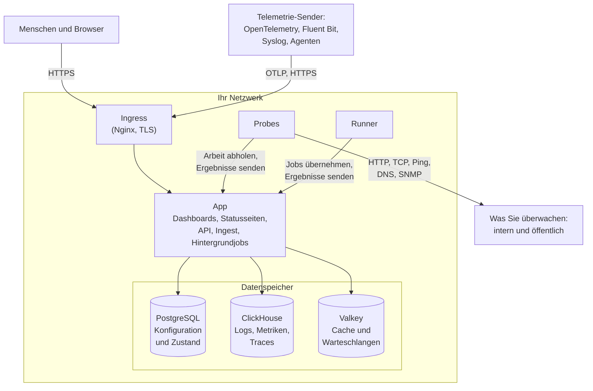

# Architektur

Eine selbst gehostete OneUptime-Installation besteht aus einer Handvoll Container: einem Ingress, über den jede Anfrage hereinkommt, einem App-Image, das die Arbeit erledigt, Probes, die die Prüfungen Ihrer Monitore ausführen, und drei Datenspeichern. Diese Seite zeigt, wie sie zusammenspielen, was jeder Teil tut und welche Verbindungen Ihr Netzwerk überqueren.

## Was das zeigt

- Menschen erreichen OneUptime über den **Ingress**, der TLS terminiert und jede Anfrage an die App weiterleitet: das Dashboard, die Statusseiten, die API und jeden Ingest-Endpunkt, an den Telemetrie gesendet wird.
- Die **App** liest und schreibt ihren Zustand in PostgreSQL, speichert Telemetrie in ClickHouse und nutzt Valkey (den BSD-lizenzierten Fork von Redis 7.2) als Cache und für die Warteschlangen, die ihre Hintergrundjobs abarbeiten.
- **Probes** können in Ihrem Cluster laufen (empfohlen) und/oder an anderer Stelle in Ihrem Netzwerk. Sie können Folgendes überwachen:
  - Interne/private Dienste hinter Ihrer Firewall.
  - Externe/öffentliche Ressourcen im Internet.
- Probe-Ergebnisse werden an die App gesendet, in Valkey eingereiht und von den Hintergrundjobs in Ihre Datenspeicher geschrieben. Eine Probe an anderer Stelle in Ihrem Netzwerk erreicht die App über den Ingress, unter Ihrer OneUptime-URL.
- Telemetrie (Metriken, Traces, Logs und mehr) wird von derselben App aufgenommen und in ClickHouse gespeichert.

> [!NOTE]
> Wenn Sie statt der mitgelieferten Datenbanken ein externes PostgreSQL, Valkey (oder Redis) oder ClickHouse verwenden, verbindet sich die App stattdessen mit Ihren externen Endpunkten. Der logische Ablauf bleibt derselbe.

## Die Komponenten

| Komponente | Docker-Compose-Dienst | Helm-Chart | Was sie tut |
| --- | --- | --- | --- |
| Ingress | `ingress` | `nginx` | Terminiert TLS, bedient Ihren Hostnamen und die Domains Ihrer Statusseiten und leitet jede Anfrage an die App weiter. |
| App | `app` | `app` | Das Dashboard, die Statusseiten, die API- und Ingest-Endpunkte und, sofern Sie sie nicht abtrennen, die Hintergrundjobs. |
| Worker | Teil von `app` | `worker` (standardmäßig aus) | Die Hintergrundjobs in eigenen Pods, damit aufwendige Warteschlangenverarbeitung nie mit API-Anfragen konkurriert. |
| Telemetrie-Writer | Teil von `app` | `telemetryWriter` (standardmäßig aus) | Eine Stufe fester Größe, die jeden ClickHouse-Insert ausführt, damit die Inserts begrenzt bleiben, wie weit die Worker auch skalieren. |
| Probe | `probe-1` | `probes` | Führt Monitorprüfungen aus und sendet die Ergebnisse zurück. Jede mitgelieferte Probe ist eine globale Probe, die alle Projekte nutzen können. |
| Runner | `runner` | `runner` | Der eigene Runner der Instanz, der KI-Codekorrekturen für jedes Projekt ausführen kann. Runbook-Schritte laufen auf [Runnern](/docs/runbooks/agents), die Sie dort installieren, wo sie laufen sollen. |
| PostgreSQL | `postgres` | `postgresql` oder `postgresOperator.cnpg` | Projekte, Monitore, Incidents, Benutzer und alle anderen Einstellungen und Zustände. |
| ClickHouse | `clickhouse` | `clickhouse` oder `clickhouseOperator.altinity` | Logs, Metriken, Traces, Ausnahmen, Profile und Monitor-Logs. |
| Valkey | `valkey` | `valkey` | Der Cache, die Job-Warteschlangen und kurzlebiger Zustand wie ausstehende Push-Belege. |

Alle Rollen der App sind dasselbe Image: Docker Compose führt sie in einem `app`-Container aus, und das Helm-Chart kann den Worker und den Telemetrie-Writer als eigene Deployments ausführen. Wie Sie jede Stufe dimensionieren, steht unter [Dimensionierung und Kapazitätsplanung](/docs/installation/sizing).

## Verbindungen aus Ihrem Netzwerk heraus

Die App baut nur für das, was Sie einschalten, Verbindungen nach außen auf. Jede davon ist optional, und zu jeder gibt es eine Seite, die die genauen freizugebenden Adressen nennt:

| Ausgehende Verbindung | Wofür | Mehr dazu |
| --- | --- | --- |
| E-Mail (SMTP oder die API von SendGrid) | Benachrichtigungen und Einladungen | [SMTP](/docs/emails/smtp) |
| Twilio | SMS und Telefonanrufe | [Twilio-Integration](/docs/self-hosted/twilio-integration) |
| Das Push-Relay von OneUptime oder Expo | Mobile Push-Benachrichtigungen | [Push-Benachrichtigungen](/docs/self-hosted/push-notifications) |
| Slack und Microsoft Teams | Benachrichtigungen und Aktionen im Workspace | [Slack-Integration](/docs/self-hosted/slack-integration) |
| Ein LLM-Anbieter, etwa OpenAI, Anthropic, Microsoft Foundry oder ein Modell, das Sie selbst betreiben | OneUptime AI | [LLM-Anbieter](/docs/ai/llm-provider) |
| `oneuptime.com` | Eine Enterprise-Lizenz online aktivieren | [Enterprise Edition](/docs/self-hosted/enterprise) |

Verbindungen in die andere Richtung – SendGrid, das eingehende E-Mails zustellt, oder Slack und Microsoft Teams, die zurückrufen – setzen voraus, dass der Ingress aus dem Internet erreichbar ist. Welche privaten Adressen die App und die Probes erreichen dürfen, entscheiden Sie: siehe [Zugriff auf private Netzwerke](/docs/self-hosted/private-network-access).

## Nächste Schritte

:::cards
- [Docker Compose](/docs/installation/docker-compose): Alle Komponenten auf einer Maschine installieren.
- [Dimensionierung und Kapazitätsplanung](/docs/installation/sizing): Wie viel CPU, Arbeitsspeicher und Speicherplatz jede Stufe braucht.
- [Eigene Probes](/docs/probe/custom-probe): Eine Probe in einem anderen Netzwerk betreiben.
- [Enterprise Edition](/docs/self-hosted/enterprise): Was die Enterprise-Images hinzufügen und wie die Lizenzierung funktioniert.
:::
