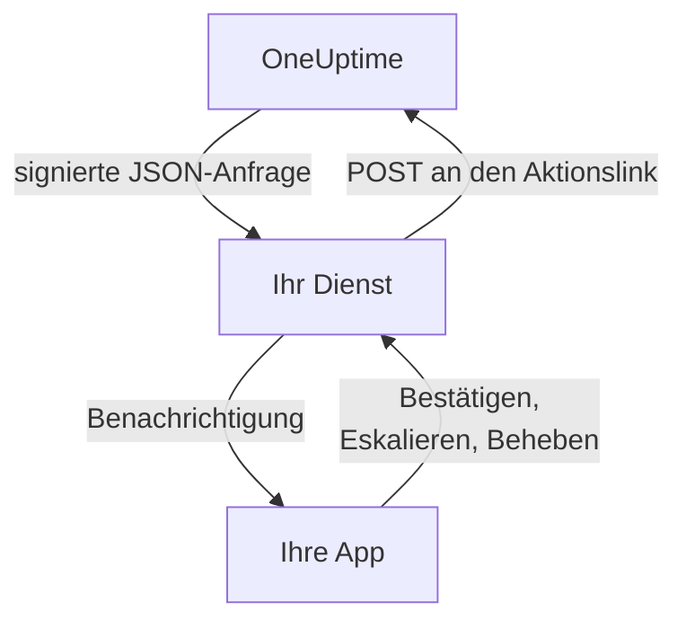

# Benutzerdefinierte Benachrichtigungskanäle

Ein benutzerdefinierter Kanal sendet Bereitschaftsalarme an einen Dienst, den Sie betreiben: die eigene App Ihres Unternehmens, ein Pager-System oder ein Gateway, das prüft, was Ihr Netzwerk verlässt. Sie fügen ihn einmal für den ganzen Server hinzu, und alle können darüber alarmiert werden, ohne etwas einzurichten. Im Admin Dashboard heißen sie **Custom Channels**.

> [!NOTE]
> Benutzerdefinierte Kanäle sind Teil der [OneUptime Enterprise Edition](/docs/self-hosted/enterprise) und brauchen eine Enterprise-Lizenz, die sie umfasst. Die Community Edition hat keine Seite **Custom Channels** und sendet nichts an einen Kanal. Siehe [Ohne Lizenz](#ohne-lizenz).

:::cards
- [Einen Kanal hinzufügen](#einen-kanal-hinzufügen): Ein Name, eine URL und ein Signaturgeheimnis.
- [Was Ihr Dienst empfängt](#was-ihr-dienst-empfängt): Eine signierte JSON-Anfrage pro Person und Alarm.
- [Auf einen Alarm reagieren](#auf-einen-alarm-reagieren): Aus Ihrer eigenen App bestätigen, eskalieren oder beheben.
- [Zustellung und Wiederholungen](#zustellung-und-wiederholungen): Was passiert, wenn Ihr Dienst nicht erreichbar ist.
- [Andere Benachrichtigungen](#andere-benachrichtigungen): Benachrichtigungen an Besitzer, Notizen und Schichten, für alle, die sie möchten.
- [Ohne Lizenz](#ohne-lizenz): Was endet und was erhalten bleibt.
:::

## So funktioniert es



Wenn eine Bereitschaftsrichtlinie jemanden alarmiert und dessen Bereitschaftsregel den Kanal verwendet, sendet OneUptime eine Anfrage an die URL des Kanals. Sie sagt, für wen der Alarm ist (Name und E-Mail-Adresse) und worum es geht, und enthält Links, die Ihr Dienst aufruft, wenn die Person den Alarm in Ihrer App bestätigt, eskaliert oder behebt.

## Einen Kanal hinzufügen

1. Öffnen Sie im Admin Dashboard **Einstellungen**, dann im Seitenmenü **Benachrichtigungen > Custom Channels** (**Benachrichtigungen** ist anfangs eingeklappt), und wählen Sie **Add**.
2. Füllen Sie im Schritt **Channel** aus:
   - **Name**: was Personen in ihren Benachrichtigungsmethoden und Bereitschaftsregeln sehen, zum Beispiel `CorpoApp`.
   - **Webhook URL**: wohin OneUptime jeden Alarm sendet. Sie kann in Ihrem privaten Netzwerk liegen.
   - **Signing Secret**: OneUptime erzeugt eines für Sie. Kopieren Sie es in Ihren Dienst, der jede Anfrage damit prüft. Sie sehen es wieder, wenn Sie den Kanal bearbeiten.
3. Speichern Sie im Schritt **Delivery**, und wählen Sie dann **Send test**, um Ihrem Dienst eine [Testanfrage](#testanfragen) zu senden.

Im Schritt **Delivery** ist **Page everyone through this channel** eingeschaltet. OneUptime fügt den Kanal dann den Bereitschaftsregeln aller Personen in jedem Projekt hinzu, ebenso den Regeln aller, die später einem Projekt beitreten, und erreicht über ihn auch Personen in Bereitschaft, die für das Ausgelöste keine Regel haben. Schalten Sie es aus, damit jede Person den Kanal selbst zu ihren Regeln hinzufügt.

Personen sehen den Kanal unter **Benutzereinstellungen**, dann **Benachrichtigungsmethoden**, dann **Custom Channels**, mit einer Schaltfläche **Send test**, und wählen ihn in ihren Bereitschaftsregeln als `Custom Channel: CorpoApp`. Sie richten nichts ein: Ihr Dienst erfährt, für wen jeder Alarm ist.

Um das Senden zu stoppen, ohne die Regeln von jemandem zu ändern, bearbeiten Sie den Kanal und schalten **An** aus. Alarme, die an ihn gegangen wären, werden im Bereitschaftsprotokoll als nicht gesendet erfasst. Wenn Sie einen Kanal löschen, wird jede Bereitschaftsregel gelöscht, die ihn verwendet.

## Was Ihr Dienst empfängt

Jeder Alarm ist eine `POST`-Anfrage mit einem JSON-Body:

| Header | Was er enthält |
| --- | --- |
| `Content-Type` | `application/json` |
| `X-OneUptime-Event` | Das Ereignis, etwa `on-call.incident.created` |
| `X-OneUptime-Signature` | `sha256=` und der hexadezimale HMAC-SHA256 des unveränderten Bodys, erstellt mit dem Signaturgeheimnis des Kanals |

```json title="An incident page"
{
  "version": 1,
  "event": "on-call.incident.created",
  "notificationId": "5f2c8a1e-6b1d-4c3a-9e7f-2a4b6c8d0e1f",
  "sentAt": "2026-10-27T03:14:15.000Z",
  "channel": { "id": "0b7e…", "name": "CorpoApp" },
  "title": "New Incident INC-42: API latency high",
  "message": "A new incident has been created: INC-42 (API latency high) in Agency A. Click to view details.",
  "project": { "id": "8d1f…", "name": "Agency A" },
  "team": { "id": "2c9a…", "name": "SRE" },
  "user": { "id": "4e6b…", "name": "Jane Tan", "email": "jane@example.com" },
  "recordType": "incident",
  "record": {
    "id": "9a3c…",
    "number": "INC-42",
    "title": "API latency high",
    "description": "p95 latency above 2 seconds for 5 minutes.",
    "severity": "Critical",
    "state": "Created",
    "url": "https://oneuptime.example.com/dashboard/8d1f…/incidents/9a3c…"
  },
  "onCallPolicy": { "id": "1d4e…", "name": "Primary" },
  "escalationRule": { "id": "7b2f…", "name": "Level 1" },
  "isPageAgain": false,
  "actions": {
    "acknowledge": "https://oneuptime.example.com/api/custom-notification-channel/page/5f2c…/acknowledge?token=…",
    "escalate": "https://oneuptime.example.com/api/custom-notification-channel/page/5f2c…/escalate?token=…",
    "resolve": "https://oneuptime.example.com/api/custom-notification-channel/page/5f2c…/resolve?token=…"
  }
}
```

| Feld | Was es ist |
| --- | --- |
| `version` | `1`. Zu dieser Version kommen nur Felder hinzu. |
| `event` | `on-call.incident.created`, `on-call.alert.created`, `on-call.incidentEpisode.created`, `on-call.alertEpisode.created`, `notification` für [andere Benachrichtigungen](#andere-benachrichtigungen) oder `test` |
| `notificationId` | Eine pro Person und Alarm. Damit verwerfen Sie eine Anfrage, die Sie bereits verarbeitet haben. |
| `title`, `message` | Fertig zum Anzeigen, so wie eine Push-Benachrichtigung sie zeigen würde |
| `user` | Für wen der Alarm ist. Finden Sie das Konto in Ihrer App über `email` oder `id`. |
| `team` | Das Team, über das die Person alarmiert wurde, oder `null`, wenn sie direkt alarmiert wurde |
| `recordType`, `record` | Worum es im Alarm geht: ein `incident`, `alert`, `incidentEpisode` oder `alertEpisode` |
| `onCallPolicy`, `escalationRule` | Die Richtlinie und die Stufe, die die Person alarmiert haben |
| `isPageAgain` | `true`, wenn der Datensatz vor einer Weile bestätigt wurde und noch immer nicht behoben ist |
| `actions` | Die Links, die Ihr Dienst aufruft, um [auf den Alarm zu reagieren](#auf-einen-alarm-reagieren) |

Ein Alarm an mehrere Personen ist eine Anfrage pro Person, jede mit den eigenen Links dieser Person, damit OneUptime weiß, wer geantwortet hat. Titel, Nachricht und Beschreibung sind zusammen auf 16.384 Zeichen begrenzt; eine längere Beschreibung wird gekürzt und endet mit „… (truncated — see OneUptime for the full text)“.

### Die Signatur prüfen

Berechnen Sie den HMAC des unveränderten Request-Bodys, bevor Sie ihn parsen, und vergleichen Sie ihn mit dem Header:

```javascript title="Node.js"
const crypto = require("crypto");

function isFromOneUptime(rawBody, signatureHeader, secret) {
  const expected =
    "sha256=" + crypto.createHmac("sha256", secret).update(rawBody).digest("hex");
  const received = String(signatureHeader || "");

  return (
    received.length === expected.length &&
    crypto.timingSafeEqual(Buffer.from(received), Buffer.from(expected))
  );
}
```

## Auf einen Alarm reagieren

Drückt die Person in Ihrer App eine Schaltfläche, sendet Ihr Dienst eine `POST`-Anfrage an den passenden Link in `actions`. Dafür ist kein API-Schlüssel nötig: Jeder Link trägt ein Token für genau diesen Alarm, das 7 Tage gültig ist, und die Aktion wird als von der alarmierten Person ausgeführt erfasst.

| Aktion | Was sie bewirkt |
| --- | --- |
| `acknowledge` | Bestätigt den Alarm der Person und damit den Vorfall, die Warnung oder die Episode |
| `escalate` | Die Person kann ihn nicht übernehmen: alarmiert sofort die nächste Stufe der Bereitschaftsrichtlinie und hört auf, sie zu alarmieren |
| `resolve` | Behebt den Vorfall, die Warnung oder die Episode, wenn die eigenen Berechtigungen der Person es erlauben |

```bash title="Acknowledge a page"
curl -X POST "https://oneuptime.example.com/api/custom-notification-channel/page/5f2c…/acknowledge?token=…"
```

Die Antwort sagt, was passiert ist, in Worten, die Ihre App unverändert anzeigen kann:

```json title="The answer"
{
  "action": "acknowledge",
  "result": "acknowledged",
  "message": "Acknowledged."
}
```

`result` ist eines von `acknowledged`, `alreadyAcknowledged`, `escalated`, `notEscalated`, `resolved` und `alreadyResolved`. Ein abgelaufener oder falscher Link wird mit einem 4xx-Status und einer Meldung abgelehnt.

## Andere Benachrichtigungen

Alarme sind nicht die einzigen Benachrichtigungen, die Personen erhalten: OneUptime teilt ihnen auch mit, wenn ein Vorfall, dessen Besitzer sie sind, seinen Status ändert, wenn eine Notiz veröffentlicht wird, wenn ihre Bereitschaftsschicht beginnt, und mehr. Jede Person wählt unter **Benutzereinstellungen > Benachrichtigungseinstellungen**, wohin jede davon geht; dort gibt es eine Spalte **Custom Channels**, solange ein Kanal eingeschaltet ist. Sie ist für alle ausgeschaltet, bis sie sie selbst einschalten.

Eine Benachrichtigung geht an jeden eingeschalteten Kanal, als eine Anfrage pro Kanal, mit `event` auf `notification`:

```json title="A notification"
{
  "version": 1,
  "event": "notification",
  "notificationId": null,
  "sentAt": "2026-10-27T03:20:00.000Z",
  "channel": { "id": "0b7e…", "name": "CorpoApp" },
  "title": "Incident INC-42 acknowledged",
  "message": "Incident INC-42 (API latency high) was acknowledged in Agency A.",
  "project": { "id": "8d1f…", "name": "Agency A" },
  "team": null,
  "user": { "id": "4e6b…", "name": "Jane Tan", "email": "jane@example.com" },
  "recordType": null,
  "record": null,
  "onCallPolicy": null,
  "escalationRule": null,
  "isPageAgain": false,
  "actions": null,
  "notificationType": "Send incident state changed notification when I am the owner of the incident",
  "url": "https://oneuptime.example.com/dashboard/8d1f…/incidents/9a3c…"
}
```

`title` und `message` sind das, was die Push-Benachrichtigung der Person sagen würde. `notificationType` nennt die Einstellung, für die sie gesendet wurde, und `url` verlinkt auf das, worum es geht, oder ist `null`. Es gibt nichts zu tun, deshalb ist `actions` gleich `null`.

## Zustellung und Wiederholungen

Eine Anfrage gilt als zugestellt, wenn Ihr Dienst innerhalb von 10 Sekunden mit einem 2xx-Status antwortet. Eine Anfrage, auf die er nicht oder mit 408, 429 oder einem 5xx-Status geantwortet hat, wird nach 1 Sekunde und nach weiteren 4 Sekunden erneut gesendet: insgesamt drei Versuche. Bei jedem anderen 4xx-Status wird sie nicht erneut gesendet.

Das Ergebnis jedes Versuchs steht im Bereitschaftsprotokoll der Person, mit dem Namen des Kanals und dem Status, mit dem Ihr Dienst geantwortet hat, nie mit der URL. Ein nicht zugestellter Alarm hält die Bereitschaftsrichtlinie nicht an: Bestätigt niemand, eskaliert sie wie gewohnt. Behalten Sie weiter hinten in Ihren Regeln eine E-Mail- oder SMS-Regel, wenn Ihr Dienst der einzige Weg ist, Personen zu erreichen.

## Testanfragen

**Send test** auf der Seite im Admin Dashboard oder in den Benachrichtigungsmethoden einer Person sendet eine Anfrage mit `event` auf `test`, der Person, die die Schaltfläche gedrückt hat, als `user` und `notificationId`, `record` und `actions` auf `null`. Damit probieren Sie Ihren Dienst aus, bevor ein echter Alarm ankommt.

## Ohne Lizenz

Benutzerdefinierte Kanäle funktionieren während der 14-tägigen Testphase der Enterprise Edition und der 30-tägigen Kulanzfrist nach dem Ablauf einer Lizenz. Danach, oder mit einer Lizenz, die sie nicht umfasst:

- **An einen benutzerdefinierten Kanal wird nichts gesendet.** Ein Alarm, der an einen gegangen wäre, wird im Bereitschaftsprotokoll der Person als nicht gesendet erfasst, ebenso ein Test.
- **Kanäle werden nicht mehr angeboten.** Sie verschwinden aus den Benachrichtigungsmethoden, Bereitschaftsregeln und Benachrichtigungseinstellungen der Personen, und die Einsatzbereitschaft und der Rückfall zählen sie nicht mehr.
- **Die Seite ist schreibgeschützt.** Sie können Kanäle sehen und löschen, aber nicht hinzufügen oder ändern, und niemand kann eine Regel oder eine Benachrichtigungseinstellung auf einen richten.
- **Nichts wird gelöscht.** Die Kanäle sowie die Bereitschaftsregeln und Einstellungen, die sie verwenden, bleiben erhalten.

Alles läuft weiter, sobald eine Lizenz aktiviert ist, ohne Neustart. Wer einem Projekt beigetreten ist, während benutzerdefinierte Kanäle angehalten waren, bekommt in seinen Regeln keinen Kanal, der alle alarmiert: Er kann ihn selbst hinzufügen.
