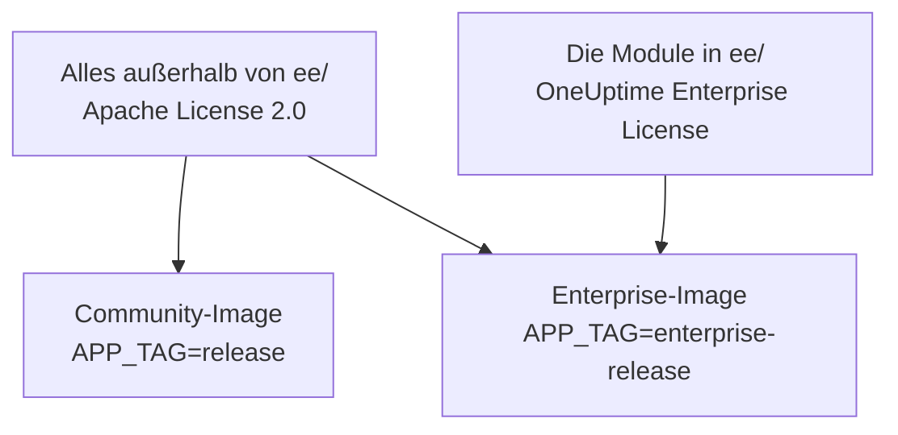
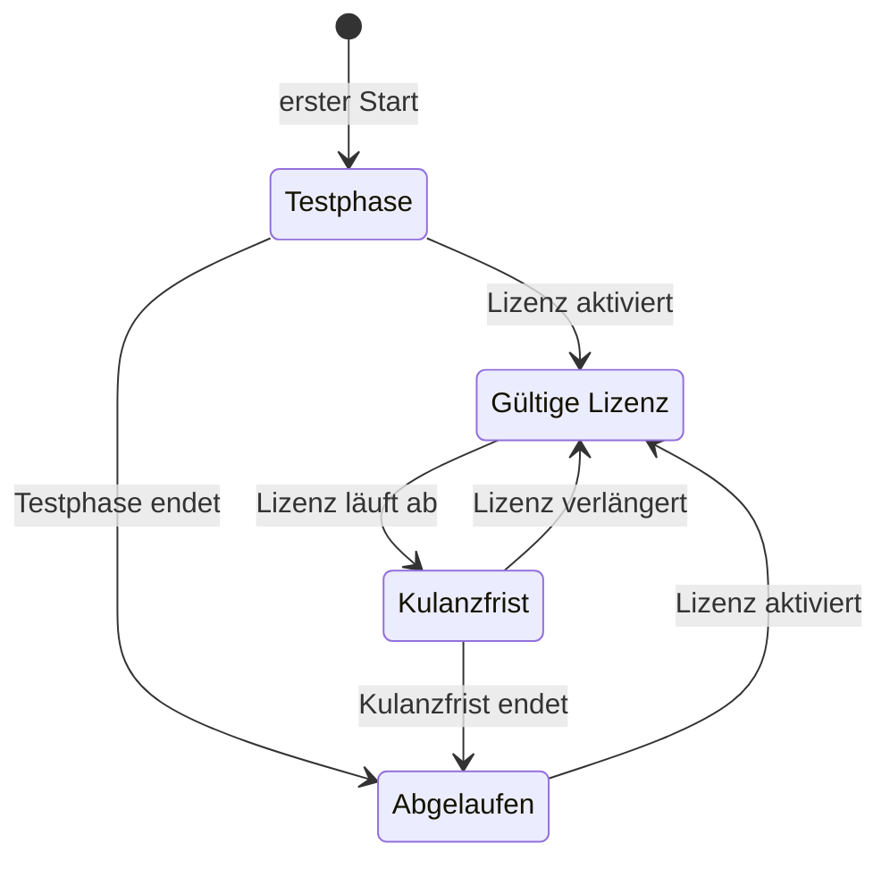

# Enterprise Edition

OneUptime wird aus einem Repository gebaut und in zwei Editionen ausgeliefert:

- **Community Edition**: die gesamte Plattform für Monitoring, Incidents und Observability, einschließlich Single Sign-On per SAML und OpenID Connect, Open Source unter der Apache License 2.0 und in jeder Größenordnung kostenlos selbst zu hosten.
- **Enterprise Edition**: die Community Edition plus die Enterprise-Module im Verzeichnis [`ee/`](https://github.com/OneUptime/oneuptime/tree/master/ee) des Repositorys. Diese Module ergänzen SCIM-Provisionierung sowie Funktionen für Governance und Instanzverwaltung. Sie stehen unter der [OneUptime Enterprise License](https://github.com/OneUptime/oneuptime/blob/master/ee/LICENSE), und der Produktivbetrieb erfordert eine Enterprise-Lizenz für Ihre Anzahl an Benutzern.

Die beiden Editionen sind getrennte Container-Images. Das Community-Image enthält keinen Code aus `ee/`. OneUptime Cloud betreibt die Enterprise Edition, und in der Cloud entscheidet Ihr Plan, welche dieser Funktionen Sie erhalten.



> [!NOTE]
> **Single Sign-On ist in jeder Edition enthalten.** Die Anmeldung per SAML und OIDC für Projekte und Statusseiten, globales SSO und „Require SSO for login“ gehören zur Community Edition, und kein Lizenzzustand schaltet sie ab.

Diese Seite beschreibt, was jede Edition enthält, wie Sie die Enterprise Edition betreiben, wie die Lizenzierung funktioniert und was geschieht, wenn Sie die Edition wechseln.

:::cards
- [Die Editionen vergleichen](#was-jede-edition-enthält): Was die Enterprise Edition hinzufügt.
- [Das Enterprise-Image betreiben](#die-enterprise-edition-betreiben): Eine Einstellung, unter Kubernetes oder Docker Compose.
- [Eine Lizenz aktivieren](#lizenzierung): Online mit einem Schlüssel oder offline mit einem signierten Token.
- [Wenn eine Lizenz ausläuft](#wenn-eine-lizenz-abläuft-oder-fehlt): Was aufhört, was nie aufhört und wie es zurückkommt.
:::

## Was jede Edition enthält

| Funktion | Community | Enterprise | OneUptime Cloud |
| --- | --- | --- | --- |
| Monitoring, Alarme, Incidents, Bereitschaftsdienst, Statusseiten, Logs, Metriken, Traces, Exceptions, Dashboards, Workflows, KI-Funktionen, API und Terraform | Ja | Ja | Jeder Plan |
| Anmeldung mit Passwort, Zwei-Faktor-Authentifizierung, Teams, Rollen und API-Schlüssel | Ja | Ja | Jeder Plan |
| [SAML-SSO und OpenID Connect](/docs/identity/sso) für die Anmeldung bei Projekten | Ja | Ja | Ab dem Plan Scale |
| SAML-SSO und OpenID Connect für die Anmeldung bei privaten Statusseiten | Ja | Ja | Ab dem Plan Scale |
| [Globales SSO und OIDC (instanzweit)](/docs/identity/global-sso) | Ja | Ja | Nicht zutreffend |
| [SCIM-Provisionierung](/docs/identity/scim) für Projekte und Statusseiten | Nein | Ja | Ab dem Plan Scale |
| Team-Compliance-Einstellungen | Nein | Ja | Ab dem Plan Scale |
| Audit-Logs | Nein | Ja | Plan Enterprise |
| Aufbewahrungs-Überschreibungen: Aufbewahrung nach Telemetrietyp (Logs, Traces, Metriken, Profile, mit Regeln nach Log-Schweregrad und Trace-Status) sowie Aufbewahrung pro Dienst und pro Ressource | Nein | Ja | Ab dem Plan Scale |
| Dashboards unter **Health** im Admin-Dashboard: Instanzübersicht, Hintergrund-Warteschlangen, Instanz-Logs, PostgreSQL, Valkey, ClickHouse-Cluster, Diagnose-Logs und Telemetrie-Ingestion | Nein | Ja | Nicht zutreffend |
| **Query Console** im Admin-Dashboard | Nein | Ja | Nicht verfügbar |
| Health-Alarme für PostgreSQL und Valkey (Redis) | Nein | Ja | Nicht zutreffend |
| Kapazitätsansicht, Kapazitätsalarme und automatisches Bereinigen der Festplatte für ClickHouse | Ja | Ja | Nicht zutreffend |
| Migrationsstatus, Support-Bundle und globale Probes im Admin-Dashboard | Ja | Ja | Nicht zutreffend |
| Verwaltung von Enterprise-Lizenz, Plätzen und Instanzen | Nein | Ja | Nicht zutreffend |

Single Sign-On umfasst „Require SSO for login“ für Projekte, private Statusseiten und die gesamte Instanz, in beiden Editionen.

Jede Edition hat die Standard-Aufbewahrung des Projekts für Telemetrie unter **Projekteinstellungen > Telemetrie & APM > Datenaufbewahrung**. Aufbewahrungs-Überschreibungen sind das, was die Enterprise Edition darüber hinaus hinzufügt.

In OneUptime Cloud lässt sich eine kostenpflichtige Funktion in jedem Plan jederzeit abschalten. Eine Aufbewahrungs-Überschreibung, die eine Testphase (oder ein Wechsel in einen niedrigeren Plan) gesetzt zurückgelassen hat, gilt weiter für neue Telemetrie; unterhalb des Plans Scale zeigen die Aufbewahrungsseiten sie deshalb unter der Upgrade-Karte mit der Schaltfläche **Überschreibung entfernen**. Das Entfernen funktioniert in jedem Plan; sie erneut zu setzen erfordert den Plan Scale. Bereits gespeicherte Telemetrie behält die Aufbewahrung, mit der sie gespeichert wurde. Ebenso zeigt **Projekteinstellungen > Sicherheit > SSO** den Schalter **SSO für die Anmeldung erzwingen** unter seiner Upgrade-Karte, solange das Projekt noch SSO verlangt, damit er sich abschalten lässt.

Zeilen mit „Nicht zutreffend“ betreffen Funktionen der Instanzverwaltung. In OneUptime Cloud betreibt OneUptime die Instanz für Sie.

## Die Enterprise Edition betreiben

Beide Editionen verwenden dieselbe Konfiguration, dieselben Datenbanken und dieselben Daten. Ein Wechsel der Edition ändert das Image, das Sie betreiben, und sonst nichts. In keiner Richtung ist eine Migration nötig.

:::tabs
@tab Kubernetes
Setzen Sie den Image-Typ in Ihrer `values.yaml`:

```yaml title="values.yaml"
image:
  type: enterprise-edition
```

Aktualisieren Sie dann wie gewohnt:

```bash
helm upgrade my-oneuptime oneuptime/oneuptime -f values.yaml
```

Das Chart zieht dann die `enterprise-`-Variante jedes Image-Tags, zum Beispiel `oneuptime/app:enterprise-release`, oder `enterprise-<version>`, wenn Sie `image.tag` festlegen. Setzen Sie `image.type: community-edition` (die Standardeinstellung), um die Community Edition zu betreiben.
@tab Docker Compose
Setzen Sie `APP_TAG` in Ihrer `config.env`:

```bash title="config.env"
APP_TAG=enterprise-release
```

Verwenden Sie `enterprise-<version>`, um ein Release festzulegen. Ziehen Sie dann die Images und starten Sie neu:

```bash
npm run update
```

Um zur Community Edition zurückzukehren, setzen Sie `APP_TAG=release` **und** `IS_ENTERPRISE_EDITION=false`. Solange `IS_ENTERPRISE_EDITION=true` gesetzt ist, setzt `npm run update` `APP_TAG` wieder auf `enterprise-release`, und das Community-Image verweigert den Start.
:::

### `IS_ENTERPRISE_EDITION` ist veraltet

Das Image, das Sie betreiben, bestimmt die Edition. `IS_ENTERPRISE_EDITION` schaltet keine Enterprise-Funktionen mehr ein und wird in einem künftigen Release entfernt. Sie können die Variable ungesetzt lassen.

Wenn Sie `IS_ENTERPRISE_EDITION=true` auf dem Community-Image setzen, aktiviert das **keine** Enterprise-Funktionen. Stattdessen **verweigert die App den Start**, damit ein Upgrade, das auf dem Community-Image landet, nie stillschweigend die SCIM-Provisionierung (einschließlich der Deprovisionierung) und die Audit-Protokollierung beenden kann. Der Fehler sagt Ihnen, was zu setzen ist: `APP_TAG=enterprise-<version>`, um die Enterprise Edition zu behalten, oder `IS_ENTERPRISE_EDITION=false`, um die Community Edition zu betreiben. Mit Helm kann das nicht passieren: Das Chart leitet die Variable aus `image.type` ab.

`ONEUPTIME_EDITION=community` lässt das Enterprise-Image als Community Edition laufen. Das ist nützlich, um ein Downgrade auszuprobieren, bevor Sie es durchführen. Das Enterprise-Image setzt `ONEUPTIME_EDITION=enterprise` selbst; überschreiben Sie es mit nichts anderem als `community`.

## Lizenzierung

Die Datei [`LICENSE`](https://github.com/OneUptime/oneuptime/blob/master/LICENSE) im Stammverzeichnis des Repositorys legt fest, welche Lizenz was abdeckt: Alles im Verzeichnis `ee/` steht unter der [OneUptime Enterprise License](https://github.com/OneUptime/oneuptime/blob/master/ee/LICENSE), Komponenten Dritter behalten die Lizenzen, unter denen ihre Eigentümer sie bereitstellen, und alles andere steht unter der Apache License 2.0.

Eine neue Installation der Enterprise Edition läuft als **14-tägige Testphase**, gezählt ab dem ersten Start der Enterprise Edition durch die Installation. Die Testphase dient der Evaluierung: Der Produktivbetrieb der Enterprise Edition erfordert ein Abonnement unter der OneUptime Enterprise License. Aktivieren Sie vor dem Ende der Testphase eine Lizenz: Danach enden SCIM, Audit-Protokollierung und Aufbewahrungs-Überschreibungen, und die Enterprise-Konfiguration wird schreibgeschützt (siehe [Wenn eine Lizenz abläuft oder fehlt](#wenn-eine-lizenz-abläuft-oder-fehlt)). Für eine Lizenz wenden Sie sich an [sales@oneuptime.com](mailto:sales@oneuptime.com).

Die Lizenz wird über das **Editions-Label** verwaltet, das Master-Admins in der Kopfzeile des Admin-Dashboards und in der Fußzeile des Dashboards sehen. Es zeigt den Lizenzstatus, die Platznutzung und, für Master-Admins, die Instanz-ID.

### Online-Aktivierung (Lizenzschlüssel)

:::steps
1. Melden Sie sich als Master-Admin an und öffnen Sie das Editions-Label.
2. Geben Sie Ihren Lizenzschlüssel ein und validieren Sie ihn.
:::

Die Installation prüft den Schlüssel bei OneUptime und speichert die Lizenz, die sie erhält. Danach hält sie die Lizenz mit einer täglichen Synchronisierung aktuell. Verwenden Sie **Refresh license** im Editions-Label, um Änderungen wie zusätzliche Plätze oder eine Verlängerung sofort abzurufen.

Die Online-Aktivierung benötigt ausgehendes HTTPS vom OneUptime-Server zu `https://oneuptime.com`. Erreicht der Server das Internet nur über ein Relay, setzen Sie `ENTERPRISE_LICENSE_SERVER_URL` auf die `https://`-Adresse des Relays. Das Relay muss `/api/enterprise-license/` an oneuptime.com weiterleiten.

### Offline-Aktivierung (Installationen ohne Internetzugang)

Eine Installation ohne Route ins Internet kann statt eines Schlüssels ein **signiertes Lizenz-Token** verwenden:

:::steps
1. Melden Sie sich als Master-Admin an, öffnen Sie das Editions-Label und notieren Sie die **Instanz-ID**.
2. Bitten Sie OneUptime ([sales@oneuptime.com](mailto:sales@oneuptime.com)) um ein Offline-Lizenz-Token für diese Instanz-ID.
3. Fügen Sie das Token in das Token-Feld des Editions-Labels ein und aktivieren Sie es.
:::

Die Installation prüft das Token selbst, gegen die in Ihr Release eingebauten Signaturschlüssel von OneUptime. Sie kontaktiert OneUptime nie. Ein Token, das für eine Instanz-ID ausgestellt wurde, wird von jeder anderen Installation abgelehnt, und ein Token, das für keine Instanz-ID ausgestellt wurde (etwa das Token, das eine online aktivierte Installation erhält), wird ebenfalls abgelehnt. Um zu verlängern oder Plätze hinzuzufügen, aktivieren Sie ein neues Token, bevor das aktuelle abläuft.

> [!IMPORTANT]
> **Die Offline-Aktivierung erfordert ein Release, das dem Lizenz-Signaturschlüssel von OneUptime vertraut.** Enthält Ihr Release diesen Schlüssel noch nicht, schlägt die Aktivierung mit „this build does not trust the key that signed this token“ fehl. Aktivieren Sie in diesem Fall online, oder aktualisieren Sie auf ein Release, das den Schlüssel enthält.

### Was die tägliche Lizenzsynchronisierung sendet

Eine online aktivierte Installation sendet OneUptime einmal am Tag einen Bericht. Er enthält:

- den Lizenzschlüssel;
- die Instanz-ID (eine zufällige Kennung, die die Installation erzeugt) und den Hostnamen, mit dem die Installation konfiguriert ist (`HOST`);
- die OneUptime-Version, die die Installation betreibt;
- die Anzahl der Benutzer der Installation;
- einen **SHA-256-Hash** der E-Mail-Adresse jedes Benutzers, in Kleinbuchstaben. OneUptime verwendet die Hashes, um eine Person mit Konten auf mehreren Ihrer Installationen als einen Platz zu zählen. Die E-Mail-Adressen gewöhnlicher Benutzer werden nie im Klartext gesendet;
- die E-Mail-Adressen der **Master-Admins** der Installation, damit OneUptime Sie wegen Verlängerungen und Platzlimits kontaktieren kann.

Die Antwort enthält die Lizenz, wie OneUptime sie an diesem Tag kennt: Firmenname, Ablaufdatum, Platzlimit, die zusammengerechnete Benutzerzahl über Ihre Installationen hinweg und die für die Lizenz registrierten Installationen. Andere Replikate der Installation übernehmen eine Änderung innerhalb von etwa einer Minute.

Wenn Sie die Lizenz aktivieren oder aktualisieren, sendet die Installation nur den Lizenzschlüssel, die Instanz-ID, den Hostnamen und die Version.

Sonst wird nichts gesendet. Keine Monitoring-Daten, keine Telemetrie, keine Logs und keine Konfiguration verlassen die Installation. Die Community Edition sendet nichts davon, und eine offline aktivierte Installation ebenso wenig.

### Wenn eine Lizenz abläuft oder fehlt

Jede Enterprise-Funktion funktioniert während der 14-tägigen Testphase und 30 Tage lang nach dem Ablauf einer Lizenz (der Kulanzfrist). Das Editions-Label warnt, bevor eine der beiden endet. Danach **enden SCIM, Audit-Protokollierung und Aufbewahrungs-Überschreibungen**, bis eine Lizenz aktiviert wird, genau wie in der Community Edition, und die Enterprise-Konfiguration wird schreibgeschützt. Single Sign-On ist keine Enterprise-Funktion: Die Anmeldung per SAML und OIDC, globales SSO und „Require SSO for login“ funktionieren in jedem Lizenzzustand gleich.



| Zustand | Was geschieht |
| --- | --- |
| **Gültige Lizenz** | Jede Enterprise-Funktion funktioniert. Über die lizenzierte Anzahl an Plätzen hinaus können keine neuen Benutzer hinzugefügt werden. Bestehende Benutzer werden nie entfernt. |
| **Testphase oder Kulanzfrist** (die ersten 14 Tage einer Installation ohne Lizenz oder 30 Tage nach dem Ablauf einer Lizenz) oder eine Installation mit einer Lizenz, deren Ablaufdatum nie erfasst wurde | Jede Enterprise-Funktion funktioniert, und das Editions-Label zeigt eine Warnung. Während der Kulanzfrist nach einem Ablauf gilt das Platzlimit weiterhin. Eine Installation mit einer Lizenz ohne erfasstes Ablaufdatum durchläuft dieselbe 14-tägige Testphase wie eine Installation ohne Lizenz, und das Platzlimit wird nicht durchgesetzt, weil der Lizenzdatensatz, den sie hält, bereits unvollständig ist. |
| **Nach der Testphase oder Kulanzfrist** (abgelaufene, fehlende oder ungültige Lizenz oder eine Lizenz, die die Funktion nicht enthält) | SCIM-Provisionierung, Audit-Protokollierung und Aufbewahrungs-Überschreibungen **enden** (siehe unten). Die Enterprise-Konfiguration wird **schreibgeschützt**: Sie können sie ansehen und löschen, aber nicht anlegen oder ändern. Eine Änderung funktioniert immer, damit Sie auf einen Vorfall reagieren können: das Ersetzen eines SCIM-Bearer-Tokens. Die SCIM-Einstellungsseiten bieten sie an, während alles andere schreibgeschützt ist: **Bearer-Token zurücksetzen** an einer SCIM-Konfiguration, das das neue Token einmal anzeigt. Über die API senden Sie `bearerToken` allein (mindestens 32 Zeichen). Die Audit-Protokollierung lässt sich weder einschalten noch erweitern. Die Enterprise-Dashboards unter Health und die Query Console sind gesperrt. Das Platzlimit wird nicht mehr durchgesetzt. |

Was endet, wenn eine Lizenz ausläuft:

- **Die SCIM-Provisionierung endet.** Die SCIM-Anfragen Ihres Identity Providers werden abgelehnt, einschließlich der Deprovisionierung, und SCIM-Teamsperren werden aufgehoben, sodass Teams, die von SCIM-Push-Gruppen verwaltet werden, von Hand bearbeitet werden können.
- **Die Audit-Protokollierung zeichnet nichts mehr auf.** Bisher aufgezeichnete Audit-Logs bleiben erhalten.
- **Aufbewahrungs-Überschreibungen gelten nicht mehr.** Neue Telemetrie wird für die Standard-Aufbewahrung des Projekts behalten. Bereits gespeicherte Telemetrie behält die Aufbewahrung, mit der sie geschrieben wurde. Über die API können Sie eine Überschreibung weiterhin entfernen, aber keine setzen.

Was **nicht** endet:

- **Single Sign-On.** Die Anmeldung per SAML und OIDC für Projekte, private Statusseiten, die gesamte Instanz (globales SSO) und die mobilen Apps sowie „Require SSO for login“ gehören zu jeder Edition. Eine abgelaufene Lizenz ändert nichts daran, und die Single-Sign-On-Konfiguration bleibt bearbeitbar.
- **Das Kern-Monitoring ist nie betroffen**: Monitore, Alarme, Incidents, Bereitschaftsdienst, Statusseiten und Telemetrie funktionieren alle weiter.
- **Master-Admins können sich immer mit ihrem Passwort anmelden.**
- **Nichts wird gelöscht.** SCIM-Konfiguration, Audit-Logs und Aufbewahrungs-Überschreibungen bleiben, wie sie sind.

**Alles läuft wieder, sobald eine Lizenz aktiviert ist**, ohne Neustart: SCIM-Provisionierung, Audit-Protokollierung und Aufbewahrungs-Überschreibungen kehren mit Ihrer bestehenden Konfiguration zurück. OneUptime schaltet sie nur ab, wenn es weiß, dass die Lizenz abgelaufen ist. Solange es den Lizenzzustand nicht lesen kann, etwa einen Moment lang beim Start des Servers, bleiben SCIM, Audit-Protokollierung und Aufbewahrungs-Überschreibungen eingeschaltet.

> [!WARNING]
> **Wenn Ihr Identity Provider Benutzer per SCIM deprovisioniert, aktivieren Sie eine Lizenz, bevor die Testphase oder die Kulanzfrist endet.** Danach deprovisioniert SCIM die Personen, die Sie bei Ihrem Identity Provider entfernen, nicht mehr: Ihre OneUptime-Konten bleiben bestehen, und sofern „Require SSO for login“ nicht für sie gilt, kann jeder, der das E-Mail-Postfach eines solchen Kontos noch erreicht, ein Passwort setzen und sich anmelden. Wenn Sie die Lizenz auslaufen lassen, entfernen Sie diese Benutzer selbst in OneUptime.

## Von Enterprise zu Community wechseln

Ihre Konfiguration bleibt in der Datenbank. Ein Wechsel zurück auf das Enterprise-Image stellt alles so wieder her, wie es war, sofern die Installation eine gültige Lizenz hat oder sich noch in ihrer Testphase oder Kulanzfrist befindet. Single Sign-On ändert sich nicht: Die Anmeldung per SAML und OIDC, globales SSO und „Require SSO for login“ funktionieren auf beiden Images gleich. Auf dem Community-Image:

- **SCIM endet.** Seine Provisionierungs-Endpunkte existieren nicht mehr, daher schlagen vom IdP ausgelöste SCIM-Aufrufe fehl. Das schließt die SCIM-Deprovisionierung ein.
- **SCIM-Teamsperren werden aufgehoben**, sodass Teams, die von SCIM-Push-Gruppen verwaltet wurden, von Hand bearbeitet werden können. Beim Start protokolliert der Server, bei welchen Projekten die SCIM-Teamsperren aufgehoben wurden.
- **Die Audit-Protokollierung endet.** Bisher aufgezeichnete Audit-Logs bleiben erhalten, aber die Audit-Log-Seiten zeigen einen Upgrade-Hinweis.
- **Aufbewahrungs-Überschreibungen gelten nicht mehr.** Neue Telemetrie wird für die Standard-Aufbewahrung des Projekts behalten, und die Aufbewahrungskarten unter **Projekteinstellungen > Telemetrie & APM > Datenaufbewahrung** und auf der Einstellungsseite jedes Dienstes und jeder Ressource zeigen einen Upgrade-Hinweis. Die Überschreibungen bleiben in der Datenbank und gelten wieder, wenn Sie zurückwechseln.
- **Enterprise-Einstellungsseiten zeigen einen Upgrade-Hinweis.** Über die API können Sie die Enterprise-Konfiguration weiterhin lesen und löschen und ein SCIM-Bearer-Token zurücksetzen, aber nichts anderes anlegen oder ändern. Die Audit-Protokollierung lässt sich nicht einschalten.
- **Die Enterprise-Dashboards unter Health, die Query Console sowie die Health-Alarme für PostgreSQL und Valkey enden.** Kapazitätsüberwachung und Bereinigung für ClickHouse, Migrationsstatus und das Support-Bundle funktionieren weiter.

> [!CAUTION]
> **Bevor Sie eine Installation, deren Identity Provider Benutzer per SCIM deprovisioniert, auf das Community-Image umstellen, prüfen Sie, wer Zugriff hat.** Ohne SCIM behalten die Personen, die Sie bei Ihrem Identity Provider entfernen, ihre OneUptime-Konten, und sofern „Require SSO for login“ nicht für sie gilt, kann jeder, der das E-Mail-Postfach eines solchen Kontos noch erreicht, ein Passwort setzen und sich anmelden. Entfernen Sie diese Benutzer zuerst.

## Fehlerbehebung

:::details Die App verweigert nach einem Upgrade den Start
`IS_ENTERPRISE_EDITION=true` ist auf dem Community-Image gesetzt. Setzen Sie `APP_TAG=enterprise-<version>`, um die Enterprise Edition zu behalten, oder `IS_ENTERPRISE_EDITION=false`, um die Community Edition zu betreiben, und führen Sie dann `npm run update` erneut aus.
:::

:::details Die Offline-Aktivierung schlägt mit „this build does not trust the key that signed this token“ fehl
Ihr Release wurde gebaut, bevor es dem Lizenz-Signaturschlüssel von OneUptime vertraute. Aktivieren Sie online, oder aktualisieren Sie auf ein Release, das den Schlüssel enthält.
:::

:::details Die SCIM-Anfragen Ihres Identity Providers werden abgelehnt
Auf dem Enterprise-Image ist die Lizenz abgelaufen: Aktivieren Sie eine, und die Provisionierung läuft ohne Neustart wieder. Auf dem Community-Image gibt es die SCIM-Endpunkte überhaupt nicht.
:::

## Nächste Schritte

:::cards
- [Aktualisierung](/docs/installation/upgrading): Auf ein neues Release wechseln, auch zwischen den Images der Editionen.
- [SSO](/docs/identity/sso): Single Sign-On, in jeder Edition.
- [Globales SSO](/docs/identity/global-sso): Ein Identity Provider für die gesamte Instanz.
- [SCIM](/docs/identity/scim): Benutzer und Teams aus Ihrem Identity Provider bereitstellen.
:::
