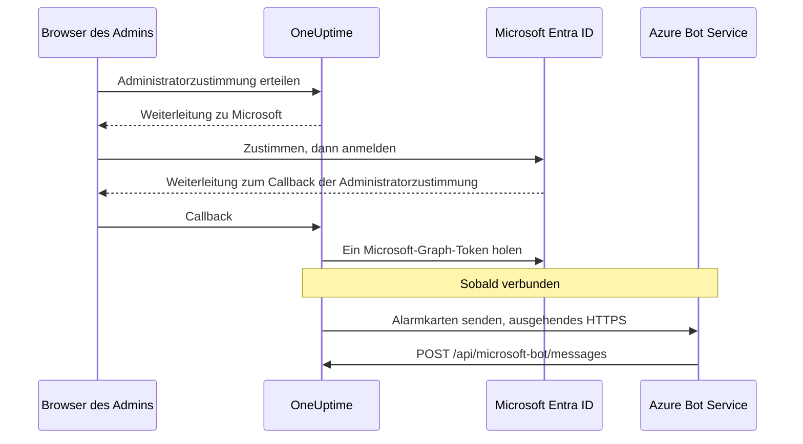

# Microsoft-Teams-Integration

Verbinden Sie Ihr selbst gehostetes OneUptime mit Microsoft Teams. Sie registrieren eine App in Microsoft Entra ID, erstellen dafür einen Azure Bot, geben OneUptime die Zugangsdaten der App und installieren das Teams-App-Paket, das Ihr Server erstellt. OneUptime veröffentlicht dann Alarme und Vorfälle in Ihren Kanälen und Chats, und Ihr Team bearbeitet sie direkt in Teams.

Diese Seite richtet sich an alle, die den OneUptime-Server betreiben. Sobald Teams verbunden ist, werden Benachrichtigungsregeln pro Projekt eingerichtet: siehe [Microsoft Teams](/docs/workspace-connections/microsoft-teams).

:::cards
- [Die Integration einrichten](#die-integration-einrichten): Neun Schritte, vom Azure-Portal bis zu Ihrem ersten Team.
- [Umgebungsvariablen](#umgebungsvariablen): Die drei Werte, die OneUptime von der App-Registrierung braucht.
- [Netzwerkzugriff](#netzwerkzugriff): Der Bot-Endpunkt, den Microsoft erreichen können muss.
- [Fehlerbehebung](#fehlerbehebung): Nicht erreichbare Endpunkte, fehlende Installationen und fehlgeschlagene Verbindungen.
:::

## So funktioniert es

OneUptime verwendet für seine Teams-Integration einen Azure Bot. Der Verkehr fließt in beide Richtungen, und die beiden Richtungen sind voneinander unabhängig: OneUptime ruft Microsoft auf, um Nachrichten zu senden, und Azure Bot Service ruft Ihren Server auf, wenn jemand auf eine Schaltfläche klickt, dem Bot schreibt oder ihn zu einem Chat hinzufügt.



Ein Incoming Webhook oder eine Teams-Workflow-URL ersetzt den Messaging-Endpunkt dieses Bots nicht.

Videoanrufe (ein Teams-Meeting für einen Vorfall) nutzen diesen Bot nicht: Sie brauchen eine eigene App-Registrierung, beschrieben unter [Videoanrufe](/docs/workspace-connections/video-calls#ein-klick-verbindung-auf-einem-selbst-gehosteten-server).

## Bevor Sie beginnen

- Ein Azure-Abonnement für die Ressource Azure Bot.
- Ein Konto, das in Microsoft Entra ID App-Registrierungen anlegen kann, und einen Microsoft-365-Administrator, der die Administratorzustimmung erteilt.
- Einen öffentlichen HTTPS-Hostnamen für OneUptime, den Azure Bot Service erreichen kann. Siehe [Netzwerkzugriff](#netzwerkzugriff).
- Zugriff auf die Konfiguration des Servers: `config.env` bei Docker Compose oder Ihre Helm-Values bei Kubernetes.
- Um ein Projekt zu verbinden, die Rolle **Project Owner**, **Project Admin** oder **Project Member** darin.

## Die Integration einrichten

:::steps
### Schritt 1: Azure-App-Registrierung anlegen

Öffnen Sie im [Azure-Portal](https://portal.azure.com) **App registrations** und wählen Sie **New registration**. Füllen Sie das Formular aus:

- **Name:** oneuptime
- **Supported account types:** Accounts in this organizational directory only (Single tenant)
- **Redirect URI:** Web - `https://your-oneuptime-domain.com/api/microsoft-teams/auth`

Wählen Sie **Register** und fügen Sie dann eine zweite Web-Redirect-URI hinzu, `https://your-oneuptime-domain.com/api/microsoft-teams/admin-consent/callback`. Notieren Sie die **Application (client) ID** und die **Directory (tenant) ID**: Sie brauchen später beide.

> [!NOTE]
> **Warum Single Tenant:** Eine selbst gehostete OneUptime-Instanz dient einer Organisation, und ihr Bot ist für den einen Tenant registriert, den Sie in `MICROSOFT_TEAMS_APP_TENANT_ID` festlegen (Schritt 6). Die App als Multitenant zu registrieren, erweitert das nicht und bringt eine Fehlerquelle mit sich: Gast- bzw. B2B-Benutzer, deren Microsoft-Heimat-Tenant sich von Ihrem unterscheidet, erreichen den Bot mit ihrer eigenen Tenant-ID, die OneUptime keinem Ihrer Projekte zuordnen kann. Haben Sie bereits eine Multitenant-App registriert, funktioniert sie weiter — achten Sie nur darauf, dass `MICROSOFT_TEAMS_APP_TENANT_ID` Ihr eigener Tenant ist, und rechnen Sie damit, dass Gastkonten ein Konto in Ihrem Tenant brauchen, um den Bot zu nutzen.

### Schritt 2: App-Berechtigungen konfigurieren

Öffnen Sie in Ihrer App-Registrierung **API permissions**, wählen Sie **Add a permission** und dann **Microsoft Graph**.

**Delegierte Berechtigungen hinzufügen** (beim Handeln im Namen eines angemeldeten Benutzers):

- **User.Read** - Erforderlich, um während des OAuth-Ablaufs die Profilinformationen des angemeldeten Benutzers (Anzeigename, E-Mail) abzurufen
- **Team.ReadBasic.All** - Erforderlich, um die Teams aufzulisten, in denen der Benutzer Mitglied ist, wenn das zu verbindende Team ausgewählt wird
- **Channel.ReadBasic.All** - Erforderlich, um Kanalinformationen zu lesen und Kanäle in Teams für die Zustellung von Benachrichtigungen aufzulisten
- **ChannelMessage.Send** - Erforderlich, um Alarm- und Vorfallsbenachrichtigungen an Teams-Kanäle zu senden

**Anwendungsberechtigungen hinzufügen** (beim Handeln als die App selbst, ohne angemeldeten Benutzer):

- **Team.ReadBasic.All** - Erforderlich, um nach erteilter Administratorzustimmung alle Teams der Organisation aufzulisten
- **Channel.ReadBasic.All** - Erforderlich, um die Existenz von Kanälen zu prüfen und Kanaldetails abzurufen
- **TeamsAppInstallation.ReadForTeam.All** - Erforderlich für die Diagnose. Lässt OneUptime lesen, welches App-Paket tatsächlich in einem Team installiert ist, und es mit der Client-ID dieser Bereitstellung vergleichen, damit ein fehlgeschlagener Versand Ihnen sagen kann, *welche* der möglichen Ursachen vorliegt. Ohne sie kann OneUptime „nicht installiert“ nicht von „installiert, aber das Paket von jemand anderem“ unterscheiden und meldet einfach, was Microsoft gesagt hat — der größte einzelne Grund, warum das Debuggen dieser Integration Tage statt Minuten dauert. Erteilen Sie sie.
- **Chat.ReadBasic.WhereInstalled** - Optional. Lässt OneUptime den Namen jedes Chats lesen, in dem die OneUptime-App ist. Ohne sie erteilt das jeder Chat über die Manifest-Berechtigung **ChatSettings.Read.Chat** (unten), die ein mit einem älteren Manifest hinzugefügter Chat erst hat, wenn die App darin aktualisiert wird.

`ChannelMessage.Send` ist nur eine delegierte Berechtigung; laut der [Referenz der Microsoft-Graph-Berechtigungen](https://learn.microsoft.com/en-us/graph/permissions-reference#channelmessagesend) gibt es keine Variante als Anwendungsberechtigung. Behalten Sie sie in der delegierten Liste oben.

Wählen Sie dann **Grant admin consent** für Ihre Organisation.

Der Bot selbst nutzt ressourcenspezifische Zustimmungsberechtigungen (RSC), die im Teams-App-Manifest definiert sind. Sie werden erteilt, wenn die App in einem Team oder Chat installiert oder aktualisiert wird, nicht in Entra ID:

- **ChannelMessage.Send.Group** - Erlaubt dem Bot, Nachrichten an Teamkanäle zu senden
- **ChannelMessage.Read.Group** - Erlaubt dem Bot, Kanalnachrichten für interaktive Befehle zu lesen
- **Channel.Create.Group** - Erlaubt dem Bot, bei Bedarf Kanäle zu erstellen
- **ChatMessage.Read.Chat** - Erlaubt dem Bot, Nachrichten in Chats zu lesen, zu denen er hinzugefügt wurde (für interaktive Befehle)
- **ChatMember.Read.Chat** - Erlaubt dem Bot, die Mitglieder von Chats zu lesen, zu denen er hinzugefügt wurde (um Chats in OneUptime zu benennen)
- **ChatSettings.Read.Chat** - Erlaubt OneUptime, den Namen von Gruppenchats zu lesen, zu denen die App hinzugefügt wurde. Teams sendet den Namen eines Gruppenchats nicht zuverlässig an den Bot, daher wird ein benannter Gruppenchat ohne diese Berechtigung mit den Namen seiner Mitglieder aufgeführt
- **TeamsAppInstallation.Read.Group** - Erlaubt OneUptime zu bestätigen, dass die App in einem Team installiert ist, in dem es gleich veröffentlichen will

Haben Sie das App-Manifest hochgeladen, bevor es diese Berechtigungen gab, laden Sie es erneut unter **Projekteinstellungen > Arbeitsbereich > Microsoft Teams** herunter und laden Sie es als Update der OneUptime-App in Teams hoch. Teams erteilt Team- und Chat-Berechtigungen, wenn die App in diesem Team oder Chat installiert oder aktualisiert wird; akzeptieren Sie das Update also in jedem Team und Chat, in dem die App bereits ist. Für Chats siehe [Ein Gruppenchat wird mit den Namen seiner Mitglieder aufgeführt](#ein-gruppenchat-wird-mit-den-namen-seiner-mitglieder-aufgeführt).

### Schritt 3: Client Secret erstellen

Öffnen Sie in Ihrer App-Registrierung **Certificates & secrets** und wählen Sie **New client secret**. Fügen Sie eine Beschreibung hinzu, wählen Sie eine Ablaufzeit (24 Monate sind eine sinnvolle Wahl) und wählen Sie **Add**. Kopieren Sie den Wert des Secrets sofort: Azure zeigt ihn nur einmal.

> [!IMPORTANT]
> Kopieren Sie den **Value** des Secrets, nicht seine **Secret ID**. Der Wert ist die längere Zeichenfolge.

### Schritt 4: Einen Bot Service erstellen

Erstellen Sie im Azure-Portal eine Ressource **Azure Bot**:

- **Bot handle:** oneuptime-bot
- **Subscription** und **Resource group:** Ihre eigenen
- **Pricing tier:** F0 (Free) genügt zum Testen
- **Type of App:** Single Tenant, mit der bestehenden App-Registrierung: ihrer **Application (client) ID** und **Directory (tenant) ID** aus Schritt 1

Wählen Sie **Review + create** und dann **Create**. Wenn der Bot bereitgestellt ist, öffnen Sie seine Seite **Configuration**, setzen Sie **Messaging endpoint** auf `https://your-oneuptime-domain.com/api/microsoft-bot/messages` und speichern Sie.

**Prüfen Sie den Endpunkt, bevor Sie weitermachen.** Azure Bot Service ruft diese URL aus dem öffentlichen Internet auf; prüfen Sie sie also von einem Ort außerhalb Ihres Netzwerks — nicht aus dem Cluster heraus und nicht aus einem VPN, das den Host sieht, wenn Azure es nicht kann:

```bash
curl -sS -i https://your-oneuptime-domain.com/api/microsoft-bot/messages
```

Verwenden Sie `-i` statt nur des Statuscodes: Bei einem 404 ist **der Body das Einzige, was Ihnen sagt, wer ihn erzeugt hat**, und genau diese Unterscheidung ist die ganze Diagnose.

- **405** ist korrekt und bedeutet, dass Sie fertig sind. Der Endpunkt nimmt nur POST an, daher wird ein GET mit `405 Method Not Allowed` beantwortet, mit `Allow: POST` und einer Beschreibung des Endpunkts. Ihn überhaupt zu erreichen, ist genau das, was geprüft wird.
- **404 mit dem JSON-Body `{"message":"Page not found - /api/microsoft-bot/messages"}`** stammt von OneUptime, die Anfrage *ist* also angekommen. Entweder ist diese Bereitstellung älter als die 405-Antwort oben — ältere Versionen bedienten diesen Pfad nur für POST, sodass ein GET beim allgemeinen Not-found-Handler landete —, oder etwas vor OneUptime schreibt den Pfad um und entfernt das Präfix `/api`, bevor die App ihn sieht (ein Kubernetes-Ingress mit `rewrite-target: /` ist der übliche Schuldige).
- **404 mit einer HTML-Fehlerseite** von nginx, Ihrem Ingress oder einem Load Balancer bedeutet das Gegenteil: Die Anfrage hat OneUptime nie erreicht, und was davor steht, leitet `/api` nicht an die App weiter.
- **Ein TLS-Fehler, ein Timeout oder eine abgelehnte Verbindung** bedeutet, dass Azure ihn auch nicht erreicht. Siehe [den Abschnitt zur Fehlerbehebung beim Messaging-Endpunkt](#kartenschaltflächen-melden-unable-to-reach-app-und-chats-erscheinen-nie) unten.

### Schritt 5: Microsoft-Teams-Kanal zum Bot hinzufügen

Öffnen Sie in Ihrer Ressource Azure Bot **Channels** und fügen Sie **Microsoft Teams** hinzu. Behalten Sie die Standard-Messaging-Optionen bei, sofern Sie keine besonderen Anforderungen haben, und speichern Sie. Ohne diesen Kanal wird der Bot nie in Teams-Unterhaltungen bereitgestellt.

### Schritt 6: Umgebungsvariablen von OneUptime konfigurieren

Geben Sie OneUptime die Zugangsdaten der App:

:::tabs
@tab Docker Compose
```bash title="config.env"
MICROSOFT_TEAMS_APP_CLIENT_ID=YOUR_TEAMS_APP_CLIENT_ID
MICROSOFT_TEAMS_APP_CLIENT_SECRET=YOUR_TEAMS_APP_CLIENT_SECRET
MICROSOFT_TEAMS_APP_TENANT_ID=YOUR_MICROSOFT_TENANT_ID
```

Wenden Sie die Änderung mit `npm run start` an, das die Container neu erstellt. `docker compose restart` liest `config.env` nicht neu ein.
@tab Kubernetes
```yaml title="values.yaml"
microsoftTeamsApp:
  clientId: YOUR_TEAMS_APP_CLIENT_ID
  clientSecret: YOUR_TEAMS_APP_CLIENT_SECRET
  tenantId: YOUR_MICROSOFT_TENANT_ID
```

Um die Werte in einem Kubernetes-Secret zu halten, das Sie selbst verwalten, setzen Sie stattdessen `microsoftTeamsApp.existingSecret`: seinen `name` und die Schlüssel `clientIdKey`, `clientSecretKey` und `tenantIdKey`. Wenden Sie die Änderung mit `helm upgrade` an.
:::

Sobald OneUptime wieder läuft, zeigt **Projekteinstellungen > Arbeitsbereich > Microsoft Teams** statt der Einrichtungsanleitung die Karte **Administratorzustimmung erteilen**.

### Schritt 7: Die Administratorzustimmung in OneUptime erteilen

Öffnen Sie **Projekteinstellungen > Arbeitsbereich > Microsoft Teams** und wählen Sie **Administratorzustimmung erteilen**. Melden Sie sich bei Microsoft als Microsoft-365-Administrator an und akzeptieren Sie die Berechtigungen. Microsoft schickt Sie zur selben Seite zurück, und die Karte zeigt **Administratorzustimmung abgeschlossen**: Das Projekt ist jetzt mit Ihrem Tenant verbunden.

Wählen Sie dann **Connect my account with Microsoft Teams**, um Ihr eigenes Konto zu verknüpfen. Alle anderen im Projekt tun dasselbe unter **Benutzereinstellungen > Arbeitsbereich > Microsoft Teams**.

### Schritt 8: Das Teams-App-Manifest hochladen

Nach der Administratorzustimmung zeigt **Projekteinstellungen > Arbeitsbereich > Microsoft Teams** die Karte **Handlungsbedarf: Installieren Sie die App dieser Bereitstellung in Microsoft Teams**. Wählen Sie **App-Manifest-Zip herunterladen**: Das Paket trägt die Bot-ID dieser Bereitstellung.

Öffnen Sie in Microsoft Teams **Apps > Manage your apps**, wählen Sie **Upload an app**, dann **Upload a custom app**, und wählen Sie die heruntergeladene ZIP-Datei.

> [!WARNING]
> Installieren Sie für eine selbst gehostete Bereitstellung nicht „OneUptime“ aus dem Microsoft-Teams-Store. Die Store-App zeigt auf den Bot von OneUptime Cloud, daher akzeptiert Teams sie und lehnt dann jede Nachricht ab, die diese Bereitstellung sendet.

### Schritt 9: OneUptime zu jedem Team hinzufügen (erforderlich)

Das Hochladen des Manifests installiert die App für **Sie**. Es gibt dem Bot **keinen** Zugriff auf die Kanäle irgendeines Teams. Microsoft nimmt Nachrichten nur in einem Team an, zu dem die App hinzugefügt wurde; Sie müssen das also für jedes Team tun, in dem Sie Benachrichtigungen möchten:

1. Klicken Sie in Microsoft Teams auf „...“ neben dem **Teamnamen** (nicht dem Kanalnamen)
2. Wählen Sie **Manage team** > **Apps** > **More apps**
3. Suchen Sie **OneUptime** und klicken Sie auf **Add**

Hinweise:

- OneUptime für sich selbst zu installieren oder es zu einem Chat hinzuzufügen, ist eine **andere** Installation. Keine von beiden lässt es in den Kanälen eines Teams veröffentlichen.
- **Private Kanäle** brauchen die App im Kanal selbst: Öffnen Sie den Kanal > „...“ > **Manage channel** > **Apps** > **Add an app**. Eine Installation auf Teamebene deckt private Kanäle nicht ab.
- **Geteilte Kanäle** können überhaupt keine Benachrichtigungen empfangen — Microsoft Teams unterstützt keine Bots in geteilten Kanälen. OneUptime blendet sie in der Kanalauswahl aus.
- Ist **Manage team > Apps > More apps** leer oder ausgegraut, blockiert Ihre Teams-Richtlinie zur App-Einrichtung benutzerdefinierte Apps. Beheben Sie das im Teams Admin Center unter **Teams apps > Manage apps** und **Setup policies**.
:::

## Umgebungsvariablen

| Docker Compose (`config.env`) | Helm (`values.yaml`) | Wert |
| --- | --- | --- |
| `MICROSOFT_TEAMS_APP_CLIENT_ID` | `microsoftTeamsApp.clientId` | Die **Application (client) ID**. Sie ist auch die Bot-ID im Teams-App-Paket und muss daher eine GUID sein. |
| `MICROSOFT_TEAMS_APP_CLIENT_SECRET` | `microsoftTeamsApp.clientSecret` | Der **Value** des Client Secrets, nicht seine ID. |
| `MICROSOFT_TEAMS_APP_TENANT_ID` | `microsoftTeamsApp.tenantId` | Die **Directory (tenant) ID**. Der Bot authentifiziert sich als Single-Tenant-App in diesem Tenant. |
| `HOST` | `host` | Ihr öffentlicher Hostname. Redirect-URIs, der Messaging-Endpunkt und das Teams-App-Paket werden daraus gebildet. |
| `HTTP_PROTOCOL` | `httpProtocol` | `https`. Azure Bot Service ruft nur HTTPS-Endpunkte auf. |

Alle drei Werte `MICROSOFT_TEAMS_APP_*` sind erforderlich:

- Ohne die Client-ID zeigt die Microsoft-Teams-Seite die Einrichtungsanleitung statt **Administratorzustimmung erteilen**.
- Ohne die Client-ID oder das Secret endet das Verbinden mit **"Microsoft Teams ist auf diesem OneUptime-Server nicht eingerichtet."**
- Ohne die Tenant-ID kann sich der Bot nicht authentifizieren, daher schlagen das Veröffentlichen und der Bot-Endpunkt fehl.

## Netzwerkzugriff

Microsoft verlangt einen [öffentlich erreichbaren HTTPS-Endpunkt für einen selbst gehosteten Bot](https://learn.microsoft.com/en-us/azure/bot-service/bot-service-resources-faq-security?view=azure-bot-service-4.0). Eine private IP-Adresse, ein interner DNS-Name oder die VPN-Verbindung einer Mitarbeiterin gibt Azure Bot Service keinen Zugriff auf OneUptime.

| Richtung | Ziel | Zweck |
| --- | --- | --- |
| OneUptime zu Microsoft | HTTPS über TCP 443 zu Microsoft Graph, Microsoft Identity und den Diensten des Bot Framework | Tokentausch, Abfrage von Teams und Kanälen sowie Zustellung von Benachrichtigungen |
| Microsoft zu OneUptime | `POST /api/microsoft-bot/messages` | Bot-Nachrichten, Installationsereignisse von Unterhaltungen und Kartenaktionen |
| Browser der Nutzer zu OneUptime | `/api/microsoft-teams/auth` und `/api/microsoft-teams/admin-consent/callback` | Weiterleitungen für Anmeldung und Administratorzustimmung |

Die Weiterleitungen der App-Registrierung zu `/api/microsoft-teams/auth` und `/api/microsoft-teams/admin-consent/callback` laufen über den Browser des Nutzers zurück. Dieser Browser muss OneUptime erreichen, zum Beispiel über Ihr Firmennetz oder VPN. Bot-Nachrichten und Kartenaktionen kommen von den Servern von Microsoft und brauchen einen eigenen erreichbaren Ingress. Ausgehende Alarmzustellung allein bestätigt keine eingehende Konnektivität.

### Den Bot-Endpunkt aus einer privaten Installation veröffentlichen

```mermaid title="Den Bot-Endpunkt aus einer privaten Installation veröffentlichen"
flowchart LR
    Azure["Azure Bot Service"] -->|HTTPS 443| GW["Öffentliches Gateway"]
    GW -->|"POST /api/microsoft-bot/messages"| ING["OneUptime-Ingress"]
    Users["Mitarbeitende im VPN"] --> ING
    ING --> App["OneUptime-App"]
```

:::steps
1. Lassen Sie das öffentliche DNS Ihres OneUptime-Hostnamens auf einen Reverse Proxy oder Load Balancer zeigen, der aus dem Internet erreichbar ist. Erlauben Sie eingehendes TCP 443 und liefern Sie ein öffentlich vertrauenswürdiges TLS-Zertifikat mit vollständiger Kette aus.
2. Verbinden Sie das Gateway mit dem privaten OneUptime-Ingress, direkt oder über Ihr eigenes Site-to-Site-VPN bzw. Ihre private Verbindung, und erlauben Sie dessen Upstream-Dienstport. Ein Kubernetes-Dienst vom Typ `ClusterIP` braucht einen erreichbaren Ingress oder eine andere Route vom Gateway. Halten Sie Datenbanken und andere interne Dienste privat.
3. Veröffentlichen Sie `/api/microsoft-bot/messages` über dieses Gateway und setzen Sie den **Messaging endpoint** des Azure Bot in Schritt 4 auf die vollständige öffentliche HTTPS-URL. Erhalten Sie Methode, das Präfix `/api`, Query-String, Body und den Header `Authorization`. Erhalten Sie den öffentlichen `Host` und setzen Sie vertrauenswürdige Weiterleitungs-Header für den öffentlichen Host und das HTTPS-Schema. Fügen Sie dieser Route keine Weiterleitungen, kein Browser-SSO, kein CAPTCHA und keine Proxy-Anmeldung hinzu; der Bot-Framework-Adapter von OneUptime muss die Anfrage empfangen und authentifizieren.
4. Halten Sie andere Routen bei Bedarf privat. Mit Split-DNS können Mitarbeitende denselben Hostnamen über das Firmennetz oder VPN zum privaten Ingress auflösen. Dieser Ingress muss ebenfalls HTTPS mit einem für den Hostnamen gültigen Zertifikat ausliefern und die Browser-Weiterleitungen aus der Tabelle oben zulassen. Beschränken Sie den Zugriff auf den Ursprung auf das Gateway und autorisierte interne Clients.
5. Setzen Sie `HOST=oneuptime.example.com` und `HTTP_PROTOCOL=https` in der `config.env` von Docker Compose oder `host: oneuptime.example.com` und `httpProtocol: https` in den Helm-Values. Ersetzen Sie das Beispiel durch Ihre Domain, wenden Sie das Update der Bereitstellung an und warten Sie, bis die Anwendung neu gestartet ist. Diese Werte erzeugen URLs; sie stellen weder DNS noch TLS noch Netzwerkzugriff bereit. Ändert sich der Hostname, aktualisieren Sie den Endpunkt des Azure Bot und die Weiterleitungen der App-Registrierung, und laden Sie das Teams-Manifest erneut herunter und hoch.
:::

Die [Einstellungen für den Zugriff auf private Netzwerke](/docs/self-hosted/private-network-access) von OneUptime steuern ausgehende Anfragen an interne Dienste. `ALLOW_PRIVATE_NETWORK_WEBHOOKS` einzuschalten, macht den Bot-Endpunkt für Microsoft nicht erreichbar.

### Ausgehender Zugriff und IP-Beschränkungen

Erlauben Sie DNS-Auflösung und ausgehendes HTTPS von der OneUptime-Anwendung. Sie nutzt `graph.microsoft.com`, `login.microsoftonline.com`, die Authentifizierungs- und Kanal-Endpunkte des Bot Framework und die Connector-Service-URL, die für eine Unterhaltung geliefert wird. Der Fallback-Connector der kommerziellen Cloud ist `https://smba.trafficmanager.net/teams/`; die Service-URLs von Unterhaltungen können abweichen. Wenden Sie die [Firewall-Hinweise von Microsoft](https://learn.microsoft.com/en-us/azure/bot-service/bot-service-resources-faq-security?view=azure-bot-service-4.0) an und prüfen Sie beim Testen blockierten Verkehr; dies ist keine vollständige Liste von Hostnamen.

Microsoft unterstützt keine festen IP-Allowlists für eingehenden Bot-Framework-Verkehr, weil sich seine Quelladressen ändern. Die IP-Bereiche für Medien der Teams-Clients beschreiben nicht die Quellen von Bot-Webhooks. Lassen Sie die Bot-Framework-Authentifizierung eingeschaltet, statt eine Quell-IP als Identitätsnachweis zu behandeln.

### Testen und Installationen ohne eingehenden Zugriff

Prüfen Sie mit Schritt 4 öffentliches DNS, TLS und Routing von außerhalb Ihres Netzwerks und VPN. Verbinden Sie dann Teams, senden Sie eine Testbenachrichtigung, schreiben Sie dem Bot und klicken Sie auf eine Kartenschaltfläche. Bestätigen Sie die Aktion in OneUptime und gleichen Sie die Zustelldiagnose von Microsoft mit den Logs von Gateway und Anwendung ab. Eine erreichbare GET-Route oder eine zugestellte Benachrichtigung allein bestätigt keinen authentifizierten eingehenden Bot-POST.

Für die Entwicklung beschreibt Microsofts [Anleitung zum lokalen Testen von Teams-Bots](https://learn.microsoft.com/en-us/microsoftteams/platform/bots/how-to/authentication/add-authentication#testing-the-bot-locally-in-teams), wie man einen lokalen Dienst mit einem Tunnel freigibt. Leiten Sie an einen Proxy weiter, der den Bot-Endpunkt erlaubt, und verwenden Sie `/api/microsoft-bot/messages` statt des Beispielpfads `/api/messages` von Microsoft. Aktualisieren Sie den konfigurierten Hostnamen und den Endpunkt des Azure Bot, wann immer sich die öffentliche Tunnel-URL ändert, stoppen Sie den Tunnel nach dem Testen und verwenden Sie für den Produktivbetrieb einen stabilen Ingress. Auch ein Tunnel öffnet eingehenden Zugriff.

> [!WARNING]
> Untersagt eine Richtlinie eingehende Verbindungen, kann die vollständige Teams-Bot-Integration nicht funktionieren: Befehle, Kartenaktionen und das Erkennen von Unterhaltungen hängen davon ab, dass Microsoft OneUptime erreicht. Azure Bot Private Endpoint löst diese Anforderung nicht. Microsofts [Anleitung zur Netzwerkisolation](https://learn.microsoft.com/en-us/azure/bot-service/dl-network-isolation-how-to?view=azure-bot-service-4.0) beschreibt die Isolation von Direct Line und stellt fest, dass das Deaktivieren des öffentlichen Netzwerkzugriffs die Teams-Kanäle unkonfiguriert lässt. Eine vollständig vom Netz getrennte Installation kann Teams nicht nutzen.

## Fehlerbehebung

Beginnen Sie mit diesen Prüfungen:

- Die App-Registrierung hat die Berechtigungen oben, und die Administratorzustimmung ist erteilt.
- Die Redirect-URIs stimmen genau überein (ersetzen Sie `your-oneuptime-domain.com` durch Ihre tatsächliche Domain).
- Die Umgebungsvariablen sind gesetzt, und OneUptime wurde danach neu gestartet.
- Der Messaging-Endpunkt des Bots ist aus dem Internet erreichbar, und der Bot hat den Microsoft-Teams-Kanal.
- Das hochgeladene Teams-App-Paket ist das, das von dieser Bereitstellung heruntergeladen wurde.

### Kartenschaltflächen melden "Unable to reach app", und Chats erscheinen nie

Diese Symptome bedeuten oft, dass **Azure Bot Service keine authentifizierten Aktivitäten an Ihren Messaging-Endpunkt zustellen kann**. Prüfen Sie Routing, Bot-Authentifizierung und Projektkonfiguration.

Das Verwirrende ist, dass Alarmkarten weiterhin in Teams ankommen, wodurch die Integration weitgehend gesund aussieht. Das ist sie nicht — die beiden Richtungen sind unabhängig, und nur eine davon funktioniert:

| Richtung | Wie sie läuft | Muss Azure Sie erreichen? |
| --- | --- | --- |
| OneUptime veröffentlicht eine Alarmkarte in einem Kanal | OneUptime ruft Microsoft auf und authentifiziert sich mit Ihrem Client Secret | **Nein** |
| Sie tippen auf eine Schaltfläche dieser Karte | Azure Bot Service sendet einen POST an `/api/microsoft-bot/messages` | **Ja** |
| Sie schreiben dem Bot `help` | Azure Bot Service sendet einen POST an `/api/microsoft-bot/messages` | **Ja** |
| Ein Chat wird unter **Microsoft Teams-Chats** registriert | Azure Bot Service sendet eine Bot-Aktivität per POST an `/api/microsoft-bot/messages` | **Ja** |

Ein funktionierender Alarm bestätigt also genau diesen ausgehenden Versand; er bestätigt weder jede Graph-Berechtigung noch den eingehenden Bot-Endpunkt. Interaktive Funktionen brauchen eine erfolgreiche Verarbeitung eingehender Bot-Aktivitäten.

OneUptime erfasst Chats aus Bot-Aktivitäten, etwa wenn die App installiert, der Bot zur Unterhaltung hinzugefügt oder ihm in diesem Chat eine Nachricht gesendet wird. Alle kommen über denselben eingehenden Endpunkt. Eine leere Liste **Microsoft Teams-Chats**, nachdem Sie die App hinzugefügt und ihr geschrieben haben, bedeutet, dass für dieses Projekt kein Chat erfasst wurde; prüfen Sie eingehende Anfragen, Authentifizierungsfehler und die Zuordnung von Tenant und Projekt. Ein Klick auf **Chats aktualisieren** liest die gespeicherten Chats von OneUptime neu und liest den Namen jedes gespeicherten Gruppenchats erneut von Microsoft.

**Diagnostizieren Sie in dieser Reihenfolge:**

1. **Suchen Sie nach dem POST, nicht nach 404ern.** Hier gehen die meisten Untersuchungen schief:

   ```bash
   grep 'POST /api/microsoft-bot/messages' <your access log>
   ```

   Gibt es keine POST-Zeilen, bestätigen Sie, dass das richtige Zugriffslog Anfragen aufzeichnet, und prüfen Sie dann den konfigurierten Azure-Endpunkt und den Netzwerkpfad. Kommen POSTs an, prüfen Sie ihre Antworten und die Authentifizierungs- oder Projektzuordnungsfehler von OneUptime. `GET`-Zeilen mit 404 sind eine separate Prüfung — siehe den Hinweis unten.

2. **Rufen Sie den Endpunkt von außerhalb Ihres Netzwerks auf,** wie in Schritt 4, mit `curl -i`, damit Sie den Body sehen. Ein `405` beweist, dass die Route aktiv und von dort erreichbar ist, wo Sie den Befehl ausgeführt haben. Ein TLS-Fehler, ein Timeout oder eine abgelehnte Verbindung ist Ihre Antwort.

3. **Prüfen Sie die Zertifikatskette.** Azure verlangt HTTPS mit einem öffentlich vertrauenswürdigen Zertifikat samt vollständiger Kette. Ein selbstsigniertes Zertifikat, eine interne CA oder ein fehlendes Zwischenzertifikat lässt den TLS-Handshake scheitern, bevor OneUptime die Anfrage sieht — Ihr Zugriffslog bleibt dann leer und sieht aus, als hätte Azure es nie versucht:

   ```bash
   openssl s_client -connect your-oneuptime-domain.com:443 -servername your-oneuptime-domain.com -verify_return_error </dev/null
   ```

4. **Prüfen Sie, dass der Host öffentlich auflösbar ist.** Ein privater DNS-Name, ein Split-Horizon-Eintrag oder ein nur interner Ingress erreichen Sie und Ihr VPN, bleiben für Azure aber unsichtbar. Lösen Sie den Namen aus einem Netz ohne Zugang zu Ihrem auf.

5. **Bestätigen Sie den Endpunkt an der Ressource Azure Bot**, der genau zu dieser Bereitstellung passen muss, einschließlich Schema und Pfad: `https://your-oneuptime-domain.com/api/microsoft-bot/messages`.

**Ein 404 auf `GET /api/microsoft-bot/messages` ist nicht der Fehler, und er ist kein Beleg dafür, dass Azure Sie nicht erreichen konnte.** Der Endpunkt hat immer nur POST angenommen, daher landete ein GET aus dem Browser bei Versionen vor dieser beim allgemeinen Not-found-Handler von OneUptime und kam als `{"message":"Page not found - /api/microsoft-bot/messages"}` zurück. Das liest sich wie eine fehlende Route und hat schon mehr als einen Admin nach einer Regression suchen lassen, die es nicht gab — aber beachten Sie, was es tatsächlich beweist: OneUptime hat diese Antwort erzeugt, die Anfrage hat die App also erreicht. Sie ist 58 Bytes groß, deshalb erscheint sie im Zugriffslog als `"GET /api/microsoft-bot/messages HTTP/1.1" 404 58`.

Diese Version beantwortet ein GET mit `405 Method Not Allowed` und einer Beschreibung ihrer selbst, die Unterscheidung muss also nicht mehr erklärt werden. Sind Sie noch auf einem älteren Build, beurteilen Sie einen 404 nach seinem Body: Das JSON von OneUptime bedeutet, dass die Anfrage angekommen ist, eine HTML-Fehlerseite Ihres Proxys bedeutet, dass sie es nicht ist.

### Ein Gruppenchat wird mit den Namen seiner Mitglieder aufgeführt

Teams sendet den Namen eines Gruppenchats nicht zuverlässig an den Bot, daher liest OneUptime ihn aus Microsoft Graph. Dafür braucht es die Manifest-Berechtigung **ChatSettings.Read.Chat**, die jeder Chat erteilt, wenn die OneUptime-App darin installiert oder aktualisiert wird. Chats, zu denen die App mit einem älteren Manifest hinzugefügt wurde, haben sie nicht, und **Chats aktualisieren** markiert sie. Beheben Sie das auf eine von zwei Arten:

1. Laden Sie das Manifest unter **Projekteinstellungen > Arbeitsbereich > Microsoft Teams** erneut herunter, laden Sie es als Update der OneUptime-App in Teams hoch, akzeptieren Sie das Update in jedem dieser Chats und klicken Sie dann auf **Chats aktualisieren**.
   - Teams nimmt den Upload nur als Update an, wenn seine Version höher ist als die installierte. Release-Images setzen sie aus `APP_VERSION`. Ein Build ohne `APP_VERSION` verwendet einen festen Ersatzwert, der sich nur ändert, wenn OneUptime das Manifest ändert; sagt Teams, das Paket sei nicht neuer, erhöhen Sie vor dem Hochladen die `version` im Manifest.
   - Lässt Ihr Tenant Chat-Berechtigungen nur für vorab genehmigte Apps zu, fügen Sie **ChatSettings.Read.Chat** zuerst der Vorabgenehmigungsrichtlinie von OneUptime hinzu (zum Beispiel `Update-MgBetaTeamAppPreapproval -TeamsAppId <app id> -ResourceSpecificApplicationPermissionsAllowedForChats @('ChatMember.Read.Chat','ChatMessage.Read.Chat','ChatSettings.Read.Chat')`), sonst kann die aktualisierte App nicht zu Chats hinzugefügt werden.
2. Oder erteilen Sie der App-Registrierung die Anwendungsberechtigung **Chat.ReadBasic.WhereInstalled** (Schritt 2) mit Administratorzustimmung und klicken Sie dann auf **Chats aktualisieren**. Das deckt jeden Chat, in dem die App ist, auf einmal ab, ohne Update pro Chat. OneUptime verwendet sein aktuelles Microsoft-Graph-Token weiter, bis es abläuft, daher kann es bis zu einer Stunde dauern, bis eine neu erteilte Berechtigung wirkt.

Ein Gruppenchat, der in Teams keinen Namen hat, wird absichtlich mit den Namen seiner Mitglieder aufgeführt. Ein in Teams umbenannter Chat übernimmt seinen neuen Namen, wenn das nächste Mal jemand auf **Chats aktualisieren** klickt.

### Die Bot-Konfiguration dieser Bereitstellung prüfen

```bash
curl -sS https://your-oneuptime-domain.com/api/microsoft-bot/test | jq
```

Das meldet, was OneUptime lokal sehen kann: ob `MICROSOFT_TEAMS_APP_CLIENT_ID` und `MICROSOFT_TEAMS_APP_CLIENT_SECRET` gesetzt sind, den Messaging-Endpunkt, den diese Bereitstellung erwartet, und — am nützlichsten — die **Bot-ID**, die Ihr Teams-App-Paket tragen muss.

Es liest Umgebungsvariablen und sonst nichts. Es ruft Azure nicht auf und kann Ihnen daher nicht sagen, ob die Ressource Azure Bot existiert, ob ihr Messaging-Endpunkt hierher zurückzeigt, ob der Teams-Kanal aktiviert ist, ob das Secret noch gültig ist oder ob Azure Sie erreichen kann. Die Antwort sagt das auch, indem sie auflistet, was geprüft wurde und was nicht, damit sie nie für grünes Licht gehalten wird.

Die eine entscheidende Prüfung, die es ermöglicht: Vergleichen Sie die zurückgegebene `botId` mit der Bot-ID der in Teams installierten OneUptime-App. Weichen sie ab, kann dieses Paket keine Nachrichten von dieser Bereitstellung empfangen — siehe Schritt 8.

### "The OneUptime app is not installed in the Microsoft Teams team ..."

OneUptime hat bei Microsoft Graph nachgesehen, und die App fehlt in diesem Team tatsächlich (oder, bei einem privaten Kanal, in diesem Kanal). Führen Sie **Schritt 9** oben aus. OneUptime kann mit den Graph-Anwendungsberechtigungen jeden Kanal Ihres Tenants auflisten, aber nur in Teams *veröffentlichen*, in denen die App Mitglied ist.

### "Microsoft Teams refused the message ... because the OneUptime bot is not a member of that conversation"

Microsoft hat den Beitrag abgelehnt (der eigene Wortlaut ist `BotNotInConversationRoster`), und OneUptime konnte **nicht** bestätigen, dass die App fehlt — gehen Sie also nicht davon aus. Arbeiten Sie die Ursachen in der folgenden Reihenfolge ab; die ersten beiden sehen aus Teams heraus genau wie eine korrekte Einrichtung aus.

1. **Die App im Team ist ein anderes Paket.** Eine Kachel namens „OneUptime“ unter **Manage team > Apps** zu sehen, genügt nicht — entscheidend ist, ob die Bot-ID dieses Pakets die `MICROSOFT_TEAMS_APP_CLIENT_ID` *dieser* Bereitstellung ist. Die öffentliche OneUptime-App aus dem Teams-Store zeigt auf den Bot von OneUptime Cloud und nimmt nie Beiträge Ihrer selbst gehosteten Instanz an. Nur das unter **Projekteinstellungen > Arbeitsbereich > Microsoft Teams** heruntergeladene Manifest (Schritt 8) ist für Ihre Bereitstellung gebaut. Im Zweifel entfernen Sie die App aus dem Team, laden Ihr eigenes Manifest erneut hoch und fügen dieses hinzu.
2. **Der Azure Bot hat keinen Microsoft-Teams-Kanal.** Führen Sie **Schritt 5** aus. Ohne ihn wird der Bot nie in Teams-Unterhaltungen bereitgestellt und steht daher in der Mitgliederliste keines Kanals — obwohl sich die App sauber installiert und die App-Liste korrekt aussieht.
3. **Die App ist für Sie oder in einem Chat installiert, aber nicht im Team.** Führen Sie **Schritt 9** aus.
4. **Der Kanal ist privat.** Eine Installation auf Teamebene deckt private Kanäle nicht ab — siehe die Hinweise unter Schritt 9.

Erteilen Sie **TeamsAppInstallation.ReadForTeam.All** (Schritt 2), damit OneUptime Ihnen sagt, welche davon vorliegt, statt sie aufzuzählen.

### Benachrichtigungen funktionieren in einem Team, aber nicht in einem anderen

Die Installation gilt pro Team. OneUptime zu einem Team hinzuzufügen, bewirkt für kein anderes etwas, und das Verbinden der Integration auch nicht — das gewährt tenantweiten Graph-*Lesezugriff*, weshalb die Kanalauswahl Ihnen Kanäle in Teams zeigen kann, in denen der Bot nicht veröffentlichen kann. Führen Sie **Schritt 9** für jedes Team aus, in dem Sie Benachrichtigungen möchten.

### "Regel testen" klappt, aber echte Benachrichtigungen kommen nie an

Prüfen Sie, welche Ziele die Regel tatsächlich aktiviert hat. Eine Regel prüft nur das, wofür sie konfiguriert ist: Mit eingeschaltetem **Create Microsoft Teams Channel** erstellt der Test einen Kanal und veröffentlicht darin, was beweist, dass der Bot *in dem Team veröffentlichen kann, in dem dieser Kanal erstellt wurde* — und nichts über irgendein anderes Team. **Projekteinstellungen > Benachrichtigungen > Benachrichtigungsprotokolle** zeichnet jeden Testversand auf, einschließlich des unveränderten Fehlers von Microsoft, wenn einer fehlschlägt.

### "Sorry, I couldn't find your project configuration"

Der Microsoft-Tenant, aus dem die Bot-Aktivität kam, ist nicht der Tenant, der mit einem OneUptime-Projekt verbunden ist. Prüfen Sie die Tenant-ID in Ihren Server-Logs:

```bash
grep "Project auth not found for tenant ID" <your app logs>
```

Vergleichen Sie sie mit dem für das Projekt gespeicherten Tenant:

```sql
SELECT "projectId", "workspaceProjectId"
FROM "WorkspaceProjectAuthToken"
WHERE "workspaceType" = 'MicrosoftTeams';
```

Weichen sie ab, ist der Benutzer, der dem Bot schreibt, bei einem anderen Microsoft-Tenant angemeldet (häufig ein Gast- bzw. B2B-Konto, dessen Heimat-Tenant nicht Ihrer ist). Lassen Sie ihn ein Konto im verbundenen Tenant verwenden oder den Bot in einem Kanal des verbundenen Teams per @Erwähnung ansprechen statt in einem 1:1-Chat.

### "This Microsoft 365 organization is connected to more than one OneUptime project"

Zwei oder mehr OneUptime-Projekte haben denselben Microsoft-Tenant verbunden. Eine Bot-Nachricht trägt nur eine Tenant-ID, daher kann OneUptime nicht erkennen, welches Projekt Sie meinen, und lehnt ab, statt zu raten. Trennen Sie Microsoft Teams von allen Projekten bis auf eines.

### "Microsoft Teams App Client ID must be a valid GUID"

**App-Manifest-Zip herunterladen** weigert sich, ein Paket zu erstellen, wenn `MICROSOFT_TEAMS_APP_CLIENT_ID` keine GUID ist, denn Teams verlangt eine für die App- und Bot-ID. Kopieren Sie die **Application (client) ID** erneut aus der Übersicht der App-Registrierung, setzen Sie sie und wenden Sie die Konfiguration an.

### Das Verbinden wurde nicht abgeschlossen

Wenn Microsoft Sie zurückschickt und die Verbindung nicht zustande gekommen ist (beim Erteilen der Administratorzustimmung oder bei der Anmeldung mit Microsoft), zeigt die Microsoft-Teams-Seite, von der Sie gestartet sind (**Projekteinstellungen > Arbeitsbereich > Microsoft Teams** oder, wenn Sie Ihr Konto verbunden haben, Ihre eigenen **Benutzereinstellungen > Arbeitsbereich > Microsoft Teams**), **Microsoft Teams wurde nicht verbunden** mit einem Satz in Ihrer Sprache, der den Grund nennt. Der Rest der Seite lädt wie gewohnt, sodass Sie es gleich dort erneut versuchen können. Was Microsoft selbst geantwortet hat (etwa einen `AADSTS`-Code), zeigt sie nie: Das steht mit dem Grund im Log des OneUptime-Servers.

| Die Seite sagt | Was zu tun ist |
| --- | --- |
| **"Dieser Verbindungslink ist ungültig, abgelaufen oder wurde bereits verwendet. Bitte beginnen Sie erneut."** | Der Link funktioniert einmal, 15 Minuten lang, in dem Browser, in dem er gestartet wurde. Beginnen Sie auf der Microsoft-Teams-Seite erneut und schließen Sie innerhalb von 15 Minuten im selben Browser ab. |
| **"Sie haben keine Berechtigung, dieses Projekt mit Microsoft Teams zu verbinden."** | Die Administratorzustimmung für das Projekt zu erteilen, erfordert **Project Owner**, **Project Admin** oder **Project Member**. Das wird erneut geprüft, wenn Microsoft Sie zurückschickt. |
| **"Sie sind kein Mitglied dieses Projekts mehr."** | Um Ihr eigenes Microsoft-Konto zu verbinden, müssen Sie Mitglied des Projekts sein, wenn Microsoft Sie zurückschickt. |
| **"Sie haben sich bei einer anderen Microsoft 365-Organisation angemeldet als der, für die diese Verbindung bestimmt ist."** | Melden Sie sich mit einem Konto der Microsoft-365-Organisation an, die die Administratorzustimmung erteilt hat bzw. mit der das Projekt verbunden ist. |
| **"Ihre Microsoft 365-Organisation hat noch keine Teams."** | Erstellen Sie ein Team in Microsoft Teams und erteilen Sie dann die Administratorzustimmung erneut. |
| **"Die Verbindung wurde abgebrochen, daher wurde nichts geändert."** | Die Zustimmung wurde bei Microsoft nicht erteilt. Beginnen Sie erneut und akzeptieren Sie sie. |
| **"Microsoft Teams ist auf diesem OneUptime-Server nicht eingerichtet."** | Setzen Sie Client-ID und Secret der Microsoft-Teams-App (siehe [Schritt 6](#schritt-6-umgebungsvariablen-von-oneuptime-konfigurieren)) und starten Sie OneUptime neu. |
| **"OneUptime konnte die Verbindung nicht abschließen. Bitte versuchen Sie es erneut."** | Microsoft hat mit einem Fehler geantwortet, oder eine Anfrage oder ein Schreibvorgang ist beim Abschließen fehlgeschlagen. Das Log des OneUptime-Servers sagt, was davon. Versuchen Sie es erneut; passiert es weiterhin, prüfen Sie das Log und die Einstellungen der App-Registrierung. |

Wir möchten diese Integration verbessern, daher ist Feedback unter [hello@oneuptime.com](mailto:hello@oneuptime.com) willkommen.

## Nächste Schritte

:::cards
- [Microsoft Teams](/docs/workspace-connections/microsoft-teams): Benachrichtigungsregeln und Zusammenfassungen für das Projekt anlegen.
- [Slack-Integration](/docs/self-hosted/slack-integration): Auch die Slack-App auf Ihrem Server einrichten.
- [Zugriff auf private Netzwerke](/docs/self-hosted/private-network-access): Workflows und Webhooks interne Tools erreichen lassen.
:::
