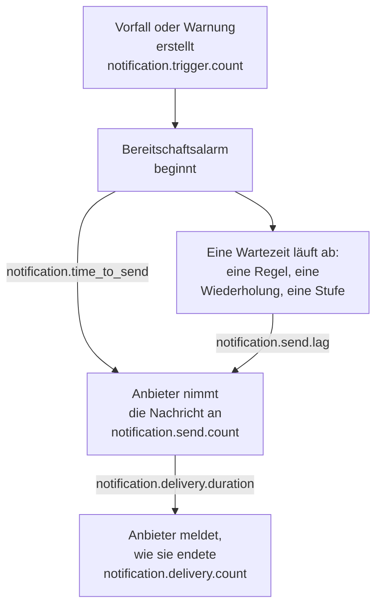

# Metriken zur Benachrichtigungszustellung

OneUptime erfasst, wie die Benachrichtigungen verlaufen, die es sendet: wie viele Vorfälle und Warnungen sie auslösen, ob jede Nachricht ihren Anbieter erreicht hat, wie lange ein Bereitschaftsalarm bis zum Versand brauchte und ob er das Telefon erreicht hat. Senden Sie die eigene Telemetrie von OneUptime an ein OneUptime-Projekt oder an ein beliebiges OpenTelemetry-Backend, um Zustellungsziele für die Menschen festzulegen, die Ihre Installation betreut, und um zu prüfen, ob Sie sie einhalten.

:::cards
- [Metriken aktivieren](#metriken-aktivieren): Zwei Einstellungen, und ohne sie wird nichts erfasst.
- [Die Metriken](#die-metriken): Sieben Metriken, vom Auslöser bis zum Telefon.
- [Wie ein Alarm gemessen wird](#wie-ein-alarm-gemessen-wird): Wovon Zeit bis zum Versand und Versandverzug ausgehen.
- [SLOs für den Anfang](#slos-für-den-anfang): Vier Ziele, Abfrage für Abfrage.
:::

## So funktioniert es



Jede Nachricht zählt in `notification.send.count`, auf jedem Kanal, nicht nur Bereitschaftsalarme. Die beiden Zeiten, `notification.time_to_send` und `notification.send.lag`, gelten nur für Bereitschaftsalarme.

## Metriken aktivieren

Nichts wird erfasst, bis OneUptime einen OpenTelemetry-Exporter hat: Ohne ihn kosten die Metriken nichts und werden nirgends gespeichert. Richten Sie ihn auf ein OneUptime-Projekt, mit einem Server-[Ingestion-Schlüssel](/docs/telemetry/ingestion-keys) dieses Projekts, oder auf ein beliebiges Backend, das OTLP über HTTP annimmt.

:::tabs
@tab Kubernetes
```yaml
openTelemetryExporter:
  endpoint: https://oneuptime.example.com/otlp
  headers: x-oneuptime-token=YOUR_INGESTION_KEY
```
Die Deployments `app` und `worker` senden sie: Lassen Sie `app.disableTelemetryCollection` und `worker.disableTelemetryCollection` auf `false`, ihrem Standard.
@tab Docker Compose
```bash
OPENTELEMETRY_EXPORTER_OTLP_ENDPOINT=https://oneuptime.example.com/otlp
OPENTELEMETRY_EXPORTER_OTLP_HEADERS=x-oneuptime-token=YOUR_INGESTION_KEY
DISABLE_TELEMETRY_FOR_APP=false
```
Setzen Sie sie in `config.env` und führen Sie dann `npm start` aus. `DISABLE_TELEMETRY_FOR_APP` ist standardmäßig `true`, und dann wird nichts gesendet.
:::

OneUptime braucht sowohl den Endpunkt als auch die Header: Ohne Header sendet es nichts. Schreiben Sie jeden Header als `name=value` und trennen Sie mehrere mit `;`. Ein Wert darf `=` enthalten. OneUptime hängt `/v1/metrics` selbst an den Endpunkt an, und dieselben Einstellungen senden auch seine eigenen Traces und Logs. Jede Metrik erscheint, sobald OneUptime sie zum ersten Mal erfasst: `notification.send.count` mit der ersten gesendeten Nachricht.

### Deltas an ein OneUptime-Projekt senden

OneUptime sendet Zähler und Histogramme so, wie OpenTelemetry es standardmäßig tut: Jeder Punkt enthält die laufende Summe seit dem Start dieses Serverprozesses. Der Metrik-Explorer addiert die Punkte in jedem Schritt eines Diagramms, daher liest er die Anzahlen und Perzentile eines Zeitraums nur aus Deltas genau, aus Punkten, die enthalten, was seit dem vorherigen geschehen ist. Wenn die Metriken an ein OneUptime-Projekt gehen, senden Sie Deltas:

:::tabs
@tab Kubernetes
```yaml
extraEnv:
  - name: OTEL_EXPORTER_OTLP_METRICS_TEMPORALITY_PREFERENCE
    value: delta
```
Die eigene Liste eines Dienstes ersetzt die des ganzen Charts: Wenn Sie `app.extraEnv` oder `worker.extraEnv` setzen, fügen Sie es auch dort hinzu.
@tab Docker Compose
```yaml title="docker-compose.override.yml"
services:
  app:
    environment:
      OTEL_EXPORTER_OTLP_METRICS_TEMPORALITY_PREFERENCE: delta
```
Legen Sie sie neben `docker-compose.yml` an, oder fügen Sie dies Ihrer vorhandenen hinzu, und führen Sie dann `npm start` aus.
:::

Das gilt für jede Metrik, die OneUptime über sich selbst sendet. Ein Backend, das laufende Summen selbst auswertet, etwa Prometheus, braucht keine Änderung.

## Die Metriken

| Metrik | Typ | Einheit | Was sie beantwortet |
| --- | --- | --- | --- |
| `notification.trigger.count` | Zähler | `1` | Wie viele Datensätze Benachrichtigungen ausgelöst haben |
| `notification.send.count` | Zähler | `1` | Wie jede einem Anbieter übergebene Nachricht verlief |
| `notification.send.duration` | Histogramm | `ms` | Wie lange der Anbieter brauchte, sie anzunehmen |
| `notification.time_to_send` | Histogramm | `ms` | Wie lange nach seinem Auslöser ein Alarm seinen Anbieter erreichte |
| `notification.send.lag` | Histogramm | `ms` | Wie lange nach ihrer Fälligkeit eine später gesendete Benachrichtigung ihren Anbieter erreichte |
| `notification.delivery.count` | Zähler | `1` | Wie die von den Anbietern angenommenen Nachrichten endeten |
| `notification.delivery.duration` | Histogramm | `ms` | Wie lange nach der Annahme durch ihren Anbieter eine Nachricht endete |

Jedes Attribut enthält einen von wenigen festen Werten, nie ein Projekt, eine Person, eine Telefonnummer oder einen Datensatz. Die einzige Ausnahme sind ID und Name eines benutzerdefinierten Kanals: Eine Installation hat eine Handvoll davon, und sie auseinanderzuhalten ist der Zweck.

### Datensätze, die Menschen benachrichtigen

`notification.trigger.count` zählt jeden Vorfall, jede Warnung, jede Vorfallsepisode und jede Warnungsepisode, sobald sie erstellt wird.

| Attribut | Werte |
| --- | --- |
| `notification.trigger.type` | `incident`, `alert`, `incident_episode`, `alert_episode` |
| `notification.trigger.source` | `automatic`, wenn OneUptime den Datensatz erstellt hat, aus einem Monitor oder einer Regel; `manual`, wenn eine Person oder die API es tat |
| `monitor.type` | Der Typ des Monitors, der einen Vorfall oder eine Warnung erstellt hat, etwa `Incoming Request`, `Logs` oder `Metrics`; fehlt, wenn kein Monitor es tat |

### Nachrichten, die einem Anbieter übergeben werden

`notification.send.count` zählt jede Nachricht, die einem Anbieter übergeben wird, und `notification.send.duration` misst den Aufruf des Anbieters. Beide tragen diese Attribute:

| Attribut | Werte |
| --- | --- |
| `notification.channel` | `email`, `sms`, `call`, `whatsapp`, `telegram`, `push`, `webhook`, `slack`, `microsoft_teams`, `mattermost`, `custom_channel` |
| `notification.provider` | `twilio`, `sms_and_call_gateway`, `smtp`, `sendgrid`, `amazon_ses`, `mailgun`, `postmark`, `resend`, `microsoft_graph`, `expo`, `push_relay`, `web_push`, `meta_whatsapp`, `telegram_bot_api`, `slack`, `microsoft_teams`, `mattermost`, `webhook`, `custom_channel` oder `none`, wenn keinem Anbieter etwas übergeben wurde |
| `notification.provider.config` | `global` für das eigene Konto und die Einstellungen der Installation; `project` für das eigene Twilio-Konto, den SMTP-Server, den Webhook oder die Workspace-Verbindung eines Projekts, deren Fehler das Projekt beheben muss |
| `notification.on_call_page` | `true` für eine Benachrichtigung eines Bereitschaftsalarms, sonst `false` |
| `outcome` | `success`, `failure` oder `not_sent`, wie unten |
| `notification.destination` | Slack, Microsoft Teams und Mattermost: `direct_message` an eine Person, `channel` für einen Beitrag in einem Kanal oder einem Teams-Gruppenchat, `incoming_webhook` für einen eingehenden Webhook, etwa den eines Statusseiten-Abonnenten. Webhooks: `status_page_subscriber` für den eigenen Webhook eines Statusseiten-Abonnenten. Fehlt beim Webhook einer Person und bei allen anderen Kanälen |
| `notification.custom_channel.id`, `notification.custom_channel.name` | Nur benutzerdefinierte Kanäle: die ID des Kanals und sein Name, gekürzt auf 100 Zeichen |

- `success`: Der Anbieter hat die Nachricht angenommen.
- `failure`: Der Anbieter hat sie abgelehnt oder war nicht erreichbar, oder das Senden ist fehlgeschlagen. Ein Chat-Kanal, der nicht gefunden wurde, ist ein Fehlschlag ohne Dauer.
- `not_sent`: Bewusst nicht gesendet. Das Projekt hat den Kanal ausgeschaltet, hat zu wenig Guthaben oder ist gesperrt, Push ist auf diesem Server ausgeschaltet, oder ein benutzerdefinierter Kanal ist ausgeschaltet, gelöscht oder nicht von der Lizenz abgedeckt. Eine Erfolgsquote lässt diese aus: Hier wirken Einstellungen, keine fehlerhafte Plattform.

Eine Nachricht an den eigenen Webhook eines Statusseiten-Abonnenten zählt einmal, egal wie oft sie versucht wurde: `success`, wenn der Endpunkt mit einem 2xx-Status antwortete, und `failure`, wenn er mit einem anderen Status antwortete, nicht erreichbar war oder seine Adresse nicht erlaubt ist.

### Was das Telefon erreicht hat

`notification.delivery.count` zählt, wie jede von einem Anbieter angenommene Nachricht endete, so wie der Anbieter es später meldet, einmal pro Nachricht. `notification.delivery.duration` misst, wie lange nach der Annahme durch den Anbieter. Beide tragen `notification.channel`, `notification.provider`, `notification.provider.config`, `notification.on_call_page` und `outcome`, den endgültigen Status:

| Kanal | Anbieter | `outcome` | Dauer |
| --- | --- | --- | --- |
| `sms` | `twilio` | `delivered`, `undelivered`, `failed` | Bis Twilio den Status meldet |
| `call` | `twilio` | `answered`, `not_answered`, `failed` | Bis der Anruf angenommen wurde, sonst bis er endete |
| `push` | `expo`, `push_relay` | `delivered`, `undelivered`, `failed` | Nicht gemessen: Eine Quittung sagt, ob Apple oder Google den Push angenommen hat, nicht wann |
| `whatsapp` | `meta_whatsapp` | `delivered`, `failed` | Bis Meta den Status meldet |

Ein Anruf, der ausklingelte, besetzt war oder abgelehnt wurde, ist `not_answered`. Ein Push an eine App, die nicht mehr da ist, ist `undelivered`, und eine gelesene WhatsApp-Nachricht zählt als zugestellt. `notification.provider.config` ist nur für SMS und Anrufe über das eigene Twilio-Konto eines Projekts `project`.

Status kommen nur dort an, wo der Anbieter sie melden kann:

- SMS und Anrufe: über Twilio, wenn Twilio Ihren Server unter seinem `HOST` erreichen kann (siehe [Twilio-Integration](/docs/self-hosted/twilio-integration#3-netzwerkzugriff-konfigurieren)). Das SMS- und Anruf-Gateway meldet keine.
- WhatsApp: wenn der Webhook von Meta für Ihre Installation eingerichtet ist.
- Push: aus den Quittungen von Expo, die OneUptime etwa 15 Minuten nach dem Push liest, auch über das Push-Relay. Die Installation, die den Push gesendet hat, zählt ihn.
- E-Mail, Telegram, Webhooks, Chat und benutzerdefinierte Kanäle melden keinen endgültigen Status.

## Wie ein Alarm gemessen wird

### Zeit bis zum Versand

`notification.time_to_send` läuft vom Auslöser eines Alarms bis zur Annahme der Benachrichtigung durch ihren Anbieter. Sie misst nur die Benachrichtigungen, die beim Start des Alarms fällig sind: die Personen der ersten Eskalationsregel, nach ihren Bereitschaftsregeln, die auf nichts warten, und jede Stufe, zu der der Alarm sofort weitergeht, weil er niemanden erreicht hat. Wartezeiten, die die Bereitschaftskonfiguration verlangt, sind keine Verzögerung der Plattform, daher bleiben sie außen vor: Sie stehen im [Versandverzug](#versandverzug). Nur Benachrichtigungen, die ihr Anbieter angenommen hat, werden gemessen; ein Fehlschlag zeigt sich in `notification.send.count`.

| Attribut | Werte |
| --- | --- |
| `notification.channel` | Wie bei `notification.send.count` |
| `notification.page.start` | Wovon die Zeit ausgeht, wie unten |
| `notification.trigger.type` | Der Datensatz, für den der Alarm gilt: `incident`, `alert`, `incident_episode`, `alert_episode` |
| `notification.custom_channel.id`, `notification.custom_channel.name` | Nur benutzerdefinierte Kanäle |

| `notification.page.start` | Die Zeit läuft ab |
| --- | --- |
| `monitor_data_received` | Wann OneUptime die Daten erhielt, die den Monitor ausgelöst haben: eine eingehende Anfrage, den Bericht eines Server-Agents, eine eingehende E-Mail, die Prüfung einer Probe, einen SNMP-Trap oder die Abfrage eines Netzwerkgeräts. Sie schließt die Zeit ein, die die Daten in der Warteschlange auf ihre Auswertung gewartet haben. |
| `record_created` | Wann der Vorfall, die Warnung oder die Episode erstellt wurde: von einem Telemetrie-Monitor, einer Regel oder einer Person, und bei einer Prüfung auf Ausbleiben, etwa einem Heartbeat, der aufgehört hat. |
| `page_started` | Wann ein Alarm später gestartet wurde: Eine Person, ein Workflow oder eine Regel, die jetzt zutrifft, hat ihn gestartet, oder es ist ein direkter Alarm. Bei einem Alarm, den seine Bereitschaftsregel oder OneUptime AI zurückgehalten hat, wann die Sperre ablief, oder wann er startete, falls das früher war. Bei einem erneuten Alarm, wann das Bestätigungs-Timeout ablief. So zeigt sich ein Worker, der einen davon zu spät erreichte, in der Zeit. |

Bei einer eingehenden Anfrage läuft die Zeit ab der letzten Anfrage, die der Endpunkt erhalten hat, daher kann sie etwas zu kurz ausfallen.

### Versandverzug

`notification.send.lag` läuft von dem Moment, in dem eine später gesendete Benachrichtigung fällig war, bis zur Annahme durch ihren Anbieter. Zwei Worker senden diese, jeder einmal pro Minute, daher zeigt ein pünktlicher Worker bis zu etwa einer Minute, und einer, der zurückgefallen ist, zeigt, um wie viel.

| `notification.schedule` | Fällig wann |
| --- | --- |
| `rule_wait` | Die Bereitschaftsregel einer Person, die wartet, etwa „ruf mich nach 10 Minuten an“: so lange, nachdem die Person alarmiert wurde. Nie bevor der Worker ihre Regeln zuletzt durchgegangen ist, daher ist eine später hinzugefügte oder geänderte Regel ab dann fällig. |
| `repeat` | Ein Push, der wiederholt wird, bis jemand bestätigt: jedes Mal, wenn sein Intervall abläuft. |
| `escalation` | Eine spätere Eskalationsstufe: wenn die Stufe davor ihre Wartezeit beendet hat, oder sofort, wenn eine Person den Alarm weitergibt. |
| `policy_repeat` | Die Richtlinie, die wieder bei ihrer ersten Stufe beginnt: wenn die Wartezeit ihrer letzten Stufe abgelaufen ist. |

Er trägt außerdem `notification.channel`, `notification.trigger.type` und, bei benutzerdefinierten Kanälen, `notification.custom_channel.id` und `notification.custom_channel.name`. Eine Benachrichtigung, die beim Start ihres Alarms fällig ist, ist nie darin, auch nicht, wenn ein Worker den Alarm zu spät startete, nach einer Sperre oder als erneuten Alarm: Sie steht in der Zeit bis zum Versand.

### Histogramm-Buckets

Jedes Histogramm hat eigene Bucket-Grenzen, in Millisekunden, so gesetzt, dass ein Ziel an einer Grenze abgelesen werden kann:

| Histogramm | Bucket-Grenzen, in Millisekunden |
| --- | --- |
| `notification.send.duration` | `5, 10, 25, 50, 100, 250, 500, 1000, 2500, 5000, 10000, 30000, 60000, 120000` |
| `notification.time_to_send` | `250, 500, 1000, 2000, 5000, 10000, 15000, 30000, 60000, 120000, 300000, 600000, 1800000, 3600000` |
| `notification.send.lag` | `1000, 5000, 10000, 15000, 30000, 45000, 60000, 75000, 90000, 120000, 180000, 300000, 600000, 1800000, 3600000` |
| `notification.delivery.duration` | `500, 1000, 2000, 5000, 10000, 15000, 30000, 60000, 120000, 300000, 600000, 1800000, 3600000, 14400000, 86400000` |

Ein Perzentil wird aus den Buckets berechnet und als Mitte des Buckets gezeichnet, in den es fällt. Vergleichen Sie es daher mit der Grenze eines Buckets: Ein P95 von `notification.time_to_send` bei oder unter 30000 bedeutet, dass 95 % der Alarme 30 Sekunden oder weniger brauchten.

## SLOs für den Anfang

Vier Ziele, die die meisten Installationen zusagen können, jedes aus einer oder zwei Abfragen im Metrik-Explorer des Projekts aufgebaut, das die Metriken empfängt. Sie lesen einen Zeitraum genau, sobald die Metriken als Deltas ankommen: siehe [Deltas an ein OneUptime-Projekt senden](#deltas-an-ein-oneuptime-projekt-senden).

### Ein Ziel im Metrik-Explorer aufbauen

:::steps
1. Öffnen Sie den [Metrik-Explorer](/docs/telemetry/metrics-explorer) des Projekts und klicken Sie auf die erste Metrik des Ziels. Ihre Abfrage ist `a`.
2. Wählen Sie ihre Aggregation unter **Aggregieren nach**. Öffnen Sie dann **Filter & Gruppierung** und fügen Sie jede ihrer Bedingungen unter **Nach Attributen filtern** hinzu.
3. Für eine zweite Abfrage klicken Sie auf **Metrik hinzufügen** und richten `b` auf dieselbe Weise ein.
4. Für eine Formel klicken Sie auf **Formel hinzufügen** und schreiben sie in **Formel**.
5. Um benachrichtigt zu werden, wenn das Ziel verfehlt wird, klicken Sie auf **Aktionen → Monitor aus dieser Ansicht erstellen** und lassen Sie alarmieren, wenn der Wert das Ziel überschreitet: siehe [Metriken-Überwachung](/docs/monitor/metrics-monitor).
:::

Um ein Ziel über 30 Tage mit einem Fehlerbudget zu verfolgen, hängen Sie diesen Monitor an ein [SLO](/docs/slo/introduction): Es zählt die Zeit, in der das Ziel verfehlt wurde.

### Bereitschafts-SMS erreichen Twilio

Höchstens 1 % der Bereitschafts-SMS, die über das eigene Twilio-Konto der Installation gesendet werden, schlagen fehl, also werden 99 % angenommen.

| Abfrage | Metrik | Aggregation | Bedingungen |
| --- | --- | --- | --- |
| `a` | `notification.send.count` | **Summe** | `notification.channel = sms`, `notification.on_call_page = true`, `notification.provider.config = global`, `outcome != not_sent` |
| `b` | `notification.send.count` | **Summe** | Dieselben, mit `outcome = failure` |

Die Formel `$b / $a * 100` ist der Anteil, der fehlschlug, und das Ziel gilt, solange er bei oder unter 1 bleibt. Ein Schritt ohne Fehlschlag zeichnet keinen Punkt, da `b` dort keinen hat. `outcome != not_sent` lässt aus, was die eigenen Einstellungen der Projekte zurückgehalten haben, und `global` die eigenen Twilio-Konten der Projekte. Auf einer Installation, die SMS über ihr SMS- und Anruf-Gateway sendet, messen dieselben Abfragen das Gateway. Für einen anderen Kanal ändern Sie `sms`: `call`, `push` oder `email`.

### Alarme gehen innerhalb von 30 Sekunden hinaus

95 % der Bereitschaftsalarme erreichen ihren Anbieter innerhalb von 30 Sekunden nach ihrem Auslöser.

| Abfrage | Metrik | Aggregation | Bedingungen |
| --- | --- | --- | --- |
| `a` | `notification.time_to_send` | **P95** | `notification.page.start != page_started` |

Das Ziel gilt, solange `a` bei oder unter 30000 bleibt. Später gestartete Alarme werden ab ihrem Start oder ihrer Fälligkeit gemessen, nicht ab einem Auslöser, daher bleiben sie außen vor. Gruppieren Sie nach `notification.page.start`, um die Warteschlange der Monitore (`monitor_data_received`) getrennt vom Rest zu sehen, oder nach `notification.channel`, um einen langsamen Kanal zu finden.

### Später gesendete Benachrichtigungen gehen innerhalb von 90 Sekunden hinaus

99 % der Benachrichtigungen, die nach einer Wartezeit gesendet werden, erreichen ihren Anbieter innerhalb von 90 Sekunden nach ihrer Fälligkeit.

| Abfrage | Metrik | Aggregation | Bedingungen |
| --- | --- | --- | --- |
| `a` | `notification.send.lag` | **P99** | — |

Das Ziel gilt, solange `a` bei oder unter 90000 bleibt. Gruppieren Sie nach `notification.schedule`, um zu sehen, welcher Worker zurückgefallen ist: `rule_wait` und `repeat` gehören zum einen Worker, `escalation` und `policy_repeat` zum anderen.

### Bereitschafts-SMS erreichen das Telefon

Höchstens 5 % der Bereitschafts-SMS, die Twilio für das eigene Konto der Installation angenommen hat, werden nicht zugestellt.

| Abfrage | Metrik | Aggregation | Bedingungen |
| --- | --- | --- | --- |
| `a` | `notification.delivery.count` | **Summe** | `notification.channel = sms`, `notification.on_call_page = true`, `notification.provider.config = global` |
| `b` | `notification.delivery.count` | **Summe** | Dieselben, mit `outcome != delivered` |

Die Formel `$b / $a * 100` ist der nicht zugestellte Anteil. Netzbetreiber und ausgeschaltete Telefone bestimmen einen Teil davon, setzen Sie das Ziel daher nach dem, was Sie über einige Wochen sehen. Für Anrufe verwenden Sie `call` und `outcome != answered`. Twilio muss Ihren Server erreichen können: siehe [Was das Telefon erreicht hat](#was-das-telefon-erreicht-hat).

## Fehlerbehebung

:::details Es kommen keine Benachrichtigungsmetriken an
Prüfen Sie, dass `OPENTELEMETRY_EXPORTER_OTLP_ENDPOINT` und `OPENTELEMETRY_EXPORTER_OTLP_HEADERS` beide gesetzt sind und in Docker Compose `DISABLE_TELEMETRY_FOR_APP` auf `false` steht, und starten Sie OneUptime dann neu. Beim Start protokolliert OneUptime eine Warnung, wenn es einen Header nicht lesen kann oder wenn es nichts sendet. Eine Metrik erscheint erst, wenn etwas erfasst wurde, senden Sie also zuerst eine Benachrichtigung.
:::

:::details Eine Anzahl wächst nur, oder ein Perzentil bewegt sich kaum
Die Metriken kommen als laufende Summen an. Senden Sie Deltas: siehe [Deltas an ein OneUptime-Projekt senden](#deltas-an-ein-oneuptime-projekt-senden).
:::

:::details Es kommen keine endgültigen Status an
Endgültige Status kommen von den Anbietern, später, und nur dort, wo sie sie melden können: siehe [Was das Telefon erreicht hat](#was-das-telefon-erreicht-hat). Auf einer Installation, die Twilio nicht erreichen kann, werden SMS und Anrufe als gesendet gezählt, aber nie als zugestellt.
:::

## Nächste Schritte

:::cards
- [Metrik-Explorer](/docs/telemetry/metrics-explorer): Jede Metrik darstellen, kombinieren und vergleichen.
- [Metriken-Überwachung](/docs/monitor/metrics-monitor): Alarmieren, wenn ein Ziel verfehlt wird.
- [Twilio-Integration](/docs/self-hosted/twilio-integration): Twilio melden lassen, was das Telefon erreicht hat.
- [Eskalationsregeln](/docs/on-call/escalation-rules): Die Wartezeiten, von denen der Versandverzug ausgeht.
:::
