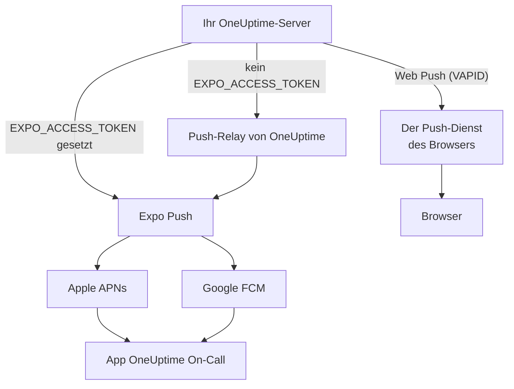
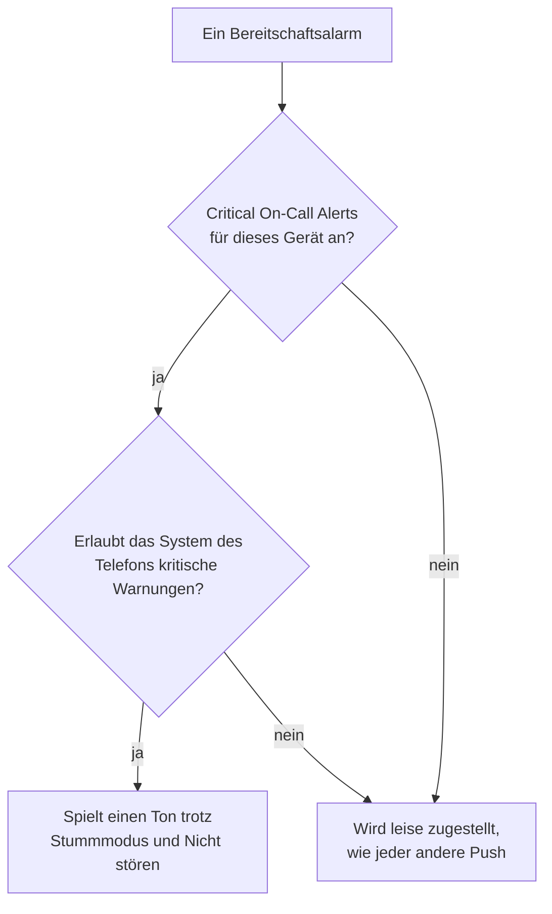

# Push-Benachrichtigungen

OneUptime alarmiert Menschen auf ihrem Telefon über die mobile App **OneUptime On-Call** und im Browser über Web Push. Mobile Pushes laufen über **Expo Push**: Eine selbst gehostete Instanz sendet sie standardmäßig über das Push-Relay von OneUptime, braucht also ausgehenden Netzwerkzugriff auf das Relay und keine eigenen Zugangsdaten für Expo, Apple oder Google.

:::cards
- [Wählen, wie Pushes gesendet werden](#einrichtung-bei-selbsthosting): Das Push-Relay oder Ihr eigenes Expo-Zugriffstoken.
- [Die Firewall öffnen](#netzwerkzugriff): Die Adressen, die Ihr Server und die Geräte Ihrer Leute erreichen.
- [Den Stummmodus durchbrechen](#kritische-bereitschaftsalarme-stummmodus-durchbrechen): Bereitschaftsalarme auf einem stummgeschalteten Telefon hörbar machen.
- [Pushes beheben, die nie ankommen](#fehlerbehebung): Was jeder Fehler von Expo bedeutet.
:::

## So funktioniert es



Die mobile App von OneUptime registriert beim Backend ein Expo-Push-Token. Das Backend sendet Benachrichtigungen über das Push-Relay von OneUptime oder, wenn `EXPO_ACCESS_TOKEN` konfiguriert ist, direkt an Expo. Expo leitet die Nachrichten zur Zustellung an das Gerät an Apple APNs oder Google FCM weiter.

Web-Push-Benachrichtigungen nutzen weiterhin VAPID-Schlüssel und das Web-Push-Protokoll.

## Einrichtung bei Selbsthosting

Mit der offiziellen mobilen App und dem Standard-Relay braucht der Server keine Expo-Zugangsdaten. Für die direkte Zustellung über Expo konfigurieren Sie `EXPO_ACCESS_TOKEN` mit Zugangsdaten, die zum Expo-Projekt Ihrer App passen. Web Push braucht `VAPID_PUBLIC_KEY`, `VAPID_PRIVATE_KEY` und `VAPID_SUBJECT`.

| Variable | Helm-Wert | Standard | Was sie bewirkt |
| --- | --- | --- | --- |
| `PUSH_NOTIFICATION_RELAY_URL` | `pushNotification.relayUrl` | `https://oneuptime.com/api/notification/push-relay/send` | Wohin mobile Pushes gehen, solange `EXPO_ACCESS_TOKEN` nicht gesetzt ist. |
| `EXPO_ACCESS_TOKEN` | `expo.accessToken` | Leer | Sendet mobile Pushes mit dem Token Ihres Expo-Projekts direkt an Expo. |
| `VAPID_PUBLIC_KEY` | `vapid.publicKey` | Leer | Die öffentliche Hälfte des Schlüsselpaars, mit dem Browser sich anmelden. |
| `VAPID_PRIVATE_KEY` | `vapid.privateKey` | Leer | Die private Hälfte, die jeden Web Push signiert. |
| `VAPID_SUBJECT` | `vapid.subject` | `mailto:support@oneuptime.com` | Eine Kontaktadresse, unter der die Push-Dienste der Browser Sie erreichen. |

Erzeugen Sie ein VAPID-Schlüsselpaar einmalig mit `npx web-push generate-vapid-keys` und behalten Sie es: Browser, die sich mit einem Schlüsselpaar angemeldet haben, erhalten keine Pushes mehr, wenn es sich ändert.

:::tabs
@tab Docker Compose
```bash title="config.env"
VAPID_PUBLIC_KEY=your-public-key
VAPID_PRIVATE_KEY=your-private-key
VAPID_SUBJECT=mailto:oncall@example.com
# Leave unset to send mobile pushes through the push relay.
EXPO_ACCESS_TOKEN=
```
@tab Kubernetes
```yaml title="values.yaml"
vapid:
  publicKey: your-public-key
  privateKey: your-private-key
  subject: mailto:oncall@example.com
# Leave empty to send mobile pushes through the push relay.
expo:
  accessToken:
```
:::

## Netzwerkzugriff

| Richtung | Ziel | Protokoll / Port | Wann erforderlich |
| --- | --- | --- | --- |
| OneUptime → Standard-Push-Relay | `https://oneuptime.com/api/notification/push-relay/send`, `https://oneuptime.com/api/notification/push-relay/receipts` | HTTPS / TCP 443 | Mobiler Push, wenn `EXPO_ACCESS_TOKEN` nicht gesetzt ist. |
| OneUptime → Expo | `https://exp.host/--/api/v2/push/send`, `https://exp.host/--/api/v2/push/getReceipts` | HTTPS / TCP 443 | Direkter mobiler Push, wenn `EXPO_ACCESS_TOKEN` gesetzt ist. |
| OneUptime → Push-Dienst des Browsers | Der HTTPS-Endpunkt aus dem Push-Abonnement des Browsers | HTTPS / normalerweise TCP 443 | Web Push. |
| Mobile App oder Browser → OneUptime | Ihr OneUptime-Hostname | HTTPS / TCP 443 | Anmelden, das Gerät registrieren und Benachrichtigungslinks öffnen. |

Wenn Sie `PUSH_NOTIFICATION_RELAY_URL` ändern, erlauben Sie dessen Ziel-Hostnamen und den konfigurierten Port. Ein eigenes Relay muss die Relay-API von OneUptime implementieren. Diese Standards und das Umschalten zwischen Relay und direkter Zustellung sind in [der Konfiguration von OneUptime](https://github.com/OneUptime/oneuptime/blob/master/config.example.env) und [im Push-Dienst](https://github.com/OneUptime/oneuptime/blob/master/packages/Common/Server/Services/PushNotificationService.ts) definiert. Direkte Expo-Anfragen nutzen den Endpunkt, der in [der Sende-Anleitung von Expo](https://docs.expo.dev/push-notifications/sending-notifications/) dokumentiert ist. OneUptime liest Zustellbelege beim Relay unter derselben Adresse, mit `/receipts` statt `/send`. Ein Relay ohne diese Route stellt Pushes trotzdem zu; ein Gerät, dessen App entfernt wurde, fällt dann erst auf, wenn ein späterer Push an das Gerät abgelehnt wird.

Erlauben Sie für Web Push die tatsächlichen Hosts der Abonnement-Endpunkte für die Browser, die Ihr Team nutzt. OneUptime akzeptiert `fcm.googleapis.com`, `android.googleapis.com`, `push.services.mozilla.com`, `notify.windows.com` und `push.apple.com`, einschließlich ihrer Subdomains. Typische Beispiele sind `updates.push.services.mozilla.com` und `web.push.apple.com`. Das [Push-Abonnement des Browsers](https://developer.mozilla.org/en-US/docs/Web/API/PushSubscription) liefert das Ziel; nur Expo oder das Relay von OneUptime zu erlauben, ermöglicht keinen Web Push.

Erlauben Sie DNS-Auflösung und ausgehendes TLS aus dem OneUptime-Prozess, der Benachrichtigungen sendet. Sein Trust Store muss das Zertifikat des Ziels validieren, und Proxys müssen API-Anfragen ohne interaktive Authentifizierung durchlassen. Push-Anbieter rufen keinen Webhook auf Ihrem OneUptime-Server auf, sodass der Server privat bleiben kann, wenn die Geräte der Benutzer ihn über ein VPN oder eine andere private Verbindung erreichen. Ein Server ohne Zugriff auf sein Relay oder externe Push-Dienste kann diese Benachrichtigungen nicht zustellen.

Die Konnektivität der Geräte ist eine eigene Voraussetzung. iOS-Geräte brauchen Zugriff auf APNs, typischerweise TCP 5223 mit TCP 443 als Ausweichweg; die Zielbereiche nennen [Apples aktuelle Netzwerkanforderungen](https://support.apple.com/en-us/102266). Android-Geräte brauchen Zugriff auf FCM über TCP 5228–5230 und 443; nutzen Sie [Googles aktuelle Hinweise zu Hosts und Firewalls](https://firebase.google.com/docs/cloud-messaging/network-configuration). Diese Geräte-Ports müssen auf OneUptime nicht eingehend geöffnet werden, und der Ablauf auf dem Server nutzt das Relay oder Expo, statt sich direkt mit APNs/FCM zu verbinden.

:::steps
1. Prüfen Sie DNS und HTTPS aus dem Container oder Pod, der Benachrichtigungen sendet, zum Ziel Ihres Zustellwegs: dem Relay, Expo oder dem Push-Dienst eines Browsers.
2. Senden Sie unter **Benutzereinstellungen > Benachrichtigungsmethoden > Push Notifications** mit **Testbenachrichtigung** einen Test und bestätigen Sie, dass er auf einem registrierten Gerät ankommt. Testen Sie für Web Push jeden Browser einzeln.
3. Prüfen Sie Fehler von Relay, Expo oder Web Push in den Logs von OneUptime; eine erfolgreiche Übermittlung an die API allein bestätigt nicht die Zustellung auf dem Gerät.
:::

Bei mobilen Pushes liest OneUptime außerdem etwa 15 Minuten nach jedem Push den Zustellbeleg von Expo: Ein Push, der das Gerät nie erreicht hat, erscheint dann im Push-Log als nicht zugestellt und, bei einem Bereitschaftsalarm, auf der Bereitschafts-Zeitleiste.

## Kritische Bereitschaftsalarme (Stummmodus durchbrechen)

Standardmäßig richtet sich eine Push-Benachrichtigung nach dem Gerät: Ein stummgeschaltetes Telefon bleibt still, und „Nicht stören“ hält die Benachrichtigung zurück. Für jemanden in Bereitschaft ist das um 3 Uhr nachts die falsche Voreinstellung, deshalb bietet die mobile App eine Einstellung pro Gerät – **Settings > Notifications > Critical On-Call Alerts** –, mit der *nur Bereitschaftsalarme* durch beides hindurch einen Ton abspielen.

Der Umfang ist bewusst eng. Nur Alarme, die eine Bereitschafts-Benachrichtigungsregel erzeugt, kommen infrage. Benachrichtigungen an Besitzer, Hinweise auf neue Notizen, Statusänderungen und Monitor-Benachrichtigungen werden nie hochgestuft, egal was diese Einstellung sagt.



Damit ein Alarm den Stummmodus durchbricht, müssen drei Dinge zutreffen. Fehlt eines davon, wird der Alarm trotzdem zugestellt – nur leise.

1. **Die Person hat es für dieses Gerät eingeschaltet.** Gespeichert pro Gerät, standardmäßig aus, in `UserPush.isCriticalAlertEnabled`. Telefon und Tablet derselben Person sind getrennte Entscheidungen.
2. **Der Server markiert den Alarm als kritisch.** Er sendet für iOS die kritische Sound-Payload von APNs plus `interruptionLevel: critical` und zielt für Android auf den Benachrichtigungskanal `oncall_critical`.
3. **Das Betriebssystem erlaubt es**, und genau hier unterscheiden sich die beiden Plattformen.

:::tabs
@tab iOS
Kritische Warnungen auf iOS erfordern das Entitlement `com.apple.developer.usernotifications.critical-alerts`, das Apple pro Entwicklerkonto auf Anfrage für Apps vergibt, die Menschen über dringende Ereignisse benachrichtigen. Beantragen Sie es über [Apples Antragsformular für Critical Alerts](https://developer.apple.com/contact/request/notifications-critical-alerts-entitlement/).

Die offizielle App **OneUptime On-Call** im App Store hat das Entitlement ab **Version 1.5.0**. Frühere Versionen haben es nicht, und iOS bietet ihnen nie kritische Warnungen an; aktualisieren Sie die App also, bevor Sie die Einstellung einschalten.

Wenn Sie die App selbst bauen, ist das Entitlement optional. Ein Provisioning-Profil kann kein Entitlement tragen, das dem Team nicht gewährt wurde, und ein Build, der eines deklariert, das es nicht tragen kann, **lässt sich nicht signieren**. Nur das Profil `production` in `packages/MobileApp/eas.json` schaltet es ein, weil Apple es dem Team gewährt hat, das die offizielle App veröffentlicht. Ein Fork, der mit seinem eigenen Apple-Team signiert, muss diesen `env`-Eintrag entfernen, bis Apple auch diesem Team das Entitlement gewährt. Danach schalten Sie es beim Bauen ein:

```bash
EXPO_IOS_CRITICAL_ALERTS_ENTITLEMENT=true npx expo prebuild
```

oder fügen Sie `EXPO_IOS_CRITICAL_ALERTS_ENTITLEMENT: "true"` dem `env`-Block des Build-Profils in `packages/MobileApp/eas.json` hinzu.

Schalten Sie auf dem Gerät in der App **Settings > Notifications > Critical On-Call Alerts** ein und erlauben Sie kritische Warnungen, wenn iOS fragt. iOS fügt unter **Settings > Notifications > OneUptime On-Call** in den iOS-Einstellungen erst dann einen Schalter **Critical Alerts** für die App hinzu, wenn die App um die Berechtigung gebeten hat; vor dem Einschalten der Einstellung in der App ist dieser Schalter also nicht da. Wenn Sie die Abfrage ablehnen, können Sie kritische Warnungen später mit diesem Schalter in den iOS-Einstellungen erlauben.

Bei einem Build ohne das Entitlement zeigt iOS weder eine Abfrage noch einen Schalter, und der Einstellungsbildschirm der App sagt, dass diese Version der App keine kritischen Warnungen empfangen kann. Sie schickt die Person nicht auf die Suche nach einem Schalter, den iOS gar nicht anzeigt.
@tab Android
Android kennt keinen Genehmigungsschritt beim Hersteller, aber die Umgehung von „Nicht stören“ gewährt der Benutzer auf einem Systembildschirm statt über eine Abfrage in der App. Wenn eine Person die Einstellung einschaltet, öffnet die App für sie **Settings > Notifications > Do Not Disturb access** und prüft erneut, wenn sie zurückkehrt.

Zwei Mechanismen wirken hier, und sie decken unterschiedliche Fälle ab:

- Der Benachrichtigungskanal `oncall_critical` fordert `bypassDnd` an, was „Nicht stören“ abdeckt und den oben beschriebenen Zugriff braucht.
- Derselbe Kanal nutzt den Audiostream **Wecker**, der auf einem Telefon hörbar ist, dessen Klingelton nur stummgeschaltet ist. Diese Hälfte braucht gar keine Berechtigung.

Android friert die Einstellungen eines Kanals ein, wenn der Kanal zum ersten Mal angelegt wird; sie lassen sich also nicht durch ein App-Update ändern – nur durch eine neue Kanal-ID.
:::

Um zu prüfen, ob es funktioniert, senden Sie unter **Benutzereinstellungen > Benachrichtigungsmethoden > Push Notifications** eine Testbenachrichtigung an das Gerät. Hat das Gerät kritische Warnungen aktiviert, wird auch der Test als kritische Warnung gesendet – schalten Sie das Telefon also zuerst stumm, dann hören Sie, ob ein echter Alarm Sie erreichen würde.

## Fehlerbehebung

### Push-Benachrichtigungen kommen nicht an

- Stellen Sie sicher, dass die mobile App mit EAS Build gebaut wurde (Expo Go unterstützt keine Push-Benachrichtigungen)
- Prüfen Sie, ob das Gerät in der Tabelle `UserPush` Ihrer Datenbank registriert ist
- Prüfen Sie die Serverlogs von OneUptime auf Fehler der Expo Push API
- Bestätigen Sie, dass das Gerät eine aktive Internetverbindung hat und Benachrichtigungen erlaubt sind
- Prüfen Sie **Benutzereinstellungen > Benachrichtigungsmethoden > Push Notifications**: Ein Gerät mit der Markierung **Keine Benachrichtigungen** empfängt keine mehr und muss neu registriert werden (siehe unten)

### Kein Schalter für Critical Alerts in den iOS-Einstellungen

- Aktualisieren Sie OneUptime On-Call über den App Store. Versionen vor 1.5.0 wurden ohne Apples Entitlement für kritische Warnungen gebaut, und iOS zeigt für sie überhaupt keinen Schalter Critical Alerts
- Schalten Sie in der App **Settings > Notifications > Critical On-Call Alerts** ein. iOS fügt den Schalter erst dann seinen eigenen Einstellungen hinzu, wenn die App um die Berechtigung gebeten hat, und die App fragt, wenn diese Einstellung eingeschaltet wird
- Bereitschafts-Benachrichtigungsregeln oder Push-Geräte zu entfernen und neu hinzuzufügen, ändert daran nichts. Die Einstellung gehört zur App auf dem Gerät, nicht zu einer Regel

### Kritische Warnungen durchbrechen den Stummmodus nicht

- Prüfen Sie, ob der Schalter für **dieses** Gerät an ist – die Einstellung gilt pro Gerät, und eine Neuinstallation oder ein neues, von Grund auf eingerichtetes Telefon erzeugt eine neue Geräteregistrierung (ein Telefon, das aus einem Backup des alten eingerichtet wurde, übernimmt die Registrierung des alten Telefons, sobald dieses keine Benachrichtigungen mehr empfängt, mit der Einstellung, die die App hatte)
- **iOS**: Bestätigen Sie, dass der Build Apples Entitlement für kritische Warnungen trägt (siehe oben) und dass Critical Alerts unter iOS Settings > Notifications > OneUptime On-Call erlaubt ist
- **Android**: Bestätigen Sie, dass die App unter Settings > Notifications > Do Not Disturb access Zugriff auf „Nicht stören“ hat
- Der Einstellungsbildschirm sagt, was davon fehlt; er liest den aktuellen Zustand vom Betriebssystem zurück, statt dem zu vertrauen, was die App zuletzt angefordert hat

### Pushes als „nicht zugestellt“ markiert

Dass Expo einen Push annimmt, heißt nicht, dass er das Gerät erreicht hat: Apple oder Google können ihn noch ablehnen. OneUptime liest den Zustellbeleg jedes mobilen Pushs etwa 15 Minuten nach dem Senden, über das Push-Relay, wenn `EXPO_ACCESS_TOKEN` nicht gesetzt ist. Meldet der Beleg einen Fehler, wechseln das Push-Log und die Bereitschafts-Zeitleiste des Alarms von gesendet zu **Push notification not delivered**, mit dem Fehlercode von Expo:

- `DeviceNotRegistered`: Die mobile App wurde vom Gerät entfernt, oder ihr Push-Token ist nicht mehr gültig. Siehe den nächsten Abschnitt.
- `MessageRateExceeded`: An das Gerät wurden in kurzer Zeit zu viele Benachrichtigungen gesendet. Spätere Pushes an das Gerät werden wie gewohnt gesendet.
- `MessageTooBig`: Die Benachrichtigung war größer, als Push-Dienste annehmen. OneUptime kürzt Benachrichtigungen passend, das sollte also nicht vorkommen; bitte melden Sie es, wenn doch.
- `InvalidCredentials` oder `MismatchSenderId`: Die Push-Zugangsdaten des Expo-Projekts, das den Push gesendet hat, sind ungültig. Mit `EXPO_ACCESS_TOKEN` prüfen Sie die Push-Zugangsdaten Ihres Expo-Projekts; mit dem Standard-Relay wenden Sie sich an den Support von OneUptime.

Lehnt Expo einen Push direkt ab, nennt das Push-Log den Grund sofort. Über das Push-Relay funktioniert das ebenso: Das Relay gibt den Fehlercode von Expo weiter, statt mit einem Serverfehler zu antworten.

### „DeviceNotRegistered“-Fehler in den Logs

Expo meldet `DeviceNotRegistered`, wenn die mobile App vom Gerät entfernt wurde oder das Push-Token des Geräts nicht mehr gültig ist. Meist steht das im Zustellbeleg eines Pushs, den OneUptime etwa 15 Minuten nach dem Push liest, und manchmal lehnt Expo den Push direkt ab. In beiden Fällen sendet OneUptime nicht mehr an dieses Gerät. Es wird als „empfängt keine Benachrichtigungen“ markiert statt gelöscht, sodass seine Benachrichtigungsregeln bleiben, und das Push-Log und die Bereitschafts-Zeitleiste des nicht angekommenen Alarms nennen den Grund. **Benutzereinstellungen > Benachrichtigungsmethoden > Push Notifications** zeigt es als **Keine Benachrichtigungen**. Die anderen Geräte und Benachrichtigungsmethoden seines Besitzers werden weiter alarmiert.

Um das Gerät zurückzuholen, öffnen Sie darauf die mobile App, während Sie angemeldet sind. Die App registriert sich neu, was ihr Push-Token bei Expo erneuert, und das Gerät empfängt mit seinen Regeln wieder Benachrichtigungen. Wurde die App entfernt, installieren Sie sie erneut und melden Sie sich an. Ein Beleg für einen Push, der vor der erneuten Registrierung gesendet wurde, markiert das Gerät nicht. Wird eine aktuelle mobile App auf einem neuen Telefon aus einem Backup des alten eingerichtet, teilt sie OneUptime das Push-Token mit, das sie vorher hatte; empfängt das Gerät des alten Telefons keine Benachrichtigungen mehr, übernimmt das neue Telefon es mit seinen Regeln.

Über das Push-Relay (kein `EXPO_ACCESS_TOKEN`) funktioniert das genauso: Das Relay meldet `DeviceNotRegistered`, wenn es einen Push sendet, und liest die Zustellbelege, nach denen Ihre Instanz fragt.

Wenn nichts davon hilft, schreiben Sie uns an [hello@oneuptime.com](mailto:hello@oneuptime.com) mit den Fehlern aus Ihren OneUptime-Logs.

## Nächste Schritte

:::cards
- [Mobile Apps](/docs/mobile-desktop-apps/index): Die App OneUptime On-Call installieren und sich anmelden.
- [Fehlerbehebung der mobilen App](/docs/mobile-desktop-apps/faq-troubleshooting): Anmelde- und Benachrichtigungsprobleme auf dem Telefon beheben.
- [Eskalationsregeln](/docs/on-call/escalation-rules): Festlegen, wer wann alarmiert wird.
- [Zugriff auf private Netzwerke](/docs/self-hosted/private-network-access): Was Ihr Server in Ihrem eigenen Netzwerk erreichen darf.
:::
