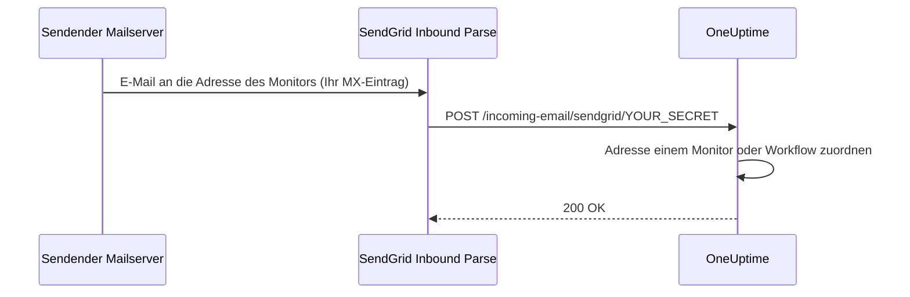

# SendGrid Inbound E-Mail

Mit dem **Incoming Email Monitor** von OneUptime können Sie Alarme anhand von E-Mails erstellen und auflösen, die an eindeutige, monitorspezifische E-Mail-Adressen gesendet werden. Das ist nützlich für die Anbindung von Altsystemen, Alarmierungswerkzeugen oder jedem Dienst, der E-Mails senden kann.

Dieselbe Einrichtung lässt auch Workflows E-Mails empfangen: Ein Workflow mit dem Trigger **Incoming Email** erhält eine eigene Adresse auf derselben Domain, und jede E-Mail an diese Adresse startet den Workflow. Siehe [Trigger](/docs/workflows/triggers#incoming-email).

Diese Anleitung erklärt, wie Sie SendGrid Inbound Parse so einrichten, dass eingehende E-Mails an Ihre selbst gehostete OneUptime-Instanz weitergeleitet werden. OneUptime Cloud braucht nichts davon: Dort funktionieren die Adressen sofort.

:::cards
- [Bevor Sie beginnen](#voraussetzungen): Ein SendGrid-Konto, eine Domain und eine öffentliche HTTPS-Adresse.
- [Einrichtung](#einrichtungsanleitung): Sieben Schritte, vom MX-Eintrag bis zur Test-E-Mail.
- [Umgebungsvariablen](#referenz-der-umgebungsvariablen): Die drei Einstellungen und ihre Standardwerte.
- [Fehlerbehebung](#fehlerbehebung): E-Mails, die nie ankommen, und Webhooks, die fehlschlagen.
:::

## So funktioniert es



1. Sie erstellen in OneUptime einen **Incoming Email Monitor**
2. OneUptime erzeugt für diesen Monitor eine eindeutige E-Mail-Adresse (z. B. `monitor-abc123@inbound.yourdomain.com`)
3. Wird eine E-Mail an diese Adresse gesendet, empfängt SendGrid sie und leitet sie per Webhook an OneUptime weiter
4. OneUptime prüft die E-Mail anhand Ihrer konfigurierten Kriterien, um Alarme zu erstellen oder aufzulösen

## Voraussetzungen

- Ein SendGrid-Konto mit Zugriff auf Inbound Parse
- Eine Domain, die Sie kontrollieren, mit Zugriff auf die DNS-Einstellungen
- Ein öffentlicher HTTPS-Endpunkt, der SendGrid-Webhooks an Ihre OneUptime-Instanz weiterleitet

## Netzwerkzugriff

Bei Inbound Parse baut SendGrid die Verbindung zu OneUptime auf. Es reicht nicht, OneUptime nur ausgehenden Internetzugriff zu erlauben.

| Richtung | Ziel | Protokoll / Port | Zweck |
| --- | --- | --- | --- |
| SendGrid → OneUptime | `https://your-oneuptime-domain.com/incoming-email/sendgrid/YOUR_SECRET` | HTTPS / TCP 443 | Die geparste E-Mail als Multipart-POST zustellen. |
| Sendende Mailserver → SendGrid | `mx.sendgrid.net`, ausgewählt über den öffentlichen MX-Eintrag Ihrer Inbound-Domain | SMTP / TCP 25 | E-Mails bei SendGrid empfangen; diese Verbindung geht nicht zu Ihrem OneUptime-Server. |
| OneUptime → SendGrid, nur wenn der E-Mail-Versand separat über den SendGrid-Anbieter konfiguriert ist | `api.sendgrid.com` | HTTPS / TCP 443 | Benachrichtigungs-E-Mails über die Mail Send API senden. |

Veröffentlichen Sie DNS für den Webhook-Hostnamen und liefern Sie ein Zertifikat aus, dem öffentliche Clients vertrauen. Eine private OneUptime-Bereitstellung kann nur den Webhook-Pfad über einen öffentlichen Reverse Proxy oder ein Gateway freigeben, das OneUptime intern erreicht. Erhalten Sie Pfad, Secret, Content-Type und den Multipart-Request-Body, und lassen Sie den POST ohne interaktive Anmeldung oder Browser-Challenge durch. Der OneUptime-Server braucht keinen eingehenden SMTP-Listener. Siehe [die Einrichtung von Inbound Parse bei SendGrid](https://www.twilio.com/docs/sendgrid/for-developers/parsing-email/setting-up-the-inbound-parse-webhook).

Setzen Sie `INBOUND_EMAIL_WEBHOOK_SECRET` auf einen starken Zufallswert und ersetzen Sie `YOUR_SECRET` in der URL durch diesen Wert. Die Route verlangt das letzte Pfadsegment. OneUptime prüft dessen Wert, wenn das Secret konfiguriert ist; eine leere Variable schaltet diese Prüfung ab. Halten Sie die vollständige URL und die E-Mail-Adressen der Monitore geheim, auch in Proxy-Logs. OneUptime prüft derzeit weder die signierten Inbound-Parse-Header von SendGrid noch OAuth-Tokens. Wenn Sie diese Mechanismen brauchen, konfigurieren Sie ein Gateway, das sie vor der Weiterleitung an OneUptime prüft, gemäß [der Dokumentation von SendGrid zur Webhook-Sicherheit](https://www.twilio.com/docs/sendgrid/for-developers/parsing-email/securing-your-parse-webhooks).

SendGrid stellt für Inbound Parse keine verlässliche Liste statischer Quell-IPs bereit. Die IPs, von denen SendGrid E-Mails versendet, und die für `mx.sendgrid.net` aufgelösten Adressen sind keine Allowlist für Webhooks. Folgen Sie [den Firewall-Hinweisen von SendGrid](https://support.sendgrid.com/hc/en-us/articles/44375457225371-How-to-Configure-Firewall-Settings-for-SendGrid-Webhook-and-Inbound-Parse-IPs), statt ein aktuelles DNS-Ergebnis festzuschreiben.

Inbound Parse ist vom ausgehenden E-Mail-Versand getrennt. Um Monitor-E-Mails zu empfangen, muss OneUptime die SendGrid-API nicht aufrufen. Wenn Sie SendGrid auch für den Versand von Benachrichtigungen wählen, erlauben Sie DNS-Auflösung und ausgehendes HTTPS zu `api.sendgrid.com`; [Mail Send](https://www.twilio.com/docs/sendgrid/api-reference/mail-send/mail-send) braucht für das Einreichen keinen eingehenden Callback. Wenn Sie stattdessen SMTP verwenden, erlauben Sie den SMTP-Server und Port, die in OneUptime konfiguriert sind.

## Einrichtungsanleitung

:::steps
### Ihre Inbound-E-Mail-Domain wählen

Wählen Sie eine Subdomain, die nur dem E-Mail-Empfang für OneUptime dient, etwa `inbound.yourdomain.com`, `email.yourdomain.com` oder `monitor.yourdomain.com`. Sie wird nur für E-Mails an OneUptime-Monitore und -Workflows genutzt, es liegt also kein Postfach von Ihnen darauf.

### Ihren MX-Eintrag auf SendGrid zeigen lassen

Fügen Sie einen MX-Eintrag hinzu, der E-Mails für die Subdomain an SendGrid leitet:

| Typ | Host/Name | Priorität | Wert |
| --- | --- | --- | --- |
| MX | inbound | 10 | mx.sendgrid.net |

Wenn Ihre Domain `example.com` ist und Sie `inbound.example.com` verwenden, lautet der Eintrag:

```text
inbound.example.com.  IN  MX  10  mx.sendgrid.net.
```

DNS-Änderungen können bis zu 48 Stunden brauchen, bis sie sich verbreitet haben, sind aber meist innerhalb weniger Stunden abgeschlossen.

### Die Domain in SendGrid authentifizieren

Die empfangende Domain muss zu einer Ihrer [authentifizierten Domains in SendGrid](https://www.twilio.com/docs/sendgrid/ui/account-and-settings/inbound-parse) gehören. Gehen Sie im [SendGrid-Dashboard](https://app.sendgrid.com) zu **Settings** > **Sender Authentication**, klicken Sie auf **Authenticate Your Domain** und fügen Sie die verlangten DNS-Einträge hinzu (CNAME-Einträge für DKIM).

### Den Inbound-Parse-Webhook hinzufügen

Gehen Sie im SendGrid-Dashboard zu **Settings** > **Inbound Parse** und klicken Sie auf **Add Host & URL**. Füllen Sie das Formular wie unten aus und klicken Sie dann auf **Add**:

| Feld | Wert |
| --- | --- |
| **Receiving Domain** | Ihre Inbound-Subdomain (z. B. `inbound.yourdomain.com`) |
| **Destination URL** | `https://your-oneuptime-domain.com/incoming-email/sendgrid/YOUR_SECRET` |
| **Check incoming emails for spam** | Optional – nach Wunsch aktivieren |
| **Send raw, full MIME message** | Nicht aktivieren (nicht erforderlich) |
| **POST the raw, full MIME message** | Nicht aktivieren (nicht erforderlich) |

### OneUptime konfigurieren

Setzen Sie die Inbound-E-Mail-Variablen, mit demselben Secret wie in der Destination URL:

:::tabs
@tab Docker Compose
```bash title="config.env"
INBOUND_EMAIL_PROVIDER=SendGrid
INBOUND_EMAIL_DOMAIN=inbound.yourdomain.com
INBOUND_EMAIL_WEBHOOK_SECRET=replace-with-a-strong-random-secret
```
@tab Kubernetes
```yaml title="values.yaml"
inboundEmail:
  provider: "SendGrid"
  domain: "inbound.yourdomain.com"
  webhookSecret: "replace-with-a-strong-random-secret"
```
:::

Wenden Sie sie dann an: Führen Sie unter Docker Compose `npm run start` aus, was die Container mit den neuen Werten neu erstellt, oder aktualisieren Sie unter Kubernetes das Helm-Release.

### Einen Incoming-Email-Monitor erstellen

[Erstellen Sie einen Incoming-Email-Monitor](/docs/monitor/incoming-email-monitor#einen-monitor-für-eingehende-e-mails-erstellen). Seine Seite **Übersicht** zeigt seine Adresse, etwa `monitor-abc123def456@inbound.yourdomain.com`, und seine Kriterien entscheiden, welche E-Mails einen Alarm erstellen und welche ihn auflösen.

Workflows nutzen dieselbe Domain. Fügen Sie einem Workflow den Trigger **Incoming Email** hinzu und klicken Sie darauf: Seine Adresse (`workflow-…@inbound.yourdomain.com`) steht oben in seinen Einstellungen. Solange die Inbound-E-Mail-Variablen oben nicht gesetzt sind, meldet der Trigger, dass der Server nicht für den E-Mail-Empfang eingerichtet ist.

### Eine Test-E-Mail senden

Senden Sie eine E-Mail an die Adresse des Monitors, mit einem Betreff, der zu seinen Kriterien passt. Die Zusammenfassung des Monitors zeigt die E-Mail, und ein Alarm wird erstellt, wenn die Kriterien zutreffen.
:::

## Referenz der Umgebungsvariablen

| Variable | Helm-Wert | Beschreibung | Erforderlich | Standard |
| --- | --- | --- | --- | --- |
| `INBOUND_EMAIL_PROVIDER` | `inboundEmail.provider` | Der Anbieter für eingehende E-Mails. SendGrid ist der einzige. | Nein | `SendGrid` |
| `INBOUND_EMAIL_DOMAIN` | `inboundEmail.domain` | Die für eingehende E-Mails konfigurierte Subdomain. Eingehende E-Mails sind aus, bis sie gesetzt ist. | Ja | Leer |
| `INBOUND_EMAIL_WEBHOOK_SECRET` | `inboundEmail.webhookSecret` | Secret, das mit dem letzten Segment der Webhook-URL verglichen wird: `/incoming-email/sendgrid/YOUR_SECRET`. Konfigurieren Sie es für öffentliche Endpunkte; ein leerer Wert schaltet die Prüfung ab. | Empfohlen | Leer |

Worauf ein Incoming-Email-Monitor prüfen kann – den Betreff, den Absender, den Text, den Empfänger und ob eine E-Mail rechtzeitig eingetroffen ist –, steht unter [Verfügbare Filtertypen](/docs/monitor/incoming-email-monitor#verfügbare-filtertypen).

## Fehlerbehebung

:::details Es kommen keine E-Mails an
1. **DNS-Verbreitung prüfen:** `dig MX inbound.yourdomain.com` sollte `mx.sendgrid.net` zurückgeben.
2. **Inbound-Parse-Einstellungen in SendGrid prüfen:** Kontrollieren Sie im SendGrid-Dashboard unter **Settings** > **Inbound Parse** Ihre Domain und die Webhook-URL.
3. **OneUptime-Logs prüfen:** Suchen Sie in den Logs des OneUptime-Dienstes `app` nach eingehenden E-Mail-Webhook-Anfragen und nach Fehlern. SendGrid führt keine ausführlichen Logs für Inbound Parse, daher sind diese Logs die Aufzeichnung dessen, was angekommen ist.
:::

:::details Webhooks schlagen fehl
1. **Die öffentliche Webhook-Route prüfen:** Die vollständige URL samt Secret muss OneUptime aus dem Internet erreichen. Die URL ohne ihr letztes Secret-Segment passt nicht zur Route.
2. **Firewall-Regeln prüfen:** Erlauben Sie HTTPS-POST-Anfragen an den Webhook-Pfad ohne Anmeldeweiterleitungen oder Browser-Challenges, und verwenden Sie die Versand-IPs von SendGrid nicht als Quell-Allowlist für Webhooks.
3. **Das SSL-Zertifikat prüfen:** Verwenden Sie für den Webhook-Hostnamen ein gültiges, öffentlich vertrauenswürdiges Zertifikat und liefern Sie seine Zertifikatskette mit.
:::

:::details Der Monitor erstellt keine Alarme
1. **Die Kriterien prüfen:** Prüfen Sie, ob Ihre Kriterien zum Erstellen von Alarmen zum Inhalt der E-Mail passen, und testen Sie zuerst mit exakten Zeichenfolgen, bevor Sie Muster verwenden.
2. **Den Monitor prüfen:** Stellen Sie sicher, dass er nicht deaktiviert ist und dass sein Typ Incoming Email ist.
3. **Die Zusammenfassung des Monitors ansehen:** Prüfen Sie, ob die E-Mail empfangen und verarbeitet wurde, und lesen Sie in den Auswertungslogs nach, wie die Kriterien zugetroffen haben.
:::

:::details Der Trigger meldet, dass der Server nicht für den E-Mail-Empfang eingerichtet ist
`INBOUND_EMAIL_DOMAIN` ist auf dem Server leer. Setzen Sie die Variable, wenden Sie die Änderung an und öffnen Sie den Trigger des Workflows erneut.
:::

## Bewährte Sicherheitspraktiken

1. **HTTPS verwenden:** Verwenden Sie für Ihren Webhook-Endpunkt immer HTTPS
2. **Webhook-Secret:** Konfigurieren Sie `INBOUND_EMAIL_WEBHOOK_SECRET` und nehmen Sie es in Ihre Webhook-URL auf (z. B. `/incoming-email/sendgrid/your-secret`), als zusätzliche Prüfung
3. **Domain-Verifizierung:** Verifizieren Sie Ihre Domain in SendGrid für mehr E-Mail-Sicherheit
4. **Zugriff beschränken:** Erstellen Sie Monitore nur für vertrauenswürdige E-Mail-Quellen
5. **Logs überwachen:** Prüfen Sie die Logs eingehender E-Mails regelmäßig auf verdächtige Aktivität

## Nächste Schritte

:::cards
- [Incoming Email Monitor](/docs/monitor/incoming-email-monitor): Kriterien, Adressformate und Beispiele.
- [Workflow-Trigger](/docs/workflows/triggers): Einen Workflow aus einer E-Mail starten.
- [Zugriff auf private Netzwerke](/docs/self-hosted/private-network-access): Was Ihr Server in Ihrem eigenen Netzwerk erreichen darf.
- [Architektur](/docs/self-hosted/architecture): Wo der Webhook in einer selbst gehosteten Installation ankommt.
:::
