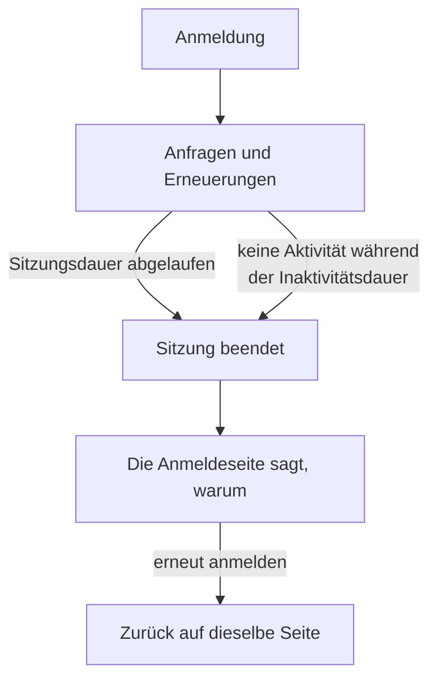

# Sitzungsdauer

Legen Sie fest, wie lange Personen bei OneUptime angemeldet bleiben, bevor sie sich erneut anmelden: eine feste Zeit nach der Anmeldung, eine Zeit ohne Nutzung oder beides. Das gilt für jede Anmeldung im Dashboard, im Admin Dashboard und in der mobilen App, ob mit Passwort, Passkey, der Anmeldung mit Google, der Anmeldung mit Microsoft oder Single Sign-On. SSO-Anmeldungen können eigene Dauern haben.

> [!NOTE]
> Die Sitzungsdauer ist Teil der [OneUptime Enterprise Edition](/docs/self-hosted/enterprise). Die Community Edition hat keine Seite **Sitzungsdauer**, und jede Anmeldung dauert so, wie [Ohne Limit](#ohne-limit) es beschreibt.

:::cards
- [Eine Sitzungsdauer festlegen](#eine-sitzungsdauer-festlegen): Zwei Einstellungen im Admin Dashboard.
- [Wie eine Sitzung endet](#wie-eine-sitzung-endet): Was der Server zählt, und wann.
- [SSO-Anmeldungen](#sso-anmeldungen): Eigene Dauern für Single Sign-On.
- [Was keine Anmeldung ist](#was-keine-anmeldung-ist): API-Schlüssel, MCP-Verbindungen und Leser von Statusseiten.
:::

## Ohne Limit

Solange Sie keine Dauer festlegen, hat eine Anmeldung keine. Ihr Zugriffstoken gilt 15 Minuten und wird im Hintergrund mit einem Aktualisierungstoken erneuert, das 30 Tage gilt und bei jeder Verwendung von vorn beginnt. Wer OneUptime mindestens einmal alle 30 Tage öffnet, bleibt angemeldet; wer das nicht tut, meldet sich erneut an.

## Eine Sitzungsdauer festlegen

:::steps
### Sitzungsdauer öffnen
Öffnen Sie im Admin Dashboard **Einstellungen** und dann im Seitenmenü **Sitzungsdauer**.

### Die Dauern wählen
- **Personen abmelden nach**: wie lange eine Anmeldung ab dem Moment der Anmeldung dauert, egal wie aktiv die Person ist.
- **Personen nach Inaktivität abmelden**: wie lange jemand in OneUptime nicht klicken, tippen oder scrollen darf.

Jede Auswahl wird gespeichert, sobald Sie sie treffen.

### Bestätigen, wer abgemeldet wird
Eine kürzere Dauer gilt für alle, die jetzt angemeldet sind. Wenn sie Personen sofort abmeldet, sagt OneUptime zuerst, wie viele, und ob Sie dazugehören. Wählen Sie **Speichern und abmelden**, um fortzufahren.
:::

| Einstellung | Auswahl | Standard |
| --- | --- | --- |
| **Personen abmelden nach** | 1 Stunde bis 90 Tage | **Kein Limit** |
| **Personen nach Inaktivität abmelden** | 15 Minuten bis 14 Tage | 30 Tage, das Längste, was es gibt |

Über die API nimmt `sessionLengthInMinutes` in der globalen Konfiguration des Servers jede ganze Zahl an Minuten von 15 bis 525600 (ein Jahr) an und `sessionIdleTimeoutInMinutes` von 15 bis 43200 (30 Tage). Leer ist der Standard.

## Wie eine Sitzung endet

- Der Server zählt beide Dauern anhand der Sitzung selbst: wann sie angemeldet wurde und wann ihre Person zuletzt aktiv war. Er prüft sie bei jeder Anfrage, jeder Erneuerung und jeder Live-Aktualisierung und überlässt das Abmelden nie dem Browser.
- Die Inaktivitätsdauer zählt ab dem letzten Klick, Tastendruck oder Scrollen in einem beliebigen Tab des Dashboards oder des Admin Dashboards. Ein offen gelassener Tab hält eine Sitzung nicht am Leben.
- Die mobile App zählt bei jeder Nutzung als aktiv.
- Wenn eine Sitzung endet, wechselt der Browser zur Anmeldeseite, die sagt, warum. Nach der erneuten Anmeldung kommt die Person auf die Seite zurück, auf der sie war.

| Änderung | Was mit den jetzt angemeldeten Personen geschieht |
| --- | --- |
| Eine kürzere Sitzungsdauer oder Inaktivitätsdauer | Alle, die sie überschritten haben, werden sofort abgemeldet, die anderen, wenn sie sie erreichen |
| Eine längere oder keine | Niemand wird abgemeldet, und Sitzungen dauern ab ihrer nächsten Erneuerung länger |

## SSO-Anmeldungen

Anmeldungen über Single Sign-On folgen denselben beiden Einstellungen. Um ihnen eigene Dauern zu geben, öffnen Sie **Weitere Einstellungen** auf der Seite **Sitzungsdauer** und schalten **Eigene Dauern für SSO-Anmeldungen** ein. Die beiden Einstellungen darunter gelten dann für Anmeldungen über den SAML- oder OpenID-Connect-Anbieter eines Projekts oder über das [globale SSO](/docs/identity/global-sso) des Servers, und die beiden oben auf der Seite für jede andere Anmeldung.

Ein Projekt, das SSO verlangt, lässt eine Sitzung außerdem nur so lange hinein, wie ihre SSO-Anmeldung andauert, und das ist nie länger als die Dauer, der SSO-Anmeldungen folgen.

Über die API ist der Schalter `useSeparateSsoSessionLengths`, und die Dauern von SSO-Anmeldungen sind `ssoSessionLengthInMinutes` und `ssoSessionIdleTimeoutInMinutes`, mit denselben Bereichen.

## Was keine Anmeldung ist

- **API-Schlüssel** behalten den Ablauf, den Sie ihnen geben.
- **MCP-Verbindungen**, also mit OAuth verbundene KI-Assistenten, behalten ihre eigene Lebensdauer. In einem Projekt, das SSO verlangt, überdauert eine Verbindung nie die SSO-Anmeldung, mit der sie genehmigt wurde.
- **Private Statusseiten** haben für ihre Leser eine eigene Dauer: siehe [Private Benutzer](/docs/status-pages/index#private-benutzer).

## Ohne Lizenz

Nach der Testphase oder der Kulanzfrist, ohne gültige Lizenz oder mit einer Lizenz, die Sitzungsdauern nicht umfasst, lassen sich die Dauern nicht festlegen oder ändern. Die bereits festgelegten melden Personen weiterhin ab, und Sie können sie weiterhin entfernen. Mit dem Image der Community Edition gilt keine Dauer: Die Werte bleiben in der Datenbank und gelten wieder, wenn Sie zurückwechseln.

## Nächste Schritte

:::cards
- [SSO](/docs/identity/sso): Personen über Ihren Identitätsanbieter anmelden.
- [Globales SSO](/docs/identity/global-sso): Ein Identitätsanbieter für den ganzen Server.
- [Enterprise Edition](/docs/self-hosted/enterprise): Was die Enterprise Edition hinzufügt, und ihre Lizenz.
:::
