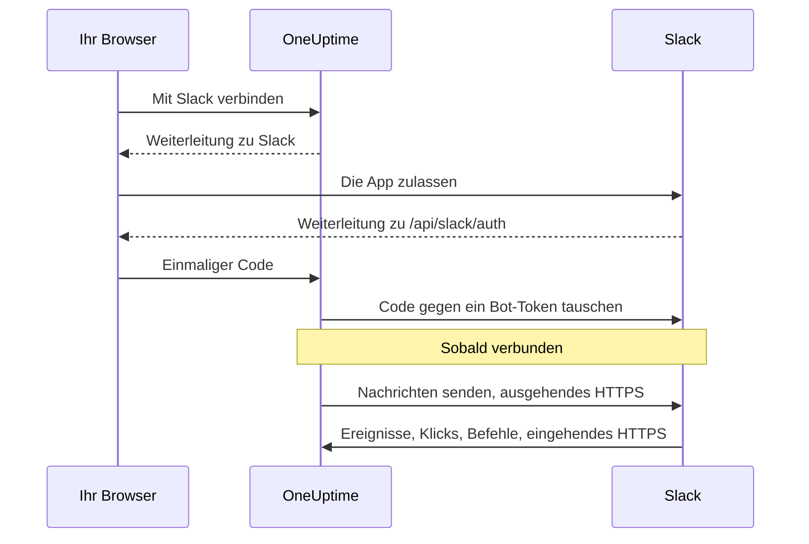

# Slack-Integration

Verbinden Sie Ihr selbst gehostetes OneUptime mit Slack. Sie erstellen eine Slack-App aus dem Manifest, das Ihr Server erzeugt, geben OneUptime die Zugangsdaten der App und verbinden jedes Projekt mit einem Arbeitsbereich. OneUptime veröffentlicht dann Vorfälle, Alarme und geplante Wartungen in Ihren Kanälen, und Ihr Team bearbeitet sie direkt in Slack.

Diese Seite richtet sich an alle, die den OneUptime-Server betreiben. Sobald Slack verbunden ist, werden Benachrichtigungsregeln pro Projekt eingerichtet: siehe [Slack](/docs/workspace-connections/slack).

:::cards
- [Die Slack-App einrichten](#die-slack-app-einrichten): Die App aus Ihrem Manifest erstellen und ein Projekt verbinden.
- [Umgebungsvariablen](#umgebungsvariablen): Die drei Werte, die OneUptime von der App braucht.
- [Netzwerkzugriff](#netzwerkzugriff-für-selbst-gehostete-installationen): Die Callbacks, die Slack erreichen können muss.
- [Fehlerbehebung](#fehlerbehebung): Was die Meldungen der Slack-Seite bedeuten und was zu tun ist.
:::

## So funktioniert es

Die Slack-App gehört Ihnen: Sie ist in Ihrem Arbeitsbereich installiert und spricht nur mit Ihrem Server. Der Datenverkehr fließt in beide Richtungen, und jede Richtung braucht ihren eigenen Netzwerkzugriff.



- **Ausgehend**: OneUptime ruft die Web-API von Slack auf, um Nachrichten zu senden, Kanäle zu erstellen und Bilder hochzuladen.
- **Eingehend**: Slack ruft vier Routen auf Ihrem Server auf, für Ereignisse, Klicks auf Schaltflächen, Menüs und Slash-Befehle. Jede Anfrage ist mit dem Signing Secret der App signiert. OneUptime lehnt eine Anfrage ab, deren Signatur nicht passt oder deren Zeitstempel älter als fünf Minuten ist.

## Bevor Sie beginnen

- Ein Slack-Arbeitsbereich, in dem Sie Apps erstellen und installieren können.
- Ein öffentlicher HTTPS-Hostname für OneUptime, den Slack erreichen kann. Siehe [Netzwerkzugriff](#netzwerkzugriff-für-selbst-gehostete-installationen).
- Zugriff auf die Konfiguration des Servers: `config.env` bei Docker Compose oder Ihre Helm-Values bei Kubernetes.
- Um ein Projekt zu verbinden, die Rolle **Project Owner**, **Project Admin** oder **Project Member** darin.

## Die Slack-App einrichten

:::steps
### Die öffentliche URL festlegen

OneUptime erzeugt das App-Manifest und jede Callback-URL aus `HOST` und `HTTP_PROTOCOL`. Setzen Sie beide auf den Hostnamen, den Slack aufrufen wird, über HTTPS:

:::tabs
@tab Docker Compose
```bash title="config.env"
HOST=oneuptime.example.com
HTTP_PROTOCOL=https
```
@tab Kubernetes
```yaml title="values.yaml"
host: oneuptime.example.com
httpProtocol: https
```
:::

Diese Werte erzeugen nur URLs. Sie legen keine DNS-Einträge, Zertifikate oder Firewall-Regeln an.

### Das App-Manifest kopieren

Öffnen Sie **Projekteinstellungen > Arbeitsbereich > Slack**. Solange Slack auf dem Server nicht eingerichtet ist, zeigt die Seite **Slack in Ihr OneUptime-Projekt integrieren** mit dem für Ihren Hostnamen erzeugten Manifest. Es wird auch unter `https://oneuptime.example.com/api/slack/app-manifest` ausgeliefert.

Prüfen Sie, dass jede URL im Manifest mit Ihrem öffentlichen Hostnamen beginnt. Ist das nicht so, korrigieren Sie zuerst `HOST` und `HTTP_PROTOCOL` und wenden die Änderung an.

### Die Slack-App erstellen

Erstellen Sie auf [api.slack.com/apps](https://api.slack.com/apps) eine neue App aus einem Manifest, wählen Sie Ihren Arbeitsbereich und fügen Sie das Manifest ein. Verwenden Sie immer das Manifest, das Ihr eigener Server erzeugt, damit seine URLs zu Ihrem Hostnamen passen.

### Die Zugangsdaten der App kopieren

Kopieren Sie auf der Seite **Basic Information** der App unter **App Credentials** die **Client ID**, das **Client Secret** und das **Signing Secret**.

### Die Zugangsdaten in OneUptime eintragen

:::tabs
@tab Docker Compose
```bash title="config.env"
SLACK_APP_CLIENT_ID=YOUR_SLACK_APP_CLIENT_ID
SLACK_APP_CLIENT_SECRET=YOUR_SLACK_APP_CLIENT_SECRET
SLACK_APP_SIGNING_SECRET=YOUR_SLACK_APP_SIGNING_SECRET
```
@tab Kubernetes
```yaml title="values.yaml"
slackApp:
  clientId: "YOUR_SLACK_APP_CLIENT_ID"
  clientSecret: "YOUR_SLACK_APP_CLIENT_SECRET"
  signingSecret: "YOUR_SLACK_APP_SIGNING_SECRET"
```

Um die Werte in einem Kubernetes-Secret zu halten, das Sie selbst verwalten, setzen Sie stattdessen `slackApp.existingSecret`: seinen `name` und die Schlüssel `clientIdKey`, `clientSecretKey` und `signingSecretKey`.
:::

### Die Konfiguration anwenden

:::tabs
@tab Docker Compose
```bash
npm run start
```

Das erstellt die Container mit der neuen `config.env` neu. `docker compose restart` liest sie nicht neu ein.
@tab Kubernetes
```bash
helm upgrade my-oneuptime oneuptime/oneuptime -f values.yaml
```
:::

Sobald OneUptime wieder läuft, zeigt **Projekteinstellungen > Arbeitsbereich > Slack** statt des Manifests eine Schaltfläche **Mit Slack verbinden**.

### Die Request-URL für Ereignisse verifizieren

Verifizieren Sie in den **Event Subscriptions** der Slack-App die Request-URL. OneUptime beantwortet die Challenge von Slack erst, wenn das Signing Secret gesetzt ist; wiederholen Sie die Prüfung also, falls sie beim Erstellen der App fehlgeschlagen ist.

### Das Projekt verbinden

Wählen Sie unter **Projekteinstellungen > Arbeitsbereich > Slack** die Option **Mit Slack verbinden** und lassen Sie die App in Slack zu. Slack schickt Sie zur selben Seite zurück, die nun Ihren Arbeitsbereich nennt.

### Ihr eigenes Slack-Konto verbinden

Schaltflächen, Formulare und Befehle handeln als der OneUptime-Benutzer, der mit dem Slack-Konto verknüpft ist, das sie verwendet. Jede Person öffnet **Benutzereinstellungen > Arbeitsbereich > Slack** und wählt **Connect my account with Slack**. Wer kein Konto verbunden hat, bekommt von der App eine Direktnachricht mit der Bitte, das zu tun.
:::

## Umgebungsvariablen

| Docker Compose (`config.env`) | Helm (`values.yaml`) | Erforderlich | Wert |
| --- | --- | --- | --- |
| `SLACK_APP_CLIENT_ID` | `slackApp.clientId` | Ja | Die **Client ID** der App. Ohne sie zeigt die Slack-Seite die Einrichtungsanleitung statt **Mit Slack verbinden**. |
| `SLACK_APP_CLIENT_SECRET` | `slackApp.clientSecret` | Ja | Das **Client Secret** der App, mit dem der Code, den Slack zurückgibt, gegen ein Token getauscht wird. |
| `SLACK_APP_SIGNING_SECRET` | `slackApp.signingSecret` | Ja | Das **Signing Secret** der App. Jede Anfrage von Slack wird damit geprüft. |
| `HOST` | `host` | Ja | Ihr öffentlicher Hostname, ohne Schema. |
| `HTTP_PROTOCOL` | `httpProtocol` | Ja | `https`. Slack ruft nur HTTPS-URLs auf. |

## Was die App kann

Das Manifest richtet diese Funktionen ein. Jede erreicht Ihren Server über die angegebene Route und funktioniert daher nur, wenn Slack diese Route erreichen kann.

| Funktion | Was sie tut | Route |
| --- | --- | --- |
| `/incident` und der Shortcut **Create New Incident** | Einen Vorfall aus Slack heraus melden | `POST /api/slack/interactive` |
| `/maintenance` und der Shortcut **Create Scheduled Event** | Eine Wartung aus Slack heraus planen | `POST /api/slack/interactive` |
| `/oneuptime` | OneUptime AI zu Ihren Logs, Traces, Metriken, Vorfällen und Monitoren befragen | `POST /api/slack/command` |
| Schaltflächen und Formulare in OneUptime-Nachrichten | Bestätigen, lösen, eine Notiz hinzufügen, den Status ändern, eine On-Call-Richtlinie ausführen | `POST /api/slack/interactive` und `POST /api/slack/options-load` |
| Ereignisse | Erwähnungen, Nachrichten, Reaktionen und Pins, zum Beispiel um eine Nachricht als Notiz zu speichern | `POST /api/slack/events` |

### Bilder in Nachrichten

Beschreibungen von Vorfällen und Alarmen können Screenshots enthalten, zum Beispiel den eines synthetischen Monitors (siehe [Einen Screenshot zeigen](/docs/monitor/incident-alert-templating#einen-screenshot-zeigen)). OneUptime zeigt sie in Slack-Nachrichten, indem es jeden als private Datei in Ihren Arbeitsbereich hochlädt; dafür braucht es den Bot-Scope `files:write`. Das erzeugte Manifest enthält ihn.

Wenn Sie Ihre Slack-App aus einem älteren Manifest erstellt haben, fügen Sie `files:write` unter **OAuth & Permissions > Bot Token Scopes** hinzu (oder aktualisieren Sie die App aus dem aktuellen Manifest). Wählen Sie dann unter **Projekteinstellungen > Arbeitsbereich > Slack** erneut **Mit Slack verbinden**, damit der neue Scope gewährt wird. Bis dahin wird jeder Screenshot als sein Alternativtext angezeigt.

## Netzwerkzugriff für selbst gehostete Installationen

### Verkehrsrichtung und Endpunkte

| Verkehr | Erforderlicher Zugriff |
| --- | --- |
| OneUptime zu Slack | DNS und ausgehendes HTTPS über TCP 443 zu `slack.com` für Web-API-Aufrufe und den OAuth-Tokentausch; `hooks.slack.com` für Antwort-URLs von Befehlen und Benachrichtigungen über Incoming Webhooks, falls verwendet |
| Slack zu OneUptime | Öffentliches HTTPS über TCP 443 zu den vier POST-Routen unten, für die vollständige Integration |
| Browser der Nutzer zu OneUptime | Dashboard-Zugriff und OAuth-Weiterleitungen zu `/api/slack/auth/:projectId/:userId` und `/api/slack/auth/:projectId/:userId/user`; diese können über das VPN der Nutzer erreichbar bleiben |

Die ausgehenden Domains beschreiben die Slack-Integration von OneUptime, keine vollständige Allowlist für Slack-Clients oder jede Slack-Funktion. Ein Slack-*Incoming Webhook* wird von Slack gehostet: OneUptime sendet an ihn, er ist also kein eingehender Endpunkt auf Ihrem Server. Siehe die [Anleitung zu Incoming Webhooks](https://docs.slack.dev/messaging/sending-messages-using-incoming-webhooks/) von Slack.

Leiten Sie diese Callbacks über den Ingress an OneUptime weiter:

| Methode und Pfad | Zweck |
| --- | --- |
| `POST /api/slack/events` | Verifizierung der Events API, Reaktionen, Pins, Erwähnungen und Nachrichten |
| `POST /api/slack/interactive` | Schaltflächen, Shortcuts, abgeschickte Modals, `/incident` und `/maintenance` |
| `POST /api/slack/options-load` | Anfragen nach Optionen interaktiver Menüs |
| `POST /api/slack/command` | Befehl `/oneuptime` |

OAuth ist eine [Weiterleitung im Browser, gefolgt von einem serverseitigen Tokentausch](https://docs.slack.dev/authentication/installing-with-oauth/). Das Manifest registriert `/api/slack/auth` als Präfix der Weiterleitungs-URL, und OneUptime ergänzt die Projekt- und Benutzerpfade, wenn es die Autorisierung startet. Zugriff im Browser allein lässt Slack keine Ereignisse oder Klicks auf Schaltflächen zustellen.

### Private Installationen und Callback-Sicherheit

```mermaid title="Die Slack-Callbacks aus einer privaten Installation veröffentlichen"
flowchart LR
    Slack["Slack"] -->|HTTPS 443| GW["Öffentliches Gateway"]
    GW -->|"/api/slack/* nur POST"| ING["OneUptime-Ingress"]
    Users["Mitarbeitende im VPN"] --> ING
    ING --> App["OneUptime-App"]
```

Verwenden Sie öffentliches DNS und ein Gateway mit einem öffentlich vertrauenswürdigen HTTPS-Zertifikat, einer vollständigen Zertifikatskette und einer privaten Route zu Ihrem OneUptime-Ingress. Erlauben Sie eingehendes TCP 443 zum Gateway und leiten Sie nur die vier Callback-Routen oben weiter. Eine private `ClusterIP`, ein interner DNS-Name oder die VPN-Verbindung einer Mitarbeiterin ist für Slack nicht erreichbar. Mit Split-DNS können das Dashboard und die OAuth-Routen unter demselben Hostnamen privat bleiben.

Erzeugen Sie das Manifest nach einer Änderung des Hostnamens neu und aktualisieren Sie die Slack-App.

Erhalten Sie über das Gateway hinweg:

- Methode, Pfad, Query-String und den ursprünglichen Body;
- `Content-Type`, `X-Slack-Signature` und `X-Slack-Request-Timestamp`;
- den öffentlichen Host und das HTTPS-Schema, über vertrauenswürdige Proxy-Header.

Nehmen Sie die Callback-Routen von Browser-SSO, CAPTCHA und Proxy-Anmeldeseiten aus, und behalten Sie die Prüfungen von Signing Secret und Zeitstempel in OneUptime bei. Halten Sie die Uhr des Servers synchron: Eine Anfrage, die mehr als fünf Minuten abweicht, wird abgelehnt. Slack dokumentiert die [Prüfung der Anfragesignatur](https://docs.slack.dev/authentication/verifying-requests-from-slack/); eine Prüfung der Quell-IP ersetzt sie nicht.

### Zugriff prüfen und Grenzen verstehen

:::steps
1. Verifizieren Sie in den **Event Subscriptions** der Slack-App die Request-URL. Slack sendet eine [POST-Challenge und prüft TLS](https://docs.slack.dev/apis/events-api/using-http-request-urls/).
2. Senden Sie eine Testbenachrichtigung, führen Sie einen Slash-Befehl aus, klicken Sie auf eine Schaltfläche in einer Vorfallsnachricht und lösen Sie ein abonniertes Ereignis aus.
3. Prüfen Sie die Logs des Gateways und von OneUptime auf fehlgeschlagene Zustellungen, ohne Geheimnisse zu protokollieren.
:::

Slack erwartet schnelle Bestätigungen, darunter [eine Antwort innerhalb von drei Sekunden bei Interaktionen](https://docs.slack.dev/interactivity/handling-user-interaction/). Ein GET im Browser oder eine erfolgreich gesendete Nachricht prüft diese POST-Callbacks nicht.

> [!WARNING]
> Ist jede eingehende Verbindung untersagt, kann eine bereits autorisierte App weiterhin Nachrichten über ausgehendes HTTPS senden, aber Ereignisse, Schaltflächen, Shortcuts und Befehle funktionieren nicht. Das Manifest von OneUptime verwendet HTTP-Callbacks und deaktiviert den Socket Mode; den Socket Mode von Slack einzuschalten, ist kein unterstützter Ersatz für diese Routen.

Die [Einstellungen für den Zugriff auf private Netzwerke](/docs/self-hosted/private-network-access) steuern ausgehende Anfragen an private Ziele. Sie machen keine Callbacks für Slack erreichbar.

## Fehlerbehebung

### Das Verbinden wurde nicht abgeschlossen

Wenn Slack Sie zurückschickt und die Verbindung nicht zustande gekommen ist, zeigt die Slack-Seite, von der Sie gestartet sind (**Projekteinstellungen > Arbeitsbereich > Slack** oder, wenn Sie Ihr Konto verbunden haben, Ihre eigenen **Benutzereinstellungen > Arbeitsbereich > Slack**), **Slack wurde nicht verbunden** mit einem Satz in Ihrer Sprache, der den Grund nennt. Der Rest der Seite lädt wie gewohnt, sodass Sie gleich dort erneut verbinden können. Was Slack selbst geantwortet hat, zeigt sie nie: Das steht mit dem Grund im Log des OneUptime-Servers.

| Die Seite sagt | Was zu tun ist |
| --- | --- |
| **"Dieser Verbindungslink ist ungültig, abgelaufen oder wurde bereits verwendet. Bitte beginnen Sie erneut."** | Der Link funktioniert einmal, 15 Minuten lang, in dem Browser, in dem er gestartet wurde. Beginnen Sie auf der Slack-Seite erneut und schließen Sie in Slack innerhalb von 15 Minuten im selben Browser ab. |
| **"Sie haben keine Berechtigung, dieses Projekt mit Slack zu verbinden."** | OneUptime in Slack zu installieren, erfordert **Project Owner**, **Project Admin** oder **Project Member**. Das wird erneut geprüft, wenn Slack Sie zurückschickt; eine Rolle, die Ihnen inzwischen entzogen wurde, beendet die Verbindung also auch hier. |
| **"Sie sind kein Mitglied dieses Projekts mehr."** | Um Ihr eigenes Slack-Konto zu verbinden, müssen Sie Mitglied des Projekts sein, wenn Slack Sie zurückschickt. |
| **"Dieses Projekt ist noch mit keinem Slack-Arbeitsbereich verbunden."** | Installieren Sie OneUptime zuerst unter **Projekteinstellungen > Arbeitsbereich > Slack** in Slack und verbinden Sie dann Ihr eigenes Konto. |
| **"Sie haben sich bei einem anderen Slack-Arbeitsbereich angemeldet als dem, mit dem dieses Projekt verbunden ist."** | Verbinden Sie Ihr Konto, während Sie bei dem Slack-Arbeitsbereich angemeldet sind, in dem das Projekt installiert ist. |
| **"Die Verbindung wurde abgebrochen, daher wurde nichts geändert."** | Die Anfrage wurde in Slack nicht zugelassen. Beginnen Sie erneut und lassen Sie sie zu. |
| **"Slack ist auf diesem OneUptime-Server nicht eingerichtet."** | Setzen Sie `SLACK_APP_CLIENT_ID` und `SLACK_APP_CLIENT_SECRET` (siehe [Umgebungsvariablen](#umgebungsvariablen)) und starten Sie OneUptime neu. |
| **"OneUptime konnte die Verbindung nicht abschließen. Bitte versuchen Sie es erneut."** | Slack hat mit einem Fehler geantwortet, oder eine Anfrage oder ein Schreibvorgang ist beim Abschließen fehlgeschlagen. Das Log des OneUptime-Servers sagt, was davon. Versuchen Sie es erneut; passiert es weiterhin, prüfen Sie das Log und die Einstellungen der Slack-App. |

### Weitere Probleme

:::details Slack kann die Request-URL für Ereignisse nicht verifizieren
OneUptime beantwortet die Challenge von Slack nur, wenn `SLACK_APP_SIGNING_SECRET` gesetzt ist und die Anfrage ankommt. Setzen Sie das Signing Secret, wenden Sie die Konfiguration an und wiederholen Sie die Verifizierung. Schlägt sie weiterhin fehl, prüfen Sie, dass `POST /api/slack/events` aus dem Internet mit einem öffentlich vertrauenswürdigen Zertifikat erreichbar ist.
:::

:::details Schaltflächen und Slash-Befehle tun nichts, aber Benachrichtigungen kommen an
Benachrichtigungen sind ausgehend und funktionieren daher ohne eingehenden Zugriff. Schaltflächen, Shortcuts und Befehle sind eingehend: Prüfen Sie, dass Slack `POST /api/slack/interactive` und `POST /api/slack/command` erreichen kann und dass das Gateway den Body sowie die Header `X-Slack-Signature` und `X-Slack-Request-Timestamp` erhält.
:::

:::details Die App sagt, mein Slack-Konto sei nicht mit OneUptime verbunden
Schaltflächen, Formulare und Befehle brauchen Ihr Slack-Konto, verknüpft mit Ihrem OneUptime-Benutzer. Öffnen Sie **Benutzereinstellungen > Arbeitsbereich > Slack** und wählen Sie **Connect my account with Slack**. Wurden Sie aus dem Projekt entfernt, sagt die App stattdessen das, und Aktionen aus Slack werden abgelehnt.
:::

:::details Screenshots erscheinen als Text
Der Slack-App fehlt der Scope `files:write`. Siehe [Bilder in Nachrichten](#bilder-in-nachrichten).
:::

## Nächste Schritte

:::cards
- [Slack](/docs/workspace-connections/slack): Benachrichtigungsregeln und Zusammenfassungen für das Projekt anlegen.
- [Microsoft-Teams-Integration](/docs/self-hosted/microsoft-teams-integration): Auch den Teams-Bot auf Ihrem Server einrichten.
- [Zugriff auf private Netzwerke](/docs/self-hosted/private-network-access): Workflows und Webhooks interne Tools erreichen lassen.
:::
