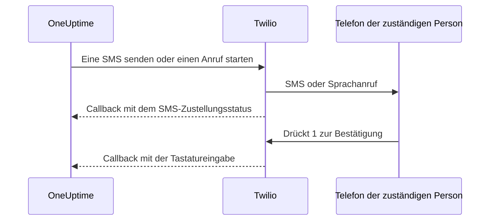

# Twilio-Integration

Ein selbst gehostetes OneUptime versendet SMS- und Sprachalarme über Ihr eigenes Twilio-Konto, und Sie bezahlen Twilio direkt. Die Twilio-Zugangsdaten speichern Sie im Dashboard von OneUptime, nicht in Umgebungsvariablen: Die Zustellung der Benachrichtigungen liest die gespeicherte Konfiguration, und das Helm-Chart hat keine Werte für Twilio-Zugangsdaten.

> [!NOTE]
> Eine alte Migration hat `TWILIO_ACCOUNT_SID`, `TWILIO_AUTH_TOKEN` und `TWILIO_PHONE_NUMBER` importiert; diese Variablen zu ändern, ist nicht der Weg, die Zugangsdaten einer bestehenden Installation zu aktualisieren.

:::cards
- [Twilio-Konto vorbereiten](#1-twilio-konto-vorbereiten): Zugangsdaten, eine Telefonnummer und die Grenzen des Kontos.
- [Zugangsdaten speichern](#2-zugangsdaten-in-oneuptime-speichern): Für ein Projekt oder für die ganze Installation.
- [Netzwerkzugriff konfigurieren](#3-netzwerkzugriff-konfigurieren): Was Twilio auf Ihrem Server erreichen muss, und wann.
- [Telefonnummern verifizieren](#5-telefonnummern-der-teammitglieder-verifizieren): Wie die Nummern der Teammitglieder verifiziert werden.
:::

## 1. Twilio-Konto vorbereiten

:::steps
### Ihre Zugangsdaten kopieren

Öffnen Sie die [Twilio Console](https://console.twilio.com/) und kopieren Sie Ihre **Account SID** und Ihr **Auth Token**.

### Eine Telefonnummer besorgen

Besorgen Sie eine Twilio-Telefonnummer mit den SMS- und/oder Sprachfunktionen, die Sie brauchen. Verwenden Sie für Absender- und Empfängernummern das Format E.164 mit Ländervorwahl.

### Die Grenzen des Kontos prüfen

Prüfen Sie das Guthaben des Kontos, die Berechtigungen für Zielländer und die geltenden Anforderungen an die Registrierung von Absendern. Testkonten haben Einschränkungen bei Empfängern, Regionen und anderem, die echte Alarme von OneUptime verhindern können; lesen Sie vor dem Testen [Twilios Dokumentation zu Konten und Testphase](https://www.twilio.com/docs/usage/tutorials/how-to-use-your-free-trial-account). Verwenden Sie für die Produktion ein aufgewertetes Konto.
:::

## 2. Zugangsdaten in OneUptime speichern

Speichern Sie die Zugangsdaten für ein Projekt oder einmal für die ganze Installation:

| | Projektkonfiguration | Installationsweite Konfiguration |
| --- | --- | --- |
| Wo | Die Karte **Twilio-Konfiguration** unter **Projekteinstellungen > Benachrichtigungen > Benachrichtigungseinstellungen** | **Admin Dashboard > Einstellungen > Anrufe und SMS** |
| Wer sie festlegen kann | **Project Owner**, **Project Admin** oder **Create Call and SMS** in einer benutzerdefinierten Rolle | Ein Master-Admin |
| Verwendet für | SMS und Anrufe an die Mitglieder des Projekts, solange sie der Projektstandard ist, die Statusseiten, denen sie zugewiesen ist, und die Richtlinien für eingehende Anrufe, die sie verwenden | SMS und Anrufe an die Mitglieder jedes Projekts, das keine Standardkonfiguration hat |

So fügen Sie eine Projektkonfiguration hinzu:

:::steps
1. Gehen Sie zu **Projekteinstellungen > Benachrichtigungen > Benachrichtigungseinstellungen**.
2. Wählen Sie in **Twilio-Konfiguration** die Schaltfläche **Twilio-Konfiguration erstellen**.
3. Geben Sie einen Namen, **Twilio Account SID**, **Twilio Auth Token** und **Twilio-Primärrufnummer** ein. Optional geben Sie durch Kommas getrennte **Twilio-Sekundärrufnummern** für andere Länder ein.
4. **Als Projektstandard festlegen** ist bei der ersten Konfiguration des Projekts eingeschaltet, sodass die SMS und Anrufe an die Mitglieder des Projekts, einschließlich der Bereitschaftsbenachrichtigungen, gleich nach dem Speichern darüber laufen. Schalten Sie es aus, wenn dieses Konto nur für Statusseiten oder eingehende Anrufe gedacht ist. Eine spätere Konfiguration beginnt mit ausgeschaltetem Schalter: Schalten Sie ihn ein oder wählen Sie im Zeilenmenü der Konfiguration **Als Projektstandard festlegen**, um diese Nachrichten dorthin zu verlegen. Eine API-Anfrage, die `isProjectDefault` weglässt, wird genauso behandelt.
5. Speichern Sie. Nur eine Konfiguration kann der Projektstandard sein. Statusseiten verwenden die Konfiguration, die jeder Statusseite ausdrücklich zugewiesen ist.

> [!IMPORTANT]
> **SMS** und **Telefonanrufe** sind in jedem Projekt zunächst ausgeschaltet, und solange sie aus sind, kann niemand im Projekt eine Telefonnummer dafür hinzufügen. Ein Projekteigentümer, ein **Billing Admin** oder jemand mit **Manage Billing** schaltet sie in der Karte **Benachrichtigungskanäle** auf derselben Seite ein.
:::

Für einen installationsweiten Standard kann ein Administrator stattdessen **Admin Dashboard > Einstellungen > Anrufe und SMS** öffnen, die Twilio-Zugangsdaten und Telefonnummern bearbeiten und speichern. Die Benachrichtigungen der Mitglieder verwenden diese globale Konfiguration, wenn ihr Projekt keinen Standard hat. Halten Sie das Auth Token vertraulich.

## 3. Netzwerkzugriff konfigurieren

Das Senden funktioniert allein mit ausgehendem Zugriff. Zustellungsupdates, die Bestätigung per Tastatur und eingehende Anrufe brauchen eine Verbindung von Twilio zu Ihrem Server.

Eine private Installation braucht DNS-Auflösung und ausgehendes HTTPS über TCP 443 zu Twilio, um SMS und Anrufe abzusetzen. Twilio empfiehlt, ausgehendes HTTPS zu `*.twilio.com` zu erlauben, weil seine API-Adressen dynamisch sind; siehe [Twilio-IP-Adressen](https://help.twilio.com/articles/115015934048-All-About-Twilio-IP-Addresses). Wenden Sie das auf den ausgehenden Verkehr des Workloads der OneUptime-Anwendung an, einschließlich Kubernetes-NetworkPolicies und externer Firewalls.

Ob Twilio eingehend zugreifen muss, hängt von der Funktion ab:

| Funktion | Muss Twilio OneUptime erreichen? |
| --- | --- |
| SMS absetzen | Nein. Updates zum Zustellungsstatus brauchen jedoch einen Callback. |
| Ein einfacher Test-Sprachanruf | Nein. OneUptime liefert die gesprochenen Anweisungen mit der ausgehenden API-Anfrage. |
| 1 drücken, um einen Bereitschaftsalarm zu bestätigen | Ja. Twilio übermittelt die Tastatureingabe an OneUptime. |
| Richtlinien für eingehende Anrufe | Ja. Twilio fragt Anrufanweisungen ab und meldet die Ergebnisse der Wahl. |

Dies sind die externen Pfade über das Nginx-Gateway von OneUptime. Die Platzhalter sind bei jeder Benachrichtigung anders:

| Methode | Pfad | Zweck |
| --- | --- | --- |
| POST | `/notification/sms/status-callback/:smsLogId/:token` | Zustellungsstatus der SMS |
| POST | `/api/user-notification-log-timeline/call/gather-input/:itemId?token=...` | Bestätigung per Tastatur |
| POST | `/notification/incoming-call/voice` | Optionale Anweisungen für eingehende Anrufe |
| POST | `/notification/incoming-call/dial-status/:callLogId/:callLogItemId` | Optionale Ergebnisse der Weiterleitung eingehender Anrufe |

OneUptime erzeugt die URLs für SMS und Bestätigung automatisch. Ersetzen Sie deren Tokens nicht durch eine statische Webhook-URL. Für eingehende Anrufe folgen Sie [Richtlinien für eingehende Anrufe](/docs/on-call/incoming-call-policy); dort wird der Webhook der Nummer konfiguriert, wenn Sie eine Nummer zuordnen.

Twilio verlangt [öffentlich erreichbare Webhook-URLs](https://www.twilio.com/docs/usage/webhooks/webhooks-overview). Verwenden Sie ein öffentlich vertrauenswürdiges TLS-Zertifikat und erhalten Sie über Proxys hinweg den ursprünglichen Host, das Protokoll, den Pfad, die Abfrageparameter, den Body und den Header `X-Twilio-Signature`. Die Handler für eingehende Anrufe prüfen die Signaturen von Twilio; die SMS-Zustellung verwendet ein URL-Token pro Nachricht, und die Bestätigung per Tastatur ein signiertes Abfrage-Token. Legen Sie Tokens nicht in gemeinsam genutzten Logs oder Screenshots offen. Siehe [Twilio-Webhook-Sicherheit](https://www.twilio.com/docs/usage/webhooks/webhooks-security).

### Callbacks aus einer privaten Installation veröffentlichen

:::steps
1. Veröffentlichen Sie DNS für Ihren OneUptime-Hostnamen, zum Beispiel `oneuptime.example.com`, mit Verweis auf einen aus dem Internet erreichbaren Reverse-Proxy oder Load Balancer. Erlauben Sie eingehendes TCP 443 und konfigurieren Sie ein öffentlich vertrauenswürdiges Zertifikat mit vollständiger Kette. Eine private IP, nur intern auflösbares DNS oder die VPN-Verbindung eines Administrators stellen keine Verbindung für Twilio her.
2. Geben Sie diesem Gateway eine Netzwerkroute zum privaten Ingress von OneUptime, direkt oder über Ihr eigenes Site-to-Site-VPN bzw. Ihren Private Link. Erlauben Sie den Upstream-Port des Dienstes. Ein Kubernetes-Dienst vom Typ `ClusterIP` braucht einen erreichbaren Ingress oder eine andere Route vom Gateway. Halten Sie Datenbanken und andere interne Dienste privat.
3. Veröffentlichen Sie nur die Callback-Pfade aus der Tabelle oben, die Sie nutzen. Leiten Sie sie über das Nginx-Gateway von OneUptime weiter, das das externe Präfix `/notification` auf die Anwendung abbildet. Behalten Sie `/api` auf der Route für die Tastaturbestätigung. Erhalten Sie die HTTP-Methode und die Anfragedaten; leiten Sie nicht auf eine andere URL um. Erhalten Sie den öffentlichen `Host` und setzen Sie an Ihrem Proxy vertrauenswürdige Forwarding-Header für den öffentlichen Host und das HTTPS-Schema.
4. Nehmen Sie diese Routen von Browser-SSO, CAPTCHA und Proxy-Anmeldeseiten aus. Lassen Sie die Callback-Authentifizierung von OneUptime eingeschaltet. Beschränken Sie den Zugriff auf den privaten Ursprung auf das Gateway und berechtigte interne Clients.
5. Setzen Sie `HOST=oneuptime.example.com` und `HTTP_PROTOCOL=https` in der `config.env` von Docker Compose oder `host: oneuptime.example.com` und `httpProtocol: https` in den Helm-Values. Übernehmen Sie die Änderung der Installation und warten Sie, bis die Anwendung neu gestartet ist. Diese Einstellungen erzeugen URLs; sie legen weder DNS noch Zertifikate noch Firewall-Regeln an. OneUptime hat keine eigene Einstellung für einen Twilio-Callback-Hostnamen. Wenn sich der Hostname ändert, aktualisieren Sie auch den Webhook der bestehenden Twilio-Telefonnummern.
:::

Das Dashboard kann auf einem privaten Ingress bleiben: Mit Split-DNS lösen Mitarbeitende denselben Hostnamen über das Firmennetz oder das VPN zu diesem Ingress auf, während Twilio ihn zum Gateway auflöst. Stellen Sie auf beiden Wegen ein für diesen Hostnamen gültiges Zertifikat bereit. Die [Einstellungen für den Zugriff auf private Netzwerke](/docs/self-hosted/private-network-access) von OneUptime regeln ausgehende Anfragen an interne Dienste; `ALLOW_PRIVATE_NETWORK_WEBHOOKS` veröffentlicht keinen eingehenden Endpunkt.

### IP-Beschränkungen und Installationen ohne eingehenden Zugriff

Die gewöhnlichen Quelladressen der Webhooks von Twilio ändern sich, verwenden Sie also keine SIP- oder Medien-IP-Bereiche als Allowlist für Callbacks. Berechtigte Twilio-Editionen bieten [Static Proxy for Webhooks](https://www.twilio.com/docs/iam/twilio-editions/twilio-static-proxy). Prüfen Sie, ob Ihre Edition berechtigt ist und welche Produkte unterstützt werden, und konfigurieren Sie Ihre Firewall mit den aktuell veröffentlichten Bereichen von Twilio; prüfen Sie die Callbacks auch dann weiter, wenn Sie es nutzen.

> [!WARNING]
> Wenn eine Richtlinie eingehende Verbindungen verbietet, funktionieren das Absetzen von SMS und die einfache Wiedergabe von Sprachnachrichten mit ausgehendem HTTPS. Updates zur SMS-Zustellung, die Bestätigung per Tastatur und die Weiterleitung eingehender Anrufe funktionieren ohne erreichbare Callbacks nicht. Eine vollständig abgeschottete Installation kann Twilio nicht nutzen.

Für die Entwicklung beschreibt Twilios [Anleitung zum Testen von Webhooks](https://www.twilio.com/docs/usage/webhooks/webhook-testing) die Verwendung eines öffentlichen Tunnels: Leiten Sie ihn an einen Proxy weiter, der nur die nötigen Routen erlaubt, konfigurieren Sie den so entstandenen Hostnamen wie oben und beenden Sie ihn nach dem Test. Auch ein Tunnel öffnet einen eingehenden Zugang.

## 4. Zustellung und Callbacks getrennt testen

:::steps
1. Prüfen Sie von außerhalb Ihres Firmennetzes und VPN, dass der Callback-Hostname zum öffentlichen Gateway auflöst und ein gültiges TLS-Zertifikat bereitstellt. Ein GET im Browser testet diese POST-Callbacks nicht.
2. Verwenden Sie **Test-SMS senden** und **Testanruf senden** an der Twilio-Konfiguration des Projekts. Bestätigen Sie den Empfang auf dem Zieltelefon. Beides erfordert die Berechtigung, Twilio-Konfigurationen hinzuzufügen: **Project Owner**, **Project Admin** oder **Create Call and SMS** und **Read Call and SMS** in einer benutzerdefinierten Rolle.
3. Richten Sie für den Benutzer einen verifizierten SMS- bzw. Anrufkontakt und Benachrichtigungsregeln ein und lösen Sie dann einen kontrollierten Bereitschaftsalarm aus. Drücken Sie 1 und prüfen Sie die Bestätigung in OneUptime. Wenn Sie Richtlinien für eingehende Anrufe nutzen, rufen Sie die konfigurierte Nummer an und prüfen Sie deren Weiterleitung und Anrufprotokoll.
4. Prüfen Sie den Zustellungsstatus der SMS in OneUptime und in den Nachrichtenprotokollen von Twilio. Ein angenommener Versand ist kein Beweis für die Zustellung; [Twilio meldet spätere Statusänderungen über Callbacks](https://www.twilio.com/docs/messaging/guides/track-outbound-message-status).
:::

| Symptom | Wo Sie nachsehen |
| --- | --- |
| Nichts wird gesendet | Zugangsdaten, die Funktionen der Nummer, Einschränkungen des Kontos und die ausgehende Verbindung. |
| Die SMS oder der Anruf kommt an, aber Status oder Bestätigung werden nicht aktualisiert | Die Callback-URL und die Logs des öffentlichen Ingress. Twilios [Hinweise zu HTTP-Abruffehlern](https://www.twilio.com/docs/api/errors/11200) helfen bei unerreichbaren Callbacks, TLS-Problemen und HTTP-Fehlern. |

Ein erfolgreicher Testanruf allein beweist nicht, dass Callbacks erreichbar sind.

## 5. Telefonnummern der Teammitglieder verifizieren

Wenn Sie eine Telefonnummer für SMS oder Anrufe hinzufügen, wird ihr Verifizierungscode sofort gesendet, und der Dialog zur Verifizierung öffnet sich. Er zeigt, wann der Code gesendet wurde und bis wann er gilt, und sendet auf Wunsch einen neuen Code, höchstens einmal pro Minute. Vor dem Verifizieren muss nichts erneut gesendet werden.

Wenn kein Code gesendet werden kann, sagt der Dialog, warum, statt zu behaupten, einer sei gesendet worden: zum Beispiel, dass kein Twilio-Konto eingerichtet ist, solange es weder eine Standardkonfiguration des Projekts noch die installationsweite Konfiguration oben gibt. Eine Nummer, deren erster Code nicht gesendet werden kann, wird nicht hinzugefügt, und das Formular nennt den Grund, etwa dass Twilio ein Zielland ablehnt.

Eine für SMS verifizierte Nummer ist auch für Anrufe verifiziert, ohne zweiten Code. Die Verifizierung per Anruf verifiziert keine SMS, weil eine Nummer, die Anrufe annimmt, etwa ein Festnetzanschluss, nicht immer Textnachrichten empfangen kann. Nimmt Twilio einen Code an, der nie ankommt, zeigt das SMS-Protokoll des Projekts seinen Zustellungsstatus.

## Nächste Schritte

:::cards
- [Richtlinie für eingehende Anrufe](/docs/on-call/incoming-call-policy): Anrufende über eine Twilio-Nummer zu Ihren Bereitschaftsingenieuren durchstellen.
- [Eskalationsregeln](/docs/on-call/escalation-rules): Festlegen, wer auf jeder Stufe benachrichtigt wird, per SMS, Anruf oder jede andere Methode.
- [SMTP](/docs/emails/smtp): E-Mails ebenfalls über Ihren eigenen Mailserver senden.
- [Zugriff auf private Netzwerke](/docs/self-hosted/private-network-access): Workflows und Webhooks interne Werkzeuge erreichen lassen.
:::
