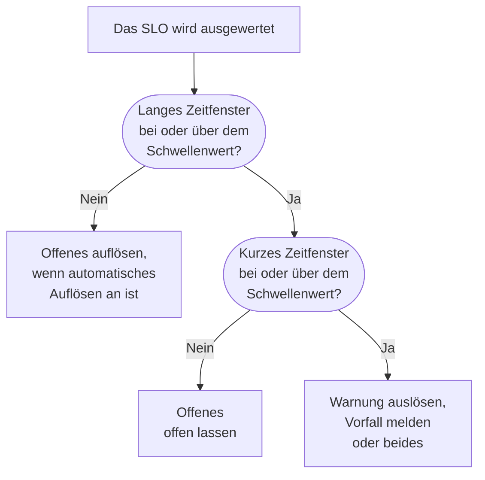

# Burn-Rate-Warnungen und -Vorfälle

Fehlerbudgets sagen Ihnen, wo Sie stehen; Burn-Rate-Regeln sagen Ihnen, wann Sie aufstehen müssen. Verbraucht ein SLO sein Fehlerbudget so schnell, dass es zählt, löst eine Burn-Rate-Regel eine Warnung aus, meldet einen Vorfall oder beides, mit eigenem Titel und eigener Beschreibung, Schweregrad, Eigentümern, Beschriftungen, Bereitschaftseskalation und Workspace-Benachrichtigungen.

:::cards
- [Wie eine Regel entscheidet](#wie-eine-regel-entscheidet-auszulösen): Zwei Zeitfenster, beide über dem Schwellenwert.
- [Standardregeln](#standardregeln): Fast burn und Slow burn, an das Zeitfenster des SLO angepasst.
- [Eine Regel erstellen](#eine-regel-erstellen-oder-bearbeiten): Fünf Schritte auf der Seite Burn-Rate-Regeln des SLO.
- [Vorlagenvariablen](#was-jede-warnung-und-jeder-vorfall-sagt): Eigene Titel und Beschreibungen schreiben.
:::

## Was Burn-Rate bedeutet

Die Burn-Rate gibt an, wie schnell Sie Fehlerbudget verbrauchen, verglichen mit einem gleichmäßigen Tempo:

```text
burn rate = (share of time that was bad) ÷ (share of time the target allows to be bad)
```

Bei einer Burn-Rate von 1 verbrauchen Sie das Budget genau über das Zeitfenster und erreichen das Ziel ohne Reserve. Höhere Werte sind früher aufgebraucht. Für ein SLO mit 99,9 % über 30 Tage:

| Burn-Rate, wenn sie anhält | Budget aufgebraucht nach |
| --- | --- |
| 1 | 30 Tagen |
| 2 | 15 Tagen |
| 6 | 5 Tagen |
| 14.4 | etwa 2 Tagen (50 Stunden) |

Die Burn-Rate hängt nicht davon ab, wie viel Budget übrig ist. Sie beantwortet „Wie schlimm ist es gerade?“, und genau das braucht die Entscheidung, jemanden zu alarmieren.

## Wie eine Regel entscheidet, auszulösen

OneUptime prüft jede aktivierte Burn-Rate-Regel bei jeder Auswertung des SLO, alle 5 Minuten. Jede Regel misst die Burn-Rate über zwei Zeitfenster und löst nur aus, wenn beide bei oder über ihrem Schwellenwert liegen:

- Das **lange Zeitfenster** (zum Beispiel 1 Stunde) zeigt, dass der Verbrauch anhält und erheblich ist, nicht nur eine einzelne fehlgeschlagene Prüfung.
- Das **kurze Zeitfenster** (zum Beispiel 5 Minuten) zeigt, dass es noch passiert. Ohne es würde eine Spitze von vor einer Stunde noch lange nach der Erholung alarmieren.

Das ist das Multi-Window-, Multi-Burn-Rate-Muster aus dem Google SRE Workbook und der Standard, den OneUptime für Sie einrichtet.



Eine Regel kann erst auslösen, wenn das SLO ein volles langes Zeitfenster an Überwachungsverlauf hat: Sonst würde die allererste fehlgeschlagene Prüfung eines Monitors, geteilt durch wenige Minuten Verlauf, als riesige Burn-Rate gelten. Ein neues SLO kann seine Regel **Fast burn** also in der ersten Stunde nicht auslösen und seine Regel **Slow burn** nicht in den ersten sechs. Hat ein SLO später nicht mehr so viel Verlauf, etwa nachdem seine Monitore durch neue ersetzt wurden, löst die Regel auf, was sie offen hat, statt es hängen zu lassen. Eine Regel löst auch nicht aus, solange einer der Monitore des SLO in einer geplanten Wartung ist: siehe [Geplante Wartung](#geplante-wartung).

## Standardregeln

Jedes neue SLO bekommt zwei Burn-Rate-Regeln. Für ein 30-Tage-Zeitfenster:

| Regel | Schwellenwert | Langes Zeitfenster | Kurzes Zeitfenster | Löst aus, wenn |
| --- | --- | --- | --- | --- |
| **Fast burn** | 14.4× | 1 Stunde | 5 Minuten | Etwa 2 % des Budgets in einer Stunde verbrennen: Es wäre in etwa 2 Tagen aufgebraucht. |
| **Slow burn** | 6× | 6 Stunden | 30 Minuten | Etwa 5 % des Budgets in sechs Stunden verbrennen: Es wäre in etwa 5 Tagen aufgebraucht. |

Die Schwellenwerte 14.4× und 6× sind für ein 30-Tage-Budget berechnet, deshalb passt OneUptime sie an das Zeitfenster Ihres SLO an. Jede Regel bedeutet immer „2 % des Budgets in 1 Stunde“ oder „5 % des Budgets in 6 Stunden“:

| SLO-Zeitfenster | Schwellenwert Fast burn | Schwellenwert Slow burn |
| --- | --- | --- |
| 7 Tage | 3.36× | 1.4× |
| 28 Tage | 13.44× | 5.6× |
| 30 Tage | 14.4× | 6× |
| 90 Tage | 43.2× | 18× |

Kalendermonat-SLOs bekommen die Werte für 30 Tage. Die beiden Regeln lösen eine Warnung mit dem schwersten Warnungsschweregrad des Projekts aus, mit dem eingebauten Titel und der eingebauten Beschreibung, lösen sie automatisch auf und fügen keine Eigentümer oder Beschriftungen hinzu. Sie melden keine Vorfälle, ein Upgrade von OneUptime fängt also nie an, in Ihrem Namen Vorfälle zu melden. Bearbeiten oder löschen Sie sie, oder fügen Sie eigene hinzu.

## Eine Regel erstellen oder bearbeiten

Sie brauchen die Berechtigung, SLO-Burn-Rate-Regeln zu erstellen.

:::steps
### Burn-Rate-Regeln öffnen

Öffnen Sie das SLO, gehen Sie zu **Burn-Rate-Regeln** und klicken Sie auf **SLO-Burn-Rate-Regel erstellen**, oder bearbeiten Sie eine der Standardregeln.

### Die Regel benennen

Geben Sie unter **Regel** einen **Name** ein, etwa „Fast burn“. **Aktiviert** ist eingeschaltet.

### Das Burn-Zeitfenster festlegen

Legen Sie unter **Burn-Zeitfenster** den **Burn-Rate-Schwellenwert** fest (zum Beispiel `14.4`), das **Langes Zeitfenster (Minuten)** und das **Kurzes Zeitfenster (Minuten)**, und optional die **Unterdrückung erneuter Auslösung (Minuten)**.

### Festlegen, was sie meldet

Schalten Sie unter **Was es meldet** **Warnung erstellen**, **Vorfall melden** oder beides ein. **SLO-Eigentümer als Eigentümer hinzufügen** macht die Eigentümer des SLO außerdem zu Eigentümern von allem, was die Regel erzeugt.

### Die Warnung und den Vorfall beschreiben

Die Schritte **Warnung** und **Vorfall** erscheinen nur für das, was die Regel meldet. Jeder hat einen Titel und einen Schweregrad sowie eingeklappte Bereiche: **Beschreibung**, **Eigentümerschaft & Beschriftungen**, **Bereitschaft** und **Weitere Felder**, das automatisches Auflösen, Privatsphäre und Behebungshinweise enthält. Neue Regeln beginnen mit dem eingebauten Titel und der eingebauten Beschreibung, bereit zum Bearbeiten. Klicken Sie im letzten Schritt auf **SLO-Burn-Rate-Regel erstellen**.
:::

OneUptime prüft die Zahlen einer Regel beim Speichern:

| Einstellung | Muss sein |
| --- | --- |
| **Burn-Rate-Schwellenwert** | Größer als 0. |
| **Kurzes Zeitfenster (Minuten)** | Größer als 0. |
| **Langes Zeitfenster (Minuten)** | Länger als das kurze Zeitfenster. |
| **Unterdrückung erneuter Auslösung (Minuten)** | 0 oder mehr. Leer bedeutet die Länge des langen Zeitfensters. |

Eine Regel muss eine Warnung erstellen, einen Vorfall melden oder beides: Eine Regel, bei der beides ausgeschaltet ist, wird abgelehnt, denn sie würde bei jeder Auswertung geprüft und nie etwas melden.

Die Regeltabelle zeigt für jede Regel ihren Schwellenwert, ihre Zeitfenster und die Unterdrückung, was sie meldet (und ob die Warnung oder der Vorfall nur von Hand aufgelöst wird oder privat ist), ihre Schweregrade, Bereitschaftsrichtlinien, Eigentümer und Beschriftungen.

> [!TIP]
> Ein guter Anfang: Behalten Sie die beiden Standardregeln, schicken Sie die Fast-Burn-Regel mit hohem Schweregrad an Ihre alarmierende Bereitschaftsrichtlinie, und lassen Sie die Slow-Burn-Regel eine Warnung mit niedrigerem Schweregrad für die Arbeitszeit auslösen. Arbeitet Ihr Team alles über Vorfälle ab, schalten Sie bei der Fast-Burn-Regel **Vorfall melden** ein, und schalten Sie dort **Warnung erstellen** aus, wenn Sie nicht beides bekommen möchten.

## Was eine Regel meldet

|  | **Warnung erstellen** | **Vorfall melden** |
| --- | --- | --- |
| Anfangs | Ein | Aus |
| Was es ist | Das leichte Signal: Es landet in der Warnungsliste. | Das schwere: Es bekommt eine Vorfallnummer und startet den ganzen Reaktionsablauf. |
| Titel und Beschreibung | Eigene oder der eingebaute Text | Eigene oder der eingebaute Text |
| Schweregrad | **Warnungsschweregrad**: der schwerste des Projekts, wenn leer | **Vorfallsschweregrad**: der schwerste des Projekts, wenn leer |
| Eskalation | **Bereitschaftsrichtlinien für Warnungen** | **Bereitschaftsrichtlinien für Vorfälle** |
| Eigentümer und Beschriftungen | **Eigentümer der Warnung** und **Warnungsbeschriftungen** | **Eigentümer des Vorfalls** und **Vorfall-Beschriftungen** |
| Privat | Aus | Aus |
| Automatisch auflösen | Ein | Ein |
| Statusseiten | Nie veröffentlicht | Nie veröffentlicht |

Weil beides getrennt eingerichtet wird, können Sie eine knappe Warnung an die Rotation des zuständigen Teams und einen ausführlichen Vorfall an Ihre Rotation für schwere Vorfälle schicken. Beide leben auch getrennt: Jedes wird für sich dedupliziert, aufgelöst und unterdrückt, das Auflösen des Vorfalls setzt also die Unterdrückung der Warnung nicht zurück, und umgekehrt.

### Das SLO ist eine betroffene Ressource

Jede Warnung und jeder Vorfall, den eine Burn-Rate-Regel erzeugt, listet das SLO unter **Betroffene Ressourcen** und verlinkt es. Der Filter **Betroffene Ressourcen** der Warnungs- und Vorfallslisten grenzt sie auf ein SLO ein, und die Seiten **Warnungen** und **Vorfälle** des SLO listen sie, mit Badges im Seitenmenü, die die offenen zählen. OneUptime setzt diese Verknüpfung selbst, und das Bearbeiten der Warnung oder des Vorfalls entfernt sie nie.

### Burn-Rate-Vorfälle bleiben intern

Ein schnell verbrennendes Fehlerbudget ist ein Signal für die Technik, kein gemeldeter Ausfall. Ein Burn-Rate-Vorfall wird nie auf Statusseiten angezeigt und benachrichtigt nie Abonnenten von Statusseiten. Er ist auch mit keinem Monitor verknüpft, denn sein Auflösen würde sonst genau den Statusverlauf der Monitore umschreiben, aus dem das SLO gemessen wird.

Lösen Sie einen solchen Vorfall von Hand auf, meldet ihn nichts erneut, bis sich der Verbrauch erholt hat und die Regel wirklich wieder auslöst, Sie kämpfen also nie gegen die Regel, während Sie einen Vorfall bearbeiten.

## Was jede Warnung und jeder Vorfall sagt

Neue Regeln beginnen in der Warnung und im Vorfall mit dem eingebauten Titel und der eingebauten Beschreibung. Leeren Sie einen Titel oder eine Beschreibung, um zum eingebauten Text zurückzukehren. Der eingebaute Titel lautet:

```text
SLO burn rate: {{sloName}} — {{ruleName}}
```

Die eingebaute Beschreibung nennt die Regel, gibt die Burn-Rate über beide Zeitfenster im Vergleich zum Schwellenwert an und das verbleibende Fehlerbudget.

Für eigene Texte verwenden Sie Vorlagenvariablen im Titel, in der Beschreibung und in den Behebungshinweisen. Jedes dieser Felder listet sie unter **Vorlagenvariablen**: Klicken Sie auf eine, um sie an der Cursorposition einzufügen, oder tippen Sie `{{` in das Feld und wählen Sie eine aus. Beschreibung und Behebungshinweise haben außerdem **Variable einfügen** in ihrer Werkzeugleiste. Die Variablen werden ausgefüllt, wenn die Regel auslöst:

| Variable | Was sie enthält | Beispiel |
| --- | --- | --- |
| `{{sloName}}` | Name des SLO. | `Checkout availability` |
| `{{sloId}}` | ID des SLO. | `b7f4c2d8-1f3e-4a5b-9c6d-7e8f9a0b1c2d` |
| `{{sloLink}}` | Link zum SLO im OneUptime-Dashboard. | `https://oneuptime.com/dashboard/project-id/slos/slo-id` |
| `{{sloStatus}}` | Status des SLO nach dieser Auswertung. | `At Risk` |
| `{{ruleName}}` | Name der Burn-Rate-Regel, die ausgelöst hat. | `Fast burn` |
| `{{burnRateThreshold}}` | Der Burn-Rate-Schwellenwert der Regel (ein Vielfaches des nachhaltigen Tempos). | `14.4` |
| `{{longWindowBurnRate}}` | Über das lange Zeitfenster der Regel gemessene Burn-Rate. | `21.5` |
| `{{shortWindowBurnRate}}` | Über das kurze Zeitfenster der Regel gemessene Burn-Rate. | `36` |
| `{{longWindowInMinutes}}` | Länge des langen Zeitfensters der Regel, in Minuten. | `60` |
| `{{shortWindowInMinutes}}` | Länge des kurzen Zeitfensters der Regel, in Minuten. | `5` |
| `{{targetPercentage}}` | Das Ziel des SLO, als Prozentsatz. | `99.9` |
| `{{currentSliPercentage}}` | Der über das Compliance-Zeitfenster des SLO gemessene SLI, als Prozentsatz. | `99.87` |
| `{{errorBudgetRemainingPercentage}}` | Anteil des noch verbleibenden Fehlerbudgets, als Prozentsatz. Negativ, sobald das Budget überzogen ist. | `42.5` |
| `{{errorBudgetRemaining}}` | Noch verbleibendes Fehlerbudget, als Dauer. Beginnt mit einem Minuszeichen, sobald das Budget überzogen ist. | `18m 22s` |
| `{{errorBudgetRemainingMinutes}}` | Noch verbleibendes Fehlerbudget, in Minuten. | `18.37` |
| `{{windowDescription}}` | Das Compliance-Zeitfenster des SLO, in Worten. | `rolling 30-day window` |

Zum Beispiel wird aus dem Titel `{{ruleName}}: {{sloName}} is burning {{longWindowBurnRate}}x` der Text `Fast burn: Checkout availability is burning 21.5x`.

:::details Wie die Variablen ausgefüllt werden
- Zahlen werden auf zwei Dezimalstellen gerundet.
- Leerzeichen innerhalb der Klammern sind erlaubt: `{{ sloName }}` funktioniert.
- Eine falsch geschriebene Variable bleibt genau so stehen, ein Tippfehler zeigt sich also in der Warnung, statt stillschweigend zu verschwinden.
- Titel können 500 Zeichen lang sein, Beschreibungen und Behebungshinweise 50.000. Ein Titel, der nach dem Ausfüllen der Variablen länger als 500 Zeichen wird, wird auf eine Zeile gebracht und mit Auslassungspunkten gekürzt, damit die Warnung oder der Vorfall trotzdem erstellt wird.
- Lässt sich der Link zum SLO beim Auslösen nicht bilden, bleibt `{{sloLink}}` leer, und die Warnung oder der Vorfall wird trotzdem erstellt.
:::

## Eigentümer, Beschriftungen und Privatsphäre

- **Eigentümer der Warnung** und **Eigentümer des Vorfalls** sind Personen und Teams, ausgewählt aus einer Liste mit **Eigentümer hinzufügen**. Sie werden der Warnung oder dem Vorfall hinzugefügt, sobald er erstellt ist, und benachrichtigt. Personen müssen Mitglieder des Projekts sein.
- **SLO-Eigentümer als Eigentümer hinzufügen** fügt außerdem die Eigentümer des SLO, seine Eigentümer-Benutzer und die Mitglieder seiner Eigentümer-Teams, zu allem hinzu, was die Regel erzeugt. SLO-Eigentümer erfahren schon von den Statusänderungen des SLO selbst, das kann sie also doppelt benachrichtigen. Standardmäßig ist es ausgeschaltet.
- Jeder Eigentümer wird einmal hinzugefügt: Ein Benutzer, dem die Warnung oder der Vorfall schon gehört, etwa über die Eigentümerregeln des Projekts, oder der in einem hinzugefügten Eigentümer-Team ist, wird nicht noch einmal hinzugefügt.
- **Warnungsbeschriftungen** und **Vorfall-Beschriftungen** werden der Warnung oder dem Vorfall hinzugefügt, damit Filter, Eigentümerregeln und Regeln für Workspace-Benachrichtigungen darauf passen können.
- Eine private Warnung oder ein privater Vorfall ist nur für die Eigentümer, Projektadministratoren und Projekteigentümer sichtbar.

Beschriftungen, Eigentümer-Teams und Bereitschaftsrichtlinien müssen zum Projekt des SLO gehören.

## Auflösung und Unterdrückung erneuter Auslösung

- **Die Auflösung folgt dem langen Zeitfenster.** Mit eingeschaltetem automatischem Auflösen (dem Standard) löst OneUptime die Warnung und den Vorfall einer Regel auf, sobald die Burn-Rate im langen Zeitfenster unter den Schwellenwert fällt. Eine Auflösung nach dem kurzen Zeitfenster würde flattern: Ein wiederkehrender Ausfall würde nach fünf ruhigen Minuten aufgelöst und die ganze Nacht erneut alarmieren.
- **Automatisches Auflösen aus.** Schalten Sie **Warnung automatisch beheben** oder **Vorfall automatisch beheben** aus, bleibt dieser Datensatz offen, bis ihn jemand auflöst, auch nachdem sich der Verbrauch erholt hat. Die Regel öffnet keinen weiteren darüber, und sobald er von Hand aufgelöst ist und das lange Zeitfenster unter dem Schwellenwert liegt, kann die Regel nach ihrer Unterdrückung wieder auslösen.
- **Unterdrückung erneuter Auslösung.** Nachdem ein Datensatz aufgelöst ist, meldet die Regel diese Art von Datensatz für die Dauer der Unterdrückung nicht erneut, standardmäßig die Länge des langen Zeitfensters. Das gibt einem sich erholenden System Raum zur Erholung, ohne wegen des restlichen Rauschens zu alarmieren.

Manche Änderungen lösen immer auf, was eine Regel offen hat, unabhängig von ihren Einstellungen zum automatischen Auflösen, damit nichts weiter eskaliert für eine Regel, die es nicht mehr rechtfertigen kann:

- das Ausschalten von **Warnung erstellen** oder **Vorfall melden** schließt, was diese Ausgabe geöffnet hat;
- das Ausschalten oder Löschen der Regel;
- das Ausschalten der Auswertung des SLO, das Archivieren oder Löschen des SLO;
- das SLO wird **Pausiert** oder **Falsch konfiguriert**, weil es dann nichts misst;
- die Regel verliert ihren Schwellenwert oder ihre Zeitfenster, oder das SLO hat kein volles langes Zeitfenster an Verlauf mehr.

## Geplante Wartung

Solange irgendein Monitor des SLO in einem laufenden geplanten Wartungsereignis ist, lösen seine Burn-Rate-Regeln keine Warnung aus und melden keinen Vorfall: Geplante Arbeit soll niemanden alarmieren. Was die Regeln bereits offen haben, wird weiterhin wie gewohnt aufgelöst. Die Zeit zählt trotzdem zum Fehlerbudget, gemäß den Ausfall-Status des SLO.

## Der SLO-Feed

Der **Feed** des SLO zeigt jede Warnung, die eine Regel auslöst, und jeden Vorfall, den sie meldet, mit einem Link und den Burn-Raten dahinter, und wann jeder aufgelöst wird, automatisch oder von Hand. Ein Datensatz, den die Regel erneut aufgreift, weil er noch offen war, wird nicht zweimal gezeigt. Das Erstellen, Ändern und Löschen einer Regel erscheint ebenfalls und wird in den **Audit-Protokolle** des SLO festgehalten. Siehe [SLO-Feed und Audit-Protokolle](/docs/slo/feed-and-audit-logs).

## Fehlerbehebung

:::details Eine Regel hat direkt nach dem Erstellen des SLO nicht ausgelöst
Eine Regel löst erst aus, wenn das SLO ein volles langes Zeitfenster an Überwachungsverlauf hat: eine Stunde für die standardmäßige Fast-Burn-Regel, sechs Stunden für die Slow-Burn-Regel.
:::

:::details Eine Warnung wurde aufgelöst, während der Ausfall noch andauerte
Das automatische Auflösen folgt dem langen Zeitfenster: Sobald die Burn-Rate im langen Zeitfenster unter den Schwellenwert fällt, wird die Warnung aufgelöst. Geben Sie der Regel ein längeres langes Zeitfenster, oder schalten Sie **Warnung automatisch beheben** aus und lösen Sie die Warnung von Hand auf.
:::

:::details Während eines geplanten Wartungsereignisses hat nichts ausgelöst
Burn-Rate-Regeln bleiben still, solange einer der Monitore des SLO in einem laufenden geplanten Wartungsereignis ist. Die Ausfallzeit zählt trotzdem zum Budget.
:::

:::details Gibt es eine Mindestanzahl an Stichproben?
Nicht für SLOs, die aus der Verfügbarkeit von Monitoren gemessen werden. Verfügbarkeit wird in Sekunden gemessen, jede Sekunde im Zeitfenster ist also eine Stichprobe, und es gibt keinen Fall mit wenig Verkehr, gegen den man sich absichern müsste. Eine Mindestanzahl an Stichproben ist nur für SLIs auf Basis von Ereignissen wichtig, die es noch nicht gibt.
:::

## Nächste Schritte

:::cards
- [Fehlerbudgets](/docs/slo/error-budget): Was das Budget ist und wie lange es reicht.
- [Eskalationsregeln](/docs/on-call/escalation-rules): Wer alarmiert wird, und in welcher Reihenfolge.
- [SLO-Feed und Audit-Protokolle](/docs/slo/feed-and-audit-logs): Jede Warnung und jeder Vorfall, den eine Regel ausgelöst hat.
:::
