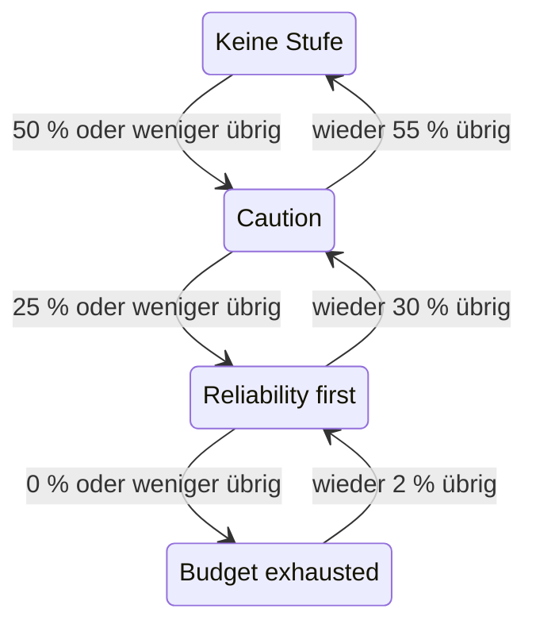

# Fehlerbudget-Richtlinie

Eine Fehlerbudget-Richtlinie hält fest, was Ihr Team vereinbart hat zu tun, während das Fehlerbudget eines SLO schrumpft, etwa riskante Änderungen zu prüfen, sobald die Hälfte verbraucht ist, oder Releases einzufrieren, sobald alles verbraucht ist. OneUptime ordnet das SLO der Stufe der Richtlinie zu, die sein Budget erreicht hat, zeigt die Vereinbarung des Teams für diese Stufe auf den Seiten des SLO, kann eine Warnung auslösen oder einen Vorfall melden, wenn das SLO in eine Stufe eintritt, postet jeden Stufenwechsel in den Slack-, Microsoft-Teams- oder Mattermost-Kanälen, die Sie auswählen, und sagt Ihren CI/CD-Pipelines, ob sie Releases zurückhalten sollen. Das ist die Praxis der Fehlerbudget-Richtlinie aus dem [Google SRE Workbook](https://sre.google/workbook/error-budget-policy/).

:::cards
- [Wie Stufen funktionieren](#wie-stufen-funktionieren): Welche Stufe gilt und wann das SLO sie verlässt.
- [Eine Richtlinie einrichten](#eine-richtlinie-einrichten): Mit der empfohlenen Richtlinie beginnen oder eigene Stufen schreiben.
- [Warnungen und Vorfälle](#warnungen-und-vorfälle): Ihr Team alarmieren, wenn das SLO in eine Stufe eintritt.
- [In Slack, Microsoft Teams und Mattermost posten](#in-slack-microsoft-teams-und-mattermost-posten): Einen Kanal informieren, wenn ein SLO in eine Stufe eintritt, ohne jemanden zu alarmieren.
- [Deployment-Gate](#deployment-gate): Releases in CI/CD zurückhalten, solange eine Stufe Deployments einfriert.
- [Die Stufe über die API lesen](#die-stufe-über-die-api-lesen): Die Stufe aus CI und Skripten prüfen.
:::

## Wie Stufen funktionieren

Eine Richtlinie ist eine Reihe von Stufen. Jede Stufe hat drei Felder:

| Feld | Was es enthält |
| --- | --- |
| **Name** | Wie das Team die Stufe nennt, zum Beispiel „Reliability first“. |
| **Schwellenwert für verbleibendes Budget (%)** | Der Anteil des verbleibenden Fehlerbudgets, bei dem oder unter dem die Stufe gilt. Von 0 bis 100, Dezimalzahlen erlaubt. Jede Stufe eines SLO hat einen eigenen Schwellenwert. |
| **Was wir tun** | Was das Team vereinbart hat zu tun, solange das SLO in der Stufe ist, in Markdown. Pflichtfeld, bis zu 10.000 Zeichen. |

Eine Stufe gilt, solange das verbleibende Budget bei ihrem Schwellenwert oder darunter liegt, eine Stufe bei 0 % ist also die Stufe eines aufgebrauchten Budgets. Gelten mehrere Stufen, ist das SLO in der mit dem niedrigsten Schwellenwert: der strengsten. Gilt keine, ist das SLO in keiner Stufe. Mit Stufen bei 50 %, 25 % und 0 % ist ein SLO mit 30 % verbleibendem Budget in der 50-%-Stufe und eines mit 10 % in der 25-%-Stufe.

Eine Stufe kann außerdem Deployments einfrieren, solange das SLO in ihr ist: siehe [Deployment-Gate](#deployment-gate).

### In eine Stufe eintreten und sie verlassen

Die Stufe folgt dem verbleibenden Budget so, wie es der Status des SLO tut:

- Das Eintreten in eine Stufe geschieht sofort: Die Auswertung, die das Budget bei oder unter dem Schwellenwert einer Stufe findet, bringt das SLO in diese Stufe. Ein Budget, das auf einmal unter mehrere Schwellenwerte fällt, kommt direkt in die strengste Stufe.
- Das Verlassen einer Stufe in Richtung einer weniger strengen wartet, bis das Budget deutlich zurück ist. Eine Stufe bei 0 % wird verlassen, sobald wieder 2 % des Budgets übrig sind. Jede andere Stufe wird verlassen, sobald das Budget 5 Punkte über ihrem Schwellenwert liegt.

Eine Stufe bei 0 % bewegt sich also mit dem Status **Budget ausgeschöpft**, und eine Stufe bei der Risikoschwelle des SLO mit **Gefährdet**: siehe [Statusänderungen und die Risikoschwelle](/docs/slo/error-budget#statusänderungen-und-die-risikoschwelle). Ein rollierendes Zeitfenster, das um einen Schwellenwert pendelt, lässt die Stufe nicht hin- und herspringen.



## Eine Richtlinie einrichten

Sie brauchen die Berechtigung, Stufen der Fehlerbudget-Richtlinie von SLOs zu erstellen.

:::steps
### Fehlerbudget-Richtlinie öffnen

Öffnen Sie das SLO und gehen Sie in seinem Seitenmenü im Bereich **Regeln** zu **Fehlerbudget-Richtlinie**. Die Seite listet die Stufen des SLO auf, jede mit ihrem Namen, dem verbleibenden Budget, bei dem sie gilt, und dem, was das Team tut.

### Mit der empfohlenen Richtlinie beginnen

Solange das SLO keine Stufen hat, bietet die Seite **Empfohlene Richtlinie verwenden** an. Klicken Sie darauf, prüfen Sie die drei Stufen, die aufgelistet werden, und bestätigen Sie. Passen Sie danach den Wortlaut jeder Stufe an die eigene Vereinbarung Ihres Teams an.

### Oder selbst eine Stufe hinzufügen

Klicken Sie auf **SLO-Fehlerbudget-Richtlinienstufe erstellen**. Geben Sie einen **Name** und einen **Schwellenwert für verbleibendes Budget (%)** ein, und schreiben Sie die Vereinbarung des Teams in **Was wir tun**. Schalten Sie **Deployments einfrieren** ein, wenn Pipelines Releases zurückhalten sollen, solange das SLO in der Stufe ist.

### Festlegen, was die Stufe auslöst

Eine Stufe hält die Vereinbarung fest und zeigt sie. Um außerdem jemanden zu alarmieren, wenn das SLO in die Stufe eintritt, öffnen Sie die eingeklappten Einstellungen für Warnung und Vorfall und schalten Sie eine Warnung, einen Vorfall oder beides ein. Beide sind standardmäßig aus. Siehe [Warnungen und Vorfälle](#warnungen-und-vorfälle).
:::

Das Hinzufügen, Bearbeiten oder Löschen einer Stufe wirkt sofort: OneUptime wertet das SLO innerhalb von etwa einer Minute erneut aus. Liegt das Budget schon bei oder unter dem Schwellenwert einer Stufe, kommt das SLO dann in diese Stufe, und die Stufe löst aus, was sie auslösen soll. Das Ausschalten oder Löschen einer Stufe löst auf, was sie ausgelöst hat, und das SLO wechselt in die Stufe, in der sein Budget liegt. Das Ausschalten der Warnung oder des Vorfalls einer Stufe löst diese Warnung oder diesen Vorfall auf.

### Die empfohlene Richtlinie

**Empfohlene Richtlinie verwenden** fügt drei Stufen hinzu, bei der Hälfte des Budgets, einem Viertel und null, mit diesem englischen Wortlaut:

| Stufe | Gilt bei | Was das Team tut | Deployments |
| --- | --- | --- | --- |
| **Caution** | 50 % übrig oder weniger | Half of the error budget is spent. Review risky changes before they ship, and find out what has been spending the budget. | Erlaubt |
| **Reliability first** | 25 % übrig oder weniger | Reliability comes first. Only reliability improvements and critical fixes ship until the budget recovers. | Erlaubt |
| **Budget exhausted** | 0 % übrig oder weniger | The error budget is spent. Freeze non-critical releases: only fixes for this SLO's reliability and security fixes ship until the budget is back. | Eingefroren |

Keine von ihnen löst eine Warnung aus oder meldet einen Vorfall, bis Sie das einschalten. **Budget exhausted** friert Deployments ein, wie es ihre Vereinbarung sagt, und die Bestätigung kennzeichnet sie entsprechend: siehe [Deployment-Gate](#deployment-gate). Stufen, die hinzugefügt wurden, bevor es das Gate gab, frieren nichts ein, bis Sie das Einfrieren einschalten. Es werden nur die Stufen hinzugefügt, die das SLO nicht hat: Eine Stufe mit demselben Namen oder mit demselben Schwellenwert zählt als vorhanden, ob sie ein- oder ausgeschaltet ist. Zweimal danach zu fragen, aus einem zweiten Tab oder über die API, fügt also nichts doppelt hinzu. Lässt sich eine der Stufen nicht hinzufügen, wird keine hinzugefügt: Das SLO bleibt, wie es war, und Sie können es erneut versuchen. Jede so hinzugefügte Stufe wird in den Audit-Protokollen des SLO als von Ihnen hinzugefügt festgehalten.

## Wo die Stufe erscheint

- Die **Übersicht** des SLO zeigt die Stufe, in der es ist, und was das Team dort vereinbart hat, sodass jeder, der das SLO öffnet, die Vereinbarung sieht, die gerade gilt. Solange die Stufe Deployments einfriert, zeigt ein rotes Badge unter ihrem Namen, seit wann.
- Das Diagramm **Fehlerbudget-Burn-down** zeichnet beim Schwellenwert jeder Stufe eine beschriftete Linie, neben der Linie der Risikoschwelle.
- Der **Feed** des SLO zeigt jeden Stufenwechsel: die Stufe, die das SLO verlassen hat, und die, in die es eingetreten ist, das verbleibende Budget, was das Team in der neuen Stufe vereinbart hat, und ob der Wechsel Deployments eingefroren oder wieder erlaubt hat.
- Die Slack-, Microsoft-Teams- und Mattermost-Kanäle, die Ihre Regeln nennen, bekommen dieselbe Nachricht: siehe [In Slack, Microsoft Teams und Mattermost posten](#in-slack-microsoft-teams-und-mattermost-posten).
- Die **Audit-Protokolle** des SLO halten jeden Stufenwechsel und jedes Einfrieren oder erneute Erlauben von Deployments als Änderung fest, die OneUptime selbst vorgenommen hat, und zeigen sie daher nur mit eingeschaltetem **Systemereignisse speichern**: siehe [Audit-Protokolle einschalten](/docs/slo/feed-and-audit-logs#audit-protokolle-einschalten). Das Hinzufügen, Bearbeiten und Entfernen einer Stufe wird unter der Person festgehalten, die es getan hat.
- Die Lese-API des SLO liefert die Stufe und ob Deployments erlaubt sind: siehe [Die Stufe über die API lesen](#die-stufe-über-die-api-lesen) und [Deployment-Gate](#deployment-gate).

## Warnungen und Vorfälle

Jede Stufe kann eine Warnung auslösen, einen Vorfall melden oder beides, wenn das SLO in sie eintritt. Sie haben die Optionen der Warnung und des Vorfalls einer Burn-Rate-Regel: Schweregrad, Bereitschaftsrichtlinien, Vorlagen für Titel, Beschreibung und Behebungshinweise, Privatsphäre, automatisches Auflösen, Beschriftungen, Eigentümer-Teams und -Benutzer und das Hinzufügen der Eigentümer des SLO als Eigentümer. Siehe [Was eine Regel meldet](/docs/slo/burn-rate-alerts#was-eine-regel-meldet). Beide sind standardmäßig aus, eine Stufe alarmiert also niemanden, bis Sie eines davon einschalten.

- Das Eintreten in eine strengere Stufe löst auf, was die vorige Stufe ausgelöst hat, unabhängig von deren Einstellung zum automatischen Auflösen, weil die neue Stufe sie ablöst. So sind höchstens die Warnung und der Vorfall einer Stufe gleichzeitig offen, und sie gehören zu der Stufe, in der das SLO ist.
- Die Erholung in eine weniger strenge Stufe oder aus jeder Stufe heraus löst sie auf, wenn das automatische Auflösen der Stufe eingeschaltet ist, wie standardmäßig. Ist das automatische Auflösen aus, bleiben sie offen, bis jemand sie auflöst.
- Es gibt keine Unterdrückung erneuter Auslösung. Eine Stufe löst erst wieder aus, nachdem das SLO sie deutlich verlassen hat und erneut in sie eingetreten ist, sie kann also nicht flattern. Löst jemand von Hand auf, was sie ausgelöst hat, während das SLO noch in der Stufe ist, bleibt es aufgelöst.
- Solange irgendein Monitor des SLO in geplanter Wartung ist, lösen Stufen nichts aus. Die Stufe selbst wechselt trotzdem, und was offen ist, wird weiterhin aufgelöst. Ist das SLO noch in der Stufe, wenn die Wartung endet, löst die Stufe dann aus, was sie auslösen soll.

Wie bei einer Burn-Rate-Regel führt eine Warnung oder ein Vorfall, den eine Stufe auslöst, das SLO unter **Betroffene Ressourcen** auf, und ein Vorfall erscheint nie auf Statusseiten. Der Feed des SLO zeigt jede Warnung und jeden Vorfall, und wann sie aufgelöst werden.

### Was sie sagen

Titel, Beschreibung und Behebungshinweise einer Stufe nehmen Vorlagenvariablen auf, wie die einer Regel: siehe [Was jede Warnung und jeder Vorfall sagt](/docs/slo/burn-rate-alerts#was-jede-warnung-und-jeder-vorfall-sagt). Die Felder einer Stufe bieten die Variablen des SLO und seines Budgets an und drei eigene der Stufe: `{{sloName}}`, `{{sloId}}`, `{{sloLink}}`, `{{sloStatus}}`, `{{policyTier}}`, `{{policyTierThresholdPercentage}}`, `{{policyTierWhatWeDo}}`, `{{targetPercentage}}`, `{{currentSliPercentage}}`, `{{errorBudgetRemainingPercentage}}`, `{{errorBudgetRemaining}}`, `{{errorBudgetRemainingMinutes}}` und `{{windowDescription}}`. Die eigenen Variablen einer Regel, etwa `{{ruleName}}` und die Burn-Raten, werden nicht angeboten und bleiben in den Vorlagen einer Stufe leer.

Die drei Variablen der Stufe funktionieren auch in den Vorlagen von Burn-Rate-Regeln:

| Variable | Was sie enthält |
| --- | --- |
| `{{policyTier}}` | Der Name der Stufe, in der das SLO nach der Auswertung ist, oder `None`, wenn es in keiner Stufe ist. |
| `{{policyTierThresholdPercentage}}` | Der Schwellenwert dieser Stufe, etwa `25`. Leer, wenn das SLO in keiner Stufe ist. |
| `{{policyTierWhatWeDo}}` | Was das Team in dieser Stufe vereinbart hat. Leer, wenn das SLO in keiner Stufe ist. |

Eine Stufe, deren Titel leer bleibt, verwendet den eingebauten Titel:

```text
SLO error budget policy: {{sloName}} — {{policyTier}}
```

Die eingebaute Beschreibung nennt die Stufe, stellt das verbleibende Budget dem Schwellenwert der Stufe gegenüber und sagt, was das Team in ihr vereinbart hat.

## In Slack, Microsoft Teams und Mattermost posten

Eine Regel kann jede Änderung der Fehlerbudget-Richtlinie eines SLO in den Slack-, Microsoft-Teams- oder Mattermost-Kanälen posten, die Ihr Team liest, ohne jemanden zu alarmieren: wenn das SLO in eine Stufe eintritt, sich in eine weniger strenge Stufe erholt oder alle Stufen verlässt, und wenn seine Deployments eingefroren oder wieder erlaubt werden. Jede Regel wählt die SLOs und die Änderungen, die sie postet. Verbinden Sie zuerst den Workspace mit dem Projekt: siehe [Slack](/docs/workspace-connections/slack), [Microsoft Teams](/docs/workspace-connections/microsoft-teams) oder [Mattermost](/docs/workspace-connections/mattermost).

:::steps
### Den Abschnitt Arbeitsbereich der SLOs öffnen

Gehen Sie zu **SLOs** → **Arbeitsbereich** → **Slack**, **Microsoft Teams** oder **Mattermost**. Der Abschnitt **Arbeitsbereich** listet nur die Chat-Workspaces, die Ihr Projekt verbunden hat.

### Eine Regel erstellen

Klicken Sie auf **Benachrichtigungsregel für SLOs erstellen** und tragen Sie unter **Regelname** einen Namen ein. Behalten Sie unter **Welche SLOs** die Option **Alle SLOs** bei, oder wählen Sie **Nur SLOs, die den Bedingungen entsprechen** und fügen Sie Bedingungen hinzu: siehe [Worauf eine Regel zutrifft](#worauf-eine-regel-zutrifft).

### Festlegen, wo sie postet

Nennen Sie unter **Dann in Slack** die Kanäle, in denen die Regel postet. In Microsoft Teams wählen Sie ein Team und seine Kanäle aus, oder Chats, denen die OneUptime-App hinzugefügt wurde. Ein SLO bekommt keinen eigenen Kanal, daher postet eine Regel nur in Kanälen und Chats, die Sie schon haben.
:::

Die Nachricht beschreibt die Änderung so, wie der **Feed** des SLO sie beschreibt: die Stufe, die das SLO verlassen hat, und die, in die es eingetreten ist, wie sich die Deployments geändert haben, das verbleibende Fehlerbudget, den Schwellenwert der neuen Stufe und was das Team dort vereinbart hat, so wie das Team es geschrieben hat. Eine Erwähnung in dieser Vereinbarung, etwa `<!channel>`, wird als Text gepostet und benachrichtigt niemanden.

- Eine Änderung wird einmal gepostet, nachdem die Auswertung, die sie bewirkt hat, gespeichert ist. Eine Auswertung, die nicht gespeichert wird, postet nichts, und die nächste postet die Änderung.
- Solange das SLO in seiner Stufe bleibt, wird nichts gepostet, wie lange das Budget auch um einen Schwellenwert pendelt: siehe [In eine Stufe eintreten und sie verlassen](#in-eine-stufe-eintreten-und-sie-verlassen).
- Das Ein- oder Ausschalten von **Deployments einfrieren** für die Stufe, in der das SLO ist, postet eine eigene Nachricht.
- Ein pausiertes, falsch konfiguriertes, deaktiviertes oder archiviertes SLO behält seine Stufe und postet nichts.
- Eine Nachricht, die nicht gesendet werden kann, wird protokolliert, und die Auswertung, der Feed des SLO und das, was die Stufe auslöst, laufen ohne sie weiter.

### Worauf eine Regel zutrifft

| Bedingung | Worauf sie zutrifft |
| --- | --- |
| **SLOs** | Die SLOs, die Sie auswählen, oder jedes SLO außer diesen. |
| **SLO-Beschriftungen** | Die Beschriftungen des SLO: eine beliebige der ausgewählten, alle oder keine davon. |
| **SLO-Name** | Der Name des SLO: ist gleich Ihrem Text oder nicht, enthält ihn oder nicht, beginnt oder endet mit ihm. |
| **Änderung der Fehlerbudget-Richtlinie** | Was sich geändert hat: **In eine strengere Stufe eingetreten**, **In eine weniger strenge Stufe erholt**, **Alle Stufen verlassen**, **Deployments eingefroren** oder **Deployments wieder erlaubt**. |
| **Eigentümer des SLO** | Die als Eigentümer des SLO eingetragenen Personen und Teams: eine beliebige der ausgewählten, oder keine davon. Die Mitgliedschaft in einem Team, dem das SLO gehört, zählt nicht. |

Ein Stufenwechsel, der Deployments eingefroren oder wieder erlaubt hat, ist eine einzige Nachricht für beide Änderungen. Eine Regel für **Deployments eingefroren** postet also auch den Wechsel in eine Stufe, die sie einfriert: Ein Release-Kanal erfährt von jedem Einfrieren.

## Wenn das Budget nicht gemessen wird

- Ein SLO, das **Pausiert** oder **Falsch konfiguriert** ist, misst kein Budget, seine Stufe bleibt also, wo sie war, und was die Stufe ausgelöst hat, bleibt offen, bis wieder gemessen wird. Burn-Rate-Regeln lösen dann dagegen auf, was sie offen haben.
- Das Ausschalten der Auswertung des SLO oder das Archivieren des SLO löst auf, was seine Stufen ausgelöst haben. Die Stufe, in der das SLO ist, bleibt, wie sie war.
- Das Löschen des SLO löscht seine Stufen und löst auf, was sie ausgelöst haben.
- In jedem dieser Fälle behält das SLO die Antwort, die es zu Deployments gegeben hat, weil es seine Stufe behält: siehe [Deployment-Gate](#deployment-gate).

## Deployment-Gate

Eine Stufe kann Deployments einfrieren. Solange das SLO in einer Stufe ist, in der **Deployments einfrieren** eingeschaltet ist, ist das Feld `deploymentsAllowed` des SLO `false`, sodass eine CI/CD-Pipeline, die es vor einem Release prüft, das Release zurückhält. Andernfalls ist es `true`: wenn das SLO keine Richtlinie hat, solange sein Budget über jeder Stufe liegt, und in einer Stufe, die keine Deployments einfriert. Die Stufe **Budget exhausted** der empfohlenen Richtlinie friert Deployments ein.

:::steps
### Deployments einfrieren einschalten

Öffnen Sie die **Fehlerbudget-Richtlinie** des SLO, bearbeiten Sie die Stufe, schalten Sie **Deployments einfrieren** ein und speichern Sie. In der Tabelle zeigt die Spalte **Deployments** der Stufe dann **Eingefroren**.

### Der Pipeline einen Schlüssel geben

Erstellen Sie einen [API-Schlüssel](/docs/api-reference/api-reference) des Projekts, der das SLO lesen kann, und speichern Sie ihn als Geheimnis der Pipeline mit dem Namen `ONEUPTIME_API_KEY`.

### Das SLO vor dem Release prüfen

Fügen Sie die Prüfung unten als Schritt vor dem Schritt ein, der das Deployment ausführt, mit der ID des SLO anstelle von `<slo-id>`.
:::

:::tabs
@tab Shell
```bash
ALLOWED=$(curl -sS -X POST 'https://oneuptime.com/api/service-level-objective/<slo-id>/get-item' \
  -H "ApiKey: $ONEUPTIME_API_KEY" \
  -H 'Content-Type: application/json' \
  -d '{ "select": { "deploymentsAllowed": true } }' | jq -r '.deploymentsAllowed')
[ "$ALLOWED" = "true" ]
```
@tab GitHub Actions
```yaml title=".github/workflows/deploy.yml"
name: Deploy
on:
  push:
    branches: [main]

jobs:
  deploy:
    runs-on: ubuntu-latest
    steps:
      - uses: actions/checkout@v4
      - name: Stop while the error budget policy freezes deployments
        env:
          ONEUPTIME_API_KEY: ${{ secrets.ONEUPTIME_API_KEY }}
          SLO_ID: <slo-id>
        run: |
          SLO=$(curl -sS -X POST "https://oneuptime.com/api/service-level-objective/$SLO_ID/get-item" \
            -H "ApiKey: $ONEUPTIME_API_KEY" \
            -H 'Content-Type: application/json' \
            -d '{ "select": { "deploymentsAllowed": true, "currentErrorBudgetPolicyTierName": true } }')
          if [ "$(echo "$SLO" | jq -r '.deploymentsAllowed')" != "true" ]; then
            echo "Not deploying: $SLO"
            exit 1
          fi
      - name: Deploy
        run: ./deploy.sh
```
@tab GitLab CI
```yaml title=".gitlab-ci.yml"
error-budget-gate:
  stage: test
  image: alpine:3.20
  variables:
    SLO_ID: <slo-id>
  before_script:
    - apk add --no-cache curl jq
  script:
    - >
      SLO=$(curl -sS -X POST "https://oneuptime.com/api/service-level-objective/$SLO_ID/get-item"
      -H "ApiKey: $ONEUPTIME_API_KEY"
      -H 'Content-Type: application/json'
      -d '{ "select": { "deploymentsAllowed": true, "currentErrorBudgetPolicyTierName": true } }')
    - echo "$SLO"
    - test "$(echo "$SLO" | jq -r '.deploymentsAllowed')" = "true"
```
:::

Die Prüfung gelingt nur, wenn die Antwort `true` ist. Ein eingefrorenes SLO, eine Antwort ohne das Feld (der Schlüssel kann das SLO nicht lesen, oder die ID ist falsch) und gar keine Antwort brechen den Schritt jeweils ab, sodass eine Pipeline nie auf eine Antwort hin ausliefert, die sie nicht bekommen hat. In GitLab CI läuft der Job in der Stage test, sodass ein eingefrorenes SLO die darauf folgende Stage deploy anhält; legen Sie `ONEUPTIME_API_KEY` als maskierte CI/CD-Variable an. Auf einer selbst gehosteten Installation verwenden Sie statt oneuptime.com deren eigene Adresse.

Das SLO antwortet mit zwei Feldern, die mit der eigenen Leseberechtigung des SLO gelesen werden:

| Feld | Was es enthält |
| --- | --- |
| `deploymentsAllowed` | `false`, solange das SLO in einer Stufe ist, die Deployments einfriert, sonst `true`. |
| `deploymentsFrozenAt` | Wann Deployments eingefroren wurden. Leer, solange sie erlaubt sind. |

Wie sich die Antwort ändert:

- Deployments werden von der Auswertung eingefroren, die das SLO in eine Stufe bringt, die sie einfriert, und von der Auswertung wieder erlaubt, die es aus dieser Stufe herausholt, mit den Erholungsabständen der Stufe: siehe [In eine Stufe eintreten und sie verlassen](#in-eine-stufe-eintreten-und-sie-verlassen). Von einer einfrierenden Stufe in eine andere bleiben sie eingefroren, und `deploymentsFrozenAt` behält seinen Zeitpunkt.
- Das Ein- oder Ausschalten von **Deployments einfrieren** für die Stufe, in der das SLO ist, wirkt innerhalb von etwa einer Minute. Um ein Release auszuliefern, bevor sich das Budget erholt, schalten Sie es aus: Die Änderung wird in den Audit-Protokollen des SLO als von Ihnen vorgenommen festgehalten.
- Ein SLO, das **Pausiert** oder **Falsch konfiguriert** ist, behält die Antwort, die es hatte, so wie es seine Stufe behält: Ein Wartungsfenster, das jeden Monitor pausiert, hebt ein Einfrieren weder auf, noch beginnt es eines. Ein deaktiviertes oder archiviertes SLO wird gar nicht ausgewertet und behält daher ebenfalls seine Antwort.
- Solange Deployments eingefroren sind, zeigt die **Übersicht** des SLO, seit wann, und sein **Feed** sagt, wann sie eingefroren und wieder erlaubt werden.

## Die Stufe über die API lesen

Die eigene Lese-API des SLO liefert die Stufe, in der es ist, sodass ein CI-Job oder ein Skript sie prüfen kann, bevor er handelt, zum Beispiel vor einem Release. Alle drei Felder sind leer, solange das SLO in keiner Stufe ist:

| Feld | Was es enthält |
| --- | --- |
| `currentErrorBudgetPolicyTierId` | Die ID der Stufe. |
| `currentErrorBudgetPolicyTierName` | Der Name der Stufe. |
| `currentErrorBudgetPolicyTierEnteredAt` | Wann das SLO in die Stufe eingetreten ist. |

Sie werden mit der eigenen Leseberechtigung des SLO gelesen, derselben, die auch sein Budget braucht. Zum Beispiel mit einem [API-Schlüssel](/docs/api-reference/api-reference) des Projekts:

```bash
curl -X POST 'https://oneuptime.com/api/service-level-objective/<slo-id>/get-item' \
  -H "ApiKey: $ONEUPTIME_API_KEY" \
  -H 'Content-Type: application/json' \
  -d '{ "select": { "name": true, "errorBudgetRemainingPercentage": true, "currentErrorBudgetPolicyTierName": true, "currentErrorBudgetPolicyTierEnteredAt": true } }'
```

Die Stufen selbst sind eine eigene Ressource, `/api/service-level-objective-error-budget-policy-tier`, mit den Anfragen zum Auflisten, Lesen, Erstellen, Ändern und Löschen, die jede Ressource hat. Zwei weitere Anfragen dienen der empfohlenen Richtlinie. Beide nehmen `{ "serviceLevelObjectiveId": "..." }` entgegen und antworten mit den Stufen in `tiers`:

| Anfrage | Was sie tut |
| --- | --- |
| `POST /api/service-level-objective-error-budget-policy-tier/recommended-policy` | Listet die empfohlenen Stufen auf, die dem SLO fehlen. Sie schreibt nichts. |
| `POST /api/service-level-objective-error-budget-policy-tier/recommended-policy/add` | Fügt sie hinzu und listet auf, was sie hinzugefügt hat. Eine erneute Anfrage fügt nichts hinzu. |

## Berechtigungen

| Berechtigung | Erlaubt einer Rolle |
| --- | --- |
| **Read SLO Error Budget Policy Tier** | Die Stufen eines SLO sehen. |
| **Create SLO Error Budget Policy Tier** | Stufen hinzufügen, von Hand oder mit **Empfohlene Richtlinie verwenden**. |
| **Edit SLO Error Budget Policy Tier** | Stufen ändern und sie ein- oder ausschalten. |
| **Delete SLO Error Budget Policy Tier** | Stufen entfernen. |

Diese Berechtigungen stehen in der SLO-Gruppe einer Rolle. Die Rollen Project Owner und Project Admin haben sie alle, und die Rollen Project Member und Viewer können Stufen lesen.

## Noch nicht verfügbar

Einige Teile einer Fehlerbudget-Richtlinie sind noch nicht verfügbar: ein eigener Workflow-Auslöser für jede Stufe, eine Richtlinie, die sich mehrere SLOs teilen, das Bestätigen einer Stufe oder das Gewähren einer Ausnahme davon, und Stufen, die sich nach der Budget-Reichweite statt nach dem verbleibenden Budget richten. OneUptime hält ein Release nicht von selbst an: Das tut eine Pipeline, die `deploymentsAllowed` prüft, wie [Deployment-Gate](#deployment-gate) zeigt.

## Nächste Schritte

:::cards
- [Fehlerbudgets](/docs/slo/error-budget): Was das Budget ist und wie der Status ihm folgt.
- [Burn-Rate-Warnungen und -Vorfälle](/docs/slo/burn-rate-alerts): Ihr Team alarmieren, wenn das Budget zu schnell verbrennt.
- [SLO-Feed und Audit-Protokolle](/docs/slo/feed-and-audit-logs): Jeder Stufenwechsel und was die Stufen ausgelöst haben.
:::
