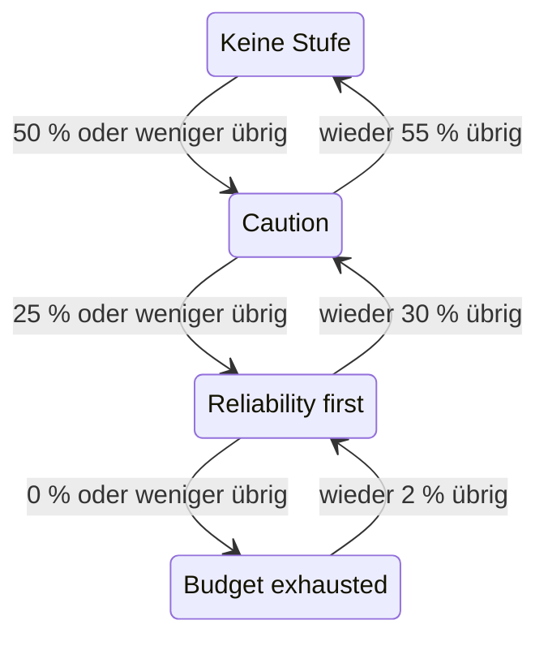

# Fehlerbudget-Richtlinie

Eine Fehlerbudget-Richtlinie hält fest, was Ihr Team vereinbart hat zu tun, während das Fehlerbudget eines SLO schrumpft, etwa riskante Änderungen zu prüfen, sobald die Hälfte verbraucht ist, oder Releases einzufrieren, sobald alles verbraucht ist. OneUptime ordnet das SLO der Stufe der Richtlinie zu, die sein Budget erreicht hat, zeigt die Vereinbarung des Teams für diese Stufe auf den Seiten des SLO und kann eine Warnung auslösen oder einen Vorfall melden, wenn das SLO in eine Stufe eintritt. Das ist die Praxis der Fehlerbudget-Richtlinie aus dem [Google SRE Workbook](https://sre.google/workbook/error-budget-policy/).

:::cards
- [Wie Stufen funktionieren](#wie-stufen-funktionieren): Welche Stufe gilt und wann das SLO sie verlässt.
- [Eine Richtlinie einrichten](#eine-richtlinie-einrichten): Mit der empfohlenen Richtlinie beginnen oder eigene Stufen schreiben.
- [Warnungen und Vorfälle](#warnungen-und-vorfälle): Ihr Team alarmieren, wenn das SLO in eine Stufe eintritt.
- [Die Stufe über die API lesen](#die-stufe-über-die-api-lesen): Die Stufe aus CI und Skripten prüfen.
:::

## Wie Stufen funktionieren

Eine Richtlinie ist eine Reihe von Stufen. Jede Stufe hat drei Felder:

| Feld | Was es enthält |
| --- | --- |
| **Name** | Wie das Team die Stufe nennt, zum Beispiel „Reliability first“. |
| **Budget Left Threshold (%)** | Der Anteil des verbleibenden Fehlerbudgets, bei dem oder unter dem die Stufe gilt. Von 0 bis 100, Dezimalzahlen erlaubt. Jede Stufe eines SLO hat einen eigenen Schwellenwert. |
| **What We Do** | Was das Team vereinbart hat zu tun, solange das SLO in der Stufe ist, in Markdown. Pflichtfeld, bis zu 10.000 Zeichen. |

Eine Stufe gilt, solange das verbleibende Budget bei ihrem Schwellenwert oder darunter liegt, eine Stufe bei 0 % ist also die Stufe eines aufgebrauchten Budgets. Gelten mehrere Stufen, ist das SLO in der mit dem niedrigsten Schwellenwert: der strengsten. Gilt keine, ist das SLO in keiner Stufe. Mit Stufen bei 50 %, 25 % und 0 % ist ein SLO mit 30 % verbleibendem Budget in der 50-%-Stufe und eines mit 10 % in der 25-%-Stufe.

### In eine Stufe eintreten und sie verlassen

Die Stufe folgt dem verbleibenden Budget so, wie es der Status des SLO tut:

- Das Eintreten in eine Stufe geschieht sofort: Die Auswertung, die das Budget bei oder unter dem Schwellenwert einer Stufe findet, bringt das SLO in diese Stufe. Ein Budget, das auf einmal unter mehrere Schwellenwerte fällt, kommt direkt in die strengste Stufe.
- Das Verlassen einer Stufe in Richtung einer weniger strengen wartet, bis das Budget deutlich zurück ist. Eine Stufe bei 0 % wird verlassen, sobald wieder 2 % des Budgets übrig sind. Jede andere Stufe wird verlassen, sobald das Budget 5 Punkte über ihrem Schwellenwert liegt.

Eine Stufe bei 0 % bewegt sich also mit dem Status **Budget ausgeschöpft**, und eine Stufe bei der Risikoschwelle des SLO mit **Gefährdet**: siehe [Statusänderungen und die Risikoschwelle](/docs/slo/error-budget#statusänderungen-und-die-risikoschwelle). Ein rollierendes Zeitfenster, das um einen Schwellenwert pendelt, lässt die Stufe nicht hin- und herspringen.



## Eine Richtlinie einrichten

Sie brauchen die Berechtigung, Stufen der Fehlerbudget-Richtlinie von SLOs zu erstellen.

:::steps
### Error Budget Policy öffnen

Öffnen Sie das SLO und gehen Sie in seinem Seitenmenü im Bereich **Regeln** zu **Error Budget Policy**. Die Seite listet die Stufen des SLO auf, jede mit ihrem Namen, dem verbleibenden Budget, bei dem sie gilt, und dem, was das Team tut.

### Mit der empfohlenen Richtlinie beginnen

Solange das SLO keine Stufen hat, bietet die Seite **Use the recommended policy** an. Klicken Sie darauf, prüfen Sie die drei Stufen, die aufgelistet werden, und bestätigen Sie. Passen Sie danach den Wortlaut jeder Stufe an die eigene Vereinbarung Ihres Teams an.

### Oder selbst eine Stufe hinzufügen

Klicken Sie auf **SLO Error Budget Policy Tier erstellen**. Geben Sie einen **Name** und einen **Budget Left Threshold (%)** ein, und schreiben Sie die Vereinbarung des Teams in **What We Do**.

### Festlegen, was die Stufe auslöst

Eine Stufe hält die Vereinbarung fest und zeigt sie. Um außerdem jemanden zu alarmieren, wenn das SLO in die Stufe eintritt, öffnen Sie die eingeklappten Einstellungen für Warnung und Vorfall und schalten Sie eine Warnung, einen Vorfall oder beides ein. Beide sind standardmäßig aus. Siehe [Warnungen und Vorfälle](#warnungen-und-vorfälle).
:::

Das Hinzufügen, Bearbeiten oder Löschen einer Stufe wirkt sofort: OneUptime wertet das SLO innerhalb von etwa einer Minute erneut aus. Liegt das Budget schon bei oder unter dem Schwellenwert einer Stufe, kommt das SLO dann in diese Stufe, und die Stufe löst aus, was sie auslösen soll. Das Ausschalten oder Löschen einer Stufe löst auf, was sie ausgelöst hat, und das SLO wechselt in die Stufe, in der sein Budget liegt. Das Ausschalten der Warnung oder des Vorfalls einer Stufe löst diese Warnung oder diesen Vorfall auf.

### Die empfohlene Richtlinie

**Use the recommended policy** fügt drei Stufen hinzu, bei der Hälfte des Budgets, einem Viertel und null, mit diesem englischen Wortlaut:

| Stufe | Gilt bei | Was das Team tut |
| --- | --- | --- |
| **Caution** | 50 % übrig oder weniger | Half of the error budget is spent. Review risky changes before they ship, and find out what has been spending the budget. |
| **Reliability first** | 25 % übrig oder weniger | Reliability comes first. Only reliability improvements and critical fixes ship until the budget recovers. |
| **Budget exhausted** | 0 % übrig oder weniger | The error budget is spent. Freeze non-critical releases: only fixes for this SLO's reliability and security fixes ship until the budget is back. |

Keine von ihnen löst eine Warnung aus oder meldet einen Vorfall, bis Sie das einschalten. Es werden nur die Stufen hinzugefügt, die das SLO nicht hat: Eine Stufe mit demselben Namen oder mit demselben Schwellenwert zählt als vorhanden, ob sie ein- oder ausgeschaltet ist. Zweimal danach zu fragen, aus einem zweiten Tab oder über die API, fügt also nichts doppelt hinzu. Jede so hinzugefügte Stufe wird in den Audit-Protokollen des SLO als von Ihnen hinzugefügt festgehalten.

## Wo die Stufe erscheint

- Die **Übersicht** des SLO zeigt die Stufe, in der es ist, und was das Team dort vereinbart hat, sodass jeder, der das SLO öffnet, die Vereinbarung sieht, die gerade gilt.
- Das Diagramm **Fehlerbudget-Burn-down** zeichnet beim Schwellenwert jeder Stufe eine beschriftete Linie, neben der Linie der Risikoschwelle.
- Der **Feed** des SLO zeigt jeden Stufenwechsel: die Stufe, die das SLO verlassen hat, und die, in die es eingetreten ist, das verbleibende Budget und was das Team in der neuen Stufe vereinbart hat.
- Die **Audit-Protokolle** des SLO halten jeden Stufenwechsel als Änderung fest, die OneUptime selbst vorgenommen hat, und zeigen ihn daher nur mit eingeschaltetem **Systemereignisse speichern**: siehe [Audit-Protokolle einschalten](/docs/slo/feed-and-audit-logs#audit-protokolle-einschalten). Das Hinzufügen, Bearbeiten und Entfernen einer Stufe wird unter der Person festgehalten, die es getan hat.
- Die Lese-API des SLO liefert die Stufe: siehe [Die Stufe über die API lesen](#die-stufe-über-die-api-lesen).

## Warnungen und Vorfälle

Jede Stufe kann eine Warnung auslösen, einen Vorfall melden oder beides, wenn das SLO in sie eintritt. Sie haben die Optionen der Warnung und des Vorfalls einer Burn-Rate-Regel: Schweregrad, Bereitschaftsrichtlinien, Vorlagen für Titel, Beschreibung und Behebungshinweise, Privatsphäre, automatisches Auflösen, Beschriftungen, Eigentümer-Teams und -Benutzer und das Hinzufügen der Eigentümer des SLO als Eigentümer. Siehe [Was eine Regel meldet](/docs/slo/burn-rate-alerts#was-eine-regel-meldet). Beide sind standardmäßig aus, eine Stufe alarmiert also niemanden, bis Sie eines davon einschalten.

- Das Eintreten in eine strengere Stufe löst auf, was die vorige Stufe ausgelöst hat, unabhängig von deren Einstellung zum automatischen Auflösen, weil die neue Stufe sie ablöst. So sind höchstens die Warnung und der Vorfall einer Stufe gleichzeitig offen, und sie gehören zu der Stufe, in der das SLO ist.
- Die Erholung in eine weniger strenge Stufe oder aus jeder Stufe heraus löst sie auf, wenn das automatische Auflösen der Stufe eingeschaltet ist, wie standardmäßig. Ist das automatische Auflösen aus, bleiben sie offen, bis jemand sie auflöst.
- Es gibt keine Unterdrückung erneuter Auslösung. Eine Stufe löst erst wieder aus, nachdem das SLO sie deutlich verlassen hat und erneut in sie eingetreten ist, sie kann also nicht flattern. Löst jemand von Hand auf, was sie ausgelöst hat, während das SLO noch in der Stufe ist, bleibt es aufgelöst.
- Solange irgendein Monitor des SLO in geplanter Wartung ist, lösen Stufen nichts aus. Die Stufe selbst wechselt trotzdem, und was offen ist, wird weiterhin aufgelöst. Ist das SLO noch in der Stufe, wenn die Wartung endet, löst die Stufe dann aus, was sie auslösen soll.

Wie bei einer Burn-Rate-Regel führt eine Warnung oder ein Vorfall, den eine Stufe auslöst, das SLO unter **Betroffene Ressourcen** auf, und ein Vorfall erscheint nie auf Statusseiten. Der Feed des SLO zeigt jede Warnung und jeden Vorfall, und wann sie aufgelöst werden.

### Was sie sagen

Titel, Beschreibung und Behebungshinweise einer Stufe nehmen Vorlagenvariablen auf, wie die einer Regel: siehe [Was jede Warnung und jeder Vorfall sagt](/docs/slo/burn-rate-alerts#was-jede-warnung-und-jeder-vorfall-sagt). Die Felder einer Stufe bieten die Variablen des SLO und seines Budgets an und drei eigene der Stufe: `{{sloName}}`, `{{sloId}}`, `{{sloLink}}`, `{{sloStatus}}`, `{{policyTier}}`, `{{policyTierThresholdPercentage}}`, `{{policyTierWhatWeDo}}`, `{{targetPercentage}}`, `{{currentSliPercentage}}`, `{{errorBudgetRemainingPercentage}}`, `{{errorBudgetRemaining}}`, `{{errorBudgetRemainingMinutes}}` und `{{windowDescription}}`. Die eigenen Variablen einer Regel, etwa `{{ruleName}}` und die Burn-Raten, werden nicht angeboten und bleiben in den Vorlagen einer Stufe leer.

Die drei Variablen der Stufe funktionieren auch in den Vorlagen von Burn-Rate-Regeln:

| Variable | Was sie enthält |
| --- | --- |
| `{{policyTier}}` | Der Name der Stufe, in der das SLO nach der Auswertung ist, oder `None`, wenn es in keiner Stufe ist. |
| `{{policyTierThresholdPercentage}}` | Der Schwellenwert dieser Stufe, etwa `25`. Leer, wenn das SLO in keiner Stufe ist. |
| `{{policyTierWhatWeDo}}` | Was das Team in dieser Stufe vereinbart hat. Leer, wenn das SLO in keiner Stufe ist. |

Eine Stufe, deren Titel leer bleibt, verwendet den eingebauten Titel:

```text
SLO error budget policy: {{sloName}} — {{policyTier}}
```

Die eingebaute Beschreibung nennt die Stufe, stellt das verbleibende Budget dem Schwellenwert der Stufe gegenüber und sagt, was das Team in ihr vereinbart hat.

## Wenn das Budget nicht gemessen wird

- Ein SLO, das **Pausiert** oder **Falsch konfiguriert** ist, misst kein Budget, seine Stufe bleibt also, wo sie war, und was die Stufe ausgelöst hat, bleibt offen, bis wieder gemessen wird. Burn-Rate-Regeln lösen dann dagegen auf, was sie offen haben.
- Das Ausschalten der Auswertung des SLO oder das Archivieren des SLO löst auf, was seine Stufen ausgelöst haben. Die Stufe, in der das SLO ist, bleibt, wie sie war.
- Das Löschen des SLO löscht seine Stufen und löst auf, was sie ausgelöst haben.

## Die Stufe über die API lesen

Die eigene Lese-API des SLO liefert die Stufe, in der es ist, sodass ein CI-Job oder ein Skript sie prüfen kann, bevor er handelt, zum Beispiel vor einem Release. Alle drei Felder sind leer, solange das SLO in keiner Stufe ist:

| Feld | Was es enthält |
| --- | --- |
| `currentErrorBudgetPolicyTierId` | Die ID der Stufe. |
| `currentErrorBudgetPolicyTierName` | Der Name der Stufe. |
| `currentErrorBudgetPolicyTierEnteredAt` | Wann das SLO in die Stufe eingetreten ist. |

Sie werden mit der eigenen Leseberechtigung des SLO gelesen, derselben, die auch sein Budget braucht. Zum Beispiel mit einem [API-Schlüssel](/docs/api-reference/api-reference) des Projekts:

```bash
curl -X POST 'https://oneuptime.com/api/service-level-objective/<slo-id>/get-item' \
  -H "ApiKey: $ONEUPTIME_API_KEY" \
  -H 'Content-Type: application/json' \
  -d '{ "select": { "name": true, "errorBudgetRemainingPercentage": true, "currentErrorBudgetPolicyTierName": true, "currentErrorBudgetPolicyTierEnteredAt": true } }'
```

Die Stufen selbst sind eine eigene Ressource, `/api/service-level-objective-error-budget-policy-tier`, mit den Anfragen zum Auflisten, Lesen, Erstellen, Ändern und Löschen, die jede Ressource hat. Zwei weitere Anfragen dienen der empfohlenen Richtlinie. Beide nehmen `{ "serviceLevelObjectiveId": "..." }` entgegen und antworten mit den Stufen in `tiers`:

| Anfrage | Was sie tut |
| --- | --- |
| `POST /api/service-level-objective-error-budget-policy-tier/recommended-policy` | Listet die empfohlenen Stufen auf, die dem SLO fehlen. Sie schreibt nichts. |
| `POST /api/service-level-objective-error-budget-policy-tier/recommended-policy/add` | Fügt sie hinzu und listet auf, was sie hinzugefügt hat. Eine erneute Anfrage fügt nichts hinzu. |

## Berechtigungen

| Berechtigung | Erlaubt einer Rolle |
| --- | --- |
| **Read SLO Error Budget Policy Tier** | Die Stufen eines SLO sehen. |
| **Create SLO Error Budget Policy Tier** | Stufen hinzufügen, von Hand oder mit **Use the recommended policy**. |
| **Edit SLO Error Budget Policy Tier** | Stufen ändern und sie ein- oder ausschalten. |
| **Delete SLO Error Budget Policy Tier** | Stufen entfernen. |

Diese Berechtigungen stehen in der SLO-Gruppe einer Rolle. Die Rollen Project Owner und Project Admin haben sie alle, und die Rollen Project Member und Viewer können Stufen lesen.

## Noch nicht verfügbar

Einige Teile einer Fehlerbudget-Richtlinie sind noch nicht verfügbar: ein Deployment-Gate, das Releases von selbst blockiert (ein CI-Job kann stattdessen die Stufe über die API lesen), Workflow-Auslöser sowie Slack- und Microsoft-Teams-Benachrichtigungen für jede Stufe, eine Richtlinie, die sich mehrere SLOs teilen, das Bestätigen einer Stufe oder das Gewähren einer Ausnahme davon, und Stufen, die sich nach der Budget-Reichweite statt nach dem verbleibenden Budget richten.

## Nächste Schritte

:::cards
- [Fehlerbudgets](/docs/slo/error-budget): Was das Budget ist und wie der Status ihm folgt.
- [Burn-Rate-Warnungen und -Vorfälle](/docs/slo/burn-rate-alerts): Ihr Team alarmieren, wenn das Budget zu schnell verbrennt.
- [SLO-Feed und Audit-Protokolle](/docs/slo/feed-and-audit-logs): Jeder Stufenwechsel und was die Stufen ausgelöst haben.
:::
