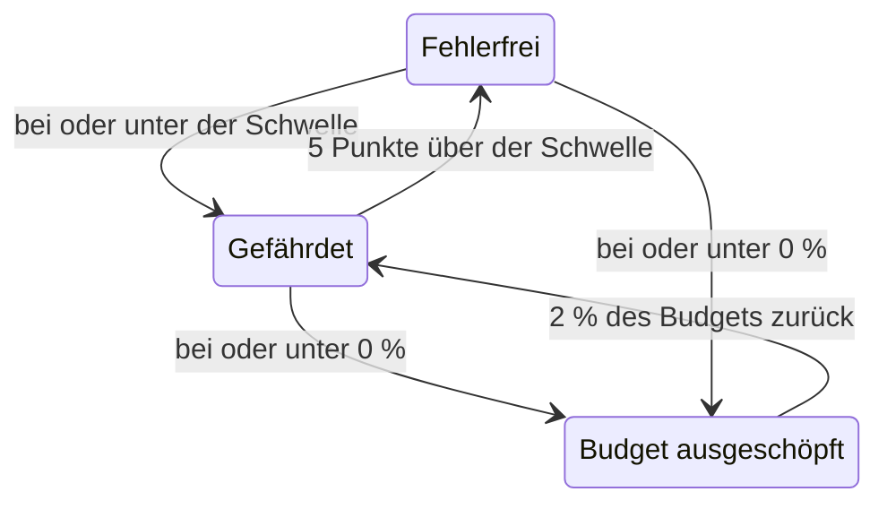

# Fehlerbudgets

Das Fehlerbudget ist die Ausfallzeit, die das Ziel eines SLO erlaubt. Ein Ziel von 99,9 % bedeutet nicht „nie ausfallen“, sondern „Sie dürfen in 30 Tagen bis zu 43 Minuten ausfallen, also gehen Sie klug damit um“. Diese Seite erklärt, wie OneUptime das Budget zählt, wie lange es reicht, wie es zurückkommt und wer davon erfährt.

:::cards
- [Wie das Budget berechnet wird](#wie-das-budget-berechnet-wird): Die Formel und das Budget für gängige Ziele.
- [Budget-Reichweite](#budget-reichweite): Wie lange das Budget beim aktuellen Tempo reicht.
- [Wie sich das Budget erholt](#wie-sich-das-budget-erholt): Rollierende Zeitfenster und Kalendermonate.
- [Benachrichtigung der Eigentümer](#benachrichtigung-der-eigentümer): Wer erfährt, wenn das Budget knapp wird.
:::

## Wie das Budget berechnet wird

Das Gesamtbudget ist der Anteil des Zeitfensters, den Ihr Ziel nicht verspricht:

```text
total budget = (100% − target) × window length
```

| Ziel | 7-Tage-Fenster | 28-Tage-Fenster | 30-Tage-Fenster | 90-Tage-Fenster |
| --- | --- | --- | --- | --- |
| 99% | 1h 40m 48s | 6h 43m 12s | 7h 12m | 21h 36m |
| 99.5% | 50m 24s | 3h 21m 36s | 3h 36m | 10h 48m |
| 99.9% | 10m 5s | 40m 19s | 43m 12s | 2h 9m 36s |
| 99.95% | 5m 2s | 20m 10s | 21m 36s | 1h 4m 48s |
| 99.99% | 1m 0s | 4m 2s | 4m 19s | 12m 58s |

Die Seite **Einstellungen** des SLO zeigt das Budget, das sein Ziel erlaubt, neben dem Ziel an, zum Beispiel „43m 12s Ausfallzeit pro 30-Tage-Zeitfenster“.

### Das Budget eines SLO mit mehreren Monitoren

Im Modus **Any Monitor Down** ist das Budget `(100% − target) × window`, egal wie viele Monitore das SLO misst: Das Zeitfenster ist eine einzige Zeitleiste.

Im Modus **Monitor Seconds Average** wird das Budget in Monitorsekunden gezählt, summiert über alle Monitore, und wächst daher mit der Zahl der Monitore: Ein SLO mit drei Monitoren und 99,9 % über 30 Tage hat etwa 129 Minuten Budget statt 43. Die Prozentwerte (SLI, verbleibendes Budget, Burn-Rate) bedeuten dasselbe; nur die Dauern ändern sich.

### Das Budget eines Kalendermonats

Ein Kalendermonat-SLO hat vom ersten Tag an das Budget des ganzen Monats: Ein SLO mit 99,9 % in einem Monat mit 31 Tagen hat am 1. seine vollen 44m 38s. Das Budget wird nicht nach dem bereits vergangenen Teil des Monats anteilig berechnet, ein einminütiger Ausfall am Morgen des 1. verbraucht also eine Minute des Monatsbudgets.

## Verbleibendes Budget

Während sich Ausfallzeit ansammelt, zeigt die **Übersicht** das verbleibende Budget auf ihrer Kachel **Verbleibendes Fehlerbudget**:

- als Prozentsatz des Gesamtbudgets, der auch den Status des SLO bestimmt und den Balken füllt. Der Balken hat eine Markierung an der Risikoschwelle des SLO;
- als Dauer, zum Beispiel "31m 4s left of 43m 12s".

Ist das Budget aufgebraucht, zeigt die Kachel **No budget left**. Geht die Ausfallzeit darüber hinaus, zeigt die Kachel **Budget exceeded** und die Überziehung als Zeit, zum Beispiel "4d 23m over budget · 5m 47s allowed": Das SLO hat alle 5 Minuten und 47 Sekunden seines Budgets verbraucht und weitere 4 Tage und 23 Minuten dazu. Der Balken bleibt leer und rot.

Das verbleibende Budget wird für Berechnungen und Verlaufsdiagramme als Zahl mit Vorzeichen gespeichert, ein überzogenes Budget erscheint dort also als negativer Prozentsatz. Ein großer negativer Prozentsatz bedeutet, dass die Überziehung im Vergleich zum Budget groß ist; er ist nicht der Anteil der Zeit, in der der Dienst ausgefallen war.

Welche Sekunden als Ausfallzeit zählen, bestimmen die Ausfall-Status des SLO und, bei einem SLO mit mehreren Monitoren, sein Multi-Monitor-Modus, beide unter **Einstellungen** → **Berechnung der Ausfallzeit**. Siehe [SLOs – Übersicht](/docs/slo/introduction).

## Budget-Reichweite

Die Kachel **Budget-Reichweite** auf der **Übersicht** beantwortet „Wenn es so weitergeht, wann ist das Budget aufgebraucht?“. Sie teilt das verbleibende Budget durch die Burn-Rate der letzten 60 Minuten:

```text
runway = budget left ÷ (burn rate × (100% − target))
```

| Die Kachel zeigt | Bedeutung |
| --- | --- |
| Eine Dauer, etwa **~2d 5h** | Beim aktuellen Tempo ist das Budget in etwa dieser Zeit aufgebraucht. Gelb, und rot, sobald es einen Tag oder weniger sind. **Under 1m** bedeutet weniger als eine Minute. |
| **Not burning** | In den letzten 60 Minuten wurde kein Budget verbraucht. |
| **Sustainable** | Nur rollierende Zeitfenster: Die Reichweite ist mindestens ein ganzes Zeitfenster, das Budget wird also nicht schneller verbraucht, als alte Ausfallzeit herausfällt. Bei diesem Tempo kann es nicht aufgebraucht werden. |
| **Lasts until reset** | Nur Kalendermonate: Das Budget wird zu Beginn des nächsten Monats zurückgesetzt, bevor es aufgebraucht wäre. |
| **Overspent** | Das Budget ist bereits verbraucht. Die Kachel sagt, um wie viel es überzogen ist. |

Bei Kalendermonat-SLOs sagt die Kachel außerdem, wann das Budget zurückgesetzt wird.

Die Reichweite ist eine gerade Linie. In einem rollierenden Zeitfenster gibt herausfallende alte Ausfallzeit Budget zurück, was die Linie nicht berücksichtigt, lesen Sie sie also als die kürzeste Zeit, die Ihnen bleibt. Sie wird vor der ersten Auswertung nicht angezeigt, ebenso wenig für SLOs im Modus **Monitor Seconds Average**, deren Budget in Monitorsekunden statt in Uhrzeit gezählt wird.

## Fehlerbudget-Burn-down

Das Diagramm **Fehlerbudget-Burn-down** auf der **Übersicht** zeigt das verbleibende Budget in Prozent über das aktuelle Compliance-Zeitfenster:

- Eine Linie bei 0 % markiert, wo das Budget aufgebraucht ist, und eine gestrichelte Linie markiert die Risikoschwelle des SLO.
- Bei Kalendermonat-SLOs verläuft eine blasse Linie gleichmäßig von einem vollen Budget zu Monatsbeginn bis zu einem leeren beim Zurücksetzen. Liegt die Kurve darunter, verbraucht der Monat sein Budget zu schnell.
- Bei jeder Auswertung, alle 5 Minuten, wird ein Punkt erfasst, das Diagramm eines neuen SLO bleibt also bis zu seiner ersten Auswertung leer.
- Ziehen Sie über das Diagramm, um in einen Teil des Zeitfensters zu zoomen. Doppelklicken Sie oder klicken Sie auf **Zoom zurücksetzen**, um wieder das ganze Zeitfenster zu sehen.

**Metriken öffnen** öffnet die Seite **Metriken** des SLO, deren Tab **Error Budget History** bis zu 400 Tage zurückreicht. Siehe [SLO-Metriken und -Dashboards](/docs/slo/metrics).

## Wie sich das Budget erholt

Wie das Budget zurückkommt, hängt vom Typ des Zeitfensters des SLO ab:

:::tabs
@tab Rollierend
Ein rollierendes Zeitfenster schaut immer gleich weit ab jetzt zurück, Ausfallzeit fällt also heraus: Ein Ausfall zählt genau ein Zeitfenster, nachdem er passiert ist, nicht mehr. Ein 30-minütiger Ausfall am 1. Juni ist am 1. Juli aus den Büchern eines 30-Tage-SLO, und das Budget kommt nach und nach zurück, während jede Sekunde Ausfallzeit das Fenster verlässt, nicht auf einmal.

Erholung wird also verdient, nicht geplant. Passieren immer wieder kleine Ausfälle, fällt alte Ausfallzeit heraus, während neue hinzukommt, und das Budget pendelt, statt sich zu erholen.
@tab Calendar Month
Ein Kalendermonat-SLO wird am Ersten jedes Monats um Mitternacht in seiner Zeitzone zurückgesetzt. Das ganze Budget kommt auf einmal zurück, und der vorige Monat ist abgeschlossen. Nichts wird übertragen, in keine Richtung: Ein schlechter Monat belastet den nächsten nicht, und ein guter Monat polstert ihn nicht.
:::

### Junge SLOs

Ein SLO mit rollierendem Zeitfenster, das jünger ist als sein Fenster, wird über die bisher vorhandenen Daten gemessen, und sein Gesamtbudget wächst mit: Ein 30-Tage-SLO, das vor einer Woche erstellt wurde, hat vorerst ein 7-Tage-Budget. Bis das Fenster voll ist, zeigt die **Übersicht**, wie voll es ist, mit einem Chip **Window 23% full** und demselben Hinweis auf der Kachel **Verbleibendes Fehlerbudget**. Rechnen Sie damit, dass sich die Zahlen beruhigen, während sich das Fenster füllt.

## Statusänderungen und die Risikoschwelle

Das verbleibende Budget bestimmt den Status des SLO:

| Status | Wann |
| --- | --- |
| **Fehlerfrei** | Es ist mehr als die Risikoschwelle des Budgets übrig. |
| **Gefährdet** | Das verbleibende Budget liegt bei der Risikoschwelle oder darunter: standardmäßig 20 %. |
| **Budget ausgeschöpft** | Das verbleibende Budget liegt bei null oder darunter. |

Legen Sie die Risikoschwelle unter **Einstellungen** → **Ziel** fest.

Rollierende Zeitfenster erholen sich Sekunde für Sekunde, ein SLO nahe einer Grenze könnte also zwischen Status hin- und herspringen. Damit jede Statusänderung etwas bedeutet, verlässt ein SLO einen Status erst, wenn es deutlich über die Grenze hinaus ist:



Mit der Standardschwelle von 20 % wird ein gefährdetes SLO bei 25 % verbleibendem Budget wieder fehlerfrei, und ein SLO mit ausgeschöpftem Budget wird bei 2 % wieder gefährdet. Jede Statusänderung erscheint im **Feed** des SLO, mit SLI, Budget und Burn-Rate dahinter.

## Benachrichtigung der Eigentümer

Wenn ein SLO **Gefährdet** oder **Budget ausgeschöpft** wird, benachrichtigt OneUptime seine Eigentümer:

- Eigentümer sind die Benutzer und die Mitglieder der Teams auf der Seite **Eigentümer** des SLO, die noch Mitglieder des Projekts sind. Ein SLO ohne Eigentümer benachrichtigt stattdessen die Projekteigentümer.
- Jeder Eigentümer bekommt standardmäßig eine E-Mail und die Benachrichtigung auf jedem weiteren Kanal, den er für **SLO-Status geändert** unter **Benutzereinstellungen** → **Benachrichtigungseinstellungen** → **Überwachung** einschaltet.
- Der Betreff der E-Mail nennt den Status und das SLO, zum Beispiel `[SLO At Risk] API Availability`.

Damit ein SLO nahe einer Grenze nicht immer wieder benachrichtigt, werden seine Eigentümer höchstens einmal pro Stunde benachrichtigt. Ein Wechsel zu **Budget ausgeschöpft** wird immer gesendet, auch innerhalb dieser Stunde.

> [!TIP]
> Die Benachrichtigungen der Eigentümer sagen den Verantwortlichen eines SLO, dass sein Budget in Schwierigkeiten ist. Um Ihr Bereitschaftsteam über Eskalationsrichtlinien zu alarmieren, verwenden Sie [Burn-Rate-Warnungen und -Vorfälle](/docs/slo/burn-rate-alerts). Eine Burn-Rate-Regel kann die Eigentümer des SLO auch zu jeder Warnung und jedem Vorfall hinzufügen, die sie erzeugt.

## Nächste Schritte

:::cards
- [Burn-Rate-Warnungen und -Vorfälle](/docs/slo/burn-rate-alerts): Ihr Team alarmieren, wenn das Budget zu schnell verbrennt.
- [SLO-Metriken und -Dashboards](/docs/slo/metrics): Das Budget über die Zeit als Diagramm darstellen.
- [SLOs – Übersicht](/docs/slo/introduction): Ziele, Zeitfenster und Ausfall-Status.
:::
