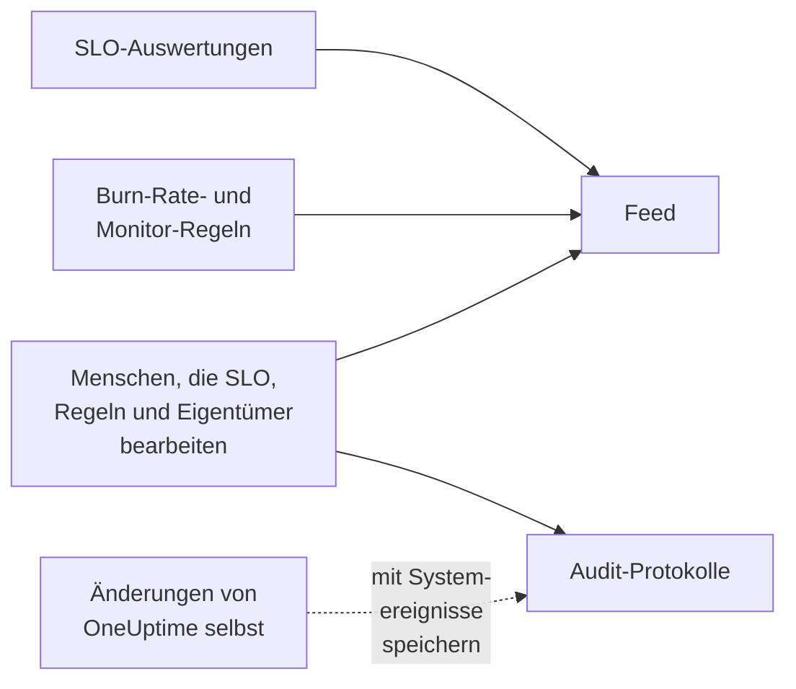

# SLO-Feed und Audit-Protokolle

Ein SLO führt zwei Aufzeichnungen seiner Geschichte, und sie beantworten verschiedene Fragen. Der **Feed** beantwortet „Was ist mit diesem SLO passiert?“, geschrieben für die Menschen, die sich darum kümmern. Die **Audit-Protokolle** beantworten „Wer hat was genau geändert?“, Feld für Feld, für Prüfung und Compliance.

## Feed oder Audit-Protokolle?

| | **Feed** | **Audit-Protokolle** |
| --- | --- | --- |
| Beantwortet | Was mit dem SLO passiert ist | Wer was geändert hat, und wann |
| Erfasst | Statusänderungen, Burn-Rate-Warnungen und -Vorfälle sowie Änderungen am SLO, seinen Regeln, Monitoren und Eigentümern | Jede Änderung, die Menschen am SLO, seinen Burn-Rate-Regeln, Monitor-Regeln und Eigentümern vorgenommen haben, mit altem und neuem Wert |
| Enthält, was OneUptime selbst tut | Ja: Auswertungen und Monitor-Regeln, die Monitore zuordnen | Nur mit eingeschaltetem **Systemereignisse speichern** |
| Tarife | Jeder Tarif | Der Tarif Enterprise auf OneUptime Cloud oder die Enterprise Edition in einer selbst gehosteten Installation |
| Aufbewahrt | Drei Jahre auf OneUptime Cloud | Standardmäßig 7 Tage, bis zu 180 |

## Der SLO-Feed

Der Feed steht auf der Seite **Feed** des SLO, und seine neuesten Einträge stehen unter **Neueste Aktivität** auf der **Übersicht** des SLO. Einträge verlinken das SLO, die Monitore, Warnungen und Vorfälle, die sie nennen, und die meisten haben einen Abschnitt **Weitere Informationen** mit den Zahlen oder den alten und neuen Werten.

| Ereignis | Erscheint, wenn |
| --- | --- |
| SLO erstellt | Das SLO erstellt wird. Nennt Ziel, Compliance-Zeitfenster, SLI, Risikoschwelle, Beschreibung und die Standard-Burn-Rate-Regeln, mit denen es begonnen hat. |
| SLO aktualisiert | Name, Beschreibung, Beschriftungen, Ziel, Compliance-Zeitfenster, Zeitzone, Risikoschwelle, Multi-Monitor-Modus oder Ausfall-Status sich ändern. Zeigt jeden alten und neuen Wert. |
| SLO aktiviert oder deaktiviert | Die Auswertung ein- oder ausgeschaltet wird. |
| SLO archiviert oder wiederhergestellt | Das SLO archiviert oder aus dem Archiv geholt wird. |
| Status geändert | Eine Auswertung das SLO in einen neuen Status bringt. Zeigt SLI, Fehlerbudget, Burn-Rate und Risikoschwelle dahinter und den Grund für **Pausiert** oder **Falsch konfiguriert**. |
| Burn-Rate-Warnung ausgelöst | Eine Burn-Rate-Regel eine Warnung erstellt. Verlinkt sie und zeigt die Burn-Raten, die sie ausgelöst haben. |
| Burn-Rate-Vorfall gemeldet | Eine Burn-Rate-Regel einen Vorfall meldet. Verlinkt ihn und zeigt die Burn-Raten, die ihn ausgelöst haben. |
| Burn-Rate-Warnung oder -Vorfall aufgelöst | Die Warnung oder der Vorfall einer Regel geschlossen wird: automatisch aufgelöst oder von Hand, während das automatische Auflösen aus war. |
| Burn-Rate-Regel hinzugefügt, geändert oder entfernt | Jemand eine Burn-Rate-Regel erstellt, bearbeitet oder löscht. Die Standardregeln eines neuen SLO stehen stattdessen in seinem Eintrag „SLO erstellt“. |
| Monitor-Regel hinzugefügt, geändert oder entfernt | Jemand eine Monitor-Regel erstellt, bearbeitet oder löscht. Ein Speichern, das nichts Wesentliches ändert, erscheint nicht. |
| Monitore zugeordnet oder gelöst | Monitore dem SLO hinzugefügt oder von ihm entfernt werden, von Hand oder durch eine Monitor-Regel. Lange Listen nennen die ersten Monitore „und N weitere“. |
| Eigentümer hinzugefügt oder entfernt | Ein Benutzer oder Team zu den Eigentümern des SLO hinzugefügt oder daraus entfernt wird. |
| Beschriftungsregel angewendet | Eine Beschriftungsregel dem SLO Beschriftungen zugeordnet hat, beim Erstellen oder wenn jemand die Regel ausgeführt hat. Nennt die passenden Regeln. Siehe [Beschriftungs- und Eigentümerregeln](/docs/slo/label-and-owner-rules). |
| Eigentümerregel angewendet | Eine Eigentümerregel dem SLO Eigentümer hinzugefügt hat. Nennt die passenden Regeln; jeder Eigentümer, den sie hinzugefügt hat, bekommt außerdem einen eigenen Eintrag „Eigentümer hinzugefügt“. |

Einige Details:

- Einträge sagen, wer eine Änderung vorgenommen hat, wenn es eine Person war. Änderungen, die OneUptime selbst vornimmt, etwa eine Auswertung oder eine Monitor-Regel, die einen Monitor zuordnet, und Änderungen über die API oder eine Automatisierung tragen keinen Benutzer.
- Eine Warnung oder ein Vorfall, den eine Regel erneut aufgreift, weil er noch offen war, erscheint nicht zweimal.
- Bei einer privaten Warnung oder einem privaten Vorfall lässt der Eintrag Titel, Nummer und Link weg, denn jeder, der das SLO lesen kann, kann seinen Feed lesen. Er sagt trotzdem, dass ein privater Datensatz erstellt wurde, und zeigt die Burn-Raten, die ihn ausgelöst haben.
- Niemand kann Feed-Einträge bearbeiten oder löschen. Auf OneUptime Cloud werden Einträge, die älter als drei Jahre sind, entfernt.

## Audit-Protokolle

Die Seite **Audit-Protokolle** des SLO listet Änderungen an:

- dem SLO selbst: seinen Details, Einstellungen, Beschriftungen, Monitoren und der Archivierung;
- seinen Burn-Rate-Regeln;
- seinen Monitor-Regeln;
- seinen Eigentümer-Benutzern und Eigentümer-Teams.

Änderungen an Regeln und Eigentümern werden bei der Regel oder dem Eigentümer erfasst und beim SLO zusammengeführt, sodass seine Seite die ganze Geschichte an einem Ort zeigt und jeder Eintrag auf die Seite verlinkt, zu der er gehört. Zugehörige Elemente wie Beschriftungen und Monitore werden mit ihren Namen erfasst, nicht nur mit ihren IDs.

Zwei Dinge fehlen:

- **Ergebnisse der Auswertung.** SLI, Fehlerbudget, Burn-Rate, Status und Auswertungszeiten ändern sich alle paar Minuten. Ihr Verlauf steht auf der **Übersicht**, der Seite **Metriken** und im **Feed**.
- **Änderungen, die OneUptime selbst vornimmt**, etwa eine Monitor-Regel, die einen Monitor zuordnet oder löst, es sei denn, **Systemereignisse speichern** ist für das Projekt eingeschaltet. Der **Feed** erfasst das Zuordnen und Lösen von Monitoren in jedem Fall.

### Audit-Protokolle einschalten

Audit-Protokolle sind eine Enterprise-Funktion: Sie brauchen den Tarif **Enterprise** auf OneUptime Cloud oder die Enterprise Edition in einer selbst gehosteten Installation. Bei anderen Tarifen erklärt die Seite **Audit-Protokolle** des SLO, wie Sie sie bekommen. In einer selbst gehosteten Installation hört die Audit-Protokollierung ohne gültige Lizenz auf aufzuzeichnen (nach der 14-tägigen Testphase oder 30 Tage nach Ablauf einer Lizenz) und setzt wieder ein, sobald eine Lizenz aktiviert ist (siehe [When a license expires or is missing](/docs/self-hosted/enterprise#when-a-license-expires-or-is-missing)). Die Seiten **Audit-Protokolle** zeigen an, wenn nicht aufgezeichnet wird.

Audit-Protokolle sind außerdem in jedem Projekt standardmäßig ausgeschaltet. So schalten Sie sie ein:

:::steps
### Die Einstellungen der Audit-Protokolle öffnen

Gehen Sie zu **Projekteinstellungen**, öffnen Sie **Audit-Protokolle** im Seitenmenü und klicken Sie auf **Einstellungen**.

### Die Einstellungen bearbeiten

Klicken Sie auf **Edit Audit Log Settings** und schalten Sie **Audit-Protokolle aktivieren** ein.

### Festlegen, was aufbewahrt wird

Legen Sie **Aufbewahrung (Tage)** fest, von 7 (dem Standard) bis 180, und schalten Sie **Systemereignisse speichern** ein, um auch die Änderungen aufzuzeichnen, die OneUptime selbst vornimmt. Speichern Sie. Die Änderung greift innerhalb etwa einer Minute.
:::

Solange die Audit-Protokollierung aus ist, zeigt die Seite **Audit-Protokolle** des SLO **Audit logging is off**, mit einem Link zum Einschalten. Einträge, die vor dem Ausschalten erfasst wurden, bleiben sichtbar. Das gesamte Audit-Protokoll des Projekts über alle Ressourcen steht unter **Projekteinstellungen** → **Audit-Protokolle** → **Audit-Protokolle**.

## Nächste Schritte

:::cards
- [SLOs – Übersicht](/docs/slo/introduction): Jede Seite, die ein SLO hat.
- [Monitore und Monitor-Regeln](/docs/slo/monitor-rules): Was Monitore zuordnet und löst.
- [Burn-Rate-Warnungen und -Vorfälle](/docs/slo/burn-rate-alerts): Was die Warnungen und Vorfälle im Feed auslöst und auflöst.
- [Beschriftungs- und Eigentümerregeln](/docs/slo/label-and-owner-rules): Was Beschriftungen und Eigentümer automatisch hinzufügt.
:::
