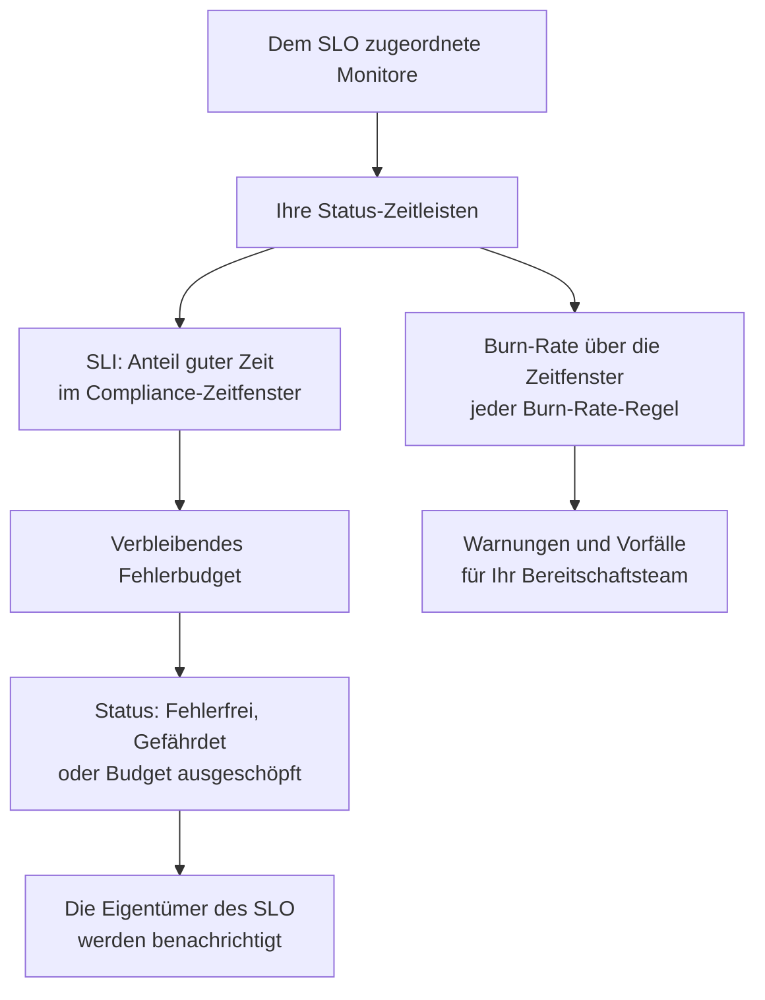

# SLOs – Übersicht

Ein Service Level Objective (SLO) ist ein Zuverlässigkeitsziel für das, was Sie betreiben, etwa „99,9 % der Zeit verfügbar über rollierende 30 Tage“ oder „99,9 % der Checkout-Anfragen gelingen“. OneUptime misst jedes SLO alle 5 Minuten an seinem Ziel. Statt „Läuft es gerade?“ beantworten Sie damit „Waren wir zuverlässig genug, über ein Zeitfenster, das unseren Nutzern wichtig ist, und wie viel Spielraum für Ausfälle bleibt?“ Das [Glossar](/docs/introduction/glossary#slo) stellt SLOs neben die anderen Wörter, die OneUptime verwendet.

:::cards
- [Ein SLO erstellen](#ein-slo-erstellen): Was es misst, ein Name und ein Ziel. Alles andere startet mit einem Standardwert.
- [Monitore und Monitor-Regeln](/docs/slo/monitor-rules): Wählen Sie die Monitore, die ein SLO misst.
- [Anfrage- und Latenz-SLOs](/docs/slo/request-slos): Die Anfragen von Diensten messen, aus ihren Traces.
- [Fehlerbudgets](/docs/slo/error-budget): Wie viel Ausfallzeit ein Ziel erlaubt und wie sie zurückkommt.
- [Burn-Rate-Warnungen und -Vorfälle](/docs/slo/burn-rate-alerts): Alarmieren Sie Ihr Team, wenn das Budget zu schnell verbrennt.
:::

## So funktioniert es

Ein SLO misst eines von zwei Dingen. Ein SLO der Monitor-Verfügbarkeit liest die Status-Zeitleisten der Monitore, die ihm zugeordnet sind: dieselben Daten, die Ihre Statusseiten zeigen. Ein Anfrage-SLO zählt die Anfragen, die seine Dienste beantworten, aus ihren Traces: siehe [Anfrage- und Latenz-SLOs](/docs/slo/request-slos). Der Rest dieser Seite beschreibt SLOs der Monitor-Verfügbarkeit, und Anfrage-SLOs funktionieren genauso, sofern nicht anders angegeben. Daraus berechnet OneUptime, welcher Anteil des Compliance-Zeitfensters gute Zeit war, wie viel Fehlerbudget übrig ist und wie schnell es verbraucht wird. Zeit, in der die Überwachung eines Monitors ausgeschaltet ist, bleibt außen vor: Nichts prüft den Monitor dann, also verbraucht diese Zeit weder Fehlerbudget, noch zählt sie als gute Zeit. Ebenso die Zeit vor der ersten Prüfung eines Monitors: Bis etwas einen Monitor geprüft hat, ist sein Status nur der betriebsbereite, in dem jeder Monitor angelegt wird, daher wird ein SLO ab den ersten Prüfungen seiner Monitore gemessen, und ein SLO, dessen Monitore noch nicht geprüft wurden, hat nichts zu messen, bis sie geprüft werden.



## Grundbegriffe

Die Wörter, die in ganz OneUptime verwendet werden, stehen im [Glossar](/docs/introduction/glossary).

| Begriff | Bedeutung |
| --- | --- |
| **SLI** (Service Level Indicator) | Die Messung: der Prozentsatz des Compliance-Zeitfensters, in dem die Monitore des SLO verfügbar waren, oder der Anfragen seiner Dienste, die gut waren. |
| **SLO** (Service Level Objective) | Ein Ziel für den SLI, zum Beispiel „mindestens 99,9 % in den letzten 30 Tagen“. |
| **Fehlerbudget** | Die Ausfallzeit, die das Ziel erlaubt: `(100% − target) × window`. Bei 99,9 % über 30 Tage sind das 43 Minuten und 12 Sekunden. Bei einem Anfrage-SLO sind es die schlechten Anfragen, die das Ziel erlaubt: bei 99,9 % eine von 1.000. |
| **Burn-Rate** | Wie schnell das Budget verbraucht wird, verglichen mit einem gleichmäßigen Tempo. Bei einer Burn-Rate von 1 ist das Budget genau am Ende des Zeitfensters aufgebraucht. |

Ein Fehlerbudget macht Zuverlässigkeit zu etwas, das Sie ausgeben können. Ist viel übrig, liefern Sie schneller aus und gehen Risiken ein; ist wenig übrig, treten Sie kürzer und investieren in Stabilität. Das SLO gibt diesem Gespräch eine Zahl, die alle sehen.

## Ein SLO erstellen

Sie brauchen eine Rolle, die SLOs erstellen darf: Projektinhaber, Projektadministrator oder eine eigene Rolle mit der Berechtigung Create Service Level Objective.

:::steps
### SLOs öffnen

Öffnen Sie **SLOs** über das Menü **Produkte** in der oberen Leiste. Es steht in der ersten Gruppe, neben Monitoren und Vorfällen. Klicken Sie auf **Service Level Objective erstellen**.

### Festlegen, was es misst

Lassen Sie unter **Messgröße** die Auswahl **Monitor-Verfügbarkeit** stehen, um den Anteil der Zeit zu messen, in dem Monitore verfügbar sind. Wählen Sie stattdessen **Anfrage-Erfolg** oder **Anfrage-Latenz**, um die Anfragen von Diensten zu messen, und wählen Sie deren **Dienste** aus: siehe [Anfrage- und Latenz-SLOs](/docs/slo/request-slos). Wählen Sie **Metrik**, um die guten Ereignisse in einem Zähler oder Histogramm zu zählen, das Ihre Dienste senden: siehe [SLOs aus einer Metrik](/docs/slo/request-slos#slos-aus-einer-metrik). Klicken Sie auf **Weiter**.

### Name und Ziel festlegen

Geben Sie einen **Name** ein, zum Beispiel „API Availability“, und ein **Ziel (%)**: den Anteil der Zeit oder der Anfragen, der gut sein muss. Das Ziel beginnt bei `99.9`. Es muss größer als 0 und höchstens 99,999 sein, denn ein Ziel von 100 % lässt kein Fehlerbudget übrig, das sich verfolgen ließe.

### Die Standardwerte unter Weitere Felder prüfen

**Weitere Felder** ist eingeklappt, mit einer Zeile, die sagt, was die Standardwerte bewirken: Das SLO wird über ein rollierendes 30-Tage-Zeitfenster gemessen und wird gefährdet, sobald weniger als 20 % seines Fehlerbudgets übrig sind. Klappen Sie es auf, um eines der Felder aus der Tabelle unten zu ändern.

### Das SLO speichern

Klicken Sie auf **Service Level Objective erstellen**. OneUptime öffnet das neue SLO. Die **Übersicht** eines SLO der Monitor-Verfügbarkeit zeigt **Wählen Sie, was dieses SLO misst**, denn es hat noch keine Monitore.

### Monitore zuordnen

Klicken Sie bei einem SLO der Monitor-Verfügbarkeit auf **Monitor-Regel erstellen**, um jeden passenden Monitor zuzuordnen, jetzt und später, oder auf **Monitore hinzufügen**, um sie von Hand auszuwählen. Siehe [Monitore und Monitor-Regeln](/docs/slo/monitor-rules).

### Die ersten Zahlen abwarten

OneUptime wertet aktivierte SLOs alle 5 Minuten aus. SLI, Fehlerbudget und das Burn-down-Diagramm erscheinen nach der ersten Auswertung, die Monitore zu messen oder Anfragen zu zählen hat.
:::

Die Felder unter **Weitere Felder**:

| Feld | Was Sie festlegen | Standard |
| --- | --- | --- |
| **Beschreibung** | Wofür das SLO da ist. | Leer |
| **Risikoschwellenwert (%)** | Der Anteil des verbleibenden Fehlerbudgets, bei dem das SLO **Gefährdet** wird. Eine ganze Zahl von 0 bis 100. | 20 |
| **Typ des Zeitfensters** | **Rollierend**: die letzten N Tage, die sich erholen, während alte Ausfallzeit aus dem Fenster fällt. **Kalendermonat**: jeder Monat für sich, zurückgesetzt am 1. | **Rollierend** |
| **Zeitfenster (Tage)** | Nur rollierende Zeitfenster: wie viele Tage zurückgeschaut wird, von 1 bis 366. Üblich sind 28 oder 30. | 30 |
| **Zeitzone** | Nur Kalendermonate: die Zeitzone, in der jeder Monat beginnt und endet. | UTC |
| **Beschriftungen** | Beschriftungen, um SLOs zu ordnen und zu filtern. | Keine |

Alles, was bestimmt, wie das SLO misst, startet mit einem Standardwert, den Sie später ändern:

| Einstellung | Ein neues SLO startet mit | Ändern unter |
| --- | --- | --- |
| Monitore | Keinen | **Monitore** oder **Monitor-Regeln** |
| Ausfall-Status | Jedem nicht betriebsbereiten Status des Projekts | **Einstellungen** → **Berechnung der Ausfallzeit** |
| Multi-Monitor-Modus | **Beliebiger Monitor ausgefallen** | **Einstellungen** → **Berechnung der Ausfallzeit** |
| Auswertung | Ein | **Einstellungen** → **Auswertung** |
| Burn-Rate-Regeln | Einer Regel **Fast burn**, einer Regel **Slow burn** und einer Regel **Slow leak**, an das Zeitfenster angepasst | **Burn-Rate-Regeln** |

## Woraus ein SLO besteht

| Teil | Was er festlegt |
| --- | --- |
| Was es misst | **Monitor-Verfügbarkeit**, **Anfrage-Erfolg** oder **Anfrage-Latenz**. |
| Monitore oder Dienste | Woher der SLI kommt: Monitore, von Hand oder mit Monitor-Regeln zugeordnet (siehe [Monitore und Monitor-Regeln](/docs/slo/monitor-rules)), oder die Dienste, deren Anfragen ein Anfrage-SLO zählt. |
| Ziel | Der Anteil guter Zeit, den das SLO verspricht, größer als 0 und höchstens 99,999. |
| Compliance-Zeitfenster | Der Zeitraum, über den SLI und Budget gemessen werden: ein rollierendes Fenster von 1 bis 366 Tagen oder ein Kalendermonat. |
| Risikoschwelle | Der Anteil des verbleibenden Budgets, bei dem das SLO **Gefährdet** wird. |
| Ausfall-Status | Welche Monitorstatus als Ausfallzeit zählen. |
| Multi-Monitor-Modus | Wie sich Ausfallzeit mehrerer Monitore zusammensetzt. |

### Welche Status als Ausfallzeit zählen

Jedes SLO hat seine eigene Liste von Monitorstatus, die als Ausfallzeit zählen. Ein neues SLO beginnt mit jedem Status des Projekts, der nicht als betriebsbereit markiert ist, etwa Degraded und Offline, so wie Ihre Statusseiten. Ändern Sie die Liste unter **Einstellungen** → **Berechnung der Ausfallzeit**. Lassen Sie sie leer, damit jeder nicht betriebsbereite Status zählt, auch Status, die dem Projekt später hinzugefügt werden.

> [!TIP]
> Messen Sie dieselben Monitore auf zwei Arten mit zwei SLOs: ein strenges Verfügbarkeits-SLO, bei dem Degraded und Offline zählen, und ein lockereres Totalausfall-SLO, bei dem nur Offline zählt.

### Compliance-Zeitfenster

| Fenstertyp | Wie es sich verhält |
| --- | --- |
| **Rollierend** | Schaut eine feste Zahl von Tagen ab jetzt zurück. Alte Ausfallzeit fällt aus dem Fenster, also kommt das Budget nach und nach zurück. |
| **Kalendermonat** | Misst ab dem Ersten des Monats, in der Zeitzone des SLO (standardmäßig UTC). Das ganze Budget kommt zu Beginn jedes Monats zurück. |

### Mehrere Monitore in einem SLO

Misst ein SLO mehr als einen Monitor, entscheidet sein **Multi-Monitor-Modus**, wie sich deren Ausfallzeit zusammensetzt. Ein neues SLO verwendet **Beliebiger Monitor ausgefallen**.

| Modus | Wie Ausfallzeit zählt | Geeignet, wenn |
| --- | --- | --- |
| **Beliebiger Monitor ausgefallen** | Jeder Moment, in dem mindestens ein Monitor ausgefallen ist, zählt als Ausfallzeit für das ganze SLO. Überlappende Ausfälle zählen einmal. | Die Monitore zusammen sind ein Dienst: Fällt einer aus, merken es die Nutzer. |
| **Durchschnitt der Monitorsekunden** | Die Ausfallzeit jedes Monitors zählt für sich, gemittelt über die gesamte überwachte Zeit: SLI = 1 − (Ausfallsekunden aller Monitore ÷ überwachte Sekunden aller Monitore). | Die Monitore sind eine Flotte gleichartiger Ressourcen, und teilweise Auswirkungen sollen teilweise zählen. |

Zum Beispiel ist Monitor A von 10:00 bis 11:00 ausgefallen, während Monitor B verfügbar bleibt. **Beliebiger Monitor ausgefallen** erfasst 60 Minuten Ausfallzeit; **Durchschnitt der Monitorsekunden** erfasst das Äquivalent von 30 Minuten, weil einer von zwei Monitoren eine Stunde lang ausgefallen war. In diesem Modus wird auch das Budget in Monitorsekunden gezählt: siehe [Fehlerbudgets](/docs/slo/error-budget).

## SLO-Status

OneUptime gibt jedem ausgewerteten SLO einen Status:

| Status | Bedeutung |
| --- | --- |
| **Fehlerfrei** | Es ist mehr als die Risikoschwelle des Budgets übrig. |
| **Gefährdet** | Das verbleibende Budget ist auf die Risikoschwelle oder darunter gefallen: standardmäßig 20 %. |
| **Budget ausgeschöpft** | Das Budget ist vollständig oder mehr als vollständig verbraucht. |
| **Wartet** | Noch nichts hat seine Monitore geprüft: ein Monitor, der vor einer Minute angelegt wurde, oder eine selbst gehostete Sonde, die nicht verbunden ist. Es wird ab ihrer ersten Prüfung gemessen. |
| **Falsch konfiguriert** | Das SLO kann nicht gemessen werden: Es hat keine Monitore, seine Monitore existieren nicht mehr oder haben in seinem Zeitfenster noch keinen Status erfasst, oder sein Ziel liegt außerhalb des zulässigen Bereichs. Ein Anfrage-SLO ist falsch konfiguriert, wenn es keine Dienste oder keine Latenzschwelle hat, oder solange seine Dienste in seinem Zeitfenster noch keine Anfrage beantwortet haben. |
| **Pausiert** | Jeder Monitor, den es misst, ist archiviert oder hat die aktive Überwachung abgeschaltet, von Hand, durch einen manuellen Vorfall oder durch geplante Wartung. Es läuft von selbst weiter, sobald einer davon wieder überwacht wird. |

Ein abgeschaltetes oder archiviertes SLO wird nicht ausgewertet, sein Status bleibt also, wo er war; die SLO-Liste zeigt stattdessen eine Kennzeichnung **Deaktiviert** oder **Archiviert**. Die Eigentümer eines SLO werden benachrichtigt, wenn sich der Status zu **Gefährdet** oder **Budget ausgeschöpft** ändert: siehe [Fehlerbudgets](/docs/slo/error-budget). Eine Regel kann Statusänderungen auch in Slack, Microsoft Teams oder Mattermost posten: siehe [Statusänderungen](/docs/slo/error-budget-policy#statusänderungen).

## Die SLO-Liste

Die Seite **SLOs** listet jedes nicht archivierte SLO mit Status, SLI, verbleibendem Budget, Burn-Rate, Ziel, Zeitfenster, Monitoren, Beschriftungen und Eigentümern. Die Spalte **Messgröße** nennt bei einem Anfrage-SLO seine Dienste, wo sie bei einem Uptime-SLO seine Monitore nennt, und der Filter **Dienste** findet die SLOs, die einen Dienst messen.

- Die Kacheln über der Liste zählen SLOs nach Status: **Fehlerfrei**, **Gefährdet**, **Budget ausgeschöpft**, **Wartet**, **Falsch konfiguriert**, **Pausiert** und **Deaktiviert**. Sie erscheinen, sobald es ein SLO gibt, das nicht archiviert ist. Klicken Sie auf eine Kachel, um nur diese SLOs anzuzeigen, und erneut, um wieder alle zu sehen.
- Wählen Sie SLOs aus, um auf einmal Beschriftungen und Eigentümer hinzuzufügen oder zu entfernen, sie zu aktivieren oder zu deaktivieren, ihnen die [empfohlenen Burn-Rate-Regeln](/docs/slo/burn-rate-alerts#die-regeln-zu-vielen-slos-auf-einmal-hinzufügen), die ihnen fehlen, oder die [empfohlene Fehlerbudget-Richtlinie](/docs/slo/error-budget-policy#die-empfohlene-richtlinie) zu geben, sie zu archivieren oder zu löschen.
- Der Filter **Deployments** zeigt die SLOs, deren Fehlerbudget-Richtlinie gerade Deployments einfriert, oder die, bei denen sie sie erlaubt. Blenden Sie die Spalte **Deployments** über die Spaltenauswahl der Liste ein, um zu sehen, seit wann jedes davon eingefroren ist: siehe [Deployment-Gate](/docs/slo/error-budget-policy#deployment-gate).
- Der Bereich **Einstellungen** des Seitenmenüs enthält **Beschriftungsregeln** und **Eigentümerregeln**, die neue SLOs beschriften und ihnen Eigentümer geben: siehe [Beschriftungs- und Eigentümerregeln](/docs/slo/label-and-owner-rules).
- Der Bereich **Erweitert** des Seitenmenüs enthält **Archiviert**, die Liste der archivierten SLOs.

## Die Seiten eines SLO

Öffnen Sie ein SLO, um seine Seiten im Seitenmenü zu sehen:

| Seite | Was sie zeigt |
| --- | --- |
| **Übersicht** | Den Status, die wichtigsten Kennzahlen, das Fehlerbudget-Burn-down, die neueste Aktivität, offene Warnungen und Vorfälle sowie die Burn-Rate-Regeln. |
| **Metriken** | Die `oneuptime.slo.*`-Metriken des SLO, seinen langfristigen Fehlerbudget-Verlauf und Metriken der Vorfälle und Warnungen, die es betreffen. Siehe [SLO-Metriken und -Dashboards](/docs/slo/metrics). |
| **Monatsbericht** | Wie das SLO in jedem Kalendermonat und über den ganzen Zeitraum abgeschnitten hat. Siehe [Der Monatsbericht](#der-monatsbericht). |
| **Vorfälle** | Die Vorfälle, die seine Burn-Rate-Regeln und seine Fehlerbudget-Richtlinie gemeldet haben. Das Badge zählt die offenen. |
| **Warnungen** | Die Warnungen, die seine Burn-Rate-Regeln und seine Fehlerbudget-Richtlinie ausgelöst haben. Das Badge zählt die offenen. |
| **Feed** | Was mit dem SLO passiert ist, als Zeitleiste. Siehe [SLO-Feed und Audit-Protokolle](/docs/slo/feed-and-audit-logs). |
| **Monitore** | Die Monitore, die es misst, und ob eine Person oder eine Regel jeden davon zugeordnet hat. Nur bei SLOs der Monitor-Verfügbarkeit. |
| **Monitor-Regeln** | Die Regeln, die passende Monitore zuordnen. Nur bei SLOs der Monitor-Verfügbarkeit. |
| **Burn-Rate-Regeln** | Die Regeln, die Warnungen auslösen und Vorfälle melden, wenn das Budget zu schnell verbrennt. |
| **Fehlerbudget-Richtlinie** | Was das Team vereinbart hat zu tun, während das Fehlerbudget schrumpft, und die Warnungen und Vorfälle, die jede Stufe der Richtlinie auslöst. Siehe [Fehlerbudget-Richtlinie](/docs/slo/error-budget-policy). |
| **Eigentümer** | Die Benutzer und Teams, die von seinen Statusänderungen erfahren. |
| **Einstellungen** | Was es misst, das Ziel, den Compliance-Zeitraum, die Berechnung der Ausfallzeit, den Schalter für die Auswertung und die Archivkarte. |
| **Audit-Protokolle** | Wer das SLO, seine Regeln und seine Eigentümer geändert hat, und wann. |
| **SLO löschen** | Löscht das SLO endgültig und löst die Burn-Rate-Warnungen und -Vorfälle auf, die es offen hatte. |

**Monitore** stehen im Bereich **Übersicht**, unter **Übersicht**; **Monitor-Regeln**, **Burn-Rate-Regeln** und **Fehlerbudget-Richtlinie** im Bereich **Regeln**; **Eigentümer**, **Einstellungen**, **Audit-Protokolle** und **SLO löschen** im Bereich **Verwaltung**. **Regeln** und **Verwaltung** sind anfangs eingeklappt, ebenso ein Bereich **Entwickler**, um das SLO per Code zu verwalten: Klicken Sie auf den Titel eines Bereichs, um ihn zu öffnen.

Wenn etwas ein SLO am Messen hindert, sagt ein Banner oben auf jeder seiner Seiten, was nicht stimmt, und verlinkt die Seite, auf der Sie es beheben: siehe [Fehlerbehebung](#fehlerbehebung).

### Die Übersicht

Die **Übersicht** beantwortet „Sind wir im Budget?“, von oben nach unten:

- **Die Zusammenfassung**: der Status, ein Satz dazu, was er bedeutet, und die Beschreibung. Daneben stehen **Aktualisieren** und wann das SLO zuletzt ausgewertet wurde. Darunter stehen das Ziel, das **Compliance-Zeitfenster** (mit einem Füllstand-Chip, solange sich ein junges rollierendes Fenster füllt: siehe [Junge SLOs und die Füllstandsanzeige des Zeitfensters](#junge-slos-und-die-füllstandsanzeige-des-zeitfensters)), die Zahl der Monitore (oder die Dienste eines Anfrage-SLO) und die Eigentümer, mit **Eigentümer hinzufügen**, um direkt dort einen hinzuzufügen.
- **Die wichtigsten Kennzahlen**:
  - **SLI**: der Anteil guter Zeit im Zeitfenster und wie weit er über oder unter dem Ziel liegt.
  - **Verbleibendes Fehlerbudget**: ein Prozentsatz, eine Dauer wie "Noch 12 Min., 30 Sek. von 43 Min., 12 Sek." (bei einem Anfrage-SLO eine Zahl schlechter Anfragen) und ein Balken mit einer Markierung an der Risikoschwelle. Ist das Budget überzogen, zeigt die Kachel **Budget überschritten** und um wie viel.
  - **Burn-Rate**: wie schnell das Budget in den letzten 60 Minuten verbraucht wird, dem Rückblick, den die standardmäßige Fast-Burn-Regel verwendet. Sie wird über 1× gelb und rot, mit **Regelschwellenwert erreicht**, beim niedrigsten Schwellenwert der aktivierten Burn-Rate-Regeln des SLO, die 6 Stunden oder weniger zurückblicken. Eine Stunde sagt wenig über eine Regel aus, die Tage zurückblickt, etwa **Slow leak**, deshalb wird sie nicht mit einer solchen Regel verglichen.
  - **Budget-Reichweite**: wie lange das Budget bei diesem Tempo reicht. Siehe [Fehlerbudgets](/docs/slo/error-budget#budget-reichweite).
- **Fehlerbudget-Burn-down**: das verbleibende Budget über das aktuelle Zeitfenster. Siehe [Fehlerbudgets](/docs/slo/error-budget#fehlerbudget-burn-down).
- **Neueste Aktivität**: die letzten Einträge im Feed des SLO.
- **SLO-Details**: Name, Beschreibung und Beschriftungen, die einzigen Einstellungen, die auf der Übersicht bearbeitet werden.
- **Offene Warnungen & Vorfälle**: was die Burn-Rate-Regeln gerade offen haben.
- **Burn-Rate-Regeln**: der Schwellenwert jeder aktivierten Regel neben der aktuellen Burn-Rate, für Regeln, die 6 Stunden oder weniger zurückblicken, und was die Regel meldet.

Ist das SLO in einer Stufe seiner Fehlerbudget-Richtlinie, zeigt die **Übersicht** auch diese Stufe und was das Team in ihr vereinbart hat: siehe [Fehlerbudget-Richtlinie](/docs/slo/error-budget-policy).

Die Karte **Verwendet von** listet die Burn-Rate-Regeln und die Stufen der Fehlerbudget-Richtlinie, die auf das SLO wirken, und die Dashboards, die es zeigen. Wer das SLO archiviert oder löscht, sieht sie zuerst: Seine Regeln und Stufen werden mit ihm gelöscht.

### Einstellungen

Die Seite **Einstellungen** enthält, wie ein SLO misst, je eine Karte:

| Karte | Was Sie ändern | Gut zu wissen |
| --- | --- | --- |
| **Messgröße** | **Messgröße**, **Dienste**, **Latenzschwelle (ms)**, **Anfragefilter** und **Metrik**, mit **Messgröße bearbeiten**. | Ein Anfrage-SLO zählt seine Anfragen nach einer Änderung noch einmal von vorn. |
| **Ziel** | **Ziel (%)** und **Risikoschwellenwert (%)**, mit **Ziel bearbeiten**. | Zeigt die Ausfallzeit, die das Ziel erlaubt, zum Beispiel „43 Min., 12 Sek. Ausfallzeit pro Zeitfenster von 30 Tagen“. |
| **Compliance-Zeitraum** | **Typ des Zeitfensters**, **Zeitfenster (Tage)** und **Zeitzone**, mit **Zeitraum bearbeiten**. | Burn-Rate-Regeln behalten ihre Schwellenwerte, wenn sich das Zeitfenster ändert, prüfen Sie sie also danach. |
| **Berechnung der Ausfallzeit** | **Multi-Monitor-Modus** und **Ausfallzeit-Monitorstatus**, mit **Berechnung der Ausfallzeit bearbeiten**. | Nur bei SLOs der Monitor-Verfügbarkeit. Leere Status zählen jeden nicht betriebsbereiten Status, auch später hinzugefügte. |
| **Auswertung** | Der Schalter **Dieses SLO auswerten**, der sofort speichert, wenn Sie ihn umlegen. | Beim Ausschalten fragt er zuerst, denn das löst auch die offenen Burn-Rate-Warnungen und -Vorfälle des SLO auf. |
| **SLO archivieren** | **Archivieren** oder **Aus dem Archiv holen**. | Siehe [Ein SLO archivieren](#ein-slo-archivieren). |

Nach einer Änderung daran, was es misst, an Ziel, Zeitraum oder Berechnung der Ausfallzeit wertet OneUptime das SLO beim nächsten Lauf neu aus.

### Der Monatsbericht

Der **Monatsbericht** zeigt, wie das SLO in jedem Kalendermonat der letzten **3 Monate**, **6 Monate**, **9 Monate** oder **12 Monate** oder eines Kalenderjahres abgeschnitten hat. Jeder Monat zeigt sein SLI, seine Ausfallzeit (bei einem Anfrage-SLO die fehlgeschlagenen oder langsamen Anfragen, bei einem Metrik-SLO die fehlerhaften Ereignisse), den Anteil seines Fehlerbudgets, den er verbraucht hat, und sein Ergebnis:

| Ergebnis | Bedeutung |
| --- | --- |
| Erreicht | Der Monat ist vorbei, und sein SLI hat das Ziel erreicht. |
| Verfehlt | Der Monat ist vorbei und hat das Ziel verfehlt, oder der Monat läuft noch und hat schon mehr Ausfallzeit, als der ganze Monat erlaubt. |
| Im Plan | Der Monat läuft noch, und sein bisheriges SLI erreicht das Ziel. |
| Unter dem Ziel | Der Monat läuft noch, und sein bisheriges SLI liegt unter dem Ziel. |
| Keine Daten | In diesem Monat wurde nichts gemessen. |

Die Zeile **Gesamt** misst den ganzen Zeitraum als einen. Ein SLO mit mehreren Monitoren erhält außerdem eine Tabelle **Nach Monitor**: das eigene SLI jedes Monitors in jedem Monat, zuerst der Monitor, der das SLO am meisten gekostet hat. **CSV herunterladen** speichert den Bericht als Datei für eine Tabellenkalkulation.

Für den Bericht wird nichts zusätzlich gespeichert. Jeder Monat wird beim Öffnen aus dem Statusverlauf der Monitore berechnet, mit den Monitoren, den Ausfallzeit-Status und dem Ziel des SLO, wie sie jetzt sind, und reicht so bis vor die Erstellung des SLO zurück. Die Monate eines Anfrage-SLO stammen aus den Anfragen, die OneUptime dafür gezählt hat, die eines Metrik-SLO aus den Ereignissen seiner Metrik; OneUptime bewahrt beide 400 Tage lang auf. Die Monate richten sich nach der Zeitzone des SLO oder nach UTC, wenn es keine hat.

Die API antwortet mit demselben Bericht:

```bash
curl -sS "https://oneuptime.com/api/service-level-objective/<slo-id>/monthly-report?months=12" \
  -H "ApiKey: $ONEUPTIME_API_KEY"
```

Fragen Sie mit `months` 1 bis 24 Monate ab, die mit dem aktuellen Monat enden, oder mit `year` ein Kalenderjahr, etwa `year=2025`.

## Ein SLO archivieren

Archivieren Sie ein SLO, das Sie nicht mehr messen, aber behalten möchten, etwa für einen stillgelegten Dienst oder das Ziel des letzten Jahres. Archivieren Sie es unter **Einstellungen** → **SLO archivieren**, oder wählen Sie SLOs in der SLO-Liste aus und dann **Archivieren**.

Ein archiviertes SLO:

- ist aus der SLO-Liste, ihren Statuskacheln sowie den SLO-Auswahlen und -Listen auf Dashboards ausgeblendet;
- wird nicht ausgewertet: Seine Zahlen bleiben auf dem Stand der letzten Auswertung, seine Burn-Rate-Regeln lösen nicht aus, und es sendet keine Metriken;
- bekommt seine offenen Burn-Rate-Warnungen und -Vorfälle aufgelöst;
- behält Einstellungen, Verlauf, Regeln und Eigentümer. Seine Monitor-Regeln halten die Monitorliste aktuell, sodass es mit den richtigen Monitoren weitermacht.

Archivierte SLOs stehen auf der Seite **Archiviert**, unter **Erweitert** im Seitenmenü der SLO-Liste. Wählen Sie sie dort aus und dann **Aus dem Archiv holen**, um sie zurückzuholen: Beim nächsten Lauf werden sie wieder ausgewertet, mit SLI und Budget neu berechnet aus dem Verlauf ihrer Monitore.

Archivieren und das Ausschalten der Auswertung sind getrennte Schalter. Ein SLO, das vor dem Archivieren ausgeschaltet war, bleibt nach dem Zurückholen ausgeschaltet: Schalten Sie es mit **Auswertung einschalten** in seinem Banner wieder ein oder mit **Dieses SLO auswerten** unter **Einstellungen** → **Auswertung**.

| Sie möchten | Tun Sie dies |
| --- | --- |
| Eine Weile nicht messen und es in der Liste behalten | Auswertung ausschalten |
| Es stilllegen, aber Verlauf und Einstellungen behalten | Archivieren |
| Es endgültig entfernen | Löschen |

## SLOs bei Warnungen, Vorfällen und Monitoren

Jede Warnung und jeder Vorfall, den eine Burn-Rate-Regel erzeugt, ist mit ihrem SLO verknüpft:

- Die Seite der Warnung oder des Vorfalls listet das SLO unter **Betroffene Ressourcen**, mit einem Link dorthin.
- Listen von Warnungen und Vorfällen zeigen das SLO unter den betroffenen Ressourcen, und der Filter **Betroffene Ressourcen** grenzt eine Liste auf ein SLO ein.
- Die Seiten **Warnungen** und **Vorfälle** des SLO listen sie, und ihre Badges im Seitenmenü zählen die offenen.

OneUptime setzt diese Verknüpfung, wenn eine Regel die Warnung oder den Vorfall erzeugt; Sie können sie nicht von Hand hinzufügen, und das Bearbeiten der Warnung oder des Vorfalls entfernt sie nie.

Auch das Seitenmenü eines Monitors hat eine Seite **SLOs**: die SLOs, die diesen Monitor messen, damit Sie wissen, welche Ziele von ihm abhängen, bevor Sie ihn pausieren oder ändern.

## Junge SLOs und die Füllstandsanzeige des Zeitfensters

Ein SLO mit rollierendem Zeitfenster, das jünger ist als sein Fenster, wird über die bisher vorhandenen Daten gemessen: Ein 30-Tage-SLO, das gestern erstellt wurde, hat einen Tag Daten. Sein Fehlerbudget beginnt klein und wächst, während sich das Fenster füllt, daher schwanken seine ersten Zahlen stärker als später.

Solange das so ist, sagt die **Übersicht** es: Die Zusammenfassung zeigt einen Chip **Fenster zu 23 % gefüllt** (**Fenster zu unter 1 % gefüllt** am ersten Tag), und die Kachel **Verbleibendes Fehlerbudget** wiederholt ihn unter ihrer Zahl. Beide verschwinden, sobald das Fenster voll ist. Kalendermonat-SLOs zeigen sie nie, weil ihr Budget vom ersten Tag an den ganzen Monat abdeckt, und SLOs im Modus **Durchschnitt der Monitorsekunden** ebenfalls nicht, weil ihr Budget über Monitore hinweg gezählt wird. Ein Anfrage-SLO zeigt sie, solange OneUptime noch die älteren Anfragen seiner Dienste zählt: siehe [Anfrage- und Latenz-SLOs](/docs/slo/request-slos#wie-anfragen-gezählt-werden).

## Fehlerbehebung

Ein Banner oben auf den Seiten des SLO sagt, was es am Messen hindert:

| Banner | Bedeutung | Was zu tun ist |
| --- | --- | --- |
| **Keine Monitore verbunden** | Das SLO hat keine Monitore, es gibt also nichts zu messen. | Monitore zuordnen oder eine Monitor-Regel erstellen. |
| **Warten auf die SLO-Auswertung** | Monitore sind zugeordnet, aber die letzte Auswertung hatte keine Statusdaten von ihnen. | Prüfen Sie, ob die Monitore geprüft werden. Zahlen erscheinen nach der nächsten Auswertung mit Daten. |
| **Warten auf die erste Prüfung** | Monitore sind zugeordnet, aber noch nichts hat sie geprüft: ein Monitor, der vor einer Minute angelegt wurde, oder eine selbst gehostete Sonde, die nicht verbunden ist. | Nichts: Das SLO wird ab ihrer ersten Prüfung gemessen. Bleibt sie aus, öffnen Sie die Monitore, um zu sehen, warum. |
| **Die Messung ist pausiert** | Jeder Monitor, den es misst, ist archiviert oder hat die aktive Überwachung abgeschaltet. | Schalten Sie die Überwachung für mindestens einen Monitor wieder ein, oder warten Sie, bis die Wartung endet. |
| **Das Ziel liegt außerhalb des gültigen Bereichs** | Das Ziel ist nicht größer als 0 und kleiner als 100. | Legen Sie ein Ziel wie 99,9 unter **Einstellungen** → **Ziel** fest. |
| **Dieses SLO ist deaktiviert** | Die Auswertung ist aus. | Klicken Sie auf **Auswertung einschalten**. |
| **Dieses SLO ist archiviert** | Das SLO ist archiviert. | Holen Sie es unter **Einstellungen** aus dem Archiv. |
| **Noch nicht ausgewertet** | Das SLO wurde gerade erstellt. | Warten Sie auf die erste Auswertung, höchstens ein paar Minuten. |
| **Keine Dienste ausgewählt** | Ein Anfrage-SLO hat keine Dienste und daher keine Anfragen, die es zählen könnte. | Wählen Sie seine Dienste unter **Einstellungen** → **Messgröße** aus. |
| **Keine Latenzschwelle** | Ein SLO der Anfrage-Latenz hat keine Schwelle, sodass keine Anfrage als schnell genug gelten kann. | Legen Sie die **Latenzschwelle (ms)** unter **Einstellungen** → **Messgröße** fest. |
| **Warten auf Anfragen** | Keiner der Dienste eines Anfrage-SLO hat in seinem Zeitfenster bisher eine Anfrage beantwortet. | Prüfen Sie, ob die Dienste Traces an OneUptime senden. Zahlen erscheinen nach der nächsten Auswertung, die eine Anfrage zählt. |
| **Keine Metrik zum Zählen** | Ein Metrik-SLO hat keine Metrik, die es zählen kann: Keine ist ausgewählt, oder es fehlt, woran seine guten Ereignisse erkannt werden. | Wählen Sie die Metrik und ihre Bedingung oder ihren Wert für gute Ereignisse unter **Einstellungen** → **Messgröße** aus. |
| **Warten auf seine Metrik** | Keiner der Dienste eines Metrik-SLO hat in seinem Zeitfenster bisher ein Ereignis seiner Metrik gesendet. | Prüfen Sie, ob die Dienste die Metrik an OneUptime senden, unter dem Namen, den das SLO zählt. Zahlen erscheinen nach der nächsten Auswertung, die ein Ereignis zählt. |

## Nächste Schritte

:::cards
- [Monitore und Monitor-Regeln](/docs/slo/monitor-rules): Monitore von Hand oder mit Regeln zuordnen.
- [Anfrage- und Latenz-SLOs](/docs/slo/request-slos): Die Anfragen eines Dienstes aus seinen Traces messen.
- [Fehlerbudgets](/docs/slo/error-budget): Die Budgetrechnung, die Reichweite und wie das Budget zurückkommt.
- [Release-Prüfungen](/docs/slo/release-checks): Ein Release zurückrollen, das das Fehlerbudget verbrennt.
:::
